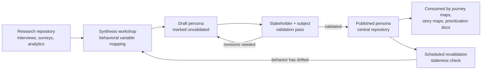

# Chapter: Personas

Part: [02 — Design Thinking and Product Management](PART_OVERVIEW.md) · Status: Drafted

## 1. Introduction

A persona is a fictional, specific, and concrete archetype of a group of real
users, synthesized from research and used as a stand-in for that group
throughout a design and engineering effort. It is not a demographic
description, not a marketing avatar, and not a wish-list of features wearing
a human name — it is a design tool whose entire purpose is to force every
person in the room to argue about the needs of one named, consistent,
evidence-backed individual instead of an imagined, infinitely flexible
"user" who conveniently agrees with whoever is currently speaking.

This chapter scopes itself deliberately narrowly within the Design Thinking
subsection of this part. Two sibling chapters cover adjacent ground and this
chapter does not re-teach either: [Empathy](CH01_Empathy.md) covers the
mindset and techniques (empathy maps, "walking in the user's shoes")
that build the qualitative understanding a persona is eventually built from;
[Research](CH02_Research.md) owns the full methodology for gathering that
understanding — interviews, contextual inquiry, surveys, diary studies,
sampling strategy, and bias mitigation. This chapter picks up **after** that
research exists (or, in the proto-persona case, after a team's best current
assumptions exist) and owns everything about turning it into a persona
artifact: what a persona is made of, how you construct one from raw research
or from assumptions, the spectrum from lightweight assumption-based personas
to rigorous data-driven ones, how personas are used and governed as a living
artifact inside an organization, and — because this is one of the most
misused artifacts in the entire design toolkit — the specific ways personas
go wrong in practice.

One naming note the reader should be aware of before proceeding: this part's
Product Management subsection (later in this same part, roughly chapters
14-31) also lists a chapter titled "Personas." That is a **separate,
later chapter** (expected to land at a path such as
`CH18_Personas_Product_Management.md` once drafted) focused on how a product
manager *uses* an already-constructed persona to make prioritization and
roadmap trade-offs. This chapter — the Design Thinking one — is the one that
owns the artifact's definition and construction technique. The Product
Management chapter, when drafted, should recap this chapter's definition in
two or three sentences and link back here rather than re-deriving what a
persona is; see the note under Further Reading and this chapter's staging
file for the explicit ownership claim.

## 2. Historical Evolution

- **Pre-1980s — no named technique**: interaction designers and engineers
  built for an implicit, unstated idea of "the user," which in practice meant
  each stakeholder substituted their own mental image — usually themselves,
  or an idealized version of themselves.
- **Mid-1990s — Alan Cooper's consulting practice**: while designing
  project-scheduling software, Cooper found stakeholders in the same room
  arguing past each other because each one silently pictured a different
  "user." He resolved the deadlock by inventing a single, specific, named
  person with a job, a history, specific frustrations, and a goal, and
  insisting the team design for that person and no one else. He later named
  this failure mode the **elastic user** — a hypothetical user stakeholders
  mentally stretch to justify whatever feature they already wanted to build.
- **1998-1999 — formalization in print**: Cooper published *The Inmates Are
  Running the Asylum* (1998), introducing personas to a mainstream software
  audience, followed by *About Face: The Essentials of Interaction Design*
  (1st edition, 1995; persona chapter expanded substantially in the 1999 and
  2003 editions), which formalized goal-directed design and a taxonomy of
  persona types (primary, secondary, supplemental, and negative personas —
  covered in Section 4).
- **2000s — adoption across the industry**: as usability and user experience
  (UX) practice matured inside large software companies, personas became a
  standard deliverable of user research teams, often produced as heavyweight,
  slowly updated documents maintained by a central UX team.
- **2008-2012 — the "lean" reaction**: as Lean and Agile methods took hold,
  practitioners (notably at organizations practicing Lean UX) pushed back on
  slow, research-heavy persona projects that blocked shipping. This produced
  the **proto-persona**: a lightweight, assumption-based persona a
  cross-functional team sketches in a single workshop from existing
  knowledge, explicitly marked as unvalidated, and updated as real research
  comes in.
- **2010s-present — data-driven personas**: as product analytics,
  event-instrumentation pipelines, and large-scale survey tooling matured,
  some organizations began deriving persona clusters statistically from
  behavioral telemetry (clickstream, feature usage, retention cohorts) rather
  than, or in addition to, one-on-one interviews — trading interpretive depth
  for statistical defensibility and scale. This is discussed as the
  "persona spectrum" in Section 4.

## 3. Why It Exists

Without a persona, a team of five people discussing "the user" is very
frequently discussing five different imagined users, and every design
argument becomes unfalsifiable — no one can be proven wrong about what "the
user" wants, because "the user" is whoever the speaker needs them to be at
that moment. This is the elastic user problem described above, and it is not
a hypothetical failure mode: it is the default state of any group design
conversation that has not deliberately pinned down who it is designing for.

A persona exists to make that conversation falsifiable. Once a team agrees
"we are designing for Priya, a mid-market operations manager who checks this
dashboard for thirty seconds between meetings and never has time to
configure anything," a proposed feature that requires ten minutes of upfront
configuration is now demonstrably wrong for Priya — not debatable, wrong,
because it contradicts a specific, agreed-upon fact about a specific, agreed
upon person. The persona's value is exactly this constraint: it takes a
design decision that would otherwise be adjudicated by whoever is most senior
or most persuasive in the room, and makes it adjudicable by reference to
evidence about a real (if composite) person instead.

A second reason personas exist is coordination at scale. A single designer
can carry a rich, tacit mental model of "who this is for" without writing
anything down. The moment a product involves a designer, three engineers, a
product manager, a technical writer, a support team, and a sales team, that
tacit model has to become an explicit, shared artifact or it silently
diverges between all of those people — this is the same coordination problem
[Architecture Decision Records](../01_Architecture_Mindset/CH03_Architecture_Thinking.md)
solve for technical decisions, applied to the question of "who are we
building for."

## 4. Core Concepts

**Persona components.** A complete persona document contains, at minimum:

- **Name and (illustrative, non-real) photo or sketch** — a memorable
  handle the team will actually use in conversation ("what would Priya
  think?") instead of a generic label like "User Type 2."
- **Role/context snapshot** — job title, industry, team size, or equivalent
  context, kept only to the extent it explains *behavior*, not as a
  demographic checkbox exercise (see the misuse discussion below).
- **Goals**, split (per Cooper) into three levels: **end goals** (the
  concrete outcome the persona wants from this specific task — "get this
  invoice approved before I go home"), **experience goals** (how they want
  the interaction to feel — "not stupid," "fast," "in control"), and **life
  goals** (the larger personal or professional aspiration the product is a
  small part of — "get promoted to finance director"). Most design decisions
  hinge on end and experience goals; life goals mostly explain motivation and
  tone.
- **Behaviors and patterns** — what the person actually does today, observed
  or reported, not what they say they'd like to do.
- **Pain points / frustrations** — specific, sourced obstacles, not generic
  complaints ("too many clicks" is generic; "abandons the approval flow
  whenever it interrupts a call because there's no way to resume" is
  specific and actionable).
- **A representative quote** — a short, verbatim-flavored line that captures
  the persona's attitude in their own words, usually adapted from an actual
  research quote.
- **A narrative scenario / "day in the life"** — a short paragraph situating
  the persona's use of the product inside their actual working day, so the
  team can reason about interruptions, context-switching, and device.
- **Technology and context of use** — device, environment, connectivity, and
  skill level, when any of these materially change the design (e.g. a
  warehouse floor persona using a ruggedized handheld one-handed while
  walking is a materially different design problem from an office persona at
  a desktop).

**Persona types (Cooper's taxonomy).** Not every persona is treated equally
by a design:

- **Primary persona** — the single persona a given interface is designed
  for above all others; if goals conflict, the primary persona's goals win.
  A well-scoped interface usually has exactly one.
- **Secondary persona** — mostly satisfied by the primary persona's design,
  but with a small number of additional needs the interface must also
  accommodate without compromising the primary persona's experience.
- **Supplemental persona** — fully covered by the primary/secondary
  personas' designs with no additional needs of their own; kept mainly to
  demonstrate the design doesn't accidentally break for them.
- **Negative persona (anti-persona)** — an explicit statement of who the
  product is *not* for, used to keep a team from scope-creeping toward
  requests that come from outside the intended audience. This is
  particularly effective as a shield against a persistent, vocal user
  segment that a team should deliberately decline to optimize for.
- **Served persona** — someone affected by the design without directly using
  it (e.g. the customer whose invoice a back-office clerk persona processes)
  — relevant when a decision's impact and its usage are performed by
  different people.

**The persona spectrum: assumption-based to data-driven.** Personas are not
one technique but a spectrum, trading construction speed for evidentiary
rigor:

- **Proto-persona (assumption-based)**: built in a single workshop by a
  cross-functional team from existing knowledge, prior research, support
  tickets, and sales conversations — explicitly labeled as an unvalidated
  hypothesis pending real research (see Section 16 for the
  validation discipline this requires).
- **Qualitative persona**: built primarily from a moderate number (commonly
  cited as roughly 6-12 per behavioral pattern) of one-on-one interviews or
  contextual inquiries — see [Research](CH02_Research.md) for the interview
  methodology itself, which this chapter does not re-teach.
- **Qualitative persona with quantitative backup**: the same interview-based
  construction, cross-checked against survey or analytics data to confirm
  the interview sample's patterns generalize to the broader user base.
- **Statistical / data-driven persona**: derived primarily from clustering
  quantitative behavioral data (product telemetry, survey responses at
  scale) using a method such as k-means or hierarchical clustering over a
  defined set of behavioral variables, with qualitative interviews used
  afterward to give the resulting clusters a human narrative. This is the
  most defensible form against "that's just one person's opinion" pushback,
  and the most expensive to produce — see Section 10 for a concrete
  clustering approach.

No point on this spectrum is universally "correct" — see Section 20 for the
trade-off between them. What is a genuine misuse, addressed directly because
it is so common, is treating a proto-persona's assumptions as if they carry
the evidentiary weight of a data-driven one, or the inverse: commissioning an
expensive data-driven persona effort and then ignoring its output in favor of
a stakeholder's pre-existing assumption anyway.

**The single most common misuse — marketing persona vs. design persona.**
A marketing (or sales) persona answers "who should we target, and with what
message?" and is built on demographic and firmographic variables — age,
income, industry, company size, budget authority. A design persona answers
"what does this specific behavior pattern need from the interface?" and is
built on **behavioral variables** — activities, attitudes, aptitudes,
motivations, and skills with respect to the product's domain, independent of
demographics. A 24-year-old and a 55-year-old can be the identical design
persona if they exhibit the same task behavior and pain points; a marketing
persona would never merge them. Handing a marketing persona to a design team
and asking them to design from it is the single most frequent and most
damaging misuse this chapter addresses, because demographic similarity is a
weak-to-nonexistent predictor of interface behavior, while it is exactly the
right predictor for a targeting or messaging decision.

## 5. Internal Working

Constructing a persona is a synthesis pipeline, not a single step. Assuming
qualitative research already exists (produced per the methodology in
[Research](CH02_Research.md)), the mechanics are:

1. **Define behavioral variables** before looking at any individual
   research subject. Cooper's recommended variable categories are
   *activities* (what they do, how often, how much), *attitudes* (how they
   feel about the domain), *aptitudes* (education, training, ability to
   learn the tool), *motivations* (why they do what they do), and *skills*
   (specific abilities relevant to the task). Defining variables first,
   before looking at subjects, is what keeps the next step from
   unconsciously clustering people by demographics instead of behavior.
2. **Map every research subject against each variable** — typically as a
   row per subject, column per variable, often visualized as each subject's
   position along a set of behavioral-variable axes (an "affinity" or
   "variable" diagram).
3. **Look for clusters** — subjects whose positions pattern together across
   multiple variables simultaneously, not just one. A cluster that only
   agrees on one variable is usually noise, not a persona candidate.
4. **Check for a significant, distinguishing behavior pattern** per
   candidate cluster — the test Cooper proposes is: does this group behave
   differently enough from the others that the same interface genuinely
   cannot serve both well? If two candidate clusters would make identical
   design decisions, they are one persona, not two — collapsing
   over-segmented clusters is as important as finding them in the first
   place.
5. **Flesh out the narrative** — attach a name, goals, quote, and
   day-in-the-life scenario to each validated cluster, using real
   (anonymized) quotes and details from the underlying research wherever
   possible rather than invented flavor text, so the persona remains
   traceable back to evidence.
6. **Rank the personas** — designate exactly one primary persona per
   distinct interface/context, with secondary, supplemental, and negative
   personas assigned per Section 4's taxonomy.
7. **Validate before publishing** — circulate the draft to stakeholders who
   have direct customer contact (support, sales, customer success) to sanity
   check it against their own experience, and, where possible, check it
   against a slice of research subjects who were not part of the original
   sample. See Section 16 for ongoing validation after publication.

For a **data-driven persona**, steps 2-4 are performed computationally: the
behavioral variables become numeric or categorical features per user (drawn
from product analytics or a large survey), a clustering algorithm groups
users, and a cluster-quality metric (e.g. silhouette score) is used to check
that the clusters are well-separated before a human analyst names and
narrates them in step 5. See the clustering approach referenced in
Section 10.

See the persona-construction pipeline diagram:
[diagrams/design-thinking/persona-construction-pipeline.md](../diagrams/design-thinking/persona-construction-pipeline.md).

## 6. Design Principles

- **Design for behavior, not demographics.** Every variable used to build a
  persona should predict a design decision; if a variable (age, gender,
  income) doesn't change what the interface needs to do, it doesn't belong
  in a design persona, even if it's useful to a marketing persona built from
  the same population.
- **One primary persona per interface.** Trying to design a single screen
  equally well for two personas with conflicting goals produces a worse
  experience for both than optimizing for one and consciously accommodating
  the other as secondary.
- **Goal-directed, not task-directed.** Design toward the persona's end and
  experience goals, which are stable over time, rather than the specific
  tasks or feature requests they currently ask for, which change constantly
  and are frequently proxies for a goal the persona hasn't articulated.
- **Evidence traceability.** Every claim in a persona document should be
  traceable to a source — an interview quote, a support ticket pattern, an
  analytics segment — so that a skeptical stakeholder can be shown the
  underlying evidence rather than asked to simply trust the artifact.
- **Treat a persona as a falsifiable hypothesis, not a finished fact.** A
  persona is a current best model of a user group, subject to revision as
  new evidence arrives — this framing is what prevents the "hardening of
  assumptions" failure discussed in Section 15.

## 7. Architecture Patterns

Personas function as an organizational coordination artifact, and like any
shared artifact they need a deliberate pattern for how they're stored,
referenced, and kept from diverging across teams:

- **Persona library / central repository**: personas are published to a
  single, discoverable location (a research repository tool, a design
  system's documentation site, or a shared workspace) rather than living in
  a single designer's slide deck — this is the same anti-sprawl motivation
  behind a component library in a design system.
- **Persona-linked downstream artifacts**: personas are referenced by name
  from journey maps, story maps, and prioritization documents rather than
  re-described inline each time — this chapter does not teach journey
  mapping or prioritization technique itself (both are sibling/future
  chapters — journey mapping has the same duplicate-title situation as this
  chapter, split between a Design Thinking and a Product Management
  version), only that personas are the upstream artifact those techniques
  consume.
- **Federated ownership with a central review gate**: in larger
  organizations, individual product teams often draft their own
  proto-personas for speed, but a central research or design-operations
  function periodically reconciles them against the validated persona
  library to prevent two teams from independently inventing two different,
  conflicting personas for what is actually the same user group.
- **Persona-as-code for data-driven variants**: where personas are derived
  from clustering pipelines (Section 5), the cluster-assignment logic itself
  is versioned and re-run on a schedule, so that persona membership can be
  recomputed as user behavior shifts, rather than being a one-time, static
  export.

## 8. Production Architecture

The following is the typical lifecycle pipeline for a persona artifact
moving from raw research to an actively used, governed asset:

Each published persona carries metadata beyond its narrative content: a
version number, the date and sample size behind its last validation, its
designated primary/secondary/supplemental/negative status per interface, and
an explicit owner (usually a research or design-operations function)
accountable for triggering revalidation. Without this metadata, a persona
degrades silently from a living hypothesis into an unquestioned artifact —
see Section 15's "zombie persona" failure mode.

## 9. Implementation

Building a single persona end-to-end, combining Sections 4-8 into a
practical sequence a team can run:

1. Decide which spectrum point (Section 4) is appropriate for the decision
   at stake and the time/budget available — a proto-persona for an
   internal tool redesign due in two weeks, versus a data-driven persona
   effort for a strategic redesign of a product with millions of users and
   rich telemetry, are both legitimate choices for their respective
   contexts.
2. Assemble the cross-functional synthesis group (design, product,
   engineering, and at least one person with direct customer contact).
3. Define behavioral variables specific to the product's domain before
   looking at any individual subject's data (Section 5, step 1).
4. Pull in the qualitative and/or quantitative inputs from
   [Research](CH02_Research.md) and map subjects against the variables.
5. Identify and stress-test clusters, collapsing over-segmented ones.
6. Draft the persona document using the component checklist in Section 4,
   sourcing every claim.
7. Rank personas per interface/context (primary/secondary/supplemental/
   negative).
8. Run the validation pass described in Section 16 before publishing.
9. Publish to the central repository with full metadata (Section 8) and set
   a revalidation date.

## 10. Complete Code Examples

- JSON persona template (the component checklist from Section 4 as a
  structured, reusable schema): [code/json/personas-chapter/persona-template.json](../code/json/personas-chapter/persona-template.json)
- Python: behavioral-variable clustering for a data-driven persona pass,
  including a silhouette-score cluster-quality check (Section 5's
  computational path): [code/python/personas-chapter/persona_clustering.py](../code/python/personas-chapter/persona_clustering.py)

## 11. Performance

"Performance" for a persona is measured in decision throughput, not latency:
a well-constructed, well-socialized persona should measurably shorten design
debates by giving the team a shared tie-breaker, rather than requiring every
disagreement to be escalated or re-litigated from first principles each
time. Teams that report personas "not helping" have almost always skipped
the validation and socialization steps (Sections 9 and 16) — an unvalidated
or unfamiliar persona provides no decision-speed benefit, because no one
trusts it enough to invoke it during an actual disagreement.

## 12. Scalability

As a product organization grows past a handful of teams, persona scalability
becomes an organizational problem, not a documentation problem:

- **Persona sprawl**: independent teams each build their own proto-personas
  without a shared repository, producing a dozen slightly different personas
  describing what is, on inspection, the same underlying user group — the
  federated-with-central-review pattern in Section 7 exists specifically to
  bound this.
- **Persona debt**: by direct analogy to technical debt, personas that are
  known to be stale (product or user behavior has since changed) but are
  left uncorrected because revalidating them competes for the same research
  budget as new feature research — left unmanaged, this accrues the same way
  unaddressed technical debt does, quietly degrading decision quality.
- **Right-sizing persona count**: most mature practices converge on a small
  number of primary personas (commonly cited as 3-7) per major product
  surface — beyond that range, teams tend to stop being able to recall or
  meaningfully differentiate them in everyday conversation, defeating the
  artifact's coordination purpose.

## 13. Security

Personas are downstream of real, often sensitive human-subject research data,
and that data's handling — informed consent, storage, and anonymization
methodology — is the responsibility of the research process itself (owned by
[Research](CH02_Research.md)), but the persona artifact has its own
derived-data obligations a design or product team must not skip:

- **Strip Personally Identifiable Information (PII)** — real names,
  employer-identifying details, contact information, or verbatim quotes
  specific enough to identify a participant — before a persona is
  distributed outside the small group with direct access to raw research
  data. A persona's photo must be an illustration or a licensed stock image,
  never an actual participant's photograph, absent explicit, specific
  consent for that use.
- **Aggregate before publishing.** A persona synthesizes patterns across
  multiple subjects specifically so that no single published trait traces
  back to one identifiable individual; a "persona" built from and clearly
  recognizable as a single named customer is a consent and privacy failure,
  not a persona.
- **Respect data-residency and regulatory obligations** on the underlying
  interview recordings, survey responses, and analytics events a persona is
  derived from — General Data Protection Regulation (GDPR) and California
  Consumer Privacy Act (CCPA) obligations attach to that raw data (retention
  limits, right-to-deletion, cross-border transfer rules), not to the
  finished, anonymized persona document itself, but a persona program that
  doesn't track provenance back to compliant raw data storage cannot
  actually demonstrate compliance on request.
- **Restrict edit access, not read access**, on the published persona
  repository — personas should be broadly readable to build the shared
  mental model in Section 3, but centrally controlled for edits to avoid an
  unreviewed change quietly invalidating a decision other teams already made
  based on the prior version.

## 14. Observability

A persona program without feedback signals cannot tell a well-used, accurate
persona apart from an ignored or stale one:

- **Reference tracking**: count how often a persona is cited by name in
  design documents, product requirement documents, and prioritization
  discussions — a persona nobody references in practice is either poorly
  socialized or not actually useful, and both are worth investigating.
- **Staleness signal**: surface each persona's last-validated date
  prominently in the repository (Section 8), and flag personas past a
  defined revalidation interval (commonly annually, or after a major product
  or market change) rather than letting staleness be discovered only when a
  decision built on the persona turns out to be wrong.
- **Behavioral drift detection**: for data-driven personas, periodically
  re-run the clustering pipeline (Section 5) against current telemetry and
  diff the resulting clusters against the published persona's variables —
  a material drift is a leading indicator that the persona needs
  revalidation before it produces a bad decision, not just a lagging one
  discovered afterward. Tying this drift signal to actual product usage
  metrics is a natural extension point into the (future, not-yet-drafted)
  Product Management Metrics chapter's territory, which this chapter does
  not teach.

## 15. Failure Scenarios

- **The zombie persona**: a persona built once, published, and never
  revalidated, that continues silently driving decisions years after the
  user behavior it described has changed — the single most common
  persona-related production incident, and the direct motivation for
  Section 8's staleness metadata and Section 14's drift detection.
- **The elastic user creeping back in**: a team nominally has a persona but
  routinely substitutes their own assumptions ("well, *I* wouldn't want that
  confirmation dialog") in its place during actual decisions — the persona
  exists on paper but was never actually adopted as the tie-breaker Section 3
  describes.
- **Marketing persona misapplied to design decisions**: as described in
  Section 4, a demographic-based marketing persona handed to an engineering
  or design team as if it were behavior-predictive, producing designs
  optimized for a variable (age, income, industry) that has no real bearing
  on the interaction being designed.
- **The composite "frankenpersona"**: a single persona stitched together
  from two or more subject clusters that actually have conflicting goals,
  built by a team uncomfortable admitting the user base needs two different
  primary personas — the resulting design serves neither cluster's goals
  well, because the persona itself never resolved the conflict, it just
  hid it.
- **The executive's golden persona**: a persona whose traits suspiciously
  mirror a senior stakeholder's own preferences and usage patterns rather
  than the researched population's, effectively re-legitimizing the elastic
  user fallacy with an official-looking document attached.
- **Persona theater**: personas produced as a polished deliverable (a poster,
  a slide), presented once, and never referenced again in an actual design
  or roadmap decision — indistinguishable in outcome from never having built
  one, but more expensive.

## 16. Testing

"Testing" a persona means checking whether it still matches reality, on two
timescales:

- **Pre-publication validation**: circulate the draft persona to people with
  direct, current customer contact (sales, support, customer success) and
  ask them to identify any claim that contradicts their own experience;
  where feasible, walk the draft past a small number of research subjects
  who were not part of the original synthesis sample to check it
  generalizes.
- **In-context validation**: during subsequent usability testing sessions
  (methodology owned by a future, not-yet-drafted Usability Testing chapter
  in this part — recap only), check whether real participants' observed
  goals and pain points still match the persona's stated ones; a persistent
  mismatch is evidence the persona needs revision, not evidence the
  participant is atypical.
- **Statistical validation (data-driven personas only)**: check
  cluster separation quality with a metric such as silhouette score before
  naming and narrating a cluster as a persona — a low score means the
  "clusters" are not actually behaviorally distinct and should be merged or
  the variable set reconsidered, per the collapsing step in Section 5.
- **Ongoing revalidation cadence**: schedule a recurring check (Section 8's
  staleness metadata) rather than relying on someone happening to notice
  the persona no longer fits — this is the difference between a tested,
  living artifact and a zombie persona (Section 15).

## 17. Common Mistakes

- Building a persona from demographics because that data was easiest to
  obtain, instead of from behavioral variables that actually predict design
  decisions.
- Skipping validation and publishing a proto-persona's assumptions as if
  they were already evidence-backed — "hardening of the assumptions."
- Creating too many personas because no one wanted to tell a stakeholder
  their favorite user segment didn't make the cut, defeating the
  prioritization value described in Section 3.
- Writing a persona document once and never revisiting its staleness date.
- Treating a persona as a static demographic snapshot rather than updating
  its goals and behaviors as the product and market evolve.
- Confusing a persona with a user segment or an Ideal Customer Profile
  (ICP) — see the comparison in Section 21 — and expecting a design artifact
  to do a targeting artifact's job or vice versa.

## 18. Best Practices

- Define behavioral variables before looking at any individual research
  subject, to avoid unconsciously clustering by demographics.
- Designate exactly one primary persona per interface, and make the ranking
  explicit and visible, not implied.
- Source every claim in the persona back to specific evidence, and keep that
  provenance link intact in the repository, not just in the original
  research team's memory.
- Pick the point on the assumption-based-to-data-driven spectrum
  (Section 4) that matches the decision's stakes and the available budget —
  don't default to the cheapest option for a high-stakes decision, and don't
  over-invest in statistical rigor for a low-stakes internal tool.
- Schedule revalidation the same day a persona is published, not after
  someone first notices it's stale.

## 19. Anti-Patterns

- **Persona theater** — a polished one-time deliverable never referenced in
  an actual decision (Section 15).
- **The zombie persona** — published once, never revalidated, still
  quietly driving decisions (Section 15).
- **The frankenpersona** — one persona covering two conflicting behavior
  clusters because no one wanted to admit the user base needs two
  (Section 15).
- **Marketing-persona-as-design-persona** — the single most damaging and
  common misuse in this chapter's scope (Section 4).
- **The executive's golden persona** — a persona shaped to match a senior
  stakeholder's own preferences rather than researched behavior
  (Section 15).

## 20. Trade-off Analysis

| Decision | Benefit | Cost |
|---|---|---|
| Proto-persona (assumption-based workshop) | Fast, cheap, gets a team aligned within a day | Encodes stakeholder bias as if validated; risk of "hardening of the assumptions" if never revisited |
| Statistical / data-driven persona | Defensible against anecdote-based pushback; scales to large user bases; recomputable as behavior drifts | Expensive; requires clean, sufficient instrumented data; clusters still need qualitative narrative to be usable by a design team |
| Exactly one primary persona per interface | Every design conflict has a clear tie-breaker | Risks under-serving a legitimate secondary need if applied too rigidly, or too many personas if applied too loosely |
| Centralized persona ownership | Consistency; avoids duplicate/conflicting personas across teams | Slower to produce; single team can become a bottleneck at scale |
| Federated persona ownership per squad | Faster for each individual team | Persona sprawl; risk of two teams independently describing the same user group differently (Section 12) |

## 21. Comparison Table

| Artifact | Primary question answered | Basis | Owning discipline | Typical use |
|---|---|---|---|---|
| Persona (this chapter) | Who am I designing for, and what do they need from this interface? | Behavioral variables from qualitative and/or quantitative research | User Experience (UX) design / research | Design decisions, feature scope, conflict resolution |
| User segment | Which cohort of customers behaves or spends similarly? | Quantitative usage/spend data | Marketing / data analytics | Targeting, campaign design, pricing tiers |
| Ideal Customer Profile (ICP) | Which company or account should we sell to? | Firmographic and fit criteria (B2B) | Sales / marketing | Lead scoring, account targeting |
| Jobs-to-be-Done (JTBD) statement | What job is the customer "hiring" the product to do? | Causal narrative around a triggering event | Product strategy | Framing the problem space, prioritization input |
| Brand archetype | What recurring narrative role does this audience play? | Qualitative, often broader than one product | Brand / marketing | Cross-product storytelling and positioning |

The last four rows are named here only for disambiguation against the
persona this chapter owns; none of them are taught in depth in this chapter
— each belongs to a different, mostly not-yet-drafted chapter in this part
(Market Analysis, Competitive Analysis, and Product Strategy for the first
three; a future chapter for brand archetypes if one exists), and this
chapter's staging file flags them for the merge step's overlap check rather
than assuming ownership.

## 22. Real-World Case Study

Cooper's own account in *The Inmates Are Running the Asylum* remains the
clearest illustration of why the technique exists: while consulting on a
project-scheduling application, he found the client's stakeholders
repeatedly deadlocked over feature decisions, each one implicitly designing
for a different imagined user. He resolved the deadlock not with more
requirements documents but by inventing a single, specific, named persona
with a concrete job, a specific frustration, and a stated goal, and asking
the room to evaluate every proposed feature against that one person instead
of their own assumptions. Disagreements that had been unresolvable when
"the user" was elastic became resolvable — sometimes in minutes — once "the
user" was a fixed, agreed-upon reference point.

A more modern, composite illustration: a business-to-business (B2B)
software-as-a-service (SaaS) company noticed its roadmap prioritization
meetings kept splitting along the same fault line — one faction wanted
deep, configurable power-user features, the other wanted a simpler guided
experience. A data-driven persona pass, clustering product telemetry
(feature usage frequency, session length, configuration-screen dwell time)
alongside a smaller set of follow-up interviews, confirmed the split was
real: two behaviorally distinct clusters existed in the same user base
rather than one that needed compromise. Rather than building one
frankenpersona to average the two, the team designated one cluster the
primary persona for the core product and treated the other as a secondary
persona served by an advanced/configuration mode gated behind a single
entry point — resolving with data a debate the team had spent two quarters
failing to resolve by opinion.

## 23. Interview Questions

1. What's the difference between a marketing persona and a UX design
   persona, and why does confusing the two produce bad design decisions?
2. Explain the "elastic user" problem in your own words and describe how a
   persona specifically fixes it.
3. Walk through the difference between a proto-persona and a data-driven
   persona — when would you choose one over the other?
4. What are Cooper's three levels of persona goals (end, experience, life),
   and which one should drive most day-to-day design decisions?
5. Describe a "zombie persona" and the specific artifact metadata that
   would have prevented it.

## 24. Hands-on Exercises

Using the JSON persona template referenced in Section 10, take a small set
of (anonymized, fictional) interview transcripts, define three to five
behavioral variables relevant to the domain, manually map each transcript's
subject against those variables, and identify whether the subjects cluster
into one persona or more than one. Write up the resulting persona using the
Section 4 component checklist, and cite the specific transcript evidence for
each claim.

## 25. Design Exercises

Design the persona program for a mid-sized B2B SaaS company that currently
has no personas, a product analytics pipeline with roughly a year of
event data, and a small user-research function that can run about six
interviews a month. Decide: which point on the assumption-based-to-data-driven
spectrum to start at, how many primary personas to target initially, what
the revalidation cadence should be, and who owns the central repository.
Evaluation criteria: the plan's realism given the stated research capacity,
an explicit staleness/revalidation mechanism, and a clear governance answer
to who has edit rights on the published personas.

## 26. Architecture Review Questions

- Is every persona currently in active use traceable to specific, sourced
  research evidence, not just an assumption workshop that was never
  revalidated?
- Does exactly one primary persona exist per interface, with an explicit,
  visible ranking against any secondary/supplemental personas?
- Does every published persona carry a last-validated date and an assigned
  owner accountable for revalidation?
- Is there a mechanism (reference tracking, drift detection) to tell whether
  a persona is actually being used in decisions, versus produced once and
  never referenced again ("persona theater")?
- Has anyone checked that a marketing/segmentation artifact isn't being
  handed to the design team as if it were a behavior-predictive design
  persona?

## 27. Summary

A persona is a fictional but evidence-backed, specific, and consistent stand-in
for a real user group, whose entire purpose is to convert unfalsifiable
arguments about an imagined "elastic user" into falsifiable arguments about a
named, agreed-upon person's goals and behaviors. Building one well means
defining behavioral variables before looking at subjects, clustering on
behavior rather than demographics, choosing a deliberate point on the
assumption-based-to-data-driven spectrum for the decision's stakes, and — the
step most practices skip — governing the artifact afterward with staleness
metadata, revalidation cadence, and usage tracking, so it stays a living
hypothesis rather than degrading into an unquestioned, stale fact. The
underlying research methodology that feeds a persona belongs to
[Research](CH02_Research.md); the empathetic mindset and techniques that
inform it belong to [Empathy](CH01_Empathy.md); this chapter owns everything
from "what a persona is made of" through "how it's governed once published,"
and — per the note in Section 1 — the Product Management part's future
"Personas" chapter should recap this definition rather than re-deriving it.

**Further reading**: [Empathy](CH01_Empathy.md) ·
[Research](CH02_Research.md) · [Journey Mapping](PART_OVERVIEW.md) ·
[Architecture Thinking § Trade-off analysis](../01_Architecture_Mindset/CH03_Architecture_Thinking.md) ·
Product Management subsection's future "Personas" chapter (not yet drafted;
should recap this chapter's definition rather than re-deriving it, per the
scope note above and in this chapter's staging file).
