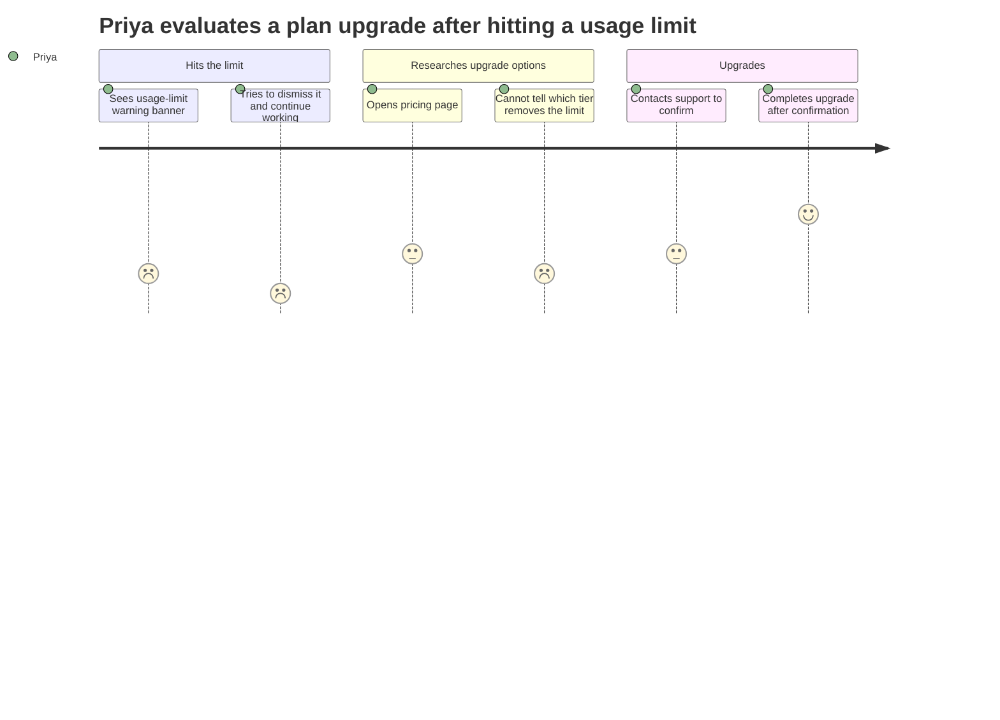
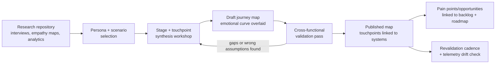

# Chapter: Journey Mapping

Part: [02 — Design Thinking and Product Management](PART_OVERVIEW.md) · Subsection: Design Thinking · Status: Drafted

## 1. Introduction

A journey map is a synthesized, visual artifact that sequences a specific
person's experience of accomplishing a specific goal, across a specific
end-to-end process, over time — plotting what they do, think, and feel at
each stage against the touchpoints and channels they pass through, so that a
team can see the whole arc of an experience at once instead of only the
narrow slice their own team, system, or department happens to own. Where an
empathy map freezes a single moment and asks "what is this person's inner
experience right now," and a persona answers "who, in general, am I designing
for," a journey map answers a third, different question: "walking in this
person's shoes from the very first moment they realize they have a need
through to the moment that need is resolved (or abandoned), where exactly
does the experience break down, and where does it actually work?" That
sequencing — the deliberate act of plotting experience *across time and
across organizational boundaries* — is this chapter's entire subject, and it
is the missing ingredient that turns isolated pieces of empathy and research
into a decision-usable map of where to intervene.

This chapter sits third in the Design Thinking subsection's research-and-
synthesis cluster and is explicit about what it does **not** re-teach.
[Empathy](CH01_Empathy.md) owns the empathy map and the mindset of building
genuine, evidence-grounded understanding of a person's inner state — a
journey map's "thoughts and feelings" row is *built from* empathy maps and
similar synthesis, not derived independently. [Research](CH02_Research.md)
owns the methodology for gathering the underlying evidence — interviews,
contextual inquiry, surveys, analytics, and the synthesis techniques (affinity
diagramming, thematic coding) used to turn raw data into defensible findings;
this chapter assumes that evidence already exists, or is being gathered in
parallel, and does not re-teach how to run a study. [Personas](CH03_Personas.md)
owns the actor a journey map is built for — a journey map is always a
specific persona's journey through a specific scenario, never a genderless,
goalless "user's" generic path, and this chapter does not re-teach persona
construction. This part's forthcoming User Interviews chapter (a sibling
being drafted in the same batch as this chapter) is expected to own the
mechanics of running a single interview in depth; where this chapter
references interview technique, it defers to that chapter rather than
assuming or restating its content. Likewise, this part's forthcoming Problem
Framing chapter is expected to own how a team turns synthesized findings —
including a journey map's pain points — into a bounded, actionable design
problem statement; this chapter stops at *identifying* pain points and
opportunities and does not teach how to reframe them into a How-Might-We
statement.

One naming and scope note the reader must have before proceeding, because it
recurs throughout this chapter: this part's Product Management subsection
(later in this same part, roughly chapters 14-31) **also** lists a chapter
titled "Journey Mapping." That is a separate, later chapter (expected at a
path such as `CH?_Journey_Mapping_Product_Management.md` once drafted),
focused on a different question: mapping the customer's *commercial*
relationship with the product — acquisition funnel, activation, retention,
expansion, and churn — for product-strategy and growth purposes. **This**
chapter — the Design Thinking one — owns the underlying journey-mapping
*artifact and technique itself*: stages, touchpoints, actions, the emotional
curve, pain points, and opportunities, as a research-synthesis tool used to
understand and redesign a specific experience. The Product Management
chapter, when drafted, should recap this chapter's technique in two or three
sentences and link back here rather than re-deriving swimlane construction,
emotional-curve scoring, or validation discipline from scratch — the same
deferral relationship [Personas](CH03_Personas.md#1-introduction) already
established with its own Product Management namesake. See this chapter's
Further Reading (Section 27) and staging file for the explicit ownership
claim, and Section 21's comparison table for how the two chapters' scopes
differ concretely.

For this handbook's Solution Architect audience specifically: a journey map
is one of the few design-thinking artifacts that maps almost directly onto
system architecture. Each touchpoint in a journey is, in nearly every
digital product, backed by a specific system, service, or Application
Programming Interface (API) boundary — a checkout touchpoint is a payment
service; a "track my order" touchpoint is a fulfillment API; a support-chat
touchpoint is a ticketing system integration. A journey map that reveals an
emotional low at a specific stage is very often, on inspection, revealing a
real architectural seam: a handoff between two systems owned by two
different teams, an unmonitored latency spike, or a synchronous call chain
with no graceful degradation path. This chapter treats that connection
explicitly, because an architect who can read a journey map as a map of
*system boundaries as experienced by a human*, not just a UX artifact, gains
a rare and valuable diagnostic tool — one this chapter returns to concretely
in Sections 7, 14, and 15.

## 2. Historical Evolution

Journey mapping's lineage runs through service design and customer-experience
practice as much as through software UX, and understanding that lineage
explains why the artifact insists on crossing organizational boundaries
rather than staying inside a single team's scope.

- **1984 — G. Lynn Shostack's service blueprint.** Shostack, a banking
  marketing executive, published "Designing Services That Deliver" in the
  *Harvard Business Review*, introducing the **service blueprint**: a
  diagram that plots a customer's actions against the "line of visibility"
  separating what the customer sees (frontstage) from the internal processes,
  systems, and people that make the visible experience possible (backstage).
  This is the direct ancestor of the frontstage/backstage distinction this
  chapter revisits in Section 4.4, and the first formal notation to insist
  that a customer-facing experience map is incomplete without also showing
  the internal machinery producing it.
- **1990s — service design emerges as a named discipline.** Design
  consultancies and academic programs (notably the Köln International School
  of Design's service design program, founded 1995) extended Shostack's
  blueprinting into a broader practice of designing services — not just
  products — holistically, treating the sequence of a customer's interactions
  with an organization as a designable object in its own right rather than an
  incidental byproduct of separately designed touchpoints.
- **Early-mid 2000s — "touchpoint" enters common design vocabulary.**
  As digital channels multiplied (web, call center, physical branch, email,
  and later mobile), practitioners needed a term for each discrete point of
  contact between a person and an organization; "touchpoint" became the
  standard unit journey maps are built from, and touchpoint inventories
  became a common precursor artifact to a full journey map.
- **2005 — the UK Design Council's Double Diamond.** The Double Diamond
  model (Discover, Define, Develop, Deliver) — a related but distinct
  framework from the Stanford d.school's five-stage model this part uses as
  its organizing spine (see [Empathy § Historical Evolution](CH01_Empathy.md#2-historical-evolution)) —
  gave service-design practice its own widely taught process shape, within
  which journey mapping sits as a Discover/Define-stage synthesis tool.
- **2008-2010 — customer experience (CX) management formalizes as a
  corporate discipline.** Forrester Research and other analyst firms began
  publishing customer-journey-mapping methodology aimed at enterprise CX
  teams, reframing journey mapping from a design-studio technique into a
  boardroom-legible tool for diagnosing and prioritizing cross-channel
  customer experience investment.
- **2013 — Adaptive Path's "Guide to Experience Mapping."** The UX
  consultancy Adaptive Path published a widely circulated methodology guide
  and an illustrative journey map (built around a fictionalized rail-travel
  booking experience) that popularized the now-standard visual format this
  chapter teaches: a horizontal swimlane grid with stages as columns and
  actions/thoughts/emotions/touchpoints as rows, with an emotional curve
  plotted across the top. Most journey map templates in use in industry
  today are direct visual descendants of that 2013 format (Section 22).
- **2015-2018 — the Nielsen Norman Group codifies journey mapping for a UX
  audience.** NN/g published a series of practitioner-facing guides
  distinguishing journey maps from the closely related "experience map" (a
  more general map not tied to one persona or one product) and from service
  blueprints, and popularizing the "moments of truth" framing (borrowed from
  Jan Carlzon's 1987 book *Moments of Truth*, about Scandinavian Airlines'
  turnaround) for the specific touchpoints where an experience is won or lost.
- **2010s — omnichannel retail and banking adoption.** As commerce and
  banking experiences fragmented across web, mobile app, physical location,
  call center, and social channels, journey mapping became a standard
  technique for diagnosing where a customer's experience broke down *across*
  channels — a failure mode invisible to any single channel-owning team's own
  metrics, and the direct motivator for this chapter's emphasis on
  cross-team, cross-system visibility (Section 3).
- **2020s — digital-first, data-augmented journey mapping.** Modern journey
  mapping practice increasingly overlays workshop-derived qualitative maps
  with quantitative telemetry — funnel drop-off rates, support ticket volume
  per touchpoint, session-replay data — turning what was once a purely
  workshop-and-sticky-notes artifact into one partly derived from, and
  continuously checked against, real behavioral data (Section 14).

## 3. Why It Exists

Software organizations are organized around systems, teams, and backlogs;
customers and users experience the organization as a single, continuous
relationship with no awareness of — or interest in — where one team's
ownership ends and another's begins. This mismatch is the entire reason
journey mapping exists as a distinct technique rather than being redundant
with empathy maps and personas.

- **The silo blindness problem.** Every team can usually describe, in
  detail, the quality of the experience inside its own boundary — the
  checkout team can tell you checkout's conversion rate; the support team can
  tell you support's average resolution time. What almost no one owns, by
  construction, is the *seam* between checkout and support: the customer who
  hits a payment failure, gets an ambiguous error, and has to explain their
  entire situation from scratch to a support agent who has no visibility
  into what checkout was doing. A journey map exists specifically to make
  seams — not just individual stages — visible and ownable, because seams
  are where responsibility is most likely to be nobody's job.
- **Moments of truth and the peak-end rule.** Behavioral research on how
  people remember experiences (notably Daniel Kahneman's peak-end rule) shows
  that overall satisfaction is disproportionately driven by the most intense
  moment of an experience and its ending, not by the average of every step.
  A team optimizing every individual touchpoint's average satisfaction score
  in isolation can still produce a terrible *overall* journey if the single
  worst moment or the ending is bad — journey mapping exists to make that
  worst moment and that ending visible as first-class objects to manage,
  rather than invisible because they are diluted inside per-touchpoint
  averages nobody looks at together.
- **Aggregation hides the actual failure.** Funnel analytics can show that
  40% of users drop off "somewhere in onboarding," but a funnel step is a
  system event, not a lived experience; it cannot show *why*, and it
  frequently spans several touchpoints and even several systems collapsed
  into one reporting bucket. Journey mapping exists to convert an
  aggregate, anonymous drop-off number into a specific, walkable sequence of
  actions, thoughts, and feelings, so a team can identify which exact moment
  in that sequence is actually responsible — the difference between "we know
  something is wrong somewhere in onboarding" and "we know the identity
  verification step causes hesitation because the reason data is being
  requested is never explained."
- **Architecture relevance: journeys expose system-boundary failures a
  single service's dashboard cannot.** A payment service, a fulfillment
  service, and a notification service can each independently report healthy
  service-level objectives (SLOs) while the *sequence* of calling all three
  produces a bad experience — for example, a fulfillment update reaching the
  notification service twenty minutes after the customer already gave up and
  contacted support. No single system's dashboard reveals this, because the
  failure exists only in the relationship between systems as experienced
  over time — exactly what a journey map, and only a journey map among this
  part's artifacts, is built to surface. This is the same class of blind
  spot that motivates distributed tracing in
  [Observability](../12_Observability/PART_OVERVIEW.md) and end-to-end
  scenario thinking in
  [System Design and Distributed Systems](../07_System_Design_and_Distributed_Systems/PART_OVERVIEW.md);
  a journey map is, in effect, a human-experience trace across the same kind
  of system boundary a distributed trace follows mechanically.
- **Without a journey map, prioritization defaults to whoever's loudest.**
  In the absence of a shared, evidence-backed view of the whole experience,
  investment decisions default to whichever team has the most political
  capital, the most recent escalation, or the most persuasive anecdote —
  not to the stage that is actually causing the most abandonment or the
  worst emotional low. A validated journey map gives a cross-functional
  group a shared, falsifiable reference to prioritize against, the same
  role a persona plays for "who are we building for" (see
  [Personas § Why It Exists](CH03_Personas.md#3-why-it-exists)), applied to
  "where in the experience should we invest next."

## 4. Core Concepts

### 4.1 Anatomy of a journey map

A complete journey map is built from a small, consistent set of components,
typically laid out as a horizontal swimlane grid (stages as columns, the
following as rows):

- **Actor and scenario** — the specific [persona](CH03_Personas.md) and the
  specific goal or trigger driving this specific journey. A journey map is
  never built for a genderless, goal-less "user"; the same persona pursuing
  two different goals (e.g. a first-time purchase vs. a return) produces two
  different journey maps, because the stages, touchpoints, and emotional
  curve genuinely differ.
- **Stages (phases)** — the coarse-grained segments the journey is divided
  into (e.g. Awareness → Consideration → Onboarding → First Use → Ongoing
  Use → Renewal/Churn for a subscription product). Stages are the map's
  columns and set its altitude — see Section 4.3 for choosing the right
  level of granularity.
- **Touchpoints and channels** — the specific interfaces, systems, or
  interactions the actor uses within each stage (a marketing email, a
  pricing page, a mobile app screen, a call-center conversation) and the
  channel each occurs on (web, mobile, in-person, phone, social). Recording
  the channel explicitly is what allows a journey map to expose cross-channel
  handoff failures (Section 3) that a single-channel view would hide.
- **Actions** — what the actor actually does at each touchpoint, described
  behaviorally ("compares three pricing tiers side by side," not "considers
  purchasing").
- **Thoughts and quotes** — the actor's internal reasoning at each step,
  synthesized from empathy-mapping-style evidence (recap:
  [Empathy § Core Concepts](CH01_Empathy.md#4-core-concepts) owns the
  full technique for capturing this; this chapter consumes it, sourced and
  attributed, rather than re-deriving it).
- **Emotions (the emotional curve)** — a plotted line, usually ranging from
  strongly negative to strongly positive, showing how the actor feels at
  each stage; this is the single most recognizable visual feature of a
  journey map and the artifact's main diagnostic tool (Section 4.2).
- **Pain points** — specific, sourced moments of friction, confusion, or
  negative emotion, stated concretely enough to act on (not "checkout is
  confusing" but "the shipping cost is not shown until the final review
  step, after the customer has already entered payment details").
- **Opportunities** — specific, sourced ideas for improvement or
  intervention tied to a pain point, deliberately kept lightweight at this
  stage (a one-line hypothesis, not a designed solution) — turning an
  opportunity into a scoped, prioritized problem statement is the
  forthcoming Problem Framing chapter's job, not this chapter's.
- **Ownership metadata** — which team, system, or backstage process is
  responsible for each touchpoint; this row is what makes a journey map
  usable as a cross-functional prioritization artifact rather than a purely
  descriptive poster (Section 7).

### 4.2 The emotional curve and the peak-end rule

The emotional curve is the row (or overlay line) plotting the actor's
affective state across every stage of the journey, and it exists because
raw satisfaction averages hide the moments that actually determine how an
experience is remembered.

- **Construction methods, from lightest to heaviest evidence**: (1)
  qualitative judgment by the team synthesizing interview and empathy-map
  data (fast, cheap, requires the same evidence-traceability discipline
  Personas insists on — see
  [Personas § Design Principles](CH03_Personas.md#6-design-principles));
  (2) coded sentiment scores from verbatim quotes, using a simple
  ordinal scale (e.g. -2 to +2) applied consistently across every
  touchpoint by more than one coder to check inter-rater agreement; (3)
  quantitative survey instruments captured in the moment or immediately
  after a touchpoint, most commonly the **Customer Effort Score (CES)** — a
  single-item survey asking how much effort a specific interaction required
  — or a per-touchpoint satisfaction rating, aggregated across many
  respondents (Section 10 walks through a concrete aggregation approach).
- **The peak-end rule** (Kahneman, Fredrickson & Kahneman, 1993 and later
  work) establishes that people's retrospective evaluation of an experience
  is dominated by its most intense point (peak, positive or negative) and
  its ending, largely independent of the experience's total duration or
  average quality. This has a direct, actionable consequence for how a team
  reads its own emotional curve: the single lowest point and the final stage
  deserve disproportionate design attention relative to their share of the
  map's total width, because they are disproportionately what the actor
  will actually remember and repeat to others.
- **A flat curve is itself a finding.** A curve with no meaningful peaks or
  troughs at all usually indicates either an unremarkable, low-engagement
  experience (which may be fine for a purely transactional utility) or,
  more often, that the underlying evidence wasn't granular enough to detect
  real variation — a signal to revisit the evidence base (Section 16)
  before trusting the map.

### 4.3 Current-state vs. future-state maps, and choosing altitude

Two related but distinct decisions shape every journey map before a single
row is filled in:

- **Current-state (as-is) map**: documents the experience as it actually
  happens today, evidence-first, warts and all — including pain points the
  team would rather not admit exist. This is the map type this chapter
  spends most of its attention on, because it is the diagnostic input every
  future-state map should be built from.
- **Future-state (to-be) map**: a deliberately designed, aspirational
  version of the same journey after a proposed set of changes, used to
  communicate and evaluate a redesign before committing engineering effort
  to it. A future-state map is only as credible as the current-state map
  and evidence it was derived from — skipping straight to a future-state map
  without an evidence-backed current-state map first is one of this
  chapter's named anti-patterns (Section 19).
- **Altitude (granularity)**: journey maps can be drawn at very different
  zoom levels — a "day in the life" map spanning an entire relationship with
  a product over months or years, a "hero journey" spanning one high-level
  goal (e.g. "become a paying customer"), or a "micro-journey" spanning a
  single transaction (e.g. "reset a forgotten password"). There is no single
  correct altitude; the right choice is set by the decision the map needs to
  inform (Section 20), and mixing altitudes within a single map — some
  stages at the scale of months, others at the scale of seconds — is a
  common construction mistake (Section 17).

### 4.4 Frontstage, backstage, and the service blueprint relationship

Every journey map has an implicit or explicit **line of visibility**
(Shostack's term, Section 2): everything above it is what the actor
directly sees and experiences (frontstage); everything below it is the
internal people, systems, policies, and processes that produce that visible
experience without the actor ever seeing them directly (backstage).

- A **journey map**, as this chapter teaches it, is fundamentally a
  frontstage-perspective artifact: it is built from the actor's point of
  view, and backstage detail only appears as ownership metadata (Section
  4.1) attached to a touchpoint, not as its own set of rows.
- A **service blueprint** extends the same frontstage timeline downward
  across the line of visibility, adding rows for backstage employee actions,
  support systems, and the specific technology or process that produces each
  frontstage touchpoint. Where the two diverge is *depth of the backstage
  view*, not the frontstage timeline itself, which is why the two artifacts
  are frequently drawn as a single combined diagram in service-design
  practice — a journey map with a "backstage" swimlane doubles as a compact
  service blueprint.
- For this handbook's audience, the backstage rows are exactly where a
  journey map earns its keep as an architecture-relevant artifact: a
  backstage row naming "fulfillment service → notification service, async,
  no dead-letter alerting" against a frontstage touchpoint that shows a
  20-minute-late order-confirmation email is a direct, human-legible link
  between a UX pain point and a specific integration design decision
  (Section 7).

### 4.5 Journey map vs. adjacent artifacts (brief differentiator)

Several closely related artifacts are easy to conflate with a journey map;
Section 21 gives a full comparison table, but the essential distinctions to
hold in mind while reading the rest of this chapter are: an **empathy map**
captures one moment, not a sequence; a **persona** describes a person in
general, not their path through one specific process; an **experience map**
(as NN/g distinguishes it) generalizes across products and personas rather
than being tied to one specific actor and product; and this part's future
Product Management "Journey Mapping" chapter maps the *commercial*
relationship (acquisition, activation, retention) rather than a specific
experiential process — all four are legitimate, different artifacts, and
using the wrong one for a given question is itself a common mistake
(Section 17).

## 5. Internal Working

Building a journey map is a synthesis pipeline with a fixed sequence of
steps, assuming — per this chapter's scope — that the underlying research
already exists or is being gathered in parallel by
[Research](CH02_Research.md) or the forthcoming User Interviews chapter:

1. **Select the actor and the scenario.** Name the specific
   [persona](CH03_Personas.md) and the specific goal or triggering event
   this map covers (e.g. "Priya, evaluating whether to upgrade her plan
   after hitting a usage limit"). Skipping this step and mapping a genderless
   "the user" is the single most common way a journey map collapses into an
   unusable, overly generic artifact (Section 17).
2. **Gather and inventory the evidence.** Pull together the interview
   transcripts, support tickets, analytics events, and empathy maps relevant
   to this actor and scenario. This step does not re-run research; it
   collects what [Research](CH02_Research.md) and
   [Empathy](CH01_Empathy.md) have already produced, and flags genuine gaps
   that may require a small, targeted follow-up study before the map can be
   trusted.
3. **Define the stages.** Choose the coarse-grained phases the journey will
   be divided into, at the altitude appropriate to the decision the map
   needs to inform (Section 4.3). This is usually done collaboratively in
   the same workshop as the next steps, and revised at least once as actions
   are mapped and an initially chosen stage boundary turns out to be wrong.
4. **Map actions and touchpoints per stage.** For each stage, populate the
   actions the actor takes and the specific touchpoints and channels
   involved, sourced from the evidence inventory — not from what the team
   assumes the flow looks like. Where the evidence is silent on a step, that
   gap is marked explicitly (an assumption, not a fact) rather than quietly
   filled in with a guess, mirroring the evidence-traceability discipline
   [Personas](CH03_Personas.md#6-design-principles) applies to its own
   artifact.
5. **Overlay the emotional curve.** Using one of the methods in Section 4.2,
   score or judge the actor's emotional state at each stage and plot it as a
   continuous line across the map.
6. **Identify pain points and opportunities.** For each low point or
   friction moment surfaced by the emotional curve or the action/thought
   rows, write a specific, sourced pain-point statement and a lightweight,
   un-designed opportunity hypothesis (Section 4.1) — deliberately stopping
   short of designing a solution, which belongs to Ideation and Problem
   Framing (both forthcoming chapters in this part).
7. **Validate with a cross-functional group.** Walk the draft map past
   people who own the touchpoints it describes — not only the design team
   that drafted it — specifically to catch backstage assumptions that are
   wrong, outdated, or missing (Section 16 covers this validation discipline
   in depth, since a common failure mode is skipping this step entirely).
8. **Publish, link, and govern.** Move the validated map into a shared
   repository (the same anti-sprawl motivation as
   [Personas' persona library pattern](CH03_Personas.md#7-architecture-patterns)),
   link its pain points and opportunities to backlog items so the artifact
   drives visible action rather than sitting unused, and set an owner and
   a revalidation cadence so the map doesn't quietly go stale as the
   underlying systems and experience change (Section 15).

A compact illustration of the resulting shape, using Mermaid's built-in
journey-diagram syntax (a simplified, three-stage excerpt; the full
multi-row swimlane template with actions, thoughts, touchpoints, and
ownership metadata lives at
[diagrams/timeline/journey-map-swimlane-template.md](../diagrams/timeline/journey-map-swimlane-template.md)):

## 6. Design Principles

- **Evidence over assumption, at every row, not only the emotional curve.**
  Actions, touchpoints, and thoughts are as vulnerable to silent assumption
  as emotions are; every row should be traceable to a source or explicitly
  marked as an assumption pending validation.
- **One persona, one scenario, one map.** Mapping "our typical customer's"
  entire relationship with the product in one undifferentiated map produces
  an artifact too generic to act on; if two personas' paths genuinely
  diverge, draw two maps rather than one averaged, fictional composite.
- **Match altitude to the decision.** A map built to inform a single
  checkout redesign should not span a two-year customer lifecycle, and a map
  built to inform annual CX strategy should not zoom into individual button
  clicks — choose altitude deliberately (Section 4.3), not by habit or
  template default.
- **Cross the seams on purpose.** A map that stops at the boundary of the
  team drawing it defeats the artifact's core purpose (Section 3); actively
  include stages and touchpoints owned by other teams, especially handoffs.
- **Separate observation from interpretation from proposed action.** Keep
  actions/touchpoints (observed), thoughts/emotions (interpreted from
  evidence), and opportunities (proposed) visually and conceptually distinct,
  so a stakeholder can challenge an interpretation without the entire map
  being thrown out.
- **Validate with the people who own the seams, not only the people who
  drew the map.** A map drafted entirely by one design team and never shown
  to the backstage teams it depicts is a hypothesis, not a validated
  artifact (Section 16).
- **Treat the map as a living hypothesis, not a poster.** Like a persona
  (recap:
  [Personas § Governance lifecycle](CH03_Personas.md#8-production-architecture)),
  a journey map needs an owner, a last-validated date, and a revalidation
  trigger — otherwise it decays into the same "zombie" failure mode
  (Section 15).

## 7. Architecture Patterns

A journey map is a coordination artifact across teams and systems, and like
any shared artifact it benefits from a deliberate pattern for how it is
structured, stored, and connected to the systems it describes:

- **Swimlane layout with a fixed row taxonomy.** Standardizing on the same
  row set (stage, touchpoint/channel, action, thought/quote, emotion,
  pain point, opportunity, ownership) across every map in an organization
  makes maps comparable and composable — a team can scan a colleague's map
  from an unfamiliar product area and immediately know where to look for
  what.
- **Current-state/future-state pairing.** Storing a current-state map and
  its corresponding future-state map side by side (rather than overwriting
  the current-state map once a redesign ships) preserves the evidence trail
  that justified the change and gives a baseline to measure the redesign's
  actual impact against.
- **Journey-map-to-service-blueprint layering.** Where deeper backstage
  detail is needed than a simple ownership row supports, extend the same
  frontstage timeline downward into a full service blueprint (Section 4.4)
  rather than starting a disconnected, second artifact — keeping the
  frontstage timeline as the single shared spine both views hang off.
- **Touchpoint-to-system mapping.** Each touchpoint row is explicitly linked
  to the system, service, or API that implements it (a service catalog
  entry, a repository link, an on-call rotation) — turning the journey map
  into a live cross-reference between the experience a human has and the
  architecture producing it, and giving an architect a direct way to trace
  an emotional low back to a specific system boundary (Section 3) rather
  than only a vague "the checkout experience feels bad."
- **Repository and governance, mirroring the persona library pattern.**
  Journey maps are published to a single, discoverable location rather than
  living in one designer's file, with the same federated-drafting/
  central-review-gate model
  [Personas](CH03_Personas.md#7-architecture-patterns) uses to prevent two
  teams from independently producing two conflicting maps of what is
  actually the same journey.
- **Linkage to downstream artifacts.** Pain points and opportunities are
  referenced by name from backlog items, roadmap documents, and (once
  drafted) Problem Framing's How-Might-We statements, rather than being
  re-described inline each time — this chapter does not teach backlog or
  roadmap technique itself (both are Product Management chapters, not yet
  drafted), only that the journey map is the traceable upstream source those
  artifacts should cite.

## 8. Production Architecture

The following is the typical lifecycle pipeline for a journey map moving
from raw evidence to a governed, actively referenced artifact:

The full swimlane template referenced from Section 5 — including the
row taxonomy from Section 7, an example current-state/future-state pairing,
and a worked frontstage/backstage layering example — is maintained at
[diagrams/timeline/journey-map-swimlane-template.md](../diagrams/timeline/journey-map-swimlane-template.md).
A separate, larger version of the pipeline above, including the specific
workshop facilitation steps and role assignments, is maintained at
[diagrams/flow/journey-mapping-workflow.md](../diagrams/flow/journey-mapping-workflow.md).

## 9. Implementation

In practice, journey mapping is implemented through a combination of
workshop facilitation and a persisted digital artifact:

- **Workshop tooling.** Collaborative whiteboard tools (Miro, FigJam, Mural)
  are the de facto standard for the synthesis workshop itself (Section 5,
  steps 3-6), for the same remote-collaboration reasons
  [Empathy § Historical Evolution](CH01_Empathy.md#2-historical-evolution)
  describes for empathy-mapping workshops — sticky-note-style swimlane
  templates let a distributed cross-functional group build the map together
  in real time.
- **A structured, machine-readable schema, not only a picture.** Treating
  the published map as a flat image discards exactly the metadata that makes
  it useful as an architecture-relevant artifact — most importantly the
  touchpoint-to-system ownership links (Section 7) and the emotion scores
  (Section 4.2) that later need to be checked against real telemetry
  (Section 14). A minimal structured schema captures, per stage: the stage
  name, an ordered list of touchpoints (each with a channel, an action, a
  thought/quote, an emotion score, an owning system, and a list of sourced
  pain points and opportunities). A concrete version of this schema is
  provided in Section 10.
- **Linking touchpoints to the service catalog.** Where an organization
  maintains a service or API catalog (common in mid-to-large engineering
  organizations, and a natural companion to
  [Architecture Documentation](../18_Architecture_Documentation/PART_OVERVIEW.md),
  not yet drafted), the touchpoint-to-system field in the schema below
  should reference that catalog's canonical service identifier rather than
  a free-text team name, so the link survives team reorganizations and stays
  queryable — "which journeys touch this service" becomes a single lookup
  instead of a manual search through a folder of diagrams.
- **Emotional curve scoring pipeline.** Where the emotional curve is
  partly or wholly derived from quantitative survey data (Customer Effort
  Score, per-touchpoint satisfaction ratings) rather than pure workshop
  judgment, that data needs a small, repeatable aggregation step — turning
  many individual responses per touchpoint into the single plotted score per
  stage the map displays. Section 10 provides a concrete implementation.

## 10. Complete Code Examples

Two reference artifacts accompany this chapter (produced separately per this
project's diagram/code production step, referenced here rather than
embedded per the style guide):

- A structured journey map schema (JavaScript Object Notation, JSON), giving
  each stage a machine-readable representation of touchpoints, actions,
  emotion scores, ownership, and sourced pain points/opportunities — usable
  as an interchange format between a workshop tool export and a persisted
  repository, and as the input format the scoring script below consumes:
  [code/json/journey-mapping-chapter/journey-map-template.json](../code/json/journey-mapping-chapter/journey-map-template.json)
- A Python aggregation script that takes raw per-touchpoint Customer Effort
  Score (CES) survey responses and computes the plotted emotional-curve
  value per stage — including a basic inter-rater-style sanity check when
  qualitative sentiment coding and quantitative CES data disagree sharply
  for the same touchpoint, which is itself a signal worth surfacing during
  validation (Section 16) rather than silently averaging away:
  [code/python/journey-mapping-chapter/emotion_curve_scoring.py](../code/python/journey-mapping-chapter/emotion_curve_scoring.py)

## 11. Performance

"Performance," applied to a journey map, has two distinct meanings this
chapter separates deliberately:

- **The map's own production performance** — how long it takes to go from
  "we suspect this journey is broken somewhere" to a validated, published
  map. A workshop-only, qualitative-judgment map (Section 4.2) can be
  produced in days; a data-augmented map incorporating survey and telemetry
  aggregation (Sections 9-10) takes longer to instrument but stays accurate
  longer without a full re-run — the same speed-versus-rigor trade-off
  [Personas](CH03_Personas.md#12-scalability) makes for its own construction
  spectrum, applied here to journey evidence instead of persona evidence.
- **The mapped experience's actual system performance**, which is an
  architecturally direct contributor to the emotional curve: a touchpoint
  backed by a slow synchronous call chain, an unindexed query under load, or
  a cold-start serverless function produces a measurable dip in the
  emotional curve at exactly that stage, and that dip is traceable, via the
  touchpoint-to-system link (Section 7), back to a specific, fixable
  performance issue. This chapter does not re-teach performance engineering
  technique itself — full treatment (latency budgets, caching, profiling,
  load testing) belongs to
  [Performance Engineering](../16_Performance_Engineering/PART_OVERVIEW.md)
  — but it insists that latency and responsiveness be treated as first-class
  candidate explanations whenever a touchpoint's emotional score is
  unexpectedly low, before assuming the cause is purely a copy, layout, or
  information-architecture problem.

## 12. Scalability

Scaling journey mapping from a single team's one-off workshop artifact to
an organization-wide practice raises the same kind of governance questions
[Personas § Scalability](CH03_Personas.md#12-scalability) raises for its own
artifact, applied to journeys instead of personas:

- **Portfolio management.** A large organization accumulates many journey
  maps across many personas, scenarios, and product lines; without a
  central index (which persona, which scenario, which product, last
  validated when) the same journey gets independently re-mapped by
  different teams who don't know a map already exists — the direct journey-
  mapping analogue of persona sprawl.
  Standard "row taxonomy" templates (Section 7) make maps comparable across
  teams once indexed, but comparability doesn't by itself solve discovery —
  a searchable repository does.
- **Federated drafting, centralized reconciliation.** As with personas,
  individual product teams typically draft their own maps for speed, with a
  central design-operations or CX function periodically reconciling
  overlapping maps of the same underlying journey — most importantly at the
  seams between two teams' territories, where two independently drawn maps
  are most likely to silently disagree about what actually happens at the
  handoff.
- **Template standardization vs. local flexibility.** Standardizing the row
  taxonomy and stage-naming conventions across the organization makes maps
  comparable at scale, but over-standardizing stage boundaries across
  fundamentally different journey types (e.g. forcing a five-minute support
  interaction into the same six-stage template built for a multi-month
  enterprise sales cycle) produces the altitude-mismatch failure this
  chapter names in Section 17.
- **Enterprise CX programs.** At the largest scale, journey mapping becomes
  an ongoing CX-management program rather than a one-off design exercise —
  with a portfolio of maps, a standing cross-functional governance forum,
  and telemetry-driven revalidation triggers (Section 14) replacing purely
  manual, calendar-based re-validation.

## 13. Security

Journey maps are built substantially from the same raw research evidence
[Research](CH02_Research.md) owns the consent and data-governance discipline
for — recorded interviews, support-ticket excerpts, verbatim quotes — and
this chapter does not re-teach that discipline. Two considerations are
specific to the journey map artifact itself, however:

- **Personally identifiable information (PII) in quotes and screenshots.**
  A journey map's thought/quote row and any embedded screenshots of real
  touchpoints (a support ticket excerpt, a session-replay still) are a
  common, easily overlooked place for PII to leak into a shared design
  artifact that gets broadly circulated (including outside the research
  team, unlike raw transcripts, which are usually access-restricted);
  quotes should be scrubbed or generalized before a map is published beyond
  the immediate research and design team, following the same consent and
  anonymization discipline established during data collection.
- **Access control on the published repository.** Because a journey map's
  ownership metadata (Section 7) explicitly names internal systems, teams,
  and — when telemetry is linked (Section 14) — real conversion and drop-off
  figures, the published repository (Section 7) should follow the same
  least-privilege access model as any internal architecture or system
  documentation, rather than defaulting to organization-wide visibility on
  the assumption that "it's just a design artifact."

## 14. Observability

A published journey map's emotional curve and pain points are, at the moment
of publication, a hypothesis about how the mapped experience behaves; they
decay in accuracy every day the underlying systems, content, and user base
continue to change without the map being re-checked. This chapter borrows,
in spirit, the same discipline [Observability](../12_Observability/PART_OVERVIEW.md)
teaches for systems (full technique — metrics, tracing, alerting — is that
part's, not re-taught here) and applies it to the journey map as an artifact:

- **Linking touchpoints to real telemetry.** Where each touchpoint is
  already linked to an owning system (Section 7), that same link can be
  extended to the system's actual operational metrics — funnel conversion
  or drop-off rate at that step, support ticket volume tagged to that
  touchpoint, and (where relevant) latency or error rate — turning the
  map's qualitative emotional curve into something that can be periodically
  checked against real, quantitative drift.
- **Drift detection as a revalidation trigger.** Rather than relying solely
  on a calendar-based revalidation cadence (Section 5, step 8), a mature
  journey-mapping practice treats a meaningful divergence between the
  mapped emotional curve and the linked telemetry — a stage the map scored
  positively that has since seen a spike in support tickets, for example —
  as an automatic trigger to revisit and re-validate that stage of the map,
  the same way an anomalous metric triggers an incident review in
  [Observability](../12_Observability/PART_OVERVIEW.md).
- **Usage tracking on the map itself.** As with personas' "persona theater"
  failure mode (recap:
  [Personas § Failure Scenarios](CH03_Personas.md#15-failure-scenarios)),
  a journey map that is produced, presented once, and never referenced again
  in a backlog item, an ADR (Architecture Decision Record — recap:
  [Architecture Thinking § ADRs](../01_Architecture_Mindset/CH03_Architecture_Thinking.md#10-implementation)),
  or a roadmap document is a wasted artifact regardless of how well it was
  constructed; tracking whether a map is actually being cited is as
  important as tracking whether its content is still accurate.

## 15. Failure Scenarios

- **Aspirational current-state bias.** A team, uncomfortable admitting how
  bad the current experience actually is, quietly draws the current-state
  map slightly better than reality — softening pain points, smoothing the
  emotional curve — which then makes the future-state map's improvement
  look smaller and less urgent than it should, undermining the business case
  for fixing it.
- **Single-channel blindness.** A map built entirely from one channel's data
  (e.g. web analytics only) misses the exact cross-channel handoff failures
  (Section 3) journey mapping exists to catch — for example, missing that a
  customer who abandons the web checkout frequently calls support afterward
  and has a terrible time re-explaining their situation, because the map
  never included the call-center touchpoint at all.
- **The unmapped backstage handoff becomes a real incident.** A journey map
  that stops at the frontstage line of visibility (Section 4.4) with only a
  vague ownership label ("fulfillment team") instead of a specific system
  and integration pattern can hide a real architectural fragility — an
  unmonitored, retry-less asynchronous call between two services — until it
  causes an actual production incident (see
  [Failure Scenarios](../07_System_Design_and_Distributed_Systems/PART_OVERVIEW.md)
  for the systems-level treatment of this failure class); a properly
  backstage-linked map (Section 7) would have surfaced this as a design risk
  before it became an incident.
- **The zombie journey map.** Like a zombie persona (recap:
  [Personas § Failure Scenarios](CH03_Personas.md#15-failure-scenarios)), a
  journey map with no owner, no last-validated date, and no revalidation
  trigger keeps getting cited in decisions years after the mapped systems
  and experience have materially changed, quietly misleading every decision
  it informs.
- **Journey map theater.** A polished, well-designed map is produced for a
  single executive presentation or a single planning cycle, generates
  enthusiasm in the room, and is never opened again — the artifact
  equivalent of "we did the workshop" standing in for "we actually changed
  anything," addressed further as a named anti-pattern in Section 19.

## 16. Testing

Validating a journey map before it is trusted as a decision input requires
more than the drafting team's own confidence in their synthesis:

- **Cross-functional stakeholder walkthrough.** Walk the draft map, stage by
  stage, past representatives of every team whose touchpoint or backstage
  process it depicts — not only the design team that drafted it — asking
  each one explicitly: "is this accurate for the part you own?" This is the
  single highest-value, lowest-cost validation step and the one most often
  skipped under time pressure.
- **Customer shadowing / "gemba walk."** Where feasible, directly observe
  (or re-watch a recorded session of) a real actor going through the mapped
  journey, checking the drafted actions and touchpoints against what
  actually happens rather than what the team remembers or assumes happened.
  "Gemba" (a Japanese lean-manufacturing term for "the real place") captures
  the discipline of checking the map against the actual, current process
  rather than against the team's mental model of it.
- **Cross-checking against independent data sources.** Compare the map's
  qualitative pain points and emotional curve against independent
  quantitative signals — analytics funnel drop-off, support ticket volume
  per touchpoint, Customer Effort Score survey data (Section 10) — looking
  specifically for disagreement, which usually indicates either the
  qualitative sample was unrepresentative or the quantitative signal is
  measuring something subtly different than what the map claims.
- **A fresh-eyes read.** Have someone with no involvement in drafting the
  map read it cold and try to walk through the actor's experience using only
  the map; places where they get confused or ask "wait, why did they do
  that?" usually indicate a missing evidence link or an unstated assumption
  the drafting team stopped noticing because they'd internalized it.

## 17. Common Mistakes

- **Mapping "the user" instead of a named persona and scenario** —
  producing a map too generic for any specific decision (Section 6).
- **Mixing altitudes within one map** — some stages at the scale of months,
  others at the scale of seconds, making the emotional curve impossible to
  compare meaningfully across stages (Section 4.3).
- **Treating the map as an art project rather than a decision tool** —
  investing disproportionate effort in visual polish relative to evidence
  rigor, producing something impressive to look at and weak to act on.
- **Ignoring the backstage entirely** — describing only what the actor sees,
  with no ownership or system linkage, so a pain point can be identified but
  never traced to an owner who can actually fix it (Section 7).
- **Building the future-state map before validating the current-state map**
  — designing an improvement against an assumed baseline rather than a
  checked one, discussed further in Section 19 as the "leapfrog" anti-pattern.
- **Confusing a journey map with a funnel chart.** A funnel shows aggregate
  conversion rates between system-defined steps; a journey map shows one
  actor's lived sequence of actions, thoughts, and feelings — the two are
  complementary, not interchangeable, and treating funnel step boundaries as
  automatically correct journey-map stage boundaries misses experience that
  happens outside the instrumented funnel entirely (e.g. a phone call to
  support that never touches the web funnel).

## 18. Best Practices

- Name the specific persona and scenario before drafting a single row.
- Build the current-state map first, evidence-first, before any
  future-state map.
- Include backstage ownership and system linkage for every touchpoint, not
  just the frontstage description.
- Score the emotional curve using a consistent, documented method, and note
  which method (qualitative judgment, coded sentiment, quantitative survey)
  was used for which stage, so a reader can calibrate their confidence
  accordingly.
- Validate with a cross-functional group that includes people who own
  touchpoints outside the drafting team's own area, deliberately targeting
  the seams (Section 3).
- Publish to a shared, governed repository with an owner and a
  revalidation trigger, not a single designer's personal file.
- Link pain points and opportunities to backlog items or ADRs so the map
  visibly drives action, and periodically check whether it actually is
  being cited (Section 14).
- Re-validate whenever the underlying systems change materially, not only
  on a fixed calendar cadence.

## 19. Anti-Patterns

- **Frankenstein journey** — a single map stitched together from multiple
  personas' or multiple scenarios' evidence, averaged into a composite that
  represents no one's actual experience accurately.
- **Happy-path-only map** — a map that only depicts the flow when everything
  goes right, omitting the error paths, retries, and edge cases where real
  emotional lows concentrate; the architectural equivalent of only testing
  the success path.
- **The leapfrog** — jumping straight to a future-state map without a
  validated current-state map to justify and measure the change against.
- **Org-chart journey** — a map whose stages are secretly the internal
  handoff points between departments rather than the actor's actual
  perceived phases of experience, defeating the entire purpose of mapping
  from the actor's point of view.
- **Journey map theater** — produced once for a presentation, never
  referenced again (Section 15).
- **Zombie journey map** — no owner, no last-validated date, cited long
  after it has gone stale (Section 15).

## 20. Trade-off Analysis

| Decision | Favors | Costs |
|---|---|---|
| Qualitative-judgment emotional curve vs. quantitative (CES/survey)-derived curve | Faster, cheaper, sufficient for a directional read | Less defensible against "that's just the team's opinion" pushback; harder to detect drift over time |
| Current-state map only vs. current-state + future-state pair | Lower upfront effort | No before/after baseline to measure a redesign's actual impact against |
| Macro altitude (multi-month relationship) vs. micro altitude (single transaction) | Strategic, portfolio-level prioritization input | Too coarse to drive a specific interface redesign decision, and vice versa |
| Workshop-only construction vs. telemetry-augmented construction | Fast, low tooling investment | No automated drift detection (Section 14); relies entirely on manual revalidation discipline |
| Federated (per-team) drafting vs. centralized CX-team drafting | Faster, closer to the team that owns the touchpoints | Risk of two teams independently mapping the same journey inconsistently (Section 12) |

## 21. Comparison Table

| Artifact | Primary question answered | Basis | Owning chapter/discipline |
|---|---|---|---|
| Journey map (this chapter) | How does this specific persona's experience unfold, stage by stage, across this specific process — and where does it break down? | Synthesized qualitative (and optionally quantitative) evidence across time | Design Thinking / user experience (UX) research |
| Empathy map | What is this person's inner state at one point in time? | Says/Thinks/Does/Feels evidence synthesis | [Empathy](CH01_Empathy.md) |
| Persona | Who, in general, am I designing for? | Behavioral variables from research | [Personas](CH03_Personas.md) |
| Experience map | How does a general type of person typically move through a broad category of experience, independent of one specific product? | Cross-product, cross-persona qualitative synthesis | Not separately taught in this handbook; a broader-scope variant of this chapter's technique |
| Service blueprint | What frontstage experience does this specific backstage process, system, and staffing model produce? | Frontstage timeline + backstage process/systems below the line of visibility | This chapter (Section 4.4) for the frontstage/backstage relationship; full backstage-process design technique is [Service Design](CH12_Service_Design.md) |
| Product Management "Journey Mapping" (commercial/lifecycle journey) | How does this customer move through the commercial relationship — acquisition, activation, retention, churn? | Funnel and lifecycle analytics plus qualitative input | [Journey Mapping (Product Management)](CH19_Journey_Mapping_Product_Management.md) |
| Story map | In what order should we build the backlog items that support this journey? | Backlog items arranged along a user activity/task spine | [Story Mapping](CH20_Story_Mapping.md) |

## 22. Real-World Case Study

Adaptive Path's 2013 "Guide to Experience Mapping" and its accompanying
illustrative rail-travel journey map remain one of the most widely cited
public artifacts in the field, precisely because of what it made visible.
The map plotted a traveler's experience across stages from initial daydream
about a trip through researching, booking, and the trip itself, with an
emotional curve running across the top and specific touchpoints, thoughts,
and pain points recorded underneath each stage. What made the artifact
influential was not its visual polish but the fact that it forced
stakeholders who each owned a single stage — marketing owned "daydreaming,"
the booking team owned "booking," customer service owned post-purchase
support — to look, for the first time in one place, at the emotional low
points that occurred specifically at the *seams* between their separately
owned stages, none of which any single team's own metrics would have
surfaced on its own. That single insight — that the worst moments of an
experience concentrate at organizational handoffs, not inside any one
team's well-instrumented territory — is the same finding this chapter
argues journey mapping exists to surface (Section 3), and it is a large part
of why the 2013 swimlane-plus-emotional-curve format became the de facto
industry-standard visual template still in use today.

A more modern, composite illustration grounded in this handbook's
architecture focus: a retail bank redesigning its online account-opening
flow found that its individual system dashboards all reported healthy
service-level objectives — the identity-verification API, the core-banking
account-provisioning service, and the welcome-email notification service
each met their own latency and error-rate targets independently. A journey
map built from applicant interviews and support-call transcripts, however,
surfaced a sharp emotional low specifically at the step where an applicant,
having submitted identity documents, waited with no visible status update
while a Know Your Customer (KYC) compliance review ran asynchronously in the
backstage — a review that could legitimately take anywhere from seconds to
two business days depending on risk flags, with the frontstage touchpoint
giving no indication which case applied. Applicants in the "several hours"
band frequently gave up and called support, at which point support had no
visibility into the KYC system's internal queue and could only tell the
applicant to keep waiting — the exact cross-system, cross-team seam failure
described in Section 3, invisible to any single service's own monitoring.
The fix that emerged was not a redesign of any single system but an
architectural one: a status-polling touchpoint exposing the KYC review's
actual queue state to both the applicant and to support, closing the
information gap at precisely the seam the journey map had located.

## 23. Interview Questions

1. What specifically does a journey map add on top of an empathy map and a
   persona, and why can't those two artifacts alone tell you where an
   experience breaks down?
2. Explain the peak-end rule and why it means a team should pay
   disproportionate attention to a journey's lowest point and its ending,
   not just the average emotional score.
3. What is the frontstage/backstage distinction (Shostack's service
   blueprint), and why does it matter to an architect specifically, not just
   a designer?
4. Walk through why a current-state map should almost always be built
   before a future-state map, and what goes wrong when that order is
   reversed.
5. Describe a scenario where every individual system's service-level
   objective (SLO) is healthy, but a journey map would still reveal a broken
   customer experience — and explain why no single system's dashboard would
   catch it.

## 24. Hands-on Exercises

Using the JSON journey map schema referenced in Section 10, take a small set
of (anonymized, fictional) interview transcripts and support-ticket excerpts
for a single named persona and a single named scenario, define four to six
stages at a consistent altitude, populate the action/touchpoint/thought rows
for each stage from the evidence, and score an emotional curve using the
coded-sentiment method from Section 4.2. Identify the single lowest point on
the curve, write a specific sourced pain-point statement for it, and name
the specific system or team that would need to be involved to address it.

## 25. Design Exercises

Design the journey-mapping practice for a mid-sized e-commerce company that
currently has no journey maps, an analytics pipeline covering its web
storefront only (no visibility into its call-center or in-app-chat
channels), and three product teams (browse/search, checkout, post-purchase
support) that have never jointly reviewed an end-to-end customer experience.
Decide: which single journey to map first and why, what evidence gaps exist
given the current analytics coverage and how you would close the highest-
priority one, what altitude the first map should be drawn at, who should be
in the validation workshop, and what governance model (federated vs.
centralized) the map repository should use as the practice scales to more
journeys. Evaluation criteria: the plan explicitly addresses the
call-center/chat blind spot rather than ignoring it, names a specific
cross-functional validation group that includes people outside the
initiating team, and gives a concrete revalidation trigger rather than a
vague "we'll revisit periodically."

## 26. Architecture Review Questions

- Does the journey map name a specific persona and a specific scenario,
  rather than a generic "the user"?
- Is every touchpoint linked to a specific owning system or team, not just a
  frontstage description with no backstage accountability?
- Was the current-state map evidence-validated before any future-state map
  was drawn from it?
- Was the map validated by people who own touchpoints outside the drafting
  team's own area, specifically at the seams between teams?
- Does the map have an assigned owner, a last-validated date, and either a
  calendar-based or telemetry-drift-based revalidation trigger?
- Are the map's pain points and opportunities actually cited in backlog
  items, ADRs, or roadmap documents — or was the map presented once and
  never referenced again?

## 27. Summary

A journey map sequences a specific persona's experience of a specific
scenario across time, plotting actions, thoughts, touchpoints, and an
emotional curve against each stage, with the explicit goal of exposing
where an experience breaks down — especially at the seams between
organizational and system boundaries that no single team's own metrics can
see. Building one well means starting from a named persona and scenario (not
a generic user), grounding every row in sourced evidence rather than
assumption, deliberately crossing organizational seams rather than stopping
at the drafting team's own boundary, linking touchpoints to the systems and
teams that actually own them, validating with the people who own those
seams, and governing the published map afterward with an owner, a
revalidation trigger, and visible linkage to the backlog items and
architecture decisions it should be driving — otherwise it decays into the
same "zombie" or "theater" failure modes that threaten an ungoverned
persona. The empathetic understanding a journey map's thought/emotion rows
are built from belongs to [Empathy](CH01_Empathy.md); the research
methodology behind its evidence belongs to [Research](CH02_Research.md); the
actor it is built for belongs to [Personas](CH03_Personas.md); this chapter
owns everything about sequencing that evidence into a validated,
cross-boundary map of an experience over time — and, per the note in
Section 1, this part's future Product Management "Journey Mapping" chapter
should recap this technique and link back here rather than re-deriving
swimlane construction, emotional-curve scoring, or validation discipline
from scratch.

**Further reading**: [Empathy](CH01_Empathy.md) ·
[Research](CH02_Research.md) · [Personas](CH03_Personas.md) ·
[Problem Framing](CH06_Problem_Framing.md) (consumes this chapter's pain
points and opportunities as raw input) ·
[Architecture Thinking § Trade-off analysis](../01_Architecture_Mindset/CH03_Architecture_Thinking.md) ·
[Observability](../12_Observability/PART_OVERVIEW.md) ·
[Performance Engineering](../16_Performance_Engineering/PART_OVERVIEW.md) ·
Product Management subsection's future "Journey Mapping" chapter (not yet
drafted; should recap this chapter's artifact/technique rather than
re-deriving it, per the scope note in Section 1 and this chapter's staging
file).
