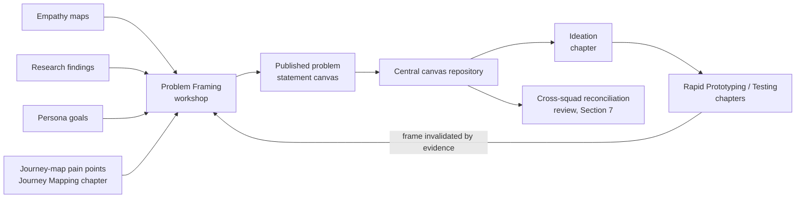

# Chapter: Problem Framing

Part: [02 — Design Thinking and Product Management](PART_OVERVIEW.md) · Subsection: Design Thinking · Status: Drafted

## 1. Introduction

Problem framing is the discipline of converting everything a team has
learned about its users — empathy findings, research evidence, persona
goals, journey-map pain points — into a single, bounded, actionable
statement of the problem worth solving next. It is the **Define** stage of
the canonical five-stage design-thinking process (Empathize → Define →
Ideate → Prototype → Test) that [Empathy](CH01_Empathy.md) introduces and
owns as this part's organizing framework: Empathize and the Research and
Journey Mapping work that operationalize it produce raw understanding;
Define — this chapter — is where that understanding is deliberately
narrowed into something specific enough to design against, before Ideation
is ever allowed to propose a single solution.

This chapter treats problem framing as a craft with its own techniques,
failure modes, and quality bar, not as an obvious five-minute step between
"doing research" and "having ideas." Framed too broadly ("improve customer
satisfaction"), a problem statement gives a team nothing to design against
and no way to know when it has succeeded. Framed too narrowly ("add a
one-click reorder button"), it silently smuggles a specific solution into
what is supposed to be a *problem* statement, foreclosing better
alternatives before Ideation ever gets a chance to propose them. Framed
around a symptom instead of a root cause, it produces a solution that
treats the visible complaint while leaving the underlying condition free to
resurface in a new form next quarter. Getting the frame right — at the
right altitude, anchored to evidence, free of an embedded solution — is the
single highest-leverage step in the entire design-thinking process, because
every later stage inherits it: a brilliantly executed Ideation, Prototype,
and Test cycle built on a badly framed problem produces a well-validated
solution to the wrong thing.

This chapter deliberately narrows its scope and consumes, rather than
re-teaches, several sibling chapters' outputs:

- [Empathy](CH01_Empathy.md) owns the empathy map and the mindset/technique
  for building raw understanding of a person's inner experience; this
  chapter treats a synthesized empathy map as a required *input*, not
  something it re-derives.
- [Research](CH02_Research.md) owns research methodology — how findings get
  collected and synthesized into defensible statements in the first place;
  this chapter treats a research finding as evidence to cite, not a method
  to teach.
- [Personas](CH03_Personas.md) owns persona construction; this chapter
  treats "which persona this problem is framed for" as a required field on
  its own artifact (Section 4.5), never re-deriving what a persona is or
  how one is built.
- The User Interviews chapter (this part's Design Thinking subsection,
  chapter 4 — [User Interviews](CH04_User_Interviews.md)) owns interview
  technique; this
  chapter does not teach how to run the validation conversations it
  recommends in Sections 9 and 16, only that they should happen.
- The Journey Mapping chapter (this part's Design Thinking subsection,
  chapter 5 — [Journey Mapping](CH05_Journey_Mapping.md)) owns identifying
  and sequencing a
  user's pain points across an end-to-end experience. This chapter
  explicitly does **not** claim ownership of pain-point *identification*
  itself — it consumes an already-identified pain point as raw material and
  owns only the next step: reframing that pain point (or an empathy finding,
  or a research insight) into a bounded, actionable design problem. Where a
  team has no journey map yet, this chapter's techniques work directly from
  an empathy map or a research finding instead; a journey map is a
  particularly rich *source* of candidate problems, not a prerequisite.

What this chapter owns, in full: the **Point-of-View (POV) statement**, the
**How-Might-We (HMW) statement** — the artifact [Empathy's comparison
table](CH01_Empathy.md#21-comparison-table) already forward-references as
"Problem (How-Might-We) statement, owned by Problem Framing" — the
abstraction-laddering technique used to calibrate a problem statement's
scope, root-cause framing (Five Whys) as applied to problem statements
specifically, the **problem statement canvas** as a structured brief
artifact, and the **Opportunity Solution Tree** as a living, continuous
alternative to a one-time canvas. For the Solution Architect audience this
handbook targets specifically: a problem statement is functionally
equivalent to the "Context and Problem Statement" section of an
Architecture Decision Record (see [Architecture
Thinking § Architecture Decision Records](../01_Architecture_Mindset/CH03_Architecture_Thinking.md#10-architecture-decision-records-adrs))
— both exist to force a team to agree, in writing, on *what question is
being answered* before anyone is allowed to argue about the answer. An
architect who has internalized this chapter should read a product
requirements document the same way they read an ADR missing its context
section: as an artifact that cannot yet be trusted, because no one has
shown their work on what problem it is actually solving.

## 2. Historical Evolution

- **1950s-70s — Toyota Production System and the Five Whys.** Sakichi
  Toyoda's original root-cause questioning technique, formalized and
  popularized within the Toyota Production System by Taiichi Ohno, asked
  "why" repeatedly (conventionally five times) against a manufacturing
  defect until the questioning reached a root cause rather than stopping at
  the first, most visible symptom. The technique migrated from
  manufacturing quality control into software and design practice as a
  general-purpose tool for distinguishing a problem's root cause from its
  symptom (Section 4.4) — a distinction this chapter treats as foundational
  to framing a problem that, once solved, actually stays solved.
- **1969 — Herbert Simon's design-as-problem-solving framing.** Already
  covered as the academic root of the whole design-thinking process (see
  [Empathy § Historical Evolution](CH01_Empathy.md#2-historical-evolution));
  Simon's specific contribution this chapter leans on is the idea that
  defining a problem well *is itself* a distinct, non-trivial design act,
  not a preamble to the "real" design work.
- **1970s — "How Might We" phrasing at Procter & Gamble.** The specific
  three-word phrasing "How might we...?" is credited to Min Basadur, a
  Procter & Gamble innovation manager, who chose the wording deliberately:
  "how" implies a solution exists and is discoverable, "might" grants
  permission for imperfect or partial ideas, and "we" frames it as a
  collaborative act rather than one person's burden. The wording's
  psychological effect on group ideation is a large part of why it — rather
  than a plain declarative problem statement — became the dominant
  transition artifact between Define and Ideate.
- **1980s-90s — IDEO adopts How-Might-We as a core facilitation tool.**
  IDEO's consulting practice popularized HMW questions as the standard
  bridge between synthesized research and brainstorming sessions, cementing
  the convention that a design-thinking team frames its problem as a
  question to be explored rather than a specification to be executed.
- **2005 — Stanford d.school formalizes the Point-of-View statement.** As
  part of formalizing the five-stage Empathize-Define-Ideate-Prototype-Test
  model (see [Empathy § Historical
  Evolution](CH01_Empathy.md#2-historical-evolution)), the Stanford d.school
  taught a specific POV statement template — "[User] needs [need] because
  [insight]" — as the Define stage's primary output artifact, with HMW
  questions generated from it as a subsequent, distinct step. This chapter's
  Section 4.1-4.2 structure follows that same two-step decomposition because
  it remains the clearest teaching model and the one most Solution
  Architects will encounter if they later work alongside a design team
  trained on it.
- **2008-2009 — Tim Brown's mainstream framing.** Already covered as the
  point design thinking entered general management vocabulary (see
  [Empathy § Historical Evolution](CH01_Empathy.md#2-historical-evolution));
  Brown's own writing repeatedly stresses that badly framed problems, not
  weak ideation, are design thinking's most common practical failure —
  motivating this chapter's Section 3.
- **2010 — UK Design Council's Double Diamond names its own "Define"
  point.** As already established when correcting a historical conflation
  in [Research § Historical
  Evolution](CH02_Research.md#2-historical-evolution), the Double Diamond
  (Discover, Define, Develop, Deliver) is a distinct model from the Stanford
  five-stage process this part uses as its organizing spine, but both models
  independently arrived at the same structural insight: a narrowing,
  convergent "Define" point must sit between open-ended discovery and
  solution generation. This chapter is the Stanford-model chapter's Define
  stage; a reader encountering the Double Diamond in the wild should
  recognize its "Define" point as covering substantially the same ground.
- **2013 — Lean UX's Problem Statement canvas.** Jeff Gothelf and Josh
  Seiden's *Lean UX* formalized a structured, fill-in-the-blank "Problem
  Statement" template (business context, problem observed, supporting
  evidence, business impact if unaddressed) as part of the broader Lean UX
  canvas — a direct ancestor of this chapter's problem statement canvas
  (Section 4.5), adapted here to a design-thinking rather than a purely Lean
  Startup framing.
- **2010s — Amazon's "Working Backwards" and the PR-FAQ.** Amazon
  popularized an adjacent but distinct problem-framing discipline: writing
  an internal press release and Frequently Asked Questions (FAQ) document
  *as if the product already shipped*, forcing authors to articulate the
  customer problem and the value delivered in concrete, customer-facing
  language before any engineering investment is approved. This chapter does
  not teach the PR-FAQ format in depth — it is a distinct, narrative-driven
  technique most associated with Amazon's specific planning process rather
  than the design-thinking lineage this part follows — but names it in
  Section 21's comparison table as a well-known adjacent technique readers
  may encounter, particularly if they work with or alongside product
  organizations that use it instead of (or alongside) HMW statements.
- **2016 — Google Ventures Design Sprint's "Sprint Questions."** Jake
  Knapp's *Sprint* formalized a compressed, five-day version of the whole
  design-thinking cycle for product teams; its Monday "map and sprint
  questions" step is a time-boxed, single-room version of this chapter's
  workshop process (Section 5), demonstrating that rigorous problem framing
  can compress from a multi-week research-to-Define cycle into a few hours
  when a team already has enough existing evidence to draw on.
  Foundational to Google Ventures' popularization of this compressed format
  are the studios AJ&Smart, whose public "Lightning Decision Jam" and
  Design Sprint facilitation material further spread the HMW-based framing
  step across product teams that never went through a formal d.school
  training.
- **2021 — Teresa Torres's Opportunity Solution Tree.** *Continuous
  Discovery Habits* introduced a structural alternative to a one-time
  problem statement: a living tree with a desired outcome at the root,
  opportunities (needs, pain points, desires — including a journey map's
  pain points once that chapter exists) as its branches, and solutions as
  leaves explored under each opportunity. This reframes problem framing as
  a continuously maintained structure rather than a single workshop
  artifact, matching the same "continuous discovery" trend already noted
  in [Research § Historical
  Evolution](CH02_Research.md#2-historical-evolution) and covered in this
  chapter's Section 4.6.

## 3. Why It Exists

Problem framing exists because a team's instinct, left unchecked, is to
skip straight from a raw observation to a proposed solution — and because
several distinct, well-documented failure modes make that skip expensive.

- **Premature solutioning.** The single most common failure this chapter
  guards against: a stakeholder hears one piece of user feedback and
  immediately proposes a specific fix, without anyone pausing to ask whether
  that fix addresses the actual underlying need or merely the first
  solution that came to mind. An old (likely apocryphal, but pedagogically
  useful) quote attributed to Henry Ford — "if I had asked people what they
  wanted, they would have said faster horses" — captures the trap from the
  other direction: taking a literally stated solution at face value without
  laddering up (Section 4.3) to the underlying need it was a proxy for
  (faster point-to-point transportation, not literally a faster horse)
  forecloses a much better solution. Problem framing exists to insert a
  disciplined pause between "we heard something" and "here is what we will
  build," during which the team is required to state the *problem* — not
  yet the *solution* — and get alignment on it.
- **Symptom-only fixes that don't stay fixed.** A problem statement anchored
  to the most visible symptom rather than its root cause (Section 4.4)
  produces a solution that suppresses one visible complaint while leaving
  the underlying condition intact to resurface in a different form later —
  the design-thinking equivalent of patching a null-pointer crash without
  ever asking why the pointer was null in the first place.
- **The Goldilocks scoping problem.** A problem framed too broadly ("improve
  customer satisfaction," "grow revenue") gives a team no way to know what
  to build or when it has succeeded — it is not actually a *design* problem
  yet, only a business aspiration. A problem framed too narrowly ("add a
  one-click reorder button") has already silently picked a specific
  solution and dressed it up as a problem statement, foreclosing every
  alternative a proper Ideation stage might have surfaced — including ones
  cheaper, faster, or more effective than the one baked into the frame.
  Section 4.3's laddering technique exists specifically to find and hold
  the workable middle altitude between these two failure modes.
- **The elastic-user problem, one layer up.** [Personas § Elastic
  user](CH03_Personas.md#4-core-concepts) names the failure mode where
  stakeholders each substitute their own mental image of "the user" absent
  a shared, concrete artifact. The same failure recurs one layer up, at the
  level of the problem itself: without a written, agreed problem statement,
  each stakeholder in a room silently imagines a slightly different
  problem, and disagreements that appear to be about *solutions* are
  frequently, on inspection, actually unresolved disagreements about what
  problem is even being solved. A written, evidence-anchored problem
  statement converts that silent disagreement into an explicit, resolvable
  one — the same coordination mechanism a persona provides for "who," a
  problem statement provides for "what."
- **Downstream stages inherit the frame's quality unconditionally.** A
  brilliant Ideation session, a well-built prototype, and a rigorously run
  usability test (both future chapters in this subsection) cannot correct
  for a badly framed problem — they can only produce a well-validated
  answer to the wrong question, faster and more convincingly than a sloppy
  process would have. This is the design-thinking analogue of the
  architecture principle that a wrong structural decision compounds the
  longer it goes uncaught (see [Research § Why It
  Exists](CH02_Research.md#3-why-it-exists)); here, the "structural
  decision" is the problem frame itself, and it compounds through every
  later stage of the process.
- **Framing is a decision with real inertia, even though it is nominally
  "just a statement."** Once a team has invested a workshop, stakeholder
  sign-off, and early Ideation energy into a particular problem frame,
  reframing it later carries real organizational cost — the same
  reversible-vs-irreversible calculus [Architecture
  Thinking](../01_Architecture_Mindset/CH03_Architecture_Thinking.md#reversible-vs-irreversible-decisions)
  applies to architecture decisions applies here: a problem frame is
  cheap to change on a whiteboard on day one and expensive to change once a
  quarter's roadmap has been built around it. Problem framing exists to get
  this decision right (or explicitly held loosely, per Section 6) while it
  is still a one-day-cost change, not a one-quarter-cost change.

## 4. Core Concepts

### 4.1 The Point-of-View (POV) statement

A POV statement is the first concrete output of problem framing: a single
sentence that compresses a synthesized empathy or research finding into a
specific user, a specific need, and the insight that explains why the need
exists. The Stanford d.school's canonical template:

> **[User]** needs **[need]** because **[surprising insight]**.

Each of the three slots carries a specific discipline the team must not skip:

- **User** is a specific persona or a specific, concretely described
  individual from the empathy or research work — never "users" or
  "customers" in the abstract. If a persona already exists for this user
  ([Personas](CH03_Personas.md)), name it directly rather than
  re-describing the person from scratch.
- **Need** must be expressed as a **verb describing an action or outcome
  the user is trying to accomplish**, never as a noun naming a feature or
  artifact. "Needs a faster checkout page" fails this discipline — it has
  already named a solution (a page, implicitly the existing one, just
  faster). "Needs a way to complete a purchase before losing confidence in
  the transaction" passes it — it names an outcome without prescribing how
  to achieve it, leaving room for Ideation to propose solutions no one in
  the framing session thought of.
- **Insight** is the surprising, non-obvious "why" — usually a tension or
  contradiction surfaced during empathy or research work (an empathy map's
  *Feels* quadrant conflicting with what the user *Says*, or a research
  finding that contradicts the team's prior assumption). An insight that
  merely restates the need in different words ("...because they want to
  check out quickly") is not doing its job; a working insight explains a
  *cause* the team did not already know, and is the single element of the
  POV statement most directly traceable to a cited empathy or research
  artifact (Section 4.5's evidence-citation discipline).

Worked example, building on the pattern [Empathy](CH01_Empathy.md#22-real-world-case-study)
uses for its GE Healthcare pediatric MRI case study: *A pediatric patient
needs to feel safe and in control during a scan because unfamiliar,
loud, clinical equipment triggers a fear response in young children that
adult-oriented safety reassurance ("it won't hurt") does nothing to
address.* Note what this statement does not do: it does not say "needs a
jungle-themed MRI room" — that is IDEO's and GE's eventual solution, and it
belongs to Ideation and Prototyping, not to this statement.

### 4.2 The How-Might-We (HMW) statement

An HMW statement translates a POV statement's need into an open-ended
question that Ideation can diverge from. Structurally:

> How might we help **[user]** **[need, restated as a question]** so that
> **[insight-derived outcome]**?

A single POV statement typically generates several candidate HMW questions,
each one produced by applying a different reframing lens to the same need
and insight. The most commonly taught lenses, worth running through
deliberately rather than stopping at the first HMW that comes to mind:

- **Amp up the positive** — focus the question on an aspect of the current
  experience that already works, and ask how to make more of it. ("How
  might we make the parts of the scan children already tolerate feel like
  the whole experience?")
- **Remove the negative** — focus directly on the pain point itself. ("How
  might we remove the fear response the equipment itself triggers?")
- **Explore the opposite** — invert an assumption to surface an unexpected
  angle. ("How might we make the scan something the child *wants* to do,
  rather than merely tolerates?")
- **Question an assumption** — name and challenge an unstated premise in
  the original framing. ("How might we redesign the *room*, not the
  *machine*, given the machine's engineering is fixed?")
- **Identify unexpected resources** — ask what already-available asset
  could be repurposed. ("How might we use the technologist's existing
  pre-scan conversation time as part of the fix, rather than adding a new
  step?")
- **Change a status quo** — challenge a rule the team has been treating as
  fixed. ("How might we let a parent stay in the room throughout the scan,
  if the only reason they currently can't is an unexamined old policy?")
- **Create an analogy from a different context** — borrow a framing from an
  unrelated domain. ("How might we make this feel like an adventure, the
  way a themed children's dental office already does?")

A good Problem Framing session generates a small portfolio of HMWs (commonly
three to seven per POV statement) rather than converging immediately on
one, because each lens tends to seed a structurally different category of
Ideation output later — converging too early on a single HMW re-introduces
the premature-solutioning risk (Section 3) one level up, at the level of
which *question* to explore rather than which *solution* to build.

### 4.3 Abstraction laddering: calibrating scope

Both a POV statement's need and an HMW question can sit at different
altitudes of abstraction, and choosing the right altitude — not the
highest or the lowest available — is the single most consequential
craft skill this chapter teaches.

- **Laddering up** means asking "why does this matter?" repeatedly,
  moving from a specific, concrete need toward a broader, more abstract
  one. Laddering up from "needs a faster checkout page" surfaces "needs to
  complete a purchase before losing confidence in the transaction," and
  laddering up again surfaces "needs to trust that this store handles their
  money responsibly" — each step trades specificity for a wider space of
  possible solutions.
- **Laddering down** means asking "how, specifically?" repeatedly, moving
  from an abstract need toward a concrete, actionable one. Laddering down
  from "needs to trust this store" might reach "needs visible, specific
  confirmation at each step of a multi-step payment flow" — trading breadth
  for actionability.
- **The Goldilocks zone** sits between two failure altitudes already named
  in Section 3: too high, and the frame is an unactionable business
  aspiration nobody can design directly against ("grow revenue"); too low,
  and the frame has already picked a specific solution and is only
  pretending to be a problem statement ("add a one-click reorder button").
  There is no universal correct altitude — the right level depends on the
  scope of the initiative (a single feature redesign warrants a lower,
  more specific frame than a multi-quarter platform investment) — but a
  team should reach its chosen altitude *deliberately*, by laddering
  through several levels and picking one, rather than accepting whichever
  altitude the first person in the room happened to phrase their
  observation at.
- Laddering is distinct from, though frequently confused with, the
  root-cause analysis in Section 4.4: laddering recalibrates a statement's
  *scope* (how broad a solution space it opens), while root-cause analysis
  recalibrates a statement's *causal depth* (whether it targets a symptom
  or an underlying cause). A team can ladder a symptom-anchored statement
  up or down without ever reaching its root cause, and can find a
  well-targeted root cause at an altitude that is still poorly calibrated
  for the initiative's scope — the two techniques are complementary and
  usually both worth applying to a single draft statement.

### 4.4 Root cause vs. symptom: the Five Whys

Borrowed from the Toyota Production System (Section 2) and applied here
specifically to problem statements rather than manufacturing defects, the
Five Whys technique asks "why did this happen?" against a stated problem
repeatedly — conventionally five times, though the number is a heuristic,
not a rule — until the chain of answers reaches a cause the team can act on
directly, rather than stopping at the first, most visible symptom.

Worked example: *"Users abandon the checkout flow at the payment step."*
(Why?) *"They hesitate after entering their card number."* (Why?) *"The
page reloads without visible feedback for several seconds."* (Why?) *"The
fraud-check service call is synchronous and unusually slow."* (Why?) *"It
was integrated as a blocking call during an initial implementation and
never revisited once traffic grew."* (Why?) *"There was no performance
budget or Service Level Objective (SLO) attached to third-party call
integrations at the time."* A problem statement anchored to the first
symptom ("the payment page needs better loading feedback") produces, at
best, a cosmetic spinner that papers over an unresolved latency problem. A
problem statement anchored to the root cause the chain actually surfaces
("third-party integrations lack a performance budget, so latency
regressions ship undetected") produces a fix that prevents this entire
class of problem from recurring in a different form next quarter — the
same distinction between fixing a symptom and fixing a root cause that
[What is Software Architecture? § Technical
debt](../01_Architecture_Mindset/CH01_What_is_Software_Architecture.md#4-core-concepts)
draws for engineering decisions generally.

Two practical cautions on applying Five Whys to problem framing
specifically: first, a single linear chain of "whys" often oversimplifies a
problem that actually has multiple contributing causes branching at once —
treat the technique as a way to *generate candidate root causes to
investigate*, not as a proof that the fifth answer found is *the* one true
cause; where a claimed root cause hasn't actually been checked against
evidence, mark it explicitly as an unvalidated assumption (Section 4.7)
rather than asserting it as fact. Second, root-causing too aggressively can
itself become a laddering-up problem in disguise (Section 4.3) — a chain of
whys can, if pushed far enough, always end at something as broad and
unactionable as "the company doesn't invest enough in engineering
quality," which is true of nearly every specific defect and therefore
useless as a scoped problem statement for this particular initiative.

### 4.5 The problem statement canvas

Where a POV/HMW pair (Sections 4.1-4.2) is the *conversational* artifact a
framing workshop produces in the room, the problem statement canvas is the
structured, written brief that gets published, reviewed, and carried
forward into Ideation and beyond — the equivalent of an ADR's written
document versus the conversation that preceded it. A complete canvas
contains:

| Field | Content | Typical source |
|---|---|---|
| Background / context | Why this problem is being framed now (a strategic priority, a support-ticket spike, a research finding) | Product strategy, escalation, or research trigger |
| Target user | The specific persona(s) this problem is framed for | [Personas](CH03_Personas.md) |
| Evidence citations | Specific, named empathy maps, research findings, and/or journey-map pain points this statement is anchored to | [Empathy](CH01_Empathy.md), [Research](CH02_Research.md), [Journey Mapping](CH05_Journey_Mapping.md) |
| Current-state pain | The specific, observed friction or unmet need, in the user's own words where possible | Same evidence sources above |
| POV statement | The Section 4.1 artifact this canvas formalizes | This chapter |
| Selected HMW(s) | The one to three HMW questions (Section 4.2) chosen to carry forward, and why the others in the generated portfolio were set aside | This chapter |
| Desired outcome / success metric | How the team will know, after a solution ships, that this problem is actually resolved | Product strategy; deeper metric-selection technique is a future Product Management chapter's territory, not taught here |
| Explicit non-goals / out of scope | What this problem statement deliberately does *not* cover, to prevent scope creep during Ideation | This chapter |
| Constraints | Known technical, regulatory, timeline, or resourcing limits Ideation must design within | Engineering, compliance, program management |
| Assumptions log | Every unvalidated assumption embedded in the statement, flagged per Section 4.7 | This chapter |

The canvas's discipline value comes almost entirely from the fields most
teams are tempted to skip under time pressure — the non-goals and the
assumptions log — because both exist specifically to make the frame's
boundaries and its unproven claims visible and arguable *before* Ideation
spends effort inside them.

### 4.6 The Opportunity Solution Tree

Teresa Torres's Opportunity Solution Tree (Section 2) is a structural
alternative — or complement — to a one-time problem statement canvas,
suited to teams running continuous discovery (recap:
[Research § Historical Evolution](CH02_Research.md#2-historical-evolution)'s
note on continuous discovery as an ongoing practice rather than a phase)
rather than framing a problem once per initiative. The tree has three
levels:

```text
                    [Desired Outcome]
                 (a measurable business/user
                  outcome, not a problem yet)
                    /        |        \
         [Opportunity]  [Opportunity]  [Opportunity]
        (a need, pain point,      (each one a candidate
         or desire surfaced          problem this chapter's
         by research/journey          techniques can frame)
         mapping)
          /      \
   [Solution]  [Solution]
   (explored only after
    an opportunity is
    selected and framed)
```

The tree keeps three layers that are frequently and dangerously collapsed
into one — outcome, problem, and solution — visibly distinct, and makes
explicit which opportunities have and have not yet been framed into an
actionable problem statement (Section 4.5) versus which have already
reached a validated solution. This chapter's techniques (POV statements,
HMW generation, laddering, root-cause analysis) are exactly the toolkit
used to convert one selected opportunity branch into a framed problem
before any solution branch below it is populated; a team using the tree
should resist the temptation to sketch solution leaves under an opportunity
that has not yet gone through that framing step, for the same
premature-solutioning reason named in Section 3.

### 4.7 Assumption surfacing

Every draft problem statement — POV, HMW, or full canvas — contains claims
of at least three kinds: claims about the user, claims about a cause, and
claims about a constraint. Assumption surfacing is the explicit practice of
listing every one of these claims separately, and marking each as either
**validated** (with a citation to the specific empathy map, research
finding, or journey-map evidence that supports it) or **unvalidated** (an
assumption the team is choosing to proceed on, at least until Ideation,
Prototyping, or Testing can check it). This is not a one-time gate — it is
the same falsifiability discipline [Research § Why It
Exists](CH02_Research.md#3-why-it-exists) applies to research findings
generally, applied here specifically to the claims embedded inside a
problem frame, and it directly determines which of Section 15's failure
scenarios a given problem statement is exposed to: a canvas with a fully
populated, honestly marked assumptions log fails safely (the team knows
what it doesn't yet know); one with no assumptions log at all fails
silently, presenting unvalidated guesses with the same confidence as cited
evidence.

### 4.8 Detecting a "solution in disguise"

A specific, mechanical check worth running against any draft POV statement,
HMW question, or canvas need field: substitute the noun or artifact it
names with a blank, and ask whether multiple, meaningfully different
solutions remain conceivable for what's left. "Needs a **_____**" where the
blank is "faster checkout page" leaves essentially one solution
conceivable — a faster version of the existing page — which means the
statement was never really a problem statement; it was a solution wearing
a "needs" verb as a disguise. "Needs to complete a purchase before losing
confidence in the transaction" leaves many structurally different
solutions conceivable (a faster page, a progress indicator, an
asynchronous confirmation email, a completely different checkout flow
architecture) — which is exactly the property a well-framed problem
statement should have. This check is cheap enough to run against every
field of every canvas before publishing it, and catches the single most
common way premature solutioning (Section 3) sneaks past a team that
believes it has correctly separated problem framing from ideation.

### 4.9 Selecting among multiple candidate problem statements

A single framing session frequently produces more viable POV/HMW pairs
than a team can pursue at once, and choosing among them is itself a small
prioritization decision. Lightweight convergence techniques — dot-voting
across the room, simple affinity clustering of similar HMWs, or a quick
show-of-hands ranking against the initiative's stated strategic priority —
are usually sufficient at this stage and are as far as this chapter goes.
Deeper, quantitative prioritization frameworks (RICE, MoSCoW, the Kano
model) belong to this part's Product Management subsection's future
Prioritization chapter (not yet drafted; see
[PART_OVERVIEW.md](PART_OVERVIEW.md)) and are the right tool once a team is
choosing among fully scoped *initiatives* competing for a roadmap slot, not
among a handful of candidate problem framings from the same workshop — this
chapter does not claim that later, heavier-weight decision.

## 5. Internal Working

A Problem Framing session is a structured workshop, not an unstructured
discussion, and its internal mechanics follow a deliberate convergent
sequence — starting from a wide pool of evidence and narrowing, step by
step, to a small number of published problem statements:

```mermaid
flowchart TD
    A[Inputs: empathy maps, research findings,<br/>persona goals, journey-map pain points] --> B[Review evidence together<br/>as a cross-functional group]
    B --> C[Draft individual POV statements<br/>Section 4.1]
    C --> D[Share and cluster similar POVs;<br/>discard duplicates]
    D --> E[Generate HMW portfolio per POV<br/>using reframing lenses, Section 4.2]
    E --> F[Ladder each HMW to calibrate<br/>scope, Section 4.3]
    F --> G[Root-cause check via Five Whys<br/>Section 4.4]
    G --> H[Select HMW(s) to carry forward<br/>Section 4.9]
    H --> I[Write full problem statement canvas<br/>Section 4.5, including assumptions log]
    I --> J[Solution-in-disguise check<br/>Section 4.8]
    J -->|fails check| C
    J -->|passes check| K[Stakeholder review + sign-off]
    K --> L[Published problem statement:<br/>input to Ideation]
```

Two properties of this workflow are easy to get wrong under time pressure
and worth naming explicitly. First, the sequence is **individual before
group**: Step C asks each participant to draft their own POV statement
independently before the group clusters and converges (Step D), which
surfaces the same silent-disagreement problem named in Section 3 (each
stakeholder had implicitly been solving a slightly different problem) as an
explicit, visible spread of drafts to reconcile, rather than letting the
most vocal person in the room's framing become the group's framing by
default. Second, the workflow includes an explicit **failure loop** (Step J
back to Step C): a canvas that fails the solution-in-disguise check is not
patched in place — it is treated as evidence that the underlying HMW or POV
needs to be reframed, which is often faster and more honest than trying to
awkwardly rephrase a solution to sound like a problem.

## 6. Design Principles

- **One statement, one problem.** A problem statement joined by "and" (
  "users need faster checkout *and* better order tracking") is two problem
  statements pretending to be one, and should be split before proceeding —
  each half deserves its own POV, its own HMW portfolio, and its own
  prioritization decision (Section 4.9), rather than an Ideation stage
  forced to solve for both simultaneously without ever formally weighing
  them against each other.
- **Needs, not features.** Every need field, in every artifact this chapter
  produces, should survive the solution-in-disguise check (Section 4.8)
  before it is considered finished.
- **Evidence-anchored, not assumed.** Every claim in a published canvas
  traces to a specific, named empathy map, research finding, or journey-map
  pain point, or is explicitly flagged as an unvalidated assumption
  (Section 4.7) — never silently presented as fact.
- **Bounded, not solved.** A problem statement's job is to be specific
  enough to design against while remaining genuinely open about *how*; if a
  reader can only imagine one solution after reading it, it has failed
  Section 4.8's check regardless of how well-written the prose is.
- **Calibrated altitude, chosen deliberately.** A team should ladder
  (Section 4.3) through at least two or three levels of abstraction before
  picking one, rather than defaulting to whatever altitude the raw evidence
  happened to arrive at.
- **Held loosely until validated.** A published problem statement is the
  team's current best framing, not a permanent commitment — the same
  reversible-decision posture [Architecture
  Thinking](../01_Architecture_Mindset/CH03_Architecture_Thinking.md#reversible-vs-irreversible-decisions)
  recommends for architecture decisions applies here: treat the frame as a
  two-way door until Ideation, Prototyping, and Testing (future chapters)
  have had a chance to stress it, and be willing to cycle back through this
  chapter's workflow if they surface evidence the frame was wrong, rather
  than treating a published canvas as sunk-cost justification to proceed
  regardless.

## 7. Architecture Patterns

Problem framing, like [Personas § Architecture
Patterns](CH03_Personas.md#7-architecture-patterns), needs a deliberate
organizational pattern for how framing sessions are run and how their
output is stored and governed, not just a technique for running one session
well:

- **Workshop-based synchronous framing** — a dedicated, timeboxed,
  single-room (or single-video-call) session following Section 5's workflow
  in one sitting, well suited to a discrete initiative with a clear start
  and a bounded evidence set to review, and the pattern Google Ventures'
  Design Sprint (Section 2) compresses into a single morning.
- **Continuous, asynchronous framing** — an Opportunity Solution Tree
  (Section 4.6) maintained as a living artifact, updated incrementally as
  new research findings or journey-map pain points arrive, with framing
  work happening in small increments rather than in one concentrated
  workshop — the pattern suited to a continuous-discovery team maintaining
  a rolling backlog of opportunities rather than executing one initiative
  at a time.
- **Central review gate.** Larger organizations often route a published
  problem statement canvas through a lightweight review — not unlike the
  Architecture Review Board pattern in [Role of a Solution
  Architect](../01_Architecture_Mindset/CH02_Role_of_a_Solution_Architect.md#architecture-review-board-arb-governance-model)
  — before it is allowed to consume Ideation and Prototyping resources,
  catching unaddressed scope, an unvalidated critical assumption, or an
  undetected solution-in-disguise before, rather than after, a team invests
  in exploring it.
- **Federated framing with periodic cross-squad reconciliation.** Multiple
  product squads independently running Section 5's workshop for their own
  initiatives risk two squads framing overlapping or duplicate problems
  without realizing it; a shared, searchable canvas repository (the same
  discoverability motivation as [Empathy § Production
  Architecture](CH01_Empathy.md#8-production-architecture)'s research
  repository) combined with a periodic cross-squad review catches this
  before both squads have separately invested in solving the same problem
  twice.

## 8. Production Architecture

Where problem framing sits in a representative product organization's
evidence-to-delivery pipeline:



The feedback edge from Testing back to Problem Framing is deliberate and
important: this chapter's Section 6 design principle of holding a problem
statement loosely until validated is only meaningful if the pipeline
actually has a return path, rather than treating a published canvas as a
one-way gate that later stages can never revisit. A canvas repository that
tracks which published problem statements were later invalidated by
downstream testing (and why) is itself a valuable observability signal —
see Section 14.

## 9. Implementation

Running a Problem Framing session end to end, combining Sections 4-8 into a
practical sequence:

1. **Assemble the evidence set** before scheduling the session — the
   relevant empathy maps ([Empathy](CH01_Empathy.md)), research findings
   ([Research](CH02_Research.md)), persona goals
   ([Personas](CH03_Personas.md)), and any available journey-map pain
   points. A framing session with no assembled evidence produces opinions,
   not problem statements.
2. **Invite a cross-functional group** — at minimum a designer, a product
   manager, and an engineer with delivery accountability for whatever
   Ideation produces; an engineer's presence specifically catches
   constraints (Section 4.5's constraints field) that would otherwise
   surface only after Ideation has already invested in an infeasible
   direction.
3. **Run Section 5's workflow**: individual POV drafting, clustering, HMW
   generation across the reframing lenses (Section 4.2), laddering
   (Section 4.3), and a root-cause pass (Section 4.4) on any HMW anchored
   to a recurring or previously "fixed" complaint.
4. **Select the HMW(s) to carry forward** (Section 4.9) using a lightweight
   convergence technique appropriate to the room.
5. **Write the full canvas** (Section 4.5), populating every field —
   especially the non-goals and assumptions log, which are the two fields
   most often skipped under time pressure and most responsible for later
   scope creep and silent, unvalidated claims.
6. **Run the solution-in-disguise check** (Section 4.8) against every need
   field and HMW in the canvas before publishing it.
7. **Circulate for stakeholder review and sign-off** (Section 7's central
   review gate, where one exists) before Ideation begins consuming it.
8. **Publish to the shared canvas repository** (Section 8) with full
   evidence citations, so the framing — and its assumptions log — remains
   auditable by anyone downstream, including a later Testing cycle that
   needs to check whether the original frame's assumptions actually held.

## 10. Complete Code Examples

Like its Design Thinking siblings, this chapter's practical artifacts are
facilitation templates and lightweight tooling rather than a production
system:

- [code/templates/problem-framing-chapter/pov-hmw-worksheet-template.md](../code/templates/problem-framing-chapter/pov-hmw-worksheet-template.md) —
  a fillable worksheet for Section 5's individual-drafting step, with the
  POV template (Section 4.1) and the seven reframing lenses (Section 4.2)
  as facilitator prompts.
- [code/json/problem-framing-chapter/problem-statement-canvas-schema.json](../code/json/problem-framing-chapter/problem-statement-canvas-schema.json) —
  a structured schema for the Section 4.5 canvas, suitable for storing
  canvases in a shared repository (Section 8) with consistent, queryable
  fields rather than free-form documents.
- [code/python/problem-framing-chapter/solution_in_disguise_lint.py](../code/python/problem-framing-chapter/solution_in_disguise_lint.py) —
  a lightweight linter that flags candidate "solution in disguise" need
  fields (Section 4.8) by checking a canvas's `need` field against a
  configurable list of concrete-artifact nouns (button, page, dashboard,
  app) versus outcome-oriented verb phrases, as an automated first pass
  before a human review — not a replacement for the judgment-based check
  itself, only a cheap way to catch the most obvious violations at scale
  across a large canvas repository.

## 11. Performance

"Performance" for problem framing is measured in the quality and speed of
the decisions it enables downstream, not in workshop throughput for its own
sake:

- **Cycle time from evidence to published canvas.** How long it takes a
  team to go from "we have a research finding or journey-map pain point"
  to "we have a published, reviewed problem statement" — a team that
  routinely takes weeks here is either over-processing a decision that
  should be a two-way door (Section 6) or lacks a lightweight-enough
  workshop format (Section 7's synchronous pattern) for its context.
- **Solution surface area.** A well-framed problem should produce a wide,
  genuinely varied range of candidate solutions once Ideation runs against
  it; a narrow, converged-looking Ideation output is frequently a symptom
  of a problem statement that failed the solution-in-disguise check
  (Section 4.8) without anyone catching it before publishing.
- **Reframe rate.** How often a published problem statement has to be sent
  back through Section 8's feedback loop after Testing invalidates one of
  its assumptions. A very low reframe rate across many initiatives is not
  necessarily good news — it can indicate that assumptions are being
  marked "validated" without real evidence (Section 4.7), rather than that
  the team's framing is unusually accurate.

## 12. Scalability

As an organization runs many Problem Framing sessions across many squads
concurrently, the same sprawl and coordination risks recur that
[Personas § Scalability](CH03_Personas.md#12-scalability) already names for
persona proliferation:

- **Problem statement sprawl** — independent squads each framing narrow,
  overlapping problems without a shared repository (Section 8), producing
  redundant or even conflicting Ideation efforts against what is, on
  inspection, the same underlying user need. The federated-with-central-
  reconciliation pattern (Section 7) exists specifically to bound this at
  scale.
- **Cross-cutting problems bigger than one squad.** A problem statement
  that, once framed, turns out to require coordinated changes across
  several squads' areas of ownership needs an explicit escalation path to
  a broader planning forum rather than being quietly scoped down to fit
  inside one squad's remit — scoping a genuinely cross-cutting problem down
  to fit organizational boundaries is itself a subtle form of the
  too-narrow framing failure named in Section 3, driven by org-chart
  convenience rather than evidence.
- **Canvas repository query load.** As the repository (Section 8) grows
  into hundreds of canvases across many squads and quarters, the same
  discoverability discipline [Empathy § Production
  Architecture](CH01_Empathy.md#8-production-architecture) names for a
  research repository applies here — canvases need consistent tagging
  (target persona, product area, status) or the repository degrades into
  the same "findings nobody can find" failure mode empathy findings are
  prone to without one.

## 13. Security

Problem framing's security-relevant surface is less about protecting
systems than about protecting the integrity and confidentiality of the
framing process and its underlying evidence:

- **Confidentiality of strategically sensitive canvases.** A problem
  statement built around competitive intelligence, an unreleased business
  strategy, or a not-yet-public regulatory concern warrants the same
  access-restriction discipline [Personas §
  Security](CH03_Personas.md#13-security) applies to the published persona
  repository: broad internal readability is usually appropriate for
  ordinary product canvases, but a subset of strategically sensitive ones
  may need restricted access, tracked separately from the general
  repository.
- **Protecting the evidence chain's provenance, not just its content.**
  Section 4.5's evidence citations point back to empathy maps and research
  findings whose underlying raw data (recordings, transcripts, survey
  responses) carries its own data-protection obligations, owned in full by
  [Research § Security](CH02_Research.md#13-security) and [Personas §
  Security](CH03_Personas.md#13-security) — this chapter's canvases should
  cite the *synthesized* artifact, never re-embed raw, potentially
  re-identifiable participant data directly into a problem statement that
  may circulate more widely than the original research repository access
  list allows.
- **Guarding against motivated reframing.** A distinct integrity risk more
  specific to this chapter than to its siblings: a stakeholder who has
  already privately decided on a solution can work backward to construct a
  problem statement that appears evidence-anchored but was actually
  reverse-engineered to justify a predetermined answer — a design-thinking
  analogue of confirmation bias operating at the framing stage rather than
  the research stage (recap:
  [Research § Why It Exists](CH02_Research.md#3-why-it-exists)'s bias
  discussion). The solution-in-disguise check (Section 4.8) and a genuine,
  independent stakeholder review (Section 7's central review gate) are this
  chapter's primary defenses; a review gate staffed only by the same
  stakeholder who proposed the frame provides no actual protection against
  this failure mode.
- **Whose problem gets framed.** Because problem framing decides which
  user's pain gets organizational attention and resourcing, a framing
  practice that consistently draws its evidence from the most vocal,
  best-resourced, or most-researched user segments — while under-serving
  segments with less research investment or organizational voice —
  reproduces an equity and representation risk at the decision layer, not
  merely at the research-sampling layer already covered in
  [Research § Core Concepts](CH02_Research.md#4-core-concepts)'s bias
  taxonomy. A problem-framing practice should periodically audit which
  personas and user segments its published canvases actually serve, not
  only whether each individual canvas is internally well evidenced.

## 14. Observability

A Problem Framing practice without feedback signals cannot distinguish a
well-calibrated frame from a poorly calibrated one until well after the
fact, expensively, at the end of a Prototype/Test cycle:

- **Reframe rate** (Section 11) as a leading indicator: track how often a
  published canvas gets sent back through the Section 8 feedback loop, and
  why — a specific pattern (e.g., a particular team's canvases repeatedly
  failing on an unvalidated user assumption) is a targeted coaching signal,
  not just aggregate noise.
- **Ideation solution-diversity signal.** If a downstream Ideation session
  (future chapter) consistently produces a narrow cluster of near-identical
  solution ideas from a given problem statement, that is a lagging
  indicator the frame likely failed the solution-in-disguise check (Section
  4.8) without being caught during review — worth feeding back into the
  central review gate's checklist (Section 7) as a specific case to look
  for.
- **Assumption validation tracking.** Because every canvas carries an
  explicit assumptions log (Section 4.7), the repository (Section 8) can
  track, over time, what fraction of logged assumptions across all
  published canvases were later confirmed versus invalidated by Testing —
  a practice-wide accuracy signal analogous to a persona's staleness
  tracking in [Personas § Observability](CH03_Personas.md#14-observability),
  but measuring framing accuracy rather than persona freshness.
- **Time-to-frame and time-to-reframe**, tracked per squad, surfaces
  process friction (a squad consistently taking far longer than peers to
  produce a canvas) that is worth investigating separately from whether the
  resulting frames are actually accurate — a fast but consistently wrong
  framing process and a slow but consistently accurate one are different
  problems requiring different fixes.

## 15. Failure Scenarios

- **The unchallenged HiPPO frame.** A senior stakeholder states a problem
  (frequently already containing an embedded solution) in a meeting, and no
  one in the room applies Section 4.8's check or proposes an alternative
  POV statement, because challenging the framing feels like challenging the
  stakeholder personally. The published canvas inherits an unvalidated,
  unchallenged frame with organizational authority behind it, making a
  later reframe (Section 8's feedback loop) politically harder than it
  would have been for an ordinary team member's proposal.
- **The compound problem statement.** A canvas built around two or three
  loosely related needs joined by "and," violating Section 6's "one
  statement, one problem" principle — Ideation, forced to solve for all of
  them simultaneously, produces a diluted compromise solution that serves
  none of the underlying needs particularly well.
- **The unfalsifiable insight.** A POV statement's insight field restates
  the need in different words rather than explaining a genuine, checkable
  "why" (Section 4.1) — the canvas looks complete but provides no actual
  explanatory anchor, and a later Five Whys pass (Section 4.4) or
  stakeholder review typically surfaces this only after Ideation has
  already spent effort against it.
- **The silently un-run assumptions log.** A canvas that skips or leaves
  blank the Section 4.5 assumptions log is not a canvas with no
  assumptions — it is a canvas whose assumptions are simply invisible,
  which means no one downstream knows which claims to check before relying
  on them, and Testing discovers the gap only when a "validated"-sounding
  claim turns out to have never actually been checked.
- **Scope creep after publication.** A canvas without a populated non-goals
  field (Section 4.5) invites Ideation and Prototyping to quietly expand
  the problem's boundary over time, until the eventual solution addresses a
  meaningfully different (and differently resourced) problem than the one
  that was originally reviewed and signed off — a design-thinking analogue
  of uncontrolled requirements creep in a traditional software project.
- **The reframe that never happens.** Testing surfaces clear evidence that
  a published problem statement's core assumption was wrong, but the
  Section 8 feedback loop back to Problem Framing is organizationally
  absent or ignored — sunk cost in the already-built solution keeps the
  team iterating on execution rather than acknowledging the frame itself
  needs to change, the same failure mode [Architecture
  Thinking](../01_Architecture_Mindset/CH03_Architecture_Thinking.md#reversible-vs-irreversible-decisions)
  warns against when a reversible decision is treated, after the fact, as
  if it had been irreversible all along.

## 16. Testing

"Testing" a problem statement, before any solution exists to test, means
validating the frame itself against reality rather than against the
framing team's own confidence in it:

- **Problem validation interviews.** Taking a draft POV/HMW pair back to a
  small number of real users or stakeholders — using the interviewing
  technique the User Interviews chapter owns in depth (this part, not yet
  drafted; see [PART_OVERVIEW.md](PART_OVERVIEW.md)) — and checking whether
  the stated need and insight actually resonate as described, before
  investing further in Ideation against a frame that might not hold up.
  This is distinct from usability testing a prototype (a later chapter's
  territory): here, there is nothing built yet to test — only the
  *statement* itself is under test.
- **Assumptions-log audit.** Reviewing a canvas's assumptions log (Section
  4.7) specifically for claims marked "validated" without an actual, named
  evidence citation — a common shortcut under deadline pressure that
  defeats the entire purpose of the log.
  Passing this audit is a minimum bar for a canvas leaving the central
  review gate (Section 7), not an optional quality check.
- **Solution-in-disguise re-check by a second reviewer.** Because Section
  4.8's check depends on the reviewer's own judgment, having someone other
  than the canvas's original author run it independently catches cases
  where the author's own familiarity with an intended solution has
  invisibly shaped how narrowly they phrased the "need" field.
- **Cross-squad duplicate check.** Before publishing, checking the shared
  repository (Section 8) for an existing canvas addressing a substantially
  similar problem for a similar user segment, to catch the scalability
  failure mode named in Section 12 before, rather than after, two squads
  have independently invested in solving the same problem.

## 17. Common Mistakes

- Writing a need field as a feature name rather than an outcome, then
  never running the solution-in-disguise check (Section 4.8) that would
  have caught it.
- Stopping at the first HMW that comes to mind instead of generating a
  small portfolio across several reframing lenses (Section 4.2), which
  quietly narrows Ideation's solution space before Ideation even begins.
- Treating Five Whys (Section 4.4) as a single, linear, definitive chain
  rather than a way to generate root-cause candidates that still need
  evidence to confirm.
- Laddering all the way up to an unactionable business aspiration and
  calling it "done," rather than deliberately choosing a workable
  Goldilocks altitude (Section 4.3).
- Leaving the non-goals and assumptions-log fields of the canvas (Section
  4.5) blank under time pressure — the two fields most responsible for
  later scope creep and unchecked assumptions, and not coincidentally the
  two most often skipped.
- Treating a published problem statement as a permanent commitment rather
  than a currently-best frame held loosely until validated (Section 6),
  making a later necessary reframe (Section 15's "reframe that never
  happens") organizationally harder than it needs to be.
- Skipping the cross-functional invite (Section 9, step 2) and running the
  session with designers and product managers only, discovering technical
  or regulatory constraints only after Ideation has already invested in an
  infeasible direction.

## 18. Best Practices

- Assemble and review the actual evidence set (empathy maps, research
  findings, persona goals, journey-map pain points) as an explicit first
  step, rather than starting the session from stakeholders' recollection of
  what the evidence said.
- Draft POV statements individually before converging as a group (Section
  5), to surface disagreement explicitly rather than letting the loudest
  framing in the room become the default one.
- Generate an HMW portfolio across multiple reframing lenses (Section 4.2)
  before selecting which to carry forward, rather than converging on the
  first plausible question.
- Run both a laddering pass (Section 4.3) and, where the problem is
  anchored to a recurring complaint, a root-cause pass (Section 4.4)
  before finalizing scope.
- Populate every field of the canvas (Section 4.5), especially non-goals
  and the assumptions log, and treat an incomplete canvas as not yet ready
  for stakeholder review.
- Run the solution-in-disguise check (Section 4.8) against every need field
  and HMW, ideally by a reviewer other than the canvas's author.
- Publish to a shared, tagged repository (Section 8) and check it for
  overlapping canvases before starting a new framing session, to avoid the
  scalability failure named in Section 12.
- Build in, and actually use, the feedback loop from Testing back to
  Problem Framing (Section 8) — a practice's willingness to reframe in
  light of new evidence is a stronger maturity signal than its rate of
  producing polished-looking canvases.

## 19. Anti-Patterns

- **Solutioning-as-framing**: named and covered fully in Sections 3, 4.8,
  and 17; the single most common and most damaging anti-pattern this
  chapter addresses, listed again here because of how frequently it
  recurs even on teams that believe they've internalized the check.
- **The rubber-stamp canvas**: a problem statement canvas written *after* a
  solution has already been informally agreed upon internally, purely to
  produce a paper trail that retroactively justifies it — the Problem
  Framing analogue of [Empathy § Anti-Patterns](CH01_Empathy.md#19-anti-patterns)'s
  "empathy as a rubber stamp."
  - **The frame-and-forget canvas**: a well-run workshop that produces a
  thorough, well-evidenced canvas that is then never actually consulted
  during Ideation or Prototyping — functionally identical in outcome to
  never having framed the problem at all, and the same failure pattern
  [Empathy § Anti-Patterns](CH01_Empathy.md#19-anti-patterns) names as the
  "empathy-to-nowhere pipeline," recurring one stage later.
- **Perpetual reframing**: the opposite failure from Section 15's "reframe
  that never happens" — a team that reopens and re-litigates its problem
  frame every time a single new data point arrives, never allowing
  Ideation and Prototyping enough stability to actually generate and test
  a solution against a held frame; a healthy practice treats the frame as
  a two-way door (Section 6) that should still stay shut long enough for a
  meaningful test cycle to run.
- **Framing by committee dilution**: a compound problem statement (Section
  15) produced specifically because no one in a large stakeholder group was
  willing to let any single need get set aside, resulting in an
  unfocusable "and"-joined statement that structurally cannot pass Section
  6's "one statement, one problem" principle.

## 20. Trade-off Analysis

| Decision | Benefit | Cost |
|---|---|---|
| Workshop-based synchronous framing vs. continuous Opportunity Solution Tree | Fast, decisive convergence for a bounded initiative | Less suited to an ongoing discovery practice; can feel artificially "final" for a problem space that keeps evolving |
| Laddering to a broad, business-level frame vs. a narrow, feature-adjacent frame | Broad frame preserves maximum solution space for Ideation | Broad frame risks being unactionable; narrow frame risks the solution-in-disguise failure (Section 4.8) |
| Deep root-cause investigation (Five Whys) vs. framing the visible symptom directly | Root-cause framing produces solutions that stay fixed | Slower to reach a publishable canvas; risk of over-abstracting to an unactionable cause (Section 4.4) |
| Central review gate before Ideation vs. no formal review | Catches unaddressed scope, weak evidence, and solution-in-disguise failures before resources are spent | Adds process latency; risks becoming a rubber-stamp step if reviewers aren't genuinely independent (Section 13) |
| Federated per-squad framing vs. centralized framing function | Faster, more context-aware framing per squad | Higher risk of problem statement sprawl and duplicate effort across squads (Section 12) without active reconciliation |

## 21. Comparison Table

A quick reference distinguishing this chapter's artifacts from adjacent
design-thinking and product techniques (see [PART_OVERVIEW.md](PART_OVERVIEW.md)
for the full chapter list and current status of each):

| Artifact / Technique | Primary Purpose | Typical Format | Owning Chapter |
|---|---|---|---|
| Point-of-View (POV) statement | Compress one synthesized finding into a specific user, need, and insight | One sentence, fixed template | This chapter |
| How-Might-We (HMW) statement | Reframe a POV's need as an open question Ideation can diverge from | One-sentence question | This chapter |
| Problem statement canvas | Publish a fully evidenced, bounded problem brief for stakeholder review | Structured multi-field document | This chapter |
| Opportunity Solution Tree | Maintain a living map from outcome through opportunities to solutions in continuous discovery | Tree diagram | This chapter |
| Working Backwards / PR-FAQ | Articulate a customer problem and value proposition via a pre-written press release and FAQ | Narrative document | Not covered in depth by this part; named here for disambiguation only (Amazon-specific planning technique) |
| Empathy map | Synthesize raw evidence about one person's inner experience | Four-to-six-quadrant canvas | [Empathy](CH01_Empathy.md) |
| Persona | Package synthesized patterns into a reusable archetype | One-page character-style summary | [Personas](CH03_Personas.md) |
| Journey map pain point | Identify and sequence friction across an end-to-end experience | Timeline/swimlane annotation | [Journey Mapping](CH05_Journey_Mapping.md) |
| HMW-generated idea | A candidate solution explored against a selected HMW | Sketch, concept description | [Ideation](CH07_Ideation.md) |

## 22. Real-World Case Study

Doug Dietz's GE Healthcare pediatric MRI redesign, already introduced as
[Empathy's real-world case study](CH01_Empathy.md#22-real-world-case-study),
is worth revisiting specifically at the Define stage, because it is an
unusually clean illustration of laddering (Section 4.3) done well under
real organizational pressure. GE's initial engineering brief for the
project — implicitly, though never stated this way on paper — had been
framed at the narrowest possible altitude: "make the existing scanner
work for pediatric patients," which quietly assumed the machine itself was
the fixed point and the only available lever was clinical procedure (sedate
the child, reassure the parents, proceed as with an adult patient). After
Dietz's empathy work surfaced the fear response as the actual driver of
poor outcomes (delayed scans, higher sedation rates, distressed families),
reframing the problem required laddering up from "make the scanner work for
this population" to something closer to "help a frightened child feel safe
and in control during an unfamiliar medical procedure" — a POV statement
whose need is expressed as an outcome (feeling safe and in control), not as
a feature of the existing machine.

That single laddering move — recognizing that the *room and experience*
around the machine, not the machine's clinical engineering, was the actual
lever available — is what let Ideation later propose the eventual solution
(the "Adventure Series," redecorating the scan room and briefing children
through an imaginative pre-scan narrative rather than through adult-oriented
clinical reassurance) instead of converging on incremental, adult-framed
tweaks to sedation protocol. Had the team frozen the problem at its
original, narrower altitude — "reduce pediatric sedation rates" — a
plausible, well-evidenced Ideation effort could easily have converged on
better sedation drugs or dosing protocols: a real improvement, but a far
narrower one than the eventual room-and-experience redesign delivered,
which GE later reported meaningfully increased both patient satisfaction
scores and scan-completion rates without sedation, across the hospitals
that adopted it.

## 23. Interview Questions

1. What is the difference between a POV statement and an HMW statement, and
   why does design thinking use both rather than jumping straight from
   research to HMW questions?
2. Explain the "solution in disguise" check in your own words, and give an
   example of a need statement that fails it and one that passes it.
3. What is abstraction laddering, and how is it different from a Five Whys
   root-cause analysis? When would you use one versus the other, or both?
4. Describe the Goldilocks scoping problem: what goes wrong when a problem
   statement is framed too broadly, and what goes wrong when it's framed
   too narrowly?
5. What is an Opportunity Solution Tree, and what specific failure mode
   does keeping "opportunity" and "solution" as separate tree levels
   prevent?

## 24. Hands-on Exercises

Using the [POV/HMW worksheet template](../code/templates/problem-framing-chapter/pov-hmw-worksheet-template.md),
take one existing empathy map or research finding (real or a plausible
fictional one from your own domain) and draft three candidate POV
statements from it, each at a different laddering altitude (Section 4.3).
For your chosen altitude's POV statement, generate an HMW portfolio using
at least four of the seven reframing lenses in Section 4.2, then run the
solution-in-disguise check (Section 4.8) against every HMW in your
portfolio and discard any that fail it.

## 25. Design Exercises

Design the Problem Framing practice for a mid-sized product organization
that currently has ad hoc, undocumented framing (stakeholders verbally
agree on "the problem" in a planning meeting with no written artifact) and
is about to scale from three product squads to twelve over the next year.
Decide: whether framing should be workshop-based, continuous (Opportunity
Solution Tree), or a mix depending on initiative type; what the canvas
repository's tagging scheme should be to prevent the problem-statement
sprawl named in Section 12; what a lightweight central review gate should
check for (Section 7) without becoming a bottleneck across twelve squads;
and how the feedback loop from Testing back to Problem Framing (Section 8)
should be surfaced so a reframe actually happens when evidence warrants one.
Evaluation criteria: the plan's realism given twelve concurrent squads, an
explicit mechanism for catching duplicate or overlapping canvases across
squads, and a concrete, non-bureaucratic definition of what the review gate
actually checks.

## 26. Architecture Review Questions

- Does every published problem statement canvas cite specific, named
  empathy, research, persona, or journey-map evidence for its core claims,
  rather than presenting unattributed assertions as fact?
- Has every need field and HMW in the canvas been checked against the
  solution-in-disguise test (Section 4.8), and by someone other than the
  canvas's original author?
- Are the canvas's non-goals and assumptions-log fields actually populated,
  not left blank under time pressure?
- Is there a working feedback path from Testing (or from Ideation
  discovering the frame doesn't hold) back to Problem Framing, and can you
  point to an example of it actually being used?
- Has the repository been checked for an existing, overlapping canvas
  before this one was published, to avoid duplicate framing effort across
  squads?
- Is the problem statement a single, focused statement, or does it join
  multiple needs with "and" in a way that will force Ideation to dilute its
  effort across more than one problem at once?

## 27. Summary

Problem framing is the Define stage of design thinking: the deliberate,
disciplined act of converting synthesized empathy findings, research
evidence, persona goals, and journey-map pain points into a single, bounded,
evidence-anchored problem statement — before anyone is allowed to propose a
solution to it. Its core artifacts are the Point-of-View statement (a
specific user, an outcome-oriented need, and a surprising insight), the
How-Might-We question it generates (explored across multiple reframing
lenses rather than converged on immediately), and the problem statement
canvas that formalizes both into a reviewable, citable brief. Getting this
stage right means calibrating scope deliberately through abstraction
laddering, distinguishing root cause from symptom through techniques like
the Five Whys, surfacing every embedded assumption rather than presenting
guesses as facts, and running the solution-in-disguise check against every
need statement before it is allowed to leave the room. Because every later
design-thinking stage inherits whatever frame this stage produces, a
Problem Framing practice's real measure of success is not how polished its
canvases look, but whether it stays honestly willing to reframe — via the
feedback loop back from Testing — when real evidence says the original
frame was wrong. The empathy work and research evidence this chapter
consumes belong to [Empathy](CH01_Empathy.md) and
[Research](CH02_Research.md); the persona goals it cites belong to
[Personas](CH03_Personas.md); the ideation this chapter's output feeds
belongs to the forthcoming Ideation chapter — this chapter owns everything
from "we have evidence" to "we have a bounded, reviewable problem worth
solving," and nothing past that boundary.

**Further reading**: [Empathy](CH01_Empathy.md) ·
[Research](CH02_Research.md) · [Personas](CH03_Personas.md) ·
[User Interviews](CH04_User_Interviews.md) ·
[Journey Mapping](CH05_Journey_Mapping.md) ·
[Ideation](CH07_Ideation.md) ·
[Architecture Thinking § Architecture Decision
Records](../01_Architecture_Mindset/CH03_Architecture_Thinking.md#10-architecture-decision-records-adrs) ·
[What is Software Architecture? § Architecturally Significant
Requirements](../01_Architecture_Mindset/CH01_What_is_Software_Architecture.md#4-core-concepts)
