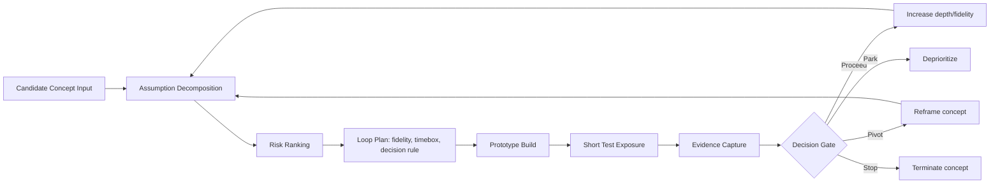
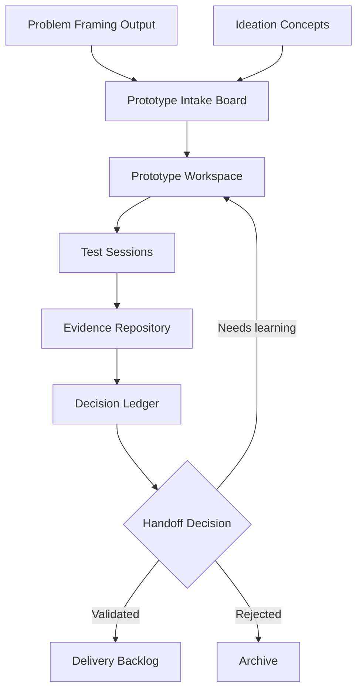

# Chapter: Rapid Prototyping

Part: [02 - Design Thinking and Product Management](PART_OVERVIEW.md) · Subsection: Design Thinking · Status: Drafted

## 1. Introduction

Rapid prototyping is the disciplined practice of turning a candidate idea into
just enough artifact, just fast enough, to learn whether the idea should move
forward, be reshaped, or be discarded. In the design-thinking sequence this
chapter follows the Define and Ideate work and precedes deeper validation and
delivery: teams consume framed opportunities and candidate concepts, build
small testable representations, run short learning loops, and use evidence to
update decisions.

This chapter owns rapid prototyping as an experiment strategy, not as visual
craft. It focuses on learning velocity, fidelity choice, throwaway versus
evolutionary prototype intent, timeboxing, and test-loop design. It does not
re-teach ideation facilitation depth, wireframing craft, or full usability-test
protocol mechanics:

- Ideation outputs are treated as inputs to prototype selection. See this
  part's Ideation chapter listing in [PART_OVERVIEW.md](PART_OVERVIEW.md).
- Wireframes are discussed as one prototype form only; wireframing technique is
  owned by this part's Wireframing chapter listing in [PART_OVERVIEW.md](PART_OVERVIEW.md).
- Structured usability-testing mechanics are referenced as downstream
  validation practice owned by this part's Usability Testing chapter listing in
  [PART_OVERVIEW.md](PART_OVERVIEW.md).

For Solution Architects, rapid prototyping matters because it changes the risk
curve of architecture decisions. A prototype can make uncertainty visible while
change is still cheap, before a roadmap and implementation plan harden around a
wrong assumption. In architecture terms, prototyping keeps early product and
system decisions in a reversible state long enough for evidence to shape them.

## 2. Historical Evolution

- **1960s-1970s - software simulation and mock-up culture.** Early interactive
  systems work in research laboratories and aerospace computing used mock-ups
  and simulation to test operator interaction before full implementation,
  establishing the principle that partial artifacts can de-risk full builds.
- **1983 - Boehm's Spiral Model.** Barry Boehm formalized risk-driven
  iteration: build something, evaluate risks, then iterate. Rapid prototyping
  inherited this risk-first sequencing directly.
- **1980s-1990s - Human-Computer Interaction (HCI) studio practice.**
  Paper prototypes and storyboard flows became common in Human-Computer
  Interaction (HCI), proving that many interaction assumptions can be tested
  without production code.
- **1990s-2000s - Agile software development.** Agile methods normalized short
  feedback cycles and incremental learning, making prototypes a practical
  pre-build step rather than an academic design artifact.
- **2000s - Lean Startup and hypothesis-driven product development.** Build-
  Measure-Learn framing moved prototypes from "design artifact" to
  "experiment instrument" connected to explicit assumptions and success
  criteria.
- **2010s - Design sprints and cross-functional product trios.** Timeboxed,
  week-scale cycles popularized the pattern: map problem, prototype quickly,
  test with users, decide next move.
- **2020s - high-speed prototyping stacks and Artificial Intelligence (AI)
  assistants.** No-code/low-code tools, component libraries, and AI-assisted
  generation accelerated artifact creation, increasing speed but also raising
  governance questions about false confidence from polished-looking prototypes.

## 3. Why It Exists

Rapid prototyping exists because teams routinely face high uncertainty while
pressure pushes them toward premature commitment.

- **Requirements are hypotheses early on.** Many "requirements" at discovery
  time are assumptions about user behavior, desirability, feasibility, or
  business impact. Prototypes convert these assumptions into testable claims.
- **Roadmap pressure creates premature certainty.** Without prototypes,
  organizations commit to implementation plans before proving key interaction,
  workflow, or value assumptions.
- **Discussion without artifacts is ambiguous.** Verbal descriptions and static
  requirement text allow multiple mental models in the same room. A prototype
  collapses ambiguity by making one model inspectable.
- **Cost of change rises sharply over time.** Reframing in discovery is cheap;
  rework during implementation is expensive. Prototypes shift learning earlier.
- **Cross-functional alignment needs shared evidence.** Product, design,
  architecture, engineering, and operations can disagree productively when a
  concrete artifact and test evidence are available.

Rapid prototyping therefore exists to maximize learning per unit time and
learning per unit cost, not to produce deliverable software.

## 4. Core Concepts

### 4.1 Prototype as an experiment instrument

A prototype is not a miniature product. It is a targeted instrument designed to
answer specific questions. A good prototype starts with a question such as:

- Can a first-time user complete this core task unaided?
- Do users understand this value proposition from the first screen?
- Is this workflow conceptually acceptable in real context?

If no decision would change based on prototype results, the prototype has no
clear experiment purpose.

This is the central distinction between demonstration and discovery. A
demonstration artifact is built to persuade stakeholders that a direction is
good. A discovery artifact is built to create the possibility that the
direction is wrong. Rapid prototyping is only effective when teams are willing
to invalidate their own assumptions early.

A useful discipline is decision framing before build:

- assumption being tested
- observable evidence signal
- decision threshold
- expected action if threshold is not met

Without these fields, teams often produce polished artifacts that generate
discussion but no concrete decision.

### 4.2 Learning velocity

Learning velocity is the rate at which a team turns uncertainty into decisions.
It can be measured using practical signals:

- Time from assumption articulation to evidence-backed decision.
- Number of high-risk assumptions retired per iteration.
- Ratio of assumptions validated to assumptions invalidated.
- Time from invalidation to updated prototype/test loop.

Rapid prototyping optimizes these signals, not output volume.

Learning velocity is not raw speed. Fast loops with low-quality evidence can
create false confidence and expensive rework later. The target is decision
throughput with evidence quality preserved.

Two anti-patterns frequently reduce true learning velocity:

- artifact obsession: teams optimize prototype polish rather than uncertainty
  reduction
- loop truncation: teams build and demo, but skip explicit decision capture

A simple operational metric is "assumptions retired per week with documented
decision rationale." This forces teams to track whether each loop changed what
they believe, not just what they built.

### 4.3 Fidelity ladder

Prototype fidelity is the degree of detail and realism represented in an
artifact. Treat fidelity as a ladder, not a binary state:

- **Low fidelity**: paper sketches, simple click flows, lightweight service
  stubs.
- **Medium fidelity**: interactive wire-level behaviors, realistic copy,
  partial data behavior.
- **High fidelity**: near-real visuals, richer interactions, realistic edge
  states, sometimes limited real integration.

Higher fidelity is not automatically better. The right fidelity is the minimum
that can answer the current question credibly.

Fidelity choice should be tied to hypothesis type:

- comprehension hypotheses ("do users understand this concept?") usually need
  low to medium fidelity
- interaction hypotheses ("can users complete this flow without guidance?")
  usually need medium fidelity with realistic state transitions
- trust or risk-sensitive hypotheses (for example, payments, permissions,
  compliance prompts) may require high-fidelity realism to elicit valid
  behavior

Moving fidelity upward too early often narrows critique scope. Participants
comment on visual polish and microcopy while structural assumptions remain
untested.

### 4.4 Breadth-first then depth-first exploration

Early loops should often explore breadth: multiple concepts tested quickly with
coarse fidelity. Later loops explore depth: one or two promising directions
with stronger behavioral realism. This sequencing avoids over-investing in the
first plausible concept.

Breadth-first is risk management. It keeps option value alive while evidence is
still weak. Depth-first is execution alignment. It increases confidence on a
shortlisted path once alternatives are no longer competitive.

Teams that skip breadth can converge quickly but on the wrong concept. Teams
that stay in breadth too long can delay delivery without increasing insight.
A practical trigger to move from breadth to depth is repeated evidence that one
direction outperforms others across at least two independent user cohorts or
usage contexts.

### 4.5 Throwaway versus evolutionary prototypes

- **Throwaway prototype**: created to learn, expected to be discarded. It
  optimizes speed and flexibility.
- **Evolutionary prototype**: intentionally built to be extended into delivery
  code or operational capability.

The key discipline is intent declaration before building. Hidden intent
mismatch causes common failures: a throwaway prototype silently becoming
production code, or an evolutionary prototype constrained by shortcuts that were
acceptable only for throwaway learning.

Intent should be visible in artifact metadata and repository structure. A
prototype labeled "throwaway" should have explicit constraints: no production
security assumptions, no long-term maintainability promises, and no implied API
contract stability. An evolutionary prototype should include baseline coding
standards and migration expectations from day one.

Many teams incur architecture debt here by treating intent as social knowledge.
When teams change, undocumented intent is lost and temporary decisions become
permanent by accident.

### 4.6 Timeboxed prototyping

A timebox is a fixed maximum duration for creating and testing a prototype
iteration. Timeboxes force scope discipline and preserve loop cadence. Typical
patterns include:

- 2-4 hour micro-loops for one interaction assumption.
- 1-2 day loops for small workflow hypotheses.
- 1-week loops when coordinated cross-functional input is required.

Timebox expiration is a decision point, not an excuse for uncontrolled
extension.

At timebox end, only four actions should be allowed:

- proceed to next loop with explicit carry-forward assumptions
- pivot with revised hypothesis
- park due to dependency or priority shift
- stop due to failed value case

"Extend timebox until complete" is typically a signal that scope was not
bounded to a testable question. Timebox discipline protects the team from
turning prototype work into unplanned mini-projects.

### 4.7 Test loops and decision gates

A rapid prototyping loop has five stages:

1. Define assumption and decision criterion.
2. Build minimum artifact that can test it.
3. Expose artifact to representative usage.
4. Capture evidence.
5. Decide: proceed, pivot, park, or stop.

Decision gates protect teams from prototype theater, where artifacts are built
and shown but no concrete decision follows.

Decision gates also improve organizational trust. Stakeholders can tolerate
failed prototypes when failure leads to explicit learning and faster better
choices. They lose trust when teams repeatedly prototype without showing what
changed in strategy.

A good gate record includes:

- decision outcome
- evidence cited
- uncertainty remaining
- owner of next loop
- revisit condition if parked

This turns prototyping into a transparent decision system rather than an
informal craft activity.

### 4.8 Risk-first sequencing

Not all assumptions are equal. Prototype planning should prioritize
high-impact/high-uncertainty assumptions first:

- Desirability risk: do people want this?
- Usability risk: can people use this?
- Feasibility risk: can this work with realistic constraints?
- Viability risk: does this create measurable business value?

Risk-first sequencing prevents low-risk polish work from consuming early cycle
time.

Risk sequencing should account for dependency structure. Some high-risk
assumptions are upstream of many others (for example, whether users trust a
self-serve onboarding path). Testing those first collapses uncertainty across
multiple downstream design choices.

Teams commonly invert this order by starting with easiest-to-build prototypes.
This optimizes local productivity while deferring decisive risk. A stronger
pattern is to rank assumptions by impact x uncertainty and prototype in that
order, even when the first loop is less visually impressive.

## 5. Internal Working

Rapid prototyping operates as a compact experiment system rather than a design
artifact factory.

1. **Input capture.** Candidate concepts enter from problem framing and
   ideation outcomes (titles, short narratives, assumptions list).
2. **Assumption decomposition.** The team extracts testable assumptions and
   ranks them by risk and dependency.
3. **Loop planning.** Each loop declares fidelity target, artifact type,
   participant profile, and decision rule.
4. **Artifact creation.** The smallest credible prototype is produced inside a
   hard timebox.
5. **Exposure and evidence capture.** Short sessions generate behavioral
   signals, observed friction, and confidence updates.
6. **Decision and traceability.** Outcomes are recorded with rationale:
   proceed, pivot, park, stop.
7. **Backlog update.** Next loop scope is adjusted based on evidence.

A healthy prototyping system favors short cycle time, explicit assumptions,
and archived decisions over polished visuals.



## 6. Design Principles

- **Question-first, artifact-second.** Start from the decision to make, then
  choose prototype form.
- **Minimum credible realism.** Use only enough fidelity to reduce decision
  uncertainty.
- **Evidence over preference.** Team opinions are inputs; observed behavior and
  test outcomes decide.
- **Timebox integrity.** Preserve cadence by ending loops on time, then
  explicitly deciding next step.
- **Assumption transparency.** Keep assumptions visible, versioned, and linked
  to loop outcomes.
- **Intent clarity.** Mark each prototype as throwaway or evolutionary at
  creation time.
- **Cross-functional participation.** Include product, design, and engineering
  voices in planning and interpretation.
- **Ethical participant handling.** Protect participant privacy and avoid
  manipulative test framing.

## 7. Architecture Patterns

Rapid prototyping commonly appears in these operating patterns:

- **Prototype Funnel Pattern.** Many low-fidelity concepts enter; few advance
  to high-fidelity depth after evidence gates.
- **Risk-Bucket Pattern.** Loops are grouped by risk type (desirability,
  usability, feasibility, viability) so each loop has a clear purpose.
- **Dual-Track Discovery/Delivery Pattern.** Prototyping loops run in discovery
  while delivery continues on validated workstreams, with explicit handoff
  criteria.
- **Spike-and-Stabilize Pattern.** Exploratory spikes answer unknowns, then
  stabilized prototypes convert learning into implementable requirements.
- **Evidence Ledger Pattern.** Every loop writes a compact decision record,
  creating an auditable chain from concept to go/no-go outcome.

These patterns reduce the chance that prototyping becomes isolated from
engineering and architecture decisions.

## 8. Production Architecture

Although prototypes are pre-production artifacts, organizations need a
repeatable architecture around the prototyping practice itself:

- **Intake layer.** Candidate concepts and assumptions sourced from framing and
  ideation outputs.
- **Prototype workspace layer.** Tooling for low/medium/high-fidelity artifacts
  with clear versioning.
- **Evidence layer.** Session notes, observed behavior logs, confidence scores,
  and decision outcomes.
- **Governance layer.** Rules for participant data handling, repository access,
  and archival lifecycle.
- **Handoff layer.** Criteria and artifacts required before a concept enters
  delivery planning.



Production-grade discipline here means reproducibility of learning, not
hardening prototype runtime.

## 9. Implementation

A practical implementation sequence for a product team:

1. Create a prototype backlog with one row per concept and explicit
   assumptions.
2. Rank assumptions by impact and uncertainty.
3. Define first loop decision criteria and timebox.
4. Choose prototype type and fidelity matched to those criteria.
5. Build prototype and run short evidence sessions.
6. Record outcomes in a decision ledger.
7. Re-rank remaining assumptions and launch next loop.
8. Escalate to delivery only when key assumptions are retired with adequate
   confidence.

Minimal operating roles:

- Product manager for hypothesis and success criteria.
- Designer for representation and interaction framing.
- Engineer or architect for feasibility boundaries and implementation signals.

This chapter intentionally leaves deep facilitation methods for ideation,
wireframing craft details, and full usability-test protocol structure to their
own chapters in [PART_OVERVIEW.md](PART_OVERVIEW.md).

## 10. Complete Code Examples

Rapid prototyping often mixes design artifacts with lightweight automation. The
following examples represent implementation-ready support code patterns for
managing test loops and decisions.

### 10.1 Python loop decision model

```python
from dataclasses import dataclass
from enum import Enum
from typing import List

class LoopOutcome(Enum):
    PROCEED = "proceed"
    PIVOT = "pivot"
    PARK = "park"
    STOP = "stop"

@dataclass
class Assumption:
    statement: str
    impact_score: int      # 1-5
    uncertainty_score: int # 1-5

    @property
    def risk_score(self) -> int:
        return self.impact_score * self.uncertainty_score

@dataclass
class Evidence:
    sessions: int
    success_rate: float    # 0.0-1.0
    critical_failures: int


def decide_outcome(e: Evidence, success_threshold: float = 0.8) -> LoopOutcome:
    if e.critical_failures >= 2:
        return LoopOutcome.PIVOT
    if e.success_rate >= success_threshold:
        return LoopOutcome.PROCEED
    if e.sessions < 3:
        return LoopOutcome.PARK
    return LoopOutcome.STOP


def rank_assumptions(items: List[Assumption]) -> List[Assumption]:
    return sorted(items, key=lambda a: a.risk_score, reverse=True)
```

### 10.2 Node.js evidence ledger schema (TypeScript)

```typescript
export type Outcome = "proceed" | "pivot" | "park" | "stop";

export interface PrototypeLoopRecord {
  conceptId: string;
  loopId: string;
  timeboxHours: number;
  fidelity: "low" | "medium" | "high";
  assumption: string;
  decisionRule: string;
  participants: number;
  observedSuccessRate: number;
  criticalFailures: number;
  outcome: Outcome;
  rationale: string;
  createdAtIso: string;
}

export function validateRecord(r: PrototypeLoopRecord): string[] {
  const errors: string[] = [];
  if (r.timeboxHours <= 0) errors.push("timeboxHours must be > 0");
  if (r.observedSuccessRate < 0 || r.observedSuccessRate > 1) {
    errors.push("observedSuccessRate must be in [0,1]");
  }
  if (r.participants < 0) errors.push("participants must be >= 0");
  return errors;
}
```

### 10.3 Java learning-velocity tracker

```java
import java.time.Duration;
import java.time.Instant;

public final class LearningVelocity {
    private final Instant assumptionCreatedAt;
    private final Instant decisionAt;
    private final int assumptionsRetired;

    public LearningVelocity(Instant assumptionCreatedAt, Instant decisionAt,
                            int assumptionsRetired) {
        this.assumptionCreatedAt = assumptionCreatedAt;
        this.decisionAt = decisionAt;
        this.assumptionsRetired = assumptionsRetired;
    }

    public double decisionsPerDay() {
        long hours = Duration.between(assumptionCreatedAt, decisionAt).toHours();
        if (hours <= 0) {
            return assumptionsRetired;
        }
        return assumptionsRetired / (hours / 24.0);
    }
}
```

These examples are intentionally small and focused on loop operations rather
than user-interface craft. They demonstrate how to operationalize prototyping
as measurable experimentation.

## 11. Performance

Performance for rapid prototyping is operational performance of learning loops,
not runtime performance of product code.

Key metrics:

- **Loop cycle time**: assumption-to-decision elapsed time.
- **Decision throughput**: decisions completed per week.
- **Assumption retirement rate**: high-risk assumptions resolved per cycle.
- **Rework avoidance**: estimated implementation effort prevented by early
  invalidation.
- **Evidence completeness**: percentage of loops with explicit decision
  rationale recorded.

Common bottlenecks:

- Excessive fidelity too early.
- Unclear decision criteria leading to repeated retests.
- Scheduling latency between prototype completion and participant exposure.

## 12. Scalability

As organizations scale, rapid prototyping faces coordination problems similar
to other discovery practices.

- **Portfolio saturation.** Too many concurrent concepts can dilute loop
  quality; use intake limits and risk-based prioritization.
- **Inconsistent standards across teams.** Define a shared loop template
  (assumption, fidelity, timebox, decision rule, outcome rationale).
- **Knowledge fragmentation.** Maintain a centralized searchable repository so
  evidence from one team can prevent duplicate experiments elsewhere.
- **Role scarcity.** Train engineers and product managers in lightweight
  prototyping participation so discovery is not blocked by a single specialist.
- **Cross-team dependency uncertainty.** When a concept spans multiple systems,
  prototype feasibility slices should be jointly planned with architects.

## 13. Security

Rapid prototyping often handles sensitive information before product launch.

- **Participant data protection.** Session recordings, notes, and transcripts
  may contain personally identifiable information; apply retention limits,
  access controls, and minimization.
- **Confidential roadmap leakage risk.** Prototype artifacts can expose future
  strategy; classify and restrict access when needed.
- **Third-party tool risk.** Cloud design/prototyping platforms may export or
  index artifact content; review contractual and residency constraints.
- **Synthetic data discipline.** Prefer synthetic or anonymized datasets in
  feasibility prototypes unless real data is strictly required.
- **Consent and transparency.** Participants should understand prototype
  purpose, recording practices, and data use boundaries.

Security in prototyping is about safeguarding early-stage information and human
subjects, not only infrastructure hardening.

## 14. Observability

An observable prototyping practice can answer: what was tested, what was
learned, and why decisions changed.

Recommended telemetry for the practice:

- Loop identifier, concept identifier, and assumption identifier.
- Planned versus actual timebox duration.
- Fidelity level used.
- Participant profile and sample characteristics.
- Outcome decision and confidence level.
- Follow-up action and owner.

A simple observability dashboard for discovery leaders should show:

- Active loops by risk category.
- Median loop cycle time.
- Invalidation rate by concept stream.
- Concepts promoted to delivery versus stopped.

Without this visibility, prototyping quality degrades into anecdotal status
updates with weak auditability.

## 15. Failure Scenarios

- **Prototype Theater.** Teams create impressive artifacts but skip explicit
  decisions, so learning does not alter plans.
- **Fidelity Trap.** High-fidelity polish is mistaken for validation; visual
  realism masks unresolved core assumptions.
- **Timebox Drift.** Loops expand repeatedly, reducing cadence and delaying
  key decisions.
- **Intent Drift.** A throwaway prototype is quietly reused in production,
  carrying hidden quality and security debt.
- **Sample Mismatch.** Testing with non-representative participants creates
  false confidence.
- **Metric Illusion.** Teams report activity metrics (number of prototypes)
  instead of learning metrics (assumptions retired, decisions changed).

Each failure is preventable through explicit loop design, decision gates, and
practice-level observability.

## 16. Testing

This chapter treats testing as rapid, targeted validation inside prototyping
loops, while full usability-testing protocol depth remains owned by the future
Usability Testing chapter in [PART_OVERVIEW.md](PART_OVERVIEW.md).

Practical testing guidance for prototyping loops:

- Define one primary learning goal per loop.
- Use task-based exposure aligned to realistic context.
- Capture behavioral evidence first, opinion signals second.
- Record critical failures separately from minor frictions.
- End each loop with a decision memo, not just session notes.

A lightweight result template:

- Assumption tested.
- Evidence observed.
- Decision taken.
- Confidence level.
- Next loop recommendation.

## 17. Common Mistakes

- Starting with tools instead of assumptions.
- Treating prototype completion as success even without decision impact.
- Over-sampling familiar internal users instead of target segments.
- Collapsing multiple assumptions into one loop and obtaining ambiguous
  outcomes.
- Using high fidelity by default for stakeholder persuasion rather than for
  valid learning.
- Skipping feasibility probes until late, then discovering architectural
  blockers after desirability signals look positive.
- Failing to archive failed loops, causing repeated invalidated ideas.

## 18. Best Practices

- Keep an explicit assumption register per concept.
- Use risk scoring to select next loop focus.
- Start with low fidelity unless realism is necessary for validity.
- Pair designer and engineer during feasibility-sensitive loops.
- Maintain strict timeboxes and visible loop calendars.
- Use predefined outcome categories: proceed, pivot, park, stop.
- Store every loop result in a searchable evidence ledger.
- Promote to delivery only with clear confidence thresholds.

## 19. Anti-Patterns

- **Polish-before-proof.** Investing in branded visuals before proving core
  interaction or value assumptions.
- **One-prototype-fits-all.** Reusing one artifact to answer unrelated
  questions about desirability, usability, and feasibility simultaneously.
- **Infinite iteration loop.** Repeating loops without tightening assumptions
  or changing design variables.
- **Stakeholder demo bias.** Running demos for internal approval while
  under-weighting representative participant evidence.
- **Discovery-delivery disconnect.** Prototyping outputs not translated into
  implementable constraints and acceptance criteria.
- **Silent gatekeeping.** Decisions made informally without traceable rationale,
  making later audits impossible.

## 20. Trade-off Analysis

| Decision | Benefit | Cost |
|---|---|---|
| Low fidelity first | Fast loops, low cost, broad exploration | Limited realism can miss higher-order interaction issues |
| High fidelity early | Richer realism, easier stakeholder buy-in | Slower loops, higher sunk cost, polish bias |
| Throwaway prototypes | Maximum speed and flexibility | No direct reuse, repeated build effort |
| Evolutionary prototypes | Potential acceleration into delivery | Risk of premature hardening and hidden quality debt |
| Short timeboxes | High cadence and momentum | May under-sample complex behaviors |
| Longer timeboxes | Better depth per loop | Lower overall learning velocity and slower pivoting |
| Centralized prototyping team | Consistency and specialist quality | Queue bottlenecks and reduced product-context proximity |
| Embedded prototyping in squads | Domain context and speed | Standard drift and uneven quality across squads |

## 21. Comparison Table

| Artifact / Technique | Primary Purpose | Typical Output | Owning Chapter |
|---|---|---|---|
| Rapid prototyping loop | Retire key assumptions through fast experiments | Timeboxed prototype + evidence + decision | This chapter |
| Ideation session output | Generate candidate concepts from framed opportunities | Concept set, themes, candidate directions | Ideation chapter in [PART_OVERVIEW.md](PART_OVERVIEW.md) |
| Wireframe | Structure content and interaction layout | Low-to-medium fidelity interaction layout | Wireframing chapter in [PART_OVERVIEW.md](PART_OVERVIEW.md) |
| Usability test protocol | Evaluate usability with formalized method rigor | Test plan, tasks, moderation protocol, findings | Usability Testing chapter in [PART_OVERVIEW.md](PART_OVERVIEW.md) |
| Minimum Viable Product (MVP) | Deliver smallest market-facing product increment | Production-grade release slice | Product Management subsection (see [PART_OVERVIEW.md](PART_OVERVIEW.md)) |
| Feasibility spike | Reduce technical uncertainty on one architecture concern | Short technical proof artifact | System design/engineering chapters outside this part |

## 22. Real-World Case Study

A business-to-business procurement platform faced chronic first-order drop-off:
new enterprise buyers started request creation but failed to complete approval
routing setup. The product team had a strong hypothesis that users needed a
more prominent "Help" panel and considered scheduling immediate implementation.

Instead, the team ran rapid prototyping loops over eight working days:

- **Loop 1 (low fidelity, 1 day):** tested three conceptual flows for first-
  time setup sequence. Result: users understood terminology poorly before they
  reached any help content.
- **Loop 2 (medium fidelity, 2 days):** tested a guided setup with plain-language
  role mapping and progressive disclosure. Result: completion improved, but
  users still misconfigured escalation rules.
- **Loop 3 (feasibility probe, 2 days):** technical prototype of policy
  templates and preview simulation. Result: users predicted outcomes correctly
  at much higher rates, and engineering confirmed feasible integration path.
- **Loop 4 (high-medium fidelity, 3 days):** combined guided setup, template
  presets, and simulation preview. Result: major reduction in setup failure,
  enough confidence for delivery handoff.

The key learning: the original "add help" solution was a symptom-level fix.
Rapid prototyping redirected investment toward structure and predictability,
retiring usability and feasibility assumptions before implementation began.
Delivery launched with fewer late-stage changes and significantly less rework.

## 23. Interview Questions

1. Define rapid prototyping as an experiment strategy. How is it different from
   producing early user-interface assets for presentation?
2. Explain when to choose throwaway versus evolutionary prototypes and the
   architectural risks of confusing the two.
3. What is the fidelity ladder, and how do you choose the minimum credible
   fidelity for a given loop?
4. Why should high-impact/high-uncertainty assumptions be tested first?
5. Which metrics best indicate learning velocity, and which metrics are merely
   activity indicators?
6. Describe the Prototype Theater anti-pattern and how decision gates prevent
   it.
7. How would you design a handoff criterion from prototyping to delivery that
   avoids premature commitment?

## 24. Hands-on Exercises

Run a two-day rapid prototyping sprint on one concept from your current
product backlog.

1. Write five assumptions and score each by impact and uncertainty.
2. Select the top two risk assumptions.
3. Design one low-fidelity loop and one medium-fidelity loop, each with a
   clear decision rule.
4. Execute both loops with representative participants.
5. Produce a one-page decision ledger entry for each loop.

Evaluation criteria:

- Whether decisions changed based on evidence.
- Whether timeboxes were preserved.
- Whether assumptions were explicitly retired, revised, or rejected.

## 25. Design Exercises

Design a rapid prototyping operating model for an organization with eight
cross-functional squads and a centralized architecture review process.

Your design must specify:

- Intake and prioritization policy for candidate concepts.
- Standard loop template and mandatory metadata.
- Criteria for when a loop requires architect participation.
- Governance for participant data, retention, and access.
- Handoff contract from prototyping to delivery planning.
- Portfolio dashboard fields for leadership visibility.

Assess your design against three constraints:

- High concept volume with limited specialist designers.
- Regulatory requirements for handling participant information.
- Need to prevent duplicate experiments across squads.

## 26. Architecture Review Questions

- Are prototype loops linked to explicit assumptions and decision criteria, or
  are they framed as open-ended exploration?
- Is prototype fidelity justified by the question being tested?
- Are throwaway versus evolutionary intents declared and enforced?
- Is there evidence that invalidated assumptions changed roadmap or design
  direction?
- Are feasibility probes integrated early enough for architecture-significant
  risks?
- Is participant and artifact data governed with clear retention and access
  policy?
- Are loop outcomes archived in a searchable ledger to prevent repeated
  invalidated work?

## 27. Summary

Rapid prototyping is a high-leverage experiment discipline that accelerates
learning while uncertainty is still cheap to resolve. Its core mechanics are
simple but strict: define assumptions, choose minimum credible fidelity,
timebox creation, test quickly, and force explicit decisions. The chapter's
central ideas are learning velocity, risk-first sequencing, fidelity ladders,
and intent clarity between throwaway and evolutionary prototypes. Teams that
apply these mechanics consistently reduce rework, improve cross-functional
alignment, and make architecture and product decisions with stronger evidence.

This chapter intentionally consumed ideation outputs and referenced wireframing
and usability testing as adjacent practices without re-teaching their craft.
Its ownership boundary is rapid prototyping as an experiment system: test-loop
design, operational cadence, decision gates, and evidence traceability.

**Further reading**: [Problem Framing](CH06_Problem_Framing.md) ·
[Journey Mapping](CH05_Journey_Mapping.md) · [User Interviews](CH04_User_Interviews.md) ·
Ideation, Wireframing, and Usability Testing chapter listings in
[PART_OVERVIEW.md](PART_OVERVIEW.md) ·
[Architecture Thinking](../01_Architecture_Mindset/CH03_Architecture_Thinking.md)
