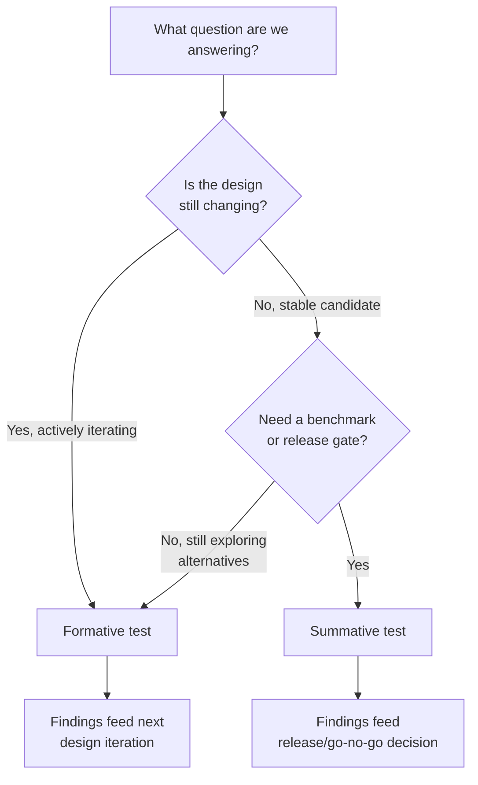
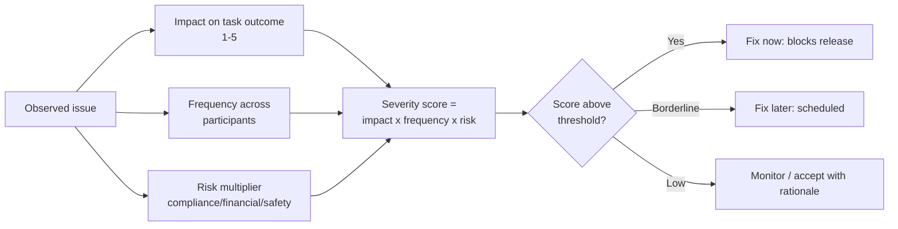
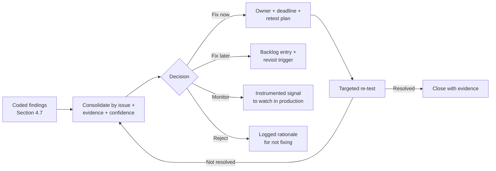

# Chapter: Usability Testing

Part: [02 - Design Thinking and Product Management](PART_OVERVIEW.md) - Subsection: Design Thinking - Status: Drafted

## 1. Introduction

Usability testing is the disciplined practice of evaluating whether representative
users can complete representative tasks with acceptable effectiveness,
efficiency, and confidence in a realistic context. It is not a generic feedback
meeting, and it is not a design taste review. It is a method with explicit
objectives, controlled session protocols, structured observation, and
decision-quality evidence outputs.

This chapter sits immediately after [Wireframing](CH09_Wireframing.md) and
consumes upstream outputs from [Research](CH02_Research.md),
[Personas](CH03_Personas.md), [Journey Mapping](CH05_Journey_Mapping.md),
[Problem Framing](CH06_Problem_Framing.md), and [Rapid Prototyping](CH08_Rapid_Prototyping.md).
It does not re-teach those practices. Instead, it owns the mechanics of running
usability tests well: objective design, task design, participant strategy,
moderation protocols, observation frameworks, bias control, interpretation,
and evidence-to-decision closure.

For Solution Architects, usability testing matters because many architecture
failures surface first as user struggle patterns: hidden dependency latency,
error-state ambiguity, brittle recovery, role-policy mismatch, and confusing
state transitions. A robust usability program reveals those risks before they
become production incidents, support load, and expensive rework.

## 2. Historical Evolution

- 1940s-1960s: Human Factors Engineering (HFE) in aviation and industrial
  systems established controlled task observation and error analysis for
  high-consequence workflows.
- 1970s-1980s: Human Computer Interaction (HCI) research formalized lab-based
  task studies, think-aloud techniques, and operator performance metrics.
- 1990s: Graphical User Interface (GUI) software teams adopted practical
  formative usability tests as part of interaction design cycles.
- 2000s: Web product scale pushed remote testing methods and lightweight,
  iterative rounds tied to rapid product releases.
- 2010s: Platform analytics and mixed-method discovery matured the split
  between formative and summative usability evaluation in product teams.
- 2020s: Unmoderated tooling, behavioral telemetry, and Artificial
  Intelligence (AI)-assisted analysis increased testing speed, while also
  increasing risk of low-quality interpretation without method discipline.

The throughline is stable: usability testing exists to reduce uncertainty about
real user behavior under realistic constraints, not to validate stakeholder
preference.

## 3. Why It Exists

Usability testing exists because teams consistently overestimate how obvious,
forgiving, and self-explanatory their interfaces are.

- Requirements do not prove usability. A feature can satisfy business and
  technical acceptance criteria while still being hard to use.
- Internal review is not a substitute for representative users. Team members
  carry domain and product knowledge that masks discoverability issues.
- Visual quality can hide interaction failures. Polished interfaces can still
  produce high error rates and abandonment.
- Architecture and interaction are coupled. If users repeatedly fail at one
  step, root causes may include service choreography, state handling,
  permission timing, or error semantics.
- Delivery speed amplifies risk. Without structured tests, teams repeatedly
  ship friction and then pay with support, churn, and retroactive redesign.

In this part's flow, usability testing converts prototype and wireframe
candidates into decision-grade evidence: proceed, revise, defer, or stop.

## 4. Core Concepts

### 4.1 Formative vs Summative Usability Testing

Definition:
Formative usability testing is diagnostic and improvement-oriented, usually
executed during design evolution. Summative usability testing is evaluative and
benchmark-oriented, usually executed when a design is stable enough for
comparative or release decisions.

Mechanism:
- Formative tests use smaller rounds, richer observation, and rapid iteration
  between rounds.
- Summative tests use tighter controls, consistent tasks, and metrics suitable
  for baseline or target comparisons.
- Both should define task success, critical errors, and data capture rules in
  advance.

Decision implications:
- Choose formative when the primary question is What should we change next?
- Choose summative when the primary question is Have we reached acceptable
  usability quality relative to baseline, target, or competitor?
- Avoid mixing both goals in one session unless explicitly planned, because the
  method quality for each can degrade.

Common failure mode:
Teams run a "formative" test but treat small-sample directional feedback as
release certification, or run a "summative" test with unstable prototypes and
inconsistent task conditions.

Concrete scenario:
A team redesigning enterprise onboarding runs two formative rounds to uncover
navigation confusion and policy-comprehension issues, then a summative round on
the stabilized flow to confirm task success and time-to-completion targets
before rollout.



The reason this distinction matters more than it first appears is that the
two test types optimize for opposite things: formative testing rewards a
facilitator who deviates from script to chase confusion wherever it appears,
while summative testing punishes exactly that same improvisation because it
breaks comparability across participants. A team that runs one script but
lets facilitators freelance mid-study ends up with data that is neither a
clean diagnostic read nor a defensible benchmark.

### 4.2 Moderated vs Unmoderated Testing

Definition:
Moderated testing includes a trained facilitator guiding each participant
session. Unmoderated testing presents scripted tasks without live facilitator
interaction.

Mechanism:
- Moderated sessions allow probing, clarification, and deeper diagnosis of
  confusion moments.
- Unmoderated sessions scale participant volume and speed, with cleaner
  consistency but less in-session recovery when participants misunderstand a
  task.
- Both require precise task wording and predefined success criteria.

Decision implications:
- Use moderated when tasks are complex, domain-heavy, or high-risk, and when
  diagnostic depth is more important than scale.
- Use unmoderated for clearer tasks, larger sample needs, and throughput-heavy
  iteration.
- Hybrid strategies are often strongest: moderated early to diagnose,
  unmoderated later to validate pattern prevalence.

Common failure mode:
Teams select unmoderated for complex enterprise workflows and then interpret
high drop-off as pure usability failure when task wording and context were
under-specified.

Concrete scenario:
A procurement system with role-based approval chains uses moderated sessions to
identify policy-language confusion first, then unmoderated rounds with cleaner
task prompts to estimate issue prevalence across geographies.

### 4.3 Qualitative vs Quantitative Usability Signals

Definition:
Qualitative signals explain why behavior occurred (confusion sources, mental
model mismatch, trust concerns). Quantitative signals measure how often,
how quickly, and how reliably behavior occurred.

Mechanism:
- Qualitative evidence includes observation notes, utterances, hesitation
  patterns, navigation detours, and recovery behavior.
- Quantitative evidence includes task completion rate, critical error rate,
  time-on-task, first-click accuracy, and standardized scales such as System
  Usability Scale (SUS).
- Interpretation quality increases when both are combined around the same task
  model.

Decision implications:
- Use qualitative-first when problems are unknown and diagnosis depth is needed.
- Add quantitative controls when comparing alternatives, tracking trendlines, or
  enforcing release-quality gates.
- Resist pseudo-precision: small-sample metrics are directional unless method
  design supports inferential claims.

Common failure mode:
Teams report one metric as the whole story, for example average time-on-task,
while ignoring that participants completed quickly only by skipping required
validation steps.

Concrete scenario:
A medical scheduling flow shows acceptable completion rate but high observed
hesitation at consent and insurance sections. Qualitative evidence reveals term
ambiguity; redesign improves confidence and reduces downstream support calls.

### 4.4 Task Design as the Core Instrument

Definition:
Task design is the construction of realistic, bounded participant prompts that
trigger the behavior the team needs to evaluate.

Mechanism:
- Tasks should reflect actual user intent, constraints, and context.
- Prompts should define goal and context without prescribing the interface path.
- Success criteria should include outcome correctness, not only completion.
- Task sets should include typical, edge, and recovery situations.

Decision implications:
- If task realism is low, evidence quality drops regardless of tool sophistication.
- High-risk flows require explicit failure-path tasks, not just happy path.
- Task sequencing matters: early tasks can prime later behavior and bias
  interpretation.

Common failure mode:
Tasks are written as step-by-step instructions, effectively converting the test
into interface following rather than usability evaluation.

Concrete scenario:
Instead of saying "Click Reports, then select Quarterly Risk View," the test
prompt says "You need to brief finance leadership on last quarter variance.
Find and share the relevant risk summary." This reveals discoverability and
information scent quality.

### 4.5 Participant Recruitment by Target User Profile

Definition:
Recruitment strategy is the deliberate selection of participants whose
experience, goals, constraints, and context match the user profile the product
serves for the tested tasks.

Mechanism:
- Start from target personas and job context defined upstream in
  [Personas](CH03_Personas.md).
- Create screening criteria for role, frequency of task, domain familiarity,
  and environmental constraints.
- Include exclusion criteria to avoid over-representation of internal proxies.
- Balance cohorts to reflect key behavior-relevant differences.

Decision implications:
- Sampling quality directly controls external validity of findings.
- For multi-role workflows, recruit each role separately and evaluate handoffs.
- In regulated or high-consequence domains, include participants with realistic
  compliance and policy burden.

Common failure mode:
Teams recruit convenient participants (internal staff, existing power users)
and draw conclusions for novice or occasional users.

Concrete scenario:
A travel-expense flow tested only with finance experts appears efficient; adding
frequent travelers with low policy knowledge exposes severe interpretation and
error-recovery issues that experts never encountered.

### 4.6 Moderation Protocol and Bias Control

Definition:
Moderation protocol is the pre-defined facilitator script and behavior standard
that protects session consistency and evidence integrity.

Mechanism:
- Use a standardized session flow: intro, consent, context framing, task block,
  neutral probes, debrief.
- Apply neutral prompts such as "What are you thinking now?" and "What would
  you expect here?"
- Track facilitator interventions as data, because intervention frequency itself
  is a usability signal.
- Use observer and note-taking roles separately when possible, as covered in
  [User Interviews](CH04_User_Interviews.md).

Decision implications:
- Strong protocol improves comparability across sessions and moderators.
- Bias control is not optional; it determines whether findings are trustworthy.
- Pilot sessions are mandatory for calibrating script clarity and moderator
  consistency.

Common failure mode:
Facilitators lead participants toward expected flows, then misread assisted
completion as interface clarity.

Concrete scenario:
In a claims-submission test, moderators who frequently rephrase tasks see higher
completion. After protocol tightening and intervention logging, true completion
rates drop, revealing a critical discoverability problem.

### 4.7 Observation Framework and Coding

Definition:
An observation framework is a structured scheme for capturing and coding events
during sessions so findings are reproducible and triage-ready.

Mechanism:
- Define event codes before testing: hesitation, navigation detour,
  misinterpretation, validation failure, abandon, recovery success,
  moderator assist.
- Tag each event by task step, severity hypothesis, and evidence strength.
- Distinguish symptom from suspected cause; causal claims require synthesis,
  not single-observation assertion.

Decision implications:
- Without coding standards, findings become anecdotal and hard to prioritize.
- Structured coding supports cross-round comparison and trend analysis.
- Architecture-relevant issues become visible when observation tags include
  state transitions and dependency-touchpoint references.

Common failure mode:
Teams collect unstructured notes and later prioritize by memory salience rather
than frequency, impact, and risk.

Concrete scenario:
A dashboard test uses event codes and finds repeated detours to the same panel
before filter use. This pattern links directly to layout semantics and data
state signaling issues, enabling focused redesign.

### 4.8 Issue Severity and Risk Triage

Definition:
Usability triage is the method for converting observed issues into prioritized
change decisions based on impact, frequency, and risk exposure.

Mechanism:
- Separate issue discovery from solution proposal in first pass.
- Score issues using a transparent matrix, for example:
  severity = impact on task outcome x frequency x risk multiplier
- Include risk multiplier for compliance, financial, safety, or operational
  consequence.
- Assign owner, expected fix horizon, and validation method.

Decision implications:
- Prioritization should align with product goals and architecture risk, not
  stakeholder seniority.
- Critical-path and irreversible-action issues should preempt cosmetic fixes.
- Triage output should feed backlog, architecture notes, and prototype loop
  planning.

Common failure mode:
Teams prioritize by anecdote intensity or executive reaction, leaving frequent
mid-severity workflow barriers unresolved.

Concrete scenario:
In checkout testing, one dramatic rare error is less harmful overall than a
frequent address-validation confusion that affects 40 percent of participants
and drives abandonment; triage matrix makes this explicit.



The multiplier for risk exists precisely because raw frequency alone
underweights low-frequency, high-consequence failures — a rare but total
data-loss error in a compliance workflow deserves a higher score than its
frequency alone would suggest, which is why the formula is multiplicative
rather than additive: a high risk multiplier should be able to elevate even
an infrequent issue above the fix-now threshold.

### 4.9 Evidence-to-Decision Loop

Definition:
Evidence-to-decision loop is the explicit closure step that turns test findings
into decisions, ownership, timelines, and re-test plans.

Mechanism:
- Consolidate findings by issue statement, supporting evidence, and confidence.
- Decide for each issue: fix now, fix later, monitor, or reject with rationale.
- Log decision trace with links to artifacts and planned validation round.
- Re-run targeted tests for high-severity or high-uncertainty fixes.

Decision implications:
- Usability testing without closure is performative activity.
- Decision traceability supports auditability and prevents repeated debates.
- Release confidence should be tied to closed-loop evidence, not test count.

Common failure mode:
Teams produce detailed findings decks that never materially change backlog,
release criteria, or design standards.

Concrete scenario:
A platform team runs three test rounds but ships unresolved critical errors due
to missing decision governance. After introducing explicit closure categories
and owner deadlines, issue carryover drops and release quality improves.



The loop closes only at "Close with evidence" — a finding that reaches "Fix
now" but never gets re-tested is functionally identical to one that was
never found, because no one can confirm the fix actually changed user
behavior rather than just changing the code.

## 5. Internal Working

A production-grade usability testing workflow usually follows this pipeline:

1. Define decision objective and test type (formative or summative).
2. Select artifact scope (wireframe, prototype, staging build) and readiness.
3. Design task set and success criteria.
4. Define recruitment plan and screener.
5. Prepare moderation protocol and observer guides.
6. Pilot the study and calibrate.
7. Run sessions and capture coded observations.
8. Synthesize qualitative and quantitative evidence.
9. Triage issues by severity and risk.
10. Convert findings into decisions and owners.
11. Re-test critical changes.

Operational roles:
- Research or design lead: method owner and integrity guard.
- Product manager: decision objective owner.
- Architect or engineering lead: feasibility and architecture-impact reviewer.
- Moderator: session execution owner.
- Note taker or observer: coding and evidence capture owner.
- Analytics partner: metric quality and interpretation support.

## 6. Design Principles

- Question-first design: every test exists to answer explicit decisions.
- Task realism over script convenience: simulate real intent and constraints.
- Neutral facilitation: protect participants from moderator guidance bias.
- Behavioral evidence first: what users do outranks what they claim they would do.
- Reproducibility: protocols and coding should allow another team to rerun.
- Risk-weighted prioritization: optimize for outcome harm reduction, not visual
  polish.
- Closed-loop governance: no findings without ownership and follow-through.

## 7. Architecture Patterns

Common operating patterns for usability testing programs:

- Embedded pattern: each product squad runs its own tests with shared standards.
- Hub-and-spoke pattern: central research team defines protocol standards and
  coaching; squads execute domain tests.
- Service pattern: specialist testing team runs studies on request.
- Hybrid maturation pattern: formative rounds embedded, summative gates
  centralized for consistency.

Session-level patterns:

- Diagnostic moderated pattern: small samples, deep probing, early-phase design.
- Validation unmoderated pattern: larger samples, standardized prompts,
  prevalence estimation.
- Sequential hybrid pattern: moderated discovery followed by unmoderated
  confirmation.

Pattern selection depends on product risk, team maturity, participant access,
and release cadence.

## 8. Production Architecture

Usability testing should be represented in production architecture as a
first-class quality input, not an optional design activity.

Architecture integration points:
- Experiment and instrumentation layer: event definitions aligned to task models.
- Environment strategy: stable test environments with realistic data behavior.
- Identity and access model: role-accurate test accounts and permission states.
- Feature flag strategy: controlled exposure for summative or comparative tests.
- Decision logging: links from findings to backlog items and Architecture
  Decision Records (ADRs) (recap: ADR full ownership is in
  [Architecture Thinking](../01_Architecture_Mindset/CH03_Architecture_Thinking.md)).

A practical architecture implication checklist per tested flow:
- Which dependency failures were user-visible?
- Which states lacked actionable recovery?
- Which role checks interrupted progression unexpectedly?
- Which telemetry signals were missing for post-release monitoring?

## 9. Implementation

Implementation in this chapter means implementing the testing system itself.

Step-by-step implementation plan:

1. Create a reusable test-plan template.
2. Define a task library format with versioning.
3. Create screener templates per user profile.
4. Standardize moderation scripts and intervention tags.
5. Define an observation coding schema.
6. Build issue triage matrix and severity definitions.
7. Create a findings-to-backlog handoff workflow.
8. Define re-test criteria for critical and high-severity issues.

Minimum artifact package per study:
- Test objective and decision statement.
- Task set and success criteria.
- Participant screener and cohort summary.
- Session protocol and pilot notes.
- Coded observations and metrics summary.
- Issue register with severity, risk, and owner.
- Decision log and re-test plan.

## 10. Complete Code Examples

Large runnable assets should be stored under [code](../code/) by language. The
snippets below show compact structures that teams can operationalize.

Example: usability test plan schema in YAML (YAML Ain't Markup Language)

```yaml
study:
  id: onboarding_formative_round_2
  type: formative
  objective: reduce setup confusion in approval-chain configuration
  artifact: high_fidelity_prototype
  decision_needed: proceed_or_revise_before_release_candidate

cohorts:
  - profile: procurement_manager
    target_count: 6
    criteria:
      - configures_approval_flows_monthly
      - not_involved_in_product_development
  - profile: finance_reviewer
    target_count: 4
    criteria:
      - reviews_escalations_weekly

tasks:
  - id: T1
    prompt: Configure a new approval route for purchases above 50,000 USD.
    success_criteria:
      - route_created
      - correct_threshold
      - escalation_contact_set
    critical_errors:
      - wrong_role_selected
      - threshold_misconfigured

metrics:
  - task_success_rate
  - critical_error_rate
  - time_on_task_seconds
  - sus_score

quality_gates:
  intervention_rate_max: 0.20
  missing_observation_tags_max: 0.05
  recruitment_match_min: 0.90
```

Example: issue triage scoring in Python

```python
from dataclasses import dataclass

@dataclass
class UsabilityIssue:
    issue_id: str
    impact: int          # 1..5
    frequency: int       # 1..5
    risk_multiplier: float  # 1.0, 1.5, 2.0


def severity_score(issue: UsabilityIssue) -> float:
    return issue.impact * issue.frequency * issue.risk_multiplier


def severity_band(score: float) -> str:
    if score >= 30:
        return "critical"
    if score >= 18:
        return "high"
    if score >= 8:
        return "medium"
    return "low"
```

Example: findings decision ledger entry in JSON (JavaScript Object Notation)

```json
{
  "studyId": "onboarding_formative_round_2",
  "issueId": "UT-014",
  "statement": "Users misinterpret escalation role field",
  "evidence": {
    "task": "T1",
    "frequency": 0.5,
    "impact": "route configured incorrectly",
    "confidence": "high"
  },
  "decision": "fix_now",
  "owner": "design_system_team",
  "targetRelease": "2026.09",
  "retestRequired": true
}
```

## 11. Performance

Performance for usability testing is operational performance of the testing
program.

Key performance indicators:
- Cycle time from objective definition to decision closure.
- Percentage of critical issues closed before release.
- Re-test turnaround time for high-severity fixes.
- Evidence completeness rate (coded observations and metrics available).
- Decision adoption rate (findings that changed backlog or design).

Program performance anti-signals:
- High session volume with low decision conversion.
- Repeated issue rediscovery across rounds.
- Long lag between finding and owner assignment.

## 12. Scalability

As product portfolios grow, usability testing must scale without losing method
quality.

Scalability practices:
- Shared templates and coding schema across squads.
- Central participant panel operations with role-segment indexing.
- Standardized tooling for session capture and synthesis.
- Governance metrics for protocol adherence.
- Study repository with search by flow, issue type, and severity.

Common scaling risks:
- Inconsistent moderation quality across teams.
- Fragmented evidence repositories that prevent reuse.
- Duplicate studies due to poor visibility into prior findings.

## 13. Security

Usability studies handle sensitive participant and product information.

Security controls:
- Data minimization for participant attributes and session artifacts.
- Consent capture and retention policies.
- Access controls for recordings and transcripts.
- Redaction pipeline for personally identifiable information.
- Environment segregation for production-like but non-production data.

Do not re-teach transport security internals here; those are owned by
[HTTP](../05_Networking_and_OS/CH01_HTTP.md). This chapter owns secure handling
of usability research operations and artifacts.

## 14. Observability

A test program should be observable like any other production capability.

Operational observability fields:
- Study throughput by product area and risk level.
- Recruitment fill-rate and profile match quality.
- Moderator intervention rate by task.
- Protocol deviation incidents.
- Finding-to-fix lead time.
- Re-test pass rate for critical issues.

Observation quality signals:
- Inter-rater coding consistency checks.
- Missing tag ratios.
- Session dropout and task abandonment reasons.

## 15. Failure Scenarios

- Recruitment mismatch: participants do not represent intended user profile,
  invalidating conclusions.
- Task contamination: prompts reveal navigation path and inflate completion.
- Moderator bias: leading probes alter participant behavior.
- Metric misuse: directional small-sample numbers are treated as statistical
  proof.
- Triage distortion: visually obvious but low-impact issues displace
  high-impact recurring failures.
- No closure: findings archived but not translated into backlog decisions.

Failure response playbook:
- Halt decision use when quality gates fail.
- Re-run with corrected recruitment or task design.
- Log protocol deviations explicitly.
- Separate method defect from product defect in reporting.

## 16. Testing

Testing in this chapter means testing the quality of the usability testing
process itself.

Quality assurance checks for each study:
- Pilot validation completed with script adjustments logged.
- Recruitment match score meets threshold.
- Moderator intervention rate within planned bounds.
- Observation coding completeness above threshold.
- Metric calculation reproducibility verified.
- Decision log completed for every high and critical issue.

Meta-testing techniques:
- Double-coding subset of sessions for consistency.
- Blind synthesis review for high-impact findings.
- Retrospective audit of previous round predictions vs outcomes.

## 17. Common Mistakes

- Treating usability tests as stakeholder demos.
- Running only happy-path tasks.
- Recruiting convenience participants.
- Leading participants with corrective hints.
- Over-indexing on single metrics.
- Merging discovery notes and decision logs into one ambiguous artifact.
- Declaring success without re-testing critical fixes.

## 18. Best Practices

- Define decision objective before building tasks.
- Pilot every study before main sessions.
- Use neutral moderation and intervention logging.
- Combine qualitative diagnosis with quantitative trend signals.
- Apply explicit severity and risk triage matrix.
- Maintain a searchable evidence repository.
- Link every major finding to owner, due date, and re-test plan.

## 19. Anti-Patterns

- Prototype theater testing: polished artifacts, no actionable decisions.
- Checkbox usability: running sessions only to satisfy governance formalities.
- Tool determinism: assuming platform automation guarantees method quality.
- Findings vanity deck: extensive presentation, weak ownership and execution.
- Severity inflation: marking all issues as critical to force roadmap priority.

## 20. Trade-off Analysis

| Decision Area | Option A | Option B | Benefits | Risks | Choose When |
|---|---|---|---|---|---|
| Test intent | Formative | Summative | Diagnostic speed vs benchmark reliability | Weak comparability vs premature certification | Formative for in-flight design changes; summative for release confidence and baseline tracking |
| Facilitation | Moderated | Unmoderated | Rich diagnosis vs scale and speed | Moderator bias risk vs context misunderstanding | Moderated for complex tasks; unmoderated for high-volume validation |
| Signal emphasis | Qualitative-first | Quantitative-first | Deeper cause insight vs faster trend comparability | Slower reporting vs shallow diagnosis | Qualitative-first for unknown problems; quantitative-first for known-metric monitoring |
| Sampling | Narrow cohort depth | Broader cohort breadth | Rich contextual depth vs better prevalence view | Limited generalization vs weaker per-segment insight | Narrow for early diagnosis; broader for later validation |
| Triage model | Impact-only | Impact x frequency x risk | Simpler decisions vs better business-risk alignment | Overlooks recurring friction vs increased process overhead | Use matrix when consequences vary significantly by domain risk |

## 21. Comparison Table

| Artifact or Practice | Primary Purpose | Typical Output | Owning Chapter |
|---|---|---|---|
| Usability testing protocol | Evaluate task success and interaction quality with representative users | Study plan, tasks, coded observations, prioritized issues, decision log | This chapter |
| Wireframe | Define structure, hierarchy, and state model | Screen and flow artifact with annotations | [Wireframing](CH09_Wireframing.md) |
| Rapid prototyping loop | Retire assumptions through fast artifact iterations | Timeboxed loop evidence and decision | [Rapid Prototyping](CH08_Rapid_Prototyping.md) |
| User interview | Generate deeper attitudinal and contextual understanding | Discussion guide, interview notes, synthesis inputs | [User Interviews](CH04_User_Interviews.md) |
| Research synthesis | Convert raw evidence into robust findings and themes | Affinity map, themes, confidence notes | [Research](CH02_Research.md) |

## 22. Real-World Case Study

### Case: Enterprise Access-Request Workflow Modernization

A global enterprise modernized an internal access-request system used by
employees, managers, and security approvers. Early pilots showed low adoption
and high support volume despite complete functional parity with legacy tools.

Baseline indicators:
- Task completion for first-time employees: 54 percent.
- Critical error rate at manager-approval step: 31 percent.
- Median time-on-task for end-to-end request: 14.2 minutes.
- Support tickets related to "request status confusion": 1,150 per month.

Testing strategy:
- Round 1 formative, moderated: diagnose breakdowns in request creation and
  approval routing.
- Round 2 formative, moderated plus targeted unmoderated: validate revised
  terminology and status signaling.
- Round 3 summative: benchmark stabilized design before staged release.

Key findings:
- Users misunderstood role labels and selected invalid approvers.
- Status state names did not match policy language used by security teams.
- Recovery from rejected requests lacked a clear next action path.
- Hidden dependency latency made users retry submissions, creating duplicates.

Triage and decisions:
- Critical: approver-selection model and validation feedback redesign.
- High: status taxonomy realignment to policy vocabulary.
- High: asynchronous submission acknowledgement with explicit processing state.
- Medium: help content and tooltip sequencing improvements.

Post-release outcomes after re-test and rollout:
- First-time task completion increased to 86 percent.
- Critical error rate decreased from 31 percent to 8 percent.
- Median time-on-task decreased to 8.1 minutes.
- Status-confusion support tickets reduced by 57 percent.

Primary lesson:
Most value came from fixing state model clarity and recovery behavior, not from
visual refresh. Usability testing exposed architecture-relevant failure surfaces
early enough to change flow logic and service interaction patterns before broad
release.

## 23. Interview Questions

1. Explain the difference between formative and summative usability testing and
   when each should be used.
2. How do you decide between moderated and unmoderated testing for one product
   flow?
3. Why is task design the core instrument of usability testing quality?
4. Which recruitment mistakes most often invalidate findings?
5. How do you separate symptom observation from causal inference in synthesis?
6. What metrics are most useful for summative usability evaluation, and what
   are their limitations?
7. How would you build a severity triage matrix that includes business risk?
8. Describe a bias-control protocol for moderators.
9. How should usability findings be linked to architecture decisions?
10. What makes a usability testing program auditable and reproducible?

## 24. Hands-on Exercises

1. Select one high-friction workflow in your product and write a usability test
   objective with explicit decision criteria.
2. Design five realistic tasks including one failure recovery task.
3. Create a screener for two user profiles and define inclusion/exclusion
   criteria.
4. Run a pilot session and update the script based on observed ambiguity.
5. Execute at least six sessions, code observations, and produce a severity-
   ranked issue list.
6. Write a decision log with fix-now, fix-later, monitor, and reject outcomes.

## 25. Design Exercises

Design a usability testing operating model for an organization with twelve
product squads across regulated and non-regulated domains.

Your design must include:
- Governance boundary between central standards and squad autonomy.
- Required quality gates for formative and summative studies.
- Recruitment operations model and participant-data controls.
- Cross-squad repository model for findings reuse.
- Severity triage standards and release-gate linkage.
- Capacity model for moderators and observers.

Evaluate your design against constraints:
- Fast release cadence with limited research specialists.
- Strict compliance expectations for participant data handling.
- Need for comparable benchmark metrics across product lines.

## 26. Architecture Review Questions

- Are tested tasks mapped to architecture-significant user journeys?
- Do findings identify where system states are unclear to users?
- Were dependency failures and fallback behaviors observed explicitly?
- Is issue severity tied to operational and compliance risk?
- Are findings traceable to backlog changes and Architecture Decision Records?
- Is re-test evidence required for critical usability defects before release?
- Are telemetry events sufficient to monitor known usability risks in
  production?
- Does the test process itself meet reproducibility and auditability standards?

## 27. Summary

Usability testing is the method discipline that converts interaction assumptions
into evidence strong enough to drive product and architecture decisions. Its
value depends less on tools and more on protocol quality: clear objectives,
realistic tasks, representative recruitment, neutral moderation, structured
observation, and explicit triage.

This chapter distinguished formative vs summative intent, moderated vs
unmoderated execution, and qualitative vs quantitative signal use. It also
established test-readiness and result-quality standards, plus the evidence-to-
decision loop that prevents findings from becoming shelfware.

In this part's sequence, usability testing consumes wireframe and prototype
artifacts and returns prioritized change decisions. Done well, it reduces
rework, lowers support burden, improves release confidence, and surfaces
architecture-relevant risk before production impact.

Further reading: [Empathy](CH01_Empathy.md) - [Research](CH02_Research.md) -
[Personas](CH03_Personas.md) - [User Interviews](CH04_User_Interviews.md) -
[Journey Mapping](CH05_Journey_Mapping.md) - [Problem Framing](CH06_Problem_Framing.md) -
[Ideation](CH07_Ideation.md) - [Rapid Prototyping](CH08_Rapid_Prototyping.md) -
[Wireframing](CH09_Wireframing.md) -
[Architecture Thinking](../01_Architecture_Mindset/CH03_Architecture_Thinking.md)
