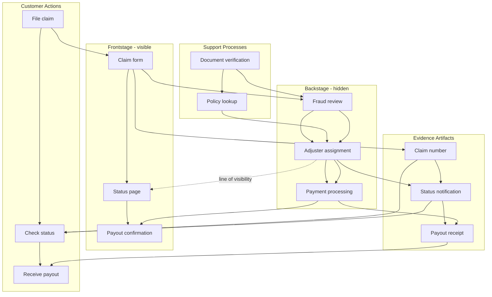
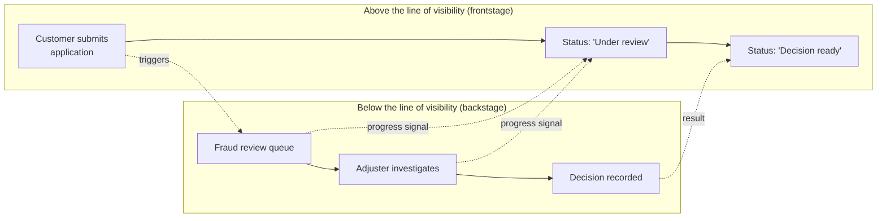
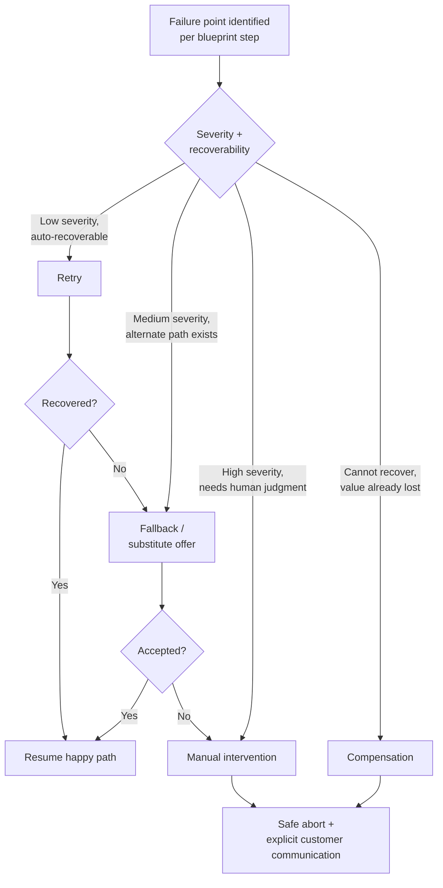

# Chapter: Service Design

Part: [02 - Design Thinking and Product Management](PART_OVERVIEW.md) · Subsection: Design Thinking · Status: Drafted

## 1. Introduction

Service design is the discipline of intentionally designing how people, processes,
systems, policies, and teams work together to deliver a coherent end-to-end
experience. If journey mapping asks what the user experiences over time,
service design asks what the organization must orchestrate behind the scenes so
that the promised experience is consistently delivered in reality.

For Solution Architects, this chapter is the bridge between customer-facing
design artifacts and production architecture. It explains how to move from a
frontstage view of touchpoints and emotions into backstage workflows, handoffs,
data dependencies, operational controls, and governance decisions that make the
service reliable at scale.

This chapter deliberately builds on prior chapters without re-teaching their
owned concepts in full:

- Journey-map construction is owned by [CH05_Journey_Mapping.md](CH05_Journey_Mapping.md).
  Here, we recap its outputs and extend them into service blueprints.
- Problem statement framing and How-Might-We (HMW) construction are owned by
  [CH06_Problem_Framing.md](CH06_Problem_Framing.md). Here, we consume those
  outputs as blueprint design constraints.
- Divergent and convergent ideation mechanics are owned by
  [CH07_Ideation.md](CH07_Ideation.md). Here, we use ideation outcomes to
  select candidate service interventions.
- Prototype loop strategy is owned by [CH08_Rapid_Prototyping.md](CH08_Rapid_Prototyping.md).
  Here, we prototype service flows and operational behavior, not only interface
  layout.
- Structural interaction artifacts are owned by [CH09_Wireframing.md](CH09_Wireframing.md).
  Here, wireframes become one evidence source and handoff artifact for service
  orchestration.

The core outcome of this chapter is practical mastery of service blueprinting:
frontstage and backstage decomposition, line of visibility reasoning, support
process modeling, evidence artifacts, role handoffs, failure-point design, and
governance across the service lifecycle.

## 2. Historical Evolution

- 1980s: G. Lynn Shostack formalized the service blueprint and the line of
  visibility, making service experiences analyzable as designed systems rather
  than marketing narratives.
- 1990s: service design emerged as a named discipline in design consultancies
  and academic programs, expanding from customer-contact scripts to full
  end-to-end service ecosystems.
- 2000s: omnichannel delivery increased interaction fragmentation across web,
  mobile, call centers, branches, and partners, creating frequent seam
  failures that traditional process maps could not expose from the customer
  viewpoint.
- 2010s: customer experience (CX) and User Experience (UX) teams adopted
  journey maps broadly, while operations teams refined process metrics; service
  design became the connecting mechanism between these two worlds.
- 2020s: digital platforms, cloud-native services, automation, and
  Artificial Intelligence (AI) assistants increased service speed but also
  increased socio-technical coupling. Blueprint governance became essential for
  coordinating product, platform, compliance, and operations.

The historical trend is consistent: as service delivery becomes more
cross-channel and software-mediated, the cost of unmanaged handoffs rises.
Service design exists to manage that complexity as a first-class architectural
concern.

## 3. Why It Exists

Service design exists because organizations usually optimize local components
while users experience the global journey.

- Team-local optimization does not guarantee journey quality. A fast checkout
  service and a fast support queue can still produce a poor experience if the
  error handoff between them is ambiguous.
- Organizational boundaries create invisible failure zones. Ownership often
  stops at team borders, while user pain concentrates exactly at those borders.
- Product intent and operational reality diverge without explicit orchestration.
  A desirable concept can fail in production because staffing, policy,
  escalation, or observability assumptions were never designed.
- Architecture decisions need service-level context. Interface-level and
  Application Programming Interface (API) decisions change customer outcomes
  only when they align with workflow, policy, and support behavior.

In short, service design transforms a sequence of touchpoints into an operating
model that can deliver the intended experience repeatedly, safely, and at
scale.

## 4. Core Concepts

### 4.1 Service Design as a Socio-Technical System

Definition:
Service design is the intentional design of interactions between people,
software, process, policy, and physical or digital evidence to create an
end-to-end value-delivery experience.

Mechanism (how it works):
A service is decomposed into user actions, contact points, backstage activities,
supporting systems, and governance rules. Designers model not only what should
happen but who does what, when, with which information, and under what
constraints.

Decision implications (when and why to use it):
Use service design when outcomes depend on cross-functional coordination,
especially where user-facing flow spans multiple teams, systems, or channels.
It is less necessary for isolated, single-step interactions with minimal
handoff risk.

Common failure mode:
Teams treat service design as visual documentation only, without changing
handoff ownership, operational policy, or error management.

Concrete scenario:
A healthcare teleconsultation product has excellent booking screens but frequent
visit failures because identity checks, payment holds, and clinician availability
are handled by separate teams with inconsistent escalation rules. Service design
makes those backstage dependencies explicit and redesigns the handoffs.

### 4.2 Service Blueprint Anatomy

Definition:
A service blueprint is a structured map of how a service is delivered, linking
customer actions to frontstage interactions, backstage operations, support
processes, and enabling systems.

Mechanism (how it works):
A blueprint is organized in horizontal lanes and time-sequenced columns. Typical
lanes include:

- Customer actions
- Frontstage interactions (visible to the customer)
- Backstage actions (invisible, but directly supporting frontstage)
- Support processes (shared operations that enable backstage execution)
- Evidence artifacts (receipts, notifications, confirmations, status pages)

Decision implications (when and why to use it):
Use blueprinting when teams need a single artifact that connects experience,
operations, and architecture decisions. It is especially useful before
large-scale redesigns, multi-team transformations, or reliability improvement
programs.

Common failure mode:
Creating a static workshop poster that is never linked to metrics, ownership,
or delivery planning.

Concrete scenario:
An insurance claim process blueprint reveals that claim-status notifications are
triggered by three different systems with inconsistent language. The team
standardizes evidence artifacts and notification ownership to reduce support
calls.

The lanes are ordered deliberately: customer actions and frontstage sit above
the line of visibility, backstage and support processes sit below it, and
evidence artifacts are the only elements deliberately designed to cross that
line — they are backstage progress translated into something the customer can
see and trust.

### 4.3 Frontstage, Backstage, and the Line of Visibility

Definition:
Frontstage refers to interactions visible to the customer; backstage refers to
the internal activities that enable those interactions. The line of visibility
separates these two planes.

Mechanism (how it works):
For each touchpoint, teams identify which actions are customer-visible,
which are hidden, and which hidden actions are prerequisites for visible
progress. This clarifies what can be optimized silently and what requires
explicit communication.

Decision implications (when and why to use it):
Use the line of visibility to decide where to invest in transparency,
self-service, and expectation-setting. If backstage latency cannot be reduced,
frontstage communication must compensate through accurate evidence and state
feedback.

Common failure mode:
Assuming hidden work does not affect experience. In reality, invisible delays
without visible explanation are often interpreted as failure or neglect.

Concrete scenario:
A loan application includes a manual fraud review. Instead of exposing a generic
pending state, the service explicitly communicates review progress and expected
turnaround windows, reducing abandonment and duplicate submissions.

The line of visibility is not a fixed wall; it is a design decision about
which backstage progress gets translated into a frontstage signal. Moving
the line — exposing more backstage state — costs engineering effort to
instrument and communicate, but not moving it risks customers interpreting
silence as failure, which is exactly the trade-off this concept forces teams
to make explicit rather than leaving to default engineering convenience.

### 4.4 Support Processes and Enabling Systems

Definition:
Support processes are internal workflows that do not directly interact with the
customer but make customer-facing delivery possible. Enabling systems are the
technical platforms and tools executing those workflows.

Mechanism (how it works):
Blueprints trace each frontstage promise to required support processes, then map
those processes to systems, data contracts, and operational runbooks. This
creates traceability from experience claim to implementation capability.

Decision implications (when and why to use it):
Use this concept to avoid over-investing in interface changes that backend
capability cannot sustain. It guides sequencing: often support-process redesign
must precede frontstage rollout.

Common failure mode:
Launching redesigned user flows without modernizing the support process,
resulting in polished interfaces backed by brittle manual operations.

Concrete scenario:
An e-commerce returns flow adds one-click returns, but warehouse exception
handling remains spreadsheet-driven. Service design identifies the support
process gap and prioritizes returns triage automation before broad release.

### 4.5 Evidence Artifacts and Experience Trust

Definition:
Evidence artifacts are the tangible or digital signals that confirm service
state to the customer, such as confirmation numbers, receipts, status updates,
notifications, and escalation acknowledgments.

Mechanism (how it works):
For every high-stakes or ambiguous step, the blueprint defines required evidence:
what signal is emitted, when, in what channel, with which semantics, and how it
is reconciled with system state.

Decision implications (when and why to use it):
Use evidence design wherever uncertainty can cause anxiety, duplicate effort,
or support demand. Evidence design is crucial in payments, bookings,
healthcare, logistics, and compliance-heavy workflows.

Common failure mode:
Sending technically correct but semantically weak updates, for example order
accepted without expected ship time or next action guidance.

Concrete scenario:
A travel rebooking service reduces call-center volume by emitting explicit
rebooked, ticket-issued, and payment-adjusted evidence artifacts with clear
next-step guidance.

### 4.6 Role Handoffs and Responsibility Integrity

Definition:
Role handoffs are transitions of responsibility across people, teams, or
systems during service delivery.

Mechanism (how it works):
Blueprints explicitly mark handoff trigger, payload, owning role, receiving
role, completion condition, and timeout behavior. This converts implicit
coordination into auditable contracts.

Decision implications (when and why to use it):
Use explicit handoff modeling in any service where unresolved tasks can stall,
duplicate, or be dropped. Handoff integrity is a reliability problem, not only
an operations concern.

Common failure mode:
Handoffs without completion criteria, leading to ticket ping-pong, unresolved
cases, and customer repetition burden.

Concrete scenario:
In subscription cancellation disputes, ownership shifts from chatbot to billing
to retention specialist. Explicit handoff contracts remove duplicate questioning
and reduce resolution time.

### 4.7 Failure Points, Recovery Paths, and Service Resilience

Definition:
Failure points are moments where the service can break from a customer
perspective. Recovery paths are designed mechanisms to restore progress,
confidence, and control.

Mechanism (how it works):
Teams identify failure modes per blueprint step, classify them by severity and
recoverability, then define containment and recovery behavior: retry, fallback,
manual intervention, compensation, or safe abort.

Decision implications (when and why to use it):
Use failure-point design early when service reliability is business-critical,
regulated, or trust-sensitive. Recovery design must be part of discovery,
not postponed to incident response.

Common failure mode:
Designing only happy-path choreography. Users then encounter dead ends where
support has no contextual data and no authorized recovery action.

Concrete scenario:
A same-day delivery promise fails due to inventory mismatch. Instead of a late
failure message, the blueprint defines proactive notification, substitute
recommendations, and compensation policy before checkout confirmation.

Designing this flow at discovery time, before the failure happens in
production, is what separates service design's failure-point work from
incident response: the choice between retry, fallback, manual intervention,
compensation, and safe abort should be a deliberate policy decision made with
full context, not an improvised judgment call made by whichever on-call
engineer encounters the failure first.

### 4.8 Service Blueprint Governance

Definition:
Service blueprint governance is the ongoing practice of versioning, ownership,
quality gates, and review cadence for blueprint artifacts.

Mechanism (how it works):
Each blueprint has named owners, change control rules, linkages to metrics,
review triggers, and retirement criteria. Changes in architecture, policy,
channel strategy, or compliance trigger blueprint review.

Decision implications (when and why to use it):
Use governance whenever the service has multiple squads, regulatory obligations,
or frequent change. Without governance, blueprint quality decays and teams
revert to informal local process maps.

Common failure mode:
Blueprint drift: the artifact diverges from production behavior, reducing trust
and causing planning decisions based on stale assumptions.

Concrete scenario:
A financial onboarding blueprint is reviewed quarterly and after any
Anti-Money Laundering (AML) policy change. Governance catches a new verification
step that otherwise would have broken the mobile onboarding flow.

## 5. Internal Working

A practical service-design operating cycle:

1. Define journey scope and actor.
2. Import validated current-state journey findings from
   [CH05_Journey_Mapping.md](CH05_Journey_Mapping.md).
3. Select the service scenario and service boundaries.
4. Draft blueprint lanes and event timeline.
5. Populate frontstage interactions from journey touchpoints.
6. Derive backstage actions required for each frontstage step.
7. Add support processes and enabling systems.
8. Define evidence artifacts for each high-risk state transition.
9. Annotate role handoffs and ownership contracts.
10. Identify failure points and design recovery paths.
11. Add governance metadata: owner, review cadence, metric linkage, and version.
12. Validate with cross-functional walkthroughs and live case replay.
13. Translate accepted blueprint changes into delivery architecture backlog.

A key mechanism is bidirectional traceability:

- Journey pain point -> blueprint step -> system dependency -> backlog item.
- Incident class -> failed handoff or missing evidence -> blueprint update.

This keeps service design connected to both discovery and operations rather
than becoming a one-time workshop deliverable.

## 6. Design Principles

- Design for continuity, not isolated touchpoint quality.
- Make hidden work legible when it affects trust.
- Treat handoffs as contracts, not assumptions.
- Design evidence as carefully as actions.
- Default to recoverability over perfect prevention.
- Optimize both customer effort and operator effort.
- Align channel behavior around one service truth model.
- Version service blueprints as living architecture artifacts.
- Link every major blueprint decision to measurable outcomes.

## 7. Architecture Patterns

Common service-design patterns for digital services:

### 7.1 Request -> Triage -> Fulfillment -> Closure

Used in support-intensive domains. Key blueprint focus:

- clear intake semantics
- triage ownership
- fulfillment dependency graph
- explicit closure evidence

### 7.2 Self-Service with Assisted Escalation

Used where automation handles the majority path but human support resolves
exceptions.

- frontstage autonomy with clear escape hatches
- context-preserving escalation payload
- no customer repetition of already provided information

### 7.3 Appointment and Capacity-Constrained Service

Used in healthcare, field services, and consulting.

- booking evidence and capacity promises
- pre-service preparation artifacts
- no-show and reschedule recovery choreography

### 7.4 Omnichannel Continuity Pattern

Used when users switch channels mid-journey.

- shared state model across web, mobile, and human-assisted channels
- handoff continuity and identity assurance
- consistent evidence semantics across channels

### 7.5 High-Risk Exception Pattern

Used in fraud, compliance, and safety-critical workflows.

- explicit risk checkpoint lanes
- fail-safe behavior definition
- compensating communication and appeal process

## 8. Production Architecture

Service design becomes production architecture when blueprint elements are
mapped to deployable capabilities:

- Frontstage interactions map to channels, interface components, and API
  orchestration boundaries.
- Backstage actions map to workflow engines, event handlers, rule services,
  and case-management tools.
- Support processes map to operations platforms, staffing models, and
  Standard Operating Procedures (SOPs).
- Evidence artifacts map to notification services, document templates, and
  state-reconciliation jobs.
- Failure recovery paths map to retry policies, compensation workflows,
  escalation queues, and incident playbooks.

A practical production blueprint-to-architecture matrix includes:

- service step identifier
- owning squad and accountable role
- system components and data dependencies
- service-level objective and error budget expectation
- evidence artifact and channel
- recovery path and operational runbook reference

This matrix is often the missing connector between design workshops and
architecture reviews.

## 9. Implementation

A phased implementation approach:

### Phase 1: Baseline

- Build current-state blueprint for one high-impact journey.
- Capture known pain points, handoff gaps, and evidence weaknesses.
- Establish blueprint ownership and review cadence.

### Phase 2: Redesign

- Prioritize blueprint interventions by user impact and implementation
  feasibility.
- Co-design frontstage and backstage changes together.
- Define pilot scope and success metrics.

### Phase 3: Pilot and Learn

- Run controlled rollout for a segment or channel.
- Monitor customer, operational, and reliability outcomes.
- Update blueprint from real-world exceptions.

### Phase 4: Scale

- Extend to adjacent journeys.
- Standardize blueprint notation and governance.
- Integrate blueprint checkpoints into delivery and architecture reviews.

### Phase 5: Institutionalize

- Train cross-functional teams in blueprint reading and maintenance.
- Link blueprint updates to architecture decision records.
- Treat blueprint drift as a quality risk requiring remediation.

## 10. Complete Code Examples

Service design is primarily artifact-driven rather than code-first. In this
chapter, complete examples are represented as blueprint schemas and contract
notations that can be implemented in any platform stack.

Example: blueprint step contract schema

- Step ID
- Customer goal
- Frontstage action
- Backstage action
- Support process
- Evidence artifact
- Owning role
- Timeout threshold
- Failure class
- Recovery path
- Observability signal

Example: handoff contract schema

- Trigger event
- Required context payload
- Receiving owner
- Acknowledgment service-level objective
- Completion condition
- Escalation rule

These schemas are implementation-neutral and should be translated into your
organization's workflow tools, issue templates, and architecture repositories.

## 11. Performance

Service performance in service design is not only response time. It includes:

- customer-perceived latency at each high-friction step
- handoff delay between teams or systems
- queue wait time and variance
- recovery time for recoverable failures
- evidence delivery timeliness

A high-performing service is one where progress is timely, predictable, and
transparent even when exceptions occur.

Performance heuristics:

- optimize perceived waiting experience when absolute latency cannot be reduced
- prioritize latency at emotional low points identified in the journey map
- minimize multi-hop synchronous dependencies in high-volume touchpoints

## 12. Scalability

Service scalability has three dimensions:

- demand scalability: ability to absorb volume growth
- complexity scalability: ability to add channels, policies, and variants
  without service fragmentation
- organizational scalability: ability to coordinate more teams without
  handoff collapse

Blueprint-informed scalability strategies:

- modularize support processes with clear ownership boundaries
- standardize evidence artifact semantics across channels
- use event-driven choreography for loosely coupled backstage steps
- separate policy decision points from channel-specific interfaces

Scalability failure often appears as inconsistent experience, not only outages.

## 13. Security

Service design must include security as an experience and process property,
not only a code property.

Security in blueprint terms:

- identity assurance checkpoints
- consent and authorization touchpoints
- data minimization across handoffs
- privileged-action governance
- secure exception handling and auditability

Common security-service design tensions:

- stronger verification versus abandonment risk
- fraud controls versus flow friction
- data access speed versus least-privilege principles

The correct design balances these through risk-tiered flows and explicit
communication evidence so users understand why additional controls are required.

## 14. Observability

Observability for service design connects user experience signals with
backstage operational telemetry.

Minimum observability model:

- journey-step event taxonomy
- handoff success and timeout metrics
- evidence artifact emission tracking
- failure-class distribution
- recovery-path effectiveness metrics

A service blueprint becomes operationally useful when every critical lane
transition has measurable signals and alert thresholds.

Recommended linkage:

- blueprint step IDs embedded in logs and traces
- dashboard views aligned to frontstage stages
- incident templates referencing affected blueprint steps

This enables faster root-cause analysis from customer symptom to backstage
failure mechanism.

## 15. Failure Scenarios

Representative failure scenarios and blueprint responses:

1. Lost handoff between automated triage and human queue.
   Response: explicit acknowledgment requirement and timeout-based escalation.
2. Evidence artifact emitted before transaction finalization.
   Response: state reconciliation guard and compensating notification flow.
3. Channel switch loses customer context.
   Response: shared case context model and continuation token strategy.
4. Compliance checkpoint blocks legitimate users disproportionately.
   Response: risk-tiered review and assisted verification fallback.
5. Inventory or capacity mismatch after promise confirmation.
   Response: proactive exception evidence, alternative options, and compensation.

Failure readiness should be validated before scale rollout, not after incident
frequency rises.

## 16. Testing

Service-design testing extends beyond interface usability.

### 16.1 Blueprint Validation Testing

- cross-functional walkthrough with real case narratives
- role-play of frontstage and backstage interactions
- verification of ownership and completion criteria per handoff

### 16.2 Operational Scenario Testing

- happy path and exception-path rehearsals
- queue overload simulation
- delayed dependency and timeout simulation

### 16.3 Evidence and Communication Testing

- clarity and timing of confirmations
- channel consistency for status semantics
- customer comprehension under stress conditions

### 16.4 Governance Testing

- artifact freshness checks
- policy change impact traceability
- post-incident blueprint update completeness

Testing goal: confirm the service works as a coordinated system, not only as
isolated component correctness.

## 17. Common Mistakes

- Treating blueprinting as a design workshop artifact only.
- Modeling only happy paths.
- Omitting support processes because they are less visible.
- Ignoring evidence artifacts and focusing only on transaction mechanics.
- Allowing ambiguous handoff ownership.
- Failing to connect blueprint changes to architecture and backlog decisions.
- Not updating blueprint after incidents or policy changes.

## 18. Best Practices

- Start with one critical journey and deepen quality before broad expansion.
- Use shared notation across teams to reduce interpretation variance.
- Require explicit handoff contracts for all cross-team transitions.
- Pair customer-impact metrics with operator-effort metrics.
- Maintain a failure library tied to blueprint steps.
- Integrate blueprint review into release and architecture governance.
- Keep blueprint IDs and observability signals aligned.
- Revalidate blueprints after major channel or policy changes.

## 19. Anti-Patterns

- Blueprint theater: impressive diagrams with no ownership changes.
- Channel silos: separate blueprints per channel with no continuity model.
- Notification spam as substitute for meaningful evidence.
- Escalation dumping: every exception sent to humans without triage quality.
- Governance neglect: stale artifacts used in strategic decisions.
- Tool absolutism: forcing all service behavior into one workflow tool despite
  heterogeneous needs.

## 20. Trade-off Analysis

Key trade-offs in service design:

- Transparency versus cognitive load: more state visibility can improve trust
  but overwhelm users if poorly designed.
- Automation versus flexibility: automation improves scale but may fail on
  high-context exceptions without assisted paths.
- Standardization versus local optimization: uniform process improves
  consistency but may reduce domain-specific responsiveness.
- Strict control versus flow speed: stronger security and compliance can
  increase friction; risk-tiering is often the balancing mechanism.
- Central governance versus team autonomy: governance reduces drift, while
  excessive centralization can slow iteration.

A sound decision records both user impact and operational impact, not one
without the other.

## 21. Comparison Table

| Artifact | Primary Question | Time Orientation | Typical Owner Mix | Output Nature | When to Use |
|---|---|---|---|---|---|
| Empathy Map | What does this person say, think, do, and feel? | Moment-focused | Research, design, product | Understanding artifact | Early understanding and bias correction |
| Persona | Who are we designing for and what goals matter most? | Relatively stable profile | Research, design, product | Decision proxy for user segments | Prioritization and design alignment |
| Journey Map | How does the person's experience evolve across stages? | End-to-end over time | Design, product, architecture | Experience sequence with pain points | Identify where experience breaks |
| Service Blueprint | What must the organization orchestrate to deliver the journey reliably? | End-to-end with operational depth | Design, product, architecture, operations, support, compliance | Socio-technical delivery model | Design and govern service execution |
| Wireframe | How should interface structure and state logic appear on screen? | Screen and flow level | Design, product, engineering | Structural interaction artifact | Shape interface behavior before styling |
| Rapid Prototype | Which assumptions should we test next and how fast can we learn? | Iterative loop | Product, design, engineering, architecture | Experiment artifact | Reduce uncertainty before commitment |

## 22. Real-World Case Study

Case: Omnichannel mortgage pre-approval service

Context:
A regional bank offered web and branch-based pre-approval. Customers reported
high confusion, repeated document uploads, and inconsistent approval timelines.
Metrics showed moderate digital conversion but severe drop-off during
verification and high support-contact volume.

Service-design intervention:

1. Team created a current-state journey map and identified the emotional low
   around document verification uncertainty.
2. Team built a service blueprint with lanes for customer actions, branch
   advisor actions, underwriting operations, fraud checks, and evidence
   artifacts.
3. Blueprint revealed three critical defects:
   - no shared context between branch and web channels
   - duplicate manual checks without ownership clarity
   - weak evidence artifacts, especially pending-state communication
4. Redesign introduced:
   - unified case identifier across channels
   - explicit triage and underwriting handoff contracts
   - milestone evidence artifacts with estimated turnaround and next actions
   - exception recovery path for missing or unreadable documents

Results after phased rollout:

- 24 percent reduction in support contacts per application
- 18 percent improvement in application completion
- 31 percent reduction in median verification cycle time
- improved branch advisor satisfaction due to lower context-reconstruction work

Architecture lesson:
The largest gains did not come from interface redesign alone. They came from
orchestrating backstage ownership, evidence semantics, and channel continuity as
a single service system.

## 23. Interview Questions

1. What is the difference between a journey map and a service blueprint, and
   when would you use each?
2. How does the line of visibility influence architecture and communication
   decisions?
3. Why are evidence artifacts critical in high-anxiety service moments?
4. How would you design a handoff contract between automation and human
   operations?
5. Which metrics would you use to measure service handoff quality?
6. How do you prevent blueprint drift in a fast-changing product?
7. Describe a failure-recovery design for a payment-confirmation mismatch.
8. How should security controls be represented in a service blueprint?
9. What trade-offs appear when scaling an omnichannel service?
10. How would you connect blueprint steps to observability instrumentation?

## 24. Hands-on Exercises

1. Choose a service you use weekly and draft a mini blueprint with five lanes:
   customer actions, frontstage, backstage, support process, evidence.
2. Mark three role handoffs and define trigger, payload, owner, and timeout for
   each.
3. Identify two failure points and design one recovery path per failure.
4. Define one dashboard metric for each of the following: handoff delay,
   evidence timeliness, recovery success rate.

## 25. Design Exercises

1. Redesign an existing onboarding flow so that one manual compliance step is
   preserved but perceived waiting anxiety is reduced.
2. Propose a service blueprint variant for low-risk and high-risk customer
   segments, including different verification behaviors.
3. Design an assisted-escalation experience where users can move from chatbot
   to human support without repeating context.
4. Create a governance policy for blueprint review triggers after incidents,
   policy changes, and channel launches.

## 26. Architecture Review Questions

1. Are all critical frontstage promises traceable to backstage capabilities?
2. Which blueprint handoffs currently lack explicit ownership contracts?
3. Are evidence artifacts semantically clear and state-consistent across
   channels?
4. What are the top three failure points by user impact and operational cost?
5. Which recovery paths are automated, which are manual, and why?
6. Does observability instrumentation align to blueprint step identifiers?
7. How is blueprint drift detected and corrected?
8. Are security and compliance controls placed proportionally to risk tiers?
9. Which support processes are current scalability bottlenecks?
10. What decision in this blueprint is hardest to reverse later, and what
    evidence justifies committing now?

## 27. Summary

Service design is the operational bridge between customer-experience intent and
reliable production delivery. It extends journey thinking into a socio-technical
orchestration model where frontstage behavior, backstage workflows, evidence
artifacts, role handoffs, failure recovery, and governance are designed as one
system.

The service blueprint is this chapter's central technique because it makes
cross-functional dependencies explicit and therefore manageable. For Solution
Architects, blueprint quality directly influences delivery reliability,
observability clarity, and change safety.

Further reading across this part:

- Journey map construction and emotional-curve foundations:
  [CH05_Journey_Mapping.md](CH05_Journey_Mapping.md)
- Problem statement and opportunity framing:
  [CH06_Problem_Framing.md](CH06_Problem_Framing.md)
- Ideation method families and convergence discipline:
  [CH07_Ideation.md](CH07_Ideation.md)
- Prototyping loop and learning-velocity mechanics:
  [CH08_Rapid_Prototyping.md](CH08_Rapid_Prototyping.md)
