# Chapter: Lean UX

Part: [02 - Design Thinking and Product Management](PART_OVERVIEW.md) · Subsection: Design Thinking · Status: Drafted

## 1. Introduction

Every chapter so far in this part has taught one discipline as if it were a
discrete phase: build an empathy map, then do research, then write personas,
then interview users, then map the journey, then frame the problem, then
ideate, then prototype, then wireframe, then usability-test. That sequencing
is pedagogically necessary — each technique needs its own depth treatment —
but it is not how a healthy product team actually spends its calendar. A team
shipping on a two-week Agile sprint cadence cannot spend three weeks on
research, two weeks on synthesis, and two weeks on wireframing before writing
a single line of validated learning back into the backlog. If design thinking
is executed as ten sequential relay-race legs, the organization around it
will either slow down to match the relay's pace or route around it entirely,
treating "design" as a pre-project phase disconnected from delivery.

Lean UX is the discipline that resolves this tension. It does not invent an
eleventh phase. It is an operating model that takes the same techniques this
part has already taught — empathy, research, personas, journey mapping,
problem framing, ideation, prototyping, wireframing, usability testing — and
runs them concurrently, in small batches, on a continuous cycle measured in
days rather than months, with every activity anchored to an explicit,
falsifiable hypothesis about a business outcome. Where classic design
thinking asks "what do we believe after a full round of research?", Lean UX
asks "what is the smallest thing we can build and test this week that either
confirms or kills our riskiest belief?" The output is the same kind of
evidence; the batch size, cycle time, and organizational integration are
completely different.

This chapter is deliberately the last chapter in this part's Design Thinking
subsection, and that placement is not incidental. It assumes a reader who
already understands each individual technique in depth and asks a different
question than any prior chapter: given all of these tools, how do you run
them as one continuous, integrated system instead of ten disconnected
projects? This chapter's job is to teach the integration and compression
layer, not to re-teach the tools it integrates. Concretely, this chapter
consumes — and does not re-derive — the following sibling chapters' full
teaching:

- [Empathy](CH01_Empathy.md) owns the empathy map and the empathize mindset.
  Lean UX treats a synthesized empathy finding as one input to the canvas's
  "Users & Customers" box, not something to reconstruct here.
- [Personas](CH03_Personas.md) owns persona construction, the persona
  spectrum, and persona governance. Lean UX references a persona by name on
  its canvas and in its hypothesis statements; it does not re-teach how a
  persona is built.
- [Journey Mapping](CH05_Journey_Mapping.md) owns journey-map construction
  and the emotional-curve technique for locating pain points. Lean UX treats
  a journey map's identified pain point as raw material for an assumption,
  not something it re-diagnoses.
- [Problem Framing](CH06_Problem_Framing.md) owns the Point-of-View (POV)
  statement and the How-Might-We (HMW) statement, along with the Opportunity
  Solution Tree. Lean UX's canvas "Business Problem" box is filled with the
  output of that chapter's technique, referenced rather than re-derived.
- [Ideation](CH07_Ideation.md) owns divergent/convergent facilitation
  mechanics and idea-selection funnels. Lean UX's design studio (Section 4.7)
  is a specific, timeboxed application of that mechanic, not a replacement
  for it.
- [Rapid Prototyping](CH08_Rapid_Prototyping.md) owns the prototype loop,
  fidelity ladder, and learning-velocity metric. Lean UX's Build-Measure-Learn
  application (Section 4.6) nests that loop inside a broader weekly cadence
  rather than re-teaching how to run it.
- [Wireframing](CH09_Wireframing.md) owns wireframe fidelity and layout
  semantics. Lean UX treats a wireframe as one of several possible "build"
  artifacts in a design cycle, not a technique to re-explain.
- [Usability Testing](CH10_Usability_Testing.md) owns the full
  objective-tasks-recruitment-moderation-synthesis-decision protocol. Lean
  UX's "measure" step (Section 4.6) references that protocol at small-batch
  scale rather than re-specifying it.

What this chapter owns instead is the compression and integration layer
itself: the Lean UX canvas and assumptions worksheet, hypothesis-driven design
statements, the Build-Measure-Learn loop as it applies specifically to design
artifacts and design decisions, collaborative design studio practice as a
cross-functional convergence technique, and outcome-over-output framing as
the accountability model that makes continuous small-batch validation
possible in the first place. These five ideas are this chapter's unique
teaching contribution, and each receives full first-principles treatment in
Section 4.

For a Solution Architect, Lean UX matters for a very concrete reason: it
changes the shape of the product delivery pipeline your systems have to
support. A sequential design-thinking process produces a large, mostly-final
requirements set at the end of a discovery phase, which an architecture team
can plan against with a stable target. Lean UX produces a continuous stream
of small, falsifiable hypotheses that need to be instrumented, feature-flagged,
measured, and either promoted or discarded on a weekly rhythm. That is an
architecture requirement, not just a process preference — it implies
experimentation infrastructure, event instrumentation designed before a
feature ships rather than after, and reversible deployment mechanisms. This
chapter's Sections 7 and 8 make that architecture requirement explicit.

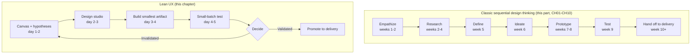

The diagram above is intentionally blunt about the contrast: the same
underlying techniques appear in both models, but the classic model spends
roughly nine to ten weeks before delivery ever sees validated evidence, while
Lean UX compresses one full learning cycle into roughly a single week and
repeats it continuously. Neither model is "more correct" in the abstract —
Section 3 and Section 20 examine exactly when each is the right choice.

## 2. Historical Evolution

- **2001 — the Agile Manifesto.** Software delivery adopted short, iterative
  cycles with working software as the primary measure of progress. Design
  and research practice, largely untouched by this shift for the following
  decade, kept operating on multi-week upfront phases that did not fit inside
  a two-week sprint, creating a structural mismatch this chapter's whole
  practice exists to resolve.
- **2008-2011 — the "Agile UX" tension.** As Agile software delivery became
  the default, design and research practitioners publicly wrestled with how
  to contribute meaningfully inside sprint-length cycles rather than as a
  separate pre-project phase. This period produced early patterns — "design
  one sprint ahead of build," embedded designers, lightweight sketching in
  standups — that Lean UX later systematized.
- **2011 — Lean Startup's Build-Measure-Learn loop.** Eric Ries's *The Lean
  Startup* is covered in full in [Research § Historical
  Evolution](CH02_Research.md#2-historical-evolution) as the source of the
  general validated-learning discipline: treat every part of a business,
  including a product concept, as a set of falsifiable hypotheses, and use
  a build-measure-learn loop to retire uncertainty as fast as possible. Lean
  UX imports this general loop and, as Section 4.6 explains in depth,
  reshapes each of its three steps to operate on design artifacts and design
  decisions specifically rather than on a whole business or a whole product.
- **2013 — Jeff Gothelf and Josh Seiden publish *Lean UX*.** The book fused
  the Lean Startup's validated-learning loop with design thinking's
  qualitative research methods and the Agile UX movement's cadence
  constraints into a single named practice. Its two most durable artifacts —
  the Lean UX canvas and the hypothesis statement template — are this
  chapter's Sections 4.3 and 4.5, respectively. [Problem
  Framing](CH06_Problem_Framing.md#2-historical-evolution) already notes
  that this same 2013 book formalized the Problem Statement canvas box that
  chapter's own problem statement canvas descends from; this chapter picks
  up the rest of that same canvas — the business-outcome, solution, and
  experiment boxes the Problem Framing chapter does not cover.
- **2016-2017 — *Sense and Respond*.** Gothelf and Seiden's follow-up book
  extended Lean UX's practice-level guidance into an organizational design
  argument: that outcome-over-output accountability (Section 4.2) requires
  changes to how teams are funded, staffed, and evaluated, not just changes
  to how designers spend their week.
- **2010s — dual-track Agile.** Practitioners including Marty Cagan and Jeff
  Patton popularized running a continuous "discovery track" alongside a
  "delivery track" within the same team, rather than treating discovery as a
  phase that completes before delivery starts. [Research § Research
  Synthesis](CH02_Research.md) already names this pattern as the
  organizational destination Lean Startup's and Lean UX's continuous-loop
  thinking were heading toward; Section 7 of this chapter details the
  architecture-pattern version of that same idea.
- **2021 — Teresa Torres's *Continuous Discovery Habits*.** Torres's
  Opportunity Solution Tree, owned in full by [Problem
  Framing](CH06_Problem_Framing.md#48-opportunity-solution-tree-teresa-torres),
  is a close relative of Lean UX operating from a slightly different angle:
  where Lean UX starts from a single canvas and a batch of hypotheses to
  clear in one cycle, the Opportunity Solution Tree maintains a living,
  branching map of opportunities and experiments that never fully closes.
  Section 21's comparison table places the two side by side.
- **2020s — remote and asynchronous Lean UX.** Digital whiteboards, recorded
  micro-usability sessions, and AI-assisted synthesis tools let distributed
  teams run design-studio-style convergence and small-batch validation
  without being co-located, at some cost to the spontaneous energy of an
  in-room studio session — a trade-off Section 4.7 discusses directly.

## 3. Why It Exists

Lean UX exists because three structural pressures make a purely sequential
design-thinking process impractical for most ongoing product teams, even
when every individual technique in that sequence is executed well.

**Delivery cadence mismatch.** Modern software delivery organizes work into
short, regularly-shipping cycles. A design process that requires ten
uninterrupted weeks before it produces its first piece of validated evidence
cannot synchronize with a team that ships every two weeks; something has to
give, and historically what gave was design's influence over what got built,
because delivery kept moving with or without validated input.

**Batch-size risk.** A sequential process defers all validation to the end:
a full round of research, a complete persona set, an entire journey map, an
entire wireframe suite, and only then a usability test. If a foundational
assumption is wrong — the wrong persona was prioritized, the journey's most
painful step was misdiagnosed — that error propagates through every
downstream artifact before anyone tests it. Lean UX's small-batch discipline
(Section 4.8) exists specifically to shrink the size of an undetected error
by testing continuously instead of once at the end.

**Outcome accountability requires continuous evidence, not a single
validation gate.** A team that validates a concept once, ships it, and moves
on has no mechanism for detecting that the shipped feature failed to move
the business outcome it was meant to serve. Lean UX's insistence on
hypothesis statements with explicit success signals (Section 4.5), tied to
outcome-over-output accountability (Section 4.2), keeps that evidence
flowing after launch, not only before it.

None of this means the sequential techniques taught in CH01 through CH10 are
wrong — they are the vocabulary Lean UX speaks. What Lean UX changes is the
grammar: the order, batch size, and cadence in which that vocabulary gets
used, and the explicit hypothesis discipline that keeps every activity
anchored to a business outcome rather than becoming craft for its own sake.

## 4. Core Concepts

### 4.1 Lean UX as Phase Compression, Not a New Phase

Definition:
Lean UX is an operating model for design work that runs the individual
techniques of design thinking — empathy synthesis, research, persona
reference, journey-derived assumptions, problem framing, ideation, prototype
building, and usability testing — concurrently, in small batches, on a
continuous, short cadence, rather than as discrete sequential phases with a
single end-of-phase validation gate.

Mechanism (how it works):
Instead of a linear pipeline where each technique fully completes before the
next begins, Lean UX organizes work around a recurring cycle (Section 5)
in which every technique is present in compressed form during every cycle.
A cycle might reference an existing persona rather than construct a new one,
extract one assumption from an existing journey map rather than remap the
whole journey, and build a single low-fidelity prototype rather than a full
wireframe suite. The techniques are the same; what compresses is scope per
cycle and elapsed time per cycle.

Decision implications (when and why to use it):
Compression is appropriate when a team already has a reasonably stable
understanding of its users (an existing persona set, an existing journey
map) and needs to iterate on a specific hypothesis quickly. It is
inappropriate as a substitute for foundational research a team has never
done — you cannot compress your way past having zero empathy data. Lean UX
presumes a baseline of understanding already exists (built using CH01-CH05's
techniques at least once) and optimizes the ongoing refinement loop on top
of that baseline.

Common failure mode:
Teams adopt Lean UX's vocabulary — a canvas, a hypothesis template, a design
studio — while still batching all their validation to the end of a release,
effectively running "Waterfall with Post-it notes." Section 19 names this
failure mode explicitly as "waterfall in sprint's clothing."

Concrete scenario:
A team building a subscription-management feature already has a validated
persona ("Priya, the budget-conscious renewer") and a journey map showing a
pain point at cancellation flow confusion. Rather than re-running empathy
interviews and rebuilding a journey map from scratch, the team opens a Lean
UX canvas referencing the existing persona and pain point directly, writes
one hypothesis about a redesigned cancellation flow, and moves to a design
studio within the same day.

### 4.2 Outcome-over-Output Framing

Definition:
An output is an artifact the team ships — a feature, a redesigned screen, a
new flow. An outcome is a measurable change in user or business behavior
that the team is accountable for causing. Outcome-over-output framing is the
discipline of defining success, prioritizing work, and evaluating teams
against outcomes rather than against the volume or polish of outputs
delivered.

Mechanism (how it works):
Instead of a roadmap item reading "redesign the checkout page," an
outcome-framed roadmap item reads "reduce checkout abandonment for
mobile users from 34% to under 25% within one quarter." The redesigned
checkout page becomes one candidate intervention toward that outcome, not
the definition of success itself. This reframing propagates into how
Objectives and Key Results (OKRs) are written, how a team's sprint or
cycle is planned, and — critically for Lean UX — into how every hypothesis
statement (Section 4.5) is worded: every hypothesis names an outcome
signal, never only a shipped artifact.

Decision implications (when and why to use it):
Use outcome framing whenever a team has enough measurement capability to
observe user or business behavior after a change ships (this is why
Section 8's instrumentation architecture is a prerequisite, not an
afterthought). Output framing remains appropriate for pure infrastructure or
compliance work where there is no meaningful behavioral outcome to
observe — forcing an artificial "outcome" onto every unit of work produces
metric-gaming rather than better decisions (see Section 19's
"metrics laundering" anti-pattern).

Common failure mode:
Teams declare an outcome-over-output culture on paper while continuing to
staff, fund, and promote based on shipped feature counts. Because
incentives, not slogans, drive behavior, this produces the exact failure
outcome framing is meant to prevent: polished features that ship on time
and move no business metric, with no organizational mechanism to notice or
correct it.

Concrete scenario:
A team ships a heavily requested "dark mode" feature (a clear output) with
no attached outcome hypothesis. Six months later, support-ticket volume and
churn are unchanged; the team has no way to know whether dark mode helped,
hurt, or was irrelevant, because no outcome signal was defined at the
outset. Contrast this with a hypothesis-framed alternative: "We believe
adding dark mode will increase daily session length for our night-shift
persona segment by measurable minutes; we will know this is true when
session-length telemetry for that segment moves after rollout" — the same
feature, but now falsifiable.

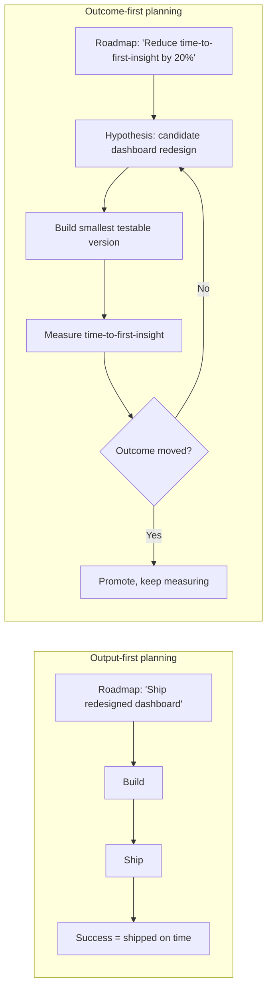

### 4.3 The Lean UX Canvas and Assumptions Worksheet

Definition:
The Lean UX canvas is a structured, single-page worksheet that forces a team
to make its business problem, target users, desired outcomes, candidate
solutions, and underlying assumptions explicit and visible before any
significant design or engineering effort begins. It exists in eight
connected boxes, each one narrowing the previous box's output into something
more specific and testable.

Mechanism (how it works):
The canvas is filled in a deliberate order, because each box constrains the
next:

1. **Business problem** — what problem, stated from the business's
   perspective, are we trying to solve? This box is typically populated by
   referencing a Point-of-View (POV) statement or How-Might-We (HMW)
   question already produced using [Problem
   Framing](CH06_Problem_Framing.md)'s technique — Lean UX does not
   re-derive this box's content, it consumes it.
2. **Business outcomes** — how will we know, in business terms, that we
   solved it? Stated as a measurable change (revenue, retention, cost,
   risk), not as a feature description.
3. **Users and customers** — who experiences this problem? Referenced by
   name from an existing persona built using [Personas](CH03_Personas.md)'s
   technique, or flagged explicitly as an assumption if no persona exists
   yet for this segment.
4. **User outcomes and benefits** — what does the user gain if we solve
   this well? This box is the user-value mirror of box 2's business-value
   statement, and both must be filled — a canvas with a business outcome
   but no user benefit usually signals a solution that extracts value from
   users rather than creating it for them.
5. **Solutions** — what are our candidate ideas? Populated from
   [Ideation](CH07_Ideation.md) output or a design studio session
   (Section 4.7), kept as a short list, not a single locked-in answer.
6. **Hypotheses** — for each candidate solution, a falsifiable statement
   using this chapter's hypothesis template (Section 4.5).
7. **What is the riskiest assumption underlying our hypotheses?** — the
   single assumption that, if false, invalidates the most downstream work.
   This box is filled using the assumption-mapping technique (Section 4.4).
8. **What is the smallest experiment that tests that riskiest assumption?**
   — the minimum-scope build, referencing [Rapid
   Prototyping](CH08_Rapid_Prototyping.md)'s fidelity ladder and [Wireframing](CH09_Wireframing.md)'s
   craft to choose an artifact type, and [Usability
   Testing](CH10_Usability_Testing.md)'s protocol to expose it to real users.

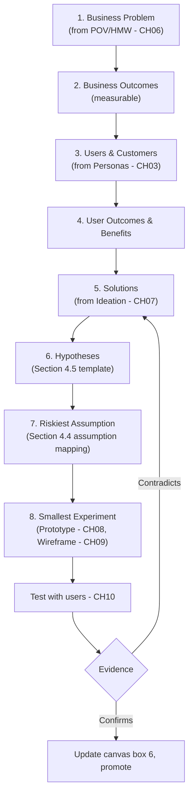

Decision implications (when and why to use it):
Fill a canvas at the start of any new initiative, and re-open it — not
replace it — every time evidence from a completed cycle changes what the
team believes. The canvas is a living document, revised in place across many
cycles, not a one-time planning artifact filed away after a kickoff meeting.
Use a canvas per initiative or per outcome, not per team-wide strategy; a
canvas covering too much scope collapses back into the batch-size problem
Section 3 describes.

Common failure mode:
"Vanity canvas" — the canvas is filled thoughtfully once, displayed in a
kickoff deck, and never revisited as evidence accumulates. Section 19 names
this failure mode directly; the tell is a canvas whose "hypotheses" box still
reads exactly as it did on day one after three months of shipped work.

Concrete scenario:
A fintech team's canvas states the business problem as "users abandon KYC
[Know Your Customer] identity verification at a high rate," the business
outcome as "increase verification completion rate from 61% to 80%," the
persona as "Marcus, first-time crypto buyer" (already built in the team's
persona library), the riskiest assumption as "users abandon because they
don't trust why we need a selfie, not because the flow is technically
difficult," and the smallest experiment as a single reworded consent screen
tested with five users this week rather than a full KYC flow rebuild.

### 4.4 Assumption Mapping and Riskiest-Assumption Prioritization

Definition:
Assumption mapping is the technique of taking every belief embedded in a
canvas or a set of hypotheses and explicitly ranking each one along two
dimensions — how important it is to the plan's success, and how much
evidence currently supports it — so a team can decide which single
assumption to test first rather than testing everything (or nothing)
at once.

Mechanism (how it works):
Every canvas and every hypothesis set silently contains multiple stacked
assumptions: that users have the problem at all, that they care enough to
change behavior, that the proposed solution addresses the actual cause, that
the technology is feasible, that the business impact is large enough to
matter. Assumption mapping makes each of these explicit as a short statement,
then places each one on a two-axis grid: horizontal axis for certainty
(how much evidence already supports this belief, from none to strong), and
vertical axis for importance (how much of the plan depends on this belief
being true). Assumptions that are both important and uncertain are the
riskiest, and become box 7 of the canvas; assumptions that are important but
already well-evidenced can be carried forward without re-testing; assumptions
that are unimportant, regardless of certainty, are explicitly deprioritized
rather than silently ignored.

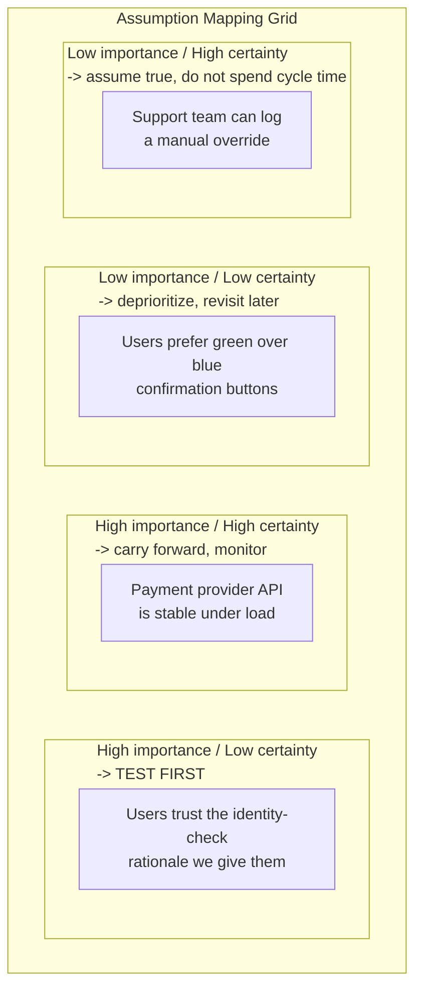

Decision implications (when and why to use it):
Run assumption mapping at the start of every cycle, and especially whenever
a canvas's hypotheses box has grown to include more than two or three
distinct beliefs — that is a signal the team is about to test too much at
once. The output directly drives cycle scope: one cycle should generally
target the single highest-risk assumption, not the whole cluster.

Common failure mode:
Teams intuitively agree on "what feels risky" without writing assumptions
down individually, which lets the loudest voice in the room — often the
most senior person present — silently set the agenda. Writing every
assumption down as a discrete, falsifiable statement before ranking it is
what prevents this; skipping the writing step and going straight to a
verbal debate about risk reproduces the exact HiPPO ("highest paid person's
opinion") dynamic assumption mapping exists to counter.

Concrete scenario:
A team assumes a new onboarding checklist will improve activation. Written
out, this actually contains at least four separate assumptions: users notice
the checklist, users understand what each item means, completing the
checklist causally drives retention (rather than merely correlating with
already-engaged users), and engineering can build a checklist state model
without a large data-migration effort. Mapping these separately reveals that
the causal-link assumption, not the build-feasibility one, is the actual
highest-risk item — and the cheapest way to test it is a concierge-style
manual experiment, not a shipped feature.

### 4.5 Hypothesis-Driven Design Statements

Definition:
A hypothesis-driven design statement is a structured sentence that names a
proposed action, the audience it targets, the outcome it is expected to
produce, and the observable evidence that will confirm or contradict it,
written before any design or engineering work begins. The canonical template
is: *"We believe that [doing this / building this] for [these users] will
result in [this outcome]. We will know this is true when we see [this
signal]."*

Mechanism (how it works):
Each clause forces a specific commitment that a vaguer statement of intent
would let a team quietly avoid. "Doing this / building this" must name a
concrete, buildable intervention, not a vague direction — "improve
onboarding" is not acceptable; "adding a single-screen progress indicator to
onboarding" is. "These users" must reference a named persona or segment, not
"users" generally. "This outcome" must be the business or user outcome from
canvas boxes 2 and 4, stated as a direction and ideally a magnitude, not
restated as the intervention itself (a hypothesis whose "outcome" is just a
description of the shipped feature has smuggled the output back in as the
outcome — a subtle version of Section 19's metrics-laundering failure).
"This signal" must name an observable, ideally quantifiable, piece of
evidence that a specific instrument (a usability-test observation, an
analytics event, a support-ticket count) can actually produce.

Decision implications (when and why to use it):
Write one hypothesis statement per canvas solution before any studio session
or build work starts. If a team cannot complete the template's four blanks
with specific answers, that is diagnostic: it usually means the underlying
idea is still too vague to test and needs another pass through problem
framing or ideation before it is ready for a Lean UX cycle.

Common failure mode:
Unfalsifiable hypotheses — statements phrased so that almost any observed
result can be claimed as confirmation. "We believe redesigning the homepage
will improve the user experience; we will know this is true when users like
it" fails on both counts: "improve the user experience" is not a specific
outcome, and "users like it" is not an observable signal with a defined
threshold. A well-formed hypothesis must be phrased so that a specific,
plausible result would force the team to admit it was wrong.

Concrete scenario:
"We believe that adding an estimated-wait-time indicator to the support
chat queue for our free-tier persona will reduce chat abandonment before
first response. We will know this is true when abandonment-before-response
drops from its current 22% baseline by at least five percentage points
within two weeks of rollout to a 20% traffic sample." Every blank is
specific, the outcome is measurable, the signal is instrumented, and a
result of "abandonment stayed at 22%" would honestly be reported as
invalidation, not reframed as a partial win.

### 4.6 The Build-Measure-Learn Loop Applied to Design

Definition:
Build-Measure-Learn, as a general validated-learning discipline for an
entire business or product, is owned by [Research § Historical
Evolution](CH02_Research.md#2-historical-evolution), which covers Eric
Ries's original Lean Startup formulation. This chapter owns a distinct,
narrower application: how the same three-step loop operates specifically on
design artifacts and design decisions inside a Lean UX cycle, where "build"
means the smallest representative design artifact (not a shippable product
increment), "measure" means qualitative and small-sample behavioral
observation (not only aggregate product analytics), and "learn" means an
explicit update to the canvas's hypotheses and riskiest-assumption boxes
(not a general business pivot decision).

Mechanism (how it works):
**Build** draws on [Rapid Prototyping](CH08_Rapid_Prototyping.md)'s fidelity
ladder and prototype loop, and on [Wireframing](CH09_Wireframing.md)'s
structural craft, to select and construct the minimum artifact capable of
testing the cycle's single riskiest assumption — this might be a paper
sketch, a clickable wireframe, or a narrow, flagged production slice,
chosen by the same minimum-credible-realism logic those chapters teach in
depth. **Measure** draws on [Usability Testing](CH10_Usability_Testing.md)'s
full protocol, run at reduced scale — often three to five participants
rather than a full study — to observe whether the hypothesis's named signal
appears. **Learn** is this chapter's own addition to the general loop: the
observed evidence is written back into the canvas itself, updating box 6's
hypothesis language (confirmed, revised, or discarded) and box 7's riskiest
assumption for the next cycle, closing the loop back to a live artifact
rather than a one-off report that nobody revisits.

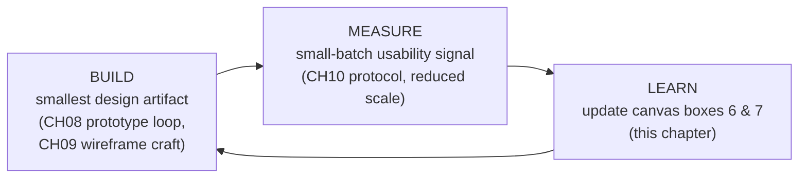

Decision implications (when and why to use it):
Use this design-scoped loop within a single Lean UX cycle whenever the
riskiest assumption is a design-shaped question — comprehension, usability,
workflow acceptance, information architecture. Use the broader, product-wide
Build-Measure-Learn loop (Research's general framing) when the riskiest
assumption is not design-shaped at all — a pricing model, a market-fit
question, a supply-chain feasibility question — because forcing those
questions through a wireframe-and-usability-test loop produces evidence that
does not actually address the underlying risk.

Common failure mode:
Treating "build" as "build the real feature" rather than "build the minimum
artifact that tests the assumption" collapses this loop back into a
standard, expensive delivery cycle with a usability test bolted onto the
end — expensive per-loop, and therefore run rarely, defeating Section 4.8's
small-batch cadence.

Concrete scenario:
A team's riskiest assumption is "clinicians will trust an AI-generated
draft summary enough to review rather than write from scratch." Build is a
static, non-functional mockup showing a draft summary with a clearly labeled
"AI-generated — review before use" banner (not a working AI integration).
Measure is a five-session, task-based usability round following [Usability
Testing](CH10_Usability_Testing.md)'s protocol, watching whether clinicians
attempt to edit or simply approve without reading. Learn updates the canvas:
the assumption is revised from "clinicians will trust a draft" to "clinicians
trust a draft only when source citations are visible inline," driving the
next cycle's build.

### 4.7 Collaborative Design Studio Practice

Definition:
A design studio is a structured, timeboxed, cross-functional workshop method
that compresses individual concept generation, group critique, and
convergence on a single directional concept into a single session lasting
hours rather than the days or weeks a fully separated ideation-then-critique
process would take.

Mechanism (how it works):
A design studio runs in four disciplined rounds. **Round one — individual
divergence.** Every participant — regardless of role, including engineers
and product managers, not only designers — sketches multiple concept
variations alone and silently, typically using a fixed template such as a
grid of six to eight small boxes, for a strict short timebox (commonly
five to eight minutes). Silence and individual work prevent early anchoring
on the first spoken idea. **Round two — presentation and critique.** Each
participant presents their sketches briefly; the group critiques against
the cycle's hypothesis and outcome, not against personal aesthetic
preference — a facilitator actively redirects "I don't like it" feedback
toward "does this address the riskiest assumption?" **Round three —
iteration in pairs or small groups.** Participants combine the
strongest elements surfaced in critique into fewer, stronger concepts,
again under a timebox. **Round four — convergence.** The full group selects
a single directional concept, or a small number of concepts, to carry
forward into the build step of Section 4.6's loop.

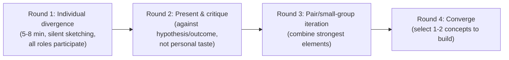

The divergence and convergence rhythm inside a studio is a direct,
timeboxed application of the divergent/convergent cycle [Ideation](CH07_Ideation.md)
teaches in full depth, including phase-purity facilitation controls and
anti-premature-convergence practice; this chapter does not re-derive that
mechanic, only compresses it into a single cross-functional session
scoped tightly to one already-framed problem statement rather than an
open-ended ideation session covering a broader opportunity space.

Decision implications (when and why to use it):
Use a design studio when a problem is already well-framed (a POV/HMW
statement or canvas box 1 exists) and the team needs fast convergence on a
concept to build and test this cycle, with a small group (generally under
eight participants) that includes non-designers. It is a poor substitute
for open-ended, longer-horizon ideation on a broadly-scoped strategic
opportunity — for that, use [Ideation](CH07_Ideation.md)'s full facilitation
toolkit without the studio's tight timebox.

Common failure mode:
The studio degrades into an art crit or a status exercise where the most
senior or most confident voice's sketch is adopted by social gravity rather
than by evidence — undermining the entire cross-functional-input premise of
the format. Section 19 names this "studio as art crit."

Concrete scenario:
A six-person trio (one product manager, two designers, three engineers)
runs a ninety-minute studio to converge on a redesigned checkout error
state. Every participant, including engineers, sketches individually for
six minutes; critique is explicitly scoped to "does this help the user
recover from a declined card without abandoning the cart?"; the group
converges on a single concept combining one engineer's inline-retry idea
with a designer's clearer error-messaging copy, ready to prototype the same
afternoon.

### 4.8 Continuous Small-Batch Validation Cadence

Definition:
Small-batch validation cadence is the operating discipline of deliberately
limiting how much a team commits to building and testing in a single cycle,
and how long that cycle runs, so that any single wrong assumption is caught
and corrected quickly rather than compounding across a large body of
unvalidated work.

Mechanism (how it works):
A cadence sets two constraints simultaneously: cycle length (commonly one
week, sometimes shorter for a single narrow assumption, rarely longer than
two weeks without breaking into sub-cycles) and batch size (commonly one
riskiest assumption per cycle, occasionally two if they are independent).
Both constraints are enforced even under pressure to "just also test this
other thing while we're at it," because batch-size creep is the primary way
teams silently drift back into the large, undifferentiated validation
rounds Section 3 identifies as the core problem Lean UX solves. A cadence is
paired with a fixed decision point at the end of each cycle (Section 5's
weekly loop) where the team explicitly promotes, revises, or discards the
cycle's hypothesis before starting the next one — an open cycle that rolls
into the next without a decision is itself a failure signal.

Decision implications (when and why to use it):
Tighter cadences and smaller batches are appropriate when uncertainty is
high and evidence is cheap to gather (a five-user hallway test, an
internal dogfood group). Batches can widen, and cadences can lengthen
somewhat, once a team has retired its highest-risk assumptions and is
validating lower-risk refinements — but widening should be a deliberate,
visible decision, not an unexamined drift.

Common failure mode:
"Just one more thing" scope creep, where a cycle intended to test a single
assumption quietly grows to include several unrelated changes because they
happen to touch the same screen. When the resulting evidence is ambiguous,
the team cannot attribute the result to any single change, defeating the
entire purpose of keeping batches small.

Concrete scenario:
A team's cadence is a five-day cycle testing exactly one assumption. Midway
through, a stakeholder asks to "also swap the button color while you're in
there for the rebrand." The team explicitly declines to fold this into the
current cycle, logging it as a separate, lower-priority assumption for a
future cycle instead — preserving the ability to attribute this cycle's
result cleanly to the one change it was designed to test.

## 5. Internal Working

A Lean UX practice is not a single technique; it is a small operating system
that runs the same weekly rhythm repeatedly, with every phase corresponding
to a concept from Section 4 and consuming an artifact this chapter's sibling
chapters own.

1. **Frame and map assumptions (day 1-2).** The team opens or updates its
   canvas (Section 4.3), referencing existing personas, journey-map pain
   points, and a POV/HMW statement rather than re-deriving them, then runs
   assumption mapping (Section 4.4) to select this cycle's single riskiest
   assumption and writes a hypothesis statement (Section 4.5) for it.
2. **Converge on a concept (day 2-3).** The team runs a design studio
   (Section 4.7), a compressed application of [Ideation](CH07_Ideation.md)'s
   divergent/convergent mechanic, to select one concept worth building this
   cycle.
3. **Build the smallest artifact (day 3-4).** The team applies [Rapid
   Prototyping](CH08_Rapid_Prototyping.md)'s fidelity choice and, where
   structural interface behavior matters, [Wireframing](CH09_Wireframing.md)'s
   craft, to construct the minimum artifact the hypothesis needs.
4. **Test in a small batch (day 4-5).** The team runs a reduced-scale
   application of [Usability Testing](CH10_Usability_Testing.md)'s protocol,
   commonly three to five sessions, focused narrowly on the cycle's signal.
5. **Decide and update the canvas (day 5).** The team writes the evidence
   back into the canvas (Section 4.6's "learn" step), makes an explicit
   promote/revise/discard decision, and either hands validated work to the
   delivery track (Section 7) or opens the next cycle with a revised
   hypothesis.

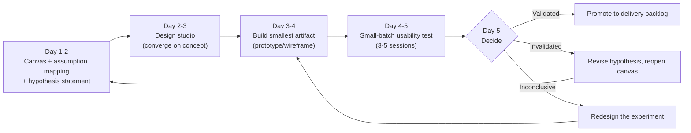

Each hypothesis, once written, moves through a predictable lifecycle across
cycles. Modeling it as a state machine makes an easy-to-miss failure mode
visible: a hypothesis that stays in "Testing" across many cycles without
ever reaching a decision is a stalled loop, not a thorough one.

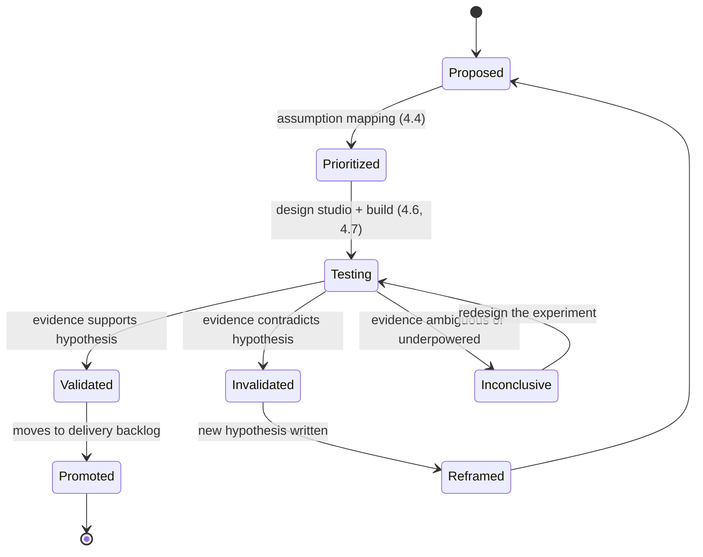

The deeper structural shift Lean UX makes, compared to the sequential model
Section 1 opened with, is *who* is present at each step and *when*. In a
relay model, research, design, and engineering hand off completed work to
the next specialist in sequence, each working largely alone during their
phase. In Lean UX, a small cross-functional trio — typically one product
role, one design role, and one engineering role, with research participation
as needed — is present continuously across every phase of every cycle. The
diagram below is wide enough that it is wrapped in the book's landscape
convention so all lanes remain legible.

```{=latex}
\begin{landscape}
```

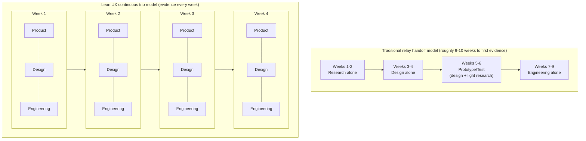

```{=latex}
\end{landscape}
```

In the relay model, each specialty works in isolation and hands off a
finished artifact; miscommunication surfaces only at the handoff boundary,
often too late to cheaply correct. In the continuous trio model, the same
three functions are present in every week's cycle, so a misunderstanding
between, for example, a design intent and an engineering feasibility
constraint surfaces inside the same week it is created rather than after a
completed design phase has already been signed off.

## 6. Design Principles

- **Cross-functional, dedicated, small teams.** A trio of product, design,
  and engineering — not a shared pool of specialists split across many
  initiatives — sustains the continuous presence Section 5 depends on.
- **Progress is validated learning, not shipped volume.** A cycle that
  invalidates a hypothesis and saves the team from building the wrong
  thing is a successful cycle, not a wasted one.
- **Externalize thinking early and often.** A rough sketch shared on day one
  creates more useful feedback than a polished document shared on day
  ten; Lean UX favors visible, half-finished work over private polish.
- **Shared understanding over comprehensive documentation.** A team that
  jointly built and watched a prototype fail together needs far less
  written specification to align on what to do next than a team relying on
  a handoff document to transmit that same understanding.
- **Get out of the building continuously, not once.** Contact with real
  users is a standing weekly habit, not a phase that happens once at project
  kickoff and is treated as "done."
- **Make over discuss when a disagreement can be resolved by evidence.**
  When a team argues in a meeting about which of two concepts is better,
  the Lean UX default is to build both cheaply and test them rather than
  debate further.
- **Permission to be wrong, quickly and cheaply.** A team whose culture
  punishes an invalidated hypothesis will unconsciously stop writing
  falsifiable ones — this principle is the cultural precondition for
  Section 4.5's hypothesis discipline to function honestly.

## 7. Architecture Patterns

- **Dual-track discovery/delivery pattern.** [Research § Research
  Synthesis](CH02_Research.md) already names the general concept: a
  continuous discovery track runs Lean UX cycles concurrently with a
  delivery track building already-validated work, sharing the same trio.
  Architecturally, this implies two coexisting backlogs — a discovery
  backlog of open hypotheses and a delivery backlog of promoted, ready-to-
  build items — with an explicit promotion gate (Section 5's day-5 decision
  point) between them, rather than one undifferentiated backlog where
  unvalidated ideas and committed work compete for the same sprint slots.
- **Feature-flagged experiment pattern.** Because a validated hypothesis
  frequently needs to be tested against real production traffic at small,
  controlled exposure rather than only in a usability lab, promoted
  hypotheses are built behind feature flags with percentage-based rollout
  controls, so a cycle's build step can move from prototype to a limited
  production slice without a full release commitment.
- **Instrumentation-first pattern.** Every hypothesis statement's signal
  clause (Section 4.5) is translated into a concrete analytics event or
  telemetry field *before* the build step starts, not added afterward as an
  afterthought — otherwise the measure step of Section 4.6's loop has
  nothing to observe.
- **Canvas-as-living-artifact pattern.** The canvas and its hypothesis
  history are stored as a versioned artifact (a wiki page with revision
  history, or a lightweight structured file under version control)
  linked directly from delivery tickets, so any engineer picking up a
  promoted item can trace it back to the assumption and evidence that
  justified it — the same traceability discipline [Architecture
  Thinking § Architecture Decision
  Records](../01_Architecture_Mindset/CH03_Architecture_Thinking.md#10-architecture-decision-records-adrs)
  applies to architecture decisions, applied here to design decisions.

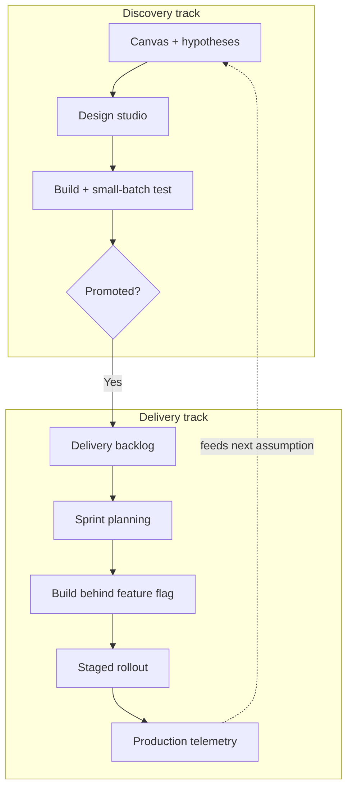

## 8. Production Architecture

Lean UX's continuous cadence only functions if the surrounding production
architecture can support small, frequent, reversible experiments rather than
large, infrequent, hard-to-reverse releases. The production layers a team
needs are:

- **Experimentation and flagging layer.** A feature-flag service capable of
  percentage-based and segment-based rollout, so a promoted hypothesis can
  be exposed to a small, controlled slice of real traffic without a full
  deployment.
- **Event instrumentation layer.** A telemetry pipeline capturing the
  specific signal each hypothesis statement names (Section 4.5), tagged with
  the hypothesis and canvas identifier so evidence can be traced back to the
  decision it informs — the same traceability discipline [Service
  Design](CH12_Service_Design.md#14-observability) applies to blueprint step
  identifiers, applied here to hypothesis identifiers.
- **Small-batch usability infrastructure.** Lightweight recruiting and
  session-recording tooling sized for three-to-five-participant rounds run
  weekly, distinct from the larger-scale recruiting infrastructure
  [Usability Testing](CH10_Usability_Testing.md#9-implementation) describes
  for full studies.
- **Decision ledger.** A record, linked to the canvas, of every cycle's
  decision (promote, revise, discard), evidence cited, and next owner —
  structurally similar to [Rapid Prototyping](CH08_Rapid_Prototyping.md)'s
  decision-gate record, applied at the cadence level rather than the single
  prototype-loop level.

Statistical experiment design — sample-size calculation for a production
A/B test, significance thresholds, and multi-variant test architecture — is
intentionally out of this chapter's scope. That depth belongs to this part's
forthcoming Product Management subsection chapters on Experimentation and
A/B Testing (see [PART_OVERVIEW.md](PART_OVERVIEW.md)); this chapter treats
production experimentation only as far as the architecture needed to expose
a Lean UX hypothesis to a small, safe slice of real usage.

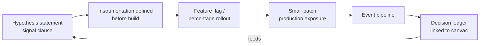

## 9. Implementation

A practical sequence for standing up a Lean UX practice on an existing
product team:

1. Form a dedicated cross-functional trio (product, design, engineering) and
   protect its time from being split across unrelated initiatives.
2. Choose one existing outcome-level roadmap item and translate it into
   outcome-over-output language (Section 4.2) if it is not already framed
   that way.
3. Build (or open, if one already exists) a Lean UX canvas (Section 4.3),
   referencing existing personas and journey-map pain points rather than
   re-deriving them.
4. Run an assumption-mapping session (Section 4.4) and write the cycle's
   first hypothesis statement (Section 4.5).
5. Run a design studio (Section 4.7) scoped tightly to that single
   hypothesis.
6. Build the smallest credible artifact and run a small-batch usability
   round (Section 4.6).
7. Hold an explicit day-5 decision meeting; update the canvas; log the
   decision in the ledger (Section 8).
8. Repeat the cycle, tightening cadence discipline (Section 4.8) as the
   team's instrumentation and recruiting infrastructure matures.

## 10. Complete Code Examples

Runnable templates and helper scripts for this chapter's artifacts are kept
under the code directory rather than embedded inline:

- Lean UX canvas schema (structured, versionable canvas fields):
  [code/json/lean-ux-chapter/lean-ux-canvas-schema.json](../code/json/lean-ux-chapter/lean-ux-canvas-schema.json)
- Hypothesis statement worksheet template:
  [code/templates/lean-ux-chapter/hypothesis-statement-template.md](../code/templates/lean-ux-chapter/hypothesis-statement-template.md)
- Assumption-mapping quadrant scorer (importance x certainty ranking):
  [code/python/lean-ux-chapter/assumption_mapping_score.py](../code/python/lean-ux-chapter/assumption_mapping_score.py)
- Design studio session timer/facilitation checklist:
  [code/templates/lean-ux-chapter/design-studio-facilitation-checklist.md](../code/templates/lean-ux-chapter/design-studio-facilitation-checklist.md)
- Cycle decision ledger schema (promote/revise/discard log linked to
  canvas and hypothesis identifiers):
  [code/json/lean-ux-chapter/decision-ledger-schema.json](../code/json/lean-ux-chapter/decision-ledger-schema.json)

Diagrams referenced but not embedded at full workshop scale:
[diagrams/canvas/lean-ux-canvas-template.md](../diagrams/canvas/lean-ux-canvas-template.md)
and
[diagrams/flow/lean-ux-weekly-cycle.md](../diagrams/flow/lean-ux-weekly-cycle.md).

## 11. Performance

Performance for a Lean UX practice is measured as cycle throughput and
evidence quality, not artifact volume. Building on [Rapid
Prototyping](CH08_Rapid_Prototyping.md#42-learning-velocity)'s learning-
velocity metric, Lean UX adds cadence-specific signals:

- **Canvas-to-decision cycle time.** Elapsed time from opening or reopening
  a canvas to the next explicit promote/revise/discard decision. A healthy
  practice keeps this close to its declared cadence (Section 4.8); a
  cycle time silently creeping past its cadence is an early symptom of
  batch-size creep.
- **Hypothesis throughput.** Number of hypotheses reaching an explicit
  decision per month. A low number relative to team size usually indicates
  stalled cycles (the "Testing" state lingering in Section 5's state
  diagram) rather than genuinely difficult problems.
- **Validated-to-invalidated ratio.** A ratio near 100% validated is itself
  a warning sign: it usually means hypotheses are being written so vaguely,
  or so safely, that they cannot fail — undermining Section 4.5's
  falsifiability requirement.

## 12. Scalability

Scaling Lean UX across many teams introduces coordination problems a single
trio's cadence does not have to solve:

- **Canvas federation.** Multiple teams' canvases can reference overlapping
  users or overlapping outcomes; without a shared index of active
  hypotheses, two teams can unknowingly run conflicting or duplicate
  experiments on the same user segment in the same week.
- **Outcome alignment across teams.** Program-level outcome metrics (a
  forward reference to this part's future Product Management chapters on
  Metrics and North Star Metrics — see [PART_OVERVIEW.md](PART_OVERVIEW.md))
  are needed so that many teams' local hypotheses roll up coherently
  instead of each team locally optimizing a metric that does not add up to
  the organization's actual strategic outcome.
- **Shared instrumentation platform.** As more teams instrument more
  hypotheses, a shared event-taxonomy and feature-flag platform (Section 8)
  becomes necessary to prevent every team independently reinventing
  experiment infrastructure at different quality levels.

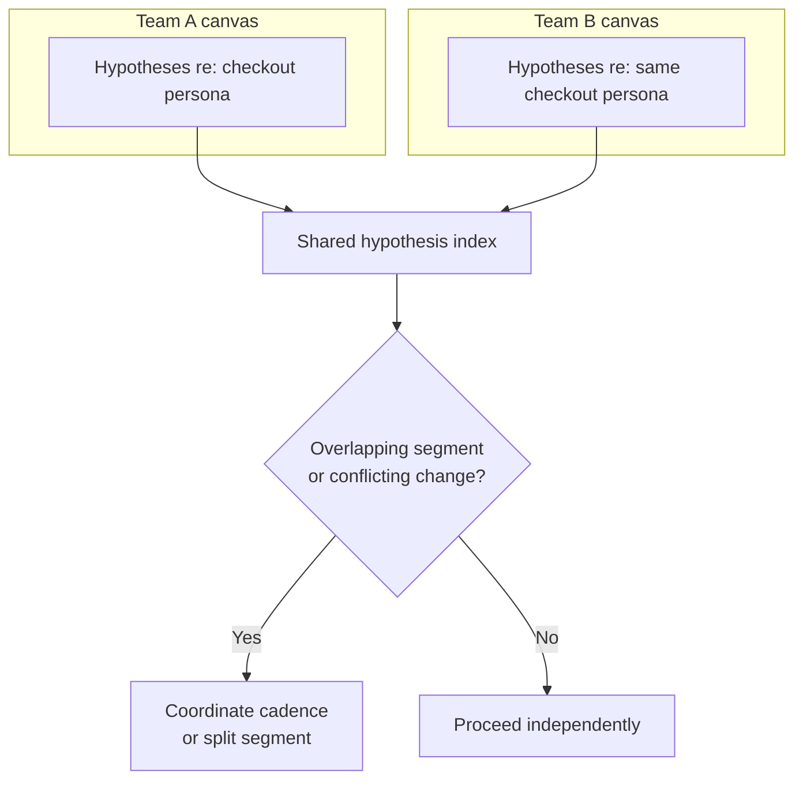

## 13. Security

Lean UX's continuous small-batch cadence touches several security-relevant
surfaces:

- **Participant data handling.** Recruiting and running small-batch usability
  sessions weekly, rather than occasionally, multiplies the surfaces where
  participant consent, recording storage, and data-retention policy must be
  applied consistently — the same discipline [Usability
  Testing](CH10_Usability_Testing.md) and [User
  Interviews](CH04_User_Interviews.md) already teach in full, now exercised
  at higher frequency rather than needing a new framework.
- **Feature-flag exposure risk.** A production experiment exposing a
  partially-built flow to real users can leak an unfinished, insufficiently
  authorized, or insufficiently validated code path if flag targeting is
  misconfigured; flag changes should go through the same review discipline
  as any other production configuration change.
- **Unequal-treatment risk.** Percentage-based rollout inherently treats
  different users differently for a period of time; for anything touching
  pricing, eligibility, or access decisions, teams must confirm this
  differential treatment does not cross into a discriminatory or
  regulatorily-restricted practice before running the experiment, not
  after.

## 14. Observability

Every hypothesis's signal clause (Section 4.5) should map to a concrete,
named observability artifact, not an ad hoc query written after the fact:

- **Per-hypothesis event tagging.** Every telemetry event relevant to a
  cycle carries the canvas and hypothesis identifier, enabling direct
  evidence-to-decision traceability (Section 8).
- **Cycle dashboards.** A lightweight dashboard per active hypothesis
  showing the named signal against its declared threshold, refreshed at
  the cadence's cycle length, not only at cycle end.
- **Decision ledger linkage.** Every dashboard links back to the decision
  ledger entry that will consume it, so a stakeholder reading a dashboard
  can immediately see what decision that number is meant to inform.

## 15. Failure Scenarios

1. A cycle's hypothesis lingers in "Testing" for months with no decision
   recorded. Response: enforce the day-5 decision point as non-negotiable;
   an undecided cycle at cadence-end is itself logged as "inconclusive,"
   not silently extended.
2. A design studio consistently converges on the most senior participant's
   sketch regardless of critique content. Response: introduce structured,
   anonymous critique voting before open discussion, and rotate
   facilitation away from the most senior team member.
3. Canvas hypotheses box is unchanged after six months of shipped work.
   Response: treat this as a "vanity canvas" audit trigger (Section 19) and
   require evidence-backed revision at every cycle close.
4. Feature-flag misconfiguration exposes an unfinished experiment to 100%
   of production traffic instead of the intended small sample. Response:
   require a second reviewer on flag-targeting changes and default new
   flags to 0% exposure.
5. A team reports a near-100% hypothesis validation rate. Response: audit a
   sample of hypothesis statements for falsifiability (Section 4.5); this
   pattern usually indicates unfalsifiable wording, not genuine success.

## 16. Testing

Testing in this chapter has two distinct meanings that should not be
conflated.

**Testing the design artifact.** This is the "measure" step of Section
4.6's loop, a small-batch application of [Usability
Testing](CH10_Usability_Testing.md)'s full protocol — objective, tasks,
recruitment, moderation, synthesis, and decision — run at reduced
participant count and shorter turnaround, not a different method.

**Testing the Lean UX practice itself.** This is a periodic health check on
the cadence: are canvases being revised, not just filled once? Are
hypotheses reaching decisions inside the declared cadence? Is the
validated-to-invalidated ratio plausible rather than suspiciously high?
This second kind of testing is the responsibility of whoever owns the
practice organizationally (often a design or product operations lead) and
should run monthly or quarterly, using Section 11's performance signals as
its evidence base.

## 17. Common Mistakes

- Writing a hypothesis statement with a vague, unfalsifiable outcome or
  signal clause.
- Running a full nine-technique sequential process once per quarter and
  calling it "Lean UX" because a canvas template was used.
- Letting cycle batch size creep because "we're already in this screen."
- Treating the canvas as a one-time kickoff artifact rather than a living
  document revised every cycle.
- Running a design studio without cross-functional participation, reducing
  it to a designers-only sketching exercise.
- Skipping instrumentation until after a hypothesis is built, leaving the
  "measure" step with no signal to observe.
- Declaring outcome-over-output culture while still evaluating and
  promoting staff on shipped-feature counts.

## 18. Best Practices

- Keep one canvas per outcome-scoped initiative, revised in place across
  many cycles.
- Write every hypothesis statement using the full four-clause template
  before any build work starts.
- Instrument the hypothesis's signal before building the artifact that
  will be measured against it.
- Include engineering voices in design studio sessions, not only design and
  product roles.
- Enforce a non-negotiable end-of-cycle decision point, even when the
  decision is "inconclusive, redesign the experiment."
- Default new feature flags to zero exposure and require explicit,
  reviewed steps to widen rollout.
- Periodically audit hypothesis language for falsifiability, not only
  outcome for correctness.

## 19. Anti-Patterns

- **Waterfall in sprint's clothing.** Adopting Lean UX vocabulary (a canvas,
  a hypothesis template) while still batching all validation to the end of
  a release cycle.
- **Vanity canvas.** A canvas filled once at kickoff and never revised as
  evidence accumulates.
- **Hypothesis theater.** Statements that read like hypotheses but are
  phrased so no observed result could ever contradict them.
- **Studio as art crit.** A design studio that converges on the most senior
  participant's sketch by social gravity rather than by evidence against
  the stated hypothesis.
- **Metrics laundering.** Restating a shipped output as its own "outcome"
  (for example, calling "launched dashboard redesign" the outcome rather
  than a candidate intervention toward a named behavioral change).
- **Batch creep.** Folding unrelated changes into an active cycle because
  they happen to touch the same screen, destroying attribution of the
  cycle's result.

## 20. Trade-off Analysis

- **Speed versus rigor.** Small-batch, short-cadence cycles surface risk
  faster but generate less statistically robust evidence per cycle than a
  larger, slower validation round; Lean UX accepts this trade explicitly
  because the cost of a slow, large, wrong bet usually exceeds the cost of
  several fast, small, occasionally-wrong bets.
- **Continuous integration versus specialist depth.** Embedding
  cross-functional presence in every cycle (Section 5) improves shared
  understanding and reduces handoff loss, but can reduce the uninterrupted
  focus time a specialist would get in a phase-separated model, which
  matters for genuinely deep individual research or engineering work.
- **Outcome accountability versus roadmap predictability.** Outcome-over-
  output framing (Section 4.2) improves the odds that shipped work actually
  matters, but makes forward roadmap commitments inherently less certain,
  since a hypothesis can be invalidated and change direction mid-quarter —
  a trade many stakeholder-facing commitments are not comfortable making.
- **Compression versus foundational depth.** Lean UX's compression (Section
  4.1) presumes a baseline of empathy, research, and persona work already
  exists; a team with no such baseline that jumps straight to Lean UX
  cadence is optimizing an ongoing loop it has not yet earned the right to
  run efficiently.

## 21. Comparison Table

| Approach | Primary Question | Cycle Length | Batch Size | Owning Chapter / Source | When to Use |
|---|---|---|---|---|---|
| Classic sequential design thinking (this part, CH01-CH10) | What do we learn from one complete round of empathy through test? | Weeks to months | Large (full persona set, full journey, full wireframe suite) | This part's CH01-CH10 | New product area, no existing baseline understanding |
| Lean UX (this chapter) | What is the smallest thing we can test this week against our riskiest belief? | Days to about one week | Small (one riskiest assumption per cycle) | This chapter | Ongoing product team with an existing baseline, needs continuous validation |
| General Lean Startup Build-Measure-Learn | Is this business/product hypothesis viable at all? | Variable, business-scoped | Whole product or business model assumption | [Research](CH02_Research.md#2-historical-evolution) | Early-stage venture or new business-model validation, not only design questions |
| Continuous Discovery / Opportunity Solution Tree | What is the current highest-value opportunity in a living, branching map? | Continuous, no fixed end | One opportunity branch at a time, tree never fully closes | [Problem Framing](CH06_Problem_Framing.md#48-opportunity-solution-tree-teresa-torres) | Mature product team maintaining an ever-evolving map of opportunities rather than closing out a fixed canvas |
| Design Sprint (Google Ventures style) | Can we answer one critical question in a single, dedicated five-day block? | Fixed five days, one-time | One well-scoped critical question | Not owned by this book yet; named here as a well-known adjacent technique | High-stakes single decision needing dedicated, uninterrupted focus, not an ongoing cadence |

## 22. Real-World Case Study

**Case: A business-to-business (B2B) SaaS platform's trial-to-paid
conversion redesign**

Context:
A mid-market analytics SaaS product had a healthy free-trial signup rate but
a stubbornly low trial-to-paid conversion rate. Prior attempts to improve
conversion had followed the classic sequential model — a two-month research
and redesign project culminating in a full onboarding-flow relaunch — with
only marginal, statistically ambiguous improvement, because the large,
single-shot redesign bundled many changes together and no one could
attribute the modest lift to any specific change.

Lean UX intervention:

1. The team formed a dedicated trio (one product manager, one designer, one
   engineer) and opened a Lean UX canvas referencing an existing persona
   ("Dana, the evaluating team lead") and an existing journey map's
   documented pain point at the "connect your first data source" step.
2. Assumption mapping (Section 4.4) surfaced that the team's leading
   assumption — "the connection step is too technically difficult" — was
   actually a lower-risk, better-evidenced belief than a competing,
   less-examined assumption: "trial users do not understand *why* connecting
   a data source early matters before they've seen any value."
3. The team wrote a hypothesis: "We believe surfacing a sample-data preview
   before requiring a real data-source connection will increase trial users
   reaching the 'first insight viewed' milestone. We will know this is true
   when milestone-reached rate for a 20% traffic sample increases from its
   28% baseline by at least eight percentage points within one week."
4. A ninety-minute design studio (Section 4.7), including the engineer,
   converged on a single concept: a one-click "explore with sample data"
   path alongside the existing "connect your data" path.
5. The team built the smallest version behind a feature flag at 20%
   exposure, instrumented the milestone event before build, and ran a
   five-session small-batch usability round confirming users understood the
   sample-data option without confusion.
6. Evidence after one week: milestone-reached rate rose to 39% for the
   flagged segment, comfortably clearing the hypothesis's threshold. The
   team promoted the change to full rollout and opened the next cycle's
   canvas using the promoted milestone as its new baseline.

Results after four cycles over one month:

- Trial-to-paid conversion improved 6 percentage points, attributable
  cycle-by-cycle to specific, individually-validated changes rather than a
  single bundled relaunch.
- Time from "idea proposed" to "shipped and measured" fell from roughly
  eight weeks (the prior sequential project) to about one week per cycle.
- The team retained a decision ledger showing exactly which of four
  hypotheses drove the improvement, letting the organization confidently
  reinvest in the same technique rather than crediting an unattributable
  bundle of changes.

Architecture lesson:
The largest gain was not any single design idea — it was the compression of
cycle time and the feature-flag/instrumentation architecture that let the
team attribute a measurable outcome to one small, specific change per week,
instead of gambling an entire quarter on one large, unattributable bet.

## 23. Interview Questions

1. How does Lean UX differ from the classic sequential design-thinking
   process, and when would you choose one over the other?
2. Walk through all eight boxes of the Lean UX canvas and explain the
   dependency order between them.
3. Write a hypothesis-driven design statement for a feature of your choice
   and explain why each clause is falsifiable.
4. How is the Build-Measure-Learn loop applied to design different from the
   general Lean Startup Build-Measure-Learn loop?
5. What makes a design studio different from a general ideation session?
6. How would you detect a "vanity canvas" during a design review?
7. What architecture must exist before a team can safely run a Lean UX
   cycle in production, not just in a prototype?
8. How do you decide when to widen a Lean UX cycle's batch size?
9. What is the risk of a near-100% hypothesis validation rate, and how would
   you investigate it?
10. How does outcome-over-output framing change how you would write a
    roadmap item?

## 24. Hands-on Exercises

1. Take an existing feature idea and fill out all eight boxes of the Lean
   UX canvas, referencing (not re-deriving) a persona and journey-map pain
   point from an earlier chapter's technique.
2. Run assumption mapping on that canvas's hypotheses box and identify the
   single riskiest assumption.
3. Write a complete hypothesis statement for that riskiest assumption using
   the four-clause template.
4. Time-box and run a thirty-minute mini design studio (individually, if
   working alone, is a useful simulation exercise) for that hypothesis and
   record which concept you converged on and why.

## 25. Design Exercises

1. Propose a canvas-federation mechanism for an organization running Lean UX
   cycles across five teams that share overlapping user segments.
2. Design a feature-flag governance policy that prevents a Lean UX
   experiment from accidentally exposing an unfinished flow at full
   production scale.
3. Redesign a stalled Lean UX practice (six months of an unchanged canvas)
   into a working cadence, specifying the exact enforcement mechanism for
   the day-5 decision point.
4. Design an instrumentation plan for three different hypothesis signal
   types: a comprehension signal, a task-completion signal, and a
   downstream business-metric signal.

## 26. Architecture Review Questions

1. Is every active hypothesis's signal instrumented before its build step
   started, or was instrumentation added after the fact?
2. Which canvases in this program have gone unrevised for more than one
   full quarter?
3. Does the feature-flag platform default new flags to zero exposure, and
   is a second reviewer required before widening rollout?
4. Are discovery-track and delivery-track backlogs kept separate with an
   explicit promotion gate between them?
5. Which team's hypothesis validation rate is implausibly high, and has
   its hypothesis wording been audited for falsifiability?
6. Is there a shared hypothesis index preventing two teams from running
   conflicting experiments on the same user segment?
7. What decision in the current cycle is hardest to reverse once shipped,
   and what evidence justifies committing to it now rather than testing it
   at smaller scale first?
8. Are roadmap items in this program written as outcomes or as outputs, and
   what would change if they were rewritten the other way?

## 27. Summary

Lean UX is not an eleventh design-thinking phase; it is the operating model
that takes every technique this part has already taught — empathy, research,
personas, journey mapping, problem framing, ideation, prototyping,
wireframing, and usability testing — and runs them concurrently, in small
batches, on a continuous, short cadence anchored to explicit, falsifiable
hypotheses about business outcomes. This chapter's unique teaching
contribution is the compression and integration layer itself: the Lean UX
canvas and assumptions worksheet, hypothesis-driven design statements, the
Build-Measure-Learn loop as applied specifically to design artifacts,
collaborative design studio practice, and outcome-over-output framing as the
accountability model that makes continuous small-batch validation possible.

For a Solution Architect, the payoff of understanding Lean UX is
architectural, not merely procedural: a team running genuine Lean UX cycles
needs feature-flagging, pre-build instrumentation, and a traceable decision
ledger as first-class infrastructure, not optional tooling — the same way a
team running classic sequential design thinking needs a stable requirements
handoff process. Recognizing which model a product team is actually running
tells an architect what kind of delivery pipeline to build around it.

Further reading across this part:

- Empathy map construction and the empathize mindset:
  [CH01_Empathy.md](CH01_Empathy.md)
- General Lean Startup Build-Measure-Learn history:
  [CH02_Research.md](CH02_Research.md#2-historical-evolution)
- Persona construction and governance:
  [CH03_Personas.md](CH03_Personas.md)
- Journey-map construction and pain-point diagnosis:
  [CH05_Journey_Mapping.md](CH05_Journey_Mapping.md)
- Point-of-View and How-Might-We statements, and the Opportunity Solution
  Tree: [CH06_Problem_Framing.md](CH06_Problem_Framing.md)
- Divergent/convergent ideation facilitation:
  [CH07_Ideation.md](CH07_Ideation.md)
- Prototype loop, fidelity ladder, and learning velocity:
  [CH08_Rapid_Prototyping.md](CH08_Rapid_Prototyping.md)
- Wireframe fidelity and layout semantics:
  [CH09_Wireframing.md](CH09_Wireframing.md)
- Usability testing protocol architecture:
  [CH10_Usability_Testing.md](CH10_Usability_Testing.md)
- Service blueprint and evidence-artifact observability linkage:
  [CH12_Service_Design.md](CH12_Service_Design.md)
