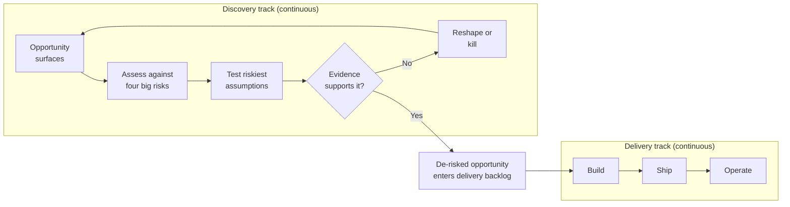
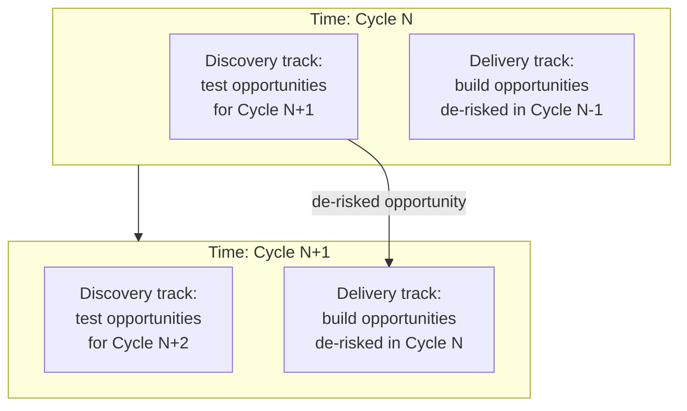
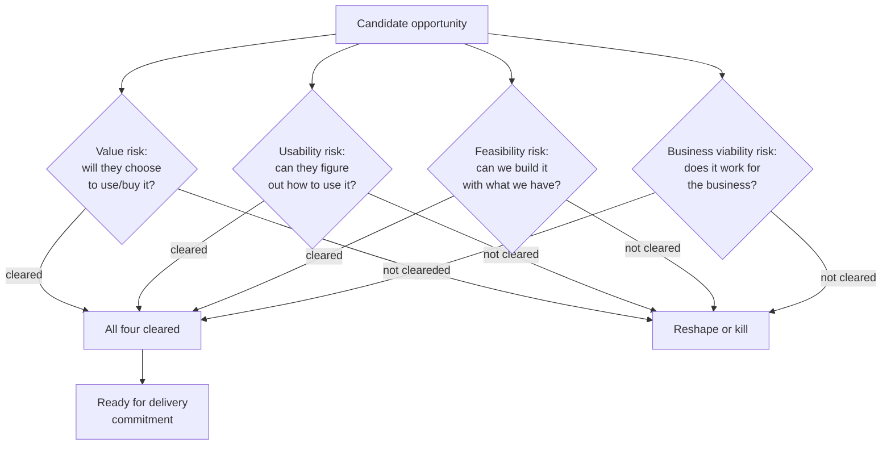
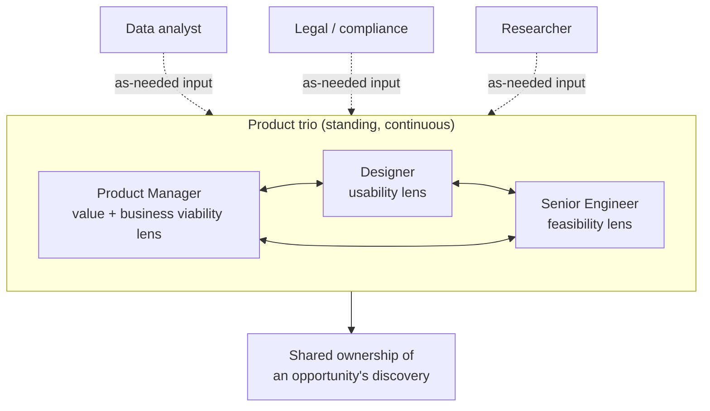
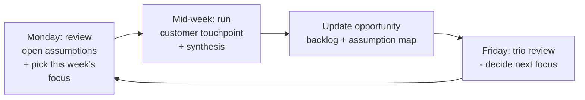
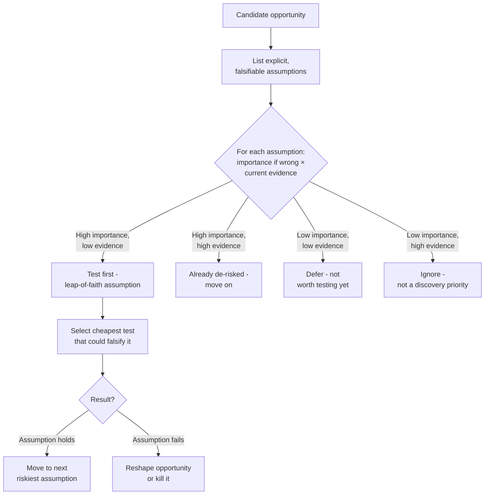
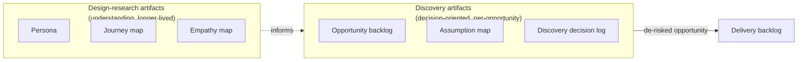
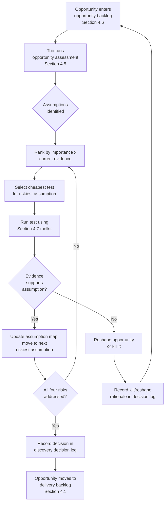
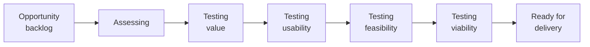
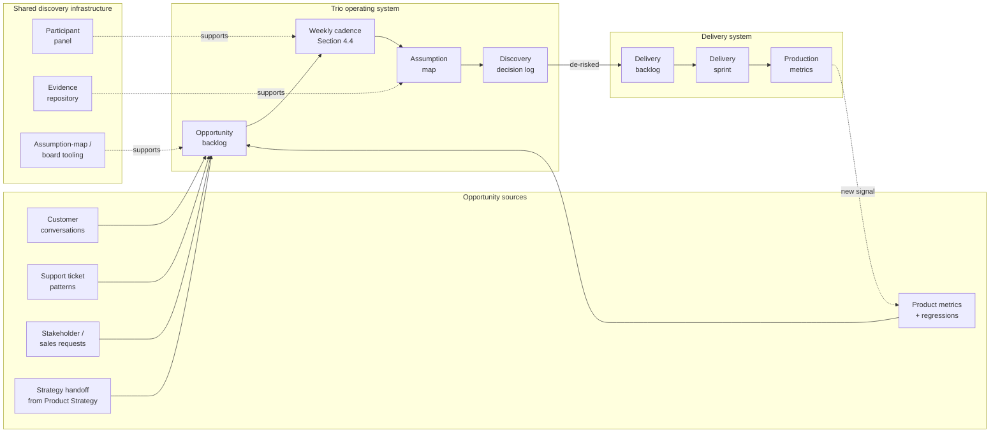

# Chapter: Product Discovery

Part: [02 - Design Thinking and Product Management](PART_OVERVIEW.md) · Subsection: Product Management · Status: Drafted

## 1. Introduction

Product discovery is the continuous, product-management-owned practice of
determining what should be built — and whether it should be built at all —
before an engineering team commits weeks or months of delivery capacity to
it. It is not a single workshop, a phase that happens once before a project
"really starts," or a synonym for user research. It is an ongoing operating
rhythm in which a small cross-functional group deliberately tries to prove
a candidate initiative wrong along every dimension that could sink it —
whether customers value it, whether they can actually use it, whether it
can be built with the team's technology and constraints, and whether it
serves the business — before that initiative is handed to a delivery team
to build at full cost.

This chapter is chapter fourteen of Part 02 — Design Thinking and Product
Management, and it is the first chapter of this part's Product Management
subsection. Everything before it (Chapters 1-13) taught the Design Thinking
subsection's mindset and technique library: empathy, research methodology,
personas, interviewing, journey mapping, problem framing, ideation,
prototyping, wireframing, usability testing, accessibility, service design,
and [Lean UX](CH13_Lean_UX.md).
Product discovery does not re-derive any of that technique library. It is
the practice of *deciding what deserves a team's attention next* and
*de-risking that specific opportunity* using the techniques the Design
Thinking subsection already taught, applied under product-management
ownership, on a continuous cadence, against an explicit risk framework, and
producing a distinct set of artifacts aimed at a go/no-go/reshape decision
rather than at deepening design understanding for its own sake.

Three boundaries define this chapter precisely, and holding them precisely
matters more here than in most chapters, because "discovery" is one of the
most overloaded words in product management and the fastest way to write a
useless chapter about it is to let it quietly absorb every neighboring
topic:

- **Discovery is not the Design Thinking subsection's technique library,
  re-taught.** When this chapter needs a generative interview, a
  prototype, or a usability test, it recaps that technique in two to three
  sentences and links to the owning chapter — [Research](CH02_Research.md),
  [User Interviews](CH04_User_Interviews.md),
  [Rapid Prototyping](CH08_Rapid_Prototyping.md), and
  [Usability Testing](CH10_Usability_Testing.md) — rather than re-deriving
  interview craft, prototyping fidelity choice, or moderation protocol.
  Section 4.7 collects these recaps in one place as "the toolkit discovery
  draws on."
- **Discovery is not strategy.** Deciding the company's overall direction,
  setting a multi-quarter vision, and choosing which of several competing
  strategic bets deserves investment is the subject of this part's
  [Product Strategy](CH15_Product_Strategy.md) chapter. This chapter assumes a
  specific opportunity or initiative has already surfaced — from a
  strategy, a stakeholder request, a support-ticket pattern, a metric
  regression, or a sales conversation — and teaches how to de-risk *that*
  opportunity before committing delivery capacity to it. Where this
  chapter's examples need a strategic backdrop, that backdrop is treated as
  a given, not something this chapter teaches how to set.
- **Discovery is not Lean UX.** [Lean UX](CH13_Lean_UX.md) and product
  discovery share ancestry (both descend from lean startup thinking and
  both push validation earlier). Per the batch review for this part
  (see `review/design-thinking-batch5-review.md`), no real overlap was
  found: Lean UX owns the design-artifact-scoped Build-Measure-Learn loop,
  the Lean UX canvas, and design-studio facilitation; this chapter owns
  the discovery/delivery track split, the four big risks, product trio
  topology, discovery cadence, opportunity assessment, and
  discovery-specific artifacts.

For the Solution Architect audience of this handbook: product discovery is
the mechanism that determines whether an architecture decision is even
worth making. An architect who is asked to design the system for "the new
recommendations feature" has a fundamentally different job depending on
whether that feature has been through discovery (value, usability,
feasibility, and business viability risks addressed, with evidence) or
whether it is an untested guess wearing a roadmap line-item's clothing. This
chapter gives architects the vocabulary and operating model to recognize
which situation they are in, to participate usefully in the feasibility
side of discovery, and to push back — the same way they would push back on
an unvalidated performance or security assumption — when a team is asked to
build against an opportunity that has not actually been de-risked.



## 2. Historical Evolution

Product discovery did not appear as a named practice; it accumulated from
several separate corrections to the way software organizations had been
deciding what to build.

- **1970s-1980s — the waterfall requirements document.** Requirements were
  gathered once, up front, written into a specification, and handed to
  engineering. The specification's correctness was assumed, not tested;
  the first real feedback a team received was often from production users
  after launch, by which point the cost of being wrong was maximal.
- **1986 — Barry Boehm's spiral model.** Boehm introduced risk-driven
  iteration into software process thinking: each cycle of a project should
  identify its biggest risks and spend effort resolving them before
  committing to the next cycle. The spiral model applied this mostly to
  technical and schedule risk, but it established the reusable principle
  discovery inherits directly — resolve the riskiest unknown first, not
  last.
- **2001 — the Agile Manifesto.** Agile software development shortened
  delivery iterations dramatically and made it far cheaper to change
  direction *once work had started*. It did not, by itself, solve the
  earlier problem: teams could now build the wrong thing in two-week
  increments instead of eighteen-month ones, which is faster feedback but
  not necessarily *earlier* feedback about whether the underlying idea was
  worth building at all.
- **2007 — Desirée Sy's dual-track proposal.** In "Adapting Usability
  Investigations for Agile User-Centered Design," Sy described running
  design and usability investigation work one sprint ahead of the
  engineering sprint building the previous cycle's validated design — the
  direct ancestor of the discovery/delivery track split this chapter
  teaches in Section 4.1.
- **2008 — Marty Cagan's *Inspired* (first edition).** Cagan, writing from
  his experience at the Silicon Valley Product Group (SVPG), named the
  discovery/delivery split explicitly for a product-management audience and
  introduced the framing this chapter owns as its second core concept: a
  product idea carries four distinct risks — value, usability, feasibility,
  and business viability — and discovery's job is to address all four
  *before* delivery, not to be validated retroactively by a launch.
- **2011 — Eric Ries's *The Lean Startup*.** Ries popularized
  build-measure-learn and the idea of validated learning: that a team's
  job under uncertainty is not to execute a plan but to run the cheapest
  experiment that converts a guess into evidence. This chapter treats
  validated learning as a foundational mindset discovery inherited, without
  re-teaching Minimum Viable Product (MVP) construction in depth — MVP as
  an artifact and technique is this part's own forthcoming Product
  Management chapter (see the "MVP" listing in
  [PART_OVERVIEW.md](PART_OVERVIEW.md)).
- **2010s — "dual-track agile" / "dual-track Scrum" as a named pattern.**
  Agile coaches and product leaders, building directly on Sy's 2007 proposal
  and Cagan's discovery/delivery framing, converged on "dual-track agile" as
  the standard term for running a continuous discovery track alongside a
  continuous delivery track rather than treating discovery as a phase that
  ends when delivery begins.
- **2018 — Cagan's *Empowered*.** Cagan shifted emphasis from technique to
  team topology and management model: empowered product teams organized as
  durable trios (product manager, designer, and a senior engineer), given
  problems to solve rather than features to build, doing discovery
  continuously as a standing team responsibility rather than a project
  phase. This is the direct ancestor of Section 4.3's product trio.
- **2021 — Teresa Torres's *Continuous Discovery Habits*.** Torres
  formalized the weekly cadence this chapter teaches in Section 4.4 —
  weekly customer touchpoints as a standing habit, not an occasional
  research sprint — and introduced the Opportunity Solution Tree as a
  structural technique connecting a desired outcome to the opportunities
  and solutions that might achieve it. The Opportunity Solution Tree is
  owned in full by [Problem Framing § Core
  Concepts](CH06_Problem_Framing.md#4-core-concepts); this chapter recaps
  it only where it interacts with opportunity assessment (Section 4.5).
- **2020s — discovery operations and AI-assisted synthesis.** As
  organizations scaled the number of product trios running continuous
  discovery in parallel, dedicated discovery-operations roles emerged
  (mirroring ResearchOps, owned by
  [Research § Core Concepts](CH02_Research.md#4-core-concepts)) to manage
  participant panels, shared learning repositories, and increasingly,
  Artificial Intelligence (AI)-assisted transcription and synthesis of the
  volume of customer conversations continuous discovery generates.

The overall trend mirrors the rest of this part: as the cost of iteration
fell, the center of gravity moved from "prove the plan was followed" toward
"prove the idea was right," and product discovery is the current, mature
form of that shift specifically for the product-management function.

## 3. Why It Exists

Product discovery exists because delivery capacity is the most expensive,
least reversible resource a product organization has, and most of what
consumes it is not proven to be worth building until after it has already
been built.

- **Building is expensive; guessing is cheap.** An engineering team's
  sprint capacity, once spent building the wrong feature, cannot be
  recovered. A discovery conversation, a five-participant prototype test,
  or a smoke test can falsify the same guess for a fraction of the cost,
  while the decision is still cheap to reverse.
- **Stakeholder confidence is not evidence.** A confident executive, a
  vocal enterprise customer, or a persuasive competitor move are all
  legitimate *sources* of an opportunity, but none of them constitute
  evidence that a specific solution will create value, be usable, be
  buildable, or be viable for the business. Discovery is the mechanism that
  converts "someone senior believes this" into "we have evidence for or
  against this."
- **Agile delivery iteration solves a different problem than discovery
  does.** Short sprints make it cheap to change *how* something is built
  and to catch delivery-level mistakes quickly. They do nothing, by
  themselves, to prevent a team from iterating efficiently toward the wrong
  destination. Discovery exists precisely to answer the question delivery
  iteration does not: should we be building this at all, and if so, which
  version of it?
- **The four risks fail independently, not together.** A feature can be
  something users clearly want (value risk cleared) that they nonetheless
  cannot figure out how to use (usability risk unaddressed), or that is
  fully usable and wanted but cannot be built within the team's technical
  constraints (feasibility risk unaddressed), or that is desirable, usable,
  and buildable but loses money or creates legal exposure (business
  viability risk unaddressed). Without a discovery practice that
  deliberately checks all four, teams default to checking only the risk
  their own function is trained to notice — designers checking usability,
  engineers checking feasibility — while the other risks ship unexamined.
- **Discovery needs an owner and a cadence, or it does not happen under
  delivery pressure.** Every organization intends to "understand the
  customer before building." Under sprint-commitment pressure, discovery
  is the activity with no ticket, no story point estimate, and no visible
  cost of skipping it this week — which is exactly why it is the first
  thing cut without an explicit owner (product management) and a standing
  cadence (Section 4.4) protecting it.

In short, product discovery exists because "build it and see" is the most
expensive possible way to learn whether an idea was worth building, and
because without an explicit practice, risk, evidence, and cross-functional
judgment default to whichever function shouts loudest in a roadmap meeting.

## 4. Core Concepts

### 4.1 The Discovery/Delivery Track Split (Dual-Track Agile)

Definition:
The discovery/delivery track split is an operating model in which a product
team runs two continuous, parallel streams of work rather than a single
sequential pipeline: a **discovery track** that generates evidence about
which opportunities are worth pursuing and which solution shape addresses
them, and a **delivery track** that builds, ships, and operates the
opportunities discovery has already de-risked. Neither track is a phase
that finishes; both run indefinitely, in parallel, for the life of the
product.

Mechanism (how it works):
The discovery track typically runs slightly ahead of the delivery track in
time. While delivery is building and shipping this cycle's already-de-risked
work, discovery is testing next cycle's candidate opportunities, so that by
the time delivery finishes its current work, discovery has already produced
a de-risked, right-sized piece of work ready to hand off. The two tracks
share people — critically, the same product trio (Section 4.3) participates
in both, rather than discovery being an entirely separate team that "throws
requirements over the wall" — but they do not share a queue: a delivery
sprint's backlog contains only things discovery has already validated, and
a discovery cycle's backlog contains only unresolved risk, not committed
delivery work.



Decision implications (when and why to use it):
Use a genuine discovery/delivery split whenever a team's roadmap includes
opportunities with unresolved risk — which, for most product teams outside
of narrow maintenance work, is most of the roadmap. The alternative is a
single-track model where discovery either does not happen at all, or
happens as a distinct "discovery phase" or "discovery sprint" that
precedes delivery once per project. The single-phase model is weaker
because it treats discovery as something a team graduates out of rather
than a standing capability: once the phase ends, subsequent pivots,
follow-on opportunities, and next quarter's roadmap have no protected space
to be de-risked in, and discovery quietly reverts to nobody's job.

Common failure mode:
"Waterfall discovery" — running a single, time-boxed discovery phase (often
literally called a "discovery sprint") at the start of a project, treating
it as complete once delivery begins, and then building the rest of the
roadmap on assumptions that are never revisited. This produces exactly the
same brittleness dual-track agile was invented to prevent, just with better
vocabulary; the fix is not doing "more discovery up front" but making
discovery continuous.

Concrete scenario:
A team is delivering a multi-quarter checkout redesign. In cycle one,
discovery tests three candidate payment-method-selection layouts while
delivery builds the already-validated cart-summary redesign from the prior
cycle. By the time delivery is ready for the payment-method work, discovery
has already produced a validated design and a resolved feasibility question
about a third-party payment SDK's constraints — so delivery never sits idle
waiting on validation, and discovery never becomes a bottleneck phase.

### 4.2 The Four Big Risks (Cagan's Framing)

Definition:
Every product opportunity carries four distinct categories of risk that
must each be independently addressed before it is safe to commit full
delivery capacity: **value risk** (will customers choose to use or buy
this), **usability risk** (can users figure out how to use it),
**feasibility risk** (can the engineering team build it with the time,
skills, and technology available), and **business viability risk** (does
this work for the business — legally, financially, operationally,
ethically, and for go-to-market). This framing, popularized by Marty Cagan
of the Silicon Valley Product Group, is this chapter's central risk
taxonomy.

Mechanism (how it works):
Each risk is independent — clearing one does not clear another — and each
is typically owned, in the first instance, by a different member of the
product trio, though all four are the trio's shared responsibility, not a
private handoff. Value and business viability risk are led by product
management, usually with input from sales, finance, legal, and marketing
stakeholders as needed; usability risk is led by design; feasibility risk
is led by engineering. Discovery's job is not merely to "do research" but
to deliberately design a small evidence-gathering activity — often reusing
techniques from [Section 4.7](#47-the-validation-toolkit-discovery-draws-on)
— aimed at each specific risk, because a generic "let's talk to some
users" activity tends to surface only value and usability signal while
leaving feasibility and business viability completely unexamined.



| Risk | Core question | Typical first-line owner | Representative technique |
|---|---|---|---|
| Value | Will customers choose this over alternatives (including doing nothing)? | Product management | Customer interviews, concierge/fake-door tests, demand signal analysis |
| Usability | Can representative users understand and operate it without excessive friction? | Design | Prototype-based usability testing (recap: Section 4.7) |
| Feasibility | Can it be built within the team's timeline, skills, and technical constraints, including at the target scale? | Engineering | Technical spikes, architecture review, third-party capability checks |
| Business viability | Does it work financially, legally, operationally, and for go-to-market? | Product management, with legal/finance/sales input | Unit-economics modeling, compliance review, sales/support readiness check |

Decision implications (when and why to use it):
Use the four-risk framework as a mandatory checklist before any opportunity
moves from discovery to a delivery commitment — not as a one-time audit,
but as a running question the trio keeps asking as new evidence arrives.
It is especially decision-relevant when an opportunity looks obviously
good along the risk a team is naturally biased toward noticing: a strong
technical team will over-index on feasibility and under-examine value; a
strong design team will over-index on usability and under-examine business
viability. The framework's value is forcing examination of the risks a
given team's default instincts would otherwise skip.

Common failure mode:
Treating one risk as a proxy for all four — most commonly, treating "users
liked it in a usability test" (usability and some value signal) as
sufficient evidence to commit, without ever separately checking feasibility
at scale or business viability. Teams then discover feasibility or
viability problems only after delivery has already started, at which point
the fix is far more expensive than it would have been during discovery.

Concrete scenario:
A team validates that customers want an in-app financing option (value
risk cleared: strong interview signal and a working fake-door click-through
rate) and that a prototype of the flow tests well (usability risk cleared).
Only when engineering does a feasibility spike do they discover the
existing payments platform cannot support installment billing without a
significant platform investment, and only when legal reviews it does the
team discover the feature triggers consumer-lending disclosure
requirements in several target markets — both risks that would have gone
unexamined if "customers want it and can use it" had been treated as
sufficient to commit.

### 4.3 The Product Trio and Discovery Team Topology

Definition:
The product trio is the minimum durable team topology for discovery: a
product manager, a designer, and a senior (often lead or staff) engineer,
working together continuously as the standing owners of a product area's
opportunities — not assembled ad hoc per project and not a hand-off chain
where each role works in sequence.

Mechanism (how it works):
The three roles bring the perspective each of the four risks in Section 4.2
most naturally needs: the product manager holds value and business
viability framing and prioritization; the designer holds usability and
interaction framing; the engineer holds feasibility framing and, critically,
surfaces technical constraints and possibilities *during* discovery rather
than only after a design is finalized. The trio does discovery work
together — attending the same customer conversations, reviewing the same
evidence, and making decisions jointly — rather than each member privately
gathering their own risk's evidence and reporting a verdict to the others.
For discovery efforts spanning more than one product area, the trio is
supplemented, not replaced, by specialists (data analysts, researchers,
legal/compliance partners) who participate as needed without diluting the
trio's standing accountability for the outcome.



Decision implications (when and why to use it):
Use a standing trio whenever a product area has ongoing discovery needs —
which is the normal condition for anything beyond a one-off, fully-scoped
delivery task. The trio model is a direct alternative to two weaker
patterns: a solo product manager doing discovery alone and handing a
finished specification to design and engineering, or a temporary
"discovery task force" assembled per initiative and disbanded afterward.
Both alternatives break the continuous discovery cadence in Section 4.4,
because there is no standing group whose job it is to keep discovering
between initiatives.

Common failure mode:
The "requirements relay" anti-pattern: the product manager gathers customer
input alone, writes a specification, hands it to the designer, who designs
alone and hands mockups to the engineer, who estimates and builds alone.
Each handoff loses context, and feasibility or usability problems surface
only at the next stage, by which point the previous stage's decisions have
already hardened. The trio model's core claim is that this sequential
relay is slower and riskier than the same three people making decisions
together in the room.

Concrete scenario:
A B2B analytics product's trio is reviewing a request for a new export
format. In a single thirty-minute working session, the product manager
frames the underlying business need from three customer conversations, the
designer sketches two candidate interaction shapes live, and the engineer
immediately flags that one shape would require a synchronous export that
does not scale past a data-volume threshold several target customers
exceed — a feasibility constraint that reshapes the design on the spot,
rather than surfacing three weeks later after a specification has already
been agreed and estimated.

### 4.4 Continuous Discovery Cadence

Definition:
Continuous discovery cadence is the standing operating rhythm — most
commonly weekly — at which the product trio deliberately engages with
customers and evidence, regardless of whether a specific initiative is
"in discovery" that week. It replaces episodic, occasional research
("we'll talk to users when we start the next big project") with a
protected habit.

Mechanism (how it works):
The trio commits to a recurring touchpoint — Teresa Torres's formulation
is at least one substantive customer conversation per week, per trio — and
treats it as a standing calendar commitment with the same priority as a
sprint ceremony, not an activity scheduled only when convenient. Between
touchpoints, the trio maintains a running backlog of open questions and
assumptions (Section 4.6) so that each week's conversation is aimed at the
current highest-uncertainty question rather than starting from a blank
slate. This cadence is what keeps the discovery track in Section 4.1
genuinely continuous instead of collapsing back into occasional discovery
sprints.



Decision implications (when and why to use it):
Use a protected weekly cadence whenever a product area has any ongoing
roadmap ahead of it — in practice, nearly always. The cadence matters more
than any single technique choice: a team that talks to customers every
week using an imperfect method learns faster, and course-corrects sooner,
than a team that runs one flawless large-scale study once a quarter. The
cadence is deliberately small and repeatable (one conversation, not a
twenty-person study) precisely so that it survives delivery pressure
instead of being the first thing cancelled when a sprint runs long.
Weekly customer conversation logistics (recruitment, scheduling,
consent, discussion guide execution) reuse the craft owned by
[User Interviews](CH04_User_Interviews.md); this chapter owns only the
cadence discipline of running them every week as a standing habit, not the
in-session interviewing technique itself.

Common failure mode:
"Discovery theater by calendar" — holding a weekly meeting that reviews
old research or discusses opinions internally, without an actual external
customer touchpoint that week, while calling it a discovery cadence. The
cadence's value comes specifically from continuous exposure to
disconfirming evidence from outside the building; an internal-only weekly
meeting does not provide that, no matter how well attended.

Concrete scenario:
A trio commits to Torres's weekly-touchpoint habit. In the eleventh week,
a routine conversation intended to validate a minor workflow tweak
surfaces an unprompted, strongly felt complaint about an unrelated part of
the product that three prior conversations had also mentioned only in
passing. Because the cadence is continuous rather than tied to a specific
initiative, the pattern is caught in week eleven rather than waiting for
the next scheduled "big research project," which might have been months
away.

### 4.5 Opportunity Assessment

Definition:
Opportunity assessment is the structured practice of evaluating a specific
candidate opportunity against the four big risks (Section 4.2) before
committing trio time to deep discovery on it, producing an explicit,
shared judgment of which risks are already understood, which are unknown,
and which specific assumption is riskiest to leave untested.

Mechanism (how it works):
For a given opportunity, the trio names its underlying assumptions
explicitly — not "we think users want this" as a vague belief, but discrete,
falsifiable assumptions such as "users will complete onboarding without
support contact," "the existing rate-limiting infrastructure can absorb
this volume," or "this feature does not trigger a regulatory disclosure
requirement in our top three markets." Each assumption is placed against
two axes: how important it is if wrong (how much of the opportunity's value
depends on it holding), and how much evidence currently supports it. The
intersection — important and currently unsupported — identifies the
riskiest, most leverage-worthy assumption to test next, rather than
spreading discovery effort evenly across everything.



This assumption-ranking step is opportunity assessment's own technique for
deciding *what to test next*; it is distinct from, and narrower in scope
than, the [Opportunity Solution Tree](CH06_Problem_Framing.md#4-core-concepts)
(recap: a structural map connecting a desired outcome to the many
opportunities that might achieve it and the candidate solutions and
experiments under each — owned in full by
[Problem Framing](CH06_Problem_Framing.md)). Where an Opportunity Solution
Tree already exists for a product area, opportunity assessment is the
technique the trio applies to any single node the tree surfaces, before
committing discovery time to it; where no tree exists yet, opportunity
assessment can be applied directly to a single incoming opportunity without
first building the larger tree structure.

Decision implications (when and why to use it):
Use opportunity assessment before starting deep discovery work on any
opportunity of nontrivial size, and re-run it whenever new evidence
changes the assumption map materially. It is most valuable exactly where
teams are tempted to skip it: opportunities that feel obviously good,
where the temptation is to move straight to prototyping or specification
without ever naming what would have to be true for the opportunity to
actually succeed.

Common failure mode:
Testing assumptions in the order they were thought of, or in the order
that is most comfortable for the team's own function, rather than in
order of actual risk. A team confident in its design skill will happily
test usability first even when the far riskier, unaddressed assumption is
whether customers value the feature at all — testing the comfortable
assumption first while the truly dangerous one goes unexamined until much
later.

Concrete scenario:
A retail platform considers building a "buy now, ship later" reservation
feature. The trio lists five assumptions, including "customers will trust
a reservation without immediate payment capture" and "the inventory system
can hold soft reservations without overselling." The importance/evidence
grid puts the inventory-holding assumption in the top-priority quadrant —
high importance, currently zero evidence — ahead of a usability question
about button placement that the team had initially planned to test first
because it was easier to mock up.

### 4.6 Discovery Artifacts (Distinct from Design-Research Artifacts)

Definition:
Discovery artifacts are the specific documents a product trio produces and
maintains to run continuous discovery and to make its evidence and
decisions auditable: primarily the **opportunity backlog**, the
**assumption map**, and the **discovery decision log**. They are distinct
in purpose, audience, and lifespan from the Design Thinking subsection's
research and design artifacts — empathy maps, personas, journey maps,
wireframes, and service blueprints — which describe *understanding of
users and services* rather than *the state of a specific go/no-go
decision*.

Mechanism (how it works):

- The **opportunity backlog** is a running, prioritized list of candidate
  opportunities (not solutions) a trio is aware of, each tagged with its
  source (customer conversation, metric, support pattern, stakeholder
  request), its current assessment status (Section 4.5), and its priority
  relative to other open opportunities. It is deliberately kept separate
  from the delivery backlog: an item only moves from the opportunity
  backlog to the delivery backlog once the four big risks are addressed.
- The **assumption map** records, per opportunity under active discovery,
  the explicit assumptions identified in Section 4.5, each assumption's
  importance/evidence rating, the test chosen to address it, and the
  result once run. It is the artifact that makes "why did we decide this
  was safe to build" answerable after the fact, rather than living only in
  the trio's memory.
- The **discovery decision log** records the actual proceed/reshape/kill
  decision for each opportunity, the evidence that supported it, and the
  date — deliberately lightweight (a handful of fields), so that it stays
  current, unlike a heavyweight specification document that quickly goes
  stale.



Decision implications (when and why to use it):
Maintain discovery artifacts separately from design-research artifacts even
though both draw on similar underlying evidence. A persona describes a
durable understanding of a user segment that outlives any single feature
decision; an assumption map describes the state of evidence for one
specific, time-bound opportunity and is expected to be retired once that
opportunity is resolved. Conflating the two — for example, treating a
persona document as if it were also the record of why a specific feature
was approved — produces artifacts that are simultaneously too heavyweight
to update every week and too specific to remain useful once the underlying
decision is old news.

Common failure mode:
No discovery artifact at all — decisions live only in the trio's memory
and in scattered meeting notes, so that six months later nobody can
reconstruct which assumptions were actually tested for a shipped feature
versus which were simply assumed to be fine, which becomes a serious
liability the first time a shipped feature underperforms and the
organization needs to know whether it was under-discovered or simply
executed poorly.

Concrete scenario:
A trio's assumption map for a shipped notification-preferences feature
shows that the "users want granular per-category controls" assumption was
tested with a five-participant prototype study and held, while the "this
does not increase support ticket volume" assumption was never tested at
all — flagged in the map as "deferred, low confidence." When support
tickets do rise post-launch, the assumption map immediately tells the team
which specific untested risk to investigate first, rather than starting a
full post-mortem from scratch.

### 4.7 The Validation Toolkit Discovery Draws On

Product discovery is a decision-making and risk-management practice, not a
technique library — the concrete methods it uses to gather evidence for
each of the four big risks are owned in full by earlier chapters in this
part's Design Thinking subsection. The recaps below are deliberately brief;
follow the links for full technique depth.

- **Research** (recap: [CH02_Research.md](CH02_Research.md)) owns the
  overall research-methods taxonomy — generative versus evaluative,
  qualitative versus quantitative, attitudinal versus behavioral — and the
  discipline of choosing the right method for a given question, planning
  a study, and synthesizing raw data into a defensible finding. Discovery
  draws on this taxonomy every time the trio decides *which kind* of
  evidence a given assumption needs, but it does not re-teach research
  methodology here.
- **User Interviews** (recap:
  [CH04_User_Interviews.md](CH04_User_Interviews.md)) owns the craft of
  running a single one-on-one conversation well: discussion-guide design,
  question wording that avoids leading the participant, rapport-building,
  and live probing technique. Discovery's weekly touchpoint (Section 4.4)
  is very often a user interview in practice, but this chapter does not
  re-teach how to run one.
- **Rapid Prototyping** (recap:
  [CH08_Rapid_Prototyping.md](CH08_Rapid_Prototyping.md)) owns prototyping
  as an experiment strategy: fidelity choice, throwaway-versus-evolutionary
  intent, timeboxing, and the proceed/pivot/park/stop decision gate.
  Opportunity assessment (Section 4.5) frequently selects a prototype as
  the cheapest test for a usability or value assumption, but the
  mechanics of building and running that prototype are taught there, not
  here.
- **Usability Testing** (recap:
  [CH10_Usability_Testing.md](CH10_Usability_Testing.md)) owns the full
  protocol for structured usability studies: objective design, task
  design, moderation, and evidence-to-decision closure. Discovery uses
  usability testing specifically to address usability risk (Section 4.2),
  and reuses that protocol unmodified rather than defining its own.

Framed against Section 4.2's risk table: value risk is most often addressed
using Research's generative methods and User Interviews' one-on-one craft;
usability risk is most often addressed using Rapid Prototyping to build
the artifact and Usability Testing to evaluate it; feasibility risk is
addressed by engineering-led technical spikes (a discovery-specific
activity this chapter does not need a separate technique chapter for, since
it is standard engineering practice applied inside the discovery cadence);
and business viability risk is addressed by product-management-led
analysis (unit economics, legal/compliance review, go-to-market readiness)
that this chapter also does not re-teach, since it draws on domain
expertise outside this part's scope rather than a design-research
technique.

## 5. Internal Working

This section walks through one full turn of the continuous discovery
engine — from an opportunity entering the backlog to a de-risked item
reaching the delivery track — showing how Section 4's concepts interlock
in practice.



Step-by-step:

1. **Intake.** An opportunity — a customer complaint pattern, a metric
   regression, a stakeholder request, a strategic bet handed down from the
   forthcoming Product Strategy chapter's process — is logged in the
   opportunity backlog with its source and initial priority.
2. **Assessment.** The trio runs opportunity assessment (Section 4.5),
   naming explicit, falsifiable assumptions across all four big risks
   (Section 4.2), not only the risk their own function is inclined to
   check first.
3. **Prioritized testing.** Assumptions are ranked by importance and
   current evidence; the riskiest, least-supported assumption is tested
   first, using the cheapest test that could actually falsify it — a
   discipline this chapter shares with [Rapid
   Prototyping § Internal Working](CH08_Rapid_Prototyping.md#5-internal-working)'s
   learning-velocity framing.
4. **Evidence gathering.** The trio runs the test using the appropriate
   technique from Section 4.7's toolkit — an interview, a prototype study,
   a technical spike, a business-viability analysis — inside the weekly
   cadence (Section 4.4) rather than as a special one-off effort.
5. **Interpretation and decision.** If the assumption holds, the trio
   updates the assumption map and moves to the next-riskiest open
   assumption. If it fails, the opportunity is reshaped (a different
   solution shape that avoids the failed assumption) or killed outright,
   and the rationale is logged.
6. **Exit to delivery.** Only once all four risk categories have been
   addressed — not merely "we did some research" — does the opportunity
   move from the opportunity backlog to the delivery backlog, entering
   the delivery track described in Section 4.1.
7. **Continuous restart.** The cadence does not pause once one opportunity
   clears; the trio is simultaneously working the next opportunity in the
   backlog, which is what keeps the discovery track continuous rather than
   project-shaped.

A key property of this cycle, worth making explicit for an architecture
audience: the exit criterion in step 6 is a **risk-clearance gate**, not a
time-box. An opportunity with an unusually risky feasibility question may
legitimately spend several cadence cycles in discovery, while a
well-understood, low-risk opportunity may clear all four risks in a single
cycle. Discovery's throughput is measured in opportunities de-risked per
unit time (Section 11), not in a fixed discovery-phase duration — precisely
because a fixed duration would either waste time on already-clear risks or,
worse, force a premature "yes" on a risk that was never actually resolved.

## 6. Design Principles

- Treat delivery capacity as the scarce resource discovery protects, not
  as the default destination for every idea.
- Check all four big risks explicitly; never let one risk's clearance
  stand in for the others.
- Keep the trio together for the whole discovery conversation, not split
  into sequential, function-siloed handoffs.
- Protect the weekly cadence as a standing commitment, not an
  activity scheduled around delivery pressure.
- Name assumptions explicitly and rank them by importance and evidence
  before choosing what to test.
- Choose the cheapest test that could actually falsify the riskiest
  assumption — not the most impressive-looking one.
- Keep discovery artifacts lightweight enough to stay current every week.
- Make kill and reshape decisions as legitimate, well-recorded outcomes,
  not as discovery "failures" to be hidden.
- Let evidence — not seniority, confidence, or sunk cost — decide whether
  an opportunity proceeds.

## 7. Architecture Patterns

Recurring structural patterns for organizing discovery work itself (as
distinct from the architecture of the product being discovered):

### 7.1 Discovery Kanban

A visual board with columns mirroring the four-risk gate: *Opportunity
backlog -> Assessing -> Testing value -> Testing usability -> Testing
feasibility -> Testing viability -> Ready for delivery*. Work-in-progress
limits per column keep the trio from spreading attention across too many
opportunities at once, mirroring standard kanban discipline applied to
discovery instead of delivery tickets.



### 7.2 Assumption-Testing Funnel

Rather than a board, some trios track a single prioritized funnel of
assumptions across all currently open opportunities, always working the
single riskiest assumption in the whole funnel next, regardless of which
opportunity it belongs to. This pattern suits trios juggling several small
opportunities simultaneously, where a per-opportunity kanban would create
too many parallel, thin columns to manage usefully.

### 7.3 Parallel Discovery/Delivery Streams (Dual-Track Execution)

The direct operational expression of Section 4.1: two visibly separate
board swim-lanes — discovery and delivery — reviewed in the same trio
sync, with an explicit, visible handoff point (an opportunity moving lanes)
rather than two boards maintained by two different teams that only meet at
a planning ceremony.

### 7.4 Discovery Ops Hub-and-Spoke

At scale — many trios running continuous discovery in parallel — a small
central discovery-operations function (mirroring
[ResearchOps](CH02_Research.md#4-core-concepts)) manages shared
infrastructure: a participant panel, a shared evidence repository, and
common assumption-map tooling, while each trio retains full ownership of
its own opportunity backlog and decisions. This avoids both extremes of a
fully centralized discovery team (which recreates the requirements-relay
anti-pattern from Section 4.3 at organizational scale) and fully
disconnected trios (which duplicate recruitment and lose cross-team
learning).

## 8. Production Architecture

Discovery's "production architecture" is the set of standing systems and
integration points that make continuous discovery operate reliably across
a real organization, rather than depending on one trio's personal
diligence.

```{=latex}
\begin{landscape}
```



```{=latex}
\end{landscape}
```

Key production-architecture properties:

- **Closed loop with delivery.** Production metrics from shipped work feed
  back into the opportunity backlog as a new opportunity source, keeping
  discovery from being a one-directional pipeline that never learns from
  what actually shipped.
- **Shared infrastructure, distributed ownership.** The discovery-ops hub
  pattern (Section 7.4) appears here as shared services (panel, repository,
  tooling) that many trios draw on, while each trio's opportunity backlog
  and decision log remain independently owned.
- **Explicit interface to Product Strategy.** Where this part's
  [Product Strategy](CH15_Product_Strategy.md) chapter sets overall
  direction, that direction enters
  this system as one of several opportunity sources (I5) — discovery does
  not set strategy, but it is also not blind to it.
- **Architect participation point.** For a Solution Architect, the most
  useful entry point into this system is the feasibility-testing stage
  inside the trio operating system: this is where technical constraints,
  scaling limits, and build-versus-buy questions should be raised, while
  an opportunity is still cheap to reshape, rather than after it has
  already reached the delivery backlog.

## 9. Implementation

A phased approach for introducing continuous discovery into an
organization that currently does little or none of it:

### Phase 1: Form the trio and protect the cadence

- Identify one product area and its permanent product manager, designer,
  and senior engineer.
- Commit, publicly and on the shared calendar, to at least one customer
  touchpoint per week, protected the same way a sprint ceremony is
  protected.
- Stand up a minimal opportunity backlog — a simple list is sufficient at
  this stage; elaborate tooling can wait.

### Phase 2: Introduce the four-risk lens

- For the next few opportunities entering the backlog, explicitly run
  opportunity assessment (Section 4.5) before allowing any prototyping or
  specification work to start.
- Make the four-risk table (Section 4.2) visible in planning discussions
  so viability and feasibility are raised as early as value and usability.

### Phase 3: Instrument the assumption map and decision log

- Start recording assumptions, their importance/evidence ratings, chosen
  tests, and results for every opportunity in active discovery.
- Record every proceed/reshape/kill decision, even ones that feel obvious,
  so the discipline becomes a habit rather than an occasional formality.

### Phase 4: Connect to delivery

- Establish the explicit handoff rule: nothing enters the delivery backlog
  without a corresponding discovery decision log entry showing all four
  risks addressed.
- Make the discovery/delivery track split visible on the team's actual
  planning board (Section 7.3), not just in principle.

### Phase 5: Scale discovery operations

- Once multiple trios are running this cadence, introduce shared
  infrastructure (Section 7.4): a participant panel, a shared evidence
  repository, and common tooling, without centralizing decision ownership
  away from each trio.
- Feed production metrics back into the opportunity backlog (Section 8) so
  discovery and delivery form a closed loop rather than two one-way
  pipelines.

## 10. Complete Code Examples

Product discovery is an artifact- and decision-driven practice rather than
a code-first one; the runnable equivalent of "code examples" here is a set
of concrete, implementation-neutral schemas a trio can adopt directly in
whatever tracking tool (spreadsheet, kanban board, or internal wiki) they
already use.

Opportunity backlog entry schema:

- Opportunity ID
- Title (opportunity framed as a problem/need, not a solution)
- Source (customer conversation, metric, support pattern, stakeholder
  request, strategy handoff)
- Date logged
- Current status (backlog, assessing, testing risk-X, ready for delivery,
  killed)
- Priority rationale (one sentence)

Assumption map entry schema:

- Opportunity ID (foreign key to opportunity backlog)
- Assumption statement (falsifiable, single claim)
- Risk category (value, usability, feasibility, business viability)
- Importance if wrong (high / medium / low)
- Current evidence strength (none / weak / strong)
- Test selected
- Test result
- Date resolved

Discovery decision log entry schema:

- Opportunity ID
- Decision (proceed / reshape / kill)
- Supporting evidence summary (one paragraph, referencing assumption map
  entries)
- Decision date
- Decision-maker(s) (trio members involved)
- Reshape detail (if applicable: what changed about the opportunity)

These three schemas are deliberately minimal. A trio that fills them in
faithfully every week has, in effect, implemented the entire internal
working cycle from Section 5 without needing specialized software; dedicated
discovery-tracking tools mainly add search, visualization, and cross-trio
aggregation on top of the same underlying fields.

## 11. Performance

"Performance" in a discovery practice is measured as the speed and quality
of converting uncertainty into evidence-backed decisions, not computational
throughput.

Primary performance signals:

- **Discovery cycle time**: elapsed time from an opportunity entering the
  backlog to a proceed/reshape/kill decision being recorded.
- **Assumptions tested per week**: a direct measure of whether the weekly
  cadence (Section 4.4) is actually producing evidence, not just meetings.
- **Kill/reshape rate**: the proportion of opportunities that do not
  survive discovery unchanged. Counter-intuitively, a healthy discovery
  practice usually has a *nontrivial* kill/reshape rate — a rate near zero
  often signals that discovery is rubber-stamping decisions already made
  elsewhere rather than genuinely testing them.
- **Time-to-riskiest-test**: how quickly, once an opportunity is assessed,
  the trio gets to testing its actual riskiest assumption, versus spending
  time on easier, lower-value assumptions first.

Performance heuristics:

- Optimize for learning velocity per Section 4.7's link to [Rapid
  Prototyping § Design
  Principles](CH08_Rapid_Prototyping.md#6-design-principles), not for
  the volume of research activity produced.
- A discovery cycle that takes longer because a genuinely hard feasibility
  question is being resolved is healthy; a discovery cycle that takes
  longer because the cadence lapsed for three weeks is not — the metric
  alone cannot distinguish these without also checking the assumption map.

## 12. Scalability

Discovery scalability has two distinct dimensions, and conflating them is a
common planning mistake:

- **Per-trio scalability**: how many opportunities one trio's weekly
  cadence can meaningfully carry at once. This is bounded by
  work-in-progress limits (Section 7.1) far more than by headcount; adding
  more opportunities to one trio's plate without adding cadence capacity
  degrades every opportunity's discovery quality simultaneously.
- **Organizational scalability**: how many trios an organization can run
  continuous discovery across without discovery quality degrading or
  duplicated recruitment/tooling effort emerging. This is the dimension the
  discovery-ops hub-and-spoke pattern (Section 7.4) addresses directly.

Scalability strategies:

- Cap work-in-progress in the discovery kanban (Section 7.1) rather than
  letting a trio start assessment on every incoming opportunity at once.
- Share panel, repository, and tooling infrastructure centrally while
  keeping opportunity ownership and decision authority local to each trio.
- Standardize the three artifact schemas (Section 10) across trios so
  organization-wide patterns (a feasibility risk that recurs across
  several product areas, for instance) become visible in aggregate.
- Resist the temptation to "scale" discovery by adding a dedicated
  research or discovery team disconnected from delivery trios — this
  recreates the requirements-relay anti-pattern (Section 4.3) at a larger
  scale.

## 13. Security

Discovery activities themselves carry security- and privacy-relevant
obligations that must be designed in, not treated as afterthoughts once a
study is already underway:

- **Informed consent and data minimization** for customer conversations and
  prototype tests — participants must know what is being recorded and how
  it will be used; discovery artifacts should store only what a decision
  actually requires, not raw recordings indefinitely by default.
- **Confidentiality of competitive and strategic intelligence** — an
  opportunity backlog can itself be commercially sensitive (it reveals
  what the company is considering building); access should be scoped
  appropriately, especially when third parties (contract researchers,
  prototype-testing panel vendors) are involved.
- **Feasibility-stage security and compliance surfacing** — because
  feasibility risk (Section 4.2) is engineering-led, this is the natural
  point in discovery to surface data-handling, authentication, and
  regulatory constraints on a candidate solution shape, before those
  constraints are baked into a committed design. Raising them here is far
  cheaper than raising them during a delivery-stage security review.
- **Fake-door and concierge test disclosure** — value-risk tests that
  simulate a feature that does not yet exist (a "coming soon" button that
  is not actually wired up, for example) must not create a deceptive user
  experience that violates the trust the rest of this part's chapters
  spend so much effort building; disclose clearly once a user engages with
  a simulated feature, and never charge for something that cannot yet be
  delivered.

## 14. Observability

Observability for a discovery practice means making the state of ongoing
discovery work visible to stakeholders beyond the trio itself, so that
"discovery is happening" is demonstrable rather than an assertion.

Minimum observability model:

- Opportunity backlog dashboard: count and age of opportunities by status
  (backlog, assessing, testing which risk, ready for delivery, killed).
- Assumption-map coverage: for opportunities currently in discovery, which
  of the four risk categories have at least one tested assumption versus
  which remain unexamined.
- Cadence adherence: whether the weekly touchpoint commitment (Section 4.4)
  was actually met, trio by trio, over recent weeks.
- Decision log audit trail: for any shipped feature, a reviewer can trace
  back to the specific assumptions tested and evidence recorded before it
  entered the delivery backlog.

Recommended linkage:

- Opportunity IDs from the backlog schema (Section 10) should be
  referenced in delivery tickets once an opportunity graduates, so
  production incident or metric-regression investigations can trace a
  shipped feature back to the discovery evidence that justified it.
- A dashboard view showing kill/reshape rate over time helps distinguish a
  healthy discovery practice (Section 11) from one that has quietly
  stopped saying no to anything.

## 15. Failure Scenarios

Representative discovery failure scenarios and their typical root cause:

1. **Feature ships, then fails in production on an untested risk.**
   Root cause: one or more of the four big risks (usually feasibility at
   scale, or business viability) was never assessed, only assumed clear
   because the other risks looked good.
2. **Discovery cadence quietly stops during a delivery crunch.**
   Root cause: discovery was never protected as a standing commitment with
   the same priority as a sprint ceremony, so it is the first thing
   sacrificed under schedule pressure.
3. **Trio makes a confident decision that later evidence contradicts, and
   nobody can explain why the original decision was made.**
   Root cause: no assumption map or decision log was kept; the rationale
   existed only in memory and was lost or misremembered.
4. **The same feasibility risk recurs across multiple product areas,
   each rediscovering it independently and expensively.**
   Root cause: no shared discovery infrastructure or cross-trio visibility
   (Section 7.4), so lessons stay siloed inside one trio.
5. **A killed opportunity resurfaces unchanged months later because a
   stakeholder forgot, or never knew, it had already been tested and
   failed.**
   Root cause: the discovery decision log was not consulted, or was not
   accessible to the stakeholder proposing the opportunity again.

## 16. Testing

"Testing" in a discovery context refers to validating that the discovery
process itself is functioning, distinct from the assumption tests the
process produces (which are the subject of Section 5).

### 16.1 Cadence Integrity Check

- Confirm at least one genuine external customer touchpoint occurred per
  trio per week, not merely an internal review meeting.

### 16.2 Risk Coverage Check

- For each opportunity currently in, or recently graduated from,
  discovery, confirm all four risk categories have at least one recorded,
  tested assumption — not merely one or two convenient ones.

### 16.3 Evidence Quality Check

- Spot-check assumption map entries against the underlying evidence: does
  a "strong evidence" rating actually correspond to a real test result, or
  to an untested assertion that was marked strong by habit or optimism?

### 16.4 Decision Traceability Check

- For a sample of shipped features, confirm the discovery decision log
  entry exists, is legible months later, and actually justifies the
  decision with reference to specific assumption test results.

## 17. Common Mistakes

- Running discovery as a one-time phase instead of a continuous cadence.
- Letting one risk (usually usability, since it is the most visible in a
  prototype test) stand in for all four.
- Splitting the trio into a sequential relay instead of working together.
- Skipping opportunity assessment because an idea "obviously" seems good.
- Keeping no assumption map, so decisions cannot be explained after the
  fact.
- Treating a kill or reshape decision as a discovery failure to be hidden
  rather than a legitimate, valuable outcome.
- Confusing discovery artifacts with design-research artifacts and letting
  one crowd out or replace the other.
- Letting the weekly cadence lapse whenever delivery gets busy.

## 18. Best Practices

- Protect the weekly customer touchpoint the same way a delivery team
  protects its sprint ceremonies.
- Run opportunity assessment before any prototyping or specification work
  begins on a nontrivial opportunity.
- Rank assumptions by importance and current evidence, and always test the
  riskiest one first.
- Keep the three discovery artifacts (Section 4.6) lightweight enough to
  update every week without becoming a documentation burden.
- Involve engineering in feasibility framing from the first discovery
  conversation, not after a design is finalized.
- Record kill and reshape decisions with the same rigor as proceed
  decisions.
- Feed production metrics back into the opportunity backlog to close the
  loop between discovery and delivery.
- Reuse the Design Thinking subsection's technique library (Section 4.7)
  rather than inventing parallel, discovery-specific research methods.

## 19. Anti-Patterns

- **Waterfall discovery**: a single discovery phase at project start,
  never revisited once delivery begins.
- **Feature factory discovery theater**: holding discovery rituals
  (stand-ups, boards) with no real external evidence gathering behind
  them.
- **Solo-PM discovery**: a product manager gathering and interpreting all
  evidence alone, without the designer's usability lens or the engineer's
  feasibility lens.
- **Risk cherry-picking**: addressing only the risk that is easiest or most
  flattering to test, and treating it as if it cleared all four.
- **Discovery-as-permission-seeking**: running discovery activities only
  to justify a decision already made, rather than to genuinely test it —
  recognizable when the kill/reshape rate is persistently near zero.
- **Centralized discovery silo**: a dedicated discovery/research team
  disconnected from delivery trios, recreating the requirements-relay
  problem (Section 4.3) at organizational scale.

## 20. Trade-off Analysis

- **Speed versus rigor**: a faster, smaller test (five interviews, a
  low-fidelity prototype) reduces cycle time but carries wider evidence
  uncertainty than a larger, slower study; discovery generally favors
  speed with explicit uncertainty acknowledgment over slow certainty,
  because the cost of being late is often higher than the cost of some
  residual uncertainty.
- **Breadth versus depth of risk coverage**: thoroughly testing all four
  risks for every opportunity is expensive; teams often triage by
  opportunity size, applying full four-risk rigor to large bets and a
  lighter-touch version to small, easily reversible ones.
- **Protected discovery time versus delivery pressure**: time spent in
  discovery is time not spent shipping already-validated work; the
  trade-off is resolved by treating discovery as an investment that
  reduces future wasted delivery effort, not as overhead competing with
  delivery for the same hours.
- **Dedicated trio versus shared/rotating membership**: a stable, durable
  trio builds deep opportunity-specific context but is a larger
  organizational commitment than rotating people through discovery
  ad hoc, which is cheaper to staff but repeatedly loses context.
- **Centralized discovery infrastructure versus local trio autonomy**: the
  hub-and-spoke pattern (Section 7.4) balances this, but leaning too far
  toward centralization risks recreating the very requirements-relay
  problem discovery was designed to avoid.

## 21. Comparison Table

| Artifact / Practice | Primary question | Owner | Lifespan | Relationship to this chapter |
|---|---|---|---|---|
| Empathy map | What does this person say, think, do, and feel? | Research/design | Durable, per segment | Input to value-risk framing; owned by [Empathy](CH01_Empathy.md) |
| Persona | Who are we designing for and what goals matter most? | Research/design/product | Durable, revalidated | Background context for opportunity framing; owned by [Personas](CH03_Personas.md) |
| Journey map | How does experience evolve across stages? | Design/product | Durable, per journey | Frequent opportunity source; owned by [Journey Mapping](CH05_Journey_Mapping.md) |
| Opportunity Solution Tree | Which opportunities and solutions could achieve a desired outcome? | Product/design | Living, per outcome | Structural map this chapter's opportunity assessment operates within; owned by [Problem Framing](CH06_Problem_Framing.md) |
| Opportunity backlog | Which candidate opportunities are we aware of, and how are they progressing? | Product trio | Continuously updated | Owned by this chapter (Section 4.6) |
| Assumption map | What must be true for this opportunity to succeed, and what evidence do we have? | Product trio | Per-opportunity, retired on resolution | Owned by this chapter (Section 4.6) |
| Discovery decision log | Why did we proceed, reshape, or kill this opportunity? | Product trio | Permanent record | Owned by this chapter (Section 4.6) |
| Service blueprint | What must the organization orchestrate to deliver a journey reliably? | Design/product/operations | Durable, governed | Downstream of discovery once an opportunity is committed; owned by [Service Design](CH12_Service_Design.md) |

## 22. Real-World Case Study

Case: Mid-market Human Resources (HR) software platform — payroll
correction workflow

Context:
A payroll software vendor's support team flagged a recurring complaint:
customers frequently needed to correct a payroll run after submission, and
the existing process required contacting support directly, which was slow
and created trust concerns near payday. A stakeholder proposed building a
full self-service "payroll amendment" feature as the next quarter's
flagship initiative.

Discovery intervention:

1. The trio logged the opportunity in the backlog, sourced from the
   support-ticket pattern, and ran opportunity assessment before agreeing
   to the "full self-service" framing the stakeholder had already assumed.
2. Assumption mapping surfaced four assumptions: customers want to self-
   correct rather than call support (value); customers can understand a
   self-service correction Unit Interface (UI) without creating more errors
   than the manual process (usability); the payroll calculation engine can
   safely recompute a submitted run without double-paying employees
   (feasibility); and self-service correction does not violate the several
   jurisdictions' payroll-tax filing deadlines the platform operates under
   (business viability).
3. The feasibility assumption was rated highest risk — high importance,
   zero current evidence — ahead of the usability question the
   stakeholder had wanted to prototype first, because the payroll
   engine's recomputation behavior was genuinely unknown even to the
   engineers who had inherited it.
4. A technical spike (feasibility test) found that safe recomputation was
   possible only for corrections made within twenty-four hours of
   submission; beyond that window, tax filings were already locked, making
   full self-service unsafe for the general case.
5. The trio reshaped the opportunity: self-service correction within the
   twenty-four-hour window, with an explicit, well-communicated handoff to
   assisted support outside that window, rather than the originally
   assumed "full self-service, always" scope.
6. A five-participant prototype test (usability) and a fake-door click
   test (value) on the reshaped scope both cleared cleanly, and legal
   confirmed the twenty-four-hour boundary satisfied filing-deadline
   constraints in all target jurisdictions (business viability).

Results after shipping the reshaped feature:

- 40 percent of correction requests resolved via self-service within the
  first quarter, with zero recomputation-related payroll errors.
- Support contact volume for corrections outside the window dropped
  because the handoff communication (an evidence artifact in the Section
  4.6 sense) set clear expectations up front.
- The originally proposed "full self-service, always" scope, had it
  shipped unexamined, would very likely have produced tax-filing
  violations in at least one jurisdiction — a business viability risk the
  stakeholder's original framing had never considered.

Architecture lesson:
The highest-value discovery work in this case was not the usability
prototype most stakeholders expected to see first — it was the
feasibility spike that reshaped the entire scope of the opportunity before
any interface was designed. This is the four-risk framework's central
claim in practice: value and usability signal, however strong, tell a team
nothing about feasibility or business viability, and the risk a team's
instincts skip first is often the one with the largest blast radius.

## 23. Interview Questions

1. What distinguishes product discovery from the Design Thinking
   subsection's research and design techniques it draws on?
2. Explain the four big risks and give an example of a feature that could
   clear three of them while failing the fourth.
3. Why does dual-track agile keep discovery and delivery as parallel,
   continuous tracks instead of sequential phases?
4. What is the product trio, and why does discovery favor it over a
   sequential product-manager-to-design-to-engineering handoff?
5. How would you decide which assumption to test first for a new
   opportunity?
6. Distinguish an opportunity backlog from a delivery backlog.
7. Why might a healthy discovery practice have a nontrivial kill/reshape
   rate, and what would a near-zero rate suggest?
8. How does opportunity assessment relate to, and differ from, an
   Opportunity Solution Tree?
9. What discovery-stage checks would you want an architect to weigh in on,
   and why raise them there rather than during a delivery-stage review?
10. Describe a discovery cadence failure mode and how you would detect it.

## 24. Hands-on Exercises

1. Pick a recent feature request in a product you use. Write three
   explicit, falsifiable assumptions underlying it, one per risk category
   beyond usability (value, feasibility, business viability).
2. Rank those three assumptions by importance and current evidence, and
   identify the cheapest test that could falsify the riskiest one.
3. Draft a one-page opportunity backlog entry and assumption map entry for
   that feature request using the schemas in Section 10.
4. Sketch a discovery kanban board (Section 7.1) for a hypothetical trio
   with three opportunities currently in different stages.

## 25. Design Exercises

1. Design a weekly discovery cadence for a five-person product team that
   currently has no standing customer-contact habit, including how the
   cadence survives a delivery crunch.
2. Propose a discovery-ops hub-and-spoke structure (Section 7.4) for an
   organization scaling from two trios to eight, specifying what is
   centralized and what stays local to each trio.
3. Design the handoff contract between the discovery track and the
   delivery track for your organization (or a hypothetical one): what
   fields must be present before an opportunity is allowed into the
   delivery backlog?
4. Propose an escalation path for when a feasibility test performed during
   discovery reveals a constraint serious enough to affect the
   organization's broader technical strategy, not just the one
   opportunity under review.

## 26. Architecture Review Questions

1. For this initiative, which of the four big risks has actual evidence
   behind it, and which are still assumed?
2. Was the riskiest assumption tested first, or was an easier, less
   important one tested first for convenience?
3. Is there an assumption map or decision log for this opportunity, or
   does the rationale exist only in someone's memory?
4. Did engineering participate in framing feasibility risk during
   discovery, or only after the design was already finalized?
5. What would have to be true for this opportunity to fail after launch,
   and was that assumption tested?
6. Is the discovery cadence for this product area actually active, or has
   it lapsed under delivery pressure?
7. Does this opportunity's business viability assessment account for
   legal, financial, and operational constraints, not just user desirability?
8. If this opportunity is killed or reshaped later, will the reason be
   traceable, or will it look like an unexplained reversal?
9. Is this decision being pushed to delivery because the risks are
   genuinely resolved, or because of schedule pressure?
10. What is the cheapest test still available to reduce the largest
    remaining uncertainty before committing further delivery capacity?

## 27. Summary

Product discovery is the continuous, product-management-owned practice of
de-risking a specific opportunity — across value, usability, feasibility,
and business viability — before committing delivery capacity to it. It
runs as a standing parallel track alongside delivery, not as a phase that
precedes it once and then ends; it is carried out by a durable product
trio working together rather than in sequential handoffs; it operates on
a protected weekly cadence rather than an occasional research sprint; and
it produces its own lightweight, decision-oriented artifacts — the
opportunity backlog, the assumption map, and the discovery decision log —
distinct from the Design Thinking subsection's longer-lived research and
design artifacts.

None of this replaces the technique library the earlier chapters in this
part built: research methodology, interviewing craft, prototyping strategy,
and usability testing protocol are all reused, not reinvented, inside the
discovery cadence. What this chapter adds is the risk framework, the team
topology, the cadence discipline, and the artifact set that turn that
technique library into a repeatable, auditable practice for deciding what
is worth building next — and, just as importantly, what is not.

For Solution Architects, the practical takeaway is to treat "has this gone
through discovery" as a legitimate, answerable question for any roadmap
item reaching an architecture review, with a specific expectation: an
assumption map showing all four risks addressed, not merely a confident
stakeholder narrative.

Further reading across this part:

- Problem framing, How-Might-We construction, and the Opportunity Solution
  Tree: [CH06_Problem_Framing.md](CH06_Problem_Framing.md)
- Research methodology and synthesis technique:
  [CH02_Research.md](CH02_Research.md)
- One-on-one interviewing craft:
  [CH04_User_Interviews.md](CH04_User_Interviews.md)
- Prototyping as an experiment strategy:
  [CH08_Rapid_Prototyping.md](CH08_Rapid_Prototyping.md)
- Usability testing protocol and evidence-to-decision closure:
  [CH10_Usability_Testing.md](CH10_Usability_Testing.md)
- Service blueprinting for opportunities once committed to delivery:
  [CH12_Service_Design.md](CH12_Service_Design.md)
- Design-scoped Build-Measure-Learn and the Lean UX canvas:
  [CH13_Lean_UX.md](CH13_Lean_UX.md)
- Strategic direction-setting and JTBD:
  [CH15_Product_Strategy.md](CH15_Product_Strategy.md)
- Overall part sequencing: [PART_OVERVIEW.md](PART_OVERVIEW.md)
