# Chapter: Product Strategy

Part: [02 - Design Thinking and Product Management](PART_OVERVIEW.md) · Subsection: Product Management · Status: Drafted

## 1. Introduction

Product strategy is the connective layer between a company's business
strategy — the choices about which markets to compete in, how to win, and
what advantage to build — and the concrete, buildable intent a product
organization commits to next. Business strategy answers "what business are we
in and how do we win?" at the altitude of the whole company. Product strategy
translates that answer one level down into "given that, which product bets
earn the right to consume our engineering, design, and go-to-market capacity
this year, and why this bet over that one?" Without this translation layer,
a business strategy stays a slide deck, and a backlog becomes a flat list of
locally justified requests with no shared theory of why any one of them
matters more than the others.

This chapter treats product strategy as a discipline with its own artifacts,
techniques, failure modes, and quality bar — not as a one-paragraph mission
statement a leadership team writes once a year and never revisits. It covers
strategic intent and vision-setting (including the Press Release and
Frequently Asked Questions (PR-FAQ) technique), product principles as
reusable decision heuristics, Jobs-to-be-Done (JTBD) as the framework for
finding a strategically defensible unit of customer value to build around,
portfolio-level sequencing logic for choosing which bets go first, and the
translation contract that turns a strategic bet into a roadmap theme without
this chapter reaching into roadmap construction itself.

This chapter deliberately narrows its scope and consumes, rather than
re-teaches, several sibling chapters' outputs, and it deliberately does not
reach forward into chapters that have not yet been written:

- [Empathy](CH01_Empathy.md), [Research](CH02_Research.md), and
  [Personas](CH03_Personas.md) own the underlying qualitative-evidence base
  (empathy maps, research methodology, persona construction) that a healthy
  product strategy should be grounded in. This chapter treats a validated
  persona or research finding as an input, not something it re-derives.
- [Problem Framing](CH06_Problem_Framing.md) owns Point-of-View (POV) and
  How-Might-We (HMW) statement construction, the abstraction-laddering and
  Five Whys techniques, and the problem statement canvas. This chapter does
  not re-teach any of that; where a strategic bet needs a bounded problem
  statement, it is framed using Problem Framing's technique, not a
  parallel one invented here.
- This part's [Product Discovery](CH14_Product_Discovery.md) and
  [Lean UX](CH13_Lean_UX.md) chapters do not duplicate this chapter's
  territory: **Product Discovery** owns the de-risking mechanics of testing
  a specific solution against a specific opportunity (assumption mapping,
  discovery experiment design, evidence-strength grading); this chapter
  treats "a bet has been discovery-validated" as an input state it consumes,
  not a technique it teaches. Where this chapter needs to reference that
  relationship, it names the chapter and links to
  [PART_OVERVIEW.md](PART_OVERVIEW.md) rather than guessing at a filename or
  section anchor it cannot confirm.
- This chapter explicitly does **not** teach roadmap construction, backlog
  management, or prioritization scoring mechanics (Reach, Impact, Confidence,
  and Effort scoring (RICE); Must-have, Should-have, Could-have, and
  Won't-have this time (MoSCoW); or the Kano model). Those belong to this
  part's not-yet-drafted **Roadmaps**, **Backlog**, and **Prioritization
  (RICE, MoSCoW, Kano)** chapters (see [PART_OVERVIEW.md](PART_OVERVIEW.md)).
  This chapter's Section 4.7 teaches only the *translation contract* — what
  a strategy owes a roadmap so the roadmap has something coherent to
  prioritize — and stops there.
- Similarly, **Market Analysis**, **Competitive Analysis**, **Metrics**,
  **North Star Metrics**, and **MVP (Minimum Viable Product)** are named
  where relevant as adjacent, not-yet-drafted chapters (see
  [PART_OVERVIEW.md](PART_OVERVIEW.md)) and are not taught here.

This chapter does fully claim and teach one concept that two earlier
chapters explicitly declined to teach and flagged forward: **Jobs-to-be-Done
(JTBD)**. [Personas](CH03_Personas.md#21-comparison-table) named JTBD only
for disambiguation against a persona and flagged it as a likely candidate
for "Product Strategy or Problem Framing." [Problem
Framing](CH06_Problem_Framing.md) confirmed it did not end up teaching JTBD
either, and its staging notes explicitly routed ownership to "whichever
future chapter actually teaches it, most likely Product Strategy." This
chapter is that chapter: Section 4.5 teaches JTBD in full, because strategic
opportunity framing — finding the underlying causal job a customer is trying
to make progress on, independent of any specific persona or feature — is
JTBD's natural home, and because a product strategy that is not anchored to
a real, stable job is anchored to nothing more durable than the current
product's feature list.

## 2. Historical Evolution

- **1957** — Igor Ansoff's product-market growth matrix (market penetration,
  market development, product development, diversification) gave the first
  widely used framework connecting business growth strategy directly to
  product-level choices: which markets, with which products.
- **1954-1970s** — Peter Drucker's writing on business purpose ("what
  business are we in?") and management by objectives established the idea
  that a company needs an explicit, examinable theory of its own purpose
  before it can rationally decide what to build.
- **1980** — Michael Porter's *Competitive Strategy* formalized generic
  competitive positions (cost leadership, differentiation, focus), giving
  product strategy a vocabulary for *how* a company intends to win, not only
  *where* it competes.
- **1970s-1980s** — Andy Grove, then chief executive officer (CEO) of Intel,
  developed an internal goal-setting discipline pairing a qualitative
  objective with quantitative key results. This later became known as
  Objectives and Key Results (OKRs) once John Doerr introduced the practice
  to Google in 1999, where it became the dominant mechanism translating
  strategic intent into measurable, time-boxed execution commitments.
- **1995** — Rita McGrath and Ian MacMillan's discovery-driven planning
  introduced explicit assumption-checking milestones for high-uncertainty
  bets, distinguishing planning under genuine uncertainty from traditional
  forecast-driven planning.
- **1995-2003** — Clayton Christensen's *The Innovator's Dilemma* and later
  work with Bob Moesta on a fast-food chain's milkshake sales produced the
  Jobs-to-be-Done framework: customers do not buy products, they "hire" them
  to make progress against a specific struggle in a specific circumstance.
  Section 4.5 covers this origin story and the resulting framework in full.
- **2000** — McKinsey's *Three Horizons of Growth* model gave portfolio-level
  sequencing logic a durable shape: core business (Horizon 1), emerging
  opportunities (Horizon 2), and speculative future bets (Horizon 3), each
  requiring a different funding, risk, and governance posture.
- **Early 2000s** — Amazon's internal "Working Backwards" practice, and its
  PR-FAQ artifact (a fictional press release and frequently-asked-questions
  document written *before* a product is built), became a widely emulated
  vision-setting mechanism forcing customer-outcome clarity ahead of
  execution planning. [Problem Framing](CH06_Problem_Framing.md) named this
  only for Section 21 disambiguation and explicitly deferred teaching it;
  Section 4.4 of this chapter claims and teaches it.
- **2001** — Eric Ries and the broader Lean Startup movement (drawing on
  Steve Blank's customer development) reframed early-stage product bets as
  a build-measure-learn loop, tightening the link between strategic
  uncertainty and cheap, fast validation.
- **2011** — Richard Rumelt's *Good Strategy Bad Strategy* gave the field a
  rigorous definition of what a strategy actually is — a coherent kernel of
  diagnosis, guiding policy, and coherent action — as a corrective to
  "strategy" documents that were really just restated goals or wish lists.
  Section 6 uses this kernel as an operating design principle.
- **2010s** — Teresa Torres's continuous-discovery habits (owned in this
  part by [Problem Framing](CH06_Problem_Framing.md#4-core-concepts) for
  its Opportunity Solution Tree technique) tightened the loop between
  ongoing discovery and strategic opportunity framing, making strategy less
  of an annual event and more of a continuously revisited structure.
- **2010s-2020s** — The product-led growth era, platform business models, and
  the proliferation of dedicated product-strategy and roadmap tooling
  (broadly: Aha!, Productboard, and similar categories of tool, named here
  only for orientation, not endorsement) pushed strategy-to-roadmap
  translation to happen continuously rather than once a year, while
  increasing the risk of "roadmap-as-strategy" — mistaking a list of
  planned work for a theory of why that work wins.

The historical arc is consistent: as the cost of building the wrong thing
rose relative to the cost of building anything, the discipline of explicitly
connecting business intent to product bets — rather than trusting that
intent to survive translation by instinct — became a distinct, teachable
skill.

## 3. Why It Exists

Product strategy exists because business strategy is written at an altitude
too abstract to build against, and a backlog without a strategic filter
collapses into whichever request is loudest, most recent, or most senior.

- **Business strategy is directionally true but not buildable.** "Become the
  leading provider of small-business payments in three years" tells an
  engineering team nothing about which of ten plausible features to build
  next. Product strategy is the deliberate act of narrowing that altitude
  down to a testable set of bets.
- **Without an explicit filter, prioritization becomes political.** In the
  absence of a stated strategy, the request that wins scarce engineering
  capacity is usually the one attached to the most senior stakeholder (the
  "highest-paid person's opinion," or HiPPO problem) or the most recent
  complaint, not the one with the strongest connection to a durable
  advantage.
- **Discovery produces more validated opportunities than any team can build.**
  Once a discovery practice (this part's [Product Discovery](CH14_Product_Discovery.md)
  chapter) is working well, it generates a *surplus* of legitimately
  validated opportunities. Strategy is the layer that decides which validated
  opportunities are actually worth pursuing now, given finite capacity —
  discovery de-risks an opportunity; strategy decides whether it is the
  right opportunity to de-risk *first*.
- **"Feature factory" teams optimize local throughput, not compounding
  advantage.** A team that ships continuously without a shared strategic
  frame can hit every sprint commitment and still fail to build anything
  that compounds into a defensible position, because nothing connects one
  quarter's work to the next quarter's.
- **Strategy gives an organization permission to say no.** A team without a
  stated strategy has no principled way to decline a reasonable-sounding
  request; a team with one can point to the stated bet and explain, in
  specific terms, why a particular request is out of scope for now rather
  than forever.

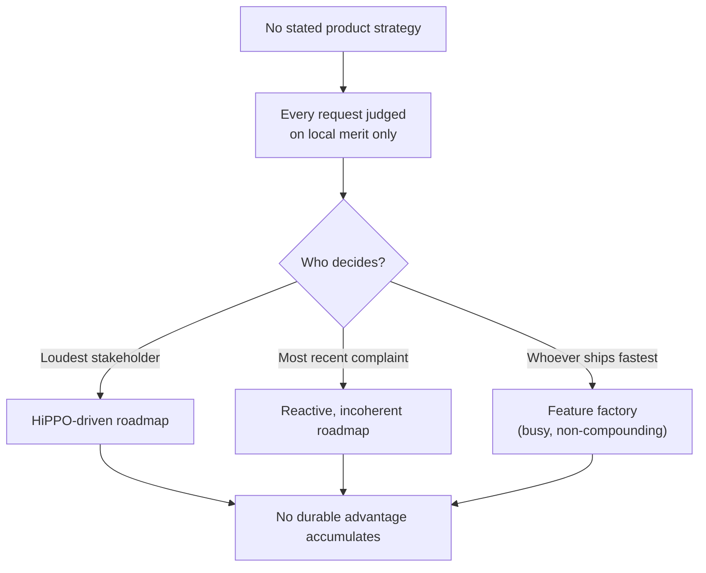

The diagram names the failure state this chapter exists to prevent: without
an explicit strategic filter, a backlog does not fail by being empty — it
fails by being full of individually defensible items that never add up to
anything.

## 4. Core Concepts

### 4.1 Product Strategy as the Connective Layer

Definition:
Product strategy is the explicit, examinable set of choices that translates
a company's business strategy into which product bets a product organization
commits to pursuing, in what order, and why — deliberately excluding the
choices left to roadmap and backlog mechanics further downstream.

Mechanism (how it works):
Product strategy sits between two layers that speak different languages.
Business strategy speaks in markets, positioning, and competitive advantage.
Roadmaps and backlogs speak in initiatives, epics, and tickets. Product
strategy is the deliberate act of holding both languages at once: it takes a
business-level directional statement, combines it with evidence about
customers (personas, JTBD, discovery findings) and the competitive
environment, and produces a small, ordered set of *bets* — each bet a stated
theory of what customer or market outcome the organization will pursue and
why it should win.

Decision implications (when and why to use it):
Any organization allocating scarce engineering, design, and go-to-market
capacity across more plausible opportunities than it can pursue needs this
layer. It becomes indispensable once a company has more than one team, since
without a shared strategic frame, each team independently optimizes for its
own local objective and the sum of locally rational choices is frequently
not organizationally rational.

Common failure mode:
Skipping the translation and running roadmap prioritization directly against
the business strategy statement. Because the business statement is too
abstract to adjudicate between two competing feature requests, this default
to whichever executive stakeholder is most persuasive in the room — the same
HiPPO failure mode introduced in Section 3, now recurring at every planning
cycle because nothing was ever built to prevent it.

Concrete scenario:
A business strategy states "expand from mid-market to enterprise customers."
Left untranslated, this produces requests for arbitrary enterprise features
(SSO, audit logs, custom contracts) prioritized by whichever enterprise
prospect complained most recently. A product strategy translates this into
a specific bet: "the single-tenant data isolation gap is the primary blocker
for our top three enterprise deals this half; solve that before any other
enterprise-adjacent request," giving the roadmap something to actually
prioritize against.

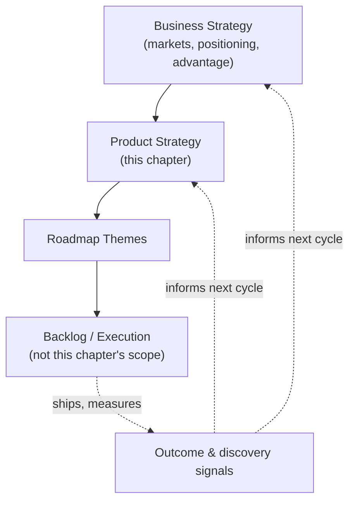

The feedback arrows matter as much as the downward ones: product strategy is
not a one-way translation performed once a year. Shipped outcomes and new
discovery evidence continuously revise the strategy layer, which is why
Section 5 treats this as a cycle, not a document.

### 4.2 The Strategy Stack (Mission, Vision, Strategy, Objectives, Initiatives)

Definition:
The strategy stack is a ladder of statements at decreasing altitude — mission
(why the organization exists), vision (the future state it is trying to
create), strategy (the coherent set of choices for getting there), objectives
(the measurable near-term targets that indicate progress), and initiatives
(the specific bets and programs of work) — each level answering a
progressively more concrete question than the one above it.

Mechanism (how it works):
Each rung constrains the one below it without dictating it. Mission rarely
changes. Vision changes on the order of years. Strategy is revisited
annually or when a material assumption breaks. Objectives are typically
quarterly. Initiatives are the bets this chapter helps select and sequence.
A well-formed stack is traceable in both directions: someone can start at an
initiative and answer "which objective does this serve, which strategic
choice does that objective operationalize, and which vision does that
choice move us toward?" — and the answer should not require inventing a
post-hoc justification.

Decision implications (when and why to use it):
Use the stack explicitly whenever a strategy conversation feels
unproductively circular — for example, a debate about a specific initiative
that is actually a disagreement about strategy, or a debate about strategy
that is actually a disagreement about vision. Naming which rung the
disagreement actually lives on prevents teams from re-litigating vision
during a quarterly initiative review, or rubber-stamping an initiative that
silently contradicts the stated strategy.

Common failure mode:
Collapsing the ladder — writing a "vision statement" that is really a
restated mission ("be the best"), or a "strategy" that is really a list of
initiatives with no stated theory connecting them. Rumelt's diagnosis in
Section 6 names this precisely: a list of goals is not a strategy.

Concrete scenario:
A team's stated "strategy" is a bullet list: "improve onboarding, add SSO,
expand to Europe, improve reliability." None of these bullets explains why
the others were excluded or how they compound. Restated properly on the
stack: the vision is "become the default payments layer for small-business
software vendors"; the strategy is "win by embedding in vendor platforms
rather than selling direct, because our unit economics only work at
platform-level distribution"; the objectives and initiatives that follow
(an SSO integration for platform partners, not consumer-facing SSO) now
derive visibly from that one strategic choice instead of sitting as an
unranked wish list.

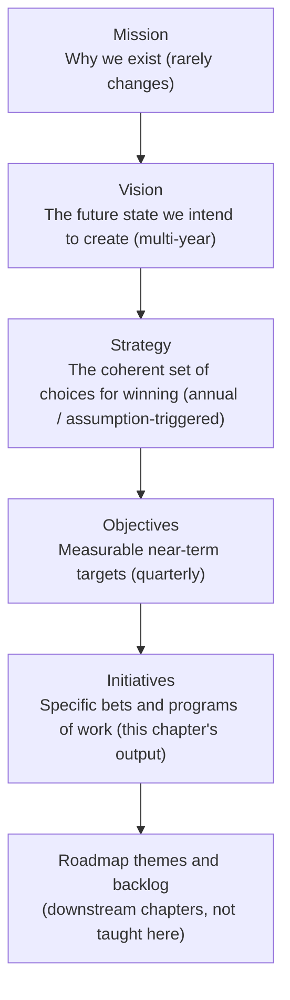

### 4.3 Product Principles

Definition:
Product principles are a small set of stated decision heuristics, derived
directly from the strategy, that a team applies repeatedly to resolve
recurring trade-offs without re-litigating the strategy from scratch every
time a conflict appears.

Mechanism (how it works):
A strategy states a small number of intentional trade-offs (for example,
"we will accept slower feature velocity in exchange for stronger data
governance, because enterprise trust is our differentiator"). A product
principle operationalizes one of those trade-offs as a rule of thumb usable
in the moment: "when a feature request would weaken audit-log completeness,
default to declining it unless a named executive sponsor overrides." Good
principles are specific enough to produce a different decision than its
opposite would; a principle that both options could equally satisfy is not
actually a principle.

Decision implications (when and why to use it):
Write product principles once a team notices the same category of trade-off
recurring across multiple, unrelated feature debates — a signal that a
reusable heuristic would save more time than re-deriving the answer from
strategy each time. They are most valuable at the boundary between teams,
where a shared, written heuristic prevents inconsistent local judgment calls.

Common failure mode:
Writing principles as inspirational platitudes ("delight the customer,"
"move fast") that do not actually discriminate between two competing
options. A test for a real principle: could a reasonable team defend the
opposite choice under a different, equally generic-sounding principle? If
so, the principle carries no decision content.

Concrete scenario:
A team debating whether to build a highly configurable settings panel or a
strongly opinionated default applies its stated principle, "default to one
opinionated path over configurability unless a customer segment can prove a
revenue-blocking need for the alternative." The debate resolves in minutes
because the heuristic — derived from a strategic choice to compete on
simplicity rather than flexibility — already picked a side.

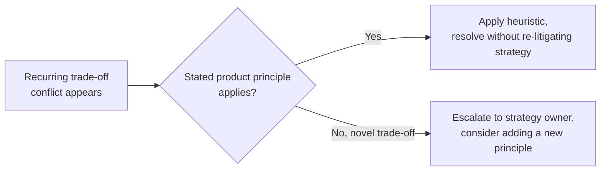

### 4.4 Strategic Intent and Vision-Setting via PR-FAQ

Definition:
Vision-setting is the deliberate articulation of the future customer or
market state a product intends to create, stated concretely enough to be
falsifiable rather than aspirational filler. The Press Release and
Frequently Asked Questions (PR-FAQ) technique — popularized as part of
Amazon's "Working Backwards" practice — is a specific artifact and process
for producing that vision: authors write a fictional press release
announcing the finished product as if it already shipped, paired with an
internal-facing FAQ addressing the hardest anticipated questions, *before*
any significant build work begins.

Mechanism (how it works):
The press release section is written entirely from the customer's point of
view — headline, customer problem, solution, a representative customer
quote — deliberately excluding internal implementation detail. The FAQ
section is split into external (customer-facing) and internal
(feasibility, cost, risk, dependency) questions, forced to be answered
honestly rather than deferred. The document is reviewed and iterated by a
small group before a build commitment is made; if the team cannot write a
believable, specific press release, that is itself a signal the underlying
idea is not yet well-formed enough to fund.

Decision implications (when and why to use it):
Use a PR-FAQ before committing meaningful capacity to an ambiguous or
high-stakes bet, specifically because the discipline of writing from the
customer's future vantage point exposes vague value propositions that a
traditional requirements document or slide deck tends to paper over with
internal jargon. It is not warranted for small, well-understood, low-risk
work, where the overhead exceeds the clarification benefit.

Common failure mode:
Treating the press release as a sales exercise decoupled from an honest FAQ
— writing a compelling customer narrative while quietly avoiding the hard
internal questions about feasibility, cost, or why a competitor has not
already done this. The FAQ section, not the press release, is where a
PR-FAQ earns its value; skipping honest engagement with the hard internal
questions turns the exercise into marketing copy with no strategic teeth.

Concrete scenario:
A team proposing an automated expense-reconciliation feature writes a
press release claiming "finance teams close their books three days
faster." Drafting the internal FAQ forces an honest answer to "what
happens when our matching algorithm is wrong 5 percent of the time on
messy vendor data?" — a question the original one-page proposal had never
raised. The bet proceeds, but with an explicit human-review fallback
scoped in from the start rather than discovered as an incident three months
after launch.

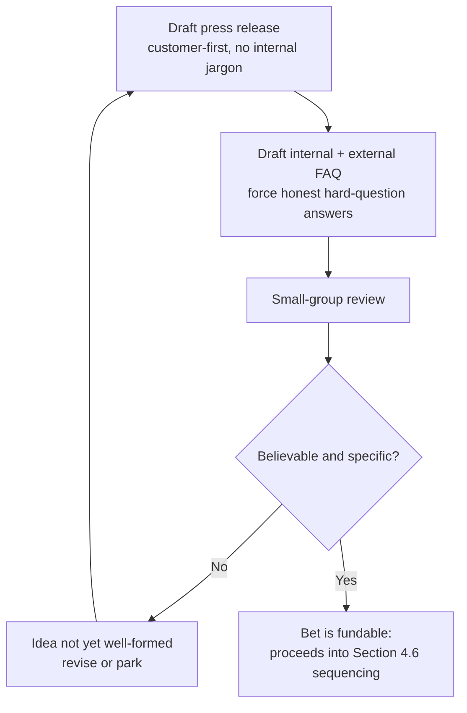

### 4.5 Jobs-to-be-Done (JTBD)

This section fully teaches JTBD, claiming ownership explicitly flagged
forward by [Personas](CH03_Personas.md#21-comparison-table) and
[Problem Framing](CH06_Problem_Framing.md), neither of which taught it.

#### 4.5.1 Definition and the Core Causal Claim

Definition:
Jobs-to-be-Done is a framework holding that customers do not fundamentally
buy products or features; they "hire" a product to make progress against a
specific struggle, in a specific circumstance, and will "fire" whatever they
were using before (including doing nothing) if a better option for making
that progress appears. The "job" is the causal, circumstantial story of
progress being sought — not a market segment, not a persona, and not a
product category.

Mechanism (how it works):
JTBD reframes the analytical unit away from "who is the customer" (a
persona question) and toward "what circumstance-specific progress is being
sought, and what is currently blocking it." Christensen's origin example —
developed with Bob Moesta while studying a fast-food chain's milkshake
sales — found that a large share of morning milkshake purchases were being
"hired" by commuters who wanted something that would occupy one hand,
survive a bumpy commute, take a long time to consume, and reduce boredom on
a long drive: the milkshake was competing against bananas, bagels, and
boredom itself, not against other milkshake brands. No demographic
persona-style segmentation (age, income, family status) predicted this
purchase; the *circumstance* did.

Decision implications (when and why to use it):
Use JTBD at the strategic-framing stage, before a persona or a feature list
has been decided, specifically when a team suspects it is competing against
something outside its own product category (a manual workaround, a
spreadsheet, a competitor's fundamentally different approach, or simple
inaction) rather than against the obvious direct competitors. JTBD is a
poor tool for screen-level interaction decisions — that is squarely
[Wireframing](CH09_Wireframing.md)'s territory — and a poor substitute for
a persona when the team's actual question is "which named group of users
should this interface serve" rather than "what underlying progress is being
sought."

Common failure mode:
Confusing the job with the solution ("their job is to use our dashboard,"
which restates the product rather than the underlying progress) or
confusing the job with the persona ("our job is serving enterprise buyers,"
which names a segment, not a struggle). A job statement that could be
satisfied only by your specific product, or that names a role instead of a
struggle, has not actually identified a job.

Concrete scenario:
A budgeting application's growth stalls despite strong feature parity with
competitors. A JTBD investigation into recent cancellations finds that
users were not "hiring" the app to categorize transactions (the feature the
team had been optimizing); they were hiring it to answer, at a specific
anxious moment right before a big purchase, "can I afford this without
derailing my month?" Competing options for that job included a bank
balance glance, a gut feeling, or asking a partner — not other budgeting
apps. The strategic reframe shifts the bet from "better categorization" to
"a fast, anxiety-reducing, purchase-moment affordability check."

#### 4.5.2 Job Story Structure

The job story format states a job as a triple of situation, motivation, and
expected outcome, deliberately replacing user-story phrasing ("as a
[persona], I want [feature], so that [benefit]") because persona-first
phrasing tends to smuggle in a role and a solution before the underlying
struggle has been established.


Worked example, contrasted directly against a user story for the same
underlying need:

- User story (persona-first, risks a premature solution): "As a budget-app
  user, I want a spending dashboard, so that I can see my transactions."
- Job story (situation-first, states the underlying struggle): "When I'm
  about to make a purchase I'm unsure I can afford, I want a fast,
  low-anxiety way to check whether it fits this month, so I can decide
  without spiraling into a full budget review."

The job story's situation clause is doing the strategic work: it names the
triggering circumstance, which is what stays stable even as candidate
solutions change, whereas the user story's "dashboard" has already
committed to a solution shape before the struggle was fully understood.

#### 4.5.3 Functional, Emotional, and Social Dimensions

A job is rarely purely functional. Most jobs carry three simultaneous
dimensions, and a strategy that satisfies only the functional dimension
frequently still fails:

- **Functional dimension**: the literal task-level progress sought (check
  whether a purchase fits the budget).
- **Emotional dimension**: how the person wants to feel, or stop feeling,
  in the process (reduce anxiety, avoid a spiral of shame or overwhelm).
- **Social dimension**: how the person wants to be perceived by others
  while doing it (appear responsible to a partner, avoid an awkward
  conversation about a shared account).

Decision implication: a solution can nail the functional dimension and
still fail the job if it aggravates the emotional dimension — for example,
a feature-rich budget review that is functionally accurate but induces the
exact anxiety spiral the customer was trying to avoid. Strategic framing
should name all three dimensions explicitly rather than defaulting to the
functional one because it is easiest to specify.

#### 4.5.4 The Four Forces of Progress

Mechanism (how it works):
Bob Moesta's Four Forces model explains why a customer does or does not
switch away from their current way of getting a job done. Two forces push
toward switching, two resist it:

- **Push of the situation**: dissatisfaction with the current approach
  strong enough to motivate looking for an alternative.
- **Pull of the new solution**: the attractiveness of the imagined better
  alternative.
- **Anxiety of the new solution**: fear of the unknown — will it actually
  work, what will go wrong, what is the switching cost.
- **Habit of the present**: inertia and the comfort of an already-known,
  already-workable-enough current approach.

A switch happens only when the combined push and pull exceed the combined
anxiety and habit; otherwise the customer stays put even if the new option
is objectively better on paper.

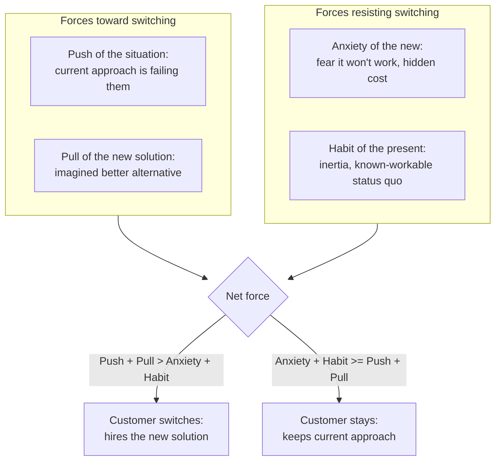

Decision implications (when and why to use it):
Use the Four Forces model to diagnose *why* an objectively-better product
is not winning adoption. If a strategy assumes customers will switch purely
because a new option is functionally superior, the Four Forces model
predicts that assumption will fail whenever anxiety or habit is
underestimated — which is common, because anxiety and habit are much less
visible in a demo than push and pull.

Common failure mode:
Designing an entire go-to-market strategy around amplifying pull (better
marketing, a flashier demo) while ignoring anxiety and habit, which are
usually the actual blockers once a prospect already believes the pull
story. A strategy that does not name a concrete anxiety-reduction and
habit-disruption mechanism (a trial, a migration assistant, a money-back
guarantee) is relying on pull alone to overcome forces it has not measured.

Concrete scenario:
A challenger accounting product is functionally superior and cheaper than
the incumbent, yet loses nearly every competitive deal. A Four Forces
analysis of lost deals finds the blocker is not pull (prospects agree it is
better) but anxiety (fear of a broken migration during tax season) and
habit (the incumbent is deeply embedded in existing accountant
relationships). The resulting strategic bet is not "add more features" but
"build a white-glove, insured migration guarantee timed outside tax
season" — directly targeting the two forces actually blocking the switch.

#### 4.5.5 Switch Triggers and the Job Timeline

A job becomes actionable strategically only once a team can name the
specific *triggering moment* that pushes someone from passively tolerating
their current approach into actively seeking an alternative — the moment
push crosses a threshold. Interviewing around this timeline (what were you
doing right before you started looking, what almost stopped you from
switching, what nearly made you go back) surfaces the real push/pull/anxiety
/habit balance far more reliably than asking someone to rate feature
importance in the abstract, because it anchors the conversation in a real,
remembered event rather than a hypothetical preference.

Distinguishing JTBD from adjacent concepts this chapter does not re-derive:
a **persona** ([Personas](CH03_Personas.md)) answers "who," built from
behavioral variables and used to resolve *design* conflicts about a given
interface; a **job** answers "what progress, in what circumstance," and is
used to resolve *strategic* conflicts about which underlying struggle is
worth building a product around in the first place. The same job can be
relevant to multiple personas, and the same persona can have multiple,
unrelated jobs — the two frameworks are complementary, not substitutes, and
conflating them is the single most common JTBD misapplication.

### 4.6 Portfolio Sequencing Logic: Why This Bet Over That One

Definition:
Portfolio sequencing logic is the explicit reasoning a product strategy uses
to decide which validated or plausible bet gets funded first, second, or
not at all, given that capacity is always smaller than the set of
legitimate opportunities.

Mechanism (how it works):
Two complementary tools do most of the sequencing work. First, the
**Three Horizons model** buckets bets by time-to-payoff and risk profile so
that a portfolio is not accidentally all core-business optimization (safe,
but with a shrinking ceiling) or all speculative bets (exciting, but
starving the business that funds it):

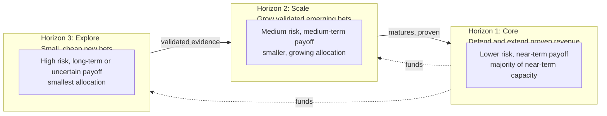

Second, for bets competing *within* the same horizon, a sequencing decision
weighs four questions: strategic fit (does it reinforce the stated strategic
choice, or merely sound reasonable in isolation), market timing (is the
window open now, or does a dependency — a partner integration, a regulatory
change — block it regardless of internal readiness), capability readiness
(does the organization have, or can it quickly acquire, the skills and
platform maturity the bet requires), and opportunity cost (what
higher-confidence bet is displaced if this one is funded first).

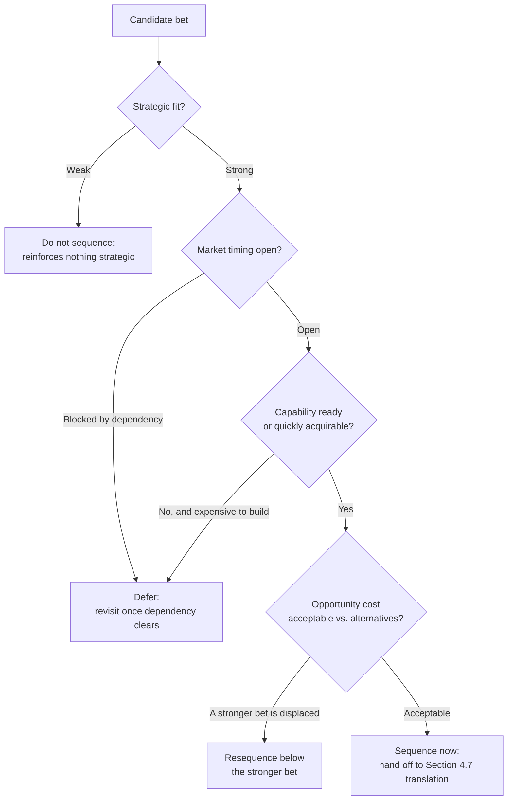

Decision implications (when and why to use it):
Use explicit sequencing logic whenever more than one legitimately validated
opportunity competes for the same capacity — which, in a healthy discovery
practice, is nearly always. Sequencing logic is what separates a strategy
from a wish list: a wish list ranks everything as important; a sequenced
portfolio explicitly states what is *not* being pursued right now and why.

Common failure mode:
Sequencing purely by discovery-validation strength while ignoring capability
readiness and opportunity cost — funding the single most-validated
opportunity even though a marginally less-validated one requires no new
capability and displaces nothing. Strength of evidence answers "should we
ever do this," not "should we do this before that."

Concrete scenario:
Three validated opportunities compete for one quarter's engineering
capacity: a compliance feature required to close two pending enterprise
deals (Horizon 1, high strategic fit, tight timing), a platform integration
with a partner whose application programming interface (API) is not yet
stable (Horizon 2, strong fit, but blocked on timing), and a speculative
artificial intelligence (AI)-assisted feature with weak internal capability
today (Horizon 3, exciting, but expensive to acquire the needed skill).
Sequencing logic funds the compliance feature first (fit and timing both
strong, deals are time-boxed), defers the partner integration until the
partner API stabilizes, and funds a small Horizon 3 exploration spike for
the AI feature rather than a full commitment — a portfolio, not a single
all-in bet.

### 4.7 Strategy-to-Roadmap Translation Contract

Definition:
The strategy-to-roadmap translation contract is the minimum set of
obligations a product strategy owes the roadmap layer so that roadmap and
backlog work (owned by this part's not-yet-drafted **Roadmaps** and
**Backlog** chapters — see [PART_OVERVIEW.md](PART_OVERVIEW.md)) has
something coherent to prioritize against, without this chapter teaching
roadmap format or backlog mechanics itself.

Mechanism (how it works):
A sequenced bet (Section 4.6's output) is not yet roadmap-ready. The
translation contract requires three things be stated before a bet is
handed downstream: an **outcome hypothesis** (the specific, falsifiable
customer or business result the bet is expected to produce, not just a
description of the work), a **roadmap theme** (a durable, outcome-oriented
label a roadmap can organize initiatives under across more than one
planning cycle), and an explicit **non-goal set** (what this bet
deliberately excludes, preventing scope creep from silently re-expanding
the bet back into the wish list Section 4.6 was designed to prevent).

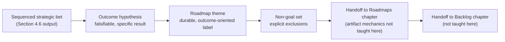

Decision implications (when and why to use it):
Apply this contract at the exact moment a strategy conversation starts
generating roadmap-shaped language ("we should build X next quarter").
That is the signal that the strategic reasoning is finished and the
translation step needs to happen deliberately, rather than being skipped
in favor of jumping straight to a feature list — which quietly re-imports
the HiPPO failure mode from Section 3 one layer down.

Common failure mode:
"Strategy theater" — a polished strategy document exists, is presented once,
and is never actually consulted when the roadmap is built, because no one
did the translation work connecting the two. The roadmap ends up justified
independently, and the strategy document becomes decorative.

Concrete scenario:
A strategic bet ("win the compliance blocker for enterprise deals") is
handed to a roadmap team as a bare instruction: "build SSO." Without the
outcome hypothesis and non-goal set, the roadmap team reasonably expands
"SSO" to include seven adjacent identity-management features because
nothing bounded the bet. Restated with the full contract — outcome
hypothesis "close the two named blocked deals by removing the single-tenant
data isolation objection," non-goals "do not build general enterprise
identity-management tooling this cycle" — the roadmap team can correctly
scope a much smaller, faster piece of work.

### 4.8 Objectives and Key Results (OKRs) as the Execution Contract

Definition:
Objectives and Key Results (OKRs) is a goal-setting framework pairing a
qualitative, ambitious **objective** (what we want to achieve) with a small
set of quantitative, verifiable **key results** (how we will know we
achieved it), used to cascade a strategy's sequenced bets into measurable,
time-boxed commitments across an organization.

Mechanism (how it works):
A company-level objective is set for a strategy period (commonly a
quarter), each with two to five key results that are outcome-oriented
(a measurable change in customer or business behavior) rather than
output-oriented (a list of things shipped). Each team or product line then
sets its own objectives, each explicitly justified by the key result it
most directly supports one level up, cascading strategic intent downward
while cascading evidence and constraints back upward.

```{=latex}
\begin{landscape}
```

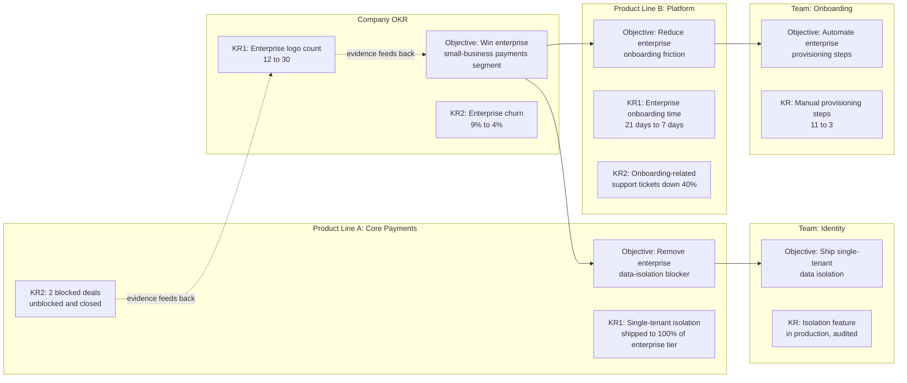

```{=latex}
\end{landscape}
```

The landscape wrap above is used deliberately: this cascade has more
parallel lanes (company, two product lines, two teams) than a portrait page
can hold without compressing labels into illegibility, matching the PDF
landscape convention in the Style Guide for wide, multi-lane diagrams.

Decision implications (when and why to use it):
Use OKRs specifically to make a sequenced strategic bet measurable and
time-boxed, and to make the cascade from company intent to team-level work
auditable in both directions. OKRs are not a substitute for the sequencing
logic in Section 4.6 — they measure whether an already-chosen bet is
working, not which bet to choose.

Common failure mode:
"OKRs as a disguised task list" — key results that are actually just a
restated list of planned deliverables ("ship feature X," "ship feature Y")
rather than a measurable change in customer or business behavior. This
failure mode erases the entire benefit of OKRs: it becomes indistinguishable
from a roadmap with extra ceremony, and — because it no longer states a
falsifiable outcome — it cannot fail cleanly, which means it also cannot
teach the organization anything when a bet does not work.

Concrete scenario:
A team sets a key result "ship the new onboarding wizard by end of
quarter." The wizard ships on time, the key result is marked complete, and
onboarding time does not improve, because the actual bottleneck was manual
enterprise provisioning steps, not the wizard's interface. Restated as an
outcome ("enterprise onboarding time from 21 days to 7 days"), the same
quarter would have surfaced the mismatch mid-cycle instead of only after a
"successful" ship that changed nothing that mattered.

## 5. Internal Working

Product strategy is not a document produced once a year; it is a recurring
operating cycle connecting inputs, synthesis, sequencing, translation, and
review into a loop that runs continuously, typically anchored to a quarterly
or half-yearly cadence with lighter continuous adjustments in between.

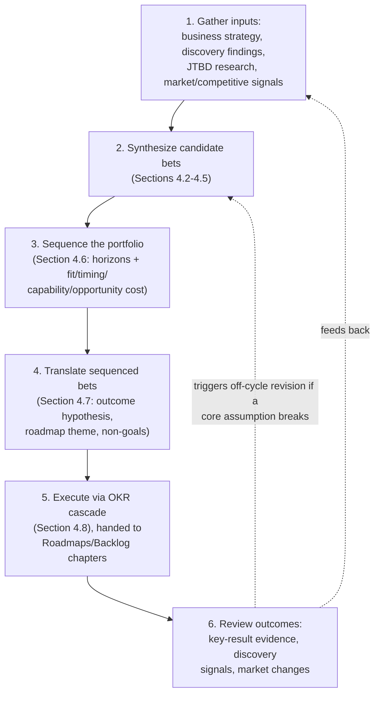

The two feedback paths matter for different reasons. The routine path
(Review back to Gather Inputs) is the expected quarterly or half-yearly
cadence: nothing has broken, the loop simply repeats with fresh evidence.
The exception path (Review directly back to Synthesize) is triggered by an
assumption invalidation strong enough to warrant revisiting bets mid-cycle
— for example, a Horizon 3 exploration in Section 4.6 producing evidence
that a core Horizon 1 assumption is no longer safe. Distinguishing routine
cadence from assumption-triggered revision prevents two opposite failure
modes: re-litigating strategy every sprint (which destroys the stability
teams need to execute), and rigidly waiting for the next quarterly cycle
even after a material assumption has already broken (which is the "strategy
whiplash versus strategy paralysis" trade-off revisited in Section 20).

A second mechanism worth naming explicitly is bidirectional traceability,
mirrored from the discipline [Service Design](CH12_Service_Design.md#5-internal-working)
uses for blueprint changes: every initiative should be traceable upward to
the outcome hypothesis and bet that justified it, and every review finding
should be traceable downward to the specific bet, objective, or key result
it invalidates or confirms. Without this traceability, a review conversation
degenerates into re-arguing the whole strategy from first principles every
cycle instead of updating the specific link in the chain that evidence
actually challenged.

## 6. Design Principles

- **A strategy is a kernel, not a wish list** (Rumelt). A real strategy
  states a diagnosis of the core challenge, a guiding policy for addressing
  it, and a coherent set of actions — not an unranked list of things that
  all sound good.
- **Make strategy falsifiable.** A strategy that cannot fail — because it
  never states a specific outcome hypothesis a reviewer could later prove
  wrong — is not a strategy; it is an aspiration, and it teaches the
  organization nothing when it does not work.
- **Strategy should be stable; tactics should flex.** Reversing a stated
  strategic bet every quarter erodes the organization's ability to
  compound effort in one direction; the initiatives beneath a stable
  strategy should still adapt quickly as evidence arrives.
- **State non-goals with the same explicitness as goals.** A strategy that
  only lists what to pursue, without listing what it deliberately excludes,
  invites the scope-creep failure mode named in Section 4.7.
- **One strategy per horizon, not one strategy for the whole portfolio.**
  Applying Horizon 1 risk tolerance to a Horizon 3 exploration kills
  legitimate early bets before they can produce evidence; applying Horizon
  3 risk tolerance to Horizon 1 destabilizes the revenue base that funds
  everything else.
- **Strategy debt is real debt.** Deferring the translation work in Section
  4.7 to "just ship something reasonable this quarter" accrues the same
  kind of compounding cost as deferred technical debt: each untranslated
  cycle makes the eventual reconciliation between roadmap reality and
  stated strategy more expensive.
- **A stated strategy must have a named owner who can say no.** Without a
  single accountable owner empowered to decline an off-strategy request,
  the sequencing logic in Section 4.6 is advisory rather than binding, and
  the HiPPO failure mode from Section 3 reasserts itself informally.

## 7. Architecture Patterns

For a product strategy, "architecture patterns" means recurring, named
operating-model shapes for how a strategy function organizes its bets and
its relationship to engineering and go-to-market, analogous to how a
software architecture pattern names a recurring structural shape.

- **Platform strategy pattern**: bets are evaluated by how much they extend
  a shared, reusable capability multiple product lines can build on, rather
  than by direct feature-level customer value alone. Strongest when an
  organization has, or intends to have, multiple product lines sharing
  underlying capability.
- **Point-solution portfolio pattern**: bets are evaluated independently per
  product line with minimal shared-capability weighting. Simpler to reason
  about and faster to execute for a single-product company; weaker at
  compounding advantage once a second product line exists, because nothing
  captures cross-line leverage.
- **Three Horizons operating pattern** (Section 4.6): capacity is
  explicitly split and separately governed across Horizon 1, 2, and 3 bets,
  with different review cadences, risk tolerances, and funding rules per
  horizon.
- **Outcome-based operating model**: teams are funded against a standing
  outcome (an OKR-style key result) rather than against a fixed project
  scope, giving them latitude to change tactics as evidence arrives without
  requiring a formal re-scoping process for every pivot.
- **Build-buy-partner pattern**: for a given sequenced bet, the strategy
  explicitly evaluates building the capability internally, acquiring it
  (buying a company or a license), or partnering (an integration or
  revenue-share arrangement) as three structurally different ways to
  satisfy the same outcome hypothesis, rather than defaulting to "build" by
  habit.

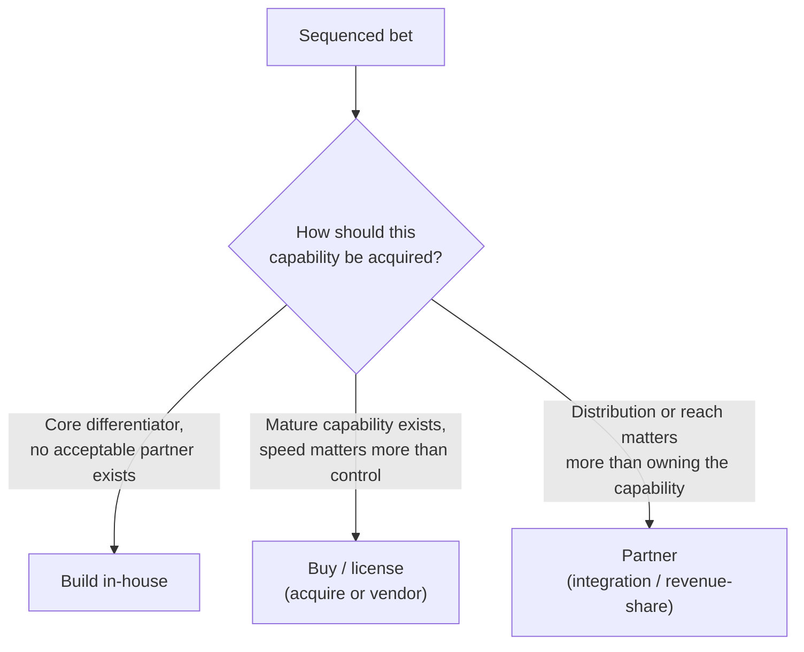

Each pattern is a trade-off, not a universal best choice: a platform
strategy pattern applied to a single-product company adds coordination
overhead with no compounding benefit to capture, and a build-first habit
applied to a commodity capability wastes scarce engineering capacity on
something a vendor already solved well.

## 8. Production Architecture

"Production" for a product strategy means the operational stack of
artifacts, cadences, and governance that keeps the strategy alive and
consulted, rather than filed away after a single launch presentation.

- **Artifact stack**: vision statement, PR-FAQ documents for major bets,
  the current strategy memo (stating the Rumelt-style kernel), the current
  OKR set, and the sequenced bet portfolio — each versioned, dated, and
  attributed to an owner.
- **Governance cadence**: an annual or half-yearly strategy reset (revisits
  Sections 4.1-4.2), a quarterly OKR-setting and bet-sequencing cycle
  (Sections 4.6-4.8), and a lighter continuous review triggered by material
  evidence (Section 5's exception path).
- **Review forum**: a named, small decision-making group (not a large
  all-hands) with the authority to approve, reject, resequence, or kill a
  bet — mirroring the accountable-owner principle from Section 6.
- **Tooling**: dedicated roadmap and strategy tools (broadly, categories
  like Aha! or Productboard, named for orientation only) typically host the
  artifact stack and OKR tracking; this chapter does not endorse or teach
  any specific tool, since tool selection is an implementation detail
  downstream of the strategy discipline itself.

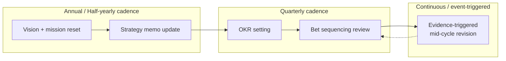

## 9. Implementation

A phased approach to standing up or resetting a product strategy function:

### Phase 1: Diagnose

- Gather the current business strategy statement, existing discovery
  findings, and any prior JTBD or persona research.
- Name the core challenge in Rumelt-kernel terms: what specifically is
  blocking growth or advantage right now.

### Phase 2: Frame

- Draft or update the vision statement and, for the most ambiguous or
  highest-stakes candidate bets, a PR-FAQ (Section 4.4).
- Run or commission JTBD research (Section 4.5) for the underlying
  customer struggle the strategy intends to address.
- Draft product principles (Section 4.3) for the two or three trade-offs
  the strategy most needs a team-level heuristic for.

### Phase 3: Sequence

- Bucket candidate bets across the Three Horizons (Section 4.6).
- Apply the strategic fit, timing, capability, and opportunity-cost test
  to bets competing within the same horizon.

### Phase 4: Translate

- For each sequenced bet, write the outcome hypothesis, roadmap theme, and
  non-goal set (Section 4.7).
- Hand the translated bet set to the Roadmaps and Backlog chapters' owners
  for downstream prioritization mechanics.

### Phase 5: Execute and Review

- Cascade an OKR set from the sequenced bets (Section 4.8).
- Run the recurring internal-working cycle (Section 5), including the
  evidence-triggered exception path.

## 10. Complete Code Examples

Product strategy is an artifact- and reasoning-driven discipline rather
than a code-first one. In place of code, this section provides
implementation-neutral schemas a team can adapt into whatever documentation
or planning tool it already uses.

Strategy memo schema:

- Diagnosis (the core challenge, stated specifically)
- Guiding policy (the coherent approach chosen to address it)
- Coherent actions (the sequenced bets that follow, Section 4.6)
- Explicit non-goals (Section 4.7)
- Owner and review cadence

Job story schema (Section 4.5.2):

- Situation ("When I...")
- Motivation ("I want to...")
- Expected outcome ("so I can...")
- Functional / emotional / social dimension notes (Section 4.5.3)
- Evidence source (interview, discovery finding, support ticket pattern)

Bet card schema (Section 4.6-4.7):

- Bet name and one-line description
- Horizon (1, 2, or 3)
- Strategic fit rationale
- Timing dependency, if any
- Capability readiness assessment
- Opportunity cost (what is displaced)
- Outcome hypothesis
- Roadmap theme
- Non-goal set

OKR schema (Section 4.8):

- Objective (qualitative, ambitious)
- Key results (2-5, quantitative, outcome-oriented not output-oriented)
- Parent objective/key result it cascades from
- Owning team

These schemas are deliberately tool-agnostic; a team implements them in
whichever roadmap or documentation platform it already operates, per
Section 8.

## 11. Performance

"Performance" for a product strategy is measured as decision velocity and
cycle time, not runtime latency:

- **Time from market signal to strategic response**: how long between a
  material discovery finding or competitive move and a corresponding
  sequencing decision (Section 5's exception path).
- **Time-to-strategic-clarity**: how long a team spends debating whether a
  request is on-strategy before a decision is made, using the stated
  product principles (Section 4.3) as the acceleration mechanism.
- **Translation lag**: the gap between a bet being sequenced (Section 4.6)
  and its outcome hypothesis and roadmap theme being written (Section 4.7)
  — a growing lag is an early indicator of the "strategy theater" failure
  mode.

Heuristics:

- Prefer a fast, principle-driven decision over a slow, perfectly analyzed
  one for reversible bets (a "two-way door," in the vocabulary owned by
  [Architecture Thinking](../01_Architecture_Mindset/CH03_Architecture_Thinking.md)).
- Reserve slow, heavily analyzed sequencing decisions for genuinely
  irreversible, high-capital bets.

## 12. Scalability

Strategy scalability has to hold across more teams, more product lines, and
more geographies without collapsing into either a single centralized
bottleneck or an incoherent set of locally invented strategies:

- **Cascade scalability**: the OKR cascade (Section 4.8) must remain
  traceable even as the number of product lines and teams grows; the
  landscape-wrapped diagram in Section 4.8 already illustrates the
  multi-lane shape this needs to support.
- **Sequencing scalability**: the Three Horizons model (Section 4.6) scales
  by applying the same fit/timing/capability/opportunity-cost test per
  product line, with a lightweight cross-line arbitration step for bets
  that compete for genuinely shared capacity.
- **Principle scalability**: product principles (Section 4.3) should be
  small in number and stable, so that adding a new product line does not
  require re-deriving new principles from scratch — new lines should be
  able to adopt the existing principle set with at most minor extension.

Strategy scalability failure typically shows up as sibling product lines
independently reinventing conflicting priorities, exactly as
[Personas](CH03_Personas.md#12-persona-governance-lifecycle-and-maintenance)
describes for federated persona ownership at scale — the same centralized-
versus-federated tension recurs here, and the same remedy (a shared, thin
central layer with local execution latitude) applies.

## 13. Security

Security for a product strategy concerns confidentiality and controlled
disclosure of strategic intent, not application-level security controls
(owned elsewhere, notably the not-yet-drafted Security part):

- **Competitive confidentiality**: an unsequenced or newly sequenced bet is
  competitively sensitive information; premature external disclosure
  (including through a public-facing roadmap) can hand a competitor a
  head start on the exact opportunity the strategy is targeting.
- **Material-information handling**: for publicly traded companies, a
  strategic bet that could reasonably move investor expectations may
  qualify as material non-public information, subject to disclosure
  controls that go beyond ordinary confidentiality practice.
- **Controlled external roadmap disclosure**: customer-facing roadmap
  communication (a downstream concern of the not-yet-drafted **Roadmaps**
  chapter) should intentionally lag internal sequencing decisions enough
  to avoid revealing competitively sensitive bet ordering before it is
  ready for public commitment.

Common tension: sales and customer-success teams want early roadmap
visibility to manage customer expectations, while the strategy owner wants
to delay disclosure until sequencing is stable enough not to create false
commitments. The typical resolution is a tiered disclosure model —
internal sequencing detail restricted to a small group, a directional but
non-binding external theme shared more broadly, and specific commitments
withheld until a bet has cleared the translation contract in Section 4.7.

## 14. Observability

Observability for a product strategy means having leading and lagging
signals that reveal whether a sequenced bet is on track *before* a full
quarter's key results are due, not only after the fact:

- **Leading indicators**: early discovery or usage signals correlated with
  a bet's outcome hypothesis (for example, adoption of a beta cohort for
  the compliance feature in Section 4.6's worked example, tracked weeks
  before the full enterprise-deal outcome is known).
- **Lagging indicators**: the key results themselves (Section 4.8), which
  confirm or refute the outcome hypothesis but arrive too late to redirect
  mid-cycle work.
- **Strategy health signals**: translation lag (Section 11), the ratio of
  on-strategy to off-strategy requests reaching the roadmap layer, and how
  often the exception path in Section 5 is triggered (too rare may signal
  a rigid strategy ignoring real signals; too frequent may signal
  insufficient upfront diagnosis).

This chapter deliberately stops at this framing-level treatment of signals;
full metric-design technique — funnel definitions, statistical rigor for
experiment reads, and the single unifying top-line metric discipline — is
owned by this part's not-yet-drafted **Metrics** and **North Star Metrics**
chapters (see [PART_OVERVIEW.md](PART_OVERVIEW.md)).

## 15. Failure Scenarios

Representative product-strategy failure modes and their typical resolution:

1. **Zombie strategy**: a strategy document exists, was approved, and is
   never referenced again during roadmap planning. Resolution: enforce the
   translation contract (Section 4.7) as a hard gate before any bet reaches
   the roadmap layer.
2. **Orphaned OKRs**: key results are set but trace to no identifiable
   sequenced bet or outcome hypothesis. Resolution: require every objective
   to cite the specific bet card (Section 10) it cascades from.
3. **Strategy whiplash**: the stated strategy changes every quarter in
   response to the latest competitive news, destroying teams' ability to
   compound effort. Resolution: apply the stability principle from Section
   6 and reserve the exception path in Section 5 for genuinely
   assumption-breaking evidence, not routine noise.
4. **Consensus-diluted strategy**: an attempt to satisfy every stakeholder
   produces a strategy with no stated non-goals and therefore no actual
   sequencing power. Resolution: enforce the non-goal requirement in
   Section 4.7 and the single-accountable-owner principle in Section 6.
5. **Feature-factory drift**: a well-formed strategy exists, but roadmap
   pressure causes teams to quietly accept off-strategy requests one at a
   time until the roadmap no longer resembles the strategy. Resolution:
   route off-strategy requests through the stated product principles
   (Section 4.3) and track the off-strategy request ratio as a strategy
   health signal (Section 14).

## 16. Testing

"Testing" a product strategy means validating it before large capacity is
committed, not testing code:

### 16.1 Premortem

Before committing to a sequenced bet, a small group imagines it has failed
a year later and works backward to the most plausible causes — surfacing
weak assumptions (unstated capability gaps, optimistic timing, ignored
anxiety-and-habit forces from Section 4.5.4) while the bet is still cheap
to adjust.

### 16.2 Red-team review

A person or small group deliberately not involved in drafting the strategy
is tasked with arguing against it — attacking the diagnosis, the guiding
policy, and the sequencing logic — to surface confirmation bias before
external evidence does it more expensively.

### 16.3 Market and discovery testing

Where a bet's outcome hypothesis rests on an unvalidated assumption, the
appropriate test is a discovery experiment — owned in full by
[Product Discovery](CH14_Product_Discovery.md); this chapter treats "run a
discovery experiment against this hypothesis" as the correct instruction to
issue, without teaching the experiment-design technique itself.

### 16.4 Strategy memo review board

A standing, small review forum (Section 8) periodically re-reads the
current strategy memo against the latest evidence, explicitly checking
whether the diagnosis still holds, not only whether the initiatives are on
schedule.

## 17. Common Mistakes

- Writing a vision statement that is really a restated, unfalsifiable
  mission ("be the best").
- Treating a bullet list of goals as a strategy, with no stated diagnosis
  or guiding policy connecting them (Section 6).
- Confusing a job (Section 4.5) with a persona or a feature.
- Sequencing bets purely by discovery-validation strength, ignoring
  capability readiness and opportunity cost (Section 4.6).
- Skipping the translation contract (Section 4.7) and handing a bare
  instruction straight to the roadmap layer.
- Writing OKRs as a disguised task list of planned deliverables rather than
  measurable outcomes (Section 4.8).
- Revising the strategy every cycle in response to routine noise instead
  of reserving revision for genuine assumption breaks (Section 15).

## 18. Best Practices

- State the strategy's diagnosis and guiding policy explicitly, not only
  the resulting actions.
- Keep the product principle set small, specific, and capable of
  discriminating between two reasonable-sounding options.
- Ground every strategic bet in either a validated job (Section 4.5) or an
  explicit, named assumption pending discovery validation — never in an
  unexamined internal opinion alone.
- Require the full translation contract (outcome hypothesis, roadmap
  theme, non-goal set) before any bet reaches the roadmap layer.
- Track translation lag and off-strategy request ratio as ongoing strategy
  health signals (Section 14).
- Reserve the mid-cycle exception path for genuine assumption breaks, and
  say so explicitly when declining to revise strategy for routine noise.
- Run a premortem or red-team review (Section 16) before committing
  significant capacity to a high-stakes bet.

## 19. Anti-Patterns

- **Strategy theater**: a polished strategy memo that is never consulted
  during roadmap planning.
- **Feature factory**: continuous shipping with no shared theory of why any
  one shipped item matters more than another.
- **HiPPO-driven roadmap**: prioritization that defaults to the most senior
  or most persuasive stakeholder in the room, in the absence of an
  enforced strategic filter.
- **Copy-paste strategy**: mimicking a competitor's stated roadmap without
  an independent diagnosis of your own situation, discarding the
  differentiation a genuine strategy is supposed to produce.
- **Job/persona conflation**: describing "our job is serving enterprise
  buyers" as if a segment name were a job statement (Section 4.5.5).
- **All-horizon-one portfolio**: funding only safe, near-term optimization
  bets, quietly starving the Horizon 2 and 3 work that sustains the
  business past its current core.

## 20. Trade-off Analysis

- **Focus versus optionality**: a narrow, well-sequenced bet set compounds
  faster but risks missing an adjacent opportunity; a wide, optionality-
  preserving bet set hedges risk but dilutes capacity and slows compounding.
- **Speed versus strategic coherence**: skipping the translation contract
  (Section 4.7) to move faster produces roadmap items sooner but risks the
  feature-factory drift named in Section 15.
- **Centralized versus federated strategy ownership**: a single centralized
  strategy owner keeps the portfolio coherent but can become a bottleneck
  at scale; federated per-product-line strategy ownership scales decision
  speed but risks the sibling-line conflict pattern named in Section 12.
- **Build versus buy versus partner** (Section 7): building preserves
  control and differentiation but consumes scarce capacity; buying or
  partnering is faster but trades away some control and margin.
- **Strategy stability versus strategy whiplash versus strategy paralysis**:
  too little revision ignores real evidence; too much revision destroys
  teams' ability to compound effort; the correct balance is the
  assumption-triggered exception path from Section 5, not a fixed
  revision cadence alone.

## 21. Comparison Table

| Artifact | Primary question answered | Time orientation | Typical owner | Output nature | When to use |
|---|---|---|---|---|---|
| Vision statement (Section 4.2) | What future state are we trying to create? | Multi-year | Product / executive leadership | Directional narrative | Orienting the organization before strategy detail |
| PR-FAQ (Section 4.4) | Is this bet's customer value concrete enough to fund? | Point-in-time, pre-commitment | Product strategy owner + cross-functional review | Fictional press release + honest FAQ | Ambiguous or high-stakes bets before commitment |
| Job story (Section 4.5.2) | What circumstance-specific progress is being sought? | Stable across solutions | Product strategy / discovery | Situation-motivation-outcome triple | Strategic opportunity framing, before persona or feature choice |
| Strategy memo (Section 10) | What is our diagnosis, guiding policy, and coherent action set? | Annual / assumption-triggered | Product strategy owner | Kernel document | Sequencing and translation reference |
| Bet card (Section 10) | Why this bet, in this order, with this scope? | Per sequencing cycle | Product strategy owner | Structured sequencing artifact | Handoff into roadmap translation |
| Objectives and Key Results (Section 4.8) | Is this quarter's execution actually producing the intended outcome? | Quarterly | Team / product line, cascaded | Measurable objective + key results | Execution tracking and cascade |
| Roadmap (not taught here) | What will we build and roughly when? | Multi-quarter | [Roadmaps](CH21_Roadmaps.md) | Sequenced initiative timeline | Downstream of this chapter's translation contract |
| Prioritization score (not taught here) | Which backlog item goes first within an already-scoped theme? | Per planning cycle | Prioritization chapter (not yet drafted) | Scored ranking (RICE, MoSCoW, Kano) | Backlog-level ordering, not strategic bet selection |

The last two rows are named only for disambiguation against this chapter's
own artifacts; neither is taught here, and both belong to this part's
not-yet-drafted **Roadmaps** and **Prioritization** chapters (see
[PART_OVERVIEW.md](PART_OVERVIEW.md)).

## 22. Real-World Case Study

Case: Repositioning a mid-size Business-to-Business (B2B) Software as a
Service (SaaS) expense-management product

Context:
A five-year-old expense-management SaaS product had strong feature parity
with three direct competitors, but growth had stalled and win rates against
a specific newer competitor were falling. Leadership's business strategy
statement — "become the leading mid-market expense platform" — had produced
a roadmap of parity features (a slightly better receipt-scanning algorithm,
one more approval-workflow variant) that had not moved the win rate.

Product-strategy intervention:

1. The team ran JTBD interviews (Section 4.5) with recently churned and
   recently won accounts, focused on the switching moment rather than
   feature preference. The finding: finance leads were not "hiring" the
   product to log expenses faster; they were hiring it, at month-end close,
   to answer "will this close cleanly without a scramble," a job the
   newer competitor's integrated close-checklist feature served far better
   than either team's receipt-scanning improvements did.
2. A Four Forces analysis (Section 4.5.4) of recent losses found the push
   (month-end scramble pain) and pull (a visibly cleaner close-checklist
   demo) were both strong on the competitor's side, while the incumbent's
   habit advantage (existing integrations, trained finance staff) was the
   only force still working in the team's favor — and it was eroding as
   the competitor's onboarding got easier.
3. The team wrote a PR-FAQ (Section 4.4) for a "guided month-end close"
   capability, which forced an honest internal FAQ answer about a
   previously unaddressed integration dependency with the general ledger
   system — surfacing a real feasibility risk before commitment.
4. Portfolio sequencing (Section 4.6) placed the guided-close capability in
   Horizon 1 (defend the core business against direct competitive loss,
   tight timing) ahead of two Horizon 3 explorations that had been
   competing for the same capacity, explicitly deferring both with a
   stated non-goal.
5. The bet was translated (Section 4.7) into an outcome hypothesis ("reduce
   month-end close time for mid-market customers from an average of 6 days
   to 2, and cut competitive losses citing 'close experience' by half
   within two quarters") and handed to the Roadmaps chapter's process for
   initiative planning, explicitly excluding the previously planned
   receipt-scanning improvement as a non-goal for the cycle.

Results after two quarters:

- Competitive losses citing "close experience" fell from 34 percent of lost
  deals to 15 percent.
- Average month-end close time for mid-market customers fell from 6 days
  to 2.5 days.
- Win rate against the specific competitor that triggered the original
  concern improved by 11 percentage points.

Architecture lesson:
The gain did not come from a better feature in isolation; it came from
correctly identifying the underlying job being lost to a competitor (JTBD),
honestly stress-testing feasibility before commitment (PR-FAQ), and
explicitly sequencing capacity away from lower-priority Horizon 3 work to
fund it (portfolio sequencing) — the same reasoning chain this chapter
teaches end to end.

## 23. Interview Questions

1. What is the difference between business strategy and product strategy,
   and what specifically does the translation layer between them need to
   produce?
2. How does a job (JTBD) differ from a persona, and when would you reach
   for one over the other?
3. Explain the Four Forces of Progress and how they explain a customer who
   agrees a new product is better but still does not switch.
4. What makes a product principle useful versus merely inspirational?
5. Walk through the strategy-to-roadmap translation contract and explain
   why skipping it produces "strategy theater."
6. How would you decide whether a candidate bet belongs in Horizon 1, 2, or
   3?
7. Why can a key result be "achieved" (the feature shipped) while the
   underlying objective still fails?
8. Describe a PR-FAQ and the specific failure it is designed to catch that
   a traditional requirements document tends to miss.
9. What signals would tell you a stated strategy has become "zombie
   strategy"?
10. How do you decide whether new evidence justifies revising a strategy
    mid-cycle versus waiting for the next planning cycle?

## 24. Hands-on Exercises

1. Pick a product you use regularly. Write a job story (situation,
   motivation, expected outcome) for the moment you most recently reached
   for it, then identify what it was really competing against.
2. For that same job, sketch the Four Forces (push, pull, anxiety, habit)
   that led you to adopt it — or that are currently making you consider
   leaving it.
3. Draft a one-page PR-FAQ for a hypothetical improvement to that product,
   including at least three honest internal FAQ questions you cannot yet
   fully answer.
4. Write three candidate product principles for that product's team, then
   test each one by checking whether a reasonable team could defend the
   opposite choice under an equally generic-sounding principle.

## 25. Design Exercises

1. Given a business strategy statement ("expand into a new geographic
   market"), draft the product-strategy translation: a diagnosis, a
   guiding policy, and three sequenced bets across the Three Horizons.
2. For two competing candidate bets with roughly equal discovery-validation
   strength, apply the strategic fit, timing, capability, and
   opportunity-cost test to decide which is sequenced first, and justify
   the non-obvious choice.
3. Take a vague OKR ("improve customer satisfaction") and rewrite it as a
   properly outcome-oriented objective with two to three measurable key
   results, each traceable to a specific sequenced bet.
4. Design a tiered external-disclosure policy (Section 13) for a company's
   roadmap communication, specifying what each of engineering, sales, and
   public customers is allowed to see and when.

## 26. Architecture Review Questions

1. Does the stated strategy include an explicit diagnosis and guiding
   policy, or only a list of initiatives?
2. Can every current roadmap initiative be traced upward to a specific
   sequenced bet and outcome hypothesis?
3. Are the current OKRs stated as measurable outcomes, or do they describe
   planned deliverables in disguise?
4. Which Horizon does each active bet belong to, and is capacity actually
   allocated across horizons in proportion to the stated strategy, or is
   it silently all Horizon 1?
5. What is this quarter's off-strategy request ratio, and is it trending
   up or down?
6. Which active bets are grounded in a validated job or persona, and which
   rest on an unexamined internal opinion?
7. Has the translation contract (outcome hypothesis, roadmap theme,
   non-goal set) actually been completed for every bet currently in the
   roadmap, or was any handed off as a bare instruction?
8. What would have to be true for the current strategy's core diagnosis to
   be wrong, and has anyone actively looked for that evidence (premortem
   or red-team review)?
9. Who is the single accountable owner empowered to say no to an
   off-strategy request, and has that authority actually been exercised
   recently?
10. What is the hardest-to-reverse commitment in the current bet portfolio,
    and what evidence justifies committing to it now rather than deferring
    it to gather more?

## 27. Summary

Product strategy is the connective layer that keeps a business strategy
from staying an abstract slide and a backlog from collapsing into an
unranked wish list. This chapter taught the full stack of that translation:
strategic intent and vision-setting through the strategy stack and the
PR-FAQ technique, product principles as reusable decision heuristics,
Jobs-to-be-Done as the framework for grounding a strategy in a real,
circumstance-specific customer struggle rather than a feature list or a
persona label, portfolio-level sequencing logic for deciding which bet
earns scarce capacity first, and the translation contract that hands a
sequenced bet to the roadmap layer with an outcome hypothesis, a theme, and
an explicit non-goal set.

For Solution Architects, the practical payoff is a principled way to answer
"why are we building this instead of that" — a question that, left
unanswered, gets answered anyway, just implicitly, inconsistently, and
usually in favor of whoever asked most recently or most loudly.

Further reading across this part:

- Empathy map and design-thinking framework foundations:
  [CH01_Empathy.md](CH01_Empathy.md)
- Persona construction, on which JTBD's "not a persona" distinction
  (Section 4.5.5) depends: [CH03_Personas.md](CH03_Personas.md)
- Problem statement and How-Might-We construction, consumed but not
  re-taught here: [CH06_Problem_Framing.md](CH06_Problem_Framing.md)
- Service blueprint traceability discipline, whose bidirectional-
  traceability mechanism Section 5 mirrors:
  [CH12_Service_Design.md](CH12_Service_Design.md)
- Reversible versus irreversible decision framing, referenced in Section
  11: [Architecture Thinking](../01_Architecture_Mindset/CH03_Architecture_Thinking.md)
- Product Discovery's de-risking mechanics: [CH14_Product_Discovery.md](CH14_Product_Discovery.md)
- Lean UX's design-scoped Build-Measure-Learn loop: [CH13_Lean_UX.md](CH13_Lean_UX.md)
- Roadmaps, Backlog, Prioritization, Market Analysis, Competitive Analysis,
  Metrics, and North Star Metrics chapters (this part's Product Management
  subsection, not yet drafted at the time of this writing): see
  [PART_OVERVIEW.md](PART_OVERVIEW.md)
