# Chapter: Market Analysis

Part: [02 - Design Thinking and Product Management](PART_OVERVIEW.md) · Subsection: Product Management · Status: Drafted

## 1. Introduction

Market analysis is the discipline of understanding the external market a
product competes in — how large it is, how it is structured into distinct
buyer segments, what stage of maturity it has reached, how much real demand
exists for the value a product proposes to create, and what macro-level
forces outside anyone's direct control (regulation, economics, social
change, technology shifts, environmental pressure, and law) are reshaping it.
It answers a different question than product strategy does. [Product
Strategy](CH15_Product_Strategy.md) answers "given everything we know, which
bets should we make and in what order?" Market analysis answers a question
that has to be settled first, and independently of any one company's
internal ambitions: "how big is this opportunity really, who is actually in
it, what stage of its life is it at, and what external forces are about to
change any of that?" A product strategy built on a market analysis that is
wrong — an inflated size estimate, a segmentation drawn around the wrong
variable, a lifecycle-stage misread, a macro trend nobody scanned for — is
not a strategy problem waiting to be diagnosed later; it is a market
problem baked into the strategy from the start, and no amount of excellent
execution downstream can correct for the size or shape of the market having
been assessed incorrectly upstream.

This chapter teaches the practice of market analysis as its own discipline,
with its own artifacts, mechanisms, failure modes, and quality bar: market
definition and boundary-setting (deciding what actually counts as "the
market" before anything else can be measured), market sizing via the Total
Addressable Market (TAM), Serviceable Addressable Market (SAM), and
Serviceable Obtainable Market (SOM) framework, market segmentation methods
(geographic, demographic/firmographic, behavioral, and needs-based),
market maturity and lifecycle stages (introduction, growth, maturity, and
decline, together with Everett Rogers's adopter-category model and Geoffrey
Moore's "crossing the chasm" gap), demand analysis (estimating and
validating how much of the sized market will actually convert into paying
adoption), and macro-trend analysis via the PESTEL (Political, Economic,
Social, Technological, Environmental, Legal) framework applied specifically
to product decisions rather than as a generic business-school exercise.

This chapter draws an explicit, deliberate line around what it does **not**
teach, because two closely related disciplines are easy to conflate with
market analysis and this book treats them as separate chapters with
separate owners:

- **Competitive Analysis** — named in this part's table of contents (see
  [PART_OVERVIEW.md](PART_OVERVIEW.md)) as a sibling chapter — owns
  head-to-head competitor comparison, competitive positioning maps, Porter's
  Five Forces (industry-structure analysis of rivalry, supplier/buyer
  power, substitutes, and new-entrant threat), and win/loss analysis (why a
  specific deal was won or lost against a specific named competitor). This
  chapter deliberately does not teach any of that. Market analysis answers
  "how big is the pond and how is it shaped"; Competitive Analysis answers
  "who else is fishing in it and how do we out-compete them for the same
  fish." Where this chapter needs to gesture at that boundary, it names
  Competitive Analysis explicitly and defers, the same way [Product
  Strategy](CH15_Product_Strategy.md) named not-yet-drafted sibling
  chapters rather than guessing at their content. This chapter was drafted
  without visibility into whatever session may be authoring Competitive
  Analysis in the same batch, and does not assume, anticipate, or duplicate
  its content.
- **Jobs-to-be-Done (JTBD) and the strategy stack** are owned in full by
  [Product Strategy](CH15_Product_Strategy.md#45-jobs-to-be-done-jtbd) and
  [Product Strategy](CH15_Product_Strategy.md#42-the-strategy-stack-mission-vision-strategy-objectives-initiatives)
  respectively. This chapter treats a market analysis as an *input* to a
  strategic bet, and a validated job as a complementary lens for
  interpreting demand (Section 4.5), but does not re-derive either
  technique. A short recap of each appears where it is genuinely needed and
  links back rather than re-teaching.
- **Personas** are owned in full by this part's Design Thinking
  [Personas](CH03_Personas.md) chapter. This part's own Product Management
  subsection has a separate, not-yet-drafted "Personas" chapter later in
  its table of contents (see [PART_OVERVIEW.md](PART_OVERVIEW.md)) that is
  expected to apply persona construction at a commercial/go-to-market
  altitude; at the time of this writing that chapter does not yet exist, so
  this chapter recaps and links only to the Design Thinking chapter's
  existing, full treatment, and does not guess at what the future
  Product-Management-specific persona chapter will add.
- This chapter does not teach pricing methodology, go-to-market planning,
  or roadmap/backlog mechanics — all named, where relevant, as this part's
  not-yet-drafted **Pricing**, **Go-to-Market**, **Roadmaps**, and
  **Backlog** chapters (see [PART_OVERVIEW.md](PART_OVERVIEW.md)).

Market analysis is not a one-time due-diligence exercise performed before a
single launch decision. Markets move — a macro shift in regulation, an
economic downturn, a new adopter cohort crossing into a market, a
substitute technology's cost curve dropping faster than expected — and a
market analysis that is never refreshed decays into a false sense of
certainty exactly the way a stale strategy decays into "zombie strategy"
([Product Strategy](CH15_Product_Strategy.md#15-failure-scenarios)). This
chapter treats market analysis as a recurring operating practice with its
own cadence (Section 5 and Section 8), not a slide a founder presents once
to a board and never revisits.

## 2. Historical Evolution

- **1956** — Wendell Smith's *Product Differentiation and Market
  Segmentation as Alternative Marketing Strategies* introduced market
  segmentation as a formal strategic choice rather than an incidental
  observation, arguing that a heterogeneous market could be deliberately
  divided into homogeneous sub-groups each served with a tailored offer.
  This is the direct ancestor of Section 4.3's segmentation methods.
- **1957** — Igor Ansoff's product-market growth matrix, already introduced
  in [Product Strategy](CH15_Product_Strategy.md#2-historical-evolution) as
  connecting business growth choices to product-level bets, also
  established one of the earliest formal distinctions between an existing
  market and a new one — a distinction market definition (Section 4.1) still
  has to make explicit today.
- **1962** — Everett Rogers's *Diffusion of Innovations* introduced the
  adopter-category model (innovators, early adopters, early majority, late
  majority, laggards) describing how a population adopts a new idea or
  product over time along an S-shaped curve. Section 4.4 uses this model as
  the backbone of market maturity/lifecycle analysis.
- **1965** — Theodore Levitt's *Exploit the Product Life Cycle* (Harvard
  Business Review) formalized the introduction-growth-maturity-decline
  product life cycle as a strategic planning tool, giving market maturity
  analysis its now-standard four-stage shape.
- **1967** — Francis Aguilar's *Scanning the Business Environment*
  introduced systematic environmental scanning across Economic, Technical,
  Political, and Social (ETPS) dimensions, the direct ancestor of the PEST
  framework and, later, PESTEL (Section 4.6).
- **1980s** — The PEST acronym (Political, Economic, Social, Technological)
  became the standard shorthand for Aguilar's environmental-scanning
  dimensions in strategic-planning practice; Environmental and Legal
  dimensions were added over the following decade as sustainability
  regulation and data-protection/consumer law grew materially more
  consequential to strategic planning, producing the PESTEL variant this
  chapter teaches.
- **1980s-1990s** — Venture capital and private-equity due-diligence
  practice popularized the Total Addressable Market / Serviceable
  Addressable Market / Serviceable Obtainable Market (TAM/SAM/SOM)
  vocabulary as a standard way to size an opportunity for investment
  decisions, formalizing top-down and bottom-up sizing as complementary,
  cross-checking techniques (Section 4.2).
- **1991** — Geoffrey Moore's *Crossing the Chasm* identified a specific,
  named discontinuity in Rogers's adoption curve between early adopters
  (who tolerate an unproven product because they value being first) and
  the early majority (who wait for proof and reference customers before
  adopting) — a gap wide enough that many technically successful products
  never cross it. Section 4.4 covers this in full as part of market
  maturity analysis.
- **2000s-2010s** — Growth of syndicated market-research providers
  (industry analyst firms such as Gartner, Forrester, and IDC, and public
  data providers such as Statista, named here for orientation only, not
  endorsement) gave product and strategy teams access to third-party market
  sizing and demand data without commissioning bespoke primary research for
  every sizing exercise.
- **2010s** — A widely discussed correction inside the venture-capital and
  Software as a Service (SaaS) startup community pushed back against
  inflated, purely top-down TAM claims in fundraising decks, popularizing
  disciplined bottom-up sizing (starting from a realistic unit of sale and
  a realistic number of buyable units, rather than a large industry
  statistic divided by an optimistic capture percentage) as the more
  defensible cross-check. Section 4.2 teaches both methods and the
  triangulation discipline this correction produced.
- **Present** — Market analysis increasingly blends syndicated third-party
  data, first-party demand signals (product usage, self-serve trial
  conversion, search and pricing-page traffic), and continuous macro-trend
  monitoring rather than a single point-in-time study, mirroring the same
  shift from "annual document" to "continuous operating cycle" that
  [Product Strategy](CH15_Product_Strategy.md#5-internal-working) describes
  for strategy itself.

The arc across this history is consistent: each stage added a more
disciplined way to answer "how big, how structured, how mature, and how
externally exposed is this market" — replacing intuition and single-number
guesses with named, checkable methods, exactly as product strategy replaced
instinct-driven prioritization with an explicit, examinable translation
layer.

## 3. Why It Exists

Market analysis exists because a product strategy built on an unexamined
assumption about the market's size, structure, maturity, or external
exposure fails in ways that no amount of execution excellence can fix
after the fact.

- **An unsized market cannot be prioritized against.** [Product
  Strategy's](CH15_Product_Strategy.md#46-portfolio-sequencing-logic-why-this-bet-over-that-one)
  sequencing logic weighs opportunity cost between candidate bets — but
  opportunity cost is meaningless if nobody has estimated how large the
  opportunity actually is. A team can validate a job-to-be-done
  thoroughly ([Product Strategy](CH15_Product_Strategy.md#45-jobs-to-be-done-jtbd))
  and still bet the company on a market too small to justify the
  investment, simply because nobody sized it.
- **An unsegmented market produces a one-size-fits-none offer.** Treating a
  heterogeneous market as a single undifferentiated block — the default
  when no segmentation work has been done — produces a product tuned to an
  imaginary "average" buyer who does not actually exist, satisfying no real
  segment particularly well.
- **A misjudged maturity stage misallocates the entire go-to-market
  motion.** A product built and sold as if a market were already in its
  growth stage — expecting reference customers, established buying
  processes, and price-based competition — will fail in a market still in
  its introduction stage, where the actual barrier is customer education
  and risk tolerance, not price or feature parity. The reverse mismatch is
  equally damaging: treating a maturing market as if it were still early
  and educational, missing the window where competing on efficiency and
  distribution actually wins.
- **Unvalidated demand inflates a sized opportunity into a false promise.**
  A market can be large and correctly segmented and still not want what is
  being proposed at the price or in the form being proposed; demand
  analysis (Section 4.5) is the check that a sized, segmented opportunity
  is not simply theoretical.
- **Macro forces outside the company's control can invalidate a market
  analysis overnight.** A regulatory change, an economic downturn, a social
  shift in buyer attitudes, or a new base technology can expand, shrink, or
  eliminate a market's addressable size independent of anything the company
  does — and a strategy that never scans for these forces (Section 4.6)
  is exposed to a risk category it never even looked for.

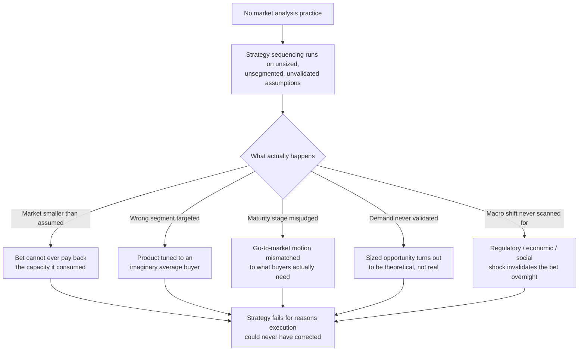

The diagram names the specific failure category this chapter exists to
prevent: these are not execution failures. A team can build exactly what it
set out to build, on schedule, to a high quality bar, and still fail,
because the failure was baked into an unexamined assumption about the
market itself — a failure category market analysis is specifically
designed to surface before capacity is committed.

## 4. Core Concepts

### 4.1 Market Definition and Boundary-Setting

Definition:
Market definition is the deliberate, stated act of deciding what counts as
"the market" for sizing and analysis purposes — which buyer needs, which
substitute solutions, which geography, and which price tier are included or
excluded — before any size, segment, or trend can be measured against it.

Mechanism (how it works):
Every subsequent step in this chapter (sizing, segmentation, maturity
assessment, demand analysis, macro scanning) depends entirely on where the
market's boundary is drawn, and the same underlying opportunity can produce
wildly different answers depending on how narrowly or broadly that
boundary is set. A market can be defined by product category ("expense-
management software"), by job being served ("helping finance teams close
the books faster," which pulls in adjacent solutions a category-based
definition would exclude — see the milkshake example in [Product
Strategy](CH15_Product_Strategy.md#451-definition-and-the-core-causal-claim)
for why a job-based boundary often reveals a market's true competitive
set), by buyer segment (only mid-market companies, excluding enterprise and
small business), or by geography (a single country's regulatory and buying
environment, not a global aggregate). None of these definitions is
objectively "correct" in isolation; the definition has to match the
decision the market analysis is meant to inform.

Decision implications (when and why to use it):
Set the market boundary explicitly, in writing, before sizing begins, and
revisit it any time a sizing number is challenged — a disputed size number
is frequently actually a disputed boundary definition in disguise. A
narrower, job-based boundary is usually more useful for a specific
strategic bet than a broad, category-based one, because it correctly
includes non-obvious substitutes (a spreadsheet, a manual process, a
competitor from an adjacent category) that a category label would silently
exclude.

Common failure mode:
Defining the market by product category alone, which systematically
undercounts real competitive and substitute pressure. A category-based
definition of "budgeting apps" excludes spreadsheets, bank balance checks,
and doing nothing — all of which are real substitutes competing for the
same underlying job — silently overstating how differentiated and
protected the "market" actually is.

Concrete scenario:
A team sizing the market for an "automated expense-reconciliation" product
defines the market narrowly as "companies currently using expense-
reconciliation software" — a small, mature, heavily contested category.
Redefining the boundary around the underlying job — "companies whose
finance teams spend meaningful manual effort reconciling expenses,
including those doing it entirely in spreadsheets today" — triples the
addressable boundary and correctly reframes the true competitive set as
including the status quo of manual effort, not only named software
competitors.

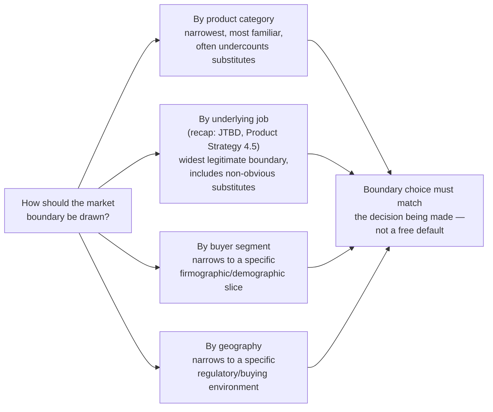

### 4.2 Market Sizing: TAM, SAM, and SOM

Definition:
Market sizing quantifies the opportunity established by the market
definition (Section 4.1) at three progressively narrower altitudes: the
Total Addressable Market (TAM) — every buyer who could conceivably use this
category of product or service, anywhere, regardless of whether the company
could realistically reach them; the Serviceable Addressable Market (SAM) —
the subset of the TAM actually reachable given the company's business
model, geography, regulatory reach, and product scope; and the Serviceable
Obtainable Market (SOM) — the subset of the SAM the company can realistically
capture over a defined planning horizon, given current capacity, channel
reach, and competitive intensity.

Mechanism (how it works):
Two complementary methods produce these three numbers, and a defensible
sizing exercise uses both and checks that they roughly agree rather than
trusting either alone. **Top-down sizing** starts from a large, credible
industry statistic (a market-research report's total category spend,
public financial filings, or census-level data) and progressively narrows
it by applying the market definition's exclusions (geography, segment,
regulatory reach) to move from TAM to SAM. **Bottom-up sizing** starts from
a realistic unit of sale (an average contract value, a per-seat price) and
a realistically countable number of buyable units (named accounts in a
target segment, a count of companies meeting a specific firmographic
profile) and multiplies them, building the estimate up from a defensible
unit economic rather than down from an industry-wide statistic. SOM
narrows the SAM further using capacity-specific realism — sales capacity,
channel reach, and expected competitive share — rather than a further
market-structural exclusion.

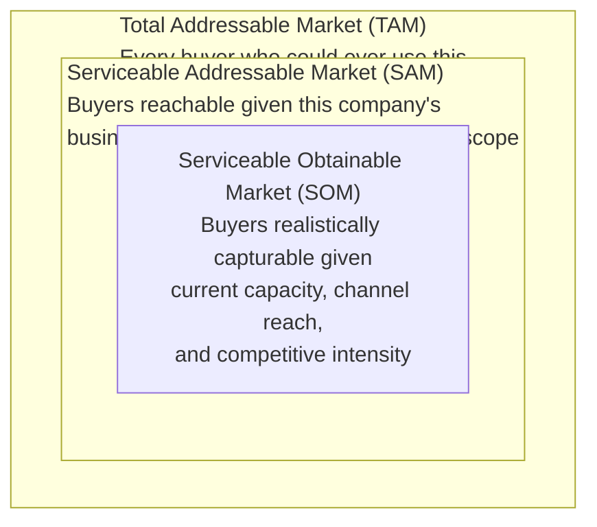

Decision implications (when and why to use it):
Use top-down sizing for a fast, directionally useful first estimate and for
communicating scale to stakeholders using externally credible numbers; use
bottom-up sizing whenever the decision is capacity-committing (funding a
strategic bet, per [Product Strategy's](CH15_Product_Strategy.md#46-portfolio-sequencing-logic-why-this-bet-over-that-one)
sequencing logic) because it is far harder to inflate without the inflation
being immediately checkable against a named, countable buyer list. Treat a
large gap between the two methods' SAM estimates as a signal to
investigate the market definition (Section 4.1) rather than to average the
two numbers together and move on.

Common failure mode:
"TAM inflation" — quoting a large, headline-grabbing top-down TAM number
(often the broadest possible category statistic) as if it were the
relevant SAM or SOM for a specific strategic bet, without ever performing
the narrowing steps. This is the single most common market-sizing failure
mode, and it is dangerous precisely because a large TAM number is genuinely
true and genuinely irrelevant to the decision at hand — the market for
"business software" is enormous and says nothing about the market for a
specific product serving a specific job for a specific segment.

Concrete scenario:
A team pitches a new product citing a $50 billion TAM for "enterprise
software." A bottom-up SOM calculation — a realistic average contract
value of $40,000, a named list of 800 companies matching the target
firmographic profile, an expected 15 percent obtainable share over three
years given current sales capacity — produces a SOM of roughly $4.8
million. Both numbers are individually true. Only the second one is
relevant to whether this specific bet is worth the engineering capacity it
will consume, and citing only the first number to justify the investment
is the exact TAM-inflation failure mode this section exists to catch.

### 4.3 Market Segmentation Methods

Definition:
Market segmentation is the deliberate division of a heterogeneous market
into sub-groups (segments) that are internally similar enough, and
externally distinct enough, to be served with a differentiated offer,
message, or go-to-market motion — rather than treating the entire sized
market (Section 4.2) as a single undifferentiated buyer.

Mechanism (how it works):
Four segmentation methods each divide the same market along a different
variable, and a mature market analysis typically layers more than one:

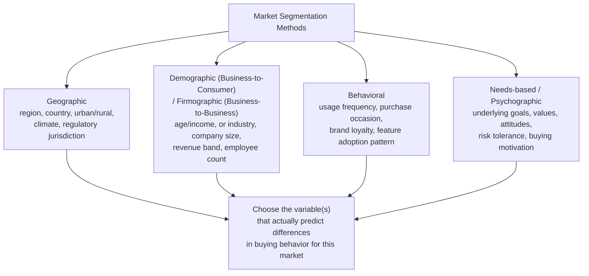

- **Geographic segmentation** divides by region, country, urban/rural
  status, climate, or regulatory jurisdiction — most useful when buying
  behavior genuinely differs by location (a data-residency regulation that
  applies in one jurisdiction and not another, a climate-driven seasonal
  demand pattern).
- **Demographic segmentation** (Business-to-Consumer (B2C) markets) or
  **firmographic segmentation** (Business-to-Business (B2B) markets)
  divides by measurable, structural attributes — age and income for
  consumers, or industry, company size, revenue band, and employee count
  for businesses — most useful when these structural attributes correlate
  with different needs or budgets.
- **Behavioral segmentation** divides by what buyers actually do — usage
  frequency, purchase occasion, brand loyalty, or feature-adoption pattern
  — most useful when observed behavior predicts future value or churn risk
  better than any structural attribute does.
- **Needs-based (psychographic) segmentation** divides by underlying goals,
  values, attitudes, and buying motivations — the segmentation method most
  closely related to, but not identical with, a validated job-to-be-done
  ([Product Strategy](CH15_Product_Strategy.md#45-jobs-to-be-done-jtbd)):
  a needs-based segment groups buyers who share a similar underlying
  motivation, while a job is the specific, circumstance-bound progress a
  person is trying to make. A needs-based segment can contain people
  pursuing several distinct jobs, and the same job can appear across more
  than one needs-based segment.

Decision implications (when and why to use it):
Choose the segmentation variable (or combination of variables) that
actually predicts a meaningful difference in buying behavior, price
sensitivity, or product need for this specific market — not the variable
that is easiest to measure. Firmographic segmentation is easy to pull from
a database (company size, industry) but frequently predicts less about
actual product fit than a needs-based or behavioral cut would; use the
easy-to-measure variable only when it has been checked against real buying
outcomes, not assumed by default.

Common failure mode:
Over-segmenting into so many small, narrowly defined groups that no
segment is large enough to build a differentiated offer for, or
under-segmenting by using a single convenient variable (usually
firmographic) that does not actually predict different buying behavior,
producing segments that look distinct on paper but behave identically in
the market.

Concrete scenario:
A B2B software company segments its market purely by company size (small,
mid-market, enterprise) and builds three separate go-to-market motions
around that split. A later behavioral analysis finds that the actual
predictor of product fit and expansion revenue is not company size but
usage intensity — companies with high transaction volume, regardless of
size, need the same advanced reconciliation features, while low-volume
companies of any size need almost none of them. Re-segmenting by usage
intensity, layered on top of (not replacing) the original firmographic cut,
produces a much more actionable go-to-market split.

Recap and boundary: this chapter's segmentation methods classify *the
market* into buyer groups for sizing, targeting, and go-to-market purposes.
[Personas](CH03_Personas.md) construct a rich, individual, narrative
representation of a specific person within a chosen segment, used to drive
design decisions. A segment is a population-level bucket with a name and a
set of measurable boundaries; a persona is a synthesized individual built
from research inside one such bucket. Do not confuse the two: a
segmentation exercise can exist with no personas built yet, and a single
segment often needs more than one persona once design work begins.

### 4.4 Market Maturity and Lifecycle Stages

Definition:
Market maturity analysis places a market at one of four life-cycle stages
— introduction, growth, maturity, or decline — based on observable
adoption, competitive, and buyer-behavior signals, because the correct
go-to-market motion, pricing posture, and product investment differ
substantially by stage, and a strategy that assumes the wrong stage
misallocates effort against a market that does not behave the way the
strategy assumes it does.

Mechanism (how it works):
The four stages follow Everett Rogers's diffusion curve, layered with
Theodore Levitt's product life cycle framing:

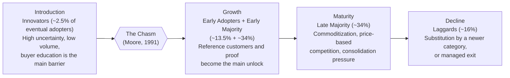

Rogers's adopter categories describe *who* is buying at each stage:
innovators tolerate an unproven product because being first has its own
value to them; early adopters buy based on a clear vision of advantage
despite imperfect proof; the early majority waits for evidence and
reference customers before committing; the late majority buys only once an
approach is standard practice and the risk of *not* adopting exceeds the
risk of adopting; laggards adopt last, often only when the prior approach
is no longer available at all. Moore's chasm names the specific,
frequently fatal gap between early adopters (who buy on vision) and the
early majority (who buy on proof) — many technically excellent products
never cross it, because the sales motion, references, and risk-reduction
mechanisms an early-majority buyer requires are structurally different
from what won over the early adopters, and a team that keeps selling the
early-adopter pitch past this point stalls.

Decision implications (when and why to use it):
Assess a target market's stage before committing a go-to-market motion or
pricing posture to it. An introduction-stage market rewards heavy buyer
education, high-touch sales, and tolerance for a longer sales cycle; a
growth-stage market rewards building reference customers and
proof-of-value mechanisms that help cross the chasm; a maturity-stage
market rewards efficiency, distribution reach, and price or service-level
differentiation since basic feature parity has become table stakes; a
decline-stage market requires an honest choice between a managed,
profitable exit and a genuine repositioning into an adjacent, still-growing
job.

Common failure mode:
Treating a market's maturity stage as fixed at the moment a company first
entered it, rather than reassessing periodically. A market can cross from
introduction into growth (or from growth into maturity) while an internal
strategy still assumes the earlier stage's playbook, producing a go-to-
market motion mismatched to what buyers now actually need — for example,
still running a heavy, evangelism-style sales process against a market
that has already standardized and now expects self-serve trials and
transparent pricing.

Concrete scenario:
A company selling an early expense-automation product initially wins
customers through founder-led, vision-based selling appropriate to an
introduction-stage market. Growth stalls once the market has visibly moved
into its early-majority phase: prospects now expect reference customers,
security certifications, and a defined implementation timeline before
committing — proof-oriented buying behavior the original vision-based
motion was never built to produce. Recognizing the maturity-stage shift
(via the signals in Section 4.4's decision-implication list, and the demand
signals in Section 4.5) triggers a deliberate investment in reference
customers and a formal proof-of-concept process, successfully crossing the
chasm rather than continuing to sell past it.

### 4.5 Demand Analysis

Definition:
Demand analysis estimates and validates how much of a sized, segmented
market (Sections 4.2-4.3) will actually convert stated need into paying
adoption at a given price and in a given form — distinguishing a
theoretically sizeable opportunity from one buyers will actually act on.

Mechanism (how it works):
Demand analysis combines three complementary evidence types, each
correcting for a blind spot in the others. **Stated demand** comes directly
from buyers (survey interest, expressed willingness to pay, sales
conversation signals) but is prone to social-desirability bias and
optimistic hypotheticals — people are generous with hypothetical interest
and far more discerning once a real price and a real switching cost are on
the table. **Revealed demand** comes from observable behavior — search
volume for the underlying problem, pricing-page traffic, self-serve trial
starts and conversion rates, or a competitor's disclosed growth — and is a
stronger signal precisely because it reflects real, costly action rather
than a stated preference. **Latent demand** is need that exists but has not
yet produced observable market activity, because no adequately priced or
positioned solution has appeared yet to surface it — a market can have real
latent demand invisible to both stated-demand surveys (nobody asks for a
solution they cannot imagine) and revealed-demand signals (nobody searches
for a category that does not yet exist), and finding it typically requires
the qualitative discovery techniques this part's earlier chapters already
own, notably [Product Discovery's](CH14_Product_Discovery.md) opportunity
assessment and [Product Strategy's](CH15_Product_Strategy.md#45-jobs-to-be-done-jtbd)
JTBD interviewing.

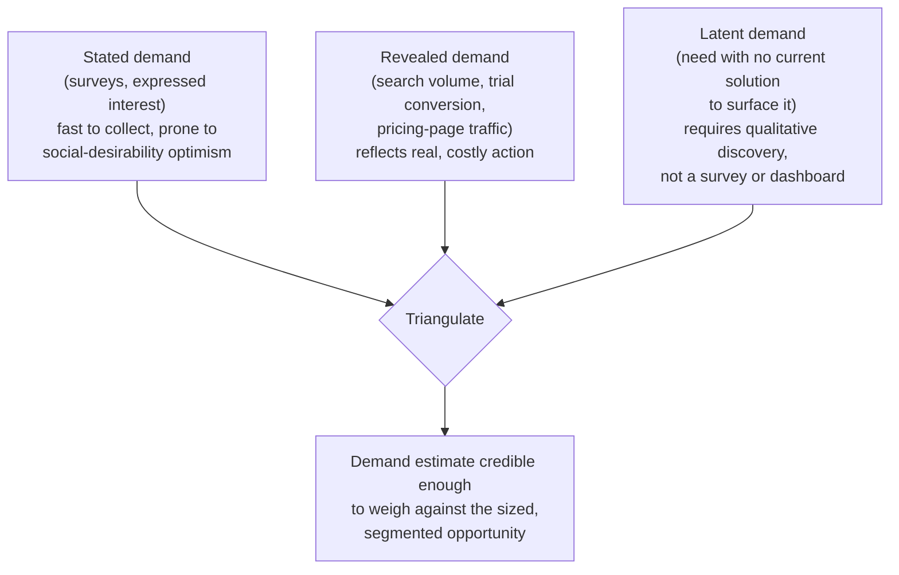

Decision implications (when and why to use it):
Never rely on stated demand alone to validate a sizing exercise; treat it
as the fastest, weakest signal and require at least one revealed-demand
check (an actual pricing-page conversion test, a landing-page signup rate,
a real sales-conversation close rate) before committing meaningful
capacity. Where the market boundary in Section 4.1 was drawn broadly around
a job rather than a category, invest specifically in latent-demand
discovery, because a job-based boundary by definition includes buyers who
are not yet searching for anything in the category.

Common failure mode:
Substituting a large stated-demand survey result for real revealed-demand
evidence — "73 percent of respondents said they would definitely buy this"
— and treating that number as validated demand rather than as an
optimistic, low-cost hypothetical answer. Stated purchase intent
systematically overstates real conversion, sometimes by an order of
magnitude, because a survey respondent bears none of the real switching
cost, budget trade-off, or organizational risk a real purchase decision
requires.

Concrete scenario:
A survey of finance leads reports strong stated interest (81 percent
"very interested") in an automated month-end close feature. A subsequent
landing page describing the same feature, offering a real (if early)
signup with a stated price, converts at 3 percent of targeted traffic — a
revealed-demand number two orders of magnitude weaker than the stated
number implied. The gap does not mean the opportunity is worthless; it
means the real obstacle (price sensitivity, integration anxiety, or
switching habit — recap: the Four Forces model,
[Product Strategy](CH15_Product_Strategy.md#454-the-four-forces-of-progress))
has to be diagnosed before the sized opportunity can be trusted as
obtainable.

### 4.6 Macro-Trend Analysis: PESTEL

Definition:
PESTEL is a structured macro-environment scanning framework examining six
categories of external force — Political, Economic, Social, Technological,
Environmental, and Legal — that lie entirely outside a single company's
control but can materially expand, shrink, or eliminate a market's
addressable size, shift its maturity stage, or invalidate a demand estimate
built on assumptions the trend has since broken.

Mechanism (how it works):
Each dimension asks a distinct diagnostic question, applied specifically to
the market being analyzed rather than to the economy in the abstract:

```{=latex}
\begin{landscape}
```

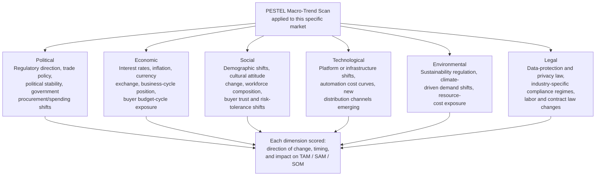

```{=latex}
\end{landscape}
```

For each dimension, a useful PESTEL entry states three things, not just a
label: the specific trend (not "technology is changing" but "generative
artificial intelligence is reducing the cost of automated document
processing by an order of magnitude"), its direction and expected timing
(accelerating, stable, or reversing; imminent or multi-year), and its
concrete impact on this chapter's other concepts — does it expand or
shrink the TAM/SAM/SOM (Section 4.2), shift a segment's relative importance
(Section 4.3), or accelerate or delay a maturity-stage transition (Section
4.4).

Decision implications (when and why to use it):
Run a PESTEL scan whenever a market sizing or maturity assessment is
performed, and refresh it on a fixed cadence (Section 8) rather than
treating it as a one-time input, because macro forces change on their own
schedule, independent of any internal planning cycle. Weight the six
dimensions unevenly per market — a heavily regulated market (healthcare,
financial services) should weight Political and Legal more heavily; a
market highly sensitive to consumer sentiment should weight Social more
heavily — rather than treating all six as equally material by default.

Common failure mode:
Producing a PESTEL scan as a one-time checklist exercise with generic,
unranked bullet points under each letter ("technology: AI is a trend"),
never revisited, and never connected back to a specific impact on sizing,
segmentation, or maturity. A PESTEL scan that does not name a specific
directional impact on the market's addressable size or maturity stage is
decorative, not analytical — the same "theater" failure mode [Product
Strategy](CH15_Product_Strategy.md#19-anti-patterns) names for a strategy
document nobody actually consults.

Concrete scenario:
A company sizing the market for a compliance-automation product runs a
PESTEL scan and flags, under Legal, a specific pending data-residency
regulation expected to take effect within eighteen months, requiring
companies above a stated revenue threshold to prove local data storage.
Rather than a generic "regulation changes" bullet, the scan states the
specific, dated trigger and its impact: the regulation expands the SAM by
adding an estimated 40,000 mid-market companies who will newly require this
capability, on a known timeline the go-to-market plan can be sequenced
against — turning a passive observation into an input the sizing and
sequencing work (Section 4.2, and [Product
Strategy's](CH15_Product_Strategy.md#46-portfolio-sequencing-logic-why-this-bet-over-that-one)
market-timing test) can actually use.

### 4.7 From Market Analysis to a Strategic Bet

Definition:
This section states the minimum handoff a market analysis owes the product
strategy layer — mirroring, one level upstream, the translation contract
[Product Strategy](CH15_Product_Strategy.md#47-strategy-to-roadmap-translation-contract)
already teaches between a sequenced bet and the roadmap layer — so that
this chapter's outputs are usable inputs rather than an unconnected pile of
numbers and scans.

Mechanism (how it works):
A market analysis is strategy-ready only once it produces four specific
outputs, each traceable to a section of this chapter: a **bounded market
definition** (Section 4.1) stating exactly what was and was not included; a
**triangulated TAM/SAM/SOM figure** (Section 4.2) with both top-down and
bottom-up methods shown, not just a single headline number; a **prioritized
segment list** (Section 4.3) naming which segment(s) the strategy should
actually target first and why; and a **dated macro-risk register**
(Section 4.6) naming which PESTEL trends could materially change the first
three outputs and by when. [Product Strategy's](CH15_Product_Strategy.md#46-portfolio-sequencing-logic-why-this-bet-over-that-one)
sequencing logic consumes these four outputs directly: market size and
demand inform opportunity cost, segment priority informs strategic fit,
maturity stage and macro risk inform market timing.

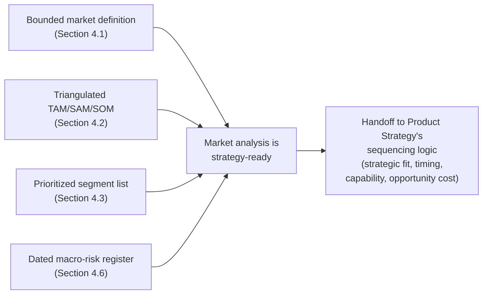

Decision implications (when and why to use it):
Apply this handoff discipline the moment a market analysis conversation
starts producing strategy-shaped language ("this looks like a big
opportunity, let's build it") — the same signal [Product
Strategy](CH15_Product_Strategy.md#47-strategy-to-roadmap-translation-contract)
already treats as the cue that a translation step is due, one layer
upstream from where that chapter applies it.

Common failure mode:
Handing a strategy team a single headline size number ("$50 billion
market") with no bounded definition, no segment priority, and no macro-risk
register — reintroducing the exact TAM-inflation failure mode from Section
4.2 at the handoff boundary instead of at the sizing step itself.

Concrete scenario:
A market analysis team hands the product strategy owner a one-line
statement: "the compliance-automation market is large and growing." The
strategy owner cannot sequence anything against this — it states no bounded
definition, no triangulated size, no segment, and no timing signal. Handed
instead as a completed four-part package (bounded definition: mid-market
companies subject to the new data-residency rule; triangulated SOM: $4.8
million over three years; priority segment: 200-800 employee financial-
services firms; macro-risk register: regulation takes effect in eighteen
months), the same opportunity becomes something [Product
Strategy's](CH15_Product_Strategy.md#46-portfolio-sequencing-logic-why-this-bet-over-that-one)
fit/timing/capability/opportunity-cost test can actually evaluate.

## 5. Internal Working

Market analysis operates as a recurring pipeline, not a single study
performed once and archived. Each stage produces an input the next stage
needs, and the final synthesis step feeds directly into the handoff
contract from Section 4.7.

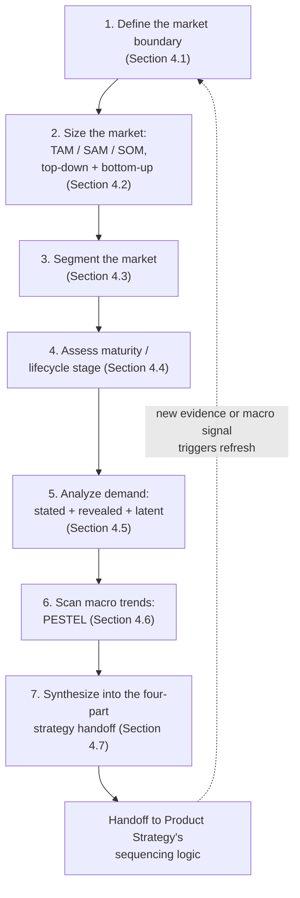

The pipeline is not strictly linear in practice: a demand-analysis finding
(stage 5) frequently forces a revisit of the market definition (stage 1) or
segmentation (stage 3) — for example, discovering strong latent demand
outside the originally defined boundary is itself a signal the boundary
was drawn too narrowly. Treat the numbered stages as the default order for
a fresh analysis, not a one-way gate that forbids revisiting an earlier
stage once new evidence appears.

Two cadences run this pipeline in practice, mirroring the routine-versus-
exception distinction [Product Strategy](CH15_Product_Strategy.md#5-internal-working)
already uses for its own operating cycle. A **routine cadence** re-runs the
full pipeline on a fixed schedule (commonly aligned to the strategy
function's own annual or half-yearly reset, Section 8) even when nothing
appears to have changed, because macro trends and demand signals shift
gradually enough that a team can miss a slow-moving change without a
scheduled check. An **exception cadence** re-runs only the affected stages
immediately when a specific triggering signal appears — a named PESTEL
trend crossing a stated threshold (Section 4.6), a sudden revealed-demand
shift (Section 4.5), or a competitor disclosure material enough to warrant
attention (named and handed to Competitive Analysis, not analyzed here).

## 6. Design Principles

- **Triangulate, never trust a single sizing method.** A TAM/SAM/SOM figure
  produced by only top-down or only bottom-up reasoning is unverified; a
  credible figure shows both methods and explains any gap between them.
- **Define the boundary before arguing about the number.** Most sizing
  disputes are actually boundary disputes; resolve the boundary explicitly
  (Section 4.1) before re-running the math.
- **Segment by what predicts behavior, not by what is easiest to query.**
  A segmentation variable earns its place by demonstrated correlation with
  buying behavior, not by being readily available in a database export.
  (Section 4.3)
- **Match the go-to-market posture to the actual maturity stage, and
  re-check the stage periodically.** A market's stage is not fixed at the
  point of entry; treat maturity assessment as a recurring check, not a
  one-time classification. (Section 4.4)
- **Demand is a claim to be tested, not a survey result to be trusted.**
  Require at least one revealed-demand check before treating stated
  interest as validated. (Section 4.5)
- **Macro-trend scanning must name a specific, dated impact, not a generic
  observation.** A PESTEL entry that does not connect to a concrete effect
  on sizing, segmentation, or maturity is decorative. (Section 4.6)
- **A market analysis is not done until it is strategy-ready.** Apply the
  four-part handoff contract (Section 4.7) as a hard gate before treating
  the analysis as complete.
- **Refresh on a cadence, and additionally on a named trigger.** Neither a
  purely scheduled refresh nor a purely reactive one is sufficient alone
  (Section 5); use both.

## 7. Architecture Patterns

For a market analysis function, "architecture patterns" means recurring,
named ways of organizing how the practice is staffed, resourced, and
connected to the strategy and discovery functions it feeds.

- **Embedded analyst pattern**: a market analyst or product manager
  performs market analysis as one responsibility inside an existing product
  team, close to the strategic decisions it feeds but with less time to
  build deep, cross-market expertise.
- **Centralized market-intelligence function pattern**: a small, dedicated
  team performs market analysis as a shared service across multiple product
  lines, building deeper cross-market expertise and consistent methodology
  at the cost of being one step removed from any single team's day-to-day
  decisions.
- **Continuous market-sensing pattern**: demand signals (Section 4.5) and
  macro-trend monitoring (Section 4.6) run as an always-on, lightweight
  feed (dashboards, alert thresholds) supplementing periodic full-pipeline
  studies (Section 5), catching a fast-moving shift between scheduled
  refreshes.
- **Point-in-time study pattern**: market analysis is commissioned only at
  specific decision gates (before a major expansion decision, before a
  funding round), producing a thorough one-time analysis with no ongoing
  monitoring between gates — cheaper to run but exposed to the "zombie
  analysis" risk of a stale study still being cited long after its
  underlying assumptions have shifted.
- **Build-versus-buy for market data**: a company can build its own primary
  research and demand-signal infrastructure, buy syndicated third-party
  market reports and data feeds, or blend both — a decision structurally
  identical to the build-buy-partner pattern [Product
  Strategy](CH15_Product_Strategy.md#7-architecture-patterns) already
  teaches for capability acquisition generally.

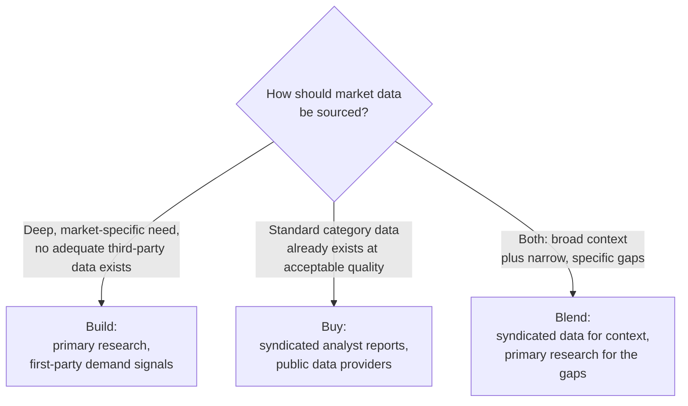

Each pattern trades staffing depth against decision proximity, and ongoing
monitoring cost against point-in-time thoroughness; none is universally
correct, and a company's choice should match how frequently its markets
actually shift and how many product lines share the same underlying
market.

## 8. Production Architecture

"Production" for a market analysis practice means the operational stack of
data sources, artifacts, and governance that keeps the analysis current and
consulted, rather than filed away after a single study.

- **Data source stack**: primary research (surveys, interviews feeding
  stated and latent demand, Section 4.5), first-party behavioral data
  (product usage, trial conversion, pricing-page traffic feeding revealed
  demand), syndicated third-party reports and public data (feeding top-down
  sizing and macro-trend scanning), and named-account lists (feeding
  bottom-up sizing).
- **Artifact stack**: the bounded market definition memo (Section 4.1), the
  triangulated sizing model (Section 4.2), the segmentation matrix (Section
  4.3), the maturity/lifecycle assessment (Section 4.4), the demand
  evidence log (Section 4.5), the PESTEL macro-risk register (Section 4.6),
  and the four-part strategy handoff package (Section 4.7) — each
  versioned, dated, and attributed to an owner.
- **Governance cadence**: a routine full-pipeline refresh aligned to the
  strategy function's own reset cadence (commonly annual or half-yearly),
  plus a continuous, lightweight demand- and macro-trend-monitoring feed
  between refreshes (Section 5's exception path).
- **Review forum**: the same small, accountable strategy-owner forum
  [Product Strategy](CH15_Product_Strategy.md#8-production-architecture)
  already names, since a market analysis that no one with sequencing
  authority reviews cannot influence the sequencing decisions it exists to
  inform.

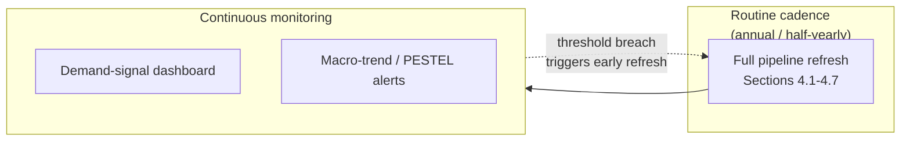

## 9. Implementation

A phased approach to standing up or refreshing a market analysis practice:

### Phase 1: Define

- State the market boundary explicitly (Section 4.1): category, job,
  segment, or geography basis, in writing, with named inclusions and
  exclusions.

### Phase 2: Size

- Produce a top-down estimate from a credible industry statistic.
- Produce an independent bottom-up estimate from a named unit economic and
  a countable buyer list.
- Triangulate the two into a defensible TAM/SAM/SOM figure (Section 4.2),
  investigating any large gap rather than averaging it away.

### Phase 3: Segment

- Test candidate segmentation variables (geographic, firmographic/
  demographic, behavioral, needs-based) against actual buying-behavior
  data where available.
- Prioritize the segment(s) the strategy should target first.

### Phase 4: Assess Maturity and Demand

- Place the market on the introduction/growth/maturity/decline curve
  (Section 4.4), naming the specific adoption and competitive signals used.
- Collect stated, revealed, and latent demand evidence (Section 4.5),
  requiring at least one revealed-demand check.

### Phase 5: Scan Macro Trends

- Run the PESTEL scan (Section 4.6), naming a specific, dated impact on
  sizing, segmentation, or maturity for each material dimension.

### Phase 6: Synthesize and Hand Off

- Assemble the four-part strategy handoff package (Section 4.7) and route
  it to the product strategy owner's sequencing process.


## 10. Complete Code Examples

Market analysis is a reasoning- and evidence-driven discipline rather than
a code-first one. In place of code, this section provides implementation-
neutral schemas a team can adapt into whatever spreadsheet, notebook, or
planning tool it already uses.

Market definition memo schema (Section 4.1):

- Boundary basis (category / job / segment / geography)
- Explicit inclusions
- Explicit exclusions
- Decision this definition is meant to inform

Sizing model schema (Section 4.2):

- Top-down: source statistic, source citation, narrowing exclusions applied
- Bottom-up: unit of sale, average value per unit, countable buyer list
  size, source of the buyer count
- Reconciliation: gap between the two methods, and the investigation
  finding that explains it
- Resulting TAM, SAM, and SOM figures with stated planning horizon

Segmentation matrix schema (Section 4.3):

- Candidate segmentation variable(s)
- Evidence the variable predicts differing buying behavior
- Segment definitions and estimated size per segment
- Priority ranking and rationale

Maturity assessment schema (Section 4.4):

- Stage classification (introduction / growth / maturity / decline)
- Observed adoption signal(s) supporting the classification
- Observed competitive signal(s) supporting the classification
- Chasm-crossing status, if applicable

Demand evidence log schema (Section 4.5):

- Evidence type (stated / revealed / latent)
- Source and collection method
- Result and confidence level
- Contradicts or confirms which other evidence entries

PESTEL register schema (Section 4.6):

- Dimension (Political / Economic / Social / Technological / Environmental
  / Legal)
- Specific trend statement (not a generic label)
- Direction and expected timing
- Concrete impact on TAM/SAM/SOM, segmentation, or maturity stage

Strategy handoff package schema (Section 4.7):

- Bounded market definition (from the Section 4.1 schema)
- Triangulated sizing figure (from the Section 4.2 schema)
- Prioritized segment list (from the Section 4.3 schema)
- Dated macro-risk register (from the Section 4.6 schema)

These schemas are deliberately tool-agnostic; a team implements them in
whichever spreadsheet, notebook, or documentation platform it already
operates, per Section 8's artifact stack.

## 11. Performance

"Performance" for a market analysis practice is measured as evidence
quality and cycle time, not runtime latency:

- **Time-to-first-sizing-estimate**: how long between a strategic question
  being raised and a triangulated TAM/SAM/SOM figure being available —
  a slow first estimate delays every downstream sequencing decision.
- **Sizing confidence gap**: the percentage difference between the
  top-down and bottom-up estimates; a persistently large gap indicates a
  market-definition problem (Section 4.1) rather than a math problem.
- **Demand-signal lag**: the time between a real shift in revealed demand
  (Section 4.5) and that shift being reflected in the strategy handoff
  package — a growing lag indicates the continuous-monitoring pattern
  (Section 7) is not actually running continuously.
- **Macro-scan staleness**: time since the PESTEL register (Section 4.6)
  was last refreshed against each dimension, tracked per dimension since
  some (Legal, Political) typically need more frequent review than others
  (Environmental) in a fast-regulating market.

Heuristics:

- Ship a fast, triangulated directional estimate before a slow, perfectly
  precise one for a reversible, low-capital decision — echoing [Product
  Strategy's](CH15_Product_Strategy.md#11-performance) "two-way door"
  heuristic (itself owned by [Architecture
  Thinking](../01_Architecture_Mindset/CH03_Architecture_Thinking.md)).
- Reserve a slow, heavily sourced sizing exercise for a genuinely
  irreversible, high-capital market-entry decision.

## 12. Scalability

Market analysis has to scale across more product lines, more geographies,
and more segments without collapsing into either a single overloaded
analyst function or a set of siblings independently re-deriving conflicting
market sizes for overlapping territory.

- **Sizing scalability and double-counting risk**: when two product lines'
  SAMs overlap (both selling into the same 200-800 employee financial-
  services firms, for different products), a naive sum of each line's SOM
  double-counts the same buyers' budget; a scaled practice maintains one
  shared, reconciled account universe rather than letting each line size
  independently against the same buyers.
- **Segmentation scalability**: a shared, centrally maintained segment
  taxonomy (Section 4.3) that multiple product lines reference avoids each
  line inventing its own incompatible segment names for what is
  substantially the same buyer population.
- **Macro-scan scalability**: a shared PESTEL register (Section 4.6),
  reviewed centrally but scoped per market, prevents each product line from
  redundantly re-scanning the same macro environment while missing
  market-specific dimensions that matter only to their specific segment.

Market-analysis scalability failure typically shows up exactly as [Product
Strategy](CH15_Product_Strategy.md#12-scalability) already describes for
sibling product-line strategy conflicts — the same centralized-versus-
federated tension, and the same remedy (a shared, thin central layer with
local execution latitude), recurs here for market data specifically.

## 13. Security

Security for a market analysis practice concerns confidentiality of
sensitive commercial data and licensed third-party content, not
application-level security controls (owned elsewhere, notably the
not-yet-drafted Security part):

- **Commercial confidentiality of sizing data**: a bottom-up sizing model
  built on a named-account list and real contract-value assumptions is
  competitively sensitive; premature external disclosure hands a
  competitor a materially useful head start on the exact opportunity being
  targeted.
- **Third-party data licensing terms**: syndicated market reports and
  analyst data (Section 7, Section 8) typically carry licensing
  restrictions on redistribution and derivative use; a market analysis
  practice must track and respect those terms rather than treating
  purchased data as freely shareable across the company.
- **Material-information handling**: for a publicly traded company, a
  market sizing figure material enough to move investor expectations may
  qualify as material non-public information, subject to the same
  disclosure-control discipline [Product
  Strategy](CH15_Product_Strategy.md#13-security) already names for
  strategic bets generally.
- **Primary research data privacy**: demand-analysis interviews and surveys
  (Section 4.5) that collect identifiable respondent information are
  subject to the same research-ethics and data-handling discipline this
  part's [Research](CH02_Research.md) chapter already establishes; this
  chapter does not re-teach that discipline, only applies it.

## 14. Observability

Observability for a market analysis practice means having leading and
lagging signals that reveal whether the current sizing, segmentation, or
maturity assessment is still accurate, before a strategic bet built on it
fails:

- **Leading indicators**: early revealed-demand shifts (Section 4.5),
  emerging PESTEL trend signals (Section 4.6) crossing a stated threshold,
  and named-account list churn (accounts entering or leaving the SAM's
  qualifying criteria).
- **Lagging indicators**: an actual strategic bet's outcome hypothesis
  ([Product Strategy](CH15_Product_Strategy.md#48-objectives-and-key-results-okrs-as-the-execution-contract))
  underperforming or overperforming its underlying market-sizing
  assumption, which confirms or refutes the sizing model after the fact.
- **Market-analysis health signals**: sizing confidence gap (Section 11),
  macro-scan staleness per PESTEL dimension (Section 11), and how often a
  strategy owner's sequencing decision cites this chapter's outputs versus
  reverting to an unexamined internal assumption — a low citation rate is
  an early sign of "analysis theater," the market-analysis equivalent of
  the "zombie strategy" failure mode.

This chapter deliberately stops at this framing-level treatment of signals;
full metric-design technique — funnel definitions, statistical rigor for
demand-signal reads, and the single unifying top-line metric discipline —
is owned by this part's not-yet-drafted **Metrics** and **North Star
Metrics** chapters (see [PART_OVERVIEW.md](PART_OVERVIEW.md)).

## 15. Failure Scenarios

Representative market-analysis failure modes and their typical resolution:

1. **TAM inflation**: a headline top-down number is cited as if it were the
   relevant SAM or SOM for a specific bet. Resolution: enforce the
   triangulation discipline (Section 4.2) and the four-part strategy
   handoff (Section 4.7) as a hard gate.
2. **Zombie market analysis**: a market sizing study is performed once,
   presented, and never refreshed even as the underlying market shifts.
   Resolution: enforce the routine-plus-exception refresh cadence (Section
   5, Section 8).
3. **One-size-fits-none segmentation**: the market is treated as a single
   undifferentiated block, or segmented purely by an easy-to-query variable
   that does not predict real buying behavior. Resolution: test
   segmentation variables against actual buying-behavior evidence (Section
   4.3).
4. **Maturity-stage mismatch**: a go-to-market motion built for one
   lifecycle stage is applied to a market that has already moved to the
   next one. Resolution: reassess the maturity stage on a recurring cadence
   (Section 4.4), not only at initial entry.
5. **Stated-demand overreliance**: a large survey-based interest number is
   treated as validated demand with no revealed-demand check. Resolution:
   require at least one revealed-demand signal before trusting a sizing
   figure (Section 4.5).
6. **PESTEL-as-checklist**: a macro-trend scan produces generic,
   unranked bullets with no stated impact on sizing or timing, and is never
   revisited. Resolution: require a specific, dated impact statement per
   material dimension (Section 4.6), refreshed on the cadence in Section 8.
7. **Double-counted market size across product lines**: sibling teams
   independently size overlapping SAMs against the same buyer population
   and both plan against the full figure. Resolution: maintain one shared,
   reconciled account universe (Section 12).

## 16. Testing

"Testing" a market analysis means validating its assumptions before
significant capacity is committed against them, not testing code:

### 16.1 Sensitivity Analysis

Vary each major sizing assumption (average contract value, obtainable
share percentage, buyer count) individually and observe how much the final
SOM figure moves; an assumption that swings the result by an order of
magnitude deserves far more scrutiny than one that barely moves it, and the
sizing exercise should state which assumptions it is most sensitive to.

### 16.2 Triangulation Check

Compare the top-down and bottom-up sizing estimates (Section 4.2); a large,
unexplained gap is a signal to revisit the market definition (Section 4.1)
before trusting either number.

### 16.3 Revealed-Demand Pilot

Where feasible, run a small, real-stakes test (a landing page with a real
signup, a limited pricing-page experiment) before committing to a full
strategic bet built on stated-demand evidence alone (Section 4.5).

### 16.4 Premortem on the Market Assumption

Before committing to a strategic bet, a small group imagines the market
sizing was wrong a year later and works backward to the most plausible
cause: a mis-drawn boundary, an unvalidated demand assumption, a missed
PESTEL trend, or a maturity-stage misread — mirroring the premortem
technique [Product Strategy](CH15_Product_Strategy.md#161-premortem)
already applies to strategic bets generally, applied one layer upstream to
the market analysis itself.

## 17. Common Mistakes

- Citing a broad, category-level TAM as if it were the relevant SAM or SOM
  for a specific bet.
- Drawing the market boundary by product category alone, silently
  excluding real substitutes (manual processes, adjacent categories, doing
  nothing).
- Segmenting by the easiest-to-query variable rather than the one that
  actually predicts buying behavior.
- Treating a market's maturity stage as fixed at the point of entry instead
  of reassessing periodically.
- Trusting stated-demand survey results with no revealed-demand check.
- Producing a PESTEL scan with generic, unranked observations and no
  connection to a specific sizing, segmentation, or timing impact.
- Letting sibling product lines independently size the same overlapping
  buyer population without reconciling the overlap.

## 18. Best Practices

- State the market boundary in writing before sizing begins, and revisit
  it whenever a sizing number is disputed.
- Triangulate every sizing figure with both top-down and bottom-up methods,
  and investigate rather than average away any large gap.
- Test candidate segmentation variables against real buying-behavior
  evidence before committing to a segmentation scheme.
- Reassess maturity stage on a recurring cadence, not only at initial
  market entry.
- Require at least one revealed-demand signal before treating a sizing
  figure as validated.
- Give every material PESTEL dimension a specific, dated impact statement
  connected to sizing, segmentation, or timing.
- Deliver the full four-part strategy handoff package (Section 4.7) rather
  than a single headline number.
- Maintain one shared, reconciled account universe across product lines
  with overlapping markets.

## 19. Anti-Patterns

- **TAM inflation**: quoting the broadest possible category statistic to
  justify a specific, much narrower bet.
- **Analysis theater**: a polished market sizing deck that is never
  actually consulted during strategic sequencing.
- **Category-only market definition**: silently excluding real substitutes
  by defining the market purely by product category.
- **Segmentation by convenience**: choosing a segmentation variable because
  it is easy to query, not because it predicts buying behavior.
- **Frozen maturity stage**: continuing a go-to-market motion built for an
  earlier lifecycle stage after the market has visibly moved on.
- **Survey-as-proof**: treating a stated-demand percentage as if it were
  revealed, costly-action evidence.
- **PESTEL-as-checklist**: generic, unranked macro-trend bullets with no
  stated market impact.

## 20. Trade-off Analysis

- **Top-down speed versus bottom-up rigor**: top-down sizing is fast and
  uses externally credible numbers but is easier to inflate; bottom-up
  sizing is slower and harder to inflate but requires a real, named buyer
  list.
- **Broad versus narrow market definition**: a broad, job-based boundary
  (Section 4.1) surfaces more real substitutes and latent demand but is
  harder to size precisely; a narrow, category-based boundary is easier to
  size but risks undercounting real competitive and substitute pressure.
- **Segmentation granularity versus actionability**: finer-grained
  segmentation captures more real behavioral difference but risks
  producing segments too small to build a differentiated offer for;
  coarser segmentation is easier to act on but risks masking meaningful
  differences.
- **Build versus buy market data** (Section 7): building primary research
  and demand infrastructure gives deeper, market-specific evidence at
  higher cost and slower speed; buying syndicated data is faster and
  cheaper but shallower and licensed rather than owned.
- **Routine cadence versus exception-triggered refresh**: a purely
  scheduled refresh can miss a fast-moving shift between cycles; a purely
  reactive refresh risks missing a slow-moving shift nobody happened to
  notice; Section 5 recommends running both.

## 21. Comparison Table

| Concept / Artifact | Primary question answered | Owner (this chapter unless noted) | Output nature | When to use |
|---|---|---|---|---|
| Market definition memo (Section 4.1) | What counts as "the market" for this decision? | Market Analysis | Bounded scope statement | Before any sizing begins |
| TAM/SAM/SOM sizing model (Section 4.2) | How large is the opportunity, at three altitudes? | Market Analysis | Triangulated size figures | Sizing a bet's opportunity cost |
| Segmentation matrix (Section 4.3) | Which buyer sub-groups should be targeted differently? | Market Analysis | Segment definitions + priority | Choosing which segment(s) to target first |
| Maturity / lifecycle assessment (Section 4.4) | What stage is this market at, and what motion does that require? | Market Analysis | Stage classification + signals | Setting go-to-market and pricing posture |
| Demand evidence log (Section 4.5) | Will buyers actually convert stated need into adoption? | Market Analysis | Stated/revealed/latent evidence | Validating a sizing figure before committing capacity |
| PESTEL macro-risk register (Section 4.6) | What external forces could change any of the above? | Market Analysis | Dimension-scored trend register | Ongoing, refreshed on a cadence |
| Strategy handoff package (Section 4.7) | Is this analysis ready to inform a strategic bet? | Market Analysis | Four-part bundled artifact | Handoff to Product Strategy sequencing |
| Job story (recap only) | What circumstance-specific progress is being sought? | [Product Strategy](CH15_Product_Strategy.md#45-jobs-to-be-done-jtbd) | Situation-motivation-outcome triple | Interpreting demand and market boundary, not sizing |
| Persona (recap only) | Who, specifically, are we designing for within a segment? | [Personas](CH03_Personas.md) | Synthesized individual profile | Design decisions inside a chosen segment |
| Competitive positioning / Five Forces / win-loss (not taught here) | Who else competes for this market, and why do we win or lose specific deals? | **Competitive Analysis** (this part, see [PART_OVERVIEW.md](PART_OVERVIEW.md)) | Head-to-head comparison, positioning map | Competitor-specific strategy, distinct from this chapter's overall market view |
| Product strategy bet (not taught here) | Which market opportunity should we actually pursue, and in what order? | [Product Strategy](CH15_Product_Strategy.md) | Sequenced bet, translated to a roadmap theme | Consumes this chapter's four-part handoff |

The last two rows are named only for disambiguation: **Competitive
Analysis** is a sibling chapter in this part's table of contents, not
taught here, and this chapter does not assume or duplicate its content;
**Product Strategy** is fully taught in [CH15_Product_Strategy.md](CH15_Product_Strategy.md)
and only recapped here where this chapter's outputs feed directly into it.

## 22. Real-World Case Study

Case: Sizing and validating a new vertical for a mid-market payroll
platform

Context:
A payroll-software company serving general small-business customers
considered expanding into a specific regulated vertical — healthcare
staffing agencies — after noticing a handful of inbound requests from that
segment. Before committing engineering capacity to vertical-specific
compliance features, the team ran a full market analysis rather than
sequencing directly off the inbound anecdotes.

Market-analysis walkthrough:

1. **Market definition (Section 4.1)**: the team defined the market by job
   rather than category — "healthcare staffing agencies whose payroll
   process must reconcile variable per-diem, shift-differential, and
   credential-expiration rules" — deliberately wider than "companies using
   payroll software for healthcare staffing," because it included agencies
   currently managing this manually in spreadsheets.
2. **Sizing (Section 4.2)**: a top-down estimate from a public
   labor-statistics data source (2.1 million healthcare staffing employees
   nationally, average agency size, average payroll software spend)
   produced a SAM of roughly $180 million. An independent bottom-up
   estimate — a named list of 3,400 agencies matching the target
   firmographic profile, an average contract value of $9,000, and a
   realistic three-year obtainable share of 6 percent given current sales
   capacity — produced a SOM of roughly $1.8 million. The two methods'
   SAM-level figures were within a defensible range of each other once the
   market definition was applied consistently to both.
3. **Segmentation (Section 4.3)**: firmographic segmentation by agency size
   alone showed no clear behavioral split; a needs-based cut between
   agencies using per-diem-heavy staffing models versus fixed-shift models
   revealed the per-diem-heavy segment had a materially more painful
   reconciliation problem and a much higher stated urgency, becoming the
   prioritized target segment.
4. **Maturity assessment (Section 4.4)**: adoption signals (a small number
   of point solutions, mostly still spreadsheet-based, no dominant vendor)
   placed the vertical in the introduction stage — meaning the go-to-market
   motion needed to prioritize buyer education and pilot-style proof, not
   an assumption of established, comparison-shopping buyers.
5. **Demand analysis (Section 4.5)**: stated interest from a follow-up
   survey was strongly positive (78 percent "very interested"). A
   revealed-demand pilot — a targeted landing page describing the specific
   capability with a real, if introductory, price — converted at 11
   percent of targeted traffic, a meaningfully strong revealed-demand
   signal relative to the company's other historical landing-page tests,
   giving the stated-demand number real corroboration rather than standing
   alone.
6. **Macro-trend scan (Section 4.6)**: the PESTEL scan flagged, under
   Legal, a pending state-level change to per-diem wage-reporting
   requirements taking effect within twelve months, expanding the urgency
   and the addressable segment simultaneously, and under Economic, a
   documented labor shortage in healthcare staffing increasing agencies'
   reliance on complex, variable shift arrangements — both trends
   reinforcing, not merely coexisting with, the sizing and segmentation
   findings.
7. **Strategy handoff (Section 4.7)**: the four-part package — bounded
   definition, triangulated $1.8 million three-year SOM, prioritized
   per-diem-heavy segment, and a dated macro-risk register naming the
   twelve-month regulatory window — was handed to the product strategy
   owner's sequencing process.

Results after the strategy owner sequenced and funded the resulting bet:

- The vertical-specific compliance feature closed 14 of the 22 named
  target accounts within the first two quarters after launch, tracking
  ahead of the three-year SOM's implied pace.
- The regulatory deadline named in the macro-risk register created a real,
  dated urgency that materially shortened the sales cycle relative to the
  company's typical enterprise motion.
- The originally noticed "handful of inbound requests" that triggered the
  investigation would, on their own, have produced a far smaller and
  differently shaped bet than the fully triangulated analysis did — the
  anecdotal signal was directionally correct but would have under-sized
  the real segment and missed the regulatory timing entirely.

Architecture lesson:
The value did not come from any single technique in isolation; it came
from triangulating sizing methods, testing a segmentation hypothesis
against real behavior rather than firmographic convenience, correctly
reading the market's introduction-stage maturity into the sales motion, and
catching a specific, dated macro-legal trend that both expanded the
opportunity and explained its urgency — the same end-to-end reasoning
chain this chapter teaches, handed cleanly to product strategy rather than
short-circuited by an anecdote.

## 23. Interview Questions

1. What is the difference between TAM, SAM, and SOM, and why is citing only
   the TAM for a specific bet a common and dangerous mistake?
2. Explain top-down versus bottom-up market sizing and describe a situation
   where you would rely more heavily on each.
3. How does market segmentation differ from persona construction, and why
   can a single segment need more than one persona?
4. Walk through Rogers's adopter categories and explain what "crossing the
   chasm" specifically refers to.
5. What is the difference between stated, revealed, and latent demand, and
   why is stated demand alone an unreliable validation signal?
6. What is PESTEL, and what makes a PESTEL entry useful rather than
   decorative?
7. How does market analysis differ from competitive analysis, and why does
   this book treat them as separate chapters?
8. Describe the four-part strategy handoff package this chapter defines and
   explain why a single headline size number is not sufficient.
9. What signals would tell you a market's maturity stage has shifted since
   a company first entered it?
10. How would you detect and correct for double-counted market sizing
    across two sibling product lines with overlapping target segments?

## 24. Hands-on Exercises

1. Pick a product you use regularly. Define its market boundary two
   different ways — narrowly by product category, and broadly by
   underlying job — and describe how the addressable market changes
   between the two.
2. For that same product, produce a rough top-down sizing estimate and a
   rough bottom-up sizing estimate, and compare the two.
3. Propose two different segmentation variables for that market and
   describe what evidence would tell you which one actually predicts
   buying behavior better.
4. Draft a six-dimension PESTEL scan for that market, stating a specific,
   dated impact for at least three of the six dimensions.

## 25. Design Exercises

1. Given a hypothetical company considering entry into a new geographic
   market, draft a market definition memo, a triangulated TAM/SAM/SOM
   model, and a prioritized segment list.
2. Design a revealed-demand test (a landing page, a pricing experiment) you
   could run in under two weeks to validate a stated-demand survey finding
   before committing further capacity.
3. Take a market you believe is in its maturity stage and identify the
   specific signals that would tell you it was actually re-entering growth
   (for example, due to a new regulatory trigger) rather than continuing
   its expected decline.
4. Design the shared-account-universe reconciliation process two sibling
   product lines with overlapping target segments should use to avoid
   double-counting the same buyers in their independent SOM estimates.

## 26. Architecture Review Questions

1. Is the market boundary for the current analysis stated explicitly in
   writing, or only implied?
2. Does the current TAM/SAM/SOM figure show both top-down and bottom-up
   methods, or only one?
3. Has the current segmentation been tested against real buying-behavior
   evidence, or chosen purely for ease of measurement?
4. What maturity stage is the target market currently classified at, and
   when was that classification last reassessed?
5. Is there at least one revealed-demand signal behind the current sizing
   figure, or does it rest on stated demand alone?
6. Does the current PESTEL register name a specific, dated impact per
   material dimension, or only generic observations?
7. Has the full four-part strategy handoff package (Section 4.7) actually
   been delivered to the strategy owner, or was a single headline number
   handed off instead?
8. Are any two product lines currently sizing overlapping buyer populations
   independently, risking double-counted market size?
9. What would have to be true for the current market sizing to be wrong,
   and has anyone actively looked for that evidence (a sensitivity analysis
   or premortem)?
10. When was the market analysis last refreshed, and does that cadence
    match how quickly this specific market actually moves?

## 27. Summary

Market analysis is the practice of understanding the external market a
product competes in, independent of any one company's internal ambitions:
how the market's boundary should be defined, how large it really is at
three progressively narrower altitudes (TAM, SAM, and SOM), how it divides
into buyer segments worth serving differently, what lifecycle stage it has
reached and what that implies for go-to-market posture, how much of its
theoretical size will actually convert into real, validated demand, and
what macro-level political, economic, social, technological, environmental,
and legal forces could reshape any of that independent of the company's own
choices. This chapter deliberately stopped short of competitor-specific
analysis — positioning maps, head-to-head comparison, and win/loss analysis
belong to this part's sibling **Competitive Analysis** chapter — and
deliberately consumed rather than re-derived [Product
Strategy's](CH15_Product_Strategy.md) JTBD and strategy-stack concepts and
[Personas'](CH03_Personas.md) persona-construction technique.

For Solution Architects, the practical payoff is the same discipline
software architecture already demands of a technical assumption: state it
explicitly, triangulate it against more than one method, and revisit it on
a deliberate cadence — applied here to the market a product strategy is
built on top of, so that a strategic bet fails, if it fails, for a reason
execution could have controlled, not because nobody checked whether the
market was ever real.

Further reading across this part:

- Product Strategy's JTBD, strategy stack, PR-FAQ, product principles,
  portfolio sequencing, and OKR cascade, consumed but not re-taught here:
  [CH15_Product_Strategy.md](CH15_Product_Strategy.md)
- Persona construction, on which Section 4.3's segment-versus-persona
  distinction depends: [CH03_Personas.md](CH03_Personas.md)
- Research methodology and bias taxonomy underlying this chapter's demand-
  analysis interviewing and survey practice:
  [CH02_Research.md](CH02_Research.md)
- Product Discovery's opportunity assessment and de-risking mechanics,
  relevant to latent-demand investigation:
  [CH14_Product_Discovery.md](CH14_Product_Discovery.md)
- Reversible versus irreversible decision framing, referenced in Section
  11: [Architecture Thinking](../01_Architecture_Mindset/CH03_Architecture_Thinking.md)
- Competitive Analysis, Personas (Product Management), Journey Mapping
  (Product Management), Pricing, Go-to-Market, Metrics, and North Star
  Metrics chapters (this part's Product Management subsection, not yet
  drafted at the time of this writing): see [PART_OVERVIEW.md](PART_OVERVIEW.md)
