# Chapter: Competitive Analysis

Part: [02 - Design Thinking and Product Management](PART_OVERVIEW.md) · Subsection: Product Management · Status: Drafted

## 1. Introduction

Every product ships into a market that already contains rivals, and every
one of those rivals is placing its own bets about how to win the same
customer. Competitive analysis is the discipline of understanding those
specific rivals in detail: who they are, what they genuinely do well and
poorly, how buyers actually perceive them relative to you, why specific
deals are won or lost against them, and what response — if any — a given
competitive move actually warrants. It is a narrower, more operational
discipline than understanding a market as a whole. A market analysis
answers "how big is this opportunity, how is it segmented, and where is it
heading?" Competitive analysis answers "given that market, which named
companies and products are we actually fighting for the same customer
against, and what do we need to know about each one to win?"

This chapter deliberately narrows to that operational, competitor-specific
scope and owns five things in full: **competitor identification** (the
direct/indirect/substitute taxonomy), **competitive teardown methodology**
(the repeatable process for building an evidence-based profile of a named
rival), **positioning maps** (visual, customer-perception-grounded
comparison of where products sit relative to each other), **feature and
capability comparison matrices** (structured, sales-facing battlecards),
**win/loss analysis** (structured post-decision interviewing to understand
why a specific deal was actually won or lost), and **competitive-response
strategy** (the decision discipline for choosing how, or whether, to react
to a competitive move or a persistent gap).

This chapter deliberately does **not** teach market sizing, industry-
structure analysis (Michael Porter's Five Forces at the level of an entire
industry), macro trend-scanning, or overall market segmentation. Those
belong to this part's **Market Analysis** chapter — named here only for
disambiguation, not assumed or guessed at, since that chapter may be
drafted in a parallel session this chapter cannot see. Where this chapter
needs to reference that boundary, it names the chapter and points to
[PART_OVERVIEW.md](PART_OVERVIEW.md) rather than linking to a specific file
or section anchor it cannot confirm exists yet. Section 4.1 states this
boundary precisely, with a worked example of a question that belongs to
each side of the line.

This chapter also consumes, rather than re-teaches, two sibling chapters'
outputs:

- [Product Strategy](CH15_Product_Strategy.md) owns Jobs-to-be-Done (JTBD)
  in full (job story format, the functional/emotional/social job
  dimensions, and the Four Forces of Progress) and the Three Horizons
  portfolio-sequencing model. This chapter uses JTBD's "what progress is
  the customer trying to make" framing as an analytical lens inside win/loss
  analysis (Section 4.6) and treats capacity-allocation decisions for a
  competitive response as an input to Product Strategy's sequencing logic
  (Section 4.7), without re-deriving either technique.
- [Personas](CH03_Personas.md) owns persona construction in full. This
  chapter uses a validated persona as an input when a positioning map or a
  competitive-response "flank" move needs to be scoped to a specific buyer
  segment (Sections 4.4 and 4.7), without re-teaching how a persona is
  built.

The practical stakes are concrete: a product team with no competitor-
specific discipline builds features by anecdote ("a sales rep says we lost
because of X"), positions itself by internal opinion rather than customer
perception, and reacts to competitor announcements by instinct rather than
by weighing validated evidence. This chapter's artifacts and process exist
to replace each of those failure-prone defaults with a repeatable,
evidence-grounded alternative.

## 2. Historical Evolution

- **5th century BC** — Sun Tzu's *The Art of War* articulated the general
  principle "know the enemy and know yourself" as a precondition for
  favorable engagement — the conceptual ancestor of every structured
  intelligence-gathering discipline that followed, including its business
  application centuries later.
- **1960s-1970s** — Albert Humphrey and colleagues at the Stanford Research
  Institute developed SWOT analysis (Strengths, Weaknesses, Opportunities,
  Threats), the first widely adopted structured technique for comparing an
  organization against its competitive environment. SWOT's "weaknesses" and
  "threats" quadrants are a direct conceptual ancestor of the teardown
  methodology in Section 4.3.
- **1979** — Michael Porter's *How Competitive Forces Shape Strategy*
  (*Harvard Business Review*) formalized the Five Forces framework
  (rivalry among existing competitors, threat of new entrants, threat of
  substitutes, buyer power, supplier power). The full industry-structure
  application of Five Forces — sizing entry barriers, buyer/supplier power
  across an entire industry — belongs to this part's Market Analysis
  chapter. This chapter picks up only two of the five forces at
  competitor-specific resolution: rivalry among existing competitors and
  the threat of substitutes, which directly seed the taxonomy in
  Section 4.2.
- **1980** — Porter's *Competitive Strategy* named the generic competitive
  positions (cost leadership, differentiation, focus). [Product
  Strategy](CH15_Product_Strategy.md#2-historical-evolution) already named
  this same source as grounding for "how a company intends to win" at the
  strategy-stack level; this chapter reuses the same generic-position
  vocabulary at a narrower resolution, specifically when classifying a
  competitive response's intended differentiation axis in Section 4.7,
  without re-deriving the framework.
- **1981** — Al Ries and Jack Trout's *Positioning: The Battle for Your
  Mind* argued that competitive advantage is decided in the customer's
  perception, not in a spec sheet — the founding argument behind
  perceptual positioning maps (Section 4.4).
- **1986** — The Society of Competitive Intelligence Professionals (SCIP)
  was founded, professionalizing competitive-intelligence gathering and
  establishing the ethics codes that Section 13 draws on when defining
  legitimate sourcing boundaries.
- **1990s** — As enterprise software sales organizations adopted Customer
  Relationship Management (CRM) systems, structured post-decision win/loss
  interview programs began to emerge as a discipline distinct from a
  salesperson's own closed-deal notes, addressing the self-reporting bias
  problem named in Section 4.6.
- **1996 and 2016** — The United States Economic Espionage Act (1996) and
  the Defend Trade Secrets Act (2016) established the legal boundary
  between legitimate competitive intelligence gathering and criminal or
  civilly actionable theft of trade secrets — the legal grounding for
  Section 13's sourcing-ethics discussion.
- **2005** — W. Chan Kim and Renée Mauborgne's *Blue Ocean Strategy*
  introduced the strategy canvas and value curve: a multi-factor visual
  comparison of relative investment across competing offerings, designed
  to reveal a "blue ocean" of uncontested space rather than a head-to-head
  fight over the same factors. Section 4.4 teaches this alongside the
  classical two-axis perceptual map, and Section 4.7 uses it as a
  differentiation-response tool.
- **2010s** — Dedicated sales-enablement tooling categories (broadly:
  battlecard platforms such as Klue or Crayon, and review-aggregation sites
  such as G2 or Capterra, named here for orientation only, not
  endorsement) turned the feature/capability matrix from an ad hoc
  spreadsheet into a maintained, sourced, continuously refreshed artifact
  — the operating model Section 8 describes.
- **2020s** — Artificial-intelligence-assisted monitoring and
  summarization tools accelerated how quickly a competitor's public
  changes could be detected and drafted into a battlecard update, but
  introduced a new sourcing-verification risk: an automatically
  summarized claim is not the same as a verified one, a distinction
  Section 13 and Section 16 both return to.

The arc is consistent with the rest of this part: as the cost of
misjudging a competitive fight rose relative to the cost of systematically
studying it, competitive analysis moved from an occasional slide before a
board meeting to a standing, evidence-governed operating discipline.

## 3. Why It Exists

Without a deliberate competitive-analysis discipline, an organization does
not stop reasoning about competitors — it just reasons about them badly,
by default, using whichever anecdote reached a decision-maker most
recently. A sales representative loses a deal and reports, in a CRM
close-reason field, "lost to Competitor X on price." Nobody validates
whether price was the actual decisive factor or the polite, simple answer
a departing prospect gave to end an awkward conversation. Product
leadership, hearing "price" repeated across a few deals, greenlights a
discounting motion or a stripped-down low-price tier. Win rates against
that competitor do not improve, because the real decisive factor — say, a
missing compliance certification that blocked the deal in security review
long before price was ever discussed — was never surfaced, let alone
addressed.

```mermaid
flowchart TB
    subgraph Anecdote["Anecdote-driven default (no discipline)"]
        A1[Deal lost] --> A2["Rep enters simplest\nCRM close-reason ('price')"]
        A2 --> A3["Leadership reacts to\nmost-repeated anecdote"]
        A3 --> A4["Response targets stated\nreason, not real cause"]
        A4 --> A5["Win rate does not improve;\nreal cause still unaddressed"]
        A5 -.next lost deal.-> A1
    end
    subgraph Evidence["Evidence-driven alternative (this chapter)"]
        B1[Deal lost] --> B2["Independent win/loss\ninterview (Section 4.6)"]
        B2 --> B3["Causal tagging distinguishes\nstated vs. real reason"]
        B3 --> B4["Response strategy weighs\nvalidated evidence (Section 4.7)"]
        B4 --> B5["Root cause addressed;\nwin rate measurably improves"]
    end
```

This is not a hypothetical failure mode — it is the default outcome of
skipping the discipline, and it recurs at every layer this chapter
addresses: without competitor identification (Section 4.2), teams miss an
indirect or substitute threat quietly eroding a category while they stare
at one visible direct rival. Without a teardown methodology (Section 4.3),
a "profile" is a stale first impression from whoever last visited a
competitor's marketing site. Without a positioning map grounded in
customer perception (Section 4.4), a team's stated differentiation is a
comforting internal fiction. Without a feature matrix disciplined by
evidence (Section 4.5), roadmap effort chases every visible competitor
checkbox regardless of whether it moves a single deal. Without win/loss
analysis (Section 4.6), the organization never learns the difference
between a stated and a real reason for losing. And without a deliberate
response-strategy discipline (Section 4.7), every competitor move triggers
an equally reflexive reaction, regardless of whether the evidence actually
supports one.

Solution Architects specifically need this discipline for a reason beyond
sales enablement: architecture decisions — build-versus-buy calls,
platform investment, which integration to prioritize, how much to invest
in a compliance certification — are frequently justified, implicitly or
explicitly, by a claim about a competitor. This chapter gives that claim a
falsifiable, evidence-backed form instead of leaving it as an assertion
nobody has actually checked.

## 4. Core Concepts

### 4.1 Competitive Analysis vs. Market Analysis: The Boundary

Definition:
Competitive analysis is the practice of studying specific, named rival
products and companies — their capabilities, positioning, and the
outcomes of head-to-head decisions against them — to inform product,
sales, and messaging choices. Market analysis is the practice of studying
the aggregate market itself: its size, its segmentation, its growth
trajectory, and the broad forces shaping it, independent of any single
named rival.

Mechanism (how the two relate):
Market analysis typically runs first, at a wider aperture: it identifies
which segments matter, how large they are, and — as a byproduct — roughly
which players operate in each one. Competitive analysis then takes that
player list and goes deep on each one individually: what does this
specific company's product actually do, how do buyers perceive it, and
what happens when a real deal is contested against it. The two disciplines
feed each other in both directions — a market analysis's segmentation can
reveal a new player worth a full teardown, and a competitive analysis's
win/loss findings can reveal a market shift (for example, a wave of losses
to a "do nothing" substitute suggesting an entire segment is not yet ready
to buy any vendor) worth escalating back to the market-analysis layer.

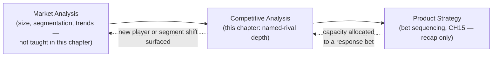

Decision implications (when to reach for which):
A question like "how big is the mid-market expense-management opportunity
in the European Union, and is it growing?" belongs to market analysis. A
question like "why did we lose six of our last ten competitive evaluations
against a specific named rival?" belongs to this chapter. When a request
sounds like the former but keeps devolving into "because of Competitor X,"
that is usually a sign the real question is competitor-specific and
deserves this chapter's tools (Sections 4.2-4.7), not another market-sizing
exercise.

Common failure mode:
Treating a single "competitor slide" produced once during an annual
market-sizing exercise as a substitute for ongoing competitive analysis.
A market analysis's competitor mention is a snapshot list, not a
maintained, evidence-refreshed profile; conflating the two leaves an
organization with a name on a slide and nothing else — no teardown, no
positioning evidence, no win/loss signal.

Concrete scenario:
A leadership offsite reviews a market-sizing deck that lists four named
competitors in a single bullet each. Six months later, sales asks "why are
we losing head-to-head evaluations against the third company on that
list?" — a question the market-sizing slide was never built to answer,
because naming a competitor and analyzing a competitor are different
disciplines with different artifacts, cadences, and owners.

### 4.2 Competitor Identification: Direct, Indirect, and Substitute Competitors

Definition:
Competitor identification classifies a candidate rival into one of three
tiers based on how it competes for the same customer, not merely on
whether it appears in the same industry category. A **direct competitor**
offers a comparable solution to the same job for the same customer
segment. An **indirect competitor** solves the same underlying job through
a materially different solution form. A **substitute** satisfies the job
without being recognized by the buyer as "a competitor" at all — including
manual processes, spreadsheets, an internal build, or simply doing
nothing.

Mechanism (how the classification is made):
The classification runs through a small number of ordered questions:
does the candidate serve the same buyer and the same underlying job
([Product Strategy](CH15_Product_Strategy.md#45-jobs-to-be-done-jtbd)'s
JTBD framing is the right lens here, recapped rather than re-taught)?
If yes, does it solve that job with a recognizably similar solution form
(same category of product, similar buying motion)? A "yes" to both makes
it direct. A "yes" to the job question but "no" to the solution-form
question makes it indirect — for example, a dedicated expense-management
SaaS product and a general-purpose workflow-automation platform that a
customer has configured to approximate the same job. A candidate that
satisfies the job but is not recognized by the buyer as a purchased
alternative at all — a spreadsheet, an internal tool, a do-nothing status
quo — is a substitute.

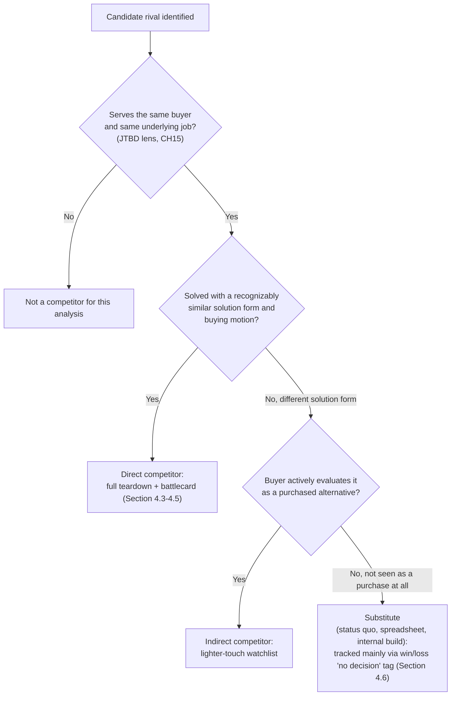

Decision implications (when and why to use it):
Use this classification to allocate finite competitive-analysis effort
proportionally: direct competitors justify the full pipeline in Section
4.3 through 4.6; indirect competitors justify a lighter watchlist entry,
refreshed less often; substitutes are mostly relevant as a source of "no
decision" losses in win/loss analysis (Section 4.6), rarely as a teardown
target, since there is no vendor website or sales team to tear down.

Common failure mode:
Tunnel vision on the one or two most visible direct competitors while an
indirect competitor or a substitute quietly erodes the category — the
classic incumbent blind spot. A team fixated on a rival with a nearly
identical product can miss that most of its actual "no decision" losses
are to prospects choosing to keep using spreadsheets, which no feature
matrix comparison against the visible direct rival will ever surface.

Concrete scenario:
An expense-management SaaS team maintains detailed battlecards against two
direct rivals with near-identical feature sets, while win/loss data
(Section 4.6) shows that the single largest loss category in the small-
business segment is "no decision — continuing with spreadsheets and
email," a substitute that never appears on any battlecard because it has
no sales team to demo against.

### 4.3 Competitive Teardown Methodology

Definition:
A competitive teardown is a structured, repeatable process for building a
deep, evidence-based profile of a single named competitor — its product,
pricing, go-to-market motion, messaging, and customer sentiment — as
distinct from an ad hoc, one-time glance at a competitor's marketing
website.

Mechanism (how it works):
A teardown runs as a pipeline, not a single step. It begins with scoping
(which competitor, and at what depth, per the tier from Section 4.2),
proceeds through public sourcing (product documentation, pricing pages,
job postings — which reveal roadmap direction through the roles a
competitor is hiring for — analyst reports, and public customer reviews),
then to first-party sourcing where ethically and legally permitted (a
trial account, a sandbox environment, or a disclosed evaluation call,
never through misrepresentation — Section 13 states the legal and ethical
boundary in full), then to customer-sourced evidence (win/loss interview
findings from Section 4.6 and triangulated sales/customer-success
anecdotes), and finally to synthesis into a maintained competitor profile
and battlecard (Section 4.5). A refresh cadence closes the loop, since a
teardown's value decays as the competitor ships changes.

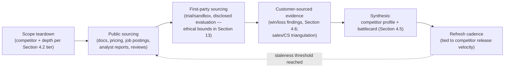

Decision implications (when and why to use it):
Scale teardown depth to the competitor tier from Section 4.2: a direct
competitor justifies the full four-stage pipeline; an indirect competitor
typically justifies only the public-sourcing stage plus periodic
sentiment checks; a substitute rarely justifies a teardown at all, since
there is no vendor to profile.

Common failure mode:
Treating a teardown as a one-time deliverable — a document produced once,
presented, and never revisited. Competitors ship changes continuously; a
teardown from eighteen months ago actively misleads a sales conversation
today, which is a materially worse outcome than having no teardown at all,
because it produces false confidence rather than acknowledged uncertainty.

Concrete scenario:
A sales representative, quoting a battlecard built two quarters earlier,
tells a prospect the competitor "doesn't support Single Sign-On (SSO)."
The competitor shipped SSO the previous quarter. The prospect, who already
knows this, loses confidence in every other claim on the battlecard for
the rest of the call — a single stale data point contaminates the
credibility of the entire artifact.

Ethical and legal sourcing boundary (summary; full treatment in Section
13): every sourcing stage above must rely on publicly available
information, disclosed evaluation activity, or properly licensed
third-party research. Misrepresenting identity or intent to obtain
non-public information, violating a competitor's terms of service to
scrape restricted content, or soliciting a competitor's confidential
information from a departing employee under a still-active
non-disclosure obligation are not aggressive competitive intelligence —
they are legal and ethical violations, and Section 13 names the specific
statutes involved.

### 4.4 Positioning Maps

Definition:
A positioning map is a visual representation of how competing offerings
compare on dimensions that matter to a buyer's decision, built from
customer-perceived evidence rather than internal opinion. The classical
form is a two-axis **perceptual map**; a related, richer form — the
**strategy canvas** and its accompanying **value curve**, from Blue Ocean
Strategy — plots relative investment across many competing factors at
once, revealing where a category is over-invested (commoditized
competition) and where "white space" exists for genuine differentiation.

Mechanism (how it works):
Building a defensible positioning map has two disciplined steps most teams
skip. First, choosing axes that are actually decision-relevant to the
buyer — not vanity metrics an internal team happens to be proud of. Second,
plotting relative position from *customer* evidence: win/loss interview
transcripts (Section 4.6), independent customer surveys, and public review
mining, not from an internal brainstorm about where the team believes it
sits. A strategy canvas extends this from two axes to many, plotting each
competitor's relative investment level (low to high) across every factor
buyers say they weigh, making it possible to see at a glance which factors
the whole category over-invests in identically (a flat, undifferentiated
line for everyone) and which factors no competitor has invested in at all
— the latter being where a genuine differentiation opportunity, rather
than a parity race, actually lives.

```{=latex}
\begin{landscape}
```

```mermaid
quadrantChart
    title Positioning Map: Ease of Use vs. Depth of Functionality
    x-axis Low Depth of Functionality --> High Depth of Functionality
    y-axis Low Ease of Use --> High Ease of Use
    quadrant-1 Power-user favorite
    quadrant-2 Simple and broad appeal
    quadrant-3 Niche or commodity
    quadrant-4 Complex and narrow
    Our Product: [0.60, 0.55]
    Competitor A (incumbent): [0.85, 0.32]
    Competitor B (challenger): [0.45, 0.80]
    Substitute (spreadsheets): [0.15, 0.60]
```

```{=latex}
\end{landscape}
```

```{=latex}
\begin{landscape}
```

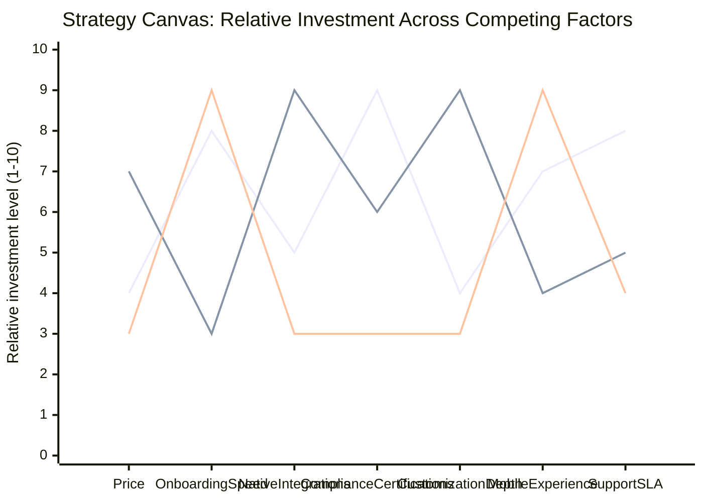

```{=latex}
\end{landscape}
```

Both diagrams above are landscape-wrapped because they are dense
multi-series visuals whose labels would compress illegibly in a portrait
layout — matching the Style Guide's PDF landscape convention for wide,
dense diagrams such as a positioning map or feature matrix.

Decision implications (when and why to use it):
Build or refresh a positioning map before committing to messaging or
differentiation work, and treat a mismatch between the intended and the
actual (evidence-based) map as a required trigger to revisit messaging,
not something to argue away. A strategy canvas's value curve is
specifically useful as an input to competitive-response strategy (Section
4.7): a flat, identical line across competitors on a given factor signals
a commoditized parity race not worth fighting further, while an
unoccupied factor signals a differentiation opportunity worth pursuing.

Common failure mode:
Drawing a positioning map from internal opinion — placing your own
product in the most flattering quadrant ("we're clearly the easiest to use
and the most powerful") without any customer evidence backing either axis
placement. This produces a comforting but false map, and every messaging
decision built on it inherits the same falseness.

Concrete scenario:
An internal positioning exercise places the product in the top-right
quadrant of "easy to use" and "deep functionality" — the most desirable
position on the map. Independent win/loss interviews (Section 4.6),
however, repeatedly surface the phrase "too complex to onboard our team
quickly" from lost deals. The evidence-based map places the product much
closer to the "complex and narrow" quadrant than the team's internal
belief — a correction that must happen before any further messaging
investment, not after.

Where positioning needs to be scoped to a specific buyer segment rather
than a generic "the customer," a validated persona
([Personas](CH03_Personas.md)) supplies that segment definition; this
chapter consumes a persona as an input rather than re-deriving how one is
built.

### 4.5 Feature and Capability Comparison Matrices

Definition:
A feature and capability comparison matrix — commonly packaged as a
sales-facing **battlecard** — is a structured, factor-by-factor comparison
table with rows for capabilities or decision-relevant dimensions and
columns for your product plus each named direct competitor, each cell
rated (supported, partial, unsupported, or a similar structured scale) and
tagged with a confidence source, paired with short objection-handling talk
tracks for the factors that most often surface in live sales
conversations.

Mechanism (how it works):
A defensible matrix is built from teardown findings (Section 4.3), not
from sales assumption or memory. Each cell carries a **confidence tag** —
verified by hands-on trial, reported by a prospect during a sales call, or
inferred from marketing copy alone — so that a reader can see at a glance
how much to trust a given claim, and so that stale or unverified cells are
visible rather than silently presented with false authority. The matrix is
refreshed on a cadence tied to the competitor's own release velocity
(Section 4.3's pipeline feeding this artifact), not on a fixed calendar
schedule that ignores how fast a given competitor actually ships.

```{=latex}
\begin{landscape}
```

| Capability | Our Product | Competitor A (incumbent) | Competitor B (challenger) | Confidence source |
|---|---|---|---|---|
| Single Sign-On (SSO) | Supported | Supported | Partial (SAML only, no SCIM) | Verified by trial |
| Native calling integration | Partial (one provider) | Supported (three providers) | Unsupported | Verified by trial |
| SOC 2 Type II report | Supported | Supported | Reported "in progress" | Reported by prospect (unverified) |
| Custom approval workflows | Supported | Partial (two-tier max) | Supported | Verified by trial |
| Onboarding time (typical) | 7 days | 21 days | 3 days | Win/loss interview aggregate |
| List price (entry tier) | $29/seat/month | $45/seat/month | $19/seat/month | Public pricing page |
| Mobile offline mode | Unsupported | Unsupported | Supported | Verified by trial |

```{=latex}
\end{landscape}
```

Decision implications (when and why to use it):
Use the matrix for three distinct purposes that are easy to conflate:
sales objection handling (which factors most often decide a live deal),
product gap analysis (which unsupported or partial cells recur across
lost deals, feeding — but not replacing — Product Strategy's sequencing
logic, recapped from [Product
Strategy](CH15_Product_Strategy.md#46-portfolio-sequencing-logic-why-this-bet-over-that-one)),
and marketing message quality assurance (catching a claim the matrix's
evidence no longer supports). Weight which gaps matter by win/loss
frequency (Section 4.6), not by row count.

Common failure mode:
Treating the matrix as a checkbox parity race — counting how many more
rows a competitor supports and pushing to match every one of them,
regardless of whether any specific row actually decides deals. This
directly feeds the "feature-factory" and reflexive-response failure modes
named again in Sections 4.7 and 19.

Concrete scenario:
A matrix shows a competitor supports forty more third-party integrations
than the product does. Sales pushes for a roadmap initiative to match all
forty. Win/loss data (Section 4.6), however, shows deals are lost citing
exactly three specific integrations relevant to the product's actual
Ideal Customer Profile (ICP) — the other thirty-seven integrations never
once appear in a lost-deal transcript. Building all forty would have
consumed a full quarter of capacity to move a number that only three rows
actually influence.

### 4.6 Win/Loss Analysis

Definition:
Win/loss analysis is a structured, ongoing practice of interviewing (or,
at lower cost and lower depth, surveying) buyers after a competitive deal
closes — won or lost — to understand the actual causal decision factors,
in contrast to relying on a salesperson's own Customer Relationship
Management (CRM) close-reason entry as if it were sufficient evidence on
its own.

Mechanism (how it works):
The practice runs as a repeatable cycle. A closed deal (won or lost)
triggers an interview request, ideally conducted by someone other than the
account's own salesperson — reducing the social-desirability and
self-serving bias that the Research chapter's bias taxonomy already
teaches in general
([Research](CH02_Research.md#4-core-concepts)), applied here specifically
to the seller's own incentive to under-report their own execution gaps.
The interview follows a structured guide (interview-technique craft itself
is owned in full by [User Interviews](CH04_User_Interviews.md); this
chapter does not re-teach rapport-building or question wording), probing
the buyer's actual decision journey, who else was evaluated, and — using
[Product Strategy](CH15_Product_Strategy.md#45-jobs-to-be-done-jtbd)'s
JTBD framing as an analytical lens rather than a re-derivation — what
progress the buyer was actually trying to make, since that framing
routinely surfaces a materially different answer than a feature checklist
would. Findings are then sorted into a **causal tagging taxonomy** —
price, feature or capability gap, integration gap, trust or brand, sales
relationship and execution, timing, loss of an internal champion, or "no
decision" (a substitute or the status quo won instead of any vendor) —
aggregated across deals, and trended over time before feeding the
battlecard (Section 4.5), the positioning map (Section 4.4), and
competitive-response strategy (Section 4.7).

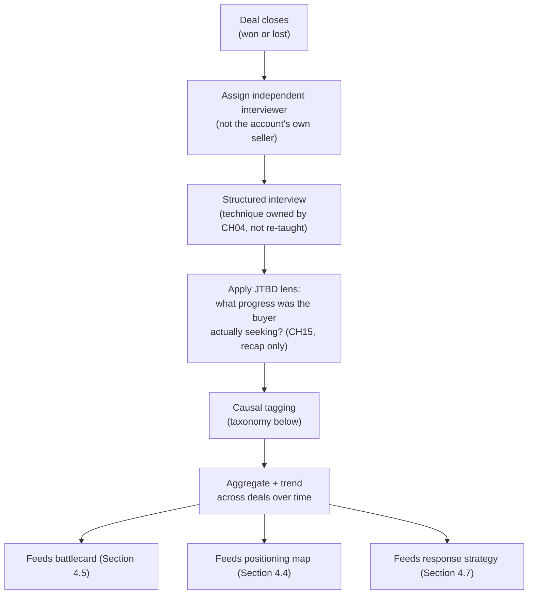

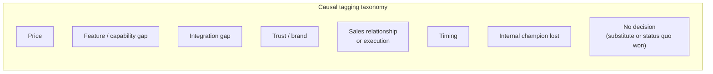

Decision implications (when and why to use it):
Distinguish the **stated reason** a buyer gives — often the simplest,
most polite answer, frequently "price" — from the **real reason**,
surfaced only through deeper, JTBD-anchored probing. Use the causal
taxonomy's trend over time, not any single interview, to decide whether a
given gap is worth a response (Section 4.7): a gap named in one interview
out of forty is noise; the same gap named in twelve of the last fifteen
lost deals is signal.

Common failure mode:
Relying solely on the CRM close-reason field the losing salesperson
entered themselves. This source is shallow (a single dropdown value),
self-serving (a rep is unlikely to enter "I was unresponsive for two
weeks" as the reason), and unverified — exactly the anecdote-driven
default Section 3's opening scenario describes.

Concrete scenario:
CRM close-reason data shows "price" as the top loss reason for the
quarter. Independent win/loss interviews, conducted by someone other than
the losing reps, reveal that in most of those same deals, price was never
even discussed — the deal died weeks earlier when a missing System and
Organization Controls 2 (SOC 2) report blocked the prospect's security
review. "Price" was the simplest thing a departing prospect said to a
seller they no longer wanted an uncomfortable conversation with; the real
reason was a compliance gap the CRM field never captured.

### 4.7 Competitive-Response Strategy

Definition:
Competitive-response strategy is the decision discipline for choosing how
— or whether — to react to a specific competitor move (a new feature
announcement, a price change, a funding round) or to a persistent,
evidence-validated gap surfaced through Sections 4.3 through 4.6, using a
deliberate menu of response types rather than a reflexive, one-size-fits-all
reaction.

Mechanism (how it works):
Five response types cover most real situations. **Ignore**: the move does
not threaten a strategically important segment or a validated, frequent
loss driver; document the decision and the evidence considered rather than
silently doing nothing. **Match**: close a specific gap that win/loss data
(Section 4.6) has validated as a high-frequency, real decision factor —
this is the only response type the checkbox-parity failure mode in
Section 4.5 should ever be allowed to trigger, and only once validated.
**Differentiate**: invest in a distinct factor the strategy canvas
(Section 4.4) shows as unoccupied white space, moving away from a
commoditized fight rather than deeper into it — the Blue Ocean move.
**Flank**: target a specific underserved segment or persona
([Personas](CH03_Personas.md)) the competitor is structurally weak in
serving, rather than contesting its strongest ground directly. **Judo
strategy**: use a competitor's own strength or scale against it — for
example, treating an incumbent's platform lock-in and complexity as the
direct argument for a lighter-weight, faster-to-adopt alternative, turning
their asset into their liability in the buyer's eyes.

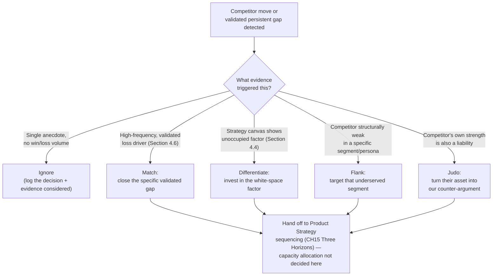

Decision implications (when and why to use it):
Use the response menu specifically to prevent reflexive parity chasing —
the Section 4.5 failure mode recurring at the strategic level. A response
decision's rigor should scale with how hard it is to reverse: an "Ignore"
decision costs little to revisit later, so a quick evidence check
suffices; a "Match" or "Differentiate" decision that consumes meaningful
engineering capacity deserves the heavier evidence bar and should be
treated as the kind of higher-stakes commitment [Architecture
Thinking](../01_Architecture_Mindset/CH03_Architecture_Thinking.md)
already teaches how to classify by reversibility, recapped rather than
re-derived here. Whatever response is chosen, this chapter hands the
decision to [Product Strategy](CH15_Product_Strategy.md#46-portfolio-sequencing-logic-why-this-bet-over-that-one)'s
Three Horizons sequencing for actual capacity allocation — this chapter
supplies validated competitive evidence as an input to that sequencing
decision, it does not make the sequencing decision itself.

Common failure mode:
Matching every visible competitor move regardless of evidence strength —
reacting to a conference announcement or a splashy feature launch with an
emergency roadmap addition before any win/loss volume has validated that
the move is actually costing deals. This drains capacity Product Strategy
would otherwise sequence toward a differentiated bet, and it feeds CH15's
sequencing logic with noise instead of validated signal.

Concrete scenario:
A competitor announces a flashy artificial-intelligence-assisted feature
at an industry conference. Win/loss data (Section 4.6) shows zero deals
lost citing that capability across the last four quarters. The response
decision is Ignore, explicitly logged with the evidence considered and a
trigger condition for revisiting it (for example, "revisit if this
capability appears in three or more lost-deal interviews within a
quarter") — a deliberate, reversible, evidence-anchored decision, not a
panic-driven roadmap addition.

## 5. Internal Working

Competitive analysis is not a document produced once; it is a standing
operating cycle that runs continuously, with an explicit fast path for
events that cannot wait for the normal cadence.

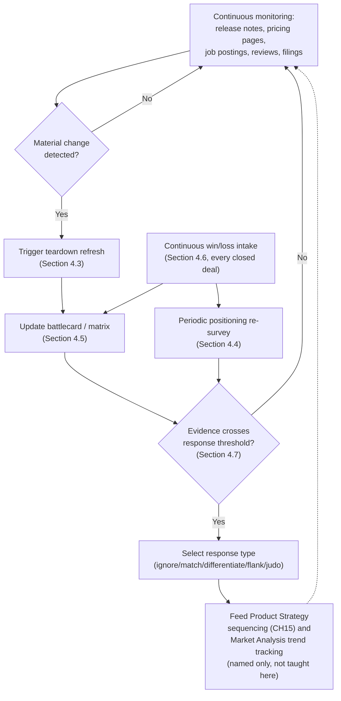

The normal cadence is the loop above: monitoring feeds teardown refresh
and win/loss intake, both of which feed the battlecard and positioning
map, and a validated response-threshold crossing feeds a deliberate
response decision, which in turn hands capacity-allocation evidence
forward to Product Strategy. An **exception path** exists for events that
cannot wait for this cadence: a competitor acquisition, a sudden major
price cut, a public security incident, or a sudden funding announcement
that materially changes competitive dynamics should trigger an immediate,
scoped teardown refresh and response review, outside the normal refresh
schedule — mirroring the assumption-triggered exception path [Product
Strategy](CH15_Product_Strategy.md#5-internal-working) already teaches for
its own strategy-revision cycle, applied here specifically to sudden
competitive events rather than general strategic assumption breaks.

## 6. Design Principles

- **Evidence over anecdote**: every claim in a battlecard, positioning
  map, or response decision traces to a sourced, confidence-tagged piece
  of evidence (Sections 4.3, 4.5, 4.6), never to an unverified internal
  belief.
- **Customer-perceived truth over internal narrative**: positioning
  (Section 4.4) is built from what buyers actually perceive, not what the
  team wishes were true.
- **Tiered depth matching competitor tier**: effort scales with the
  direct/indirect/substitute classification (Section 4.2); spending equal
  effort on every named rival wastes scarce analysis capacity.
- **Recency discipline**: every artifact carries an explicit "valid until"
  or last-verified date, and staleness is treated as an active risk
  (Section 4.3's failure mode), not a passive fact to notice eventually.
- **Single accountable owner**: one named owner is accountable for the
  competitive-intelligence artifact stack's currency and quality, echoing
  the single-accountable-owner principle [Product
  Strategy](CH15_Product_Strategy.md#6-design-principles) already applies
  to strategic bets, applied here to the artifact stack in Section 8.
- **Ethical sourcing only, without exception**: no sourcing method is
  acceptable if it depends on misrepresentation, deception, or violating a
  competitor's legal rights — Section 13 states the specific legal
  boundary.
- **Response proportional to validated evidence strength, not to
  visibility or noise level**: a loud, well-publicized competitor move
  earns exactly the same evidence bar as a quiet one before it earns a
  response (Section 4.7).

## 7. Architecture Patterns

Analogous to a software architecture pattern naming a recurring structural
shape, competitive-analysis functions tend to organize around one of a
small number of recurring operating-model patterns:

- **Centralized competitive-intelligence function**: a dedicated analyst
  or small team owns teardown, battlecard maintenance, and win/loss
  synthesis for the whole company. Strongest when the number of
  competitors and product lines is large enough to justify specialization;
  weakest at signaling speed, since a small central team can become a
  bottleneck for every product line's specific questions.
- **Embedded-in-product-management pattern**: each product manager owns
  competitive analysis for their own product line's competitor set.
  Fastest to respond to a line-specific move; weakest at consistency,
  since artifact quality and cadence discipline can vary widely across
  product lines with no shared standard.
- **Sales-enablement-led pattern**: the sales-enablement function owns
  battlecard construction and win/loss intake, since it sits closest to
  the deals themselves. Strongest at objection-handling relevance; weakest
  at teardown depth and positioning rigor, since sales-enablement teams
  are rarely staffed for deep product-level teardown work.
- **Hybrid pattern**: a small central function owns the teardown
  methodology, sourcing standards, and win/loss process design, while
  product management and sales contribute product-line-specific content
  into a shared, consistently structured artifact stack (Section 8). This
  is the pattern most organizations converge on once they outgrow a single
  informal owner, for the same reason [Product
  Strategy](CH15_Product_Strategy.md#12-scalability) converges on a
  "shared thin central layer with local execution latitude" for
  strategy — the same centralized-versus-federated tension recurs here.

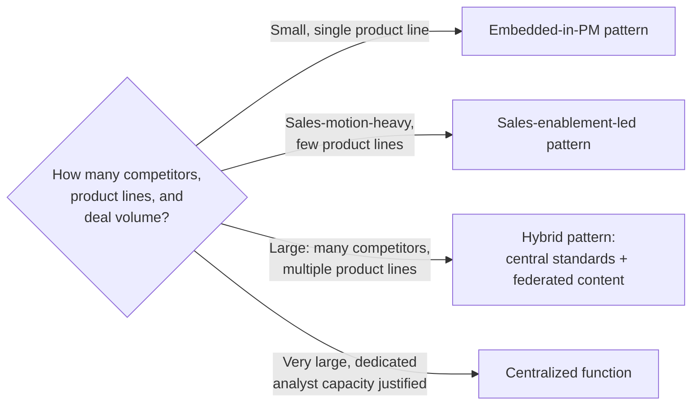

## 8. Production Architecture

- **Artifact stack**: competitor profile (Section 4.3), positioning map
  and strategy canvas (Section 4.4), feature/capability matrix and
  battlecard (Section 4.5), win/loss report (Section 4.6), and
  competitive-response memo (Section 4.7) — each versioned, dated, source-
  tagged, and attributed to an owner.
- **Governance cadence**: continuous monitoring and win/loss intake (never
  paused), a quarterly teardown and matrix refresh for direct competitors,
  a lighter semi-annual refresh for indirect competitors, and an
  event-triggered exception path (Section 5) for sudden competitive
  events.
- **Review forum**: a small, named cross-functional group (product,
  sales-enablement, and a strategy-owner representative) with the
  authority to approve a response decision (Section 4.7) and to resolve
  disagreements about causal tagging (Section 4.6) — deliberately not a
  large all-hands forum, mirroring the review-forum principle [Product
  Strategy](CH15_Product_Strategy.md#8-production-architecture) already
  applies to its own strategy-memo review board.
- **Tooling**: dedicated battlecard/competitive-intelligence platforms
  (broadly, categories like Klue or Crayon, named for orientation only)
  or a lightweight shared-document approach for smaller organizations;
  win/loss interviewing may be run in-house or through a specialized
  third-party win/loss research vendor. This chapter does not endorse or
  teach any specific tool.

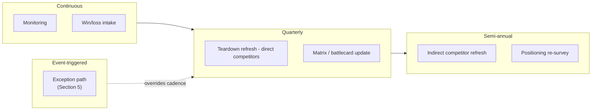

## 9. Implementation

A phased approach to standing up or resetting a competitive-analysis
practice:

### Phase 1: Identify and Tier

- Compile a candidate rival list and classify each into direct, indirect,
  or substitute (Section 4.2).
- Assign teardown depth and refresh cadence per tier.

### Phase 2: Tear Down

- Run the teardown pipeline (Section 4.3) for each direct competitor:
  public sourcing, first-party sourcing within the legal and ethical
  bounds in Section 13, and customer-sourced triangulation.

### Phase 3: Position and Compare

- Build or refresh the positioning map and strategy canvas (Section 4.4)
  from customer evidence, not internal opinion.
- Build or refresh the feature/capability matrix and battlecard (Section
  4.5), tagging every cell with its confidence source.

### Phase 4: Stand Up Win/Loss

- Establish the independent-interviewer win/loss process (Section 4.6),
  the causal tagging taxonomy, and the aggregation/trending cadence.

### Phase 5: Govern Response

- Establish the response-decision menu and review forum (Sections 4.7 and
  8), and the handoff contract to Product Strategy's sequencing process
  (CH15).

## 10. Complete Code Examples

Competitive analysis is an evidence- and artifact-driven discipline rather
than a code-first one. In place of code, this section provides
implementation-neutral schemas a team can adapt into whatever
documentation, wiki, or dedicated competitive-intelligence platform it
already operates.

Competitor profile schema (Section 4.3):

- Competitor name and tier (direct / indirect / substitute, Section 4.2)
- Product summary and target segment
- Pricing model (public sourcing date and link)
- Go-to-market motion (self-serve, sales-led, partner-led)
- Messaging summary and stated positioning claim
- Last teardown date and next scheduled refresh

Battlecard matrix-cell schema (Section 4.5):

- Capability or dimension name
- Rating (supported / partial / unsupported / scored value)
- Confidence source (verified by trial / reported by prospect / inferred
  from marketing / win-loss interview aggregate)
- Last verified date
- Linked objection-handling talk track, if any

Win/loss interview schema (Section 4.6):

- Deal identifier and outcome (won / lost / no decision)
- Interviewer (confirmed independent of the account's own seller)
- Decision journey summary
- Competitors and substitutes evaluated
- Stated reason versus real reason (post-JTBD-lens analysis)
- Causal tag(s) applied (from the Section 4.6 taxonomy)
- Interview date and source confidence

Competitive-response decision record (Section 4.7):

- Trigger (competitor move or validated persistent gap)
- Evidence considered (win/loss volume, teardown finding, positioning
  shift)
- Response type selected (ignore / match / differentiate / flank / judo)
- Rationale and reversibility classification
- Handoff reference to the Product Strategy sequencing decision (CH15),
  if capacity was allocated
- Revisit trigger condition, if the decision was to ignore

These schemas are deliberately tool-agnostic; a team implements them in
whichever documentation or competitive-intelligence platform it already
operates, per Section 8.

## 11. Performance

"Performance" for a competitive-analysis practice is measured as evidence
freshness and decision velocity, not runtime latency:

- **Battlecard staleness lag**: the time between a competitor's material
  product change and the corresponding battlecard cell update (Section
  4.5) — a growing lag is the leading indicator behind the stale-battlecard
  failure mode named in Section 4.3.
- **Win/loss cycle time**: the time between a deal closing and its
  interview being completed and tagged (Section 4.6); a growing lag
  weakens the recency of the trend data Section 4.7 relies on for
  response decisions.
- **Time from evidence threshold to response decision**: how long a
  validated, high-frequency loss driver sits unaddressed before a
  response decision (Section 4.7) is actually made and logged.

Heuristics:

- Prioritize refresh speed for direct competitors with high release
  velocity over exhaustive depth for low-activity indirect competitors.
- Treat a growing win/loss cycle-time trend as itself a leading indicator
  worth escalating, independent of any single deal's findings.

## 12. Scalability

A competitive-analysis practice has to hold as the number of competitors,
product lines, segments, and regions grows, without collapsing into either
a single overloaded central bottleneck or a set of inconsistent, siloed
efforts:

- **Coverage scalability**: the tiering discipline from Section 4.2
  is the primary scaling lever — most organizations cannot sustain full
  teardown depth for more than a handful of direct competitors at once,
  so tiering discipline (not effort inflation) is what should scale.
- **Cadence scalability**: as competitor count grows, refresh cadence
  should be tiered (Section 8) rather than uniformly slowed down for
  everyone, which would silently degrade direct-competitor freshness to
  protect indirect-competitor coverage that matters far less.
- **Ownership scalability**: the hybrid pattern (Section 7) — a small
  central function owning standards and sourcing while product lines
  contribute content — scales better than either a single centralized
  owner (bottleneck) or a fully federated model (inconsistent quality),
  echoing the same centralized-versus-federated tension [Product
  Strategy](CH15_Product_Strategy.md#12-scalability) resolves for strategy
  ownership and [Personas](CH03_Personas.md#12-persona-governance-lifecycle-and-maintenance)
  resolves for persona governance.

Scalability failure typically shows up as sibling product lines
independently maintaining conflicting, differently sourced battlecards for
the same competitor — the same remedy (a shared, thin central standard
with local execution latitude) that resolves this tension elsewhere in
this part applies here too.

## 13. Security

Security for a competitive-analysis practice concerns legal and ethical
intelligence-gathering boundaries and controlled internal distribution of
sensitive findings, not application-level security controls (owned
elsewhere, notably the not-yet-drafted Security part):

- **Legal sourcing boundary**: sourcing must rely on publicly available
  information, disclosed evaluation activity, or properly licensed
  third-party research. The United States Economic Espionage Act (1996)
  and the Defend Trade Secrets Act (2016) criminalize and create civil
  liability for misappropriating a competitor's trade secrets; soliciting
  confidential information from a departing competitor employee who
  remains bound by a non-disclosure agreement, or misrepresenting
  identity to obtain non-public competitor data, crosses this boundary
  regardless of intent.
- **Antitrust risk of direct competitor contact**: any direct
  communication with a competitor that touches pricing intentions,
  output, market allocation, or bidding behavior — even informally —
  creates a serious antitrust exposure resembling price-fixing or
  market-allocation collusion. Legitimate competitive analysis studies a
  competitor from the outside; it never involves coordinating with one.
- **Terms-of-service compliance**: automated scraping of a competitor's
  site or review platform that violates its published terms of service is
  a contractual and, in some jurisdictions, a computer-misuse-law risk,
  independent of whether the scraped information is otherwise public.
- **Controlled internal distribution**: win/loss transcripts and detailed
  battlecards often contain customer-confidential detail and should be
  distributed on a need-to-know basis, not broadcast broadly; a battlecard
  leaked externally (including through an improperly configured public
  document link) hands a competitor free insight into your own positioning
  strategy.

Common tension: sales wants the most aggressive possible battlecard
language to win a deal in the moment, while legal and competitive-
intelligence governance wants sourcing claims kept conservative and
verifiably true. The typical resolution is the confidence-tagging
discipline from Section 4.5: unverified claims are marked as such rather
than asserted with false confidence, and the review forum (Section 8)
resolves disputes before a claim reaches a live sales conversation.

## 14. Observability

Observability for a competitive-analysis practice means having leading
signals that reveal whether the practice itself is healthy, not only
after-the-fact win-rate numbers:

- **Win rate trend against a specific named competitor**: the clearest
  lagging signal that a response decision (Section 4.7) is or is not
  working.
- **Battlecard staleness age**: the elapsed time since a matrix cell's
  last verification date (Section 4.5); an aging distribution skewing
  older is a leading indicator of the stale-battlecard failure mode.
- **Sourcing-confidence coverage**: the percentage of matrix cells tagged
  "verified" versus "inferred" or "unverified" — a low verified
  percentage signals a teardown practice that has fallen behind (Section
  4.3).
- **Objection frequency distribution**: which capability gaps actually
  recur across live sales conversations, cross-checked against the
  win/loss causal-tagging taxonomy (Section 4.6) to catch a mismatch
  between what sales believes is costing deals and what buyers actually
  cite.
- **Win/loss interview completion rate**: the percentage of closed deals
  that actually receive a completed, independently conducted interview —
  a low rate undermines the statistical reliability of every downstream
  signal.

This chapter deliberately stops at this framing-level treatment of
signals; full metric-design technique — statistical rigor for trend
reads and dashboard construction discipline — is owned by this part's
not-yet-drafted **Metrics** and **North Star Metrics** chapters (see
[PART_OVERVIEW.md](PART_OVERVIEW.md)).

## 15. Failure Scenarios

Representative competitive-analysis failure modes and their typical
resolution:

1. **Stale battlecard incident**: a sales conversation is contradicted
   live by a prospect citing a competitor capability the battlecard
   claimed did not exist. Resolution: enforce the staleness-age
   observability signal (Section 14) and tie refresh cadence to
   competitor release velocity (Section 8), not a fixed calendar.
2. **Single-competitor tunnel vision**: a disruptive substitute or
   indirect competitor erodes a category while attention stays fixed on
   one visible direct rival. Resolution: enforce the full
   direct/indirect/substitute tiering discipline (Section 4.2) rather
   than tracking only the most visible name.
3. **Self-serving CRM-only win/loss data**: loss reasons are taken at
   face value from the losing seller's own CRM entry. Resolution: require
   an independent interviewer (Section 4.6) for every material deal,
   never relying on the seller's self-report alone.
4. **Opinion-based positioning map**: a positioning map is built from
   internal belief rather than customer evidence, and messaging decisions
   compound the resulting falseness. Resolution: require a customer-
   perception survey or win/loss evidence source for every axis placement
   (Section 4.4), verified in Section 16.
5. **Unethical or illegal sourcing incident**: a teardown crosses into
   misrepresentation, terms-of-service violation, or trade-secret
   misappropriation, creating legal and reputational exposure. Resolution:
   enforce the sourcing boundary in Section 13 as a hard gate on every
   teardown stage, not an informal guideline.
6. **Reflexive parity-chasing**: unvalidated competitor moves trigger
   emergency roadmap additions, draining capacity from differentiated
   bets. Resolution: enforce the evidence-threshold gate in the Section
   4.7 response decision tree before any capacity is allocated.

## 16. Testing

"Testing" a competitive-analysis practice means validating its evidence
and conclusions before they drive a decision, not testing code:

### 16.1 Blind Win/Loss Interviews

An interviewer independent of the account's own seller, and ideally
unaware of the seller's own stated theory for the outcome, conducts the
interview — reducing confirmation bias and social-desirability bias in
the findings (Section 4.6).

### 16.2 Customer-Perception Validation of the Positioning Map

A positioning map's axis placements are checked against an independent
customer survey or a sample of win/loss transcripts before being finalized
(Section 4.4), rather than accepted once drawn.

### 16.3 Red-Team Review of a Response Decision

A person or small group not involved in drafting a competitive-response
recommendation (Section 4.7) is tasked with arguing against it — attacking
the evidence strength and the assumed reversibility — before capacity is
committed, mirroring the same red-team practice [Product
Strategy](CH15_Product_Strategy.md#162-red-team-review) already applies to
its own strategic bets.

### 16.4 Sourcing-Provenance Audit

A periodic audit samples battlecard matrix cells (Section 4.5) and
confirms that each confidence tag accurately reflects how the claim was
actually sourced, catching claims that have quietly drifted from
"verified" to merely "assumed still true."

### 16.5 Mystery-Shop or Trial-Account Validation

Where legally and ethically permitted (Section 13), a first-party trial
or sandbox evaluation directly confirms a capability claim rather than
relying on secondhand reporting alone.

## 17. Common Mistakes

- Treating a one-time market-sizing "competitor slide" as a substitute
  for ongoing competitive analysis (Section 4.1).
- Fixating on one or two visible direct competitors while an indirect
  competitor or substitute erodes the category unnoticed (Section 4.2).
- Letting a teardown or battlecard go stale without a refresh cadence
  tied to competitor release velocity (Section 4.3).
- Drawing a positioning map from internal opinion instead of customer
  evidence (Section 4.4).
- Chasing every competitor feature checkbox regardless of win/loss
  relevance (Section 4.5).
- Trusting a salesperson's own CRM close-reason entry as sufficient
  win/loss evidence (Section 4.6).
- Reacting to every visible competitor move with an equally reflexive
  response, regardless of validated evidence strength (Section 4.7).

## 18. Best Practices

- Tier competitors explicitly (direct/indirect/substitute) and scale
  teardown depth and refresh cadence accordingly.
- Tag every battlecard claim with a confidence source and a last-verified
  date.
- Ground every positioning map in customer-perception evidence, never in
  internal opinion alone.
- Run win/loss interviews through an interviewer independent of the
  account's own seller, and apply a JTBD lens to separate stated from
  real reasons.
- Weigh feature-gap and response decisions by validated win/loss
  frequency, not by visible feature-count difference or announcement
  volume.
- Log every response decision — including "ignore" — with its evidence
  and a revisit trigger condition.
- Enforce the ethical and legal sourcing boundary as a hard gate on every
  teardown activity.

## 19. Anti-Patterns

- **Reflexive parity chasing**: matching every visible competitor feature
  regardless of validated relevance (Sections 4.5 and 4.7).
- **Opinion-based positioning**: a positioning map built from internal
  belief rather than customer evidence (Section 4.4).
- **CRM-close-reason-as-truth**: treating a seller's own self-reported
  loss reason as sufficient win/loss evidence (Section 4.6).
- **Single-rival tunnel vision**: ignoring indirect competitors and
  substitutes in favor of one visible direct rival (Section 4.2).
- **Stale battlecard theater**: a polished, well-designed battlecard that
  is never refreshed and actively misleads sales (Section 4.3).
- **Aggressive sourcing overreach**: crossing the legal and ethical
  sourcing boundary in the name of "thorough" intelligence gathering
  (Section 13).

## 20. Trade-off Analysis

- **Coverage breadth versus depth**: tracking many competitors shallowly
  hedges against missing an emerging threat but dilutes teardown quality
  for the direct competitors that matter most; the tiering discipline
  (Section 4.2) is the primary lever for balancing this.
- **Centralized versus federated ownership**: a centralized
  competitive-intelligence function keeps sourcing and quality consistent
  but can bottleneck product-line-specific requests; a federated model is
  faster locally but risks inconsistent artifact quality (Section 7).
- **Speed versus evidence rigor in response decisions**: reacting quickly
  to a competitor move feels responsive but risks the reflexive-response
  anti-pattern; waiting for full win/loss validation is more rigorous but
  slower — the evidence-threshold gate in Section 4.7 is the intended
  balance point, not a fixed rule for every situation.
- **Aggressive battlecard language versus verified conservatism**: sales
  wants persuasive claims; governance wants only verifiably true ones —
  the confidence-tagging discipline (Section 4.5) is the resolution
  mechanism, not a permanent unresolved tension.
- **Public roadmap-adjacent disclosure versus confidentiality**: sharing
  competitive-response intent broadly helps internal alignment but risks
  the information-leakage exposure named in Section 13.

## 21. Comparison Table

| Artifact | Primary question answered | Time orientation | Typical owner | Output nature | When to use |
|---|---|---|---|---|---|
| Competitor profile (Section 4.3) | Who is this rival and what do they actually do? | Refreshed quarterly (direct) / semi-annually (indirect) | Competitive-intelligence owner | Structured profile document | Onboarding a newly identified rival; periodic refresh |
| Positioning map / strategy canvas (Section 4.4) | Where do buyers actually perceive us relative to rivals? | Periodic re-survey | Product marketing / strategy owner | Visual quadrant map or multi-factor value curve | Before committing to messaging or differentiation work |
| Feature/capability matrix and battlecard (Section 4.5) | What specific capability differences decide live deals? | Continuously refreshed | Sales enablement + competitive-intelligence owner | Structured, confidence-tagged comparison table | Sales objection handling; gap-analysis input to strategy |
| Win/loss report (Section 4.6) | Why was this specific deal actually won or lost? | Per closed deal, trended over time | Independent interviewer / win-loss program owner | Interview findings + causal tags | Every material competitive deal closure |
| Competitive-response memo (Section 4.7) | How, or whether, should we react to this move or gap? | Per triggering event | Competitive-analysis + product strategy owner | Decision record with evidence and rationale | When a threshold-crossing move or validated gap is detected |
| Market sizing / segmentation (not taught here) | How big is the opportunity and how is it segmented? | Annual / periodic | [Market Analysis](CH16_Market_Analysis.md) | Sizing model, segmentation map | Upstream input naming which rivals matter, not head-to-head depth |
| Product strategy bet sequencing (not taught here) | Which validated bet gets funded first? | Quarterly / per cycle | Product Strategy chapter (CH15) | Sequenced bet portfolio | Downstream consumer of this chapter's response evidence |

The last two rows are named only for disambiguation against this
chapter's own artifacts; neither is taught here.

## 22. Real-World Case Study

Case: Recovering win rate for a mid-market Customer Relationship
Management (CRM) vendor

Context:
A seven-year-old mid-market CRM vendor had stable feature parity with an
established incumbent but was losing an increasing share of competitive
evaluations to a newer, venture-funded challenger over three consecutive
quarters. Sales leadership's working theory, drawn from CRM close-reason
data, was that the challenger's lower list price was the deciding factor,
and the team was preparing a discounting response.

Competitive-analysis intervention:

1. Competitor identification (Section 4.2) confirmed the challenger as a
   direct competitor and flagged a previously untracked substitute: a
   growing share of small mid-market deals were choosing "no decision,"
   continuing to run sales pipeline tracking through a spreadsheet and a
   generic email tool rather than adopting any CRM at all.
2. A teardown (Section 4.3) of the challenger, sourced through public
   pricing pages, a disclosed trial-account evaluation, and review-site
   mining, found the challenger's list price was lower but its native
   calling integration and mobile offline mode were both materially
   stronger — findings the existing, eighteen-month-old battlecard did
   not reflect at all.
3. Independent win/loss interviews (Section 4.6), conducted by a
   researcher not involved in the original sales conversations, found
   that in eleven of the last fourteen lost deals, price was mentioned
   only after the prospect had already decided the deal was lost over the
   product's clunky mobile field-sales experience — directly contradicting
   the sales team's price-driven working theory.
4. A refreshed positioning map (Section 4.4) placed the incumbent product
   noticeably lower on a "field-sales usability" axis than either the
   challenger or the team's own internal, opinion-based prior placement
   had assumed.
5. Competitive-response strategy (Section 4.7) selected **Match** for the
   mobile offline-mode gap (validated by win/loss frequency), **Flank**
   for a specific field-sales-heavy vertical segment the challenger was
   structurally weak in serving (using an existing validated persona from
   [Personas](CH03_Personas.md)), and explicitly **Ignore** for price,
   logged with the evidence considered — reversing the original
   discounting plan before it consumed margin against the wrong cause.
6. The Match and Flank decisions were handed to Product Strategy's
   sequencing process (CH15) as Horizon 1 candidates, competing on their
   own merits against other validated bets rather than being fast-tracked
   by anecdote.

Results after two quarters:

- Competitive losses citing mobile field-sales usability fell from 61
  percent of lost deals in the flagged segment to 22 percent.
- Win rate against the specific challenger improved by 9 percentage
  points in the targeted vertical segment.
- The planned discounting motion was cancelled, preserving list-price
  margin that the evidence showed would not have moved the actual
  decision factor.

Architecture lesson:
The recovery did not come from matching price, the anecdote-driven
default theory; it came from correctly tiering competitors to catch a
missed substitute (identification), replacing a stale profile with a
verified one (teardown), replacing self-reported loss reasons with
independent evidence (win/loss analysis), correcting an opinion-based
positioning belief with customer-perception data (positioning), and
choosing a differentiated response menu rather than a single reflexive
reaction (response strategy) — the same reasoning chain this chapter
teaches end to end.

## 23. Interview Questions

1. What is the difference between competitive analysis and market
   analysis, and what specifically does each answer that the other does
   not?
2. Explain the direct/indirect/substitute competitor taxonomy and give an
   example of a substitute that would not appear on a typical feature
   matrix.
3. Walk through the competitive teardown pipeline and explain why a
   teardown produced once and never refreshed is worse than having none
   at all.
4. What is the difference between a perceptual positioning map and a
   Blue Ocean strategy canvas, and when would you reach for each?
5. Why should a feature/capability matrix carry a confidence tag on every
   cell, and what failure does that tag prevent?
6. Describe how a win/loss interview surfaces a "real reason" that
   differs from a deal's stated CRM close-reason, and why an independent
   interviewer matters for that distinction.
7. Name the five competitive-response types and give a concrete scenario
   where "Ignore" is the correct choice despite a visible, well-publicized
   competitor announcement.
8. How does JTBD (owned by Product Strategy) change what a win/loss
   interview actually asks, compared to a feature-preference survey?
9. What legal and ethical sourcing boundaries constrain a competitive
   teardown, and what is the risk of any direct pricing-related contact
   with a competitor?
10. How would you decide whether a validated feature gap belongs in the
    "Match" response category versus being deferred to Product Strategy's
    broader sequencing process?

## 24. Hands-on Exercises

1. Pick a product you use regularly. Classify three of its rivals into
   direct, indirect, or substitute, and justify each classification using
   the job-based question sequence from Section 4.2.
2. Draft a lightweight competitor profile (Section 10's schema) for one
   direct competitor to that product, using only public sourcing.
3. Sketch a two-axis positioning map placing that product and two rivals,
   using only evidence you can point to (a review, a documented feature,
   a stated price) rather than your own opinion.
4. Write a five-row feature/capability matrix for the same set of
   products, tagging each cell's confidence source honestly (most will
   likely be "inferred from marketing" rather than "verified").

## 25. Design Exercises

1. Given a scenario where CRM close-reason data blames "price" for a
   rising loss rate, design a win/loss interview plan (interviewer
   selection, question sequence, causal tagging taxonomy) intended to
   test whether price is the stated or the real reason.
2. For two competing candidate responses to the same validated feature
   gap — Match versus Differentiate — write the evidence and reasoning
   that would justify choosing one over the other for a specific,
   named scenario.
3. Design a tiered competitive-intelligence operating model (Section 7)
   for a company entering three new product lines simultaneously,
   specifying which parts are centralized and which are federated.
4. Draft a competitive-response decision record (Section 10's schema) for
   a hypothetical competitor price cut, including an explicit "ignore"
   rationale and a stated revisit trigger condition.

## 26. Architecture Review Questions

1. Is every named competitor explicitly tiered as direct, indirect, or
   substitute, or is effort spread evenly regardless of tier?
2. Does every battlecard matrix cell carry a confidence tag and a
   last-verified date, or are claims asserted without a stated source?
3. Is the current positioning map grounded in customer-perception
   evidence, or does it reflect an internally flattering, unverified
   belief?
4. What percentage of closed deals in the last quarter received a
   completed, independently conducted win/loss interview?
5. Can every current competitive-response decision be traced to specific
   validated evidence, including every decision logged as "ignore"?
6. Is any current sourcing activity relying on misrepresentation, a
   terms-of-service violation, or contact that could be construed as
   antitrust-sensitive?
7. Which Section 4.2 tier does each actively tracked competitor belong
   to, and has that tiering been reviewed in the last two quarters?
8. What is the current battlecard staleness-age distribution, and is it
   trending older or younger?
9. Who is the single accountable owner for the competitive-intelligence
   artifact stack, and has that ownership actually been exercised
   recently?
10. Has a validated, high-frequency loss driver ever been left
    unaddressed for more than one full review cycle without an explicit,
    logged rationale?

## 27. Summary

Competitive analysis is the operational, competitor-specific counterpart
to market analysis: where a market analysis studies an opportunity in
aggregate, this chapter studies the specific, named rivals a product
actually fights for a customer against. This chapter taught the full
practice: identifying and tiering competitors as direct, indirect, or
substitute; running a repeatable, ethically bounded teardown methodology;
building positioning maps and strategy canvases grounded in customer
perception rather than internal opinion; constructing confidence-tagged
feature and capability comparison matrices; running independent win/loss
analysis to distinguish a deal's stated reason from its real reason; and
choosing a deliberate competitive-response strategy from a real menu of
options rather than reacting reflexively to every visible move.

For Solution Architects, the practical payoff is a principled, evidence-
backed answer to "is this architecture decision actually justified by
what a competitor does, or by an unverified assumption about them" — a
question that, left unexamined, quietly shapes build-versus-buy calls,
integration priorities, and compliance investments on the strength of
anecdote alone.

Further reading across this part:

- Jobs-to-be-Done and Three Horizons portfolio sequencing, consumed but
  not re-taught here: [CH15_Product_Strategy.md](CH15_Product_Strategy.md)
- Persona construction, consumed when scoping a positioning map or a
  "flank" response to a specific segment:
  [CH03_Personas.md](CH03_Personas.md)
- Research bias taxonomy, applied here specifically to win/loss
  interviewer independence: [CH02_Research.md](CH02_Research.md)
- Interview technique craft, consumed but not re-taught for win/loss
  interviews: [CH04_User_Interviews.md](CH04_User_Interviews.md)
- Reversible-versus-irreversible decision classification, applied to
  competitive-response commitment level:
  [../01_Architecture_Mindset/CH03_Architecture_Thinking.md](../01_Architecture_Mindset/CH03_Architecture_Thinking.md)
- Market sizing, segmentation, and industry-structure analysis — named
  only, not taught here: see this part's Market Analysis chapter, listed
  in [PART_OVERVIEW.md](PART_OVERVIEW.md)
