# Chapter: Personas (Product Management)

Part: [02 - Design Thinking and Product Management](PART_OVERVIEW.md) · Subsection: Product Management · Status: Drafted

## 1. Introduction

A persona is a fictional, evidence-backed archetype of a real user group,
built from behavioral variables rather than demographics, whose entire
purpose is to convert unfalsifiable design arguments about an imagined
"elastic user" into falsifiable arguments about a named, agreed-upon
person's goals and behaviors. [Personas](CH03_Personas.md) owns the full
first-principles treatment of that definition: the component checklist
(goals, behaviors, pain points, a representative quote, a day-in-the-life
narrative), Cooper's primary/secondary/supplemental/negative/served
taxonomy, the assumption-based-to-data-driven construction spectrum, the
synthesis pipeline that turns raw research into a named persona, and the
governance lifecycle (staleness, revalidation, the "zombie persona" failure
mode) that keeps a persona a living hypothesis instead of a stale fact. This
chapter does not re-derive, restate, or duplicate any of that; a reader who
has not yet read [Personas](CH03_Personas.md) should do so first, because
everything below assumes a well-constructed, already-governed persona
exists and asks a different question about it.

That different question is a business-decision question, not a design
question: given a persona a design or research team has already built and
validated, how does a product organization actually *use* it to decide what
gets built, in what order, and whose competing request wins when two
stakeholders each claim the same scarce engineering capacity on behalf of
"the user"? [Personas](CH03_Personas.md) deliberately and correctly stops
before answering that question — it is a design artifact chapter, and the
question of which validated need earns funding first is a product
management question. This chapter is the Product Management part's answer:
it teaches how personas inform prioritization and roadmap sequencing
decisions, how a persona's weight is combined with revenue and segment
value into a usable scoring input, how a persona's existing primary/
secondary/negative ranking becomes a formal mechanism for arbitrating
conflicting stakeholder requests, and how an organization gives this whole
process standing, product-owned authority through a mechanism this chapter
names the **persona council** — distinct from the design-operations function
that governs the persona artifact's own accuracy and staleness.

This chapter deliberately narrows its scope and consumes, rather than
re-teaches, several sibling chapters' territory:

- [Personas](CH03_Personas.md) owns the artifact itself in full — this
  chapter treats "a validated, current persona exists" as an input state,
  never as something it constructs or revalidates.
- [Product Strategy](CH15_Product_Strategy.md#45-jobs-to-be-done-jtbd) owns
  Jobs-to-be-Done (JTBD) in full, including the job-versus-persona
  distinction (a job answers "what progress, in what circumstance"; a
  persona answers "who"). This chapter treats a persona and a job as
  complementary inputs to a scoring or arbitration decision, and does not
  re-teach JTBD mechanics anywhere below.
- [Product Strategy](CH15_Product_Strategy.md#46-portfolio-sequencing-logic-why-this-bet-over-that-one)
  also owns the Three Horizons model and the strategic-fit/timing/
  capability/opportunity-cost sequencing test in full. Section 4.7 below
  treats persona weight strictly as one *input signal* into that existing
  test, not a parallel sequencing framework.
- [Research](CH02_Research.md) owns user research methodology in full —
  interviews, sampling, bias mitigation. Nothing below re-teaches how the
  evidence behind a persona or its value weighting was gathered.
- [Product Discovery](CH14_Product_Discovery.md) owns opportunity
  assessment and discovery-experiment mechanics; this chapter treats "an
  opportunity has been discovery-validated" as an input state it consumes,
  the same way [Product Strategy](CH15_Product_Strategy.md) does.
- This chapter names, but does not teach, several not-yet-drafted sibling
  chapters in this part's Product Management subsection — **Market
  Analysis**, **Competitive Analysis**, **Roadmaps**, **Backlog**,
  **Prioritization (RICE, MoSCoW, Kano)**, **Metrics**, and **North Star
  Metrics** (see [PART_OVERVIEW.md](PART_OVERVIEW.md)). Where this chapter's
  scope touches one of those — for example, market segmentation technique,
  or the mechanics of a RICE score — it names the relevant future chapter
  and stops, rather than guessing at a filename, a section anchor, or
  inventing a parallel technique that would conflict with that chapter once
  drafted. In particular, this chapter uses the general idea of a "market
  segment" as an input to persona-value alignment (Section 4.4) without
  teaching segmentation technique itself, which belongs to Market Analysis.

One naming note carried over from [Personas](CH03_Personas.md#1-introduction):
this part contains two chapters titled "Personas." The Design Thinking one
(`CH03_Personas.md`) owns the artifact's definition and construction. This
chapter — the Product Management one, disambiguated as
`CH18_Personas_Product_Management.md` — owns only the business-application
layer described above. Any reader arriving here looking for "what is a
persona made of" should follow the link in the first paragraph instead.

## 2. Historical Evolution

- **Mid-1990s to 2000s — personas as a design-only artifact**: in Cooper's
  original formulation and its early industry adoption, personas were
  produced and consumed almost entirely inside design reviews. Product
  managers were frequently present in the room but rarely treated the
  persona as a business-decision input in its own right — it informed
  interface debates, not funding or sequencing debates.
- **Early-to-mid 2000s — the primary persona as an early arbitration
  mechanic**: Cooper's own taxonomy (primary/secondary/supplemental/
  negative — recapped in Section 4.5 below) already contained the seed of
  a business-arbitration mechanism: "the primary persona's goals win when
  goals conflict" is a decision rule, not just a design heuristic. For
  roughly a decade, however, that rule was applied almost exclusively to
  interface-level conflicts (which button gets the primary placement),
  not to portfolio-level ones (which multi-quarter initiative gets funded).
- **2008 onward — Lean and Agile product management maturing as a
  distinct discipline**: as product management professionalized as a
  function separate from both engineering and design leadership, an
  explicit question emerged that neither Cooper's original taxonomy nor
  early Lean UX practice had fully addressed: when a persona's needs
  compete with a second persona's needs for the same sprint or the same
  quarter of engineering capacity, who has the standing authority to
  decide, and by what criteria beyond "primary persona wins on paper"?
- **2010s — Cagan's product-trio literature widens the persona's audience**:
  Marty Cagan's writing (echoing themes independently developed inside
  companies practicing continuous discovery, the same lineage
  [Product Discovery](CH14_Product_Discovery.md) documents) popularized
  personas and jobs as inputs a product trio — product, design,
  engineering — jointly consult during opportunity assessment, rather than
  an artifact design alone owns and hands downstream. This normalized
  product management actively using personas in prioritization
  conversations, but still without a standardized weighting or arbitration
  mechanism.
- **Mid-2010s to present — product-led growth (PLG) and monetization-tagged
  personas**: as self-serve and freemium software-as-a-service (SaaS)
  business models matured, product analytics platforms began tagging
  behavioral cohorts directly with monetization data (trial-to-paid
  conversion rate, expansion revenue, churn risk by cohort). This closed a
  gap Cooper's original, deliberately demographics-free design persona
  never addressed and was never meant to: a design persona is built to
  predict interface behavior, not business value, and product teams
  increasingly needed to know both about the same group of people.
- **Late 2010s to present — formalization of a persona-to-value bridge**:
  scaled product organizations began explicitly building the bridge this
  chapter documents — attaching a segment-value weight to an existing
  design persona, incorporating that weight into whichever prioritization
  scoring framework the team already used, and standing up a recurring,
  named review forum (this chapter's persona council) to arbitrate
  requests that the weighting math alone does not cleanly resolve. This is
  the current state of practice this chapter teaches, rather than a single
  named framework with one canonical inventor — unlike JTBD or the PR-FAQ
  technique in [Product Strategy](CH15_Product_Strategy.md), no single
  publication or practitioner is credited with inventing "persona-weighted
  opportunity scoring" or "the persona council" as a named practice; this
  chapter names and formalizes a pattern that has converged independently
  across many product organizations facing the same gap.

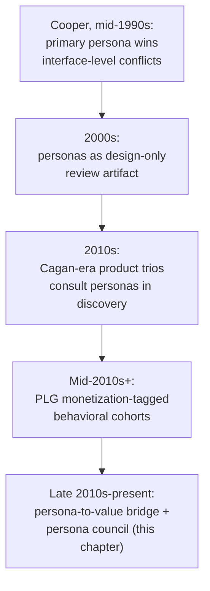

## 3. Why It Exists

A product organization can do everything [Personas](CH03_Personas.md)
prescribes correctly — well-sourced behavioral variables, an appropriately
rigorous point on the assumption-based-to-data-driven spectrum, disciplined
revalidation — and still make prioritization decisions completely untethered
from any of it. This happens because two distinct gaps sit between a
well-governed persona artifact and an actual roadmap decision, and neither
gap is one [Personas](CH03_Personas.md) is scoped to close.

**Gap one: under-utilization.** Nothing in a persona document tells a
product manager how much scoring weight this persona's needs should carry
relative to another persona's needs, or gives anyone standing authority to
invoke "this serves our negative persona, decline it" as a binding decision
rather than a personal opinion. Without that bridge, the persona repository
sits in a design tool while the actual prioritization conversation reverts
to the same failure mode [Product Strategy](CH15_Product_Strategy.md#3-why-it-exists)
describes for strategy in general: whichever request is loudest, most
recent, or attached to the most senior stakeholder wins, and the persona
library — however accurate — never enters the room.

**Gap two: business misalignment.** [Personas](CH03_Personas.md) is
explicit, and correct, that a design persona is built on behavioral
variables and deliberately excludes demographic or financial variables that
don't predict interface behavior. That is the right call for a design
decision. It is also, by design, silent on a question product management
cannot avoid: given two behaviorally distinct, equally well-validated
personas, which one's unmet needs produce more business value if served
first? A persona document alone cannot answer that, because answering it
requires a second input — revenue, segment size, or strategic account
value — that a design persona correctly never encodes.

This chapter exists to close both gaps without violating the boundary that
makes [Personas](CH03_Personas.md) trustworthy in the first place: it never
asks a design persona to smuggle in demographic or revenue variables that
would corrupt its behavioral integrity. Instead, it treats persona,
segment value, and business weight as three separate, explicitly linked
inputs, combined in a scoring and arbitration layer that product management
owns.

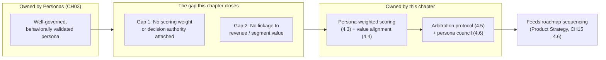

Without this bridge, an organization pays twice: once for the persona
research itself, and again in every prioritization meeting where that
research is silently ignored in favor of whoever argued most persuasively —
the elastic user fallacy [Personas](CH03_Personas.md#3-why-it-exists)
describes at the design layer, recurring one layer up as the "loudest
stakeholder" or "executive's pet segment" fallacy at the business layer.

## 4. Core Concepts

### 4.1 Recap: The Persona as a Design Artifact

A persona is a fictional, behaviorally-validated stand-in for a real user
group — built from activities, attitudes, aptitudes, motivations, and
skills rather than demographics — ranked as primary, secondary,
supplemental, or negative for a given interface, and governed as a living
artifact with a staleness date and a revalidation cadence. Full teaching of
all of this belongs to [Personas](CH03_Personas.md#4-core-concepts); every
concept in the remainder of this section assumes that definition and does
not restate it.

### 4.2 The Design-to-Business Bridge

Definition:
The design-to-business bridge is the explicit translation layer that takes
a persona — an artifact built and validated to answer "what does this
interface need to do for this behavior pattern?" — and attaches the two
additional inputs (a scoring weight and a decision-authority mechanism)
needed to answer a structurally different question: "how much of our
finite engineering and design capacity should this persona's unmet needs
receive relative to every other validated persona's unmet needs?"

Mechanism (how it works):
A design persona, on its own, has no notion of scarcity — it describes a
behavior pattern regardless of how many engineers exist to serve it. A
business decision is always a scarcity decision: capacity for one bet is
capacity not spent on another. The bridge exists to make that scarcity
trade-off explicit instead of implicit, by attaching a **value weight**
(Section 4.4) to each persona and a **decision protocol** (Section 4.5) for
when two personas' weighted claims collide. Neither of these additions
changes the persona document itself — [Personas](CH03_Personas.md#13-security)
already prohibits smuggling non-behavioral variables into the design
artifact — they live in a separate, product-owned layer that references
the persona by name.

Decision implications (when and why to use it):
Build this bridge as soon as a persona repository exists and more than one
persona's needs are competing for the same roadmap. A product organization
with exactly one persona and no competing claims does not yet need the
bridge; the moment a second, behaviorally distinct persona is validated,
the organization needs a way to decide whose needs come first, and needs it
before the first real conflict occurs, not during it.

Common failure mode:
Treating "we have personas" and "we use personas to prioritize" as the same
claim. A design team can produce excellent personas that a product team
never actually consults during a prioritization meeting, because nothing
was built to connect the two — the artifact exists, the bridge does not.
This is the single most common reason a persona program is judged "not
useful" by product leadership even when [Personas](CH03_Personas.md#11-performance)'s
decision-throughput benefit is real at the design layer.

Concrete scenario:
A mid-market software-as-a-service (SaaS) company has two well-validated
personas — an operations-focused "power configurator" and a
time-constrained "quick approver." Both personas are current, sourced, and
actively used in design reviews. When a quarterly roadmap planning session
runs, however, the decision of which persona's top pain point gets funded
is made by whichever department head speaks last in the meeting, because no
one has ever attached a weight or a decision rule to either persona for
this purpose. The personas are excellent; the bridge does not exist.

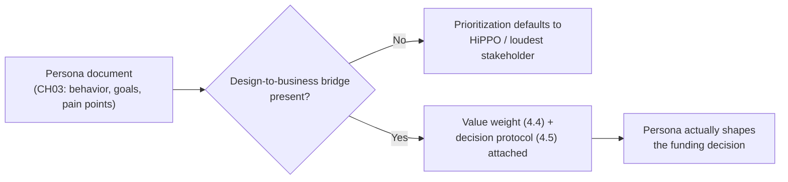

### 4.3 Persona-Weighted Opportunity Scoring

Definition:
Persona-weighted opportunity scoring is a technique that multiplies an
opportunity's existing prioritization score — produced by whichever
scoring framework a team already uses (for example, Reach, Impact,
Confidence, and Effort scoring (RICE); named here for orientation only,
since scoring-framework mechanics belong to this part's not-yet-drafted
**Prioritization (RICE, MoSCoW, Kano)** chapter and are not taught here) —
by a persona value weight, so that an opportunity serving a high-value
persona is ranked above an equally-scored opportunity serving a lower-value
persona.

Mechanism (how it works):
Every candidate opportunity is first tagged with the primary persona(s) it
serves — a mechanical step that requires no new judgment beyond correctly
reading the existing persona documents. Each persona already carries, or is
given (Section 4.4), a **value weight** derived from its segment's revenue
contribution, strategic importance, or growth potential. The opportunity's
existing base score (produced by whatever framework the organization
already runs, untouched by this chapter) is then multiplied by the tagged
persona's value weight to produce an adjusted score used for ranking:

$$
\text{adjusted score} = \text{base opportunity score} \times \text{persona value weight}
$$

Where an opportunity serves more than one persona, the weight used is
either the maximum of the served personas' weights (a "best served
audience" convention) or a reach-adjusted blend, depending on whether the
organization wants to reward opportunities that serve one high-value
persona very well or several personas moderately well — this chapter names
both conventions and the trade-off between them (Section 20) without
mandating one, since the right choice depends on the organization's actual
strategic bet (recap [Product Strategy](CH15_Product_Strategy.md#41-product-strategy-as-the-connective-layer),
not re-derived here).

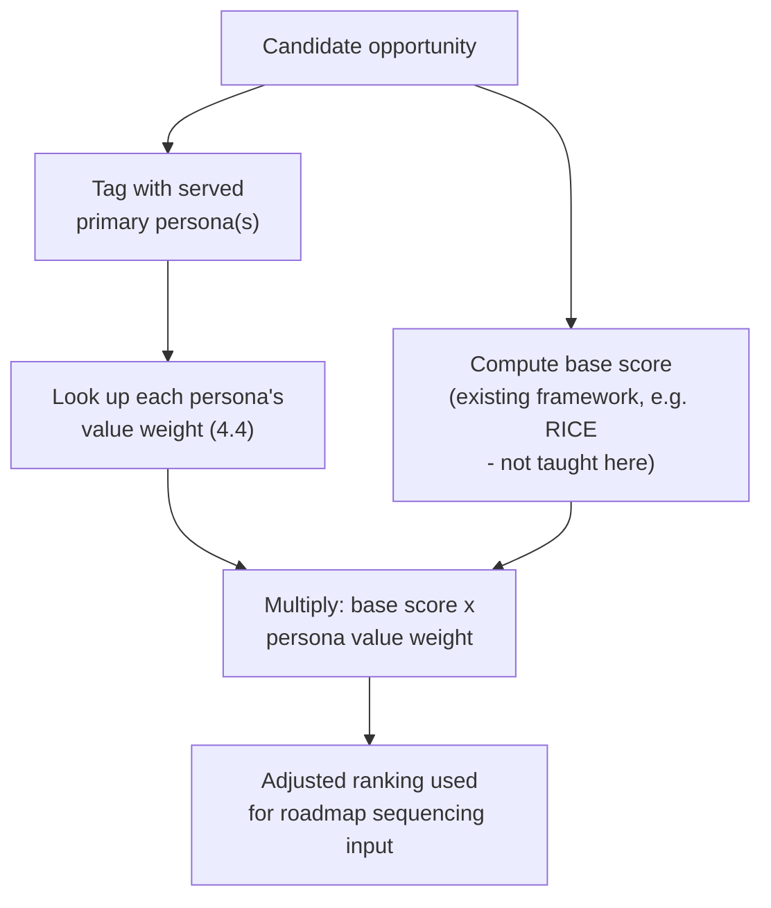

Decision implications (when and why to use it):
Use persona-weighted scoring the moment an organization has more than one
value-differentiated persona and a single, unweighted base score is
producing rankings that ignore which customers actually pay for or expand
the business. It is unnecessary, and adds needless overhead, for an
organization with a single primary persona and no meaningfully different
secondary segments.

Common failure mode:
Weighting by reach (how many users a persona represents) alone, ignoring
value (how much revenue or strategic importance that persona's segment
carries). A large, low-value free-tier persona can numerically dominate a
small, high-value enterprise persona under a reach-only weighting scheme,
silently reproducing exactly the kind of majority-rule design decision
[Personas](CH03_Personas.md#4-core-concepts)'s primary-persona discipline
exists to prevent — the weighting layer has simply reintroduced the problem
one level up.

Concrete scenario:
A team scores two opportunities with an identical base RICE score of 40.
Opportunity A serves the "quick approver" persona, mapped to a high-value
enterprise segment (value weight 1.8). Opportunity B serves a "casual
browser" persona mapped to a low-value free-tier segment (value weight
0.6). Unweighted, both opportunities tie at 40 and the ranking becomes
arbitrary. Weighted, Opportunity A's adjusted score (72) clearly outranks
Opportunity B's (24), giving the roadmap a defensible reason to sequence A
first — one that a stakeholder can trace back to a specific, named value
weight rather than a subjective call.

### 4.4 Persona-to-Segment-Value Alignment

Definition:
Persona-to-segment-value alignment is the discipline of explicitly mapping
each design persona to the revenue, strategic-account, or growth-potential
value of the market segment it represents, producing the value weight
Section 4.3's scoring formula consumes.

Mechanism (how it works):
A persona is behaviorally defined and, correctly, contains no revenue data
of its own ([Personas](CH03_Personas.md#13-security) treats this as a
non-negotiable boundary — mixing derived business-value data into the
design artifact itself risks corrupting its behavioral integrity and
re-introducing demographic-style bias). Value alignment instead builds a
separate, explicitly linked lookup: for each persona, identify the market
segment(s) whose customers it best represents (a mapping product
management performs, not the design team, since it draws on billing,
revenue, and account data the design persona was never meant to hold), and
attach that segment's known business value — annual recurring revenue
(ARR) contribution, expansion-revenue trend, strategic-account status, or
projected growth — as a weight. This chapter does not teach how a market
segment itself is defined or discovered; that full technique belongs to
this part's not-yet-drafted **Market Analysis** chapter (see
[PART_OVERVIEW.md](PART_OVERVIEW.md)). This chapter's scope starts one step
later: given a segment's value is already known, attach it to the persona
that segment maps to.

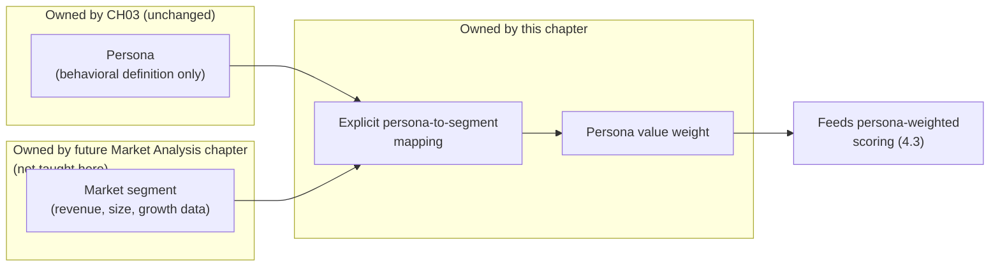

Decision implications (when and why to use it):
Perform this alignment as a joint exercise between product management
(who holds revenue and segment data) and design/research (who holds the
persona's behavioral definition and can confirm the mapping is behaviorally
sound, not just financially convenient). Revisit it on the same cadence a
persona is revalidated ([Personas](CH03_Personas.md#8-production-architecture)'s
staleness metadata) plus whenever a material revenue or segment shift
occurs (a pricing change, a new enterprise motion, a shrinking free tier),
since the underlying business value can drift faster than the underlying
behavior pattern does.

Common failure mode:
Reverse-engineering the mapping to justify a decision a stakeholder already
wanted to make — assigning an inflated value weight to whichever persona
happens to represent an executive's preferred segment, rather than deriving
the weight from actual revenue or strategic data. This is a direct
descendant of [Personas](CH03_Personas.md#15-failure-scenarios)'s
"executive's golden persona" failure mode, recurring at the value-weighting
layer instead of the artifact-construction layer.

Concrete scenario:
A company's two primary personas are "self-serve small-business owner" and
"managed enterprise administrator." A naive, reach-only view suggests the
self-serve persona dominates by raw user count. A proper value-alignment
pass against actual billing data shows the enterprise administrator's
segment contributes 70 percent of annual recurring revenue (ARR) despite
representing under 5 percent of total accounts. The resulting value weight
correctly tips scoring toward opportunities serving the enterprise
administrator, a conclusion the reach numbers alone would have inverted.

### 4.5 Persona-Based Stakeholder Arbitration Protocol

Recap of an existing concept this section builds on: [Personas](CH03_Personas.md#4-core-concepts)
already defines a taxonomy — primary, secondary, supplemental, and negative
— that ranks whose goals win when a single interface's design decisions
conflict. This chapter reuses that ranking, unchanged, as one input to a
broader protocol for a different, higher-stakes kind of conflict: two
internal stakeholders (a sales leader, an enterprise account team, a support
director) each insisting their request should win the next planning cycle's
capacity, each implicitly invoking "the user" on their side.

Definition:
The persona-based stakeholder arbitration protocol is a standing, repeatable
decision process that resolves a conflicting-request dispute by first
identifying which validated persona each request actually serves, then
applying that persona's existing primary/secondary/negative ranking and
value weight (Sections 4.3-4.4) as the tie-breaking evidence, escalating to
the persona council (Section 4.6) only when the weighted comparison itself
is genuinely ambiguous.

Mechanism (how it works):
The protocol runs as a short, deliberately ordered sequence rather than an
open-ended debate:

1. **Name the persona each request actually serves** — not the persona the
   requester *says* it serves, but the one the request's actual described
   behavior matches, checked against the published persona documents. A
   request phrased as "the user needs this" with no specific, checkable
   persona named is sent back for the requester to name one, rather than
   arbitrated on the stakeholder's authority alone.
2. **Check the ranking** — is one request's persona the primary persona for
   the affected product surface and the other's secondary, supplemental, or
   negative? If so, [Personas](CH03_Personas.md#4-core-concepts)'s existing
   ranking already resolves the conflict without further escalation.
3. **If both requests serve the same-ranked persona (or the ranking alone
   does not settle it), compare adjusted scores** — apply Section 4.3's
   persona-weighted scoring to both requests and compare the result.
4. **Escalate to the persona council only if the weighted comparison remains
   genuinely close or contested** — the council (Section 4.6) exists
   precisely for the residual cases the ranking and the scoring formula do
   not cleanly resolve, not as the default first stop for every
   disagreement.

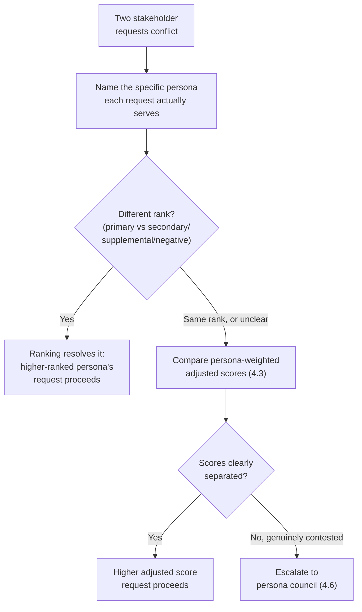

Decision implications (when and why to use it):
Stand up this protocol as soon as more than one internal stakeholder group
routinely brings competing requests to product management, which in
practice is nearly every product organization with more than one go-to-
market function (sales, support, customer success) each closest to a
different customer segment. The protocol's value is in making the first
three steps mechanical and fast, so that only genuinely hard cases consume
the council's limited time.

Common failure mode:
Skipping step 1 and allowing an unnamed, ungrounded "the user wants this"
claim to proceed directly to a senior-stakeholder judgment call — this is
the elastic user fallacy [Personas](CH03_Personas.md#3-why-it-exists)
describes, recurring at the arbitration layer specifically because no one
enforced the requirement to name a checkable persona before the debate
began. A second, related failure is escalating every disagreement straight
to the persona council out of habit, defeating the protocol's speed benefit
and turning the council into the exact bottleneck Section 12 warns against.

Concrete scenario:
A sales leader requests a bulk-import feature "because customers keep
asking for it," while a support director requests an in-app error-recovery
flow "because users are confused." Step 1 forces both to name a specific
persona: the sales leader's request maps to the enterprise administrator
persona (a request pattern the persona document already lists as a known
pain point), while the support director's request maps to the same
persona's known confusion pattern during a different task. Because both
requests serve the same primary persona at the same rank, step 3 applies
the value-weighted score, and because the bulk-import request's adjusted
score is materially higher (it addresses a pain point tied to lost
enterprise deals, a business outcome the value weight already reflects),
the conflict resolves in one meeting instead of escalating.

### 4.6 The Persona Council: A Product-Owned Governance Mechanism

Definition:
A persona council is a small, standing, cross-functional review body — owned
by product management, not by design or research — with the explicit,
chartered authority to resolve genuinely contested prioritization disputes
by reference to the organization's validated personas, their value weights,
and the strategic bets they serve, and to periodically review and adjust the
value-weighting model itself (Section 4.4) as segment revenue shifts.

Mechanism (how it works):
The council is deliberately distinct from two adjacent mechanisms this part
already documents, and the distinction is the point:

- It is **not** the same body as the design-operations or research function
  that governs a persona's own accuracy and staleness
  ([Personas](CH03_Personas.md#7-architecture-patterns)'s "federated
  ownership with a central review gate" pattern) — that body asks "is this
  persona still an accurate description of real behavior?" The persona
  council asks a different question: "given these accurate personas and
  their business value, which contested request wins capacity?" A single
  organization typically needs both bodies, and conflating them tends to
  produce a group with neither research rigor nor business-prioritization
  authority.
- It is **not** the strategy review forum
  ([Product Strategy](CH15_Product_Strategy.md#8-production-architecture)'s
  standing review group that approves, rejects, or resequences whole
  strategic bets). The persona council operates at a narrower, more
  frequent grain — arbitrating specific competing requests within an
  already-sequenced strategic bet — and feeds its decisions upward as input
  when a pattern of disputes suggests the strategic sequencing itself needs
  revisiting (the dashed feedback path in Section 5's diagram).

A typical charter specifies: standing membership (commonly one product
leader as chair, one design/research representative who can speak to
persona validity without re-litigating it, one engineering representative
who can speak to capability readiness, and one go-to-market representative
who can speak to revenue and segment reality); a cadence (commonly biweekly
or aligned to sprint/planning cycles, plus an ad hoc fast-track for
time-sensitive disputes); a scope boundary (arbitration per Section 4.5,
plus periodic review of the value-weighting model, but explicitly not
persona construction or revalidation, which stays with design/research); and
a decision-logging requirement (every arbitrated dispute recorded with the
persona(s) involved, the weights applied, and the rationale, so a future
dispute over the same persona pair can be resolved by precedent rather than
re-argued from scratch).

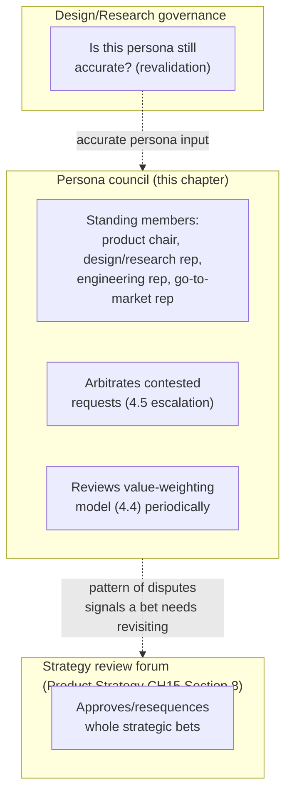

Decision implications (when and why to use it):
Stand up a persona council once the arbitration protocol (Section 4.5)
starts escalating disputes often enough that resolving them ad hoc, without
a named standing body or a decision log, produces inconsistent rulings on
similar disputes over time. A very small organization with one product
manager and no competing stakeholder factions does not need a formal
council; the single product manager effectively performs this role
informally. The council becomes necessary exactly when that informal
judgment stops scaling — commonly once more than one product manager, or
more than one go-to-market function with an independent voice, exists.

Common failure mode:
**Council capture** — the council exists on paper but is dominated in
practice by a single function (commonly sales or a particularly vocal
engineering lead), so its rulings track that function's preferences rather
than the value-weighted evidence the protocol is supposed to apply. A
second common failure is **rubber-stamp theater** — the council meets, but
every ruling is decided informally beforehand by the product chair, and the
meeting exists only to formalize a decision already made, producing all the
overhead of governance with none of its actual cross-functional check.

Concrete scenario:
A council chaired by product management, with a design/research
representative, an engineering representative, and a go-to-market
representative, reviews a contested request where the value-weighted
scoring in Section 4.5 came out too close to call automatically. The
design/research representative confirms both personas involved are current
and accurately described; the engineering representative flags that one
option requires a capability the team does not yet have (recap
[Product Strategy](CH15_Product_Strategy.md#46-portfolio-sequencing-logic-why-this-bet-over-that-one)'s
capability-readiness test); the go-to-market representative confirms a
named enterprise deal is contingent on the other. The council rules in
minutes, logs the rationale, and the same dispute does not need to be
re-argued the next time these two personas' needs collide.

### 4.7 Persona Weight as a Sequencing Input

Recap: [Product Strategy](CH15_Product_Strategy.md#46-portfolio-sequencing-logic-why-this-bet-over-that-one)
owns the full portfolio-sequencing test in depth — the Three Horizons model
plus the strategic-fit, market-timing, capability-readiness, and
opportunity-cost questions used to decide which validated bet is funded
first. This chapter does not re-teach that test; it adds exactly one new
input to it.

Definition:
Persona weight as a sequencing input means that when a candidate bet's
strategic fit is being assessed (the first question in
[Product Strategy](CH15_Product_Strategy.md#46-portfolio-sequencing-logic-why-this-bet-over-that-one)'s
test), the persona(s) that bet serves, and their value weight
(Section 4.4), are named explicitly as part of the fit evidence, rather than
"strategic fit" being assessed as an abstract, unsourced judgment call.

Mechanism (how it works):
A bet card ([Product Strategy](CH15_Product_Strategy.md#10-complete-code-examples)'s
schema) already asks for a strategic-fit rationale. This chapter's
contribution is narrow: that rationale should name the specific persona(s)
served and cite their value weight and any live arbitration-council
decisions (Section 4.6) touching the same personas, so that a bet's
sequencing position is traceable to the same evidence chain the roadmap
translation contract already demands, rather than a second, parallel
justification invented at sequencing time.

Decision implications (when and why to use it):
Apply this whenever a candidate bet's strategic-fit rationale would
otherwise be argued in the abstract ("this strengthens our enterprise
position") without naming which validated persona and which value weight
that abstraction is standing in for. Naming the persona forces the same
falsifiability discipline [Personas](CH03_Personas.md#3-why-it-exists)
gives design debates, applied one layer up to sequencing debates.

Common failure mode:
Citing a persona's name as decoration without actually consulting its
value weight or current arbitration history — for example, invoking "this
serves our enterprise administrator persona" as a rhetorical stamp of
legitimacy on a bet that a value-weighted comparison would not actually
favor. This is a sequencing-layer recurrence of
[Personas](CH03_Personas.md#15-failure-scenarios)'s persona theater failure
mode: the persona's name is invoked, but its actual weighted evidence is
not.

Concrete scenario:
Two Horizon 1 bets compete for the same quarter's capacity. Bet A's
strategic-fit rationale names the enterprise administrator persona and
cites its value weight (1.8) and three prior council rulings favoring
requests serving that persona. Bet B's rationale asserts "this matters for
our core users" without naming a specific persona or weight. The
sequencing decision funds Bet A first, not because of seniority or
persuasiveness, but because only Bet A's fit rationale is traceable to
named, weighted, auditable evidence.

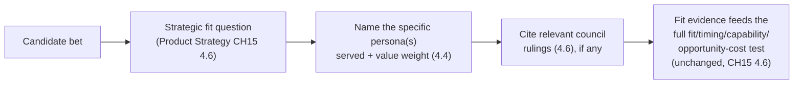

## 5. Internal Working

The concepts in Section 4 operate together as a recurring operating loop,
not as isolated techniques applied once. The loop runs continuously,
typically anchored to the same planning cadence
[Product Strategy](CH15_Product_Strategy.md#5-internal-working) already
documents for the broader strategy cycle, with this chapter's layer
sitting one level more frequent and more granular — arbitrating individual
contested requests as they arise, not only revisiting sequencing once a
quarter.

```{=latex}
\begin{landscape}
```

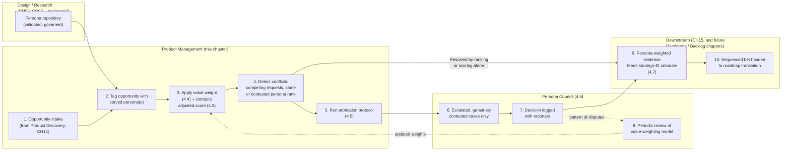

```{=latex}
\end{landscape}
```

The landscape wrap is used deliberately here: the loop spans four distinct
organizational lanes (design/research, product management, the persona
council, and downstream sequencing), and compressing that many parallel
lanes into a portrait-width diagram would force illegible label wrapping,
matching the Style Guide's convention for wide, multi-lane diagrams.

Two feedback paths deserve explicit attention, because they are the
mechanism that keeps this loop from degrading into either persona theater
(Section 15) or a rigid, unresponsive weighting model. First, every council
decision (step 7) is logged with its rationale, and a *pattern* of
decisions touching the same persona pair or the same contested value
weight is the trigger for step 8's periodic review — not a fixed calendar
date alone, mirroring
[Product Strategy](CH15_Product_Strategy.md#5-internal-working)'s
distinction between routine cadence and assumption-triggered revision.
Second, an updated value-weighting model (step 8) flows back into step 3's
scoring, so that a segment's shifting revenue contribution — a pricing
change, a shrinking free tier, a new enterprise motion — is reflected in
the next scoring pass without requiring a special, one-off intervention.

A conflict does not always require a council escalation, and the diagram
deliberately shows both outcomes from step 4: the majority of tagged
opportunities resolve cleanly through ranking or scoring alone (Section
4.5's steps 1-3) and proceed directly to feeding the strategic-fit
rationale (Section 4.7); only the minority that remain genuinely contested
reach the council. An organization whose council is handling every single
opportunity, rather than only the contested residual, has skipped steps 1-3
of the arbitration protocol and turned the council into an unnecessary
bottleneck — a specific instance of the scalability failure Section 12
names directly.

## 6. Design Principles

- **Never encode business value inside the persona document itself.**
  Revenue, segment size, and strategic-account status live in the
  value-weighting layer (Section 4.4), not in the behavioral artifact
  [Personas](CH03_Personas.md#13-security) already protects from exactly
  this kind of contamination.
- **A request must name a specific, checkable persona before it is
  arbitrated.** An unnamed "the user wants this" claim is not yet
  arbitrable — sending it back to name a persona is itself a decision, not
  a delay tactic, and it is what prevents the elastic user fallacy from
  reappearing at the business layer.
- **Weight by value, not only by reach.** A large low-value segment should
  not automatically outrank a small high-value one; Section 4.3's common
  failure mode exists precisely because reach is easier to measure than
  value and teams default to what's easy to measure.
- **Escalate only the genuinely contested residual to the council.** A
  council that arbitrates every request has skipped the mechanical
  ranking-and-scoring steps that should resolve the majority of cases
  quickly; treat frequent escalation as a signal the protocol's earlier
  steps need repair, not as normal operating volume.
- **Log every arbitrated decision with its rationale.** A council ruling
  that is not logged cannot be cited as precedent the next time the same
  persona pair's needs collide, forcing the same debate to be re-litigated
  from scratch — the persona-council equivalent of
  [Architecture Thinking](../01_Architecture_Mindset/CH03_Architecture_Thinking.md)'s
  case for Architecture Decision Records.
- **Keep the value-weighting model revisable, not fixed.** A weight set
  once and never revisited becomes exactly as stale as an unrevalidated
  persona; tie its review cadence to real business signals (a pricing
  change, a segment's revenue trend reversing), not only a calendar date.
- **The council governs decisions, not persona accuracy.** Keep the
  council's charter scoped to arbitration and weighting review; persona
  construction and revalidation stay with design/research
  ([Personas](CH03_Personas.md#7-architecture-patterns)), and conflating
  the two charters degrades both.

## 7. Architecture Patterns

As with [Product Strategy](CH15_Product_Strategy.md#7-architecture-patterns),
"architecture patterns" here means recurring, named operating-model shapes
for how an organization structures its persona-to-business-decision layer,
not a software architecture pattern in the code sense:

- **Centralized weighting model pattern**: a single, organization-wide
  value-weighting matrix (Section 4.4) is maintained by one function
  (commonly a central product-operations or revenue-operations team) and
  consumed by every squad's scoring. Strongest when segments and revenue
  data are consistent across the whole product line; becomes a bottleneck
  once product lines diverge enough that one weighting matrix no longer
  fits all of them (Section 12).
- **Federated weighting model pattern**: each product line or squad
  maintains its own value-weighting matrix against its own segment data,
  with the persona council reconciling only genuine cross-line conflicts.
  Faster for each individual team; risks the same sprawl
  [Personas](CH03_Personas.md#12-scalability) describes for federated
  persona ownership, applied here to weights instead of personas
  themselves.
- **Single standing council pattern**: one persona council serves the
  entire product organization, arbitrating disputes across every product
  line. Simpler governance, consistent rulings; can become a scheduling
  and throughput bottleneck as the organization scales (Section 12).
- **Tiered council pattern**: a lightweight, per-product-line council
  handles routine escalations, with a smaller cross-line council reserved
  for disputes that span product lines or touch the overall strategic bet
  portfolio — mirroring the centralized-versus-federated tension
  [Product Strategy](CH15_Product_Strategy.md#12-scalability) already names
  for strategy ownership at scale.
- **Precedent-driven arbitration pattern**: the council's decision log
  (Section 6) is treated as binding precedent for materially similar future
  disputes between the same persona pair, reducing the council's ongoing
  workload over time as a body of settled rulings accumulates — analogous
  to how a well-maintained Architecture Decision Record set reduces
  repeated architectural debate.

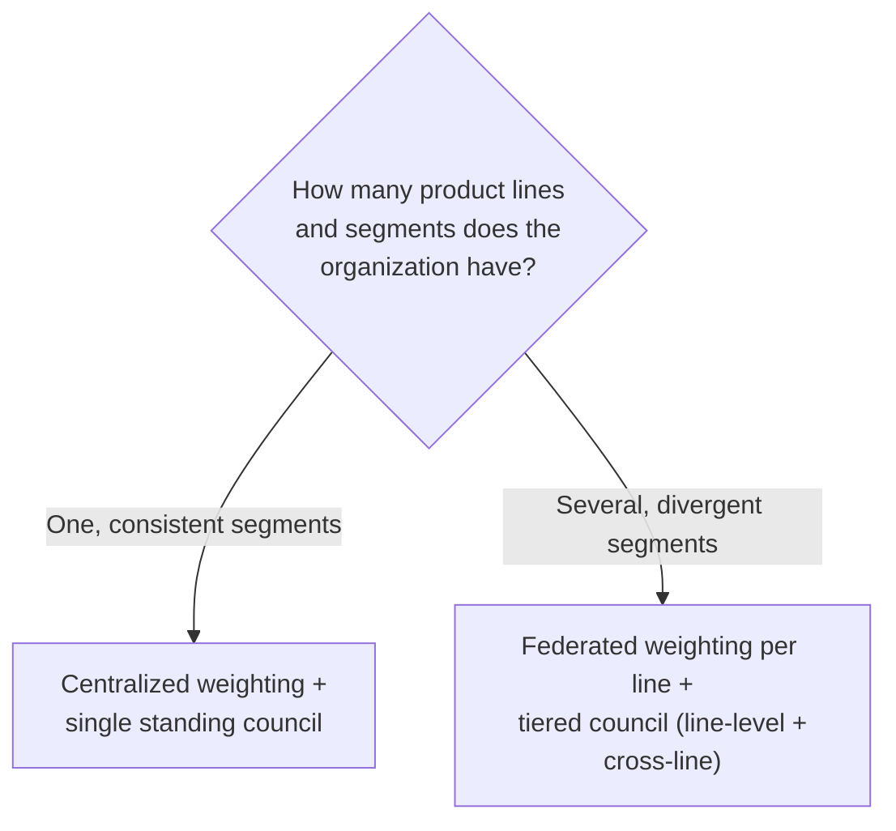

Each pattern is a trade-off, not a universally correct default: a
centralized weighting model applied to a multi-line organization with
genuinely different segments per line produces weights that fit none of
them well, while a fully federated model applied to a single-product
company adds coordination overhead with no divergence to justify it.

## 8. Production Architecture

The operational stack that keeps this chapter's mechanisms alive and
actually consulted, rather than produced once and forgotten:

- **Artifact stack**: the persona-to-segment value-weighting matrix
  (Section 4.4), the persona-weighted scoring formula and its convention
  choice (maximum versus reach-adjusted blend, Section 4.3), the
  arbitration protocol's decision log (Section 4.5-4.6), and the persona
  council's charter — each versioned, dated, and attributed to an owner,
  mirroring the artifact-stack discipline
  [Product Strategy](CH15_Product_Strategy.md#8-production-architecture)
  already applies to its own strategy artifacts.
- **Governance cadence**: routine value-weighting review tied to segment
  revenue reporting cycles (commonly quarterly, aligned to the business's
  own revenue-reporting cadence), a persona-council meeting cadence
  (commonly biweekly, plus an ad hoc fast-track for time-sensitive
  disputes), and an event-triggered review whenever a material pricing,
  segment, or persona-revalidation change occurs.
- **Review forum**: the persona council itself (Section 4.6), plus a
  lighter, informal path for the majority of requests that resolve via
  ranking or scoring alone (Section 4.5) without ever reaching the formal
  forum.
- **Interface to adjacent artifact stacks**: the council's decision log
  and the value-weighting matrix are referenced, not duplicated, by the
  bet cards and strategic-fit rationales
  [Product Strategy](CH15_Product_Strategy.md#10-complete-code-examples)
  already defines (Section 4.7), and by whichever scoring framework
  document this part's not-yet-drafted Prioritization chapter eventually
  formalizes.

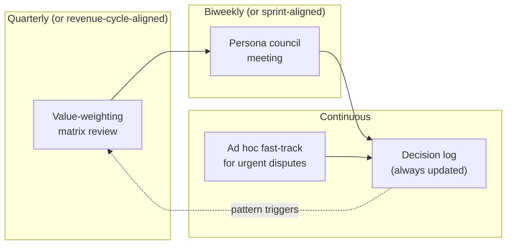

## 9. Implementation

A phased approach to standing up this chapter's mechanisms inside a
product organization that already has a governed persona repository
([Personas](CH03_Personas.md)):

### Phase 1: Audit inputs

- Confirm every active persona is current and revalidated per
  [Personas](CH03_Personas.md#8-production-architecture)'s staleness
  metadata; do not build a weighting model on top of a stale persona.
- Pull segment revenue, growth, and strategic-account data from billing
  and revenue-operations sources.

### Phase 2: Build the value-weighting matrix

- Map each persona to the segment(s) it represents (Section 4.4).
- Assign an initial value weight per persona, sourced explicitly from
  revenue or strategic data, not from stakeholder preference.
- Document the mapping's evidence trail the same way
  [Personas](CH03_Personas.md#4-core-concepts) requires evidence
  traceability for the persona itself.

### Phase 3: Wire scoring

- Choose the multi-persona weighting convention (maximum versus
  reach-adjusted blend, Section 4.3) and document the choice.
- Apply the persona-weighted multiplier to the organization's existing
  base scoring framework, without altering that framework's own mechanics.

### Phase 4: Stand up the arbitration protocol and persona council

- Publish the four-step arbitration protocol (Section 4.5) as a
  lightweight, discoverable process document.
- Charter the persona council (Section 4.6): membership, cadence, scope
  boundary, and decision-logging requirement.

### Phase 5: Connect to sequencing

- Require every bet card's strategic-fit rationale to name the specific
  persona(s) served and cite the current value weight and any relevant
  council precedent (Section 4.7).

### Phase 6: Operate and review

- Run the Section 5 loop continuously.
- Review the weighting matrix on the cadence in Section 8, and whenever
  the council's decision log shows a recurring pattern of disputes over
  the same weight.

## 10. Complete Code Examples

Like [Product Strategy](CH15_Product_Strategy.md#10-complete-code-examples),
this chapter's territory is a reasoning- and governance-driven discipline
rather than a code-first one; in place of runnable code, this section
provides implementation-neutral schemas a team adapts into whatever
prioritization, spreadsheet, or product-operations tool it already uses.

Persona value-weight matrix schema:

- Persona name (must match the published persona document exactly)
- Mapped segment(s)
- Segment revenue/strategic-value basis (annual recurring revenue (ARR)
  share, growth rate, strategic-account flag)
- Computed value weight
- Last-reviewed date and owner
- Evidence source (billing data, revenue-operations report)

Opportunity scoring extension schema (layered on top of whichever base
framework the not-yet-drafted Prioritization chapter formalizes):

- Opportunity identifier
- Base score (from existing framework — untouched by this chapter)
- Tagged served persona(s)
- Applied value weight (maximum or reach-adjusted blend — state which)
- Adjusted score
- Scoring date

Arbitration decision log schema:

- Dispute identifier and date
- Requests in conflict, with the specific persona each was mapped to
  (Section 4.5, step 1)
- Resolution path taken: ranking-resolved, score-resolved, or
  council-escalated
- If council-escalated: attendees, rationale, and outcome
- Precedent tag, if this ruling is expected to apply to future, similar
  disputes

Persona council charter schema:

- Standing membership and role (chair, design/research, engineering,
  go-to-market)
- Meeting cadence and fast-track escalation path
- Explicit scope boundary (arbitration and weighting review; excludes
  persona construction and revalidation)
- Decision-logging requirement

A short illustrative pseudocode expression of Section 4.3's scoring
formula, provided only to make the mechanism concrete rather than as a
runnable artifact:

```
adjusted_score = base_score * persona_value_weight(
    served_personas,
    convention = "max"  # or "reach_adjusted_blend"
)
```

## 11. Performance

"Performance" for this chapter's mechanisms is measured in decision
velocity and ruling consistency, not runtime latency, echoing
[Personas](CH03_Personas.md#11-performance)'s framing for the underlying
artifact:

- **Time from conflicting request to resolution**: how long the
  arbitration protocol (Section 4.5) takes to resolve a dispute, broken
  down by whether it resolved via ranking, scoring, or council escalation
  — a rising average, especially in the ranking/scoring steps, signals the
  protocol itself is being skipped or misapplied.
- **Escalation rate**: the proportion of tagged opportunities that reach
  the persona council versus those resolved by ranking or scoring alone
  (Section 5). A healthy operating loop keeps this rate low; a rate that
  creeps upward is an early indicator of Section 12's scalability failure.
- **Ruling consistency**: whether materially similar disputes, checked
  against the decision log, receive materially similar rulings over time —
  inconsistency here indicates the weighting model or the council itself
  has drifted from its own stated criteria.

## 12. Scalability

As a product organization grows past a single product line, this chapter's
mechanisms face the same scaling pressure
[Personas](CH03_Personas.md#12-scalability) documents for the artifact
itself, applied to weighting and arbitration instead of persona
construction:

- **Weighting-model sprawl**: independent product lines each invent their
  own ad hoc value-weighting conventions without a shared matrix or
  reconciliation process, producing inconsistent, incomparable weights
  across the organization — the federated-versus-centralized pattern in
  Section 7 exists specifically to bound this.
- **Council bottleneck**: a single standing council serving an entire
  large organization can become a scheduling and throughput constraint if
  the arbitration protocol's earlier ranking-and-scoring steps are being
  skipped, forcing every dispute to escalation regardless of size — the
  tiered council pattern (Section 7) is the direct remedy.
- **Weighting-model staleness at scale**: a value-weighting matrix
  reviewed centrally on a fixed quarterly cadence may lag a fast-moving
  product line's actual segment shifts; scaling this discipline requires
  either a faster review cadence for volatile lines or a federated model
  with local review authority (Section 7).
- **Precedent volume outpacing discoverability**: as the decision log
  (Section 6) grows, a council without a searchable, well-tagged log
  re-litigates disputes a past ruling already settled, eroding the
  precedent-driven pattern's intended efficiency gain (Section 7).

## 13. Security

Security here concerns confidentiality of sensitive business-value data,
not application-level security controls (owned elsewhere, notably the
not-yet-drafted Security part):

- **Segment revenue confidentiality**: the value-weighting matrix
  (Section 4.4) contains or derives from revenue and strategic-account
  data that is competitively and often legally sensitive; access should be
  restricted to those with a legitimate need (product, revenue operations,
  the persona council), echoing
  [Product Strategy](CH15_Product_Strategy.md#13-security)'s "competitive
  confidentiality" concern one layer down, at the segment-value rather
  than whole-bet level.
- **Council deliberation confidentiality**: arbitration disputes frequently
  surface unflattering information about a specific customer, deal, or
  internal stakeholder's request; the decision log (Section 6) should
  record the rationale and outcome needed for future precedent without
  exposing sensitive deal-specific detail more broadly than necessary.
- **Restrict edit access to the weighting matrix**, mirroring
  [Personas](CH03_Personas.md#13-security)'s "restrict edit access, not
  read access" principle for the persona repository itself — broad
  visibility into how weights were derived builds trust in the scoring
  outcome; uncontrolled edit access risks a stakeholder quietly adjusting
  a weight to favor their own request, reintroducing the executive's
  golden persona failure mode (Section 4.4) at the weighting layer.

## 14. Observability

Observability signals that reveal whether this chapter's mechanisms are
actually functioning as intended, rather than existing on paper:

- **Persona-citation rate in bet cards**: what proportion of sequenced
  bets' strategic-fit rationales (Section 4.7) actually name a specific
  persona and weight, versus arguing fit in the abstract — a low or
  declining rate signals the sequencing-layer bridge (Section 4.7) is not
  being consistently applied.
- **Escalation rate and resolution time** (Section 11), tracked over time
  to catch both council-bottleneck risk (Section 12) and protocol-skipping
  risk (Section 6) before either produces a visible, painful incident.
- **Weighting-model drift versus actual revenue trend**: periodically
  compare each persona's assigned value weight against the underlying
  segment's current revenue or growth trend; a material mismatch is a
  leading indicator the matrix needs review before it produces a
  systematically wrong ranking, not a lagging one discovered only after a
  bad sequencing decision ships.
- **Council ruling consistency audits**: periodically sample past
  decision-log entries and check whether materially similar disputes
  received materially similar rulings, surfacing drift in the council's
  own applied criteria.

This chapter deliberately stops at this framing-level treatment; full
metric-design technique — dashboarding, statistical rigor for trend
detection, and the organization's single unifying top-line metric — belongs
to this part's not-yet-drafted **Metrics** and **North Star Metrics**
chapters (see [PART_OVERVIEW.md](PART_OVERVIEW.md)).

## 15. Failure Scenarios

1. **The business-layer elastic user**: a stakeholder invokes "the user"
   or cherry-picks whichever persona currently supports their preferred
   request, without the arbitration protocol's step 1 (Section 4.5)
   forcing them to name a specific, checkable persona and rank. Resolution:
   enforce step 1 as a hard gate before any dispute is discussed further.
2. **Revenue-blind weighting**: value weights are derived from reach alone
   (Section 4.3's common failure mode), silently letting a large low-value
   segment outrank a small high-value one. Resolution: require every
   weight's evidence trail to cite actual revenue or strategic data
   (Section 4.4), not usage counts alone.
3. **Council capture**: a single function dominates the persona council's
   rulings regardless of the weighted evidence (Section 4.6's common
   failure mode). Resolution: enforce the charter's standing, balanced
   membership and audit ruling consistency against the decision log
   (Section 14).
4. **Rubber-stamp theater**: the council meets, but every ruling is
   pre-decided by the chair beforehand, producing governance overhead
   without an actual cross-functional check. Resolution: require the
   decision log to show genuine deliberation input from each standing
   member, not just the chair's conclusion.
5. **Zombie weighting matrix**: the value-weighting matrix is built once
   and never revisited as segment revenue shifts, silently sequencing bets
   against an outdated picture of business value — the direct analogue of
   [Personas](CH03_Personas.md#15-failure-scenarios)'s zombie persona,
   recurring at the weighting layer. Resolution: tie review to both a
   fixed cadence and the event-triggered signals in Section 14.
6. **Persona-name theater at the sequencing layer**: a bet's strategic-fit
   rationale names a persona for rhetorical legitimacy without actually
   consulting its weight or council history (Section 4.7's common failure
   mode). Resolution: require the fit rationale to cite the specific
   weight value and any relevant precedent, not just the persona's name.

## 16. Testing

"Testing" this chapter's mechanisms means validating them before they
silently misdirect a quarter's capacity, not testing code:

### 16.1 Weighting-model calibration check

Periodically compare a sample of past adjusted-score rankings against
actual outcomes (did the higher-weighted persona's served opportunities
actually produce the expected business result once shipped) to check
whether the value-weighting model's assumptions still hold — a calibration
discipline analogous to
[Product Strategy](CH15_Product_Strategy.md#16-testing)'s premortem and
red-team review, applied to the weighting model rather than a whole
strategic bet.

### 16.2 Arbitration protocol dry run

Before formally launching the protocol (Section 4.5), run it against a
handful of recent, already-resolved historical disputes to check whether
the mechanical ranking-and-scoring steps would have reached the same, or a
better-justified, outcome than the informal process that actually resolved
them at the time.

### 16.3 Council charter stress test

Deliberately bring the council a genuinely ambiguous, previously
unencountered dispute during a trial period and check whether the
standing membership, cadence, and scope boundary (Section 4.6) are
sufficient to reach and log a defensible ruling, or whether the charter
needs adjustment before real disputes depend on it.

### 16.4 Consistency audit

Sample the decision log (Section 6) periodically and check whether
materially similar disputes have received materially similar rulings,
surfacing drift before a stakeholder discovers and escalates the
inconsistency themselves.

## 17. Common Mistakes

- Treating "we have a persona repository" as equivalent to "personas
  inform our prioritization decisions," without building the
  design-to-business bridge (Section 4.2).
- Weighting personas by reach alone, ignoring segment revenue or strategic
  value (Section 4.3).
- Mixing revenue or demographic data into the persona document itself
  instead of keeping it in the separate value-weighting layer
  (Section 4.4).
- Allowing an unnamed "the user wants this" claim to proceed to
  arbitration without naming a specific, checkable persona (Section 4.5).
- Escalating every disputed request to the persona council instead of
  letting the ranking-and-scoring steps resolve the majority of cases
  (Section 12).
- Letting a single function capture the council's rulings regardless of
  the weighted evidence (Section 15).
- Building the value-weighting matrix once and never revisiting it as
  segment revenue shifts (Section 15).
- Citing a persona's name in a bet's strategic-fit rationale without
  actually citing its weight or relevant precedent (Section 4.7).

## 18. Best Practices

- Build the value-weighting matrix jointly with product management holding
  revenue data and design/research confirming the persona mapping is
  behaviorally sound.
- Require every prioritization dispute to name a specific, checkable
  persona before arbitration proceeds.
- Keep the council's charter scoped narrowly to arbitration and
  weighting-model review; leave persona construction and revalidation to
  design/research.
- Log every arbitrated decision with its rationale, and treat the
  resulting log as citable precedent for future, similar disputes.
- Tie the value-weighting model's review cadence to real business signals
  (a pricing change, a segment revenue reversal), not a calendar date
  alone.
- Require every sequenced bet's strategic-fit rationale to cite a specific
  persona, its current weight, and any relevant council precedent.
- Track escalation rate as an early warning signal for both council
  bottlenecks and protocol-skipping (Sections 11-12).

## 19. Anti-Patterns

- **The business-layer elastic user** — an unnamed, ungrounded "the user
  wants this" claim proceeding straight to a senior stakeholder's judgment
  call instead of the arbitration protocol (Section 15).
- **Revenue-blind weighting** — ranking by reach alone while ignoring
  segment value (Section 4.3).
- **Council capture** — a single function's preferences dominating
  rulings regardless of the weighted evidence (Section 4.6).
- **Rubber-stamp theater** — a council that meets only to formalize a
  decision already made beforehand (Section 4.6).
- **Zombie weighting matrix** — a value-weighting model built once and
  never revisited as business value shifts (Section 15).
- **Persona-name-as-decoration** — invoking a persona's name in a
  sequencing rationale without citing its actual weight or precedent
  (Section 4.7).
- **Council-as-default-first-stop** — escalating every dispute to the
  council instead of letting the mechanical ranking-and-scoring steps
  resolve the majority (Section 12).

## 20. Trade-off Analysis

- **Maximum weight versus reach-adjusted blend for multi-persona
  opportunities** (Section 4.3): the maximum-weight convention rewards
  opportunities that serve one high-value persona very well, concentrating
  investment; the reach-adjusted blend rewards opportunities serving
  several personas moderately well, spreading investment more broadly.
  Neither is universally correct — the choice should match whether the
  organization's current strategic bet (recap
  [Product Strategy](CH15_Product_Strategy.md#41-product-strategy-as-the-connective-layer))
  favors depth in one segment or breadth across several.
- **Centralized versus federated weighting model** (Section 7): a
  centralized matrix keeps weights consistent and comparable across the
  organization but can become a bottleneck and can under-fit a divergent
  product line; a federated model fits each line better but risks
  weighting-model sprawl and cross-line inconsistency (Section 12).
- **Single standing council versus tiered council** (Section 7): a single
  council keeps rulings consistent organization-wide but risks becoming a
  scheduling bottleneck at scale; a tiered model scales throughput but
  risks inconsistent rulings between line-level councils unless the
  cross-line council actively reconciles them.
- **Strict escalation discipline versus lower-friction council access**:
  requiring every dispute to clear the mechanical ranking-and-scoring
  steps before reaching the council keeps the council's time protected for
  genuinely hard cases, but risks under-serving a stakeholder with a
  legitimately urgent, novel dispute that does not yet fit the existing
  weighting model — the fast-track escalation path (Section 8) exists
  specifically to balance this.
- **Fixed-cadence versus event-triggered weighting review**: a fixed
  quarterly review is predictable and easy to staff, but can lag a
  fast-moving segment's actual revenue shift; event-triggered review
  reacts faster but requires reliable upstream signals (a pricing or
  segment-revenue alert) to trigger reliably.

## 21. Comparison Table

| Artifact | Primary question answered | Basis | Owning discipline | Typical use |
|---|---|---|---|---|
| Persona (recap, [Personas](CH03_Personas.md)) | Who am I designing for, and what do they need from this interface? | Behavioral variables | Design / research | Interface and design decisions |
| Persona value-weighting matrix (Section 4.4) | How much business value does this persona's segment represent? | Revenue, growth, strategic-account data | Product management | Input to opportunity scoring and sequencing |
| Persona-weighted opportunity score (Section 4.3) | Which opportunity should be ranked higher given both its base score and the persona it serves? | Base prioritization score x persona value weight | Product management | Roadmap-candidate ranking |
| Arbitration decision log (Section 4.5-4.6) | Why did this specific contested request win, and does precedent exist? | Named persona, rank, weighted score, council rationale | Product management (persona council) | Resolving and citing precedent for stakeholder conflicts |
| Bet card strategic-fit rationale (recap, [Product Strategy](CH15_Product_Strategy.md#10-complete-code-examples)) | Why does this bet reinforce the stated strategy, and for whom? | Strategic fit, timing, capability, opportunity cost, plus (Section 4.7) named persona and weight | Product strategy | Portfolio sequencing |
| Market segment (not taught here) | Which cohort of customers behaves or spends similarly, at the market level? | Quantitative usage/spend data | Not-yet-drafted Market Analysis chapter | Segmentation input this chapter's value alignment consumes |
| Prioritization score, e.g. Reach, Impact, Confidence, and Effort scoring (RICE) (not taught here) | What is this opportunity's base priority before persona weighting? | Reach, impact, confidence, effort estimates | Not-yet-drafted Prioritization chapter | Base score this chapter's weighting multiplies |

The last two rows are named only for disambiguation against this chapter's
own artifacts; neither is taught here, and both belong to this part's
not-yet-drafted **Market Analysis** and **Prioritization** chapters (see
[PART_OVERVIEW.md](PART_OVERVIEW.md)).

## 22. Real-World Case Study

Case: Resolving a cross-functional prioritization deadlock at a mid-size
business-to-business (B2B) SaaS expense-management company

Context:
This case deliberately reuses the same company introduced in
[Product Strategy](CH15_Product_Strategy.md#22-real-world-case-study)'s
case study, one layer down: after that chapter's strategic bet (a "guided
month-end close" capability) was sequenced into Horizon 1, two internal
stakeholder groups immediately began competing for the engineering capacity
the bet unlocked. The sales leadership team wanted the guided-close
capability extended first to a bulk multi-entity reconciliation flow, aimed
at the enterprise administrator persona and several named strategic
accounts. The support organization wanted capacity spent first on an
in-flow error-recovery experience for a broader set of mid-market users
who were abandoning the close process partway through, a pattern the
existing "quick approver" persona document already listed as a known pain
point.

Applying this chapter's mechanisms:

1. **Naming the persona** (Section 4.5, step 1): the sales request was
   confirmed to map to the enterprise administrator persona; the support
   request was confirmed to map to the quick approver persona. Both were
   legitimate, specific, and checkable — neither was an elastic,
   unnamed "the user."
2. **Checking the ranking** (Section 4.5, step 2): both personas were
   ranked as primary for different, overlapping product surfaces (the
   close workflow itself), so the ranking step alone did not resolve the
   conflict.
3. **Comparing weighted scores** (Sections 4.3-4.4): the enterprise
   administrator persona's value weight (1.8, reflecting the segment's 70
   percent share of annual recurring revenue (ARR), recapped from
   [Product Strategy](CH15_Product_Strategy.md#44-persona-to-segment-value-alignment))
   was applied to the bulk-reconciliation request's base score, producing
   an adjusted score of 108. The quick approver persona's weight (0.9,
   reflecting a larger but lower-ARR-per-account mid-market segment) was
   applied to the error-recovery request's base score, producing an
   adjusted score of 63. The gap was real but not overwhelming, and the
   support team raised a legitimate concern that the base scores
   themselves might be under-counting the abandonment pattern's churn
   risk.
4. **Escalating to the persona council** (Section 4.6): because the scores
   were close enough to be genuinely contested once churn risk was raised,
   the dispute reached the council. The engineering representative
   confirmed the bulk-reconciliation flow required a data-model change the
   error-recovery flow did not, affecting capability-readiness timing; the
   go-to-market representative confirmed two named enterprise deals were
   contingent specifically on the bulk-reconciliation capability within
   the current quarter.
5. **Ruling and logging** (Section 4.6): the council funded the
   bulk-reconciliation flow first, citing the time-bound enterprise-deal
   dependency as the deciding factor beyond the weighted score alone, and
   explicitly scheduled the error-recovery flow as the very next item in
   the same Horizon 1 bet rather than deferring it indefinitely — logging
   both the rationale and the commitment for future reference.
6. **Feeding sequencing** (Section 4.7): the fulfilled bet's strategic-fit
   rationale in the Roadmaps handoff named both personas explicitly, their
   weights, and the council's logged rationale, giving the downstream
   roadmap process a fully traceable justification rather than a bare
   instruction to "build the close feature."

Results after one quarter:

- Both named enterprise deals closed, citing the bulk-reconciliation
  capability directly.
- The error-recovery flow shipped as committed the following cycle,
  citing the council's logged commitment rather than requiring the
  dispute to be re-argued from scratch.
- A subsequent, similar dispute between the same two personas six weeks
  later was resolved in one meeting by citing the existing decision-log
  precedent, rather than repeating the full arbitration sequence.

## 23. Interview Questions

1. What is the difference between the persona artifact
   [Personas](CH03_Personas.md) owns and the persona-weighted opportunity
   score this chapter teaches — why can't the business-value data simply
   live inside the persona document itself?
2. Walk through the four steps of the persona-based stakeholder
   arbitration protocol. At which step does most of the "elastic user"
   risk actually get filtered out?
3. Why does a persona council need a different charter and membership than
   the design/research function that governs persona accuracy and
   staleness? What goes wrong if the two are conflated into one body?
4. Describe the difference between weighting personas by reach and
   weighting them by segment value. Give a concrete scenario where the two
   conventions would produce opposite prioritization rankings.
5. What signal indicates a persona council has become a bottleneck rather
   than a useful, narrowly-scoped escalation path, and what pattern
   fixes it?

## 24. Hands-on Exercises

Using two fictional but internally consistent personas (for example, adapt
the "quick approver" and "enterprise administrator" personas from this
chapter's case study, or build two new ones using
[Personas](CH03_Personas.md#10-complete-code-examples)'s template), build a
persona value-weighting matrix from invented but plausible segment revenue
data, apply the persona-weighted scoring formula (Section 4.3) to three
sample opportunities per persona, and produce a ranked list. Then draft a
one-page persona council charter (Section 4.6) for a five-person product
organization, specifying standing membership, cadence, and an explicit
scope boundary that excludes persona construction.

## 25. Design Exercises

Design the full persona-to-decision pipeline for a growing B2B SaaS
company with three primary personas of differing segment value, a
product-operations function currently unable to explain why two recent
roadmap decisions each favored a different persona inconsistently, and no
existing arbitration mechanism. Decide: the value-weighting convention
(maximum versus reach-adjusted blend, Section 4.3), whether to start with a
centralized or federated weighting model (Section 7), the persona
council's initial charter and membership, and the specific mechanism that
will prevent the next two similar disputes from being resolved
inconsistently. Evaluation criteria: an explicit, evidence-based
value-weighting rationale (not stakeholder preference), a narrowly scoped
council charter that does not duplicate the design/research persona
governance function, and a concrete precedent-logging mechanism.

## 26. Architecture Review Questions

- Does every contested prioritization dispute get resolved by naming a
  specific, checkable persona before any further arbitration occurs?
- Is the persona value-weighting matrix derived from actual revenue or
  strategic-account data, or does it silently default to reach alone?
- Is the persona council's charter scoped narrowly to arbitration and
  weighting review, with persona construction and revalidation
  explicitly left to design/research?
- Is every arbitrated decision logged with a rationale that could be cited
  as precedent for a materially similar future dispute?
- Does every sequenced bet's strategic-fit rationale name a specific
  persona and its current value weight, rather than arguing fit in the
  abstract?
- Is the escalation rate to the persona council being tracked, and is
  it low enough to indicate the ranking-and-scoring steps are actually
  resolving the majority of disputes?

## 27. Summary

A persona, as [Personas](CH03_Personas.md) teaches in full, is a design
artifact that makes interface-level arguments falsifiable by pinning down
who a team is actually designing for. This chapter picks up one layer
higher, where a second, business-level version of the same failure mode
recurs: without an explicit bridge, a well-governed persona repository can
sit entirely unused while prioritization decisions revert to whichever
stakeholder is loudest or most senior. Closing that gap requires three
distinct, separable mechanisms working together — a persona-weighted
opportunity scoring layer that multiplies an existing base score by a
segment-value weight (never mixing that value data into the persona
document itself), a stakeholder arbitration protocol that forces every
contested request to name a specific, checkable persona before ranking or
scoring resolves it, and a product-owned persona council, distinct from
design/research's own governance function, that arbitrates only the
genuinely contested residual and periodically reviews the weighting model
itself. Fed correctly, this layer gives a sequenced strategic bet's
fit rationale ([Product Strategy](CH15_Product_Strategy.md#46-portfolio-sequencing-logic-why-this-bet-over-that-one))
something concrete and auditable to cite — a named persona and a weight —
instead of an abstract, unsourced claim of strategic fit. Skipped, this
layer produces the exact outcome [Personas](CH03_Personas.md#15-failure-scenarios)
warns against at the design layer, recurring at the business layer: an
excellent artifact, faithfully maintained, that nobody actually consults
when the money and the capacity get allocated.

**Further reading**: [Personas](CH03_Personas.md) (owns the artifact's
definition and construction) · [Product Strategy](CH15_Product_Strategy.md)
(owns Jobs-to-be-Done and portfolio sequencing logic this chapter's
Section 4.7 feeds into) · [Product Discovery](CH14_Product_Discovery.md)
(owns opportunity assessment upstream of this chapter's scoring layer) ·
[Research](CH02_Research.md) (owns the research methodology behind any
persona or segment-value evidence) · this part's not-yet-drafted **Market
Analysis**, **Competitive Analysis**, **Roadmaps**, **Backlog**, and
**Prioritization (RICE, MoSCoW, Kano)** chapters (see
[PART_OVERVIEW.md](PART_OVERVIEW.md)), each named at the point where this
chapter's scope stops.
