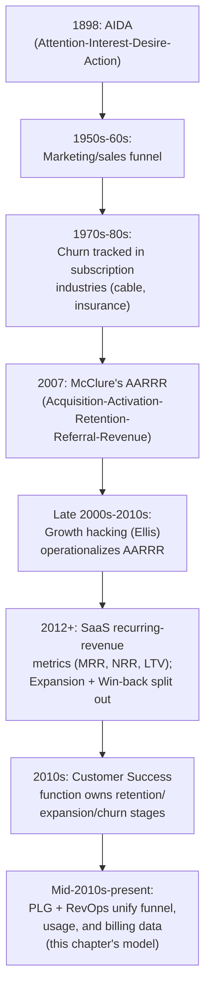
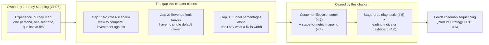
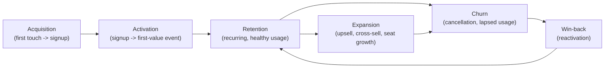
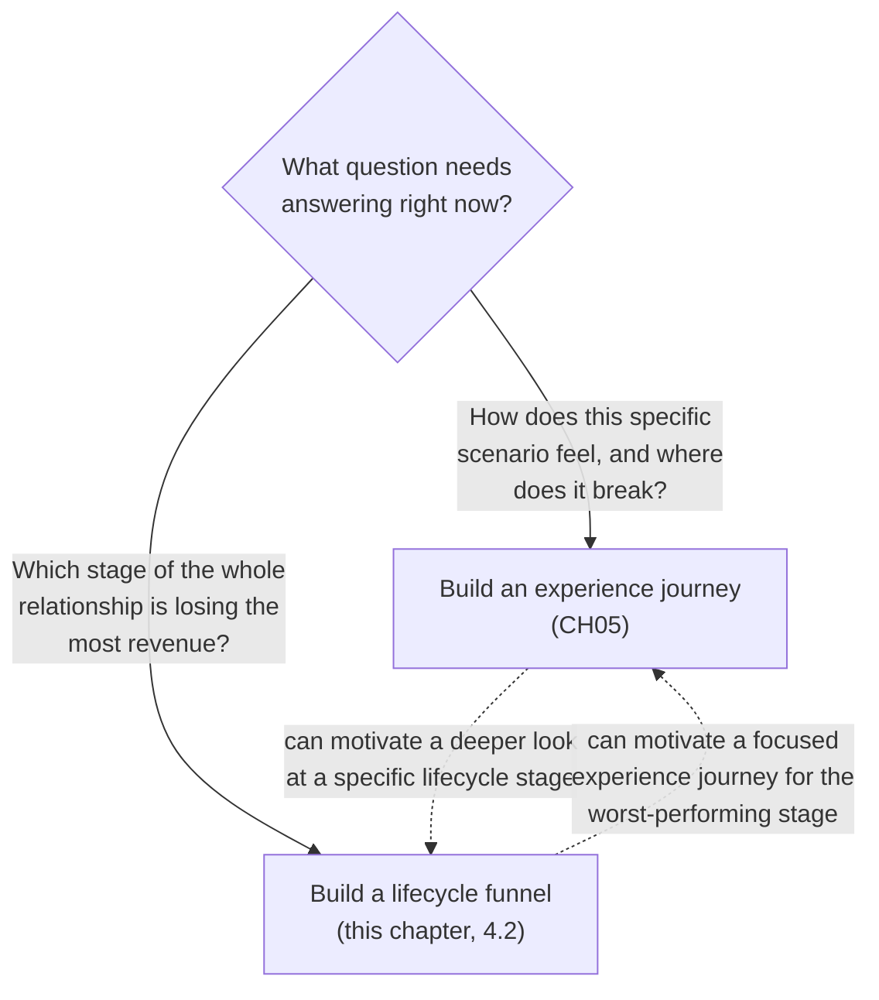
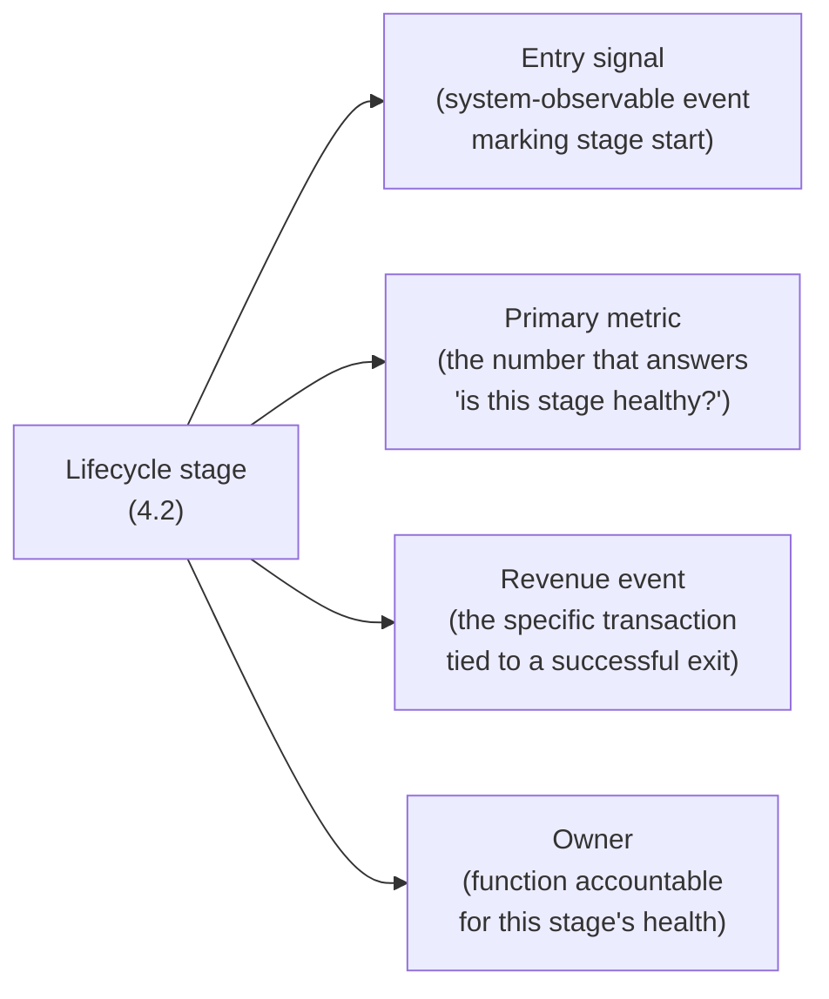
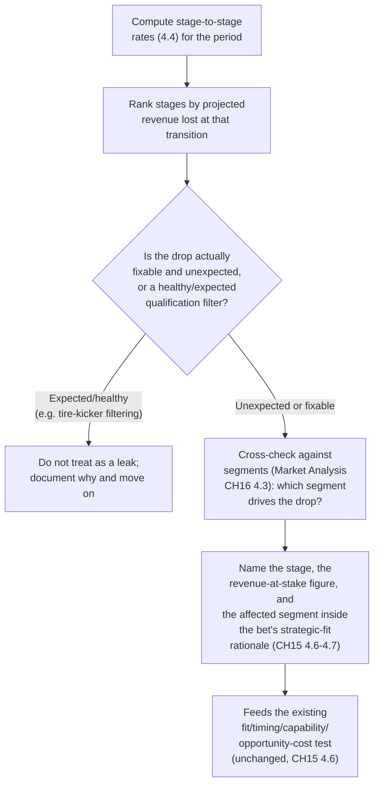
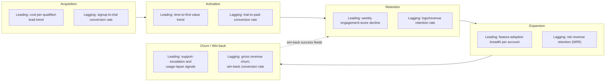
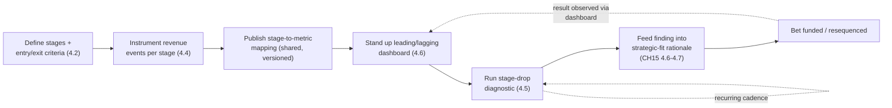
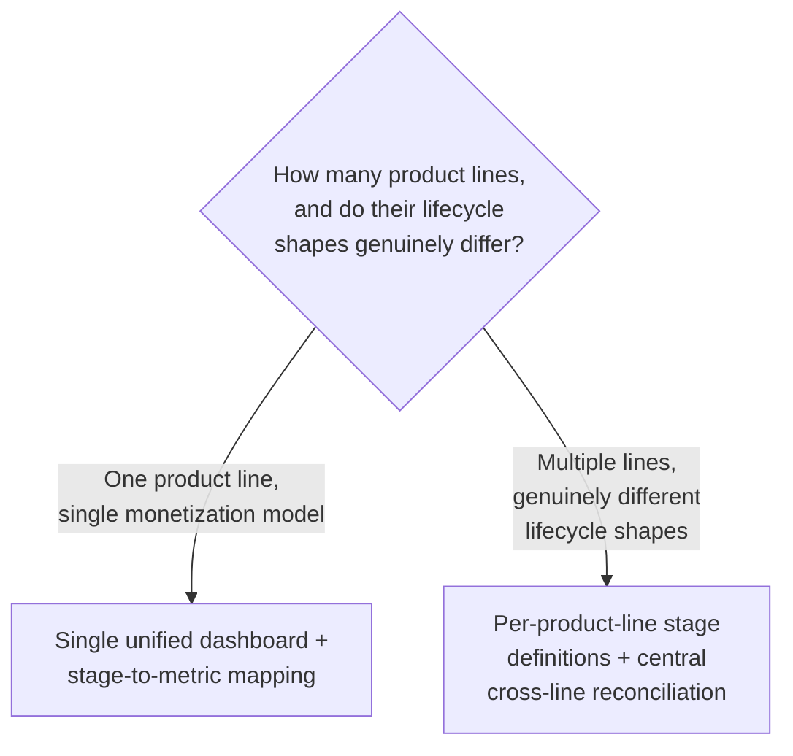
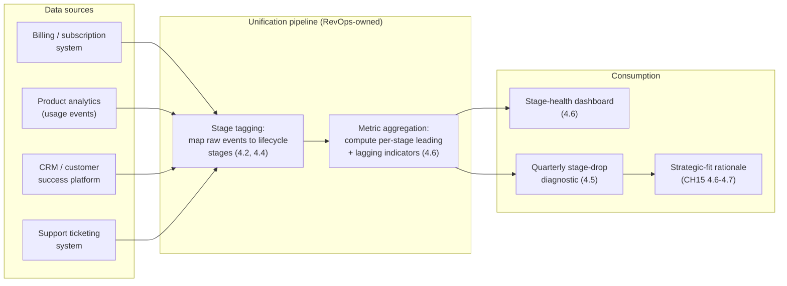

# Chapter: Journey Mapping (Product Management)

Part: [02 - Design Thinking and Product Management](PART_OVERVIEW.md) · Subsection: Product Management · Status: Drafted

## 1. Introduction

A journey map, as [Journey Mapping](CH05_Journey_Mapping.md) teaches in full,
is a synthesized visual artifact that sequences one specific persona's
experience of accomplishing one specific goal across a specific end-to-end
process, plotting actions, thoughts, and emotions against touchpoints so a
team can see where an experience actually breaks down. That chapter owns
the artifact itself in full depth — swimlane construction, the emotional
curve and Kahneman's peak-end rule, current-state versus future-state
sequencing, and the frontstage/backstage line of visibility that connects a
journey map to a service blueprint (recap:
[Journey Mapping § Core Concepts](CH05_Journey_Mapping.md#4-core-concepts)).
This chapter does not re-derive any of that, and a reader who has not yet
read [Journey Mapping](CH05_Journey_Mapping.md) should do so first — the
technique taught there is the prerequisite for everything below.

This chapter asks a structurally different question about a customer's
relationship with a product, one [Journey Mapping](CH05_Journey_Mapping.md)
explicitly flags as belonging to a later, separate chapter rather than to
its own scope (recap:
[Journey Mapping § Introduction](CH05_Journey_Mapping.md#1-introduction) and
[§ Core Concepts, 4.5](CH05_Journey_Mapping.md#45-journey-map-vs-adjacent-artifacts-brief-differentiator)).
Where a Design Thinking journey map answers "walking in this specific
persona's shoes through this specific scenario, where exactly does the
experience break down or work well?", this chapter answers a commercial
question: "across the entire, months-to-years-long arc of a customer's
*relationship* with the product — from the moment they first hear about it
through to the moment they become a stable, expanding account, or churn —
which stage of that relationship is losing the most revenue, and where
should the product organization invest its finite roadmap capacity to fix
it?" That question is answered with a different artifact this chapter names
the **customer lifecycle funnel** (Section 4.2): a stage model built from
quantitative funnel and revenue telemetry first and qualitative evidence
second, in direct contrast to the Design Thinking journey map's
qualitative-first, single-scenario construction. The two artifacts are
genuinely complementary, not competing descriptions of the same thing, and
Section 4.3 makes the distinction explicit and operational rather than
leaving it as a one-line disclaimer.

This chapter deliberately narrows its scope and consumes, rather than
re-teaches, several sibling chapters' territory:

- [Journey Mapping](CH05_Journey_Mapping.md) owns the experience-journey
  artifact and technique in full — stages, touchpoints, the emotional
  curve, and the frontstage/backstage relationship. This chapter treats
  "a team already knows how to build and validate that artifact" as a
  given, and does not repeat any of its construction discipline.
- [Service Design](CH12_Service_Design.md) owns the full service blueprint
  technique and the line-of-visibility control boundary in depth. Where
  this chapter's lifecycle stages touch backstage operational handoffs
  (for example, a churn-risk escalation reaching a customer success
  system), it names the relevant boundary without re-deriving blueprint
  construction.
- [Product Strategy](CH15_Product_Strategy.md) owns portfolio sequencing
  logic in full — the Three Horizons model and the strategic-fit/
  timing/capability/opportunity-cost test
  (recap: [§ 4.6](CH15_Product_Strategy.md#46-portfolio-sequencing-logic-why-this-bet-over-that-one))
  — and the strategy-to-roadmap translation contract
  (recap: [§ 4.7](CH15_Product_Strategy.md#47-strategy-to-roadmap-translation-contract)).
  Section 4.5 below adds exactly one new input to that existing test — a
  quantified, stage-located revenue-leak signal — and does not re-teach the
  test itself, the same deferral pattern
  [Personas (Product Management) § 4.7](CH18_Personas_Product_Management.md#47-persona-weight-as-a-sequencing-input)
  already established for persona weight.
- [Market Analysis](CH16_Market_Analysis.md) owns market segmentation
  methods in full
  (recap: [§ 4.3](CH16_Market_Analysis.md#43-market-segmentation-methods)).
  Section 4.5 uses an existing segment as a lens for deciding *who* a
  lifecycle-stage fix should target, without re-teaching how a segment
  itself is defined or sized.
- [Personas (Product Management)](CH18_Personas_Product_Management.md)
  owns persona-weighted opportunity scoring and the stakeholder
  arbitration protocol. This chapter's stage-drop diagnostic (Section 4.5)
  is a parallel, complementary sequencing input, not a restatement of
  persona weighting — a candidate roadmap bet can, and typically should,
  be evaluated against both inputs together.
- This chapter names, but does not teach, several not-yet-drafted sibling
  chapters in this part's Product Management subsection — **Story
  Mapping**, **Roadmaps**, **Backlog**, **Metrics**, **North Star
  Metrics**, and **Prioritization (RICE, MoSCoW, Kano)** (see
  [PART_OVERVIEW.md](PART_OVERVIEW.md)). Where this chapter's scope
  touches one of those — for example, how a stage-drop finding actually
  becomes a ranked backlog item, or how a dashboard's underlying metric
  definitions are chosen — it names the relevant future chapter and stops,
  rather than guessing at a filename, a section anchor, or inventing a
  parallel technique that would conflict with that chapter once drafted.

One naming note carried over from
[Journey Mapping § Introduction](CH05_Journey_Mapping.md#1-introduction) and
[Personas (Product Management) § Introduction](CH18_Personas_Product_Management.md#1-introduction):
this part contains two chapters titled "Journey Mapping." The Design
Thinking one (`CH05_Journey_Mapping.md`) owns the experience-journey
artifact and construction technique. This chapter — the Product Management
one, disambiguated as `CH19_Journey_Mapping_Product_Management.md` — owns
only the commercial-lifecycle application layer described above. A reader
looking for how to build a swimlane, score an emotional curve, or draw a
frontstage/backstage line should follow the links above instead.

## 2. Historical Evolution

The customer lifecycle funnel this chapter teaches has a distinct lineage
from the service-design ancestry [Journey Mapping § Historical Evolution](CH05_Journey_Mapping.md#2-historical-evolution)
documents — it descends from marketing funnel theory and growth-metrics
practice, not from Shostack's service blueprint.

- **1898 — the AIDA model.** Elias St. Elmo Lewis's Attention-Interest-
  Desire-Action model is the earliest widely cited ancestor of funnel-
  stage thinking: a prospective buyer's relationship with an offer is
  modeled as a narrowing sequence of stages, each stage losing some
  fraction of the prior stage's population. Every lifecycle model this
  chapter teaches inherits this same "narrowing sequence with stage-to-
  stage attrition" shape, even though the specific stage names have long
  since diverged from Lewis's original four.
- **1950s-1960s — the marketing and sales funnel formalizes.** Industrial
  and consumer marketing practice generalized AIDA into the broader
  "sales funnel" (awareness, interest, consideration, intent, purchase),
  the direct ancestor of the "acquisition" stage this chapter's lifecycle
  model opens with.
- **1970s-1980s — subscription and recurring-revenue businesses (cable,
  insurance, telecom) formalize "churn" as a named, tracked metric.**
  Industries whose revenue depended on an ongoing subscription rather than
  a single transaction were the first to need a systematic answer to "how
  many customers are we losing, and when" — churn measurement predates
  software-as-a-service (SaaS) by decades and is a direct ancestor of this
  chapter's churn and win-back stages.
- **2007 — Dave McClure's "Pirate Metrics" (AARRR).** McClure, a
  venture investor and startup advisor, popularized the AARRR framework —
  Acquisition, Activation, Retention, Referral, Revenue — as a
  memorable, ordered stage model specifically for evaluating an early-
  stage internet product's growth funnel end to end, rather than any
  single stage (typically acquisition) in isolation. AARRR is the single
  most direct historical ancestor of this chapter's lifecycle model, and
  most industry usage of "Acquisition → Activation → Retention" as a
  named stage sequence traces back to this framework.
- **Late 2000s to early 2010s — the growth-hacking movement (Sean Ellis
  and others).** Growth-hacking practice, closely associated with Sean
  Ellis (credited with coining the term "growth hacker" around 2010),
  operationalized AARRR into a repeatable, cross-functional experimentation
  discipline aimed at moving a specific stage's conversion rate, treating
  the funnel itself — not just any one channel — as the object of
  optimization.
- **2012 onward — the subscription economy and recurring-revenue metrics
  maturing for SaaS specifically.** As SaaS business models matured,
  metrics such as monthly recurring revenue (MRR), net revenue retention
  (NRR), and customer lifetime value (LTV) became standard, and McClure's
  original "Revenue" and "Referral" stages were increasingly split and
  extended by practitioners into separate **expansion** (upsell,
  cross-sell, seat growth within an existing account) and **win-back**
  (reactivating a churned account) stages — the specific five-stage model
  (Acquisition, Activation, Retention, Expansion, Churn/Win-back) this
  chapter teaches in Section 4.2 is this extended, SaaS-era variant, not
  McClure's original five letters verbatim.
- **2010s — Customer Success emerges as a distinct organizational
  function.** As recurring revenue depended on renewal rather than a
  one-time sale, companies began funding a standing Customer Success
  function specifically responsible for the retention, expansion, and
  churn stages — a direct organizational consequence of treating those
  stages as first-class, ownable parts of the business rather than an
  afterthought following "the sale."
- **Mid-2010s to present — product-led growth (PLG) and revenue
  operations (RevOps).** Product-led growth practice (echoing the same
  self-serve monetization shift
  [Personas (Product Management) § Historical Evolution](CH18_Personas_Product_Management.md#2-historical-evolution)
  documents) pushed activation and expansion instrumentation directly into
  the product itself rather than leaving them to sales-reported numbers,
  while the RevOps function emerged to unify what were previously
  separate marketing-funnel, product-usage, and billing-system data sets
  into the single, stage-tagged view this chapter's dashboard (Section
  4.6) depends on.



## 3. Why It Exists

A product organization can have an excellent, well-validated
[experience journey map](CH05_Journey_Mapping.md) for its onboarding flow —
evidence-sourced, cross-functionally reviewed, correctly scoped to one
persona and one scenario — and still have no coherent answer to a question
that experience journey was never built to answer: across the whole
customer relationship, which stage is actually bleeding the most revenue
right now, and is that the stage the team happens to be redesigning, or a
completely different one nobody is looking at? This mismatch between
experience-level insight and commercial-level prioritization is the entire
reason this chapter's lifecycle funnel exists as a distinct artifact.

- **An experience journey is deliberately narrow; a business needs a wide
  view to prioritize across.** [Journey Mapping's design principles](CH05_Journey_Mapping.md#6-design-principles)
  correctly insist "one persona, one scenario, one map" — that discipline
  is exactly right for producing an actionable redesign of one specific
  experience, and exactly wrong as a tool for comparing investment
  opportunities *across* the whole customer relationship, because a set of
  narrow maps for five different scenarios cannot, on their own, tell you
  which of the five is costing the business the most money this quarter.
  The lifecycle funnel exists to answer that comparison question, at the
  cost of the qualitative depth a narrow experience journey provides.
- **Revenue leaks concentrate at specific, named lifecycle stages, and
  those stages rarely have a single owner by default.** Marketing
  typically owns acquisition, product typically owns activation, customer
  success typically owns retention and expansion, and support typically
  owns the moments that precede churn — but the aggregate, cross-stage
  question ("which single stage, in dollar terms, is our biggest leak
  right now?") sits in exactly the gap between these functions, the same
  structural blind spot
  [Journey Mapping § Why It Exists](CH05_Journey_Mapping.md#3-why-it-exists)
  describes for experiential seams, recurring here at the commercial
  layer instead.
- **Funnel analytics alone answer "where," not "how much it's worth to
  fix."** A conversion dashboard can show that only 40 percent of trial
  signups activate, but a raw percentage alone does not tell a product
  organization whether fixing that specific drop is worth more roadmap
  capacity than fixing a smaller-percentage but higher-dollar-value drop
  two stages later — that comparison requires the stage-to-revenue-event
  mapping this chapter teaches in Section 4.4, not a bare funnel chart.
- **Without an explicit lifecycle view, roadmap investment defaults to
  whichever function's stage is politically loudest.** In the absence of a
  quantified, cross-stage comparison, a quarterly planning conversation
  reverts to the same failure mode
  [Product Strategy § Why It Exists](CH15_Product_Strategy.md#3-why-it-exists)
  and [Personas (Product Management) § Why It Exists](CH18_Personas_Product_Management.md#3-why-it-exists)
  independently describe at the strategy and persona layers — whichever
  team argues most persuasively, rather than the stage that is actually
  losing the most money, wins the next quarter's capacity.
- **Architecture relevance: lifecycle-stage health is frequently a direct
  signal of a system boundary, not just a marketing or onboarding-copy
  problem.** A sharp activation drop-off is, on inspection, very often
  traceable to a specific system event — a webhook that silently fails to
  fire a "welcome" trigger, a provisioning API with a multi-minute delay
  before a new account can actually be used, or an identity-verification
  service that times out under load during a signup spike. The lifecycle
  funnel gives an architect a business-quantified reason to prioritize
  fixing that system boundary, the same diagnostic role
  [Journey Mapping § Why It Exists](CH05_Journey_Mapping.md#3-why-it-exists)
  assigns to an experience journey's emotional low, applied here to a
  stage's conversion or retention rate instead of a felt emotion.



## 4. Core Concepts

### 4.1 Recap: The Journey Map as a Design-Thinking Artifact

A journey map is a synthesized, evidence-sourced artifact that plots one
named persona's actions, thoughts, emotions, and touchpoints across one
specific scenario, using an emotional curve and the peak-end rule to
identify the moments that most shape how the experience is remembered, and
a frontstage/backstage line of visibility to connect the visible experience
to the systems producing it. Full teaching of the artifact, its
construction pipeline, its validation discipline, and its governance
lifecycle belongs to
[Journey Mapping § Core Concepts](CH05_Journey_Mapping.md#4-core-concepts);
every concept in the remainder of this section assumes that definition and
does not restate it.

### 4.2 The Customer Lifecycle Funnel

Definition:
The customer lifecycle funnel is a stage model of a customer's entire
commercial relationship with a product — Acquisition, Activation,
Retention, Expansion, and Churn/Win-back — built primarily from
quantitative funnel and revenue telemetry, used to compare investment
opportunities across the whole relationship rather than to describe one
scenario's felt experience in qualitative depth.

Mechanism (how it works):
Each stage is a distinct, named phase of the relationship with its own
entry criterion, exit criterion, and typical organizational owner:

- **Acquisition** — a prospective customer becomes aware of the product
  and takes a first trackable action (a signup, a trial start, a
  download). Entry: first touch (an ad click, a referral link, an organic
  search visit). Exit: account creation or trial start. Typically owned by
  marketing and growth functions.
- **Activation** — a new account reaches a defined moment of first real
  value, distinct from merely having created an account. Entry: account
  created. Exit: the product's specific "aha moment" or first-value event
  (Section 4.4 defines this precisely as a revenue-adjacent event, not a
  vague feeling). Typically owned by product and onboarding-focused
  engineering.
- **Retention** — an activated customer continues using the product across
  a defined recurring interval (weekly, monthly) without lapsing. Entry:
  activation achieved. Exit: either sustained, healthy recurring usage
  (feeding Expansion) or a lapse that crosses into churn risk. Typically
  owned by product and customer success.
- **Expansion** — a retained customer increases their commercial
  relationship with the product — more seats, a higher tier, an add-on
  purchase. Entry: stable retention established. Exit: an upsell,
  cross-sell, or renewal-at-a-higher-tier revenue event. Typically owned
  by customer success and sales/account management.
- **Churn / Win-back** — a customer's relationship lapses (churn) or a
  previously churned customer is successfully reactivated (win-back).
  Entry to churn: a cancellation, a non-renewal, or a sustained usage
  lapse crossing a defined threshold. Entry to win-back: a churned
  account resumes paid usage. Typically owned by customer success and
  retention/lifecycle marketing.



Decision implications (when and why to use it):
Build a lifecycle funnel as soon as a product has enough customers and
enough stage-transition volume for stage-to-stage rates to be statistically
meaningful, and as soon as more than one function (marketing, product,
customer success) needs a shared, comparable view of where the
relationship is healthy or leaking. A pre-revenue product with a handful of
design-partner customers does not yet need a formal lifecycle funnel; a
product with meaningful trial or signup volume and a real cohort of paying
customers does.

Common failure mode:
**Stage-name collision** — reusing the same word (most commonly
"onboarding") for both an experience-journey stage
([Journey Mapping § Core Concepts, 4.1](CH05_Journey_Mapping.md#41-anatomy-of-a-journey-map))
and a lifecycle-funnel stage (this chapter's Activation), without making
the distinction explicit. A meeting where one person means "the specific
five-screen setup wizard" and another means "the entire first 30 days of
the account's life" by the same word "onboarding" produces confused,
talking-past-each-other prioritization debates that neither artifact's
data can actually resolve, because the two speakers are unknowingly
describing different objects.

Concrete scenario:
A subscription analytics company defines its five lifecycle stages and
discovers, once stage-to-stage rates are actually measured, that 92
percent of trial signups reach Activation (a healthy rate the team had
assumed was a problem, because "onboarding complaints" were loud and
frequent in support tickets), while only 38 percent of activated accounts
reach a stable Retention pattern by day 60 — a genuinely large leak that
had gone unquantified because no one had compared the two stages side by
side using consistent, comparable rates before this funnel was built.

### 4.3 Distinguishing the Commercial Lifecycle Journey from the Experience Journey

Definition:
This distinction separates two legitimate, complementary artifacts that
are easy to conflate because both use the word "journey" and both use
stages and a visual sequence: the experience journey
([Journey Mapping](CH05_Journey_Mapping.md)) and the commercial lifecycle
funnel (Section 4.2 above).

Mechanism (how it works):
The two artifacts differ along every axis that matters for how they are
built, read, and acted on:

| Axis | Experience journey (CH05) | Commercial lifecycle funnel (this chapter) |
|---|---|---|
| Primary question | How does this one persona's experience of this one scenario unfold, and where does it break down? | Across the whole customer relationship, which stage is losing the most revenue right now? |
| Altitude | One scenario, hours to days | Entire relationship, weeks to years |
| Evidence basis | Qualitative-first: interviews, empathy maps, observed sessions; quantitative telemetry is a later cross-check ([§ 14](CH05_Journey_Mapping.md#14-observability)) | Quantitative-first: funnel, usage, and billing telemetry; qualitative input (support tickets, win/loss interviews) explains an already-quantified drop |
| Actor | One named persona | An entire cohort or segment of accounts |
| Primary visual feature | The emotional curve (peak-end rule) | Stage-to-stage conversion/retention rate and revenue-event value |
| Typical owner | Design/UX research | Product management, growth, revenue operations |
| Typical use | Redesigning a specific interaction or flow | Deciding which stage deserves the next quarter's roadmap capacity |

Critically, this is not the same distinction
[Journey Mapping § Common Mistakes](CH05_Journey_Mapping.md#17-common-mistakes)
draws between a journey map and "a funnel chart" as an anti-pattern — that
warning is about mistakenly treating a system-defined funnel step as
automatically the correct *stage boundary for an experience journey*,
losing everything that happens outside the instrumented funnel (a phone
call to support, for instance). This chapter's lifecycle funnel is not a
mislabeled experience journey; it is a deliberately, legitimately
funnel-shaped artifact answering a genuinely different, comparative,
cross-scenario question that an experience journey was never built to
answer. Holding both distinctions simultaneously — journey map versus
generic funnel chart (CH05's warning) and experience journey versus
lifecycle funnel (this section) — is what prevents a reader from either
demoting this chapter's artifact to "just a bad journey map" or promoting
a plain conversion-rate dashboard to "our journey map."



Decision implications (when and why to use it):
Use an experience journey when the decision at hand is a specific redesign
decision for a specific scenario. Use a lifecycle funnel when the decision
at hand is a comparative, cross-stage investment decision. The two feed
each other in practice — a lifecycle funnel's worst-performing stage is
frequently exactly where a team should next commission a focused
experience journey, and an experience journey's discovered pain point can
motivate re-checking whether that stage's aggregate lifecycle numbers
actually confirm the scale of the problem before committing capacity to it.

Common failure mode:
Building only one of the two artifacts and using it to answer the other's
question — most commonly, using a single experience journey's qualitative
findings ("users found onboarding confusing") to justify a lifecycle-scale
roadmap investment without ever checking whether the lifecycle funnel's
actual stage-to-stage numbers (Section 4.4) confirm that this is, in
dollar terms, the biggest leak, rather than simply the most recently or
loudly discussed one.

Concrete scenario:
A team runs a well-executed experience journey for its "first-time
checkout" scenario, finds a genuine, sourced pain point, and proposes a
significant redesign. Before committing a full quarter's capacity, the team
checks the lifecycle funnel and finds that the Activation-to-Retention
transition, not Acquisition-to-Activation (where checkout sits), is losing
four times as much projected annual recurring revenue (ARR). The checkout
fix still ships, but at a smaller scope, while the larger capacity
allocation goes to the Retention stage the lifecycle funnel — not the
experience journey — actually located.

### 4.4 Mapping Lifecycle Stages to Business Metrics and Revenue Events

Definition:
A revenue event is a discrete, timestamped business transaction or
system-observable milestone causally tied to a specific lifecycle-stage
transition — for example, a trial-to-paid conversion (Activation), a
first-value milestone reached inside the product (also Activation), an
upsell or seat-count increase (Expansion), a cancellation (Churn), or a
reactivation payment (Win-back). Stage-to-metric mapping is the discipline
of explicitly attaching, to each lifecycle stage, its entry signal, its
primary health metric, and its associated revenue event, so that a stage's
health can be read as a specific number rather than an impression.

Mechanism (how it works):
Each stage in Section 4.2's model is given a small, fixed set of fields
rather than left as an unquantified label:



A concrete stage-to-metric table for a typical subscription product:

| Stage | Entry signal | Primary metric | Revenue event | Typical owner |
|---|---|---|---|---|
| Acquisition | First tracked touch (ad click, referral, organic visit) | Signup/trial-start conversion rate | Trial start (no revenue yet) | Marketing / growth |
| Activation | Trial or account created | Percentage reaching defined first-value event within N days | First paid conversion (trial-to-paid) | Product / onboarding engineering |
| Retention | First-value event reached | N-day/N-week active-usage rate; logo retention rate | Renewal payment | Product / customer success |
| Expansion | Stable, healthy recurring usage | Net revenue retention (NRR); upsell attach rate | Upsell, cross-sell, or seat-increase payment | Customer success / account management |
| Churn | Cancellation or sustained usage lapse past a defined threshold | Gross revenue churn rate; logo churn rate | Cancellation (revenue loss event) | Customer success / retention marketing |
| Win-back | Churned account resumes engagement | Win-back conversion rate | Reactivation payment | Retention / lifecycle marketing |

Decision implications (when and why to use it):
Build this mapping before, not after, attempting the stage-drop diagnostic
in Section 4.5 — a stage-drop comparison is only meaningful once every
stage's entry signal, metric, and revenue event are defined consistently
enough to be compared on the same footing. Skipping straight to "which
stage looks worst" without a documented mapping produces a comparison built
on inconsistent, informally-defined numbers that will not survive a
skeptical stakeholder's first follow-up question about how a metric was
actually calculated.

Common failure mode:
**Vanity-metric mapping** — attaching a metric to a stage because it is
easy to report rather than because it actually predicts the stage's
revenue-relevant outcome. Counting raw signups as "Acquisition success"
without any check against downstream Activation is the most common
instance: a marketing campaign can double signup volume while simultaneously
halving the Activation rate (by attracting a less-qualified audience),
producing a lifecycle funnel that looks like it improved at the Acquisition
stage while the business's actual paying-customer output stayed flat or
declined — a pattern invisible unless the stage-to-stage mapping is used to
compare adjacent stages together, not read one stage's metric in isolation.

Concrete scenario:
A team's Acquisition metric ("weekly trial signups") rises 40 percent
after a paid-acquisition channel change. Read alone, this looks like a
clear win. Once mapped against the Activation stage's metric
(percentage reaching first-value within 14 days), the team finds
Activation rate fell from 55 percent to 31 percent over the same period —
the new channel is bringing in a larger volume of a much less qualified
audience. The stage-to-metric mapping, read as a pair rather than a single
number, correctly reframes what looked like an unambiguous win as a
trade-off requiring a deliberate decision, not an automatic celebration.

### 4.5 Using the Lifecycle Journey to Prioritize Roadmap Investment

Recap: [Product Strategy](CH15_Product_Strategy.md#46-portfolio-sequencing-logic-why-this-bet-over-that-one)
owns the full portfolio-sequencing test — the Three Horizons model plus
the strategic-fit, market-timing, capability-readiness, and
opportunity-cost questions used to decide which validated bet is funded
first. This chapter does not re-teach that test; it adds one new,
quantified input to the strategic-fit question, the same deferral pattern
[Personas (Product Management) § 4.7](CH18_Personas_Product_Management.md#47-persona-weight-as-a-sequencing-input)
already established for persona weight — and the two inputs are meant to
be read together, not as competing alternatives.

Definition:
The stage-drop diagnostic is the technique of computing each stage's
conversion or retention rate (Section 4.4), converting the resulting drop
at each stage into a projected revenue value (using the stage's
associated revenue event and the volume of accounts passing through it),
and using the largest quantified, fixable revenue-leak stage as explicit,
named evidence inside a candidate bet's strategic-fit rationale — rather
than letting "strategic fit" for a lifecycle-facing bet be argued as an
abstract, unsourced judgment call.

Mechanism (how it works):



The diagnostic's second step deliberately guards against the most common
misuse of a raw drop-off number: not every stage-to-stage drop is a leak
worth fixing. A 90 percent drop between "visited pricing page" and "started
trial" may simply reflect healthy, expected filtering of unqualified
visitors, while a 15 percent drop between "started trial" and "reached
first-value event" may represent a much smaller percentage but a much
larger absolute revenue loss precisely because so many more accounts
survive to reach that stage. The diagnostic explicitly asks whether a drop
is expected/healthy or unexpected/fixable before treating it as evidence,
and cross-checks the affected population against
[Market Analysis's segmentation](CH16_Market_Analysis.md#43-market-segmentation-methods)
to determine whether the fix should be broad-based or targeted at a
specific segment likely to yield a better return per unit of engineering
effort.

Decision implications (when and why to use it):
Run this diagnostic on the same cadence a strategy or roadmap-planning
cycle runs (recap:
[Product Strategy § Internal Working](CH15_Product_Strategy.md#5-internal-working)),
and whenever a candidate bet's rationale would otherwise rest on an
unquantified claim like "this improves onboarding" — naming the specific
stage, the specific projected revenue figure, and the specific segment
most affected turns that claim into evidence a skeptical stakeholder can
check, the same falsifiability discipline
[Personas (Product Management) § 4.7](CH18_Personas_Product_Management.md#47-persona-weight-as-a-sequencing-input)
requires of a persona-based fit rationale.

Common failure mode:
**The biggest-drop fallacy** — automatically funding whichever stage shows
the largest raw percentage drop, without checking whether that drop is
expected/healthy (Section 4.5's second diagnostic step), without
converting it into an actual projected revenue figure, and without
weighing the cost and capability-readiness of actually fixing it against
the size of the opportunity. A stage with a smaller percentage drop but a
much larger population and a much larger revenue-per-account figure can
represent a far larger fixable opportunity than a stage with a dramatic-
looking but low-value percentage drop.

Concrete scenario:
A team's lifecycle funnel shows an 85 percent drop between "signup" and
"first login" (Acquisition-to-Activation) and a 12 percent drop between
"month-3 active" and "month-4 active" (within Retention). Read as raw
percentages, the 85 percent figure looks alarming. Once converted to
projected revenue — the 85 percent drop is mostly unqualified trial signups
from a broad-reach marketing campaign the team already expects to filter
heavily, worth an estimated $40,000 in recoverable annual recurring
revenue (ARR) if halved — versus the 12 percent Retention drop, which
represents a much larger, already-qualified paying-account population and
is projected at $310,000 in annual recurring revenue at risk if unaddressed
— the diagnostic correctly redirects the next quarter's capacity toward
the Retention fix, the opposite of what the raw percentages alone would
have suggested.

### 4.6 Journey-Stage Health and Leading-Indicator Dashboards

Definition:
A journey-stage health dashboard is a standing, continuously updated view
that reports each lifecycle stage's health using both a lagging indicator
(a metric that confirms an outcome has already happened, such as realized
churned revenue) and at least one leading indicator (a metric that predicts
the lagging outcome early enough for the accountable owner to intervene
before it fully materializes, such as a declining in-product engagement
score that historically precedes churn by several weeks).

Mechanism (how it works):
For each stage, the dashboard pairs a leading and a lagging indicator, an
accountable owner (recap: Section 4.4's owner column), and an alert
threshold that triggers a review before the lagging metric confirms the
damage is already done:

```{=latex}
\begin{landscape}
```



```{=latex}
\end{landscape}
```

The landscape wrap is used here for the same reason
[Personas (Product Management) § Internal Working](CH18_Personas_Product_Management.md#5-internal-working)
uses it for its own multi-lane operating loop: this dashboard spans five
stages, each with a paired leading and lagging indicator, and compressing
that many parallel lanes into a portrait-width diagram would force
illegible label wrapping.

Decision implications (when and why to use it):
Prioritize instrumenting a leading indicator for whichever stage the
stage-drop diagnostic (Section 4.5) has identified as the current largest
fixable leak, since that is the stage where early warning has the highest
immediate value; a mature lifecycle-management practice eventually
instruments a leading indicator for every stage, but a team standing up
this dashboard for the first time should sequence that build the same way
it sequences any other roadmap investment, not attempt all five stages at
once.

Common failure mode:
**The lagging-only dashboard** — a dashboard that reports only realized
outcomes (churned revenue this month, this quarter's net revenue
retention) with no leading indicator at all, giving the accountable owner
no time to intervene before the damage is already reflected in the
lagging number. A lagging-only dashboard is still useful for reporting
upward to leadership, but it is not, by itself, an operational tool a
stage owner can act on in time to change the outcome it reports.

Concrete scenario:
A customer success team's only Retention dashboard is a monthly logo-churn
report. By the time a given month's churn figure is published, every
account counted in it has already cancelled — there is nothing left to do
for that cohort. After adding a weekly engagement-score-decline leading
indicator (accounts whose weekly active usage drops more than 30 percent
for two consecutive weeks), the team identifies at-risk accounts three to
five weeks before they would otherwise cancel, giving customer success
enough lead time to intervene with a proactive outreach — converting the
dashboard from a purely historical report into an operational early-
warning tool.

## 5. Internal Working

Operating this chapter's mechanisms is a recurring loop, not a one-time
build, and it deliberately interlocks with — rather than duplicates — the
cadences [Product Strategy § Internal Working](CH15_Product_Strategy.md#5-internal-working)
and [Personas (Product Management) § Internal Working](CH18_Personas_Product_Management.md#5-internal-working)
already document for their own layers:

1. **Define the lifecycle stages and their entry/exit criteria** for the
   specific business model in question (Section 4.2), adapting the generic
   five-stage model to the product's actual monetization pattern (a
   usage-based product may need a different Expansion definition than a
   seat-based one, for example).
2. **Instrument revenue events and tag them to stages** (Section 4.4),
   wiring the billing system, product-analytics platform, and customer
   relationship management (CRM) or customer-success platform so each
   stage's entry signal, metric, and revenue event are captured
   consistently and automatically rather than manually reconciled each
   quarter.
3. **Publish the stage-to-metric mapping** as a shared, versioned document
   so every function reading the resulting numbers agrees on what each
   metric means and how it is calculated — directly preventing the
   vanity-metric and stage-name-collision failure modes named in Sections
   4.2 and 4.4.
4. **Stand up the leading/lagging dashboard** (Section 4.6), sequencing
   which stage gets a leading indicator first based on the most recent
   stage-drop diagnostic finding.
5. **Run the stage-drop diagnostic on a fixed cadence** (Section 4.5),
   ranking stages by projected, fixable revenue-at-stake and cross-
   checking the result against segments
   ([Market Analysis](CH16_Market_Analysis.md#43-market-segmentation-methods)).
6. **Feed the diagnostic's finding into strategic-fit rationales** for
   candidate bets (Section 4.5's diagram), alongside — not instead of —
   any relevant persona-weighted evidence
   ([Personas (Product Management) § 4.3](CH18_Personas_Product_Management.md#43-persona-weighted-opportunity-scoring)),
   so a sequencing decision draws on both signals when both are relevant
   to the same candidate bet.
7. **Govern the model itself**: assign a named owner per stage (Section
   4.4), review the stage-to-metric mapping and dashboard thresholds
   whenever a pricing, packaging, or product-surface change could
   invalidate a stage's definition, and treat a sustained mismatch between
   the dashboard's leading indicator and its paired lagging outcome as a
   trigger to recalibrate the leading indicator itself (Section 16).



## 6. Design Principles

- **Keep the lifecycle funnel and the experience journey as two artifacts,
  not one.** Resist the urge to merge a quantitative lifecycle stage model
  with a qualitative, single-scenario experience journey into one
  document; each is built and read differently, and forcing them together
  produces an artifact that satisfies neither audience well (Section 4.3).
- **Define every stage's entry signal, metric, and revenue event before
  comparing stages.** A stage-drop comparison built on inconsistently
  defined metrics is not a diagnostic; it is an argument waiting to be
  challenged and lose (Section 4.4).
- **Convert percentages to projected revenue before ranking leaks.** A raw
  drop-off percentage alone cannot be compared meaningfully across stages
  with very different population sizes and revenue-per-account figures
  (Section 4.5).
- **Distinguish an expected, healthy filter from a genuine, fixable leak.**
  Not every stage-to-stage drop is a problem; treating a deliberate
  qualification filter as a leak wastes roadmap capacity chasing a number
  that was never meant to be 100 percent (Section 4.5).
- **Pair every lagging indicator with a leading one wherever the stage
  owner needs time to act.** A dashboard that only confirms an outcome
  after it has already happened is a report, not an operational tool
  (Section 4.6).
- **Cite both the lifecycle diagnostic and persona-weighted evidence when
  both are relevant.** The two are complementary inputs to the same
  sequencing test, not substitutes for one another
  ([Personas (Product Management) § 4.7](CH18_Personas_Product_Management.md#47-persona-weight-as-a-sequencing-input)).
- **Treat stage definitions as living, not fixed.** A pricing, packaging,
  or monetization-model change can invalidate a stage's entry/exit
  criteria or revenue event overnight; review the mapping whenever such a
  change occurs, not only on a fixed calendar date.

## 7. Architecture Patterns

As with [Product Strategy § Architecture Patterns](CH15_Product_Strategy.md#7-architecture-patterns)
and [Personas (Product Management) § Architecture Patterns](CH18_Personas_Product_Management.md#7-architecture-patterns),
"architecture patterns" here means recurring, named operating-model shapes
for how an organization structures its lifecycle-management layer, not a
software architecture pattern in the code sense:

- **Single, unified lifecycle dashboard pattern**: one dashboard, one
  stage-to-metric mapping, and one stage-drop diagnostic serve the entire
  product line. Strongest for a single-product company with one
  monetization model; becomes a poor fit once a second product line with
  a genuinely different lifecycle shape (for example, a usage-based
  add-on sold alongside a seat-based core product) is forced into the
  same stage definitions.
- **Per-product-line lifecycle pattern**: each product line maintains its
  own stage definitions, metrics, and dashboard, with a central revenue-
  operations function reconciling only cross-product-line comparisons
  (for example, comparing each line's Expansion stage health at the
  portfolio level). Fits a multi-product company better; risks the same
  federated-versus-centralized sprawl tension
  [Personas (Product Management) § Architecture Patterns](CH18_Personas_Product_Management.md#7-architecture-patterns)
  names for weighting matrices, applied here to stage definitions.
- **RevOps-owned data pipeline pattern**: a single revenue-operations
  function owns the technical pipeline unifying billing, product-analytics,
  and CRM data into the stage-tagged view the dashboard consumes, while
  individual stage owners (marketing, product, customer success) consume
  the resulting dashboard without each building and reconciling their own
  separate pipeline — the most common pattern in practice, because the
  underlying data sources are usually owned by different systems
  regardless of how the dashboard itself is organized.
- **Stage-owner accountability pattern**: each stage has one clearly named
  accountable owner (Section 4.4's owner column) responsible for that
  stage's leading indicator and for responding to its alert threshold,
  mirroring the "stage owner" concept
  [Journey Mapping § Architecture Patterns](CH05_Journey_Mapping.md#7-architecture-patterns)
  applies to touchpoint ownership, at the coarser lifecycle-stage grain
  instead of the individual-touchpoint grain.



## 8. Production Architecture

The typical data and review architecture underpinning this chapter's
mechanisms in production:



- **Data source layer.** The billing/subscription system is the
  authoritative source for revenue events (trial-to-paid, upsell,
  cancellation, reactivation); the product-analytics platform is the
  authoritative source for in-product usage and first-value events; the
  customer relationship management (CRM) or customer-success platform
  typically holds account-level health scores and escalation history;
  the support ticketing system contributes leading-indicator signal
  (escalation volume, sentiment) ahead of a churn event.
- **Unification pipeline.** A stage-tagging step maps each raw event from
  every source to the specific lifecycle stage and revenue event it
  represents (Section 4.4's mapping, implemented rather than merely
  documented), followed by an aggregation step computing each stage's
  leading and lagging indicators on the cadence the dashboard requires.
- **Consumption layer.** The resulting stage-health dashboard (Section
  4.6) serves ongoing, operational stage-owner monitoring; the periodic
  stage-drop diagnostic (Section 4.5) serves the less frequent, higher-
  stakes roadmap-sequencing decision, feeding the strategic-fit rationale
  [Product Strategy](CH15_Product_Strategy.md#47-strategy-to-roadmap-translation-contract)
  already requires before a bet moves downstream.

## 9. Implementation

A phased approach to standing up this chapter's mechanisms:

### Phase 1: Define the model

- Adapt Section 4.2's five-stage model to the product's actual
  monetization pattern, naming a specific entry/exit criterion for each
  stage.
- Document the stage-to-metric mapping (Section 4.4) and circulate it for
  cross-functional agreement before any dashboard is built on top of it.

### Phase 2: Instrument the data pipeline

- Confirm each stage's entry signal and revenue event is captured reliably
  in its authoritative source system (billing, product analytics, CRM).
- Build the stage-tagging step mapping raw events to stages, and validate
  a sample of tagged events by hand before trusting the aggregation layer.

### Phase 3: Stand up the dashboard

- Prioritize a leading indicator for whichever stage is the current
  suspected largest leak; add lagging indicators for every stage from day
  one, since they are typically cheaper to compute from data that already
  exists.
- Assign a named accountable owner and an alert threshold per stage
  (Section 4.6).

### Phase 4: Run the first stage-drop diagnostic

- Compute stage-to-stage rates, convert to projected revenue, and
  explicitly classify each drop as expected/healthy or unexpected/fixable
  (Section 4.5) before ranking anything.
- Cross-check the largest unexpected/fixable drop against
  [Market Analysis's segments](CH16_Market_Analysis.md#43-market-segmentation-methods)
  to identify whether a broad or segment-targeted fix is appropriate.

### Phase 5: Connect to sequencing

- Require the resulting finding — stage, projected revenue-at-stake, and
  affected segment — to be cited by name inside any candidate bet's
  strategic-fit rationale
  ([Product Strategy § 4.6-4.7](CH15_Product_Strategy.md#46-portfolio-sequencing-logic-why-this-bet-over-that-one)),
  alongside any relevant persona-weighted evidence
  ([Personas (Product Management) § 4.3](CH18_Personas_Product_Management.md#43-persona-weighted-opportunity-scoring)).

### Phase 6: Operate and review

- Run the Section 5 loop continuously, and recalibrate a leading
  indicator whenever it drifts out of sync with its paired lagging
  outcome (Section 16).

## 10. Complete Code Examples

Two reference artifacts accompany this chapter (produced separately per
this project's diagram/code production step, referenced here rather than
embedded per the style guide), following the same pattern
[Journey Mapping § Complete Code Examples](CH05_Journey_Mapping.md#10-complete-code-examples)
established for its own artifact:

- A structured lifecycle-stage configuration schema (JavaScript Object
  Notation, JSON), giving each stage a machine-readable entry signal,
  primary metric, revenue-event definition, and accountable owner —
  usable as the configuration input the stage-tagging pipeline (Section
  8) and the aggregation step consume:
  [code/json/journey-mapping-product-management-chapter/lifecycle-stage-config.json](../code/json/journey-mapping-product-management-chapter/lifecycle-stage-config.json)
- A Python script implementing the stage-drop diagnostic (Section 4.5):
  computing per-stage conversion/retention rates from a tagged event log,
  converting each drop into a projected revenue-at-stake figure using the
  stage's revenue-event value and population size, and flagging drops
  that fall outside a configurable "expected/healthy" tolerance band for
  human review rather than automatically ranking every drop as a leak:
  [code/python/journey-mapping-product-management-chapter/stage_drop_diagnostic.py](../code/python/journey-mapping-product-management-chapter/stage_drop_diagnostic.py)

Illustrative pseudocode expressing the diagnostic's core calculation,
provided only to make the mechanism concrete rather than as a runnable
artifact:

```
for stage, next_stage in adjacent_stage_pairs(lifecycle_stages):
    rate = next_stage.population / stage.population
    projected_revenue_at_stake = (
        (expected_rate(stage, next_stage) - rate)
        * stage.population
        * next_stage.revenue_event_value
    )
    if abs(rate - expected_rate(stage, next_stage)) > tolerance_band:
        flag_for_review(stage, next_stage, projected_revenue_at_stake)
```

## 11. Performance

"Performance," applied to this chapter's mechanisms, has two distinct
meanings this chapter separates deliberately, echoing the same split
[Journey Mapping § Performance](CH05_Journey_Mapping.md#11-performance)
draws for its own artifact:

- **The lifecycle model's own production performance** — how long it takes
  to go from "we suspect a stage is leaking revenue" to a validated,
  quantified stage-drop finding cited in a sequencing decision. A team
  with an already-instrumented billing and product-analytics pipeline can
  run the diagnostic in days; a team building the stage-tagging pipeline
  from scratch (Section 8) should expect the first pass to take
  materially longer, with subsequent runs becoming fast and largely
  automated once the pipeline exists.
- **The mapped lifecycle's actual business performance** — the real,
  measured conversion, retention, and revenue-event rates at each stage,
  which is what the entire chapter exists to make visible and comparable.
  A "well-performing" lifecycle, in this sense, is one where every stage's
  drop is either expected/healthy or already flagged and actively being
  addressed — not one where every rate is maximized in isolation, since
  some drops (Section 4.5) are supposed to be large.

## 12. Scalability

Scaling this chapter's mechanisms from a single product's lifecycle
funnel to a multi-product, multi-segment portfolio raises the same kind
of governance questions
[Personas (Product Management) § Scalability](CH18_Personas_Product_Management.md#12-scalability)
raises for its own weighting model, applied here to stage definitions and
dashboards instead of persona weights:

- **Stage-definition sprawl.** Independent product lines each invent their
  own ad hoc stage boundaries and metric definitions without a shared
  mapping or reconciliation process, producing lifecycle numbers that
  cannot be meaningfully compared across the portfolio at the exact moment
  portfolio-level sequencing decisions need that comparison — the
  per-product-line pattern (Section 7) exists specifically to bound this.
- **Dashboard proliferation without a single source of truth.** As more
  teams build their own partial dashboards from the same underlying data,
  small differences in how a stage's boundary or metric is calculated
  produce genuinely different numbers for what stakeholders assume is
  "the same" retention rate — the RevOps-owned pipeline pattern (Section
  7) exists to prevent this by centralizing the tagging and aggregation
  layer even when consumption is federated.
- **Diagnostic cadence lagging a fast-moving segment.** A quarterly
  stage-drop diagnostic may be too slow for a fast-growing product line
  whose stage-to-stage rates shift materially within a single quarter;
  scaling this discipline requires either a faster cadence for volatile
  lines or an event-triggered re-run whenever a material pricing or
  packaging change occurs (Section 6).
- **Leading-indicator model staleness across segments.** A leading
  indicator calibrated against one segment's typical behavior (Section
  4.6) may fire false alarms, or miss real risk entirely, for a
  behaviorally different segment
  ([Market Analysis § Segmentation](CH16_Market_Analysis.md#43-market-segmentation-methods));
  scaling the dashboard to a multi-segment portfolio requires checking
  whether a single leading-indicator threshold still fits every segment
  it is applied to.

## 13. Security

Security here concerns confidentiality of sensitive revenue and account
data, not application-level security controls (owned by the not-yet-
drafted Security part):

- **Revenue and account-level data confidentiality.** The stage-to-metric
  mapping and dashboard (Sections 4.4, 4.6) surface account-level revenue,
  contract value, and churn-risk data that is competitively and often
  contractually sensitive; access should be restricted to functions with
  a legitimate operational need (product, revenue operations, customer
  success), echoing
  [Personas (Product Management) § Security](CH18_Personas_Product_Management.md#13-security)'s
  segment-revenue confidentiality concern, applied here to individual
  account-level data rather than aggregate segment weights.
- **Personally identifiable information (PII) in support-derived leading
  indicators.** Where a leading indicator is derived from support-ticket
  sentiment or escalation content (Section 4.6), that content can carry
  personally identifiable information about a named customer contact;
  aggregated indicator scores should be computed from, but not expose,
  the underlying raw ticket text to broad dashboard audiences.
- **Restrict edit access to stage definitions and thresholds, not just
  read access.** As with
  [Personas (Product Management) § Security](CH18_Personas_Product_Management.md#13-security)'s
  weighting-matrix principle, broad visibility into a stage's definition
  and threshold builds trust in the resulting numbers; uncontrolled edit
  access risks a stakeholder quietly loosening a threshold to avoid an
  uncomfortable alert, silently undermining the entire dashboard's
  credibility.

## 14. Observability

Applied to this chapter's own mechanisms rather than to a mapped
experience (the way [Journey Mapping § Observability](CH05_Journey_Mapping.md#14-observability)
applies it to its map), observability here means checking whether the
lifecycle model and dashboard themselves remain accurate over time:

- **Leading/lagging correlation checks.** Periodically verify that a
  stage's leading indicator actually precedes and predicts its paired
  lagging outcome (Section 4.6) with the lead time originally assumed; a
  leading indicator that stops correlating with its lagging outcome — for
  example, after a product change alters what "healthy engagement" looks
  like — needs recalibration before it silently stops providing useful
  warning.
- **Stage-definition drift detection.** A pricing, packaging, or
  monetization-model change can invalidate a stage's entry/exit criterion
  or revenue-event definition without anyone updating the documented
  mapping (Section 4.4); treating such changes as an automatic trigger for
  a mapping review, rather than relying solely on a calendar-based review,
  catches this before a diagnostic silently runs against a stale
  definition.
- **Diagnostic citation rate.** What proportion of sequenced bets'
  strategic-fit rationales actually cite a specific stage, a projected
  revenue-at-stake figure, and an affected segment (Section 4.5), versus
  arguing lifecycle impact in the abstract — a low or declining rate
  signals the sequencing-layer bridge is not being consistently applied,
  the same signal
  [Personas (Product Management) § Observability](CH18_Personas_Product_Management.md#14-observability)
  tracks for persona citation.

This chapter deliberately stops at this framing-level treatment; full
metric-design technique — dashboarding rigor, statistical trend detection,
and the organization's single unifying top-line metric — belongs to this
part's not-yet-drafted **Metrics** and **North Star Metrics** chapters (see
[PART_OVERVIEW.md](PART_OVERVIEW.md)).

## 15. Failure Scenarios

1. **Stage-name collision**: a team conflates an experience-journey stage
   with a lifecycle-funnel stage under the same label (most commonly
   "onboarding"), producing confused, talking-past-each-other
   prioritization debates (Section 4.2). Resolution: explicitly name which
   artifact and which stage definition a conversation is using before
   debating it.
2. **Vanity-metric mapping**: a stage's attached metric is easy to report
   but does not predict the stage's actual revenue-relevant outcome
   (Section 4.4's common failure mode), most often raw Acquisition volume
   read without checking downstream Activation. Resolution: always read
   adjacent stages together, never a single stage's metric in isolation.
3. **The biggest-drop fallacy**: roadmap capacity is funded toward
   whichever stage shows the largest raw percentage drop, without
   converting to projected revenue or checking whether the drop is
   expected/healthy (Section 4.5). Resolution: enforce the full
   diagnostic sequence — classify, convert to revenue, segment-check —
   before any stage is named as a leak.
4. **The lagging-only dashboard**: a dashboard reports only realized
   outcomes with no leading indicator, giving the stage owner no time to
   intervene (Section 4.6). Resolution: pair every stage with at least one
   leading indicator, prioritized by the most recent stage-drop diagnostic
   finding.
5. **Zombie lifecycle model**: stage definitions and thresholds are built
   once and never revisited as pricing, packaging, or the product itself
   changes, silently invalidating the diagnostic's output — the direct
   analogue of
   [Journey Mapping § Failure Scenarios](CH05_Journey_Mapping.md#15-failure-scenarios)'s
   zombie journey map and
   [Personas (Product Management) § Failure Scenarios](CH18_Personas_Product_Management.md#15-failure-scenarios)'s
   zombie weighting matrix, recurring at the lifecycle-model layer.
   Resolution: tie review to both a fixed cadence and event-triggered
   signals (a pricing or packaging change).
6. **Diagnostic theater**: a stage-drop diagnostic is run once for a
   single planning cycle's presentation and never re-run or actually cited
   in subsequent sequencing rationales, echoing
   [Journey Mapping § Failure Scenarios](CH05_Journey_Mapping.md#15-failure-scenarios)'s
   "journey map theater." Resolution: track the diagnostic citation rate
   (Section 14) as an explicit signal.

## 16. Testing

Validating this chapter's mechanisms before they silently misdirect a
quarter's roadmap capacity:

### 16.1 Stage-tagging accuracy audit

Sample a set of raw events from each source system (billing, product
analytics, CRM, support) and manually verify they were tagged to the
correct lifecycle stage and revenue event by the pipeline (Section 8)
before trusting any aggregated metric built on top of it.

### 16.2 Leading-indicator backtest

Using historical data, check whether a proposed leading indicator would
actually have predicted past known churn or expansion events with a
useful lead time, before deploying it on the live dashboard (Section
4.6) — a leading indicator that only correlates in hindsight, with no
real lead time, provides no operational value regardless of how
statistically significant it appears.

### 16.3 Stage-drop diagnostic dry run

Before formally adopting the diagnostic, run it against a recent,
already-understood historical period and check whether its
expected/healthy-versus-unexpected/fixable classifications (Section 4.5)
match what the team already knows happened, catching a miscalibrated
tolerance band before it produces a misleading live recommendation.

### 16.4 Cross-functional stage-owner walkthrough

Walk the stage-to-metric mapping (Section 4.4) past every function
accountable for a stage — not only the team that built the mapping — to
confirm each entry signal, metric, and revenue event definition is
accurate for the part of the business that owner actually runs, the same
validation discipline
[Journey Mapping § Testing](CH05_Journey_Mapping.md#16-testing) requires
for its own map.

## 17. Common Mistakes

- Conflating an experience-journey stage with a lifecycle-funnel stage
  under the same label (Section 4.2).
- Reading a single stage's metric in isolation instead of checking it
  against the adjacent stage it feeds (Section 4.4).
- Treating every stage-to-stage drop as a leak worth fixing, without
  checking whether it is an expected, healthy qualification filter
  (Section 4.5).
- Ranking stages by raw percentage drop instead of projected revenue-at-
  stake (Section 4.5).
- Building a dashboard with only lagging indicators, giving no lead time
  to intervene (Section 4.6).
- Letting stage definitions and thresholds go stale after a pricing or
  packaging change (Section 15).
- Citing a lifecycle finding in a sequencing rationale without naming the
  specific stage, revenue figure, and affected segment (Section 4.5).

## 18. Best Practices

- Publish and version the stage-to-metric mapping before building any
  dashboard or diagnostic on top of it.
- Always compare adjacent stages together, never a single stage's metric
  alone.
- Convert every candidate leak to a projected revenue figure before
  ranking it against other stages.
- Prioritize instrumenting a leading indicator for the current largest
  fixable leak first, rather than attempting every stage at once.
- Require every lifecycle-derived sequencing rationale to name the
  specific stage, revenue-at-stake figure, and affected segment.
- Review stage definitions whenever a pricing, packaging, or monetization
  change occurs, not only on a fixed calendar date.
- Read this chapter's diagnostic alongside, not instead of, persona-
  weighted evidence when both are relevant to the same candidate bet.

## 19. Anti-Patterns

- **Stage-name collision** — using the same label for an experience-
  journey stage and a lifecycle-funnel stage (Section 4.2).
- **Vanity-metric mapping** — attaching an easy-to-report but non-
  predictive metric to a stage (Section 4.4).
- **The biggest-drop fallacy** — funding whichever stage has the largest
  raw percentage drop without converting to revenue or checking for
  expected/healthy filtering (Section 4.5).
- **The lagging-only dashboard** — reporting outcomes with no time left to
  act on them (Section 4.6).
- **Zombie lifecycle model** — stage definitions and thresholds never
  revisited as the business changes (Section 15).
- **Diagnostic theater** — a stage-drop diagnostic run once for a
  presentation and never cited again (Section 15).

## 20. Trade-off Analysis

- **Lifecycle funnel versus experience journey as the next artifact to
  build** (Section 4.3): the lifecycle funnel gives a comparative,
  cross-stage investment signal but no experiential depth at any one
  stage; an experience journey gives deep, actionable insight into one
  scenario but no basis for comparing it against every other candidate
  investment. Most organizations need both, sequenced by the question
  currently being asked.
- **Single unified dashboard versus per-product-line dashboards**
  (Section 7): a unified dashboard keeps numbers comparable across the
  whole portfolio but can under-fit a genuinely different product line's
  lifecycle shape; per-line dashboards fit each line better but risk
  stage-definition sprawl and cross-line incomparability (Section 12).
- **Fixed-cadence versus event-triggered diagnostic re-runs**: a fixed
  quarterly cadence is predictable and easy to staff, but can lag a
  fast-moving product line's actual rate shifts; event-triggered re-runs
  react faster but require reliable upstream signals (a pricing or
  packaging change alert) to trigger reliably.
- **Broad-based versus segment-targeted stage fixes** (Section 4.5): a
  broad-based fix improves the stage's rate for every account but spreads
  engineering effort across a wider, more heterogeneous population; a
  segment-targeted fix concentrates effort where the projected return is
  highest but requires accurate segmentation
  ([Market Analysis](CH16_Market_Analysis.md#43-market-segmentation-methods))
  and risks under-serving accounts outside the targeted segment.
- **Leading-indicator sensitivity versus false-alarm rate** (Section
  4.6): a leading indicator tuned to fire early gives more lead time to
  intervene but risks more false alarms that erode the stage owner's
  trust in the alert; a leading indicator tuned to fire only on strong
  signal reduces false alarms but shortens the effective intervention
  window.

## 21. Comparison Table

| Artifact | Primary question answered | Basis | Owning chapter | Typical use |
|---|---|---|---|---|
| Experience journey map (recap, [Journey Mapping](CH05_Journey_Mapping.md)) | How does this specific persona's experience of this specific scenario unfold, and where does it break down? | Qualitative-first synthesis, emotional curve | Journey Mapping (Design Thinking) | Redesigning a specific interaction or flow |
| Customer lifecycle funnel (Section 4.2) | Across the whole customer relationship, which stage is losing the most revenue right now? | Quantitative-first funnel and revenue telemetry | This chapter | Comparative roadmap investment prioritization |
| Stage-to-metric mapping (Section 4.4) | What entry signal, metric, and revenue event define this stage's health? | Documented, versioned schema per stage | This chapter | Making stage comparisons consistent and defensible |
| Stage-drop diagnostic (Section 4.5) | Which stage's drop represents the largest fixable, quantified revenue leak? | Stage-to-stage rate converted to projected revenue | This chapter | Feeding portfolio sequencing's strategic-fit rationale |
| Leading/lagging dashboard (Section 4.6) | Is this stage healthy right now, and will its lagging outcome be good or bad before it is realized? | Paired leading and lagging indicators per stage | This chapter | Ongoing, operational stage-owner monitoring |
| Persona-weighted opportunity score (recap, [Personas (Product Management)](CH18_Personas_Product_Management.md#43-persona-weighted-opportunity-scoring)) | Which opportunity should rank higher given the persona it serves and that persona's business value? | Base score x persona value weight | Personas (Product Management) | Complementary sequencing input, read alongside this chapter's stage-drop finding |
| Market segment (recap, [Market Analysis](CH16_Market_Analysis.md#43-market-segmentation-methods)) | Which cohort of customers behaves or spends similarly at the market level? | Quantitative usage/spend data | Market Analysis | Deciding whether a stage fix should be broad-based or segment-targeted |

## 22. Real-World Case Study

Case: Locating and fixing the largest revenue leak in a mid-market
project-collaboration SaaS company's customer lifecycle.

Context:
A mid-market project-collaboration software-as-a-service (SaaS) company
offers a 14-day free trial converting to a seat-based subscription. The
product team has an excellent, recently validated experience journey
([Journey Mapping](CH05_Journey_Mapping.md)) for its "first project setup"
scenario, showing a real, sourced pain point in the setup wizard's project-
template selection step. Separately, the company has never built a
lifecycle funnel and has been prioritizing roadmap capacity largely based
on whichever team's request is most recent and best-argued.

Applying this chapter's mechanisms:

1. **Defining the lifecycle stages** (Section 4.2): the team defines
   Acquisition (marketing site visit to trial start), Activation (trial
   start to first project created with at least one invited teammate,
   the product's actual first-value event), Retention (first-value event
   to a stable weekly-active pattern through day 60), Expansion (stable
   retention to a seat-count increase or tier upgrade), and Churn/Win-back
   (cancellation or lapse past 30 days of inactivity, and any subsequent
   reactivation).
2. **Mapping stages to metrics and revenue events** (Section 4.4): each
   stage is given an entry signal, a primary metric, and a revenue event,
   cross-checked with marketing, product, and customer success to confirm
   agreement on definitions before any comparison is made.
3. **Running the stage-drop diagnostic** (Section 4.5): the team finds an
   82 percent drop between "trial start" and "first project created,"
   which the classification step marks as largely expected — most trial
   signups are solo evaluators who never intended to invite a team, a
   known and accepted qualification filter for this product's
   go-to-market motion. A smaller, 22 percent drop between "first-value
   event reached" and "stable weekly-active pattern by day 60," however,
   is classified as unexpected, and converts to a projected $420,000 in
   annual recurring revenue (ARR) at risk once multiplied by the much
   larger population of accounts that survive to reach the first-value
   event and the average seat-based contract value.
4. **Cross-checking against segments** ([Market Analysis](CH16_Market_Analysis.md#43-market-segmentation-methods)):
   the drop is concentrated disproportionately in accounts firmographically
   matching the mid-market segment (11-50 employees), while enterprise
   accounts in the same window show a much smaller drop, pointing the team
   toward a segment-targeted fix rather than a broad-based one.
5. **Feeding sequencing** ([Product Strategy § 4.6-4.7](CH15_Product_Strategy.md#46-portfolio-sequencing-logic-why-this-bet-over-that-one)):
   the candidate bet's strategic-fit rationale names the Retention stage
   explicitly, cites the $420,000 projected annual recurring revenue
   figure, and names the mid-market segment as the specific affected
   population — giving the sequencing decision concrete, auditable
   evidence rather than an abstract "improve retention" claim. The
   already-validated experience-journey pain point (the project-template
   selection step) is checked against this finding and confirmed to be a
   contributing factor specifically for mid-market accounts, giving the
   team a scoped, evidence-backed reason to fix that step as part of the
   Retention-stage bet, rather than as a stand-alone Activation-stage
   project.
6. **Standing up the leading indicator** (Section 4.6): a weekly
   engagement-score-decline indicator is added to the Retention stage's
   dashboard, giving customer success three to four weeks of lead time to
   intervene with at-risk mid-market accounts before they reach the
   30-day inactivity threshold that defines churn.

Results after two quarters:

- The Retention-stage fix (a redesigned project-template selection flow,
  scoped specifically for the mid-market segment's common use cases)
  reduced the unexpected drop from 22 percent to 9 percent.
- The leading indicator flagged 34 at-risk mid-market accounts in its
  first full quarter of operation, of which customer success successfully
  retained 21 through proactive outreach that would previously have had
  no early warning at all.
- A subsequent quarterly stage-drop diagnostic correctly identified
  Expansion, not Retention, as the next-largest fixable leak, redirecting
  the following quarter's capacity accordingly rather than continuing to
  over-invest in an already-improving stage.

## 23. Interview Questions

1. What is the difference between the experience journey
   [Journey Mapping](CH05_Journey_Mapping.md) teaches and the customer
   lifecycle funnel this chapter teaches — why can't a single artifact
   answer both the "how does this scenario feel" question and the "which
   stage is losing the most revenue" question equally well?
2. Walk through why a stage-to-stage drop should be converted to a
   projected revenue figure before being ranked against other stages'
   drops, and give a concrete example where the raw percentage would have
   produced the wrong prioritization decision.
3. Explain the difference between a leading and a lagging indicator in a
   lifecycle-stage dashboard, and why a dashboard with only lagging
   indicators is not, by itself, an operational tool.
4. How does this chapter's stage-drop diagnostic feed into
   [Product Strategy's](CH15_Product_Strategy.md#46-portfolio-sequencing-logic-why-this-bet-over-that-one)
   portfolio sequencing test without re-teaching or replacing that test?
5. Describe a scenario where a large percentage drop between two lifecycle
   stages should *not* be treated as a leak worth fixing, and explain what
   in the diagnostic's method prevents that mistake.

## 24. Hands-on Exercises

Using the JSON lifecycle-stage schema referenced in Section 10, define the
five stages for a fictional subscription product of your choosing (state
its monetization model explicitly), assign a plausible entry signal,
primary metric, and revenue event to each stage, and compute a stage-drop
diagnostic from a small set of invented but internally consistent
per-stage population figures. Classify each drop as expected/healthy or
unexpected/fixable, convert the largest unexpected drop into a projected
annual recurring revenue (ARR) figure, and name one leading indicator you
would add to that stage's dashboard.

## 25. Design Exercises

Design the full lifecycle-management practice for a growing business-to-
business (B2B) SaaS company that currently has a well-built experience
journey for its onboarding flow, a single lagging-only churn report
reviewed monthly, and no shared stage-to-metric mapping — with three
functions (marketing, product, customer success) each currently reporting
different, inconsistent numbers for what they each separately call
"retention." Decide: the specific stage definitions and entry/exit
criteria for this company's monetization model, which stage to instrument
a leading indicator for first and why, the architecture pattern (single
unified versus per-product-line dashboard, Section 7) appropriate for a
company with one core product and one recently launched add-on, and the
specific mechanism that will prevent marketing, product, and customer
success from continuing to report three different "retention" numbers.
Evaluation criteria: an explicit, documented stage-to-metric mapping that
resolves the inconsistent-retention-number problem, a leading indicator
prioritization decision justified by a stated (even if illustrative) stage-
drop diagnostic finding, and a concrete governance mechanism for reviewing
stage definitions when the business changes.

## 26. Architecture Review Questions

- Does a candidate roadmap bet's strategic-fit rationale name a specific
  lifecycle stage, a projected revenue-at-stake figure, and an affected
  segment, rather than arguing lifecycle impact in the abstract?
- Is every lifecycle stage's entry signal, primary metric, and revenue
  event explicitly documented and agreed cross-functionally, rather than
  informally understood differently by different teams?
- Has every stage-to-stage drop been classified as expected/healthy or
  unexpected/fixable before being used as prioritization evidence?
- Does every stage with meaningful revenue-at-stake have at least one
  leading indicator, not only a lagging one?
- Are stage definitions and dashboard thresholds reviewed whenever a
  pricing, packaging, or monetization-model change occurs, not only on a
  fixed calendar date?
- Is the lifecycle diagnostic's finding being read alongside, rather than
  instead of, any relevant persona-weighted evidence for the same
  candidate bet?

## 27. Summary

An experience journey, as [Journey Mapping](CH05_Journey_Mapping.md)
teaches in full, answers how one specific persona's experience of one
specific scenario unfolds and where it breaks down — a narrow, qualitative-
first artifact built for redesign decisions. This chapter picks up a
structurally different, wider-altitude question: across a customer's
entire commercial relationship with a product, which stage is losing the
most revenue right now, and where should the organization invest its next
quarter of roadmap capacity? Answering that question required building a
distinct, quantitative-first artifact — the customer lifecycle funnel
(Acquisition, Activation, Retention, Expansion, Churn/Win-back) — attaching
an explicit, agreed stage-to-metric mapping so stages can be compared
consistently, running a stage-drop diagnostic that converts raw
conversion-rate drops into projected, revenue-quantified, segment-aware
evidence, and pairing that evidence with a leading-indicator dashboard so
stage owners have time to act before a lagging metric confirms the damage
is already done. Fed correctly, this chapter's diagnostic gives a
sequenced strategic bet's fit rationale
([Product Strategy](CH15_Product_Strategy.md#46-portfolio-sequencing-logic-why-this-bet-over-that-one))
something concrete and auditable to cite alongside persona-weighted
evidence — a named stage, a dollar figure, and an affected segment —
instead of an abstract, unsourced claim about "improving retention" or
"fixing onboarding." Skipped, this layer produces the same failure mode
[Journey Mapping](CH05_Journey_Mapping.md#15-failure-scenarios) and
[Personas (Product Management)](CH18_Personas_Product_Management.md#15-failure-scenarios)
each independently warn against at their own layers: a business that
either never quantifies where its revenue is actually leaking, or chases
whichever leak looks biggest as a raw percentage rather than the one that
is actually worth the most to fix.

**Further reading**: [Journey Mapping](CH05_Journey_Mapping.md) (owns the
experience-journey artifact and construction technique this chapter
recaps and deliberately does not re-teach) · [Service Design](CH12_Service_Design.md)
(owns the full service-blueprint and line-of-visibility technique this
chapter's backstage-touching stages defer to) · [Product Strategy](CH15_Product_Strategy.md)
(owns portfolio sequencing logic and the strategy-to-roadmap translation
contract this chapter's stage-drop diagnostic feeds) · [Market Analysis](CH16_Market_Analysis.md)
(owns market segmentation methods this chapter uses, but does not teach,
to decide whether a stage fix should be broad-based or segment-targeted) ·
[Personas (Product Management)](CH18_Personas_Product_Management.md) (owns
persona-weighted opportunity scoring, a complementary sequencing input
meant to be read alongside this chapter's stage-drop finding) · this
part's not-yet-drafted **Story Mapping**, **Roadmaps**, **Backlog**,
**Metrics**, **North Star Metrics**, and **Prioritization (RICE, MoSCoW,
Kano)** chapters (see [PART_OVERVIEW.md](PART_OVERVIEW.md)), each named at
the point where this chapter's scope stops.
