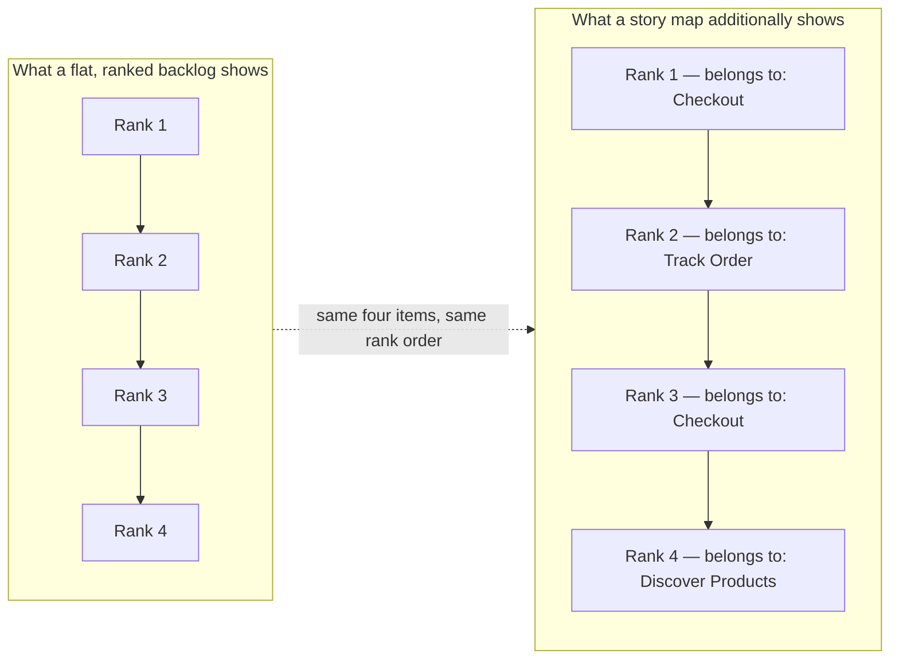
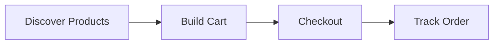
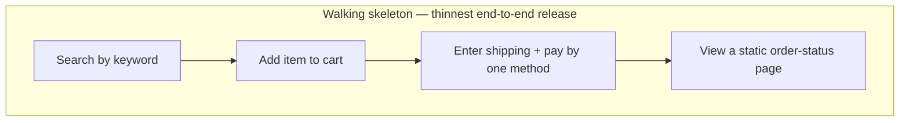
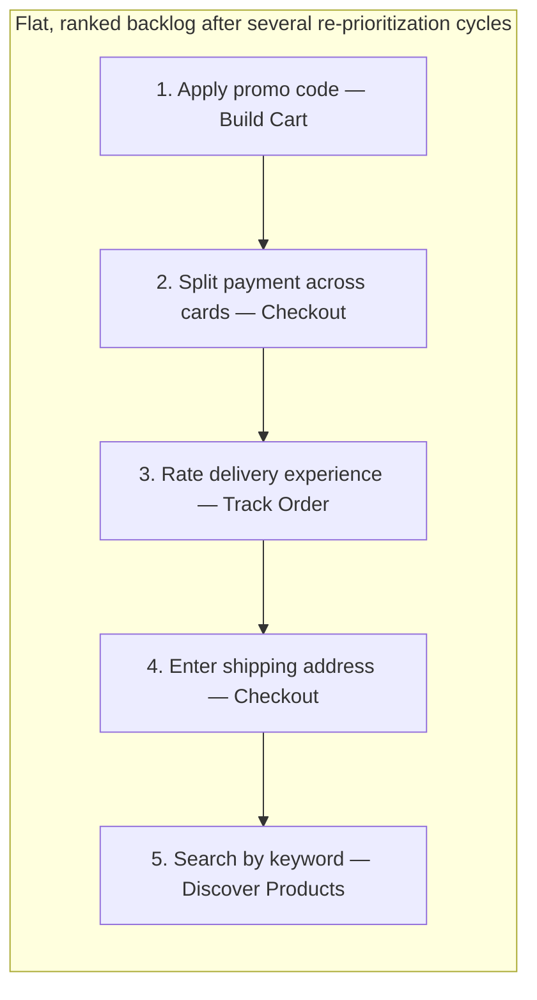
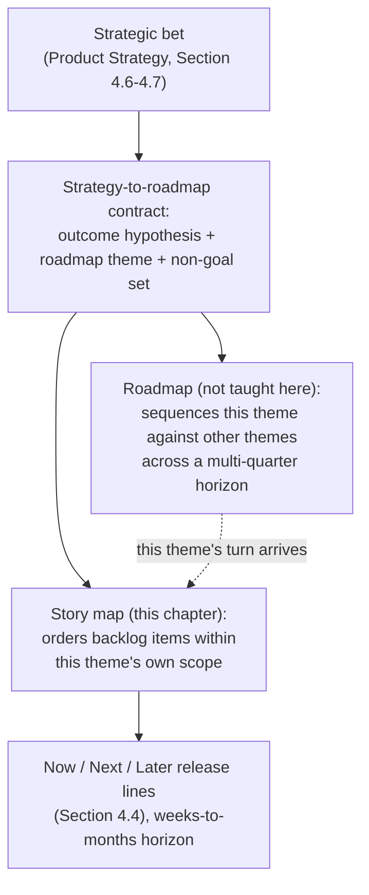
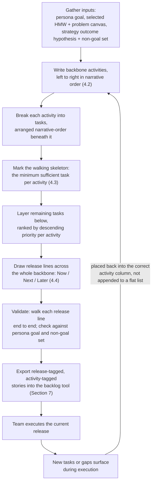
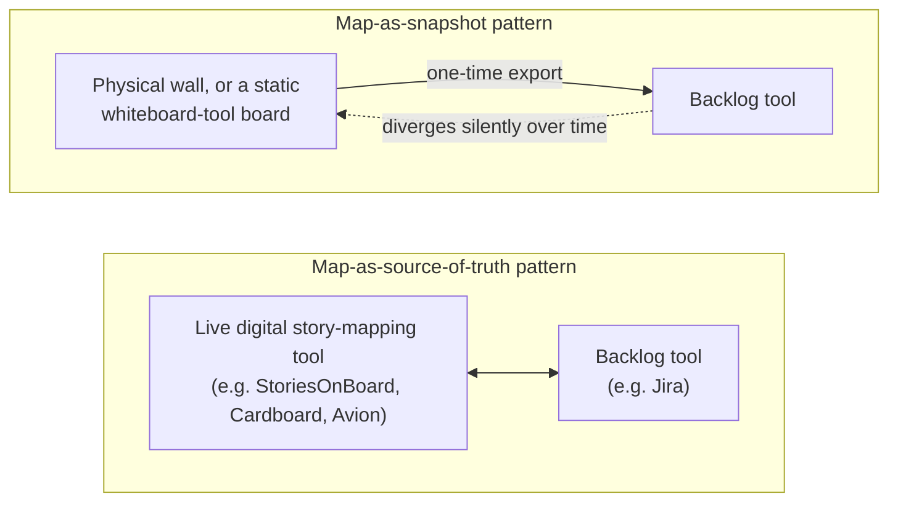
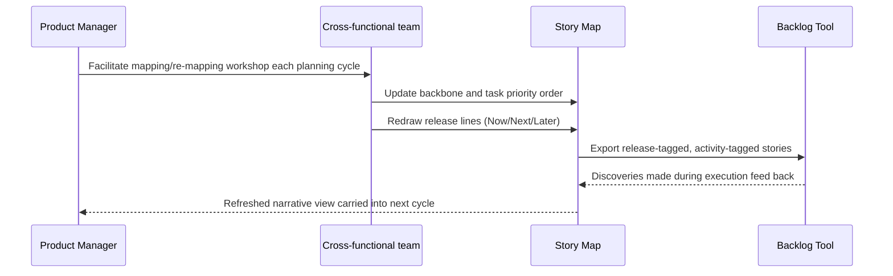

```mermaid
flowchart TB
    subgraph BACKBONE["Backbone — activities in narrative order, left to right"]
        direction LR
        A1[Discover Products]
        A2[Build Cart]
        A3[Checkout]
        A4[Track Order]
    end

    subgraph T1["Discover Products — tasks, top to bottom by priority"]
        direction TB
        A1T1[Search by keyword]
        A1T2[Browse by category]
        A1T3[Filter by price]
        A1T4[View recommendations]
    end

    subgraph T2["Build Cart — tasks, top to bottom by priority"]
        direction TB
        A2T1[Add item to cart]
        A2T2[Adjust quantity]
        A2T3[Save for later]
        A2T4[Apply promo code]
    end

    subgraph T3["Checkout — tasks, top to bottom by priority"]
        direction TB
        A3T1[Enter shipping address]
        A3T2[Select one payment method]
        A3T3[Review order summary]
        A3T4[Split payment across two cards]
    end

    subgraph T4["Track Order — tasks, top to bottom by priority"]
        direction TB
        A4T1[View static order-status page]
        A4T2[Receive shipping notification]
        A4T3[Reschedule delivery]
        A4T4[Rate delivery experience]
    end

    A1 --> T1
    A2 --> T2
    A3 --> T3
    A4 --> T4

    classDef now fill:#c8e6c9,stroke:#2e7d32,color:#1b1b1b;
    classDef next fill:#fff9c4,stroke:#f9a825,color:#1b1b1b;
    classDef later fill:#ffcdd2,stroke:#c62828,color:#1b1b1b;

    class A1T1,A2T1,A3T1,A3T2,A4T1 now
    class A1T2,A2T2,A3T3,A4T2 next
    class A1T3,A1T4,A2T3,A2T4,A3T4,A4T3,A4T4 later
```

# Chapter: Story Mapping

Part: [02 — Design Thinking and Product Management](PART_OVERVIEW.md) · Subsection: Product Management · Status: Drafted

## 1. Introduction

A story map is a two-dimensional arrangement of a product's backlog: user
tasks are laid out left to right in the order a real person would actually
perform them to accomplish a goal (the narrative spine, or **backbone**),
and stacked top to bottom beneath each backbone activity in descending
priority, so that a team can slice the map **horizontally** into coherent,
demoable releases instead of working through the backlog as an undifferentiated,
one-dimensional ranked list. Jeff Patton, who popularized the technique
under the name "story mapping," coined a blunt one-line description of the
problem it solves: a backlog is easy to build and useless to read, because
sorting hundreds of cards into a single priority-ranked column throws away
the one piece of information that made them coherent in the first place —
which step of the user's story each card belongs to, and what has to exist
before it for the card to matter at all.

This chapter's job is narrow and specific within this part's Product
Management subsection: it teaches story mapping as a **backlog-ordering and
release-planning artifact** — the backbone/activities row, the walking
skeleton concept (the thinnest possible release that is still genuinely
end-to-end), vertical slicing by release using horizontal release lines
(commonly labeled Now/Next/Later), and the specific failure mode a story map
exists to prevent: the **flat backlog**, where a backlog's narrative arc has
been quietly lost because every item lives in one undifferentiated,
rank-ordered column. Everything else this chapter touches — personas,
problem framing, product strategy, and the two closely related but distinct
artifacts a reader will be tempted to confuse a story map with — is either
recapped briefly with a link to the chapter that owns it, or named and
deliberately left untaught because it belongs to a sibling chapter in this
part that has not been drafted yet.

Three boundaries matter enough to state up front, before Section 4 works
through them in full:

- A story map's backbone is not a persona, though it is built using a
  persona's goals as an input. [Personas](CH03_Personas.md) owns the
  persona artifact itself in full — its component checklist, construction
  discipline, and governance lifecycle — and
  [Personas (Product Management)](CH18_Personas_Product_Management.md)
  owns how a persona's business value informs prioritization arbitration.
  This chapter treats "a validated persona and its top goals already
  exist" as an input state, the same way both of those chapters do for
  their own upstream dependencies.
- A story map's backbone is not a journey map, even though both artifacts
  arrange something in left-to-right, time-ordered fashion and even though
  both use sticky notes and both can look, at a glance, like the same kind
  of wall. [Journey Mapping](CH05_Journey_Mapping.md) owns the full
  construction discipline for a journey map — a sequenced, emotionally
  annotated record of a person's **experience** across an end-to-end
  process, including moments the product has not yet built and touchpoints
  the product may never own. A story map's backbone sequences something
  narrower and more internal: the **order in which a team will build**
  the tasks that make up a specific, scoped release. Section 4.6 works
  through this distinction in full, because conflating the two is one of
  the most common ways a story-mapping exercise goes wrong in practice.
  This part also lists a not-yet-drafted, Product-Management-specific
  "Journey Mapping" chapter (see [PART_OVERVIEW.md](PART_OVERVIEW.md));
  this chapter does not guess at that chapter's content and instead
  anchors its distinction entirely against [Journey Mapping](CH05_Journey_Mapping.md)'s
  already-drafted definition.
- A story map is not a roadmap. [Product Strategy](CH15_Product_Strategy.md#47-strategy-to-roadmap-translation-contract)
  owns the strategy-to-roadmap translation contract — the outcome
  hypothesis, roadmap theme, and non-goal set a strategic bet owes the
  roadmap layer before it becomes buildable work. A story map picks up
  **after** that handoff: it takes a single roadmap theme (a single bet,
  already scoped by a non-goal set) and orders the backlog items *within*
  that scope into a build sequence and a set of release cuts. A roadmap,
  by contrast — owned by this part's not-yet-drafted **Roadmaps** chapter
  (see [PART_OVERVIEW.md](PART_OVERVIEW.md)) — sequences multiple such
  themes and bets against each other across a much longer, multi-quarter
  horizon. Section 4.7 works through this altitude difference in full;
  this chapter names Roadmaps only to draw that boundary and does not
  teach roadmap mechanics.

Read in sequence, this chapter assumes a reader already has (or can quickly
construct, following the linked chapters) a validated persona, a scoped
problem statement carrying a selected How-Might-We (HMW) question, and a
strategic bet that has already cleared Product Strategy's translation
contract. Given those three inputs, this chapter is the answer to the next
question a team actually asks: in what order do we build this, and where do
we cut the first release?

## 2. Historical Evolution

- **1999-2001 — Extreme Programming (XP) formalizes the user story.**
  Kent Beck and Ron Jeffries's Extreme Programming (XP) practice introduced
  the user story as a deliberately small, conversational placeholder for a
  requirement — "a promise for a conversation," in Jeffries's later
  phrasing — favoring a short card over an exhaustive specification
  document. Bill Wake's later INVEST (Independent, Negotiable, Valuable,
  Estimable, Small, Testable) criteria became the standard checklist for a
  well-formed individual story. This gave teams a well-defined atomic unit
  of backlog work, but no answer yet for how hundreds of these atomic
  units, once written, should be arranged relative to each other.
- **Early-to-mid 2000s — Scrum standardizes the flat, ranked product
  backlog.** Ken Schwaber and Jeff Sutherland's Scrum framework
  popularized the product backlog as a single, priority-ordered list —
  simple to explain, simple to groom in a sprint-planning meeting, and,
  as Section 3 details, exactly the structure that discards a story's
  narrative context the moment it is dropped into rank order alongside
  unrelated stories from other parts of the product.
- **Alistair Cockburn's "walking skeleton" (Crystal methodologies,
  early-to-mid 2000s).** Cockburn's Crystal Clear methodology and its
  surrounding literature introduced the term "walking skeleton" for the
  thinnest possible implementation of a system that is still genuinely
  end-to-end — enough to prove the architecture holds together, even
  before most of the real functionality exists. Story mapping later
  adopted this term directly (Section 4.3) as the name for a map's
  first, thinnest horizontal release slice.
- **2005 — Jeff Patton's "It's All in How You Slice It."** Patton, working
  at the intersection of Agile delivery practice and user-centered design,
  published the essay widely credited as story mapping's origin point. Its
  central observation was that the flat backlog was primarily a *slicing*
  problem: teams were carving early releases as thin horizontal
  architectural layers (all data-model work first, then all business
  logic, then all interface work) instead of as thin vertical slices of
  complete, demoable user value — the exact distinction Section 4.4 below
  formalizes as the difference between a real release cut and an
  architecture-layer cut.
- **2008-2012 — grassroots adoption inside Agile and Lean UX practice.**
  Story mapping spread through conference talks, workshops, and informal
  practice well before it had a canonical published reference, adopted
  particularly by teams already practicing
  [Lean UX](CH13_Lean_UX.md)-style close design/engineering collaboration,
  where a physical wall of index cards was already a familiar working
  surface.
- **2014 — "User Story Mapping: Discover the Whole Story, Build the Right
  Product" (Patton, O'Reilly).** Patton's book codified the technique into
  the vocabulary this chapter uses throughout — backbone, activities,
  tasks, the walking skeleton, and release lines — and gave the practice a
  single, citable, canonical reference for the first time. The book's
  title itself states the technique's thesis: a flat backlog is a
  fragment of the story; a map is the whole story.
- **2014 onward — digital tooling and dual-track adoption.** Dedicated
  digital story-mapping tools (StoriesOnBoard, Cardboard, Avion, and
  general-purpose whiteboard tools such as Miro and Mural repurposed for
  the same layout) emerged to solve remote and distributed-team
  collaboration, most offering two-way synchronization with backlog tools
  such as Jira so a map's structure and a team's execution backlog would
  not silently diverge (Section 7). Scaled Agile Framework (SAFe) and
  other large-organization delivery frameworks incorporated story mapping
  as a standard technique inside Program Increment planning, and
  [Product Discovery](CH14_Product_Discovery.md)'s dual-track model
  further normalized story mapping as the hand-off artifact between a
  discovery track's validated opportunity and a delivery track's release
  plan.

## 3. Why It Exists

A backlog, as most teams actually maintain it, is a single column: items
ranked from "do this first" to "do this eventually," each carrying a title,
an estimate, and maybe an acceptance criterion. That structure is easy to
build, easy to groom in a sprint-planning meeting, and — this is the
problem — actively hostile to the one question a team most needs an answer
to before committing engineering time to a release: **does the set of items
we are about to build actually add up to a complete, demoable, valuable
story for a real user, or is it just this week's highest-ranked scraps from
several unrelated stories at once?**

A ranked list cannot answer that question, because rank order alone cannot
distinguish "this item is part of a coherent release" from "this item
merely scored higher on a prioritization framework than its neighbors." Two
items adjacent in rank order might belong to entirely different points in a
user's journey — one might depend on infrastructure the other item, ranked
three spots lower, hasn't been built yet. The flat backlog doesn't just
fail to prevent this incoherence; it actively hides it, because a ranked
list has no visual mechanism for showing which items are narratively
connected and which merely happen to be numerically adjacent.



The right-hand view is the same four backlog items in the same rank order
as the left — nothing about the ranking changed. What the story map adds is
the missing dimension: which narrative activity each item belongs to. Read
that way, the ranking is visibly incoherent — a release built strictly in
this rank order would ship half of checkout, then an order-tracking
feature with nothing to track yet, then the other half of checkout, then a
product-discovery feature that should have come first. A flat backlog
cannot show this; a story map can, because it never collapses the
narrative dimension in the first place.

Story mapping exists to keep that second dimension visible throughout
planning, so that "what should we build in the next release" is answered
by asking "what is the smallest complete slice of the user's actual story
we can ship" rather than "what is next on the ranked list" — two questions
that, as the flat-backlog failure mode in Section 4.5 details, produce
answers that diverge more often, and more expensively, than most teams
expect.

## 4. Core Concepts

### 4.1 The Story Map: Definition and Anatomy

Definition:
A story map is a two-dimensional grid of a product backlog in which the
horizontal axis orders **activities** — the high-level things a user does
— in the sequence a real person actually performs them, and the vertical
axis, beneath each activity, orders the specific **tasks** that make up
that activity by descending priority. The result is a map, not a list: a
reader can scan left to right to understand the whole story a user lives
through, and scan top to bottom under any single activity to see that
activity's tasks ranked from most to least essential.

Mechanism (how it works):
A story map is built from three structural layers, each answering a
different question:

1. **Backbone / activities row** (Section 4.2): the top row, answering
   "what does the user do, broadly, and in what order?" Each activity is a
   short verb phrase — "Discover Products," "Build Cart," "Checkout,"
   "Track Order" — never a system component or a team's internal name for
   a piece of work.
2. **Tasks** (the body of the map, stacked beneath each activity): each
   activity is broken into the specific tasks a user performs to
   accomplish it, arranged left to right in the same narrative-order
   discipline as the backbone itself, and then stacked vertically beneath
   the activity in descending priority — the most essential task for that
   activity sits at the top, optional refinements sink toward the bottom.
3. **Release lines** (Section 4.4): horizontal cuts drawn across the
   entire map, below the activities row, grouping the highest-priority
   tasks under every activity into a first release, the next tier into a
   second release, and so on.

Decision implications (when and why to use it):
Build a story map at the point a team has a validated persona, a scoped
problem (an HMW question and its problem statement canvas, per
[Problem Framing](CH06_Problem_Framing.md)), and a strategic bet that has
already cleared [Product Strategy](CH15_Product_Strategy.md#47-strategy-to-roadmap-translation-contract)'s
translation contract — in other words, once the team knows *what* problem
it is solving and *why* it matters, and needs to decide *in what order* to
build it and *where the first release ends*. A story map is the wrong tool
before that point (it is not a discovery or opportunity-assessment
instrument — that is [Product Discovery](CH14_Product_Discovery.md)'s and
[Problem Framing](CH06_Problem_Framing.md)'s territory) and it is the wrong
level of granularity after a release has already shipped and the team is
deep into sprint-level task tracking, where a conventional backlog tool
suffices for day-to-day execution.

Common failure mode:
Building a "map" that is really just a flat backlog wearing sticky notes —
one long, undifferentiated column of tasks pinned to a wall without ever
establishing the backbone row first. Section 4.5 names this the flat
backlog failure mode in full; the root cause is almost always skipping the
backbone step (Section 4.2) and going straight to writing individual task
cards, because task-writing feels more concretely productive in the room
than the more abstract, discussion-heavy work of first agreeing on the
activities themselves.

Concrete scenario:
A small e-commerce team building a mobile checkout redesign starts, as
several teams do, by dumping forty sticky notes onto a table — "add promo
code field," "support Apple Pay," "show estimated delivery date," and so
on — before anyone has written a backbone. Within twenty minutes the group
is arguing about which of two unrelated cards is more important, unable to
resolve the argument because nothing on the table yet shows that one card
belongs to "Build Cart" and the other to "Track Order" — two different
points in the user's story that were never going to be directly comparable
in the first place. Restarting with the backbone row first (Section 4.2)
resolves the argument immediately: both cards turn out to matter, just at
different points in the story and, once release lines are drawn
(Section 4.4), in different releases.

### 4.2 The Backbone / Activities Row: The Narrative Spine

Definition:
The backbone is the top row of a story map: a short, ordered sequence of
**activities** — the high-level things a specific persona does to
accomplish a specific goal — written and arranged strictly in the order a
real person would perform them, left to right. It is the map's narrative
spine: read alone, without a single task card beneath it, the backbone
should already read as a coherent, plausible sentence describing what the
user does from start to finish.



Mechanism (how it works):
A backbone is written by walking through the persona's goal
([Personas](CH03_Personas.md)) end to end and naming each broad activity
in the order the persona actually performs it — never in the order a team
happens to find convenient to build, and never grouped by which internal
system or team owns the underlying implementation. This is the single most
important discipline in the entire technique: the axis is the **user's**
narrative order, not the **system's** architectural order. A backbone
built by architectural convenience might read "Authentication → Data Layer
→ Business Logic → Presentation" — a sequence meaningful to an engineering
team's build plan, but meaningless as a description of what a user actually
experiences, and useless for the release-slicing work in Section 4.4,
which depends entirely on every release cut containing a coherent piece of
the *user's* story, not a coherent piece of the system's internals.

Decision implications (when and why to use it):
Write the backbone first, as a group, before a single detail task is
written. A well-formed backbone typically has somewhere between five and
nine activities for a single, bounded persona goal — fewer than five
usually means the scope is too narrow to need a map at all; more than nine
usually means either the map is trying to cover more than one persona goal
at once, or several "activities" are actually tasks that belong one level
down. Validate the backbone against the persona's stated top goal
([Personas](CH03_Personas.md)) and the selected HMW question's scope
([Problem Framing](CH06_Problem_Framing.md#42-the-how-might-we-hmw-statement))
before moving on — a backbone activity that doesn't trace back to either
is a signal the map's scope has quietly drifted.

Common failure mode:
Writing the backbone in build order instead of narrative order — for
example, ordering activities by which team will implement them, or by
which activity happens to be technically easiest to start first. This
silently converts the backbone from a description of the user's story into
a project plan wearing the story map's visual format, and it breaks the
release-slicing logic in Section 4.4, because a release cut across a
build-ordered backbone produces a release that makes engineering sense but
that no real user could actually use end to end.

Concrete scenario:
A backbone drafted by an engineering-led team for the same checkout
redesign initially read "Payment Gateway Integration → Cart Data Model →
Address Validation → Order Confirmation Email" — each activity real, but
ordered by which backend component the team wanted to build first, not by
what a shopper actually does. Rebuilt from the shopper's actual narrative
— "Discover Products → Build Cart → Checkout → Track Order" — the same
underlying engineering work still needed to happen, but now every release
line drawn beneath it (Section 4.4) produced a slice a real shopper could
complete end to end, rather than a slice that happened to finish one
backend component before starting the next.

### 4.3 The Walking Skeleton

Definition:
The walking skeleton is a story map's first, thinnest possible release: the
single highest-priority task under every activity in the backbone, taken
together, forming a release that is genuinely end-to-end — a real user
could walk through the entire narrative spine using only this release's
functionality — even though almost every individual step is the crudest,
least-featured version imaginable of what that step will eventually
become.



Mechanism (how it works):
For each backbone activity, identify the single task that is both
absolutely essential (the activity is not meaningfully completable
without it) and achievable with the least possible engineering investment
— deliberately excluding every convenience, variant, and edge case that a
task's later, richer versions will add. The walking skeleton is not the
easiest task under each activity; it is the *minimum sufficient* task, and
those are frequently not the same task. "Search by keyword" might be
harder to build than "browse by category," but if the persona's actual
goal requires being able to find a specific product, keyword search — not
the easier browse-by-category feature — is what belongs in the skeleton.

Decision implications (when and why to use it):
Build the walking skeleton first, before any other release, for two
reasons that compound. First, it is the fastest possible way to validate
that the backbone itself is correctly and completely ordered — a team that
cannot actually walk end to end through its own walking skeleton has
discovered a gap in the backbone, not just a missing feature, and it is far
cheaper to discover that gap now than after several releases' worth of
detail work has been built on top of an incomplete spine. Second, the
walking skeleton is frequently the fastest legitimate candidate for a
Minimum Viable Product (MVP) — the smallest release a team can put in
front of real users to learn something real, a concept this part's
not-yet-drafted **MVP** chapter (see [PART_OVERVIEW.md](PART_OVERVIEW.md))
will teach in full; this chapter uses the term only to name that adjacent
relationship, not to teach MVP construction itself.

Common failure mode:
Confusing "thin" with "easy." A team eager to show early progress
sometimes builds the easiest task under each activity instead of the
minimum *sufficient* one, producing a "skeleton" that is technically
end-to-end but that skips the one hard step — often payment or
authentication — that determines whether the release is actually usable,
deferring the hardest, most architecturally significant work to a later
release where it can no longer inform the early architecture decisions it
should have shaped from the start.

Concrete scenario:
A checkout-redesign team's first attempt at a walking skeleton included
"browse by category" (easy) instead of "search by keyword" (harder, but
the actual minimum sufficient task for a shopper who already knows what
they want) and deferred payment processing entirely to "Release 2,"
substituting a fake "order placed" confirmation with no real payment step.
The result technically let a tester click through every backbone activity,
but the release taught the team nothing about the one integration —
payment — most likely to surface a real architectural problem, and that
problem surfaced two releases later than it should have, at a point where
several other features already depended on assumptions about the payment
flow that turned out to be wrong.

### 4.4 Vertical Slicing by Release: Release Lines

Definition:
A release line is a horizontal cut drawn across the entire width of a
story map, beneath the backbone, separating the tasks above the line
(included in that release) from the tasks below it (deferred). Because
the cut spans every activity column, a release line forces every release
to include at least one task from every activity — a **vertical slice**
through the whole backbone — rather than a **horizontal slice** through
only one or two activities, which is the architecture-layer mistake
Patton's original 2005 essay (Section 2) identified as the flat backlog's
root cause.

The most common convention labels release lines **Now**, **Next**, and
**Later** — a deliberately coarse, three-tier horizon rather than a
committed, dated multi-release schedule, because a story map's job is to
show relative sequencing and scope, not to make date commitments (that
belongs to the not-yet-drafted Roadmaps chapter, Section 4.7).

```{=latex}
\begin{landscape}
```



```{=latex}
\end{landscape}
```

Green cells above are the **Now** release (the walking skeleton from
Section 4.3, plus one additional priority task per activity); yellow cells
are **Next**; red cells are **Later**. Reading straight down any single
activity column shows that activity's own priority order; reading straight
across at any color boundary shows a complete, vertical release cut —
every activity contributes at least one task to the Now release, so a real
shopper can walk end to end through Now alone, then again through Now plus
Next, and so on.

Mechanism (how it works):
Draw release lines only after the backbone (Section 4.2) and the
per-activity task priority order are both settled. Start with the Now
line at the walking skeleton (Section 4.3) exactly, then negotiate each
subsequent line by asking, for every activity in turn, "what is the next
most essential task here, and does adding it (plus whatever the other
activities add at this same line) still produce a coherent, demoable
release?" A release line is validated, not just drawn, by literally
walking through it left to right and confirming every step in the
narrative has *something* — even a crude version — to stand on.

Decision implications (when and why to use it):
Use release lines the moment a team must decide what ships first, in what
order, and what a specific release honestly excludes — precisely the
scope a released bet's non-goal set (recap,
[Product Strategy](CH15_Product_Strategy.md#47-strategy-to-roadmap-translation-contract))
should already have bounded before mapping starts. A release line is a
commitment device: everything below the line is explicitly, visibly
deferred, which is far more useful to a stakeholder asking "why isn't
feature X in this release" than an undifferentiated backlog's implicit,
undiscussed exclusion.

Common failure mode:
Drawing a release line that cuts *within* one or two activities only,
leaving one or more other activities with zero tasks above the line — a
horizontal, architecture-layer cut in vertical-slice clothing. A release
that includes rich checkout functionality but nothing at all under
"Track Order" is not vertically sliced; it is a release that happens to
satisfy engineering convenience (checkout was the team's current focus)
while leaving a real user with no way to find out what happened to an
order they just placed.

Concrete scenario:
Applying the diagram above literally: a proposed "Release 1" that included
every green *and* yellow "Checkout" task (four total) but zero "Track
Order" tasks would let a shopper complete a purchase with a saved-for-later
cart and a promo code applied, and then have no way whatsoever to check
what happened next — a release that is deep in one activity and entirely
absent in another, rather than a genuine vertical slice. The corrected Now
release in the diagram instead takes exactly one task from every activity
first, guaranteeing the thinnest possible release is still a complete
story.

### 4.5 The Flat Backlog Failure Mode

Definition:
The flat backlog failure mode is the loss of a backlog's narrative arc
when its items are represented and worked purely as a single,
priority-ranked column — a list where every item's relationship to every
other item is reduced to "ranked higher" or "ranked lower," with no
surviving information about which narrative activity an item belongs to,
what has to exist before it for it to make sense, or whether a given rank
cut produces a coherent release at all. It is the specific problem
Section 3 introduced at the chapter level; this section names it formally
as a recognizable, detectable failure mode with its own causes and
warning signs.

Mechanism (how it happens):
A story map almost never survives past its own workshop by accident of
tooling, not malice: most backlog-management tools (Jira and its close
peers chief among them) are built around a single ranked list as the
default, load-bearing view, because that view is what sprint planning
actually consumes day to day. A team maps carefully once, exports the
resulting cards into that tool, and from that point forward every
re-prioritization conversation happens inside the flat, ranked view —
because that is the view the tool surfaces, and the map itself, whether a
physical wall or a separate digital board, is no longer in the room. Each
individual re-ranking decision can look perfectly reasonable in isolation;
the narrative incoherence only becomes visible in aggregate, and by the
time it is visible, several sprints of work may already have been
committed against the broken rank order.



A team executing strictly in this rank order would build "apply promo
code" and "split payment across cards" — both real, but both refinements
— before "enter shipping address" exists at all; would ship a "rate
delivery experience" feature with no working checkout yet to have
generated a delivery to rate; and would build all of this before "search
by keyword," the very first thing a shopper needs, is ever addressed. None
of these five items is individually wrong to want. Ranked in this order
and executed literally, they add up to a release with no coherent,
demoable story — exactly the failure Section 4.4's release-line discipline
exists to prevent, and exactly the failure that recurs the moment the map
is treated as a one-time workshop output instead of a living reference.

Decision implications (when and why to guard against it):
Treat the map as the living source of truth for *why* the backlog is
ordered the way it is, and treat the flat, ranked export as a
downstream execution view derived from it — not the other way around.
Section 7 details the tooling patterns (map-as-source-of-truth
synchronization versus a one-time snapshot export) that make this
practical rather than aspirational, and Section 8 covers the cadence
discipline (re-mapping each planning cycle) that keeps the map from
silently going stale while the flat backlog view keeps changing underneath
it.

Common failure mode (the failure mode's own most common trigger):
Discarding or archiving the map immediately after the initial release
lines are drawn, treating story mapping as a one-time kickoff exercise
rather than a living planning artifact. Every subsequent
re-prioritization decision then has nothing to check itself against except
the flat list itself, and the narrative discipline the mapping workshop
established quietly erodes, re-ranking cycle by re-ranking cycle, until
the backlog looks exactly like the diagram above and nobody in the room
remembers why.

Concrete scenario:
A team maps its checkout redesign carefully, agrees a clean set of release
lines, and exports the result into Jira as a flat, ranked backlog for
sprint planning — a completely reasonable step on its own. Three sprints
later, a stakeholder requests that "split payment across cards" be
re-ranked upward because a single high-value customer asked for it. The
request is reasonable in isolation and is granted inside the flat Jira
view, with no visibility into the fact that "split payment" belongs to
Checkout, several tasks below "enter shipping address" in that same
activity's own priority order. Repeated a handful of times across
different activities by different stakeholders, each individually
reasonable, the accumulated effect is the diagram above: a rank order that
no longer corresponds to any coherent release. The fix is not to forbid
re-prioritization — it is to make every re-prioritization decision pass
back through the still-alive map (which activity does this belong to, and
does promoting it still leave a coherent release above the current line)
before it is applied to the flat execution view.

### 4.6 Story Map vs. Journey Map: Build Sequence vs. Experience Timeline

[Journey Mapping](CH05_Journey_Mapping.md) owns the full construction
discipline for a journey map: a synthesized, visual artifact sequencing a
specific person's **experience** of accomplishing a goal across an
end-to-end process, plotting what they do, think, and feel at each stage,
including the emotional highs and lows (the peak-end-weighted emotional
curve — recap,
[Journey Mapping](CH05_Journey_Mapping.md#42-emotional-curve-peak-end-rule-applied-to-journey-mapping))
and touchpoints the product may not yet have built at all, potentially
spanning far more than a single release. This chapter does not re-teach
any of that; a reader unfamiliar with journey mapping's construction
technique should read that chapter first.

The distinction that matters for this chapter is narrower and more
practical than "these are two different artifacts" — it is that the two
artifacts sequence **different things**, along axes that only coincidentally
look similar:

- A **story map's backbone** sequences the **build**: the order in which a
  development team will implement the tasks that make up a specific,
  already-scoped release. Its horizontal axis answers "what does the user
  do, in what order, within the scope of what we are building right now,"
  and it stops at the edge of the current bet's non-goal set
  ([Product Strategy](CH15_Product_Strategy.md#47-strategy-to-roadmap-translation-contract)).
- A **journey map's timeline** sequences the **experience**: everything the
  person actually lives through in pursuit of a goal, whether or not any
  of it has been built yet, whether or not it will ever be a feature this
  product owns, and whether the person feels satisfied, frustrated, or
  anxious at each point along the way. Its horizontal axis answers "what
  does this person actually go through," unconstrained by any particular
  release's scope.

```mermaid
flowchart TB
    subgraph SM["Story map backbone — build sequence for one scoped release"]
        direction LR
        SM1[Discover Products] --> SM2[Build Cart] --> SM3[Checkout] --> SM4[Track Order]
    end
    subgraph JM["Journey map timeline — full experience, any release, any touchpoint"]
        direction LR
        JM1["Hears about brand\nfrom a friend (not built)"] --> JM2["Compares prices\non a review site (not owned)"] --> JM3[Discovers Products] --> JM4[Build Cart] --> JM5[Checkout] --> JM6[Track Order] --> JM7["Contacts support\nabout a late delivery"] --> JM8["Decides whether\nto reorder"]
```

Notice the journey map's timeline is a strict superset that both precedes
and follows the story map's backbone, and includes stages (hearing about
the brand from a friend, comparing prices on a third-party review site)
the product may never build a feature for at all — those stages still
matter to the person's experience and still belong on a journey map, but
they have no place on a story map, whose entire purpose is ordering
*buildable* backlog items. Practically, this means a team should reach for
a journey map when the question is "where does this experience actually
break down for the user, across the whole arc, including parts we don't
own," and reach for a story map when the question has already narrowed to
"we know what we're building this release — in what order, and where do
we cut it." Conflating the two most often shows up as a "story map" whose
backbone includes non-buildable stages like "hears about brand from a
friend," which stalls the mapping session on a question story mapping
cannot answer and journey mapping already has a technique for.

### 4.7 Story Map vs. Roadmap: Within-Release Order vs. Across-Release Sequencing

[Product Strategy](CH15_Product_Strategy.md#47-strategy-to-roadmap-translation-contract)
owns the strategy-to-roadmap translation contract: before a strategic bet
is handed downstream, it must carry an outcome hypothesis (the specific,
falsifiable result expected), a roadmap theme (a durable, outcome-oriented
label a roadmap organizes initiatives under), and an explicit non-goal set
(what the bet deliberately excludes). This chapter treats that contract as
a fixed input — a story map never invents its own scope; it inherits the
scope a bet's non-goal set has already drawn.

The altitude difference between a story map and a roadmap is the same kind
of difference Section 4.6 drew between a story map and a journey map, but
along a different axis — time horizon and unit of sequencing, rather than
build-versus-experience:

- A **story map** orders **backlog items within a single release's
  scope**, at a granularity of individual user tasks, over a horizon
  typically measured in weeks to a few months (one to a handful of
  releases deep).
- A **roadmap** — owned in full by this part's not-yet-drafted
  **Roadmaps** chapter (see [PART_OVERVIEW.md](PART_OVERVIEW.md)) —
  sequences **initiatives and bets against each other**, at the
  granularity of whole roadmap themes, over a horizon typically measured
  in multiple quarters. This chapter does not teach roadmap construction,
  sequencing technique, or format; it names the boundary only so a reader
  does not mistake a story map's Now/Next/Later release lines
  (Section 4.4) for a roadmap's own, coarser sequencing of themes.



A useful operational test for which artifact a given sequencing question
belongs to: if the question is "should we build the checkout redesign
before or after the loyalty-program initiative next quarter," that is a
roadmap question, comparing two different themes against each other at the
initiative level. If the question is "within the checkout redesign we've
already committed to, should split-payment support ship in the first
release or the second," that is a story map question, ordering items
*inside* a single already-committed theme. Confusing the two most often
shows up as a story map whose backbone tries to include unrelated
initiatives side by side (mixing "Checkout Redesign" and "Loyalty Program"
activities in a single map) — a symptom that the team is actually trying
to solve a roadmap-level sequencing problem using a tool built for a
narrower, within-release one.

### 4.8 Upstream Inputs, Recapped

A story map does not originate its own scope, persona, or strategic
rationale — it consumes three upstream artifacts this chapter deliberately
does not re-teach:

> A **persona** ([Personas](CH03_Personas.md)) is a fictional,
> evidence-backed archetype built from behavioral variables, whose stated
> top goal supplies the "who" and the "what" a story map's backbone is
> built to serve — the backbone in Section 4.2's diagrams implicitly
> narrates one specific persona's goal, not a generic, unnamed "the user."

> A **How-Might-We (HMW) statement and its problem statement canvas**
> ([Problem Framing](CH06_Problem_Framing.md#42-the-how-might-we-hmw-statement))
> supply the bounded problem a story map's backbone must stay inside —
> an activity that doesn't trace back to the selected HMW's scope is a
> signal, per Section 4.2's common failure mode, that the map has drifted
> beyond the problem it was chartered to solve.

> The **strategy-to-roadmap translation contract**
> ([Product Strategy](CH15_Product_Strategy.md#47-strategy-to-roadmap-translation-contract))
> supplies the outcome hypothesis and non-goal set a story map's release
> lines (Section 4.4) must respect — a release line that quietly re-expands
> scope the non-goal set explicitly excluded is reintroducing the exact
> scope creep that contract was designed to prevent, one release cut at a
> time.

## 5. Internal Working

Building and maintaining a story map is a repeating workshop-and-refresh
loop, not a one-time drafting exercise — the flat backlog failure mode
(Section 4.5) is, in large part, what happens when a team treats it as the
latter.



The loop's final feedback edge is the single most important discipline in
this diagram and the direct operational answer to Section 4.5's failure
mode: a task discovered mid-sprint — an edge case, a missed step, a
support ticket revealing a gap — is placed back into its correct backbone
activity and given a priority relative to that activity's other tasks,
never simply appended to the bottom (or top) of a flat execution list
where its narrative position is immediately lost again.

A second internal mechanism worth making explicit is *why* the walking
skeleton (Section 4.3) is drafted before any other detail task, rather than
after the full backbone is fleshed out in detail: attempting to fully
detail every activity before establishing an end-to-end skeleton risks
sinking significant workshop time into refining a step that later turns
out to be unnecessary, redundant with another activity, or simply
misordered — exactly the kind of backbone-level error Section 4.2's common
failure mode describes, and one that is far cheaper to catch while the
skeleton is still thin than after several rows of detail have been piled
on top of it.

## 6. Design Principles

- **Order by narrative, never by system architecture.** The backbone's
  entire value collapses the moment it is reordered to match a team's
  internal build convenience instead of the user's actual sequence
  (Section 4.2's common failure mode).
- **One map per bounded persona-goal scope.** A map trying to cover more
  than one persona's goal, or more than one roadmap theme's scope
  (Section 4.7), stops being scannable as a single coherent narrative and
  starts silently doing a roadmap's job with the wrong tool.
- **Slice thin, but always end to end.** The walking skeleton principle
  (Section 4.3) generalizes to every subsequent release line: prefer a
  release that is thinner but genuinely vertical over one that is richer
  in one or two activities and empty in the rest (Section 4.4's common
  failure mode).
- **Keep the map physically or visually scannable.** A backbone with more
  than roughly nine activities, or an activity column with dozens of
  undifferentiated task cards, has usually stopped being read as a single
  story and started functioning as an unreadable wall of sticky notes —
  a sign to split the scope, not to keep adding columns.
- **Treat the map as a living artifact, not a kickoff deliverable.**
  Section 5's feedback loop only works if the map survives past the
  initial workshop; Section 8 covers the operational cadence that keeps
  it alive.
- **Bring the whole cross-functional group into the room.** A backbone or
  release-line decision made by only one function (design alone, or
  engineering alone, or product alone) tends to reproduce that function's
  own blind spot — an engineering-only backbone risks the build-order
  mistake in Section 4.2; a design-only release line risks underestimating
  engineering effort when drawing the Now cut in Section 4.4.

## 7. Architecture Patterns

Two structural choices determine whether a story map remains the living
source of truth Section 5's loop depends on, or quietly decays into the
flat-backlog failure mode (Section 4.5) shortly after its first workshop.



- **Map-as-source-of-truth (bidirectional sync)**: a dedicated digital
  story-mapping tool maintains the backbone/task/release-line structure as
  the canonical model, synchronized bidirectionally with the team's
  backlog tool, so that a re-ranking done inside the backlog tool's flat
  view is reflected back into its correct activity column in the map, and
  vice versa. This pattern is the most direct structural defense against
  Section 4.5's failure mode, because it makes it structurally difficult
  for the flat view and the mapped view to disagree with each other.
- **Map-as-snapshot (one-time export)**: a physical wall of index cards,
  or a static whiteboard-tool board, is built once, photographed or
  transcribed into the backlog tool as a one-time export, and then the
  physical or static artifact is effectively retired while the team's
  actual working reference becomes the now-flat backlog tool. This pattern
  is cheaper to start (no new tool to adopt, and physical walls remain
  genuinely superior for a first, highly collaborative workshop) but
  requires deliberate, disciplined re-mapping sessions (Section 8) to avoid
  drifting into Section 4.5's failure mode, because nothing about the
  tooling itself prevents the drift.
- **Multi-team swimlane pattern**: when a single backbone's activities are
  each owned by a different squad (one team owns Discover Products, another
  owns Checkout), the backbone functions as a shared, cross-team narrative
  spine while each team manages its own activity's task detail and release
  cadence independently — a pattern that keeps the whole-story view intact
  across team boundaries, at the cost of needing an explicit,
  cross-team-agreed backbone before any individual team can slice its own
  releases against it.

Neither pattern is universally correct; Section 20's trade-off analysis
returns to the choice in full.

## 8. Production Architecture

Running story mapping as an ongoing practice inside a real product
organization — not just as a one-time workshop technique — requires three
standing structures:



- **Ownership**: the product manager typically owns the backbone and
  release-line decisions (with cross-functional input, per Section 6),
  while individual contributors own and continuously refine their own
  activity's task-level detail between formal re-mapping sessions.
- **Cadence**: a full re-mapping session is tied to the organization's
  planning-cycle boundary (commonly each quarter, or at minimum at the
  start of each new release), rather than left to happen only when
  someone happens to notice the backlog has drifted — the same
  fixed-cadence-versus-drift-detection tension this part's other
  governance-lifecycle chapters (for example,
  [Personas](CH03_Personas.md#8-production-architecture)) apply to their
  own artifacts.
- **Versioning**: each release line's contents are snapshotted at the
  moment a release is committed, so that a later question — "what did we
  actually say was in Release 1 when we started building it" — has a
  concrete, dated answer, distinct from whatever the live map currently
  shows after subsequent re-prioritization.

## 9. Implementation

A phased approach to standing up story mapping as a recurring practice for
a team that already has a validated persona, a scoped problem statement,
and a strategy-cleared bet:

### Phase 1: Confirm inputs

- Confirm the persona's top goal ([Personas](CH03_Personas.md)), the
  selected HMW question and its problem statement canvas
  ([Problem Framing](CH06_Problem_Framing.md)), and the bet's outcome
  hypothesis and non-goal set
  ([Product Strategy](CH15_Product_Strategy.md#47-strategy-to-roadmap-translation-contract))
  are all current — do not map against a stale or ambiguous input.

### Phase 2: Run the backbone workshop

- Bring the full cross-functional group into one room (or one
  synchronous digital session); write and sequence backbone activities
  (Section 4.2) before any task-level detail is discussed.

### Phase 3: Detail and slice

- Break each activity into tasks, mark the walking skeleton
  (Section 4.3), layer remaining tasks by priority, then draw and validate
  release lines (Section 4.4) by literally walking each line end to end.

### Phase 4: Choose and wire the tooling pattern

- Select map-as-source-of-truth or map-as-snapshot (Section 7) based on
  the trade-offs in Section 20, and wire the corresponding synchronization
  or export mechanism before the map's first export into the backlog tool.

### Phase 5: Export and operate

- Export release-tagged, activity-tagged stories into the backlog tool;
  begin execution against the current release line.

### Phase 6: Refresh on cadence

- Run Section 5's feedback loop continuously; hold a full re-mapping
  session at each planning-cycle boundary (Section 8), and whenever a
  discovered gap (Section 5) suggests the backbone itself may be
  incomplete.

## 10. Complete Code Examples

Like [Product Strategy](CH15_Product_Strategy.md#10-complete-code-examples)
and [Personas (Product Management)](CH18_Personas_Product_Management.md#10-complete-code-examples),
this chapter's territory is a facilitation- and structure-driven discipline
rather than a code-first one. In place of runnable application code, this
section provides implementation-neutral schemas a team can adapt into
whichever story-mapping tool, spreadsheet, or backlog system it already
uses; a fuller worked template is planned under
[code/templates/story-mapping-chapter/story-map-template.md](../code/templates/story-mapping-chapter/story-map-template.md).

Backbone activity schema:

- Activity name (a short verb phrase, narrative order position)
- Served persona and the specific goal it advances (traceable to
  [Personas](CH03_Personas.md))
- Traced HMW question / problem statement canvas reference
  ([Problem Framing](CH06_Problem_Framing.md))

Task card schema:

- Task title
- Parent activity (must match a backbone activity name exactly)
- Priority rank within its parent activity (integer, lower is higher
  priority)
- Walking-skeleton flag (boolean — true only for the single minimum
  sufficient task per activity, Section 4.3)
- Assigned release line (Now / Next / Later, or a project-specific
  equivalent)

Release-line validation record:

- Release name
- Activities represented (must equal the full backbone activity list —
  a release with a missing activity fails validation per Section 4.4)
- Walk-through confirmation (date and participant who confirmed the
  release is genuinely completable end to end)
- Non-goal-set cross-check (confirmation the release did not silently
  reintroduce scope the bet's non-goal set excluded, recap
  [Product Strategy](CH15_Product_Strategy.md#47-strategy-to-roadmap-translation-contract))

A short illustrative pseudocode expression of Section 4.4's release-line
validity check, provided only to make the mechanism concrete rather than
as a runnable artifact:

```
def release_is_valid(release_tasks, backbone_activities):
    represented = {task.activity for task in release_tasks}
    missing = set(backbone_activities) - represented
    if missing:
        raise FlatSliceError(
            f"Release has zero tasks for activities: {missing} "
            "— this is a horizontal architecture-layer cut, not a "
            "vertical release slice (Section 4.4)."
        )
    return True
```

A short illustrative pseudocode sketch of a flat-backlog drift detector
(Section 4.5), intended only to make the failure mode concrete:

```
def detect_flat_backlog_drift(flat_ranked_backlog, story_map):
    for index, item in enumerate(flat_ranked_backlog):
        activity = story_map.activity_of(item)
        if activity is None:
            flag(item, reason="Item has no traceable backbone activity")
        elif not story_map.rank_matches_activity_priority(item, index):
            flag(item, reason="Rank order disagrees with the map's own "
                               "activity-level priority order")
```

## 11. Performance

"Performance" for story mapping is measured in planning and delivery
velocity, not runtime latency:

- **Time from mapping session to a validated first release cut**: how
  long it takes a team to go from a blank backbone to a walked-through,
  validated Now release line (Section 4.4) — a rising trend often signals
  the backbone itself (Section 4.2) is being drafted without a clear,
  already-validated persona goal to anchor it.
- **Rework rate on shipped releases**: how often a "completed" release
  turns out, after the fact, to be missing an activity a real user needed
  — a direct signal of Section 4.4's common failure mode (a horizontal
  cut mistaken for a vertical one) slipping through the walk-through
  validation step.
- **Flat-backlog drift rate**: the proportion of backlog items in the
  team's execution tool that no longer trace back to a current backbone
  activity (Section 4.5) — a rising rate is the earliest measurable
  warning sign of the flat backlog failure mode, well before it becomes
  visible in an actual broken release.

## 12. Scalability

As an organization grows past a single team working a single backlog,
story mapping faces scaling pressure along two axes:

- **Multiple concurrent maps across teams**: the multi-team swimlane
  pattern (Section 7) keeps a shared backbone legible across team
  boundaries, but requires an explicit, cross-team-agreed backbone
  revision process — without it, teams drift toward independently
  re-ordering the shared backbone to suit their own local priorities,
  quietly reintroducing the build-order mistake (Section 4.2) at the
  organizational level.
- **Map sprawl without a shared convention**: independent teams each
  inventing their own release-line labels, granularity conventions, and
  tooling choices (Section 7) makes it hard for anyone above the
  single-team level to compare progress across maps — a lightweight,
  organization-wide convention (a shared release-line vocabulary, a
  shared choice of map-as-source-of-truth tooling) bounds this without
  forcing every team's map into identical content.
- **Re-mapping cadence outpacing facilitation capacity**: an organization
  running many concurrent story maps on the same planning-cycle cadence
  (Section 8) can outstrip the number of people skilled at facilitating a
  backbone workshop well; building that facilitation skill broadly across
  product managers, rather than concentrating it in one specialist, is
  the standard mitigation.

## 13. Security

Security here concerns confidentiality of competitively or strategically
sensitive planning information, not application-level security controls
(owned elsewhere, notably the not-yet-drafted Security part):

- **Strategic non-goal-set confidentiality**: a story map's release lines
  directly reveal a bet's non-goal set
  ([Product Strategy](CH15_Product_Strategy.md#13-security)) — what the
  team has deliberately chosen *not* to build yet — which can be
  competitively sensitive if the map (or its digital tool) is broadly or
  externally visible; restrict map visibility to the team and its
  legitimate stakeholders, the same way Product Strategy restricts its own
  bet documentation.
- **Customer-specific detail on task cards**: task cards discovered during
  execution (Section 5's feedback loop) sometimes reference a specific
  named customer or deal ("split payment for [named enterprise
  account]"); treat these the same way
  [Personas (Product Management)](CH18_Personas_Product_Management.md#13-security)
  treats council-deliberation detail — record what future planning needs,
  without over-exposing customer-identifying detail more broadly than
  necessary.
- **Restrict backbone/release-line edit access, not read access**: broad,
  read-only visibility into a live map builds trust and cross-team
  alignment; uncontrolled edit access risks an individual stakeholder
  quietly reordering a release line to favor their own request outside the
  group workshop discipline Section 6 requires.

## 14. Observability

Signals that reveal whether story mapping is functioning as intended
rather than existing as a one-time artifact nobody consults:

- **Backbone-traceability rate**: the proportion of backlog items in the
  execution tool that trace cleanly back to a specific, current backbone
  activity (Section 11's flat-backlog drift rate, tracked as a standing
  metric rather than a one-time check).
- **Release walk-through completion rate**: whether every committed
  release line was actually walked through end to end and validated
  (Section 4.4) before work began, versus release lines that were drawn
  and shipped without that validation step.
- **Re-mapping session adherence**: whether the planning-cycle-tied
  re-mapping cadence (Section 8) is actually happening, versus silently
  skipped in favor of continuing to work directly against the flat
  backlog tool.
- **Non-goal-set drift**: periodically compare a release's actual shipped
  scope against the originating bet's non-goal set
  ([Product Strategy](CH15_Product_Strategy.md#47-strategy-to-roadmap-translation-contract))
  to catch scope creep re-entering through release-line decisions before
  it accumulates across several releases.

This chapter deliberately stops at this framing-level treatment; full
metric-design technique belongs to this part's not-yet-drafted **Metrics**
and **North Star Metrics** chapters (see [PART_OVERVIEW.md](PART_OVERVIEW.md)).

## 15. Failure Scenarios

1. **The flat backlog** (Section 4.5 in full): the map's narrative
   structure is lost after the initial workshop, and re-prioritization
   decisions accumulate into an incoherent release. Resolution: adopt
   map-as-source-of-truth tooling (Section 7) and enforce the re-mapping
   cadence (Section 8).
2. **Architecture-layer backbone**: the backbone is ordered by build
   convenience instead of user narrative (Section 4.2's common failure
   mode), producing release lines that make engineering sense but no user
   sense. Resolution: rebuild the backbone from the persona's actual goal
   sequence and re-validate every existing release line against it.
3. **Skeleton-that-skips-the-hard-part**: the walking skeleton substitutes
   an easy task for the minimum sufficient one under a given activity
   (Section 4.3's common failure mode), deferring the release's riskiest
   integration past the point where it could still inform early
   architecture decisions. Resolution: re-derive the skeleton by asking
   "minimum sufficient," not "easiest," per activity.
4. **Horizontal release cut**: a release line includes rich detail in one
   or two activities and nothing at all in the rest (Section 4.4's common
   failure mode). Resolution: enforce the release-is-valid check
   (Section 10) before any release is committed.
5. **Story-map/journey-map conflation**: the backbone tries to include
   non-buildable, pre-product stages that belong to a journey map instead
   (Section 4.6). Resolution: split the artifact — move those stages to a
   proper journey map ([Journey Mapping](CH05_Journey_Mapping.md)) and
   restrict the backbone to buildable scope.
6. **Story-map/roadmap conflation**: a single map's backbone tries to
   mix two or more unrelated roadmap themes side by side (Section 4.7).
   Resolution: split the map along theme boundaries, and raise the
   cross-theme sequencing question to whatever roadmap process the
   not-yet-drafted Roadmaps chapter eventually formalizes.

## 16. Testing

"Testing" this chapter's mechanisms means validating a map before
committing engineering time against it, not testing code:

### 16.1 Backbone read-aloud check

Before writing a single task card, read the backbone activities aloud in
order as a single sentence describing what the persona does. If the
sentence doesn't make narrative sense, the backbone (Section 4.2) needs
rework before proceeding.

### 16.2 Walking-skeleton dry run

Before committing to a Now release line, have someone unfamiliar with the
map's construction attempt to narrate a complete walkthrough using only
the tasks marked walking-skeleton (Section 4.3); any point where the
narration breaks down identifies either a missing task or a misordered
activity.

### 16.3 Release-line validity check

Run the Section 10 validity check (every backbone activity represented
above the line) against every proposed release line before it is
committed, not just at the Now line.

### 16.4 Flat-backlog drift audit

Periodically sample items from the team's execution backlog tool and
confirm each still traces back to a current backbone activity
(Section 11), catching drift before it accumulates into the failure mode
in Section 4.5.

## 17. Common Mistakes

- Writing task cards before a backbone exists, skipping straight to a flat
  pile of stickies (Section 4.1's common failure mode).
- Ordering the backbone by build convenience or system architecture
  instead of the user's actual narrative sequence (Section 4.2).
- Choosing the easiest task, rather than the minimum sufficient one, for
  the walking skeleton (Section 4.3).
- Drawing a release line that leaves one or more activities with zero
  represented tasks (Section 4.4).
- Discarding or archiving the map immediately after the first workshop
  instead of treating it as a living reference (Section 4.5, Section 8).
- Letting individual stakeholders re-rank items directly inside a flat
  backlog tool without routing the change back through the map
  (Section 4.5's concrete scenario).
- Mixing a journey map's pre-product, emotional-experience stages into a
  story map's backbone (Section 4.6).
- Mixing more than one roadmap theme's scope into a single map
  (Section 4.7).

## 18. Best Practices

- Confirm the persona goal, HMW/problem statement, and strategy non-goal
  set (Section 4.8) are current before starting a mapping workshop.
- Write and validate the backbone as a group, out loud, before any task
  detail is discussed (Section 16.1).
- Mark the walking skeleton by asking "minimum sufficient," never
  "easiest" (Section 4.3).
- Validate every release line, not just the first, with an explicit
  end-to-end walk-through (Section 16.3).
- Choose map-as-source-of-truth tooling wherever the team's scale and
  tooling budget allow it (Section 7), to structurally reduce
  flat-backlog drift.
- Tie re-mapping sessions to the planning-cycle boundary, not to whenever
  someone happens to notice the backlog has drifted (Section 8).
- Route mid-sprint discoveries back into the correct backbone activity,
  never straight onto the flat execution list (Section 5's feedback loop).

## 19. Anti-Patterns

- **The sticky-note pile** — task cards written and prioritized with no
  backbone at all (Section 4.1).
- **The build-order backbone** — activities sequenced by engineering
  convenience instead of user narrative (Section 4.2).
- **The easy skeleton** — a walking skeleton that defers the hardest,
  most architecturally significant integration instead of including it
  (Section 4.3).
- **The horizontal release** — a release line that is deep in one or two
  activities and empty in the rest (Section 4.4).
- **The one-time map** — a map built once for a kickoff workshop and never
  consulted again, silently decaying into a flat backlog (Section 4.5).
- **The scope-creeping release line** — a release cut that quietly
  reintroduces scope the originating bet's non-goal set explicitly
  excluded (Section 13, Section 14).
- **The journey-map cosplay** — a "story map" whose backbone includes
  pre-product, non-buildable experience stages that belong on a journey
  map instead (Section 4.6).
- **The multi-theme map** — a single map's backbone mixing two or more
  unrelated roadmap themes, silently attempting to do a roadmap's job
  (Section 4.7).

## 20. Trade-off Analysis

- **Map-as-source-of-truth versus map-as-snapshot** (Section 7): the
  synchronized, tool-backed pattern structurally resists the flat backlog
  failure mode (Section 4.5) but requires adopting and maintaining a
  dedicated tool; the physical-wall/snapshot pattern is faster and richer
  to start with (nothing beats a physical wall for a first collaborative
  workshop) but leaves flat-backlog drift prevention entirely to
  disciplined, deliberate re-mapping cadence (Section 8) rather than to
  the tooling itself.
- **Now/Next/Later versus a finer-grained, dated release schedule**: the
  coarse three-tier convention keeps a map honest about the genuine
  uncertainty in anything beyond the immediate release, and avoids the
  map quietly turning into a dated commitment schedule that belongs to
  the not-yet-drafted Roadmaps chapter (Section 4.7); a team that needs
  dated commitments for a near-term release can layer that detail on top
  of the Now line specifically, without extending the same false
  precision to Next or Later.
- **Single standing backbone versus per-team swimlane backbones**
  (Section 7): a single shared backbone keeps the whole-story view
  intact across team boundaries but requires ongoing cross-team
  agreement to revise; per-team swimlanes let each team move faster
  locally but risk the shared narrative silently fragmenting
  (Section 12).
- **Strict walking-skeleton discipline versus faster, easier first
  release**: insisting on the minimum sufficient task per activity
  (Section 4.3) surfaces the hardest integration risk early, at some cost
  to how quickly the team can show a first working release; substituting
  easier tasks shows visible progress sooner but defers the riskiest work
  to a point where it can no longer inform earlier architecture decisions.

## 21. Comparison Table

| Artifact | Primary question answered | Axis / basis | Owning chapter | Typical horizon |
|---|---|---|---|---|
| Persona (recap, [Personas](CH03_Personas.md)) | Who am I building this for, and what is their goal? | Behavioral variables | [Personas](CH03_Personas.md) | Standing (revalidated periodically) |
| HMW / problem statement (recap, [Problem Framing](CH06_Problem_Framing.md)) | What specific, bounded problem are we solving? | Reframed need, evidenced scope | [Problem Framing](CH06_Problem_Framing.md) | Per initiative |
| Strategic bet / non-goal set (recap, [Product Strategy](CH15_Product_Strategy.md)) | Why this bet, and what does it deliberately exclude? | Strategic fit, outcome hypothesis | [Product Strategy](CH15_Product_Strategy.md) | Multi-quarter, per bet |
| Story map (this chapter) | In what order do we build this, and where does the first release end? | Narrative build sequence x priority | This chapter | Weeks to a few months |
| Flat backlog | What is our current rank-ordered execution list? | Rank only | This chapter (as the failure mode to avoid, Section 4.5) | Continuous, tool-native |
| Journey map (recap, [Journey Mapping](CH05_Journey_Mapping.md)) | What does the user actually experience, feel, and go through, built or not? | Experience timeline, emotional curve | [Journey Mapping](CH05_Journey_Mapping.md) | Full experience, any horizon |
| Roadmap (not taught here) | Which initiative or theme gets sequenced before which other one? | Initiative-level sequencing | Not-yet-drafted Roadmaps chapter | Multiple quarters |

## 22. Real-World Case Study

Case: Recovering a stalled checkout redesign at a mid-size
business-to-consumer (B2C) online retailer

Context:
A retailer's product team had already completed the upstream work this
chapter assumes as input: a validated "quick-return shopper" persona
([Personas](CH03_Personas.md)), a selected HMW question — "How might we
let a returning shopper complete a purchase in under ninety seconds?" —
with a full problem statement canvas
([Problem Framing](CH06_Problem_Framing.md)), and a strategic bet, "Reduce
mobile checkout abandonment," that had cleared
[Product Strategy](CH15_Product_Strategy.md#47-strategy-to-roadmap-translation-contract)'s
translation contract with an explicit non-goal set excluding loyalty-
program integration and multi-currency support for this cycle. Despite
that solid foundation, three sprints into delivery, the team's Jira
backlog — flat, ranked, and disconnected from any surviving map — had
drifted into exactly the pattern Section 4.5 describes: half-built
checkout refinements ranked above a still-unbuilt shipping-address step,
and a delivery-rating feature ranked third with no working order-tracking
beneath it to rate.

Applying this chapter's mechanisms:

1. **Rebuilding the backbone** (Section 4.2): the team re-convened and
   wrote the backbone fresh, in the shopper's actual narrative order —
   Discover Products, Build Cart, Checkout, Track Order — explicitly
   rejecting an engineering-proposed ordering that had crept in around
   which backend service the team happened to be refactoring that
   quarter.
2. **Re-establishing the walking skeleton** (Section 4.3): the team
   confirmed keyword search (not the easier browse-by-category), a single
   payment method (not the more convenient stored-card autofill), and a
   real, working order-status page (not a placeholder) as the minimum
   sufficient tasks — deliberately including the harder payment
   integration in the skeleton rather than deferring it.
3. **Drawing and validating release lines** (Section 4.4): applying the
   release-is-valid check (Section 10) to the team's in-flight Jira
   backlog immediately surfaced the horizontal-cut problem — Checkout had
   four tasks above the current "release" line while Track Order had
   zero. The line was redrawn to guarantee every activity contributed at
   least its walking-skeleton task first.
4. **Adopting map-as-source-of-truth tooling** (Section 7): the team
   moved from a one-time Jira export to a synchronized digital
   story-mapping tool, so that future re-prioritization requests inside
   Jira would be visible back in the map's activity structure rather than
   silently diverging from it again.
5. **Tying re-mapping to the planning cycle** (Section 8): the team
   committed to a full re-mapping session at the start of every
   four-week release cycle going forward, rather than only at project
   kickoff.

Results after the corrected release shipped:

- The corrected Now release let a real shopper complete an entire
  purchase — search, cart, checkout, and a working status page — for
  the first time since the redesign began, rather than shipping
  disconnected refinements across an incoherent set of activities.
- Mobile checkout abandonment, the bet's original outcome hypothesis
  metric, moved for the first time that quarter, giving the team its
  first real signal the underlying strategic bet was sound.
- A subsequent stakeholder request to promote a promo-code refinement
  ahead of the still-unbuilt reschedule-delivery task was caught and
  redirected during the next scheduled re-mapping session, rather than
  silently applied inside the flat Jira view.

## 23. Interview Questions

1. What specific piece of information does a story map preserve that a
   flat, ranked backlog discards, and why does losing it matter more than
   it might first appear?
2. Explain the difference between the "easiest" task and the "minimum
   sufficient" task under a backbone activity, and why a walking skeleton
   must be built from the latter.
3. A colleague says their team's story map's backbone is "Authentication →
   Data Layer → Business Logic → Presentation." What is wrong with this
   backbone, and how would you correct it?
4. Distinguish a story map's backbone from a journey map's timeline. Give
   a concrete example of a stage that belongs on one but never the other.
5. Why is a story map's release line typically labeled with a coarse
   Now/Next/Later convention rather than specific dates, and what
   sibling artifact is responsible for date-bound, cross-initiative
   sequencing instead?

## 24. Hands-on Exercises

Using a persona you have already built (or adapt one from
[Personas](CH03_Personas.md#10-complete-code-examples)'s template) and a
single, bounded goal for that persona, draft a full story map: write a
five-to-nine-activity backbone in narrative order, break each activity
into three to five tasks, mark the walking skeleton by applying the
"minimum sufficient, not easiest" test to each activity, and draw two
release lines (Now and Next) validating each with the release-is-valid
check from Section 10. Then deliberately introduce a flat-backlog drift
scenario — re-rank three tasks as if inside a flat backlog tool without
consulting the map — and identify, using Section 11's drift signals, what
would have caught the drift before it accumulated.

## 25. Design Exercises

Design the full story-mapping operating model for a product team of four
squads sharing a single customer-facing backbone (Discover, Build Cart,
Checkout, Track Order), where each squad currently owns one activity
end-to-end and has, until now, run its own independent, uncoordinated
backlog. Decide: whether to adopt a single shared backbone with
per-squad swimlanes or four fully independent maps (Section 7), the
tooling pattern (map-as-source-of-truth versus snapshot, Section 7 and
Section 20), the re-mapping cadence and who facilitates it across four
squads (Section 8, Section 12), and a concrete mechanism to detect
flat-backlog drift across all four squads' shared backbone before it
produces an incoherent, organization-wide release. Evaluation criteria: a
backbone ordering discipline that survives contact with four
independently-motivated squads, an explicit release-line validation
step that checks all four squads' activities together, and a stated
escalation path for resolving a cross-squad backbone disagreement.

## 26. Architecture Review Questions

- Does the backbone, read aloud with no task detail, describe a coherent
  narrative a real user would recognize — or does it silently follow
  build order instead?
- Was the walking skeleton chosen by the "minimum sufficient" test, or
  does it defer the hardest integration risk to a later release where it
  can no longer inform early decisions?
- Does every committed release line include at least one task from every
  backbone activity, confirmed by an explicit end-to-end walk-through?
- Is the map still alive and consulted, or has the team quietly reverted
  to working purely from a flat, ranked backlog tool?
- Does every re-prioritization request get routed back through the map's
  activity structure, or applied directly inside the flat execution view?
- Does the map's backbone stay within a single persona goal and a single
  roadmap theme's non-goal set, rather than silently absorbing a second
  persona's goal or a second theme's scope?

## 27. Summary

A story map exists because a flat, ranked backlog throws away the one
piece of information that made a set of backlog items coherent in the
first place: which point in a user's story each item belongs to, and what
has to already exist for it to matter. Jeff Patton's technique restores
that missing dimension by arranging a backlog in two axes at once — a
backbone of activities in the user's actual narrative order, and, beneath
each activity, tasks stacked by priority — so that a team can draw
horizontal release lines that cut vertically through every activity at
once, guaranteeing every release is a genuinely complete, demoable slice
of the user's story rather than a horizontal slice of architectural
convenience. The walking skeleton names the thinnest such slice — the
minimum sufficient, not merely the easiest, task per activity — and the
flat backlog failure mode names what happens the moment a map is treated
as a one-time kickoff exercise instead of the living reference Section 5's
feedback loop depends on: narrative coherence erodes one individually
reasonable re-prioritization decision at a time, until the backlog looks
exactly like an unstructured rank-ordered list again. This chapter
deliberately consumes, rather than re-teaches, three upstream inputs —
a validated [persona](CH03_Personas.md), a scoped
[HMW question and problem statement](CH06_Problem_Framing.md), and a
strategy-cleared
[bet with its non-goal set](CH15_Product_Strategy.md#47-strategy-to-roadmap-translation-contract)
— and it deliberately draws, rather than blurs, the boundary against two
easily confused neighbors: a [journey map](CH05_Journey_Mapping.md)
sequences a person's full experience across time, built or not, while a
story map sequences only what a specific team is about to build; and a
roadmap (owned by this part's not-yet-drafted Roadmaps chapter) sequences
whole initiatives against each other across quarters, while a story map
orders backlog items within a single already-committed initiative's own
scope. Built and kept alive correctly, a story map turns "what should we
build next" from a question a ranked list cannot honestly answer into one
a team can answer by pointing at a line on a map and saying: everything
above this line is a complete story: everything below it is deliberately,
visibly, not yet.

## Further Reading

- [Personas](CH03_Personas.md) — full persona construction and governance,
  the source of the goal a story map's backbone narrates.
- [Personas (Product Management)](CH18_Personas_Product_Management.md) —
  how a persona's business value informs prioritization arbitration,
  complementary to but distinct from this chapter's ordering mechanics.
- [Problem Framing](CH06_Problem_Framing.md) — the How-Might-We statement
  and problem statement canvas that bound a story map's scope.
- [Product Strategy](CH15_Product_Strategy.md) — the strategy-to-roadmap
  translation contract a story map inherits its scope and non-goal set
  from.
- [Journey Mapping](CH05_Journey_Mapping.md) — the experience-timeline
  artifact a story map's backbone is explicitly not.
- [PART_OVERVIEW.md](PART_OVERVIEW.md) — this part's not-yet-drafted
  **Journey Mapping** (Product Management variant), **Roadmaps**,
  **Backlog**, and **MVP** chapters, named but deliberately not taught in
  this chapter.
