# Chapter: Roadmaps

Part: [02 - Design Thinking and Product Management](PART_OVERVIEW.md) · Subsection: Product Management · Status: Drafted

## 1. Introduction

A roadmap is the artifact and the recurring communication practice that
sequences an organization's chosen initiatives — themes of work, not
individual backlog tickets — across a multi-quarter horizon, and
communicates that sequencing, calibrated by actual certainty, to
audiences who each need a different view of the same underlying plan. It
is the layer that sits directly downstream of product strategy and
directly upstream of backlog-level execution: strategy decides *which*
bets earn scarce capacity and *why*; a roadmap decides how that sequenced
set of bets is represented, ordered in time, and disclosed so that
engineering, sales, executives, and customers can each act on it without
either drowning in premature detail or being handed a document so vague it
provides no planning value at all.

[Product Strategy](CH15_Product_Strategy.md#47-strategy-to-roadmap-translation-contract)
explicitly stopped one step short of this territory. That chapter teaches
the **strategy-to-roadmap translation contract** — the requirement that
every sequenced bet arrive with an outcome hypothesis, a roadmap theme
label, and an explicit non-goal set before it is handed downstream — and
then names this chapter, **Roadmaps**, as the owner of what happens next:
how that three-part contract actually becomes a roadmap a reader can look
at, trust, and act on. This chapter is that owner. Section 4.6 below picks
up exactly where Product Strategy's Section 4.7 left off and walks through
the construction pipeline in full: taking a contract triple per sequenced
bet and turning it into a horizon-placed, confidence-qualified, audience-
appropriate roadmap entry.

This chapter teaches, in first-principles depth, the roadmap as a distinct
discipline with its own formats, failure modes, and governance model:

- The three common **roadmap formats** — outcome-based, feature-based, and
  timeline-based — what each one commits to, and why outcome-based framing
  is generally preferred while the other two carry specific, named failure
  modes (Section 4.2).
- The **"roadmap as promise" anti-pattern**, the specific mechanism by
  which a timeline-based roadmap's probabilistic estimate turns into a
  perceived, then contractually enforced, broken commitment (Section 4.3).
- The **Now/Next/Later horizon format**, the dominant modern alternative to
  fixed-calendar roadmapping, and how it structurally resists (though does
  not automatically prevent) the roadmap-as-promise failure (Section 4.4).
- **Confidence and certainty decay by horizon** — the principle that a
  roadmap's reliability is not, and should never be presented as, uniform
  across near-term and far-term items (Section 4.5).
- **Roadmap communication tiered by audience** — executive/sales,
  engineering, and customer views of the same underlying sequencing,
  including the concrete tiered-disclosure mechanics that
  [Product Strategy's Section 13](CH15_Product_Strategy.md#13-security)
  named as this chapter's future responsibility (Section 4.7).
- **Roadmap governance and revision cadence** — the standing process that
  keeps a published roadmap synchronized with reality instead of quietly
  drifting into fiction (Section 4.8).

This chapter deliberately narrows its scope and consumes, rather than
re-teaches, several sibling chapters' territory, and it deliberately does
not reach into territory this part has not yet assigned:

- [Product Strategy](CH15_Product_Strategy.md) owns the **strategy
  stack**, the **Three Horizons model** and portfolio sequencing logic, and
  the **strategy-to-roadmap translation contract** in full. This chapter
  treats a sequenced bet arriving with its completed contract triple as an
  *input*, never re-derives why that bet was chosen over another, and —
  critically — does **not** reuse the term "horizon" to mean the same thing
  Product Strategy's Three Horizons model means. Section 4.6 draws this
  distinction explicitly, because conflating the two is one of the most
  common cross-chapter confusions in roadmap literature.
- [Market Analysis](CH16_Market_Analysis.md) owns market segmentation and
  the market-analysis-to-strategy handoff contract; where this chapter
  references a segment-driven roadmap theme, it treats the segment as an
  already-defined input, not something it re-segments.
- [Personas (Product Management)](CH18_Personas_Product_Management.md)
  owns persona-weighted opportunity scoring and the persona council's
  arbitration protocol; this chapter's Section 22 case study continues
  that chapter's worked example one layer downstream, at the point where a
  persona-council-arbitrated bet becomes a published roadmap entry, without
  re-teaching the arbitration mechanics themselves.
- This chapter does **not** teach backlog-level ordering — deciding which
  ticket, story, or epic goes first *within* an already-scoped roadmap
  theme. That belongs to this part's not-yet-drafted **Story Mapping** and
  **Backlog** chapters (see [PART_OVERVIEW.md](PART_OVERVIEW.md)). This
  chapter also does not assume any specific content for the not-yet-drafted
  Product Management **Journey Mapping** chapter, which sits alongside it
  in this part's chapter list; nothing below depends on that chapter's
  eventual scope.
- This chapter does **not** teach prioritization scoring mechanics — Reach,
  Impact, Confidence, and Effort scoring (RICE); Must-have, Should-have,
  Could-have, and Won't-have this time (MoSCoW); or the Kano model. Those
  belong to this part's not-yet-drafted **Prioritization (RICE, MoSCoW,
  Kano)** chapter (see [PART_OVERVIEW.md](PART_OVERVIEW.md)). Where this
  chapter needs to reference "how was this theme's relative priority
  decided," it names that future chapter and stops, the same way
  [Product Strategy](CH15_Product_Strategy.md#1-introduction) and
  [Personas (Product Management)](CH18_Personas_Product_Management.md#1-introduction)
  already do for the same boundary.
- **Metrics**, **North Star Metrics**, and **MVP (Minimum Viable Product)**
  are named where relevant as adjacent, not-yet-drafted chapters (see
  [PART_OVERVIEW.md](PART_OVERVIEW.md)) and are not taught here.

## 2. Historical Evolution

- **1910s** — Henry Gantt's bar chart, developed for industrial production
  scheduling, became the visual and conceptual ancestor of the
  timeline-based roadmap: a fixed calendar axis with bars representing
  committed work. Gantt charts assume estimable, largely independent,
  low-uncertainty tasks — an assumption that holds reasonably well for a
  factory floor and holds poorly for knowledge work whose scope is still
  being discovered.
- **1970s-1990s** — enterprise information technology (IT) planning
  practice adopted the Gantt-derived timeline directly for software
  planning, producing multi-year "roadmaps" that were, in substance, fixed
  feature-and-date commitments negotiated during annual budgeting cycles —
  the direct ancestor of this chapter's timeline-based format and its
  associated failure mode (Section 4.3).
- **2001** — the Agile Manifesto and the iterative planning practices that
  followed shifted near-term commitment to short, fixed-length iterations,
  but for years left the *longer-horizon* communication problem largely
  unaddressed: teams could plan two weeks reliably but still defaulted to
  Gantt-style thinking whenever asked "what's coming this year."
- **Mid-2000s to 2010s** — as product management professionalized as a
  distinct discipline (the same professionalization
  [Personas (Product Management)](CH18_Personas_Product_Management.md#2-historical-evolution)
  documents for persona-driven prioritization), dedicated roadmap and
  strategy tooling emerged (broadly, categories like Aha! and Productboard,
  named here only for orientation, not endorsement, following the same
  convention [Product Strategy](CH15_Product_Strategy.md#8-production-architecture)
  uses). This tooling made timeline-style roadmaps easier to produce and
  easier to publish externally, which — without a corresponding change in
  practice — also made the roadmap-as-promise failure mode easier to
  produce at scale.
- **Around 2013** — Janna Bastow, co-founder of the roadmap tool ProdPad,
  popularized the **Now/Next/Later** format as a direct, named response to
  the timeline roadmap's broken-promise problem: replacing fixed calendar
  commitments with qualitative buckets that could absorb uncertainty
  without becoming a liability every time a date moved. This format is the
  most durable and widely adopted alternative to date-committed
  roadmapping and is the format Section 4.4 teaches in full.
- **2011-2018** — the broader outcome-over-output movement — Josh Seiden
  and Jeff Gothelf's Lean UX principles (recapped, not re-taught, by
  [Lean UX](CH13_Lean_UX.md#4-core-concepts)), Marty Cagan's product-trio
  writing, and Melissa Perri's *Escaping the Build Trap* (2018) — pushed
  roadmap thinking away from committing to specific features or dates and
  toward committing to intended customer or business *outcomes*, treating
  the eventual feature and date as downstream implementation detail
  discovered later. This is the direct ancestor of Section 4.2's
  outcome-based format and the reasoning for why it is generally preferred.
- **2010s-present** — the widespread adoption of Objectives and Key Results
  (OKRs, owned in full by
  [Product Strategy](CH15_Product_Strategy.md#48-objectives-and-key-results-okrs-as-the-execution-contract))
  as an execution-tracking mechanism reinforced outcome-based roadmap
  thinking from the strategy side, giving roadmap themes a natural,
  measurable outcome hypothesis to organize around rather than a bare
  feature list — the same contract
  [Product Strategy](CH15_Product_Strategy.md#47-strategy-to-roadmap-translation-contract)
  formalized and handed to this chapter.
- **Present day** — mature product organizations increasingly maintain one
  internal, detailed sequencing view and derive audience-specific external
  and cross-functional views from it (Section 4.7), rather than maintaining
  independent, hand-edited roadmaps per audience — a direct response to the
  synchronization failures that independently maintained roadmaps
  reliably produce at scale (Section 12).

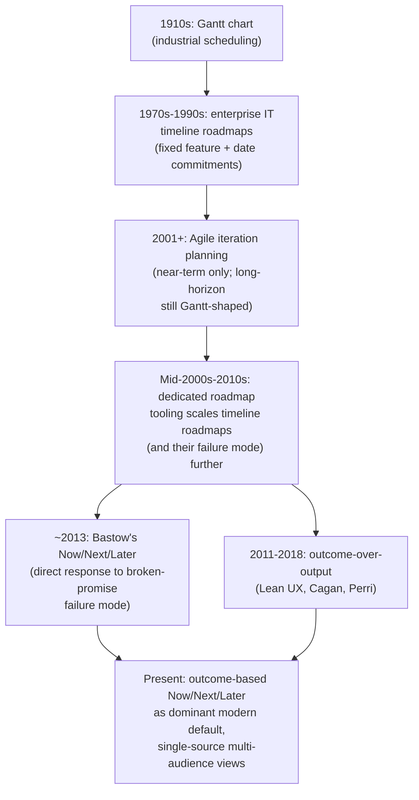

The arc mirrors [Product Strategy's](CH15_Product_Strategy.md#2-historical-evolution)
own historical arc one layer downstream: as the cost of a broken roadmap
commitment rose — first internally as wasted replanning, later externally
as contractual and reputational liability — the discipline of deliberately
choosing a roadmap's format and confidence language, rather than defaulting
to a Gantt chart because that is what scheduling software has always
produced, became a distinct, teachable skill.

## 3. Why It Exists

A completed strategy-to-roadmap translation contract (a sequenced bet with
an outcome hypothesis, a theme label, and a non-goal set) is not yet
something a sales representative, an engineer, or a customer can act on. It
exists because three distinct communication gaps sit between "we have
decided what to build and why" and "everyone who needs to plan around that
decision can do so accurately."

- **Different audiences need different units of commitment from the same
  decision.** An executive needs to know whether a bet is progressing
  relative to other bets. A salesperson needs to know what they can say to
  a prospect without over-promising. An engineer needs to know sequencing
  and dependencies, not a calendar date imposed from outside. A customer
  needs enough visibility to plan their own adoption without being handed
  a commitment the vendor cannot actually guarantee. A single, undifferen-
  tiated document cannot satisfy all four needs at once without either
  drowning some audiences in irrelevant detail or dangerously
  under-informing others.
- **Without an explicit roadmap, the same "when will X ship" question gets
  answered ad hoc, repeatedly, and inconsistently.** Each stakeholder who
  asks receives a different answer depending on who they happened to ask
  and how that person currently felt about the bet's progress — the same
  coordination failure
  [Product Strategy](CH15_Product_Strategy.md#3-why-it-exists) names for
  strategy itself, recurring one layer down at the level of "which quarter
  is this coming."
- **Uncertainty does not vanish just because a stakeholder wants
  certainty.** A near-term, already-scoped item and a far-term, barely
  investigated one carry genuinely different confidence levels. A roadmap
  that presents both with the same visual and linguistic specificity is not
  neutral — it is actively misinforming whichever audience reads the
  far-term item as equally reliable as the near-term one.
- **Disclosure has real, asymmetric costs in both directions.** Disclosing
  too little starves sales, customers, and internal teams of planning
  information they legitimately need; disclosing too much, too specifically,
  too early creates competitive exposure (recap
  [Product Strategy](CH15_Product_Strategy.md#13-security)'s competitive-
  confidentiality concern) and manufactures commitments the organization
  never actually intended to make.
- **A roadmap that is never revisited becomes fiction faster than a
  strategy does**, because a roadmap's claims are more specific and more
  time-bound than a strategy memo's — every quarter that passes without
  revision widens the gap between what the roadmap says and what is
  actually true.

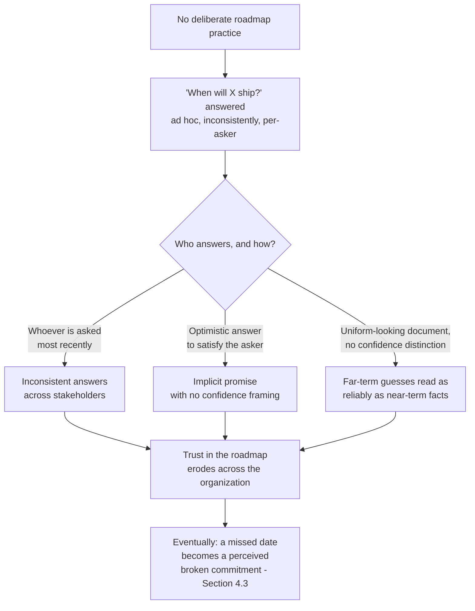

The diagram names the failure state this chapter exists to prevent: a
roadmap does not fail by being wrong about the future — every roadmap will
be wrong about *something* in the future, because the future is uncertain.
It fails by presenting that uncertainty dishonestly, to the wrong audience,
without a mechanism to keep the document current as the uncertainty
resolves.

## 4. Core Concepts

### 4.1 The Roadmap as Artifact and Communication Practice

Definition:
A roadmap is a maintained artifact and a recurring communication practice
that sequences an organization's chosen initiatives — themes of intended
work, not individual backlog items — across a multi-quarter horizon,
presented with a format and confidence language calibrated to what is
actually known, and rendered differently for different audiences who each
need a different view of the same underlying sequencing.

Mechanism (how it works):
A roadmap does not decide *which* bets to pursue — that decision, and its
justification, belongs entirely to
[Product Strategy's](CH15_Product_Strategy.md#46-portfolio-sequencing-logic-why-this-bet-over-that-one)
portfolio sequencing logic. A roadmap also does not decide the *order of
individual tickets inside* an already-scoped theme — that belongs to this
part's not-yet-drafted Story Mapping and Backlog chapters. A roadmap sits
in the narrow, high-value space between the two: it takes the sequenced,
contract-completed bet set
([Product Strategy](CH15_Product_Strategy.md#47-strategy-to-roadmap-translation-contract)'s
Section 4.7 output) and renders it as a shared, visible, revisable timeline
structure that multiple functions can plan against without needing to
re-derive the underlying strategic reasoning themselves.

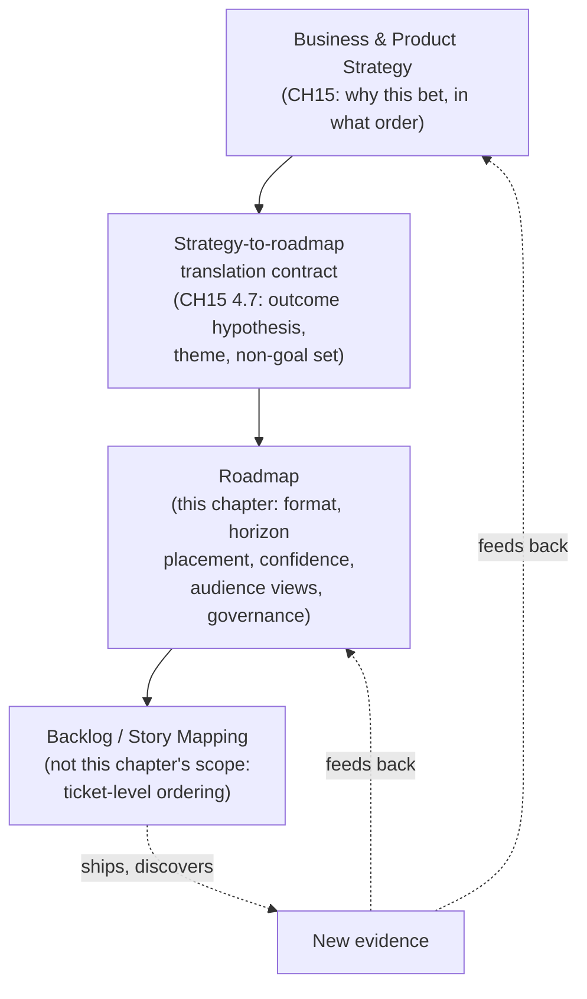

Decision implications (when and why to use it):
A roadmap becomes necessary the moment more than one function — engineering,
sales, executive leadership, or customers themselves — needs shared,
standing visibility into sequencing that would otherwise require a
one-off conversation every time it changes. A single-person team pursuing
one initiative at a time can often operate directly off the strategy memo
and does not yet need a separate roadmap artifact.

Common failure mode:
Building a roadmap bottom-up from an existing backlog, rather than
top-down from the strategy contract — listing whatever tickets currently
exist and giving them dates, rather than starting from a sequenced bet's
outcome hypothesis and theme. This produces a roadmap that looks
authoritative but is really just a re-dated feature list, importing the
"feature factory" failure mode
[Product Strategy](CH15_Product_Strategy.md#19-anti-patterns) names at the
strategy layer directly onto the roadmap's public surface.

Concrete scenario:
A team under roadmap-planning pressure, with no completed translation
contract yet available for a candidate bet, is tempted to add "improve
reporting" directly to next quarter's roadmap because a few tickets already
exist with that label. Applying this chapter's boundary correctly, the team
instead sends the request back through
[Product Strategy's](CH15_Product_Strategy.md#47-strategy-to-roadmap-translation-contract)
translation contract first — forcing an outcome hypothesis and a non-goal
set to exist before "improve reporting" becomes a roadmap-worthy theme,
rather than three months of ticket accumulation retroactively becoming a
"strategy."

### 4.2 Roadmap Formats: Outcome-Based, Feature-Based, and Timeline-Based

Definition:
A roadmap format is the unit of commitment a roadmap entry actually
promises to its reader. The three common formats commit to three
structurally different things: an **outcome-based** roadmap commits to a
customer or business result (a theme framed as "reduce enterprise
onboarding friction," not a named feature); a **feature-based** roadmap
commits to a specific deliverable (a named capability, "single sign-on
integration"); a **timeline-based** roadmap commits to a calendar date
(often layered on top of either of the other two, "single sign-on
integration, Q3").

Mechanism (how it works):
Each format encodes a different promise, and therefore a different failure
mode when reality diverges from the plan. An outcome-based entry can be
satisfied by more than one possible solution — if the first approach to
"reduce enterprise onboarding friction" does not work, a different feature
can still fulfill the same outcome commitment, because the commitment was
never to a specific feature in the first place. A feature-based entry has
already committed to *what* will be built, foreclosing the option to
discover a better solution mid-stream without appearing to have failed the
commitment. A timeline-based entry has additionally committed to *when*,
which is the least reliable variable in software delivery precisely because
it compounds every uncertainty in scope, dependency, and capacity into a
single, highly visible number.

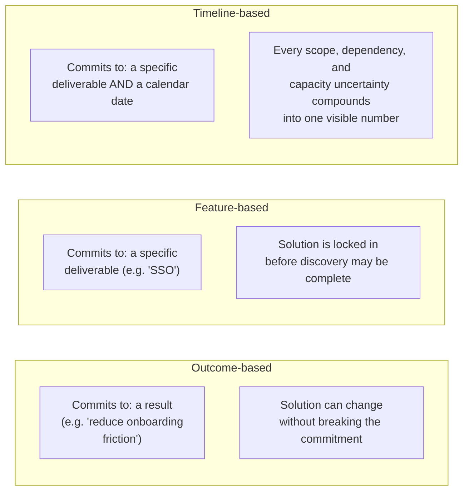

Decision implications (when and why to use it):
Prefer outcome-based framing as the default for any theme that has not yet
cleared discovery validation, because it preserves the organization's
ability to change solution approach — the same latitude
[Product Strategy's](CH15_Product_Strategy.md#7-architecture-patterns)
"outcome-based operating model" pattern already grants at the strategy
layer, applied here to the roadmap's public surface. Feature-based framing
is appropriate only once a specific solution has already been discovery-
validated and the remaining risk is genuinely just execution risk, not
solution risk. Timeline-based framing — a calendar date attached to a
specific feature — should be reserved for the narrowest case: near-term,
already-in-build, low-uncertainty work, and, separately, genuine external
commitments (a regulatory deadline, a signed contractual delivery date)
where the date itself is the actual requirement, not a convenience label.

Common failure mode:
Defaulting to feature-based or timeline-based framing simply because it
feels more concrete and reassuring to stakeholders, without checking
whether the underlying solution has actually cleared discovery risk.
Section 4.3 names the specific, severe version of this failure mode when
the format is timeline-based; the feature-based version is milder but
shares the same root cause — locking a specific answer in before the
question has been fully investigated.

Concrete scenario:
The same underlying initiative — reducing enterprise onboarding friction —
can be communicated three ways. Outcome-based: "Reduce enterprise
onboarding time by improving the multi-step provisioning process (Next
horizon, moderate confidence)." Feature-based: "Automated provisioning
wizard (Next horizon)." Timeline-based: "Automated provisioning wizard,
ships March 15." Only the first survives a mid-stream discovery finding
that the actual fix is not a wizard but a change to how sales configures
new accounts before handoff — the second and third both now read, to
anyone who saw them published, as broken.

### 4.3 The "Roadmap as Promise" Anti-Pattern

Definition:
The roadmap-as-promise anti-pattern is the failure mode in which a
timeline-based (or date-bearing feature-based) roadmap entry, originally
intended and understood internally as a probabilistic estimate, is
progressively treated by its readers — sales, customers, and eventually
legal or contractual counterparties — as a binding commitment, such that
any subsequent date slip is experienced not as normal planning uncertainty
resolving unfavorably, but as a broken promise carrying reputational and
often literal contractual liability.

Mechanism (how it works):
The failure does not happen at the moment the date is written down; it
happens through a predictable chain of re-use as the date moves through
organizational layers that each strip away the uncertainty framing the
originating team intended. A product manager writes "Q3" on an internal
planning slide meaning "our current best estimate, subject to change." A
sales leader, needing something concrete to tell a prospect, copies "Q3"
into a deck without the qualifier. An account executive, closing a deal,
writes "Q3 delivery" into a contract addendum or a signed order form,
because the prospect's own procurement process requires a specific
commitment date to proceed. By the time a dependency slips — the exact
scenario [Product Strategy's](CH15_Product_Strategy.md#22-real-world-case-study)
case study surfaces during its own PR-FAQ feasibility check — the "Q3"
figure is no longer a planning estimate at all; it is a contractual term,
and missing it triggers an escalation path (a service-level dispute, a
churn risk, a legal review) entirely disproportionate to what was, at the
point of origin, a routine and expected kind of planning uncertainty.

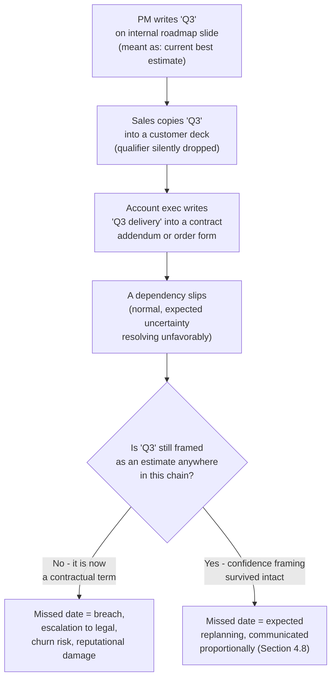

Decision implications (when and why to use it):
Treat this anti-pattern as the single strongest argument for defaulting to
outcome-based framing (Section 4.2) and the Now/Next/Later format
(Section 4.4) rather than a fixed-calendar roadmap for anything beyond the
"Now" horizon's already-in-build work. Where a specific calendar date must
be given — a genuine contractual or regulatory deadline — treat that date
as a *separate*, explicitly tracked commitment outside the general roadmap
practice, with its own risk-management discipline, rather than blending it
indistinguishably into the same document as directional, uncertain
far-term themes.

Common failure mode (a second-order version):
Believing that simply *not* publishing a date internally is sufficient
protection, while still allowing sales or account teams unsupervised access
to raw internal planning artifacts that contain implied timing information
(a "Now" horizon placement, a sprint board, a Gantt-style internal
schedule) which gets quoted externally anyway. The anti-pattern is not
solely about which document contains a date; it is about whether *any*
externally consumed representation of the plan has been stripped of its
confidence qualifier before it reaches a customer or a contract.

Concrete scenario:
Section 22's case study walks through this failure mode in a fully worked
example: a Q3 date for a "guided month-end close" capability, quoted
directly by sales into two customer contract addenda from what was
originally an internal, unqualified timeline slide, slips to Q4 after a
general-ledger integration dependency proves harder than expected — and
one customer invokes a contractual clause over the missed date.

### 4.4 The Now/Next/Later Horizon Format

Definition:
The Now/Next/Later format organizes roadmap themes into three qualitative
time buckets instead of fixed calendar slots: **Now** (actively being
built, or shipping imminently — the closest thing this format has to a
firm commitment), **Next** (planned and reasonably likely to begin once
current work completes, but not yet started, and therefore still subject
to material change), and **Later** (directionally intended, validated at
most lightly, and expected to change in scope, sequencing, or even
continued relevance before it is ever built).

Mechanism (how it works):
Instead of assigning each theme a fixed calendar position that must be
defended or explained away when it slips, the Now/Next/Later format
assigns each theme a *relative* position that is expected to change as a
normal, routine part of how the format works: a theme moves from Later to
Next as its underlying assumptions get validated and capacity frees up, and
from Next to Now once work actually begins. Movement between buckets is
the format working as intended, not a sign that something has gone wrong —
which is precisely the property that makes it structurally resistant to
Section 4.3's failure mode: there is no specific calendar date sitting in
a customer contract for a "Later" item to violate, because a "Later" item
never claimed one.

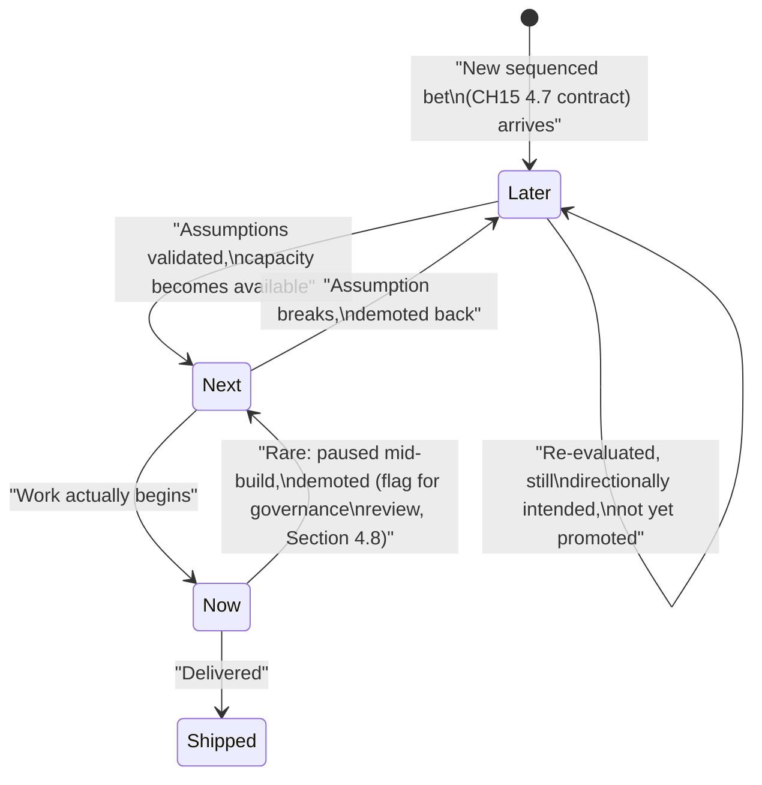

Decision implications (when and why to use it):
Adopt Now/Next/Later as the default presentation format for any
cross-functional or customer-facing roadmap, especially wherever the
underlying themes have not yet cleared discovery validation strongly
enough to justify a fixed date. It is a poor substitute, however, for the
execution-level, date-driven tracking engineering teams still need
internally for work already in the "Now" bucket — that finer-grained
tracking belongs to project or delivery-management tooling and to the
not-yet-drafted Backlog chapter's territory, not to this format, which
intentionally operates at theme grain, not ticket grain.

```{=latex}
\begin{landscape}
```

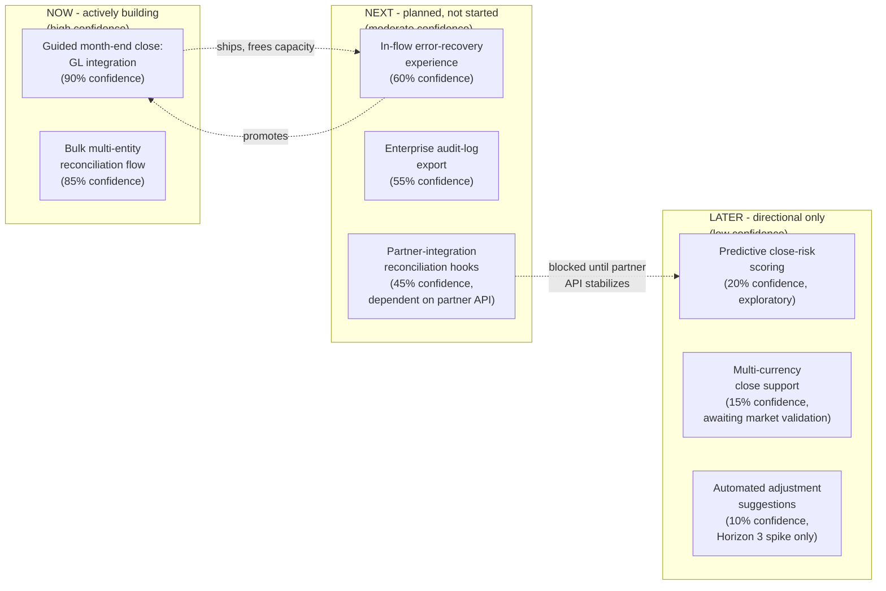

```{=latex}
\end{landscape}
```

The landscape wrap is used deliberately here, matching the Style Guide's
convention for wide, multi-lane diagrams: a real Now/Next/Later board
spans three parallel horizon lanes with several themed items each, plus
cross-lane promotion/demotion relationships, and compressing that into a
portrait-width diagram would force illegible label wrapping.

Common failure mode:
**Horizon compression** — under stakeholder pressure for certainty, a team
quietly moves everything into "Now" regardless of actual readiness,
defeating the format's entire purpose and reintroducing the
roadmap-as-promise failure mode in disguise, since "Now" is read by every
audience as the closest thing to a firm commitment this format offers. A
second, opposite failure is the **"Later" graveyard**: items accumulate in
"Later" indefinitely, never promoted and never explicitly killed, so the
bucket stops meaning "directionally intended, coming eventually" and
starts meaning "we said yes once and have not revisited it since" — a
horizon-format-specific instance of the zombie-artifact pattern
[Personas](../02_Design_Thinking_and_Product_Management/CH03_Personas.md#12-scalability)
names for stale artifacts generally.

Concrete scenario:
A sales-heavy planning session pressures product management to move an
unvalidated, Horizon-3-exploratory idea (an artificial intelligence
(AI)-assisted close-risk score with no completed discovery work) directly
into "Now" so a deal can reference it as imminent. Six weeks later, the
underlying technical approach turns out not to work as hoped, and because
the item had been placed in "Now," its removal is experienced by the sales
team as a broken commitment rather than the routine "Later" re-evaluation
it should have been — the compression, not the underlying uncertainty,
created the liability.

### 4.5 Confidence and Certainty Decay by Horizon

Definition:
Confidence decay by horizon is the principle that the reliability of any
timing or scope statement in a roadmap decreases predictably the further
out its horizon sits, and that a well-formed roadmap communicates that
decay *explicitly* — through qualifiers, visual treatment, or stated
percentage ranges — rather than presenting every horizon with the same
visual and linguistic specificity, which implies a uniform certainty that
does not actually exist.

Mechanism (how it works):
Uncertainty compounds over time from several independent sources —
unresolved dependencies, capacity that has not yet been allocated,
discovery evidence not yet gathered, and market conditions that may shift
before work begins — and each of these sources has had progressively less
opportunity to resolve the further out a theme sits. A "Now" item has
typically already been scoped, staffed, and partially built, so most of its
uncertainty has already resolved one way or another. A "Later" item has
had almost none of its uncertainty resolved yet — it may not even survive
contact with the next discovery cycle. Confidence decay names this
directly instead of leaving it implicit:

```
Confidence                                        
  high |####################                       
       |####################  #############        
       |####################  #############  ##### 
       |____________________  _____________  _______
            NOW                  NEXT            LATER
        (in build,             (planned,        (directional,
         ~80-95%)             ~40-65%)          ~5-25%)
```

The percentages above are illustrative, not a mandated formula — the
specific numbers a team publishes matter less than the discipline of
attaching *some* explicit, honestly calibrated confidence signal to every
horizon rather than presenting all three with identical formatting.

Decision implications (when and why to use it):
Pair every roadmap entry with a confidence indicator appropriate to its
horizon — a percentage range, a qualitative label ("committed,"
"targeted," "exploring"), or a consistent visual treatment (solid versus
dashed border, for example) — and keep that indicator visible in every
audience-tiered view (Section 4.7), not only the internal one. This is the
core mechanism that defuses Section 4.3's failure mode: a reader who sees
"exploring, ~15% confidence" next to a "Later" item has no reasonable basis
to treat it as a promise, whereas a reader who sees an unqualified date has
every reason to.

Common failure mode:
Presenting all three horizons in visually and linguistically identical
format — the same box style, the same declarative sentence structure, the
same absence of a confidence qualifier — which communicates equal
certainty across radically different actual certainty levels, purely as an
accident of the roadmap template rather than a deliberate choice.

Concrete scenario:
Two roadmap entries are shown in the same visual style: "Guided month-end
close — Now" and "Multi-currency close support — Later." A reader
unfamiliar with the format has no way to know the first is already in
build with a near-final scope while the second is a barely-explored idea
that may never ship as described. Adding explicit confidence language
("Now, 90% confidence, in active build" versus "Later, 15% confidence,
exploratory, subject to market validation") gives the same reader an
accurate basis for their own planning, without requiring them to already
know the team's internal context.

### 4.6 Building a Roadmap from the Strategy-to-Roadmap Translation Contract

This section fulfills the forward reference
[Product Strategy's Section 4.7](CH15_Product_Strategy.md#47-strategy-to-roadmap-translation-contract)
made explicitly to this chapter: given a sequenced bet that has arrived
with a completed contract (an outcome hypothesis, a roadmap theme label,
and a non-goal set), this section teaches the concrete pipeline that turns
it into a published roadmap entry.

Definition:
The roadmap construction pipeline is the sequence of translation steps
that convert one strategy-contract triple into a horizon-placed, format-
selected, confidence-qualified, audience-rendered roadmap entry, without
re-deciding anything the strategy layer has already decided.

Mechanism (how it works):

1. **Intake the contract triple.** Take the outcome hypothesis, roadmap
   theme label, and non-goal set exactly as
   [Product Strategy](CH15_Product_Strategy.md#47-strategy-to-roadmap-translation-contract)
   produced them. This chapter does not re-argue whether the bet was
   correctly sequenced — that question was already settled upstream.
2. **Choose the format** (Section 4.2) based on how much of the theme's
   solution has actually cleared discovery. An outcome hypothesis with no
   validated solution shape yet is rendered as an outcome-based entry; only
   a theme whose solution is already discovery-validated is rendered as
   feature-based, and only genuinely date-bound external commitments
   (contractual, regulatory) are rendered with an attached calendar date.
3. **Place the theme into a horizon** (Section 4.4) using three inputs
   together, not any one alone: current build/staffing status (is work
   actually underway), discovery/validation state (how much of the
   solution-risk uncertainty has resolved), and near-term capacity
   availability. Critically, horizon placement is **not** the same
   decision as Product Strategy's Three Horizons classification — see the
   explicit distinction below.
4. **Attach the non-goal set as a visible scope boundary**, not a private
   internal note. Publishing the non-goal set alongside the theme (at
   least in the internal and engineering-facing views, Section 4.7)
   prevents the exact scope-creep failure mode
   [Product Strategy's Section 4.7](CH15_Product_Strategy.md#47-strategy-to-roadmap-translation-contract)
   warns against, extended now to the roadmap's own public surface, where
   a stakeholder who was not part of the original sequencing conversation
   might otherwise assume the theme silently includes an adjacent request.
5. **Assign an explicit confidence qualifier** (Section 4.5) appropriate to
   the chosen horizon, sourced honestly from the same discovery and
   capacity evidence used in step 3, not from a desire to reassure a
   particular stakeholder.
6. **Render the audience-specific view** (Section 4.7), deriving each
   audience's version from this single completed entry rather than
   hand-authoring three independent documents.

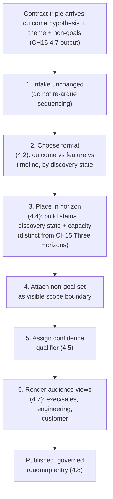

**Distinguishing Now/Next/Later from Product Strategy's Three Horizons —
an explicit, necessary disambiguation:**
These two frameworks share the word "horizon" but answer entirely
different questions, and conflating them is a common and costly error.
[Product Strategy's Three Horizons model](CH15_Product_Strategy.md#46-portfolio-sequencing-logic-why-this-bet-over-that-one)
buckets bets by **funding risk profile and time-to-payoff, measured in
years**: Horizon 1 (core, defend the existing business), Horizon 2 (scale
emerging bets), Horizon 3 (speculative exploration). This chapter's
Now/Next/Later buckets themes by **roadmap-communication certainty,
measured in quarters**: how soon, and how confidently, a given theme is
expected to actually reach a reader's hands. The two axes are orthogonal,
not the same ladder wearing different labels: a Product Strategy Horizon 1
bet (core, low strategic risk) can sit in this chapter's "Later" bucket if
its build has not yet started this quarter, and a Product Strategy Horizon
3 exploratory bet (speculative, high strategic risk) can legitimately
appear in this chapter's "Now" bucket the moment a small, cheap validation
spike for it is actively underway. A roadmap entry's Now/Next/Later
placement answers "how soon and how confidently will this be visible to
you," never "how strategically risky was the decision to fund it at all"
— that second question stays fully owned by
[Product Strategy](CH15_Product_Strategy.md#46-portfolio-sequencing-logic-why-this-bet-over-that-one).

Decision implications (when and why to use it):
Run this pipeline explicitly, as a checklist, every time a newly sequenced
bet is ready to move from the strategy layer to the roadmap layer, rather
than allowing an ad hoc, partial translation (a bare theme name with no
non-goal set, no confidence qualifier, and no audience-view derivation) to
reach any published surface.

Common failure mode:
Skipping straight from a bet's name to a horizon-and-format decision
without carrying the non-goal set and confidence qualifier along with it —
producing a roadmap entry that looks complete but has silently dropped the
exact scope-boundary and honesty mechanisms this chapter's other sections
exist to provide. This is the roadmap-layer recurrence of "strategy
theater" (recap
[Product Strategy](CH15_Product_Strategy.md#15-failure-scenarios)):
the contract exists upstream, on paper, but the roadmap that is actually
published never fully reflects it.

Concrete scenario:
A sequenced bet arrives with outcome hypothesis "reduce month-end close
time for mid-market customers from 6 days to 2" and non-goal "does not
include the previously planned receipt-scanning improvement this cycle."
Run through the full pipeline, it becomes: format = outcome-based (Section
2's solution is still being finalized); horizon = Now (build has started,
capacity committed); non-goal set attached visibly in the internal and
engineering views; confidence = 90 percent (in active build, one known
integration dependency remaining); audience views derived per Section 4.7.
Skipping steps 3-6 and simply writing "guided month-end close — Q3" onto a
slide reproduces exactly the failure Section 4.3's worked case study
walks through.

### 4.7 Roadmap Communication Tiered by Audience

Definition:
Audience-tiered roadmap communication is the discipline of deriving
multiple, purpose-calibrated views of the same underlying, single-source
roadmap for different audiences — commonly executive/sales, engineering,
and customers — each view differing in level of detail, unit of
commitment, confidence language, and disclosure boundary, rather than
publishing one undifferentiated document to everyone. This section also
fulfills the concrete mechanics
[Product Strategy's Section 13](CH15_Product_Strategy.md#13-security)
named as a "downstream concern of the not-yet-drafted Roadmaps chapter."

Mechanism (how it works):
Three views recur across most organizations, though the exact number and
boundary can vary:

- **Executive/sales view**: outcome-oriented theme statements with
  confidence expressed in business-safe, non-numeric language ("targeted,"
  "planned," "exploring," rather than raw internal percentages), the
  non-goal set summarized rather than reproduced verbatim, and — per
  [Product Strategy's](CH15_Product_Strategy.md#13-security) tiered-
  disclosure principle, now made concrete — a deliberate lag behind
  internal sequencing detail so that competitively sensitive bet ordering
  is not exposed before it is stable enough to share.
- **Engineering view**: themes plus dependency and sequencing detail,
  capacity constraints, links to the underlying bet card and discovery
  status, and the full non-goal set verbatim — deliberately *not*
  presented with date pressure, since translating a theme into ticket-level
  execution order is this part's not-yet-drafted Story Mapping and Backlog
  chapters' territory, which this chapter names and defers to rather than
  duplicating.
- **Customer view**: restricted to Now, and selectively the highest-
  confidence portion of Next, with anything competitively sensitive
  stripped entirely, worded to set expectations rather than commitments
  ("we're working on," not "you will receive"), and with an explicit,
  structurally embedded "subject to change" framing — not a small-print
  footnote easy to ignore, but baked into the presentation itself (for
  example, omitting dates entirely and using the Now/Next/Later labels as
  the only timing signal a customer ever sees).

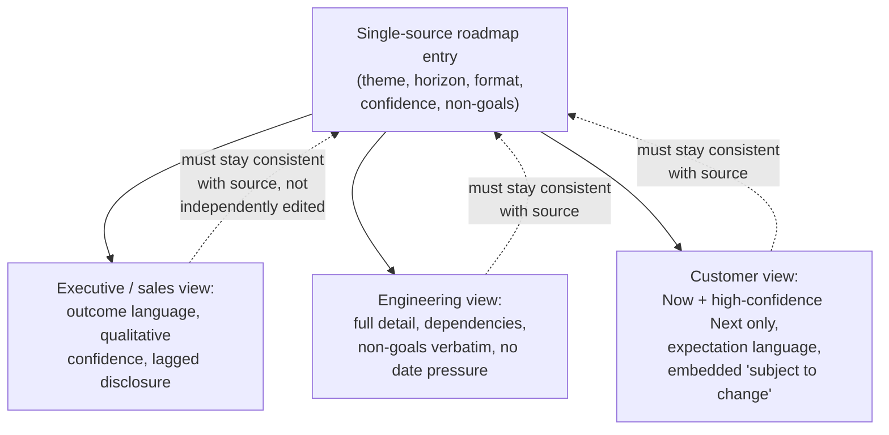

Decision implications (when and why to use it):
Build and maintain exactly one internal source-of-truth roadmap and
mechanically derive every audience view from it (an architecture choice
Section 7 names as the single-source, multiple-views pattern), rather than
hand-authoring three independently maintained documents that will
inevitably drift out of sync with each other and with reality.

Common failure mode:
Publishing the internal roadmap externally with only cosmetic editing —
leaking competitively sensitive sequencing information directly onto a
customer-facing surface, and simultaneously recreating the roadmap-as-
promise failure mode on that exact surface, since customers are the
audience least equipped to correctly interpret an unqualified internal
confidence figure. A second, opposite failure is a customer roadmap
stripped so thoroughly of substance ("great things are coming") that it
provides no planning value at all, defeating the purpose of publishing one
in the first place.

Concrete scenario:
An engineering-facing internal roadmap correctly shows "bulk multi-entity
reconciliation flow — Now, 85% confidence, depends on GL integration
completing (owner: platform team)." Rendered for the executive/sales
audience, this becomes "Enterprise reconciliation improvements — targeted
this quarter." Rendered for the customer audience, this becomes "Now:
Enterprise reconciliation improvements" with no date, no percentage, and
no internal dependency detail — each view answering the specific question
its own audience actually needs answered, derived from, and kept
synchronized with, the same single source.

### 4.8 Roadmap Governance and Revision Cadence

Definition:
Roadmap governance and revision cadence is the standing process,
accountable ownership, and review rhythm that keeps a published roadmap
synchronized with the strategy sequencing and discovery evidence that
underpin it, distinguishing routine, scheduled revision from event-
triggered revision the same way
[Product Strategy's Section 5](CH15_Product_Strategy.md#5-internal-working)
distinguishes its own routine-versus-exception review cycle, applied here
to a roadmap's specific, dated claims rather than a strategy's broader
sequencing.

Mechanism (how it works):
**Routine cadence**, typically aligned to
[Product Strategy's](CH15_Product_Strategy.md#48-objectives-and-key-results-okrs-as-the-execution-contract)
own quarterly sequencing and Objectives and Key Results (OKR) cycle,
re-examines every current roadmap entry: has a "Later" item's underlying
assumption been validated enough to promote it to "Next"; has a "Now" item
shipped and should be removed; does any confidence qualifier need
adjusting based on evidence accumulated since the last review. **Event-
triggered revision** fires immediately, outside the routine cadence,
whenever a Now- or high-confidence-Next item's underlying assumption
breaks materially — a dependency slips, a discovery finding invalidates
the planned solution, a partner integration stalls — and the urgency and
channel of the resulting communication scales with how publicly that item
had already been disclosed (recap Section 4.7's tiering): an item only
ever shown internally can be quietly corrected at the next routine review;
an item already quoted to a customer requires immediate, proactive
outreach, not a wait for the next scheduled cycle.

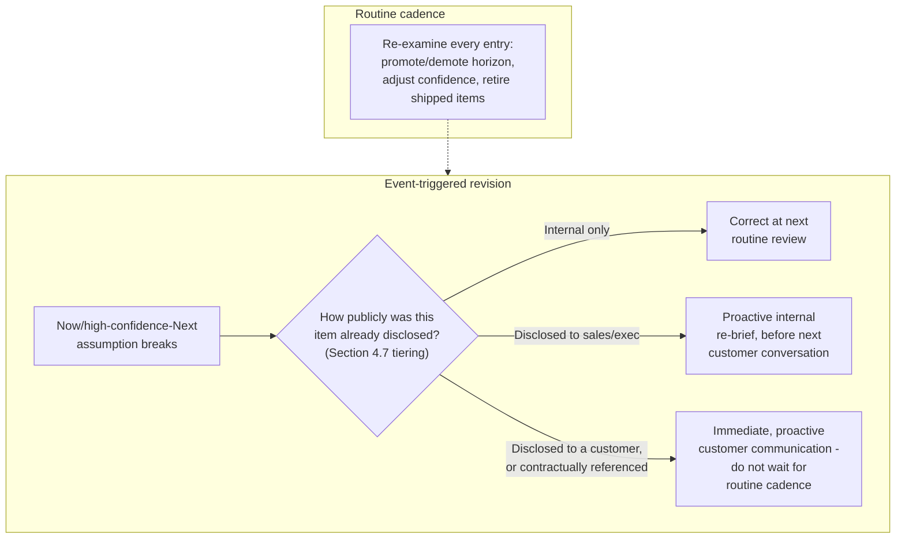

Decision implications (when and why to use it):
Name a single accountable roadmap owner — distinct in role, though
sometimes the same individual, from the strategy owner
[Product Strategy's Section 6](CH15_Product_Strategy.md#6-design-principles)
already names — with explicit authority to promote, demote, or retire
roadmap entries and to trigger event-based revision communication without
waiting for permission. Without a named owner, event-triggered revision in
practice reduces to routine cadence only, reintroducing the exact "known-
wrong information left visible" failure this section exists to prevent.

Common failure mode:
Treating revision as purely calendar-driven even after an item's
underlying confidence has already materially broken — leaving a
known-to-be-wrong entry visible externally "because it isn't time for the
quarterly refresh yet." This is a slower, more insidious cousin of Section
4.3's roadmap-as-promise failure: the harm is not that an uncertain
estimate turned out wrong (expected), but that the organization knew it
was wrong and left it published anyway, for reasons of internal process
convenience rather than external honesty.

Concrete scenario:
A "Now" horizon item's confidence drops sharply mid-quarter after a
general-ledger integration proves substantially harder than scoped — a
scenario Section 22's case study walks through as an actual, worked
incident. Under this section's governance model, the accountable roadmap
owner triggers event-based revision immediately: internal stakeholders are
re-briefed the same week, and any customer who had already received a
"Now" confidence signal for that item is proactively contacted before the
next scheduled quarterly review, rather than allowed to discover the delay
independently.

## 5. Internal Working

The eight concepts in Section 4 operate together as a continuous operating
loop, not as isolated techniques applied once at roadmap creation. The
loop intakes sequenced bets from the strategy layer, constructs and
publishes roadmap entries, derives audience views, and revises
continuously as evidence changes — running at a finer grain and higher
frequency than
[Product Strategy's](CH15_Product_Strategy.md#5-internal-working) own
quarterly-anchored strategy cycle, since a roadmap must react to discovery
and dependency evidence in near real time, not only once a quarter.

```{=latex}
\begin{landscape}
```

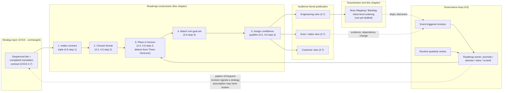

```{=latex}
\end{landscape}
```

The landscape wrap is used deliberately: this loop spans five distinct
lanes (strategy, construction, publication, governance, and downstream
execution), and compressing that many parallel lanes into a portrait-width
diagram would force illegible label wrapping, the same justification
[Product Strategy's Section 4.8](CH15_Product_Strategy.md#48-objectives-and-key-results-okrs-as-the-execution-contract)
and
[Personas (Product Management)'s Section 5](CH18_Personas_Product_Management.md#5-internal-working)
already give for their own wide, multi-lane diagrams.

Two feedback paths are worth naming explicitly, because they are what keeps
this loop from degrading into either a stale, dishonest artifact or an
unnecessarily rebuilt one. First, the routine-versus-event-triggered
distinction (Section 4.8) prevents two opposite failures: revising the
roadmap constantly in response to routine, expected noise (which destroys
stakeholders' ability to plan against anything, a roadmap-layer recurrence
of
[Product Strategy's](CH15_Product_Strategy.md#6-design-principles)
"strategy whiplash"), and rigidly waiting for the next scheduled review
even after a disclosed item's confidence has already broken (Section 4.8's
own named failure mode). Second, a *pattern* of frequent event-triggered
revisions clustered around the same theme is itself a signal worth sending
back upstream to the strategy layer — not because the roadmap layer should
re-litigate strategy, but because repeated roadmap-level breakage can be
early evidence that a strategic assumption underlying the sequencing
itself (recap
[Product Strategy's](CH15_Product_Strategy.md#46-portfolio-sequencing-logic-why-this-bet-over-that-one)
capability-readiness question) was optimistic, giving the strategy owner a
concrete, evidence-based reason to revisit sequencing sooner than the next
routine cycle.

## 6. Design Principles

- **A roadmap communicates a decision already made; it does not make the
  decision.** Which bet to pursue is
  [Product Strategy's](CH15_Product_Strategy.md#41-product-strategy-as-the-connective-layer)
  question, fully answered before a theme reaches this chapter's pipeline.
- **Default to the least specific commitment that still gives the reader
  what they need.** An outcome, not a feature; a horizon bucket, not a
  calendar date; a qualitative confidence label, not a false-precision
  percentage — reserve more specificity for cases that have genuinely
  earned it through discovery validation or a real external deadline.
- **Uncertainty should be visible, not hidden by uniform formatting.**
  Section 4.5's confidence decay principle applies everywhere a roadmap
  entry is shown, in every audience view, not only in an internal-only
  document.
- **A published roadmap that is known to be wrong is worse than an
  unpublished one.** Leaving a stale, already-invalidated entry visible
  "until the next scheduled review" actively misinforms every reader who
  encounters it in the meantime (Section 4.8).
- **One source of truth, many rendered views — never many independently
  maintained truths.** Section 4.7's derivation model exists specifically
  to prevent the synchronization failure that independently hand-edited,
  per-audience roadmaps reliably produce at scale.
- **Non-goals travel with the theme, not just with the strategy memo.** A
  roadmap entry that drops the non-goal set its contract carried (Section
  4.6) reopens exactly the scope-creep risk
  [Product Strategy](CH15_Product_Strategy.md#47-strategy-to-roadmap-translation-contract)
  built the non-goal requirement to prevent in the first place.
- **A roadmap needs a named, accountable owner empowered to correct it
  proactively.** Without one, event-triggered revision (Section 4.8) never
  actually happens in practice, regardless of how well-designed the
  governance model looks on paper.

## 7. Architecture Patterns

"Architecture patterns" here names recurring, named operating-model shapes
for how an organization structures its roadmap practice — analogous to how
a software architecture pattern names a recurring structural shape, and
consistent with the same usage
[Product Strategy's Section 7](CH15_Product_Strategy.md#7-architecture-patterns)
and
[Personas (Product Management)'s Section 7](CH18_Personas_Product_Management.md#7-architecture-patterns)
already establish in this part.

- **Single-source, multiple-views pattern**: one internal roadmap record
  is maintained as the authoritative source, and every audience-specific
  view (Section 4.7) is mechanically derived from it rather than
  independently authored. Strongest whenever more than one audience needs
  a view of the same sequencing; the derivation step itself becomes
  overhead only for the smallest teams with a single, informal audience.
- **Theme-based roadmap architecture**: the roadmap is organized around
  outcome themes (Section 4.2), cutting across whichever teams happen to
  deliver each piece of a theme. Keeps the roadmap aligned to the
  business outcome the strategy layer actually funded; requires more
  cross-team coordination to maintain than a team-based structure.
- **Team-based swimlane architecture**: the roadmap is organized as one
  lane per delivery team, each showing that team's own committed themes.
  Easier for each team to maintain independently; risks obscuring a
  cross-team theme that depends on coordinated delivery across more than
  one lane, unless an additional cross-lane theme view is layered on top.
- **Portfolio roadmap versus product roadmap pattern**: a portfolio
  roadmap aggregates multiple product lines' individual roadmaps into one
  executive-facing view (commonly needed once
  [Product Strategy's](CH15_Product_Strategy.md#7-architecture-patterns)
  "platform strategy pattern" applies across more than one product line);
  a product roadmap stays scoped to a single product line's own themes.
  Aggregation adds coordination overhead that is wasted if only one
  product line actually exists.
- **Rolling-wave revision pattern**: the roadmap is revised continuously
  as evidence arrives (Section 4.8's event-triggered path), with horizon
  boundaries treated as fluid. Contrasts with a **fixed-reset pattern**,
  where the roadmap is deliberately re-built wholesale only at fixed
  intervals (for example, annually), trading continuous accuracy for
  planning stability — appropriate mainly where external stakeholders
  specifically need a stable, unchanging reference document for a bounded
  period (a fiscal-year customer commitment cycle, for example).

```mermaid
flowchart TD
    Q1{"How many audiences\nneed a distinct view?"}
    Q1 -->|One informal audience| Simple["Single hand-maintained\ndocument, no derivation layer"]
    Q1 -->|Multiple (exec/sales,\nengineering, customer)| SSV["Single-source,\nmultiple-views pattern"]
    Q2{"How many product lines?"}
    Q2 -->|One| Product["Product roadmap only"]
    Q2 -->|Several, needing\naggregation| Portfolio["Portfolio roadmap\naggregating product roadmaps"]
    Q3{"Does an external\nstakeholder need a fixed,\nstable reference document?"}
    Q3 -->|Yes, bounded period| Fixed["Fixed-reset pattern\n(e.g. annual)"]
    Q3 -->|No, evidence should\nupdate it continuously| Rolling["Rolling-wave\nrevision pattern"]
```

Each pattern is a trade-off, not a universally correct default: a
theme-based architecture applied to a single, small team adds coordination
overhead with no cross-team benefit to capture, and a rolling-wave revision
pattern applied where a customer specifically needs a stable annual
reference document creates exactly the kind of surprise change that
undermines the trust a fixed-reset document was meant to provide.

## 8. Production Architecture

"Production" for a roadmap means the operational stack of artifacts,
cadences, and governance that keeps it alive, accurate, and actually
consulted, mirroring the same production-architecture framing
[Product Strategy's Section 8](CH15_Product_Strategy.md#8-production-architecture)
and
[Personas (Product Management)'s Section 8](CH18_Personas_Product_Management.md#8-production-architecture)
already apply to their own artifact stacks:

- **Artifact stack**: the roadmap theme record (Section 10's schema,
  carrying the contract triple, format, horizon, confidence qualifier, and
  non-goal set), the audience-view derivation rules (Section 4.7), and the
  revision log (Section 4.8) — each versioned, dated, and attributed to
  the accountable roadmap owner.
- **Governance cadence**: a routine cadence aligned to
  [Product Strategy's](CH15_Product_Strategy.md#48-objectives-and-key-results-okrs-as-the-execution-contract)
  quarterly sequencing cycle, plus a continuous, always-available
  event-triggered revision path (Section 4.8).
- **Review forum**: the accountable roadmap owner, supported by a light
  cross-functional check (a representative each from engineering, sales,
  and — where a persona council exists per
  [Personas (Product Management)'s Section 4.6](CH18_Personas_Product_Management.md#46-the-persona-council-a-product-owned-governance-mechanism)
  — product management) reviewing horizon placement and confidence
  qualifiers before each routine cadence's publication.
- **Tooling**: dedicated roadmap tools (broadly, categories like Aha! or
  Productboard, named for orientation only, following the same
  non-endorsement convention
  [Product Strategy](CH15_Product_Strategy.md#8-production-architecture)
  already establishes) typically host the theme record and generate
  audience-specific views; this chapter does not endorse or teach any
  specific tool, since tool selection is an implementation detail
  downstream of the discipline itself.

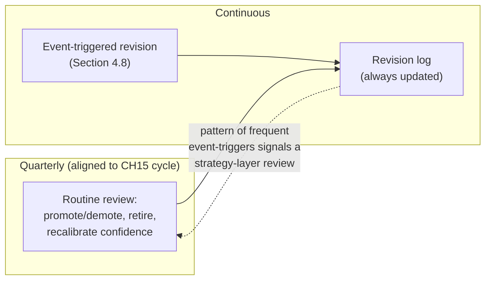

## 9. Implementation

A phased approach to standing up a roadmap practice on top of an existing,
functioning strategy layer:

### Phase 1: Intake

- Confirm every candidate theme arrives with a completed strategy-to-
  roadmap translation contract (outcome hypothesis, theme label, non-goal
  set); do not accept a bare theme name without it (Section 4.6, step 1).

### Phase 2: Construct

- Choose a format per theme based on discovery-validation state
  (Section 4.2).
- Place each theme in a horizon using build status, discovery state, and
  capacity — explicitly distinct from Product Strategy's Three Horizons
  classification (Section 4.6).
- Attach the non-goal set and assign a confidence qualifier (Sections
  4.5-4.6).

### Phase 3: Publish

- Derive audience-specific views (executive/sales, engineering, customer)
  from the single source record (Section 4.7).
- Apply the tiered-disclosure lag for externally facing views.

### Phase 4: Govern

- Establish the routine review cadence and name the accountable roadmap
  owner (Section 4.8).
- Stand up the event-triggered revision path and the disclosure-tier-based
  urgency rules for when it fires.

### Phase 5: Operate and review

- Run the Section 5 loop continuously.
- Track the observability signals in Section 14 to catch drift before a
  stakeholder does.

## 10. Complete Code Examples

Like [Product Strategy](CH15_Product_Strategy.md#10-complete-code-examples)
and
[Personas (Product Management)](CH18_Personas_Product_Management.md#10-complete-code-examples),
a roadmap is a reasoning- and governance-driven artifact rather than a
code-first one. This section provides implementation-neutral schemas a
team adapts into whichever roadmap or documentation tool it already uses,
plus a short illustrative pseudocode expression of the confidence-decay
convention from Section 4.5.

Roadmap theme record schema (the output of Section 4.6's pipeline):

- Theme label (from the strategy-to-roadmap translation contract)
- Outcome hypothesis (recap, unchanged from
  [Product Strategy](CH15_Product_Strategy.md#47-strategy-to-roadmap-translation-contract))
- Non-goal set (recap, unchanged, carried verbatim into the engineering
  view)
- Format (outcome-based / feature-based / timeline-based, Section 4.2)
- Horizon (Now / Next / Later, Section 4.4 — distinct field from any
  Three Horizons classification the bet card carries)
- Confidence qualifier (percentage range or qualitative label, Section
  4.5)
- Owning team / bet card reference
  ([Product Strategy](CH15_Product_Strategy.md#10-complete-code-examples)'s
  bet card schema)
- Last-reviewed date and accountable roadmap owner

Audience-view derivation rule schema (Section 4.7):

- Audience (executive/sales, engineering, customer)
- Detail level (full / summarized / theme-only)
- Confidence language style (percentage / qualitative business-safe /
  Now-Next-Later label only)
- Disclosure lag policy, if any
- Fields explicitly excluded for this audience (for example, non-goal set
  detail, dependency detail, internal owner names)

Revision log schema (Section 4.8):

- Theme identifier and revision date
- Trigger type: routine or event-triggered
- If event-triggered: what broke (dependency, discovery finding, capacity
  change) and the disclosure tier of any affected external communication
- Action taken: promoted, demoted, confidence adjusted, retired
- Accountable owner

A short illustrative pseudocode expression of Section 4.5's confidence-
decay convention, provided only to make the mechanism concrete rather than
as a runnable artifact:

```
def confidence_for_horizon(horizon, build_status, discovery_state):
    if horizon == "NOW":
        return clamp(80, 95, adjust_for(build_status))
    if horizon == "NEXT":
        return clamp(40, 65, adjust_for(discovery_state))
    if horizon == "LATER":
        return clamp(5, 25, adjust_for(discovery_state))
```

## 11. Performance

"Performance" for a roadmap practice is measured as communication latency
and revision responsiveness, not runtime latency, mirroring the same
reframing
[Product Strategy's Section 11](CH15_Product_Strategy.md#11-performance)
applies to its own practice:

- **Translation lag**: the time between a bet's strategy contract
  completing (Product Strategy's Section 4.7 output) and its roadmap entry
  actually being constructed and published (Section 4.6) — a growing lag
  signals the same "strategy theater" risk one layer downstream.
- **Revision latency**: the time between an event-triggering assumption
  break (Section 4.8) and the corresponding roadmap correction actually
  reaching every audience it was already disclosed to — the single most
  important leading indicator for whether Section 4.3's failure mode is
  being actively prevented or quietly tolerated.
- **Time-to-alignment across audiences**: how long it takes a new
  stakeholder question ("when is X coming") to be answered consistently
  regardless of who is asked, a direct measure of whether Section 4.7's
  single-source model is actually working in practice.

## 12. Scalability

Roadmap practice scalability has to hold across more product lines, more
audiences, and more themes without collapsing into either a single
overloaded roadmap owner or a set of independently drifting per-team
roadmaps — the same centralized-versus-federated tension
[Product Strategy's Section 12](CH15_Product_Strategy.md#12-scalability)
and
[Personas (Product Management)'s Section 12](CH18_Personas_Product_Management.md#12-scalability)
already name for their own layers, recurring here at the roadmap layer:

- **Audience-view generation at scale**: as the number of product lines
  grows, hand-deriving three audience views per theme across many themes
  becomes unsustainable without the single-source, multiple-views pattern
  (Section 7) automating the derivation rather than relying on manual
  re-authoring per theme.
- **Portfolio aggregation scalability**: a portfolio roadmap aggregating
  several product lines' individual roadmaps needs a consistent theme,
  horizon, and confidence vocabulary across all of them (Sections 4.2,
  4.4-4.5); divergent per-line conventions make cross-line aggregation
  produce a portfolio view that looks coherent but compares
  apples-to-oranges confidence figures.
- **Governance-owner bottleneck**: a single accountable roadmap owner
  serving many product lines can become a throughput constraint for
  event-triggered revision (Section 4.8) at scale; the remedy mirrors
  Product Strategy's own centralized-versus-federated resolution — a
  federated per-line roadmap owner with a thin, shared central
  vocabulary and escalation path for cross-line themes.
- **Non-goal set dilution at scale**: as more themes and more audiences
  are added, the discipline of actually carrying each theme's non-goal set
  through to its engineering view (Section 4.6, step 4) is the first thing
  to silently erode under scaling pressure — track it explicitly (Section
  14) rather than assuming it survives by default.

## 13. Security

[Product Strategy's Section 13](CH15_Product_Strategy.md#13-security)
named "controlled external roadmap disclosure" as a downstream concern
belonging to this chapter; this section is where that concern is fully
resolved into concrete mechanics, layered on top of Section 4.7's
audience-tiering model:

- **Competitive confidentiality, made concrete**: the tiered-disclosure
  lag named in Section 4.7 is not a vague intention but a specific
  policy decision — for example, "Now-horizon themes may appear in the
  customer view once build is confirmed on track; Next-horizon themes
  appear in the customer view only after they have been stable in the
  internal Next bucket for at least one full routine review cycle;
  Later-horizon themes never appear in the customer view at all." A
  concrete, written lag policy, not an ad hoc judgment call made per
  request, is what actually prevents a competitor from inferring bet
  ordering from a customer-facing roadmap before the organization intends
  to reveal it.
- **Material-information handling** (recap
  [Product Strategy](CH15_Product_Strategy.md#13-security)): for publicly
  traded companies, a roadmap entry that could reasonably move investor
  expectations may carry the same material-non-public-information
  disclosure obligations Product Strategy names at the bet-sequencing
  layer; this chapter's audience-tiering model must respect those
  obligations at the point of publication, not only at the point of
  original strategic decision.
- **Contractual-liability containment**: per Section 4.3, any roadmap
  content that risks being quoted into a contract or order form should be
  explicitly flagged and routed through a separate, deliberate
  commitment-tracking process — distinct from the general roadmap practice
  — rather than left to be discovered as a liability only after a slip
  occurs.

Common tension, recapped and now resolved concretely: sales and customer-
success teams want early roadmap visibility to manage customer
expectations, while the roadmap owner wants to delay disclosure until
sequencing is stable enough not to create a false commitment. This
chapter's resolution is the written, horizon-and-stability-based lag
policy above, applied consistently rather than negotiated ad hoc per
request.

## 14. Observability

Observability for a roadmap practice means having leading and lagging
signals that reveal whether it is actually functioning as designed, rather
than existing as a document nobody trusts:

- **Promise-breakage rate**: the proportion of externally disclosed Now or
  high-confidence Next items that slip after disclosure, tracked
  separately from routine, expected Later-to-Next-to-Now movement — a
  rising rate is the clearest possible signal that Section 4.3's failure
  mode is recurring.
- **Revision latency** (Section 11), tracked specifically for
  event-triggered revisions that touch already-disclosed items, since this
  is the exact window during which Section 4.8's "known-wrong information
  left visible" failure can occur.
- **Confidence-calibration accuracy**: periodically compare past
  confidence qualifiers (Section 4.5) against actual outcomes — did items
  labeled "90% confidence" actually ship on the stated horizon at a rate
  consistent with that label, or is the organization systematically
  over- or under-confident in its own qualifiers.
- **Non-goal-set survival rate**: what proportion of published roadmap
  entries still carry their original non-goal set intact by the time they
  reach the engineering view (Section 12's scaling-failure signal, made
  measurable).

This chapter deliberately stops at this framing-level treatment of
signals; full metric-design technique — dashboarding, statistical rigor
for trend detection, and the organization's single unifying top-line
metric — is owned by this part's not-yet-drafted **Metrics** and **North
Star Metrics** chapters (see [PART_OVERVIEW.md](PART_OVERVIEW.md)).

## 15. Failure Scenarios

1. **Roadmap as promise materializing as contractual liability**: a
   timeline-based date, stripped of its confidence qualifier as it moved
   through sales and into a contract, is missed and triggers a formal
   dispute (Section 4.3). Resolution: default to outcome-based,
   Now/Next/Later framing (Sections 4.2, 4.4) and route genuine
   date-bound external commitments through a separate, explicitly tracked
   process (Section 13).
2. **Horizon compression**: stakeholder pressure moves an unvalidated
   theme into "Now" to appease a request, reintroducing the promise
   failure in disguise (Section 4.4). Resolution: enforce horizon
   placement criteria (Section 4.6, step 3) as a gate, not a negotiation.
3. **"Later" graveyard**: themes accumulate in "Later" indefinitely,
   never promoted or explicitly retired, becoming a zombie artifact.
   Resolution: require every routine review (Section 4.8) to explicitly
   promote, retain, or retire each "Later" item, rather than silently
   rolling it forward.
4. **Leaked internal roadmap**: an externally facing view is produced by
   cosmetically editing the internal document rather than deriving it
   properly, exposing competitively sensitive sequencing (Section 4.7).
   Resolution: enforce the single-source, multiple-views derivation
   pipeline (Section 7) as the only path to publication.
5. **Stale known-wrong entry**: a disclosed item's confidence has already
   broken, but the published roadmap is left uncorrected until the next
   scheduled review (Section 4.8). Resolution: enforce the
   event-triggered revision path and disclosure-tier-based urgency rule as
   a hard requirement, not a best-effort courtesy.
6. **One-roadmap-fits-all-audiences**: a single undifferentiated document
   is shown to executives, engineers, and customers alike, either
   overwhelming some or dangerously under-informing others (Section 4.7).
   Resolution: stand up at least the three baseline audience views before
   publishing anything externally.

## 16. Testing

"Testing" a roadmap practice means validating it before a commitment
becomes a liability, not testing code:

### 16.1 Premortem for a disclosed commitment

Before disclosing a Now or high-confidence Next item externally, a small
group imagines the date has slipped and works backward through the exact
chain Section 4.3 describes (internal slide, sales deck, contract clause)
to check whether the confidence qualifier would actually have survived
that chain intact, or would have been silently dropped along the way.

### 16.2 Contract-dispute stress test

For any roadmap content at meaningful risk of being quoted into a customer
contract, ask directly: "if this date slipped tomorrow, would our current
disclosure language survive a contractual dispute, or would it read as an
unqualified promise?" — a test borrowed directly from Section 13's
contractual-liability containment concern.

### 16.3 Cross-audience consistency review

Before each routine publication cycle, sample the same underlying theme
across all three audience views and confirm they remain traceable to one
consistent source record (Section 4.7), rather than having quietly
diverged through independent, ad hoc edits.

### 16.4 Confidence-calibration retrospective

Periodically compare a sample of past confidence qualifiers against actual
delivery outcomes (Section 14), surfacing systematic over- or
under-confidence in how the organization applies Section 4.5's decay
convention before it erodes stakeholder trust in the qualifiers
themselves.

## 17. Common Mistakes

- Building a roadmap bottom-up from an existing backlog rather than
  top-down from a completed strategy-to-roadmap translation contract
  (Section 4.1).
- Defaulting to feature-based or timeline-based framing because it feels
  more reassuring, without checking whether the underlying solution has
  actually cleared discovery risk (Section 4.2).
- Letting an internal, qualified estimate travel through sales and into a
  contract without its confidence framing intact (Section 4.3).
- Compressing everything into the "Now" horizon under stakeholder
  pressure (Section 4.4).
- Presenting every horizon with identical visual and linguistic
  specificity, implying uniform certainty that does not exist (Section
  4.5).
- Skipping the non-goal-set and confidence-qualifier steps of the
  construction pipeline (Section 4.6).
- Publishing one undifferentiated roadmap to every audience instead of
  deriving audience-specific views (Section 4.7).
- Waiting for the next scheduled review to correct a roadmap entry already
  known to be wrong (Section 4.8).

## 18. Best Practices

- Require a completed strategy-to-roadmap translation contract before any
  theme reaches the roadmap construction pipeline.
- Default to outcome-based framing and the Now/Next/Later format unless a
  theme has genuinely earned more specificity through discovery validation
  or a real external deadline.
- Attach an honest, explicit confidence qualifier to every horizon, in
  every audience view, without exception.
- Maintain exactly one internal source-of-truth roadmap record and
  mechanically derive every audience view from it.
- Carry the non-goal set verbatim into at least the internal and
  engineering-facing views.
- Name a single accountable roadmap owner empowered to trigger
  event-based revision without waiting for the next scheduled cycle.
- Route any genuinely date-bound external commitment (contractual,
  regulatory) through a separate, explicitly tracked process, not the
  general roadmap practice.
- Track promise-breakage rate and revision latency as ongoing roadmap
  health signals.

## 19. Anti-Patterns

- **Roadmap as promise**: a probabilistic estimate stripped of its
  confidence framing as it moves through organizational layers, becoming
  a perceived and eventually contractual commitment (Section 4.3).
- **Horizon compression**: stuffing unvalidated themes into "Now" to
  satisfy stakeholder pressure for certainty (Section 4.4).
- **"Later" graveyard**: themes that accumulate indefinitely without ever
  being promoted or explicitly retired (Section 4.4).
- **Feature-list-masquerading-as-roadmap**: a bottom-up compilation of
  existing backlog tickets re-dated and presented as if it reflected
  deliberate strategic sequencing (Section 4.1).
- **One-roadmap-fits-all-audiences**: a single undifferentiated document
  shown to executives, engineers, and customers alike (Section 4.7).
- **Leaked internal roadmap**: an externally facing view produced by
  cosmetic editing rather than proper audience-view derivation, exposing
  competitively sensitive sequencing (Section 4.7).
- **Stale known-wrong entry**: a disclosed item left visible after its
  underlying confidence has already broken, purely because "it isn't
  review time yet" (Section 4.8).

## 20. Trade-off Analysis

- **Outcome-based versus feature-based versus timeline-based framing**
  (Section 4.2): outcome-based preserves solution flexibility but gives
  stakeholders less concrete detail to plan against; feature-based and
  timeline-based frame more concretely but foreclose solution flexibility
  and, in the timeline case, carry the roadmap-as-promise risk directly.
- **Now/Next/Later versus fixed-calendar roadmapping** (Section 4.4):
  Now/Next/Later is structurally resistant to broken-promise liability but
  gives less specific planning detail than a calendar-dated roadmap;
  fixed-calendar roadmapping gives more specific detail but carries
  materially higher liability risk once a date slips.
- **Single-source, multiple-views versus independently maintained
  per-audience roadmaps** (Section 7): single-source keeps every audience
  consistent but requires upfront investment in a derivation process;
  independently maintained roadmaps are simpler to start but reliably
  drift out of sync as themes change.
- **Centralized versus federated roadmap ownership** (Section 12): a
  single accountable owner keeps confidence and horizon vocabulary
  consistent but can become a bottleneck at scale; federated per-line
  ownership scales throughput but risks divergent vocabulary undermining
  portfolio-level aggregation.
- **Frequent event-triggered revision versus stable, infrequent
  publication**: revising too readily on every minor evidence change
  destroys stakeholders' ability to plan against a stable reference;
  revising too rarely leaves known-wrong information visible longer than
  necessary — the correct balance is the disclosure-tier-based urgency
  rule in Section 4.8, not a single fixed revision frequency for every
  item regardless of how publicly it was disclosed.

## 21. Comparison Table

| Format / Artifact | Primary commitment | Failure mode if misapplied | Best-fit discovery state | Typical audience |
|---|---|---|---|---|
| Outcome-based roadmap (Section 4.2) | A customer/business result | Can feel vague to stakeholders wanting concrete detail | Solution not yet discovery-validated | All audiences, especially cross-functional and customer-facing |
| Feature-based roadmap (Section 4.2) | A specific deliverable | Locks in a solution before discovery may be complete | Solution already discovery-validated | Engineering, internal planning |
| Timeline-based roadmap (Section 4.2) | A specific deliverable and calendar date | "Roadmap as promise" (Section 4.3) once disclosed externally | Near-term, in-build work only, or genuine external deadlines | Narrow: in-flight execution tracking, contractual commitments |
| Now/Next/Later board (Section 4.4) | Relative timing certainty, not a fixed date | "Horizon compression" or a "Later" graveyard if governance lapses (Section 4.8) | Any — this is a presentation format layered over any of the three commitment types above | Cross-functional and customer-facing default |
| Roadmap theme record (Section 10) | The single source-of-truth entry an audience view is derived from | Drifts from reality without governance (Section 4.8) | N/A — internal system-of-record artifact | Roadmap owner, tooling |
| Bet card (recap, [Product Strategy](CH15_Product_Strategy.md#10-complete-code-examples)) | Why this bet was sequenced, over which alternatives | Not this chapter's artifact — upstream input only | N/A | Product strategy owner |
| Backlog / story map (not taught here) | Which ticket ships in what order, within an already-scoped theme | Not this chapter's territory | N/A | Not-yet-drafted Story Mapping / Backlog chapters |
| Prioritization score, e.g. RICE (not taught here) | Which candidate wins scarce capacity within a scope | Not this chapter's territory | N/A | Not-yet-drafted Prioritization chapter |

The last two rows are named only for disambiguation against this
chapter's own artifacts; neither is taught here, and both belong to this
part's not-yet-drafted **Story Mapping**, **Backlog**, and **Prioritization**
chapters (see [PART_OVERVIEW.md](PART_OVERVIEW.md)).

## 22. Real-World Case Study

Case: Publishing, breaking, and repairing a roadmap commitment at a
mid-size Business-to-Business (B2B) Software as a Service (SaaS)
expense-management company

Context:
This case deliberately continues the same fictional company introduced in
[Product Strategy's](CH15_Product_Strategy.md#22-real-world-case-study)
case study and continued one layer down in
[Personas (Product Management)'s](CH18_Personas_Product_Management.md#22-real-world-case-study)
case study. By this point, the "guided month-end close" bet had been
strategically sequenced into Horizon 1 (Product Strategy), and its
internal capacity conflict between the bulk multi-entity reconciliation
flow and the in-flow error-recovery experience had been arbitrated by the
persona council (Personas, Product Management). This case picks up at the
moment that arbitrated, sequenced bet reaches the roadmap layer.

What went wrong first:

1. The bulk-reconciliation flow's completed strategy contract (outcome
   hypothesis: close the two named blocked enterprise deals; non-goal:
   exclude general enterprise identity-management tooling) arrived at the
   roadmap layer under significant sales pressure, since the named deals
   were time-sensitive.
2. Under that pressure, the team skipped Section 4.6's full pipeline and
   published a timeline-based entry directly: "Guided month-end close —
   Q3," with no confidence qualifier and no visible non-goal set — the
   exact "roadmap as promise" setup Section 4.3 describes.
3. The account executives closing both named enterprise deals wrote "Q3
   delivery" directly into each customer's contract addendum, since the
   prospects' own procurement processes required a specific date to
   proceed.
4. During actual build, the general-ledger integration dependency — the
   same feasibility risk the original PR-FAQ process had surfaced in
   [Product Strategy's](CH15_Product_Strategy.md#22-real-world-case-study)
   case study — proved substantially harder than scoped, and the delivery
   date slipped from Q3 to Q4.
5. Because "Q3" was now a contractual term rather than an internal
   estimate, one customer invoked a service-level clause over the missed
   date, escalating to a legal review and a real churn-risk conversation
   — the exact contractual-liability outcome Section 4.3 predicts.

Applying this chapter's mechanisms to repair the practice:

1. The team rebuilt its roadmap communication around the full
   construction pipeline (Section 4.6): the same bulk-reconciliation theme
   was re-published as an outcome-based, Now-horizon entry with an
   explicit confidence qualifier ("90%, in active build, one known GL
   integration dependency remaining") and its non-goal set attached
   visibly in the internal and engineering views.
2. Audience-tiered views (Section 4.7) were introduced for the first time:
   the executive/sales view used qualitative confidence language
   ("targeted this quarter") instead of a bare date; the customer view
   showed only the Now-Next-Later label, with no calendar date at all, and
   an explicit "subject to change" framing built into the presentation.
3. A written tiered-disclosure policy (Section 13) was adopted: Now-
   horizon themes could appear in the customer view only once build was
   confirmed on track, and any theme at meaningful risk of being quoted
   into a contract was flagged and routed through a separate,
   explicitly tracked commitment process rather than the general roadmap.
4. A named, accountable roadmap owner was given explicit authority to
   trigger event-based revision (Section 4.8) the moment a Now-horizon
   item's confidence changed materially, without waiting for the next
   quarterly review.
5. Six weeks into the following quarter, a similar integration risk
   surfaced early during the in-flow error-recovery experience's build.
   This time, the roadmap owner triggered immediate, proactive
   communication: internal stakeholders were re-briefed the same week, and
   the two enterprise customers who had seen a "Now" confidence signal for
   that theme were contacted directly, before either customer discovered
   the change independently.

Results after two quarters:

- No further contractual disputes over roadmap-cited dates were recorded,
  compared to the one active legal escalation in the quarter before the
  practice was rebuilt.
- Sales adoption of confidence-qualified language in customer
  conversations rose measurably, tracked through a sampled review of
  customer-facing sales materials referencing the roadmap.
- The second integration risk, caught and communicated proactively under
  the new governance model, did not escalate beyond an internal
  re-briefing and a single proactive customer conversation — the same
  category of risk that had previously required a legal review.

Architecture lesson:
The underlying uncertainty — a general-ledger integration proving harder
than scoped — was structurally similar in both incidents. What changed was
not the uncertainty itself but whether the roadmap communicating it
carried an honest confidence signal all the way through to the audience
that needed it, and whether a named owner could correct that signal the
moment it broke rather than waiting for a scheduled review — the same
reasoning chain this chapter teaches end to end.

## 23. Interview Questions

1. What is the difference between the strategy-to-roadmap translation
   contract and the roadmap itself, and where exactly does Product
   Strategy's responsibility end and this chapter's begin?
2. Explain the "roadmap as promise" anti-pattern. At which specific point
   in the chain from internal estimate to customer contract does the
   damage actually happen?
3. Why is outcome-based framing generally preferred over feature-based or
   timeline-based framing, and when would feature-based or timeline-based
   framing still be the right choice?
4. How does the Now/Next/Later format differ from Product Strategy's
   Three Horizons model? Give an example where a Horizon 1 bet sits in
   "Later" and a Horizon 3 bet sits in "Now."
5. What does it mean to communicate confidence decay explicitly, and what
   specifically goes wrong if every horizon is presented with identical
   formatting?
6. Walk through the six-step roadmap construction pipeline (Section 4.6)
   and identify which step, if skipped, most directly reintroduces the
   roadmap-as-promise risk.
7. Describe the single-source, multiple-views pattern and the specific
   failure it prevents that independently maintained per-audience
   roadmaps do not.
8. What is the difference between routine and event-triggered roadmap
   revision, and what determines the urgency of an event-triggered
   revision's communication?
9. Give an example of the "Later graveyard" failure mode and the specific
   governance practice that prevents it.
10. How would you design a tiered external-disclosure policy for a
    roadmap, and what factors would determine how long a theme must stay
    stable internally before it can appear in a customer-facing view?

## 24. Hands-on Exercises

1. Take a product you use regularly and, from public information alone,
   reconstruct what you believe its public roadmap communication looks
   like. Classify it as outcome-based, feature-based, or timeline-based,
   and identify whether it uses a Now/Next/Later-style format or a fixed
   calendar.
2. Pick a hypothetical initiative and write it three ways: as an
   outcome-based entry, a feature-based entry, and a timeline-based entry.
   Identify which audience each version would be appropriate for and why.
3. Draft a Now/Next/Later board with at least two items per horizon,
   assigning each an explicit confidence qualifier, and write one
   sentence justifying each item's horizon placement.
4. For one of your Now-horizon items, write three audience-specific
   renderings (executive/sales, engineering, customer) and check that
   each one is honest about confidence without leaking internal detail
   inappropriate to that audience.

## 25. Design Exercises

1. Given a strategy-to-roadmap translation contract (an outcome
   hypothesis, a theme label, and a non-goal set) for a hypothetical
   initiative, run it through the full six-step construction pipeline
   (Section 4.6) and produce a complete roadmap theme record (Section 10's
   schema).
2. Design a written tiered-disclosure policy (Section 13) for a company's
   roadmap, specifying exactly how long a theme must remain stable in an
   internal horizon before it may appear in a customer-facing view, and
   what triggers an exception to that rule.
3. A stakeholder insists on moving an unvalidated, exploratory idea
   directly into the "Now" horizon to support an active sales
   conversation. Design the specific conversation and criteria you would
   use to resist horizon compression (Section 4.4) without simply
   refusing the stakeholder's underlying business concern.
4. Design an event-triggered revision process (Section 4.8) for an
   organization with three product lines and one central roadmap owner,
   specifying how the urgency and communication channel scale with how
   publicly an affected item had already been disclosed.

## 26. Architecture Review Questions

1. Does every published roadmap theme trace back to a completed
   strategy-to-roadmap translation contract, or has any theme been added
   directly from the backlog without one?
2. Is an explicit confidence qualifier attached to every roadmap entry, in
   every audience view, or does any horizon rely on uniform formatting
   that implies false certainty?
3. Does the customer-facing roadmap view ever expose a specific calendar
   date, and if so, has that date been deliberately routed through a
   separate, tracked commitment process rather than the general roadmap
   practice?
4. Are audience-specific views mechanically derived from one internal
   source of truth, or is any view independently hand-maintained and at
   risk of drifting out of sync?
5. Is there a named, accountable roadmap owner empowered to trigger
   revision immediately when a disclosed item's confidence breaks, without
   waiting for the next scheduled review?
6. What is the current promise-breakage rate for externally disclosed
   items, and is it trending up or down?
7. How many items currently sit in the "Later" horizon, and when was each
   one last explicitly reviewed for promotion or retirement?
8. Does every roadmap entry still carry the non-goal set from its
   original translation contract by the time it reaches the engineering
   view, or has that boundary silently eroded?
9. If the highest-visibility item on the current roadmap slipped
   tomorrow, would the existing disclosure language survive a contractual
   or reputational dispute, or would it read as an unqualified promise?

## 27. Summary

A roadmap is the artifact and communication practice that turns a
sequenced, strategically justified bet into something engineering, sales,
executives, and customers can each act on — without inheriting more
certainty than the underlying work has actually earned. This chapter
picked up exactly where
[Product Strategy's](CH15_Product_Strategy.md#47-strategy-to-roadmap-translation-contract)
strategy-to-roadmap translation contract left off, teaching the full
downstream discipline: choosing a format calibrated to how much solution
risk has actually resolved (outcome-based, feature-based, or timeline-
based), understanding precisely how a timeline-based commitment turns into
a contractual liability through the roadmap-as-promise anti-pattern, using
the Now/Next/Later format and explicit confidence decay to keep that
liability structurally contained, building a roadmap entry from a
completed translation contract through a concrete six-step pipeline,
rendering that entry into audience-appropriate views with a written
tiered-disclosure policy, and governing the whole practice with a routine-
versus-event-triggered revision model that keeps a published roadmap
honest as reality changes underneath it.

For Solution Architects, the practical payoff is the same kind of
principled clarity
[Product Strategy](CH15_Product_Strategy.md#27-summary) and
[Personas (Product Management)](CH18_Personas_Product_Management.md#27-summary)
already provide one layer up: a defensible answer to "why does the
roadmap say what it says, to this audience, right now" — a question that,
left to ad hoc habit, gets answered anyway, just inconsistently,
optimistically, and usually in a way that quietly turns an estimate into
a promise nobody actually intended to make.

Further reading across this part:

- Strategy stack, Three Horizons, and the strategy-to-roadmap translation
  contract this chapter directly consumes:
  [CH15_Product_Strategy.md](CH15_Product_Strategy.md)
- Market segmentation feeding segment-driven roadmap themes:
  [CH16_Market_Analysis.md](CH16_Market_Analysis.md)
- Competitive positioning informing roadmap-adjacent disclosure
  boundaries: [CH17_Competitive_Analysis.md](CH17_Competitive_Analysis.md)
- Persona-weighted scoring and the persona council's arbitration protocol,
  whose worked example this chapter's Section 22 continues one layer
  downstream:
  [CH18_Personas_Product_Management.md](CH18_Personas_Product_Management.md)
- Story Mapping, Backlog, Prioritization, Metrics, and North Star Metrics
  chapters (this part's Product Management subsection, not yet drafted at
  the time of this writing): see [PART_OVERVIEW.md](PART_OVERVIEW.md)
