# Chapter 22: Backlog

Part: [02 — Design Thinking and Product Management](PART_OVERVIEW.md) · Subsection: Product Management · Status: Drafted

## 1. Introduction

A product backlog is an ordered, evolving inventory of work items—features, technical infrastructure enhancements, defect fixes, research investigations, and refactoring initiatives—that represents the single source of truth for what a product development organization might build next. Far from being a passive, static list of feature requests or a dump of unvetted ideas, a modern engineering backlog is an active operational state machine and communication interface that bridges product strategy, user discovery, system architecture, and daily software engineering execution.

Within the Software Development Life Cycle (SDLC), the backlog acts as the boundary where high-level strategic intent (see [Product Strategy](CH15_Product_Strategy.md)) and multi-quarter release themes (see [Roadmaps](CH21_Roadmaps.md)) are decomposed into concrete, executable engineering deliverables. While [Story Mapping](CH20_Story_Mapping.md) provides a two-dimensional narrative framework to identify user task flows and slice walking skeletons across release boundaries, the backlog governs the detailed lifecycle, taxonomy, dependency topology, readiness criteria, and maintenance mechanics of those individual work units over time.

A poorly managed backlog introduces silent, systemic friction across an entire engineering organization. When backlogs grow without constraint, they suffer from entropy decay: stale tickets accumulate, dependency graphs become tangled, estimation accuracy degrades, and team cognitive load spikes. Conversely, a rigorously maintained backlog provides deterministic flow, clear quality contracts through Definition of Ready (DoR) and Definition of Done (DoD) protocols, explicit trade-offs between business value and architectural debt, and reliable synchronization across modern toolchains (such as Jira, GitHub Issues, and Azure DevOps).

This chapter teaches backlog engineering from first principles to expert-level architecture. It covers item taxonomy, the DEEP criteria (Detailed appropriately, Estimated, Emergent, Prioritized), contract boundaries, continuous refinement loops, backlog debt management, dependency topology analysis, and the technical architecture required to synchronize backlogs across distributed enterprise tooling.

```mermaid
flowchart TD
    subgraph Strategy_And_Planning["Strategy & High-Level Planning"]
        PS["Product Strategy<br/>(Outcome Bets & OKRs)"] --> RM["Roadmaps<br/>(Now / Next / Later Horizons)"]
        RM --> SM["Story Mapping<br/>(User Backbone & Release Slices)"]
    Execution_Boundary["--- Contract Boundary (DoR / DoD) ---"]
    subgraph Backlog_Engine["Backlog Management Engine"]
        SM --> PB["Product Backlog<br/>(Ordered, Living Inventory)"]
        PB --> Refine["Continuous Refinement Loop<br/>(DEEP Optimization)"]
        Refine --> Dep["Dependency DAG & Coupling Analysis"]
        Dep --> Ready["Sprint Ready Backlog<br/>(DoR Cleared)"]
    end
    subgraph Delivery_Execution["Engineering Delivery"]
        Ready --> Sprint["Sprint / Iteration Execution"]
        Sprint --> DoD_Gate{"DoD Cleared?"}
        DoD_Gate -- Yes --> Release["Production Release / Deployment"]
        DoD_Gate -- No --> Remediation["Defect / Debt Remediation"]
        Remediation --> PB
    end
```

---

## 2. Historical Evolution

The concept of an ordered list of work has existed since early project management, but its role in software development has undergone radical transformation over the past three decades:

*   **1980s–1990s: The Waterfall Requirement Specification Era.** Software requirements were captured in monolithic, hundreds-of-pages-long Software Requirements Specification (SRS) documents. Changes to scope required formal Change Control Boards (CCBs). Requirements were treated as fixed upfront commitments rather than dynamic hypotheses. The result was massive inventory build-up of unvalidated ideas, slow feedback loops, and severe delivery failures when market assumptions shifted.
*   **2001: The Agile Manifesto and Early Backlog Formalization.** With the advent of Agile methodologies, the "Product Backlog" emerged as a core artifact in Scrum (formalized by Ken Schwaber and Jeff Sutherland) and Extreme Programming (XP). Requirements were broken down into user story cards—lightweight placeholders for future conversations. The backlog replaced the static SRS with a single, dynamically prioritized list managed by a Product Owner (PO).
*   **2008–2010: Roman Pichler and Mike Cohn introduce DEEP and Refinement.** As Agile adoption scaled, teams struggled with backlog bloat and chaotic sprint planning. Roman Pichler and Mike Cohn articulated the **DEEP** framework (Detailed appropriately, Estimated, Emergent, Prioritized), establishing that a backlog is not uniform; it requires a gradient of detail where near-term items are highly granular and far-term items remain high-level abstractions.
*   **2012–2015: Scale, DevOps, and Technical Backlog Integration.** As organizations adopted Continuous Integration and Continuous Deployment (CI/CD) and microservices architectures, backlogs could no longer contain only end-user functional features. Frameworks like Scaled Agile Framework (SAFe) and Large-Scale Scrum (LeSS) introduced explicit item taxonomies, distinguishing between functional User Stories, Technical Spikes, Architecture Enablers, Infrastructure Debt, and Defects.
*   **2020s–Present: Event-Driven, Multi-Tool Distributed Backlog Architectures.** In modern enterprise environments, development does not happen in a single tool. Product managers use product discovery tools (e.g., Productboard, Aha!), developers work in GitHub or GitLab, and enterprise project management relies on Jira or Azure DevOps. Backlog management has evolved into an architecture problem: building resilient, bi-directional event-driven sync engines that maintain state consistency, audit trails, and dependency graphs across heterogeneous tool ecosystems.

---

## 3. Why It Exists

The backlog exists to solve four fundamental problems in modern software engineering:

1.  **Scope Inventory & Capacity Matching:** Engineering capacity is strictly finite, whereas feature requests and ideas are infinite. Without a structured backlog, teams fall prey to the "push model," where executives and stakeholders push unvetted work directly to developers. The backlog creates an explicit "pull model" buffer, forcing trade-offs and ensuring work matches team velocity.
2.  **Uncertainty Reduction & Progressive Elaboration:** Trying to fully specify a system upfront is wasteful because information is minimal at project inception. The backlog provides a mechanism for *progressive elaboration*—deferring detailed design, architectural specification, and estimation until right before implementation, when uncertainty is lowest.
3.  **Cross-Functional Alignment & Decoupling:** Software delivery requires alignment between Product Managers (PMs), Software Architects, Quality Assurance (QA) engineers, and Reliability Engineers. The backlog serves as a shared contract that translates business outcomes into technical commitments, making scope visible and measurable.
4.  **Managing Entropy and Debt:** Codebases and product requirements naturally drift toward chaos (entropy). The backlog provides an explicit structure to track, prioritize, and pay down technical debt, architectural refactoring, and security vulnerabilities alongside customer-facing features.

---

## 4. Core Concepts

### 4.1 Backlog Item Taxonomy and Mechanics

A robust backlog categorizes work into distinct item types, each possessing unique behavioral mechanics, estimation profiles, lifecycle states, and architectural implications. Conflating these item types leads to inaccurate planning and neglected system health.

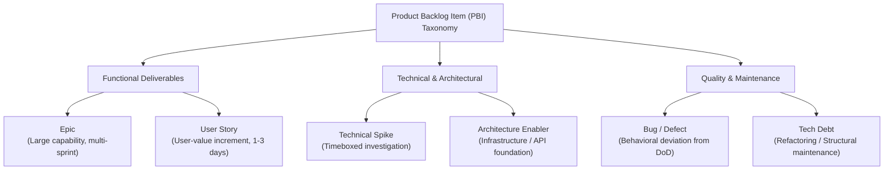

#### 1. User Story
*   **Definition:** A lightweight statement of functional capability expressed from the perspective of an end-user or system persona, delivering a discrete unit of value.
*   **Mechanism:** Written following the classic template: *"As a [persona], I want [capability], so that [business outcome/value]."* Supported by explicit Acceptance Criteria (AC) written in Given-When-Then (Gherkin) format.
*   **Decision Implications:** Used when requirements are user-facing and can be completed within a single iteration (1–3 days of developer effort).
*   **Common Failure Mode:** Writing "Developer Stories" (e.g., *"As a developer, I want a database table..."*) which obscures business value and breaks user-centric slicing.
*   **Concrete Scenario:** *"As a Fleet Manager, I want to filter vehicles by maintenance status in real-time, so that I can dispatch available trucks without calling dispatchers."*

#### 2. Technical Spike
*   **Definition:** A timeboxed research or prototyping activity designed to reduce technical or functional uncertainty before estimating a feature.
*   **Mechanism:** Formally scoped with a strict timebox (e.g., 8 hours), a clear learning hypothesis, and explicit deliverables (e.g., a technical document, benchmark results, or a proof-of-concept repository). Spikes *never* produce production code directly.
*   **Decision Implications:** Employed when an item cannot be estimated or refined due to unknown API capabilities, performance uncertainties, or architectural trade-offs.
*   **Common Failure Mode:** Open-ended research that exceeds timeboxes without producing actionable estimates or technical design decisions.
*   **Concrete Scenario:** Benchmarking gRPC (gRPC Remote Procedure Call) versus HTTP/2 REST (Representational State Transfer) JSON serialization latency for an in-memory telemetry ingestion pipeline.

#### 3. Architecture Enabler
*   **Definition:** An engineering initiative that builds the underlying infrastructure, component abstractions, data models, or Continuous Integration/Continuous Deployment (CI/CD) pipelines required to support future functional features.
*   **Mechanism:** Prioritized using architectural roadmaps and technical capacity allocation. It creates the technical foundation (the "runway") before functional stories are pulled into sprints.
*   **Decision Implications:** Essential for preventing architectural bottlenecks and ensuring non-functional requirements (NFRs)—such as scalability, security, and performance—are met upfront.
*   **Common Failure Mode:** Starving enablers in favor of pure feature stories, leading to fragile, unmaintainable architecture.
*   **Concrete Scenario:** Implementing an OAuth 2.0 / OIDC (OpenID Connect) token verification middleware service before building multi-tenant single sign-on user interfaces.

#### 4. Technical Debt Item
*   **Definition:** An explicit ticket representing deliberate or accrued sub-optimal code, outdated dependencies, missing tests, or architectural compromises that degrade maintainability.
*   **Mechanism:** Logged with an impact assessment detailing the cost of inaction (e.g., increased lead time, elevated defect rates, or performance degradation) and a proposed refactoring scope.
*   **Decision Implications:** Managed via scheduled technical debt allocation (e.g., 20% of sprint capacity) or dedicated refactoring iterations.
*   **Common Failure Mode:** Ignoring technical debt until system fragility forces a complete, high-risk rewrite.
*   **Concrete Scenario:** Refactoring a monolithic 3,000-line OrderProcessor class into decoupled domain handlers with unit test coverage exceeding 85%.

#### 5. Defect / Bug
*   **Definition:** A deviation between actual system behavior and expected behavior as defined by acceptance criteria or system specifications.
*   **Mechanism:** Categorized by severity (e.g., Blocker, Critical, Major, Minor) and root cause. High-severity bugs bypass standard backlog prioritization and trigger immediate remediation.
*   **Decision Implications:** Fixes must include automated regression tests to prevent recurrence.
*   **Common Failure Mode:** Treating feature requests as bugs or using bug reports to bypass formal backlog refinement.
*   **Concrete Scenario:** Resolving a race condition where concurrent inventory reservations cause negative stock counts in a PostgreSQL database.

---

### 4.2 The DEEP Framework

The DEEP framework, formulated by Roman Pichler and Mike Cohn, defines the structural qualities of an effectively managed product backlog. A backlog is not a uniform list; it represents a continuum of detail and certainty.

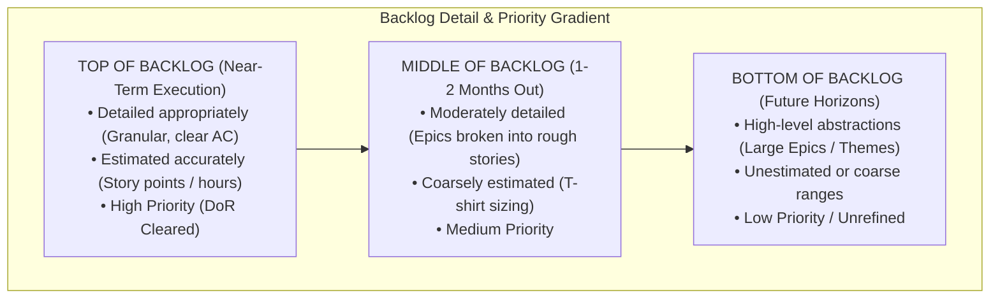

#### 1. Detailed Appropriately
*   **Definition:** Items at the top of the backlog, ready for immediate execution, must be thoroughly detailed with clear acceptance criteria. Items further down the backlog should remain high-level abstractions.
*   **Mechanism:** High-priority items undergo progressive elaboration during refinement sessions. Low-priority items are kept as broad Epics to avoid premature detail that may become obsolete.
*   **Decision Implications:** Prevents wasted effort spent writing detailed specifications for features that may never be built due to shifting market priorities.
*   **Common Failure Mode:** Over-specifying items at the bottom of the backlog months before implementation.
*   **Concrete Scenario:** A story scheduled for next week has 6 Gherkin acceptance criteria, wireframe links, and API contracts attached; an epic scheduled for next quarter is summarized in two sentences.

#### 2. Estimated
*   **Definition:** Items in the backlog carry effort and complexity estimates calibrated to their position in the backlog and level of detail.
*   **Mechanism:** Top items carry granular relative estimates (e.g., Fibonacci story points: 1, 2, 3, 5). Lower items carry coarse estimates (e.g., T-shirt sizes: S, M, L, XL) or epic story point ranges.
*   **Decision Implications:** Enables capacity planning, release forecasting, and velocity tracking without requiring micro-estimation across the entire backlog.
*   **Common Failure Mode:** Spending hours arguing over exact hour estimates for far-future backlog items.
*   **Concrete Scenario:** Using Planning Poker to assign a 3-point estimate to an immediate authentication story, while tagging a future analytics portal epic as "Extra Large."

#### 3. Emergent
*   **Definition:** The backlog is a dynamic, living structure that continuously adapts based on user feedback, market changes, test results, and emerging technical constraints.
*   **Mechanism:** Items are continually added, modified, re-prioritized, or deleted based on new evidence gathered from production analytics and customer feedback.
*   **Decision Implications:** Embraces software development as an iterative learning process rather than a static execution of an upfront plan.
*   **Common Failure Mode:** Treating the backlog as a fixed scope contract where removing or changing items requires formal project change requests.
*   **Concrete Scenario:** Deprecating three planned reporting stories after production metrics show users rely exclusively on exported CSV (Comma-Separated Values) data.

#### 4. Prioritized
*   **Definition:** Items in the backlog are explicitly ordered from top to bottom based on value, risk, dependencies, and strategic urgency.
*   **Mechanism:** The Product Owner, supported by architects and engineering leads, maintains a strict 1-to-N ranking. No two items can occupy the same priority position.
*   **Decision Implications:** Eliminates ambiguity during sprint planning regarding what work takes precedence when capacity is constrained.
*   **Common Failure Mode:** Assigning equal "High Priority" status to dozens of tickets, forcing engineering teams to guess business priorities.
*   **Concrete Scenario:** Re-ordering the backlog so that a critical security vulnerability patch sits above a high-value customer feature request for the upcoming sprint.

---

### 4.3 Definition of Ready (DoR) vs. Definition of Done (DoD) Contract Boundaries

The execution of backlog work is governed by two formal contract boundaries: the Definition of Ready (DoR) and the Definition of Done (DoD). These boundaries establish quality gates that prevent defective scope from entering execution and unvalidated code from reaching production.

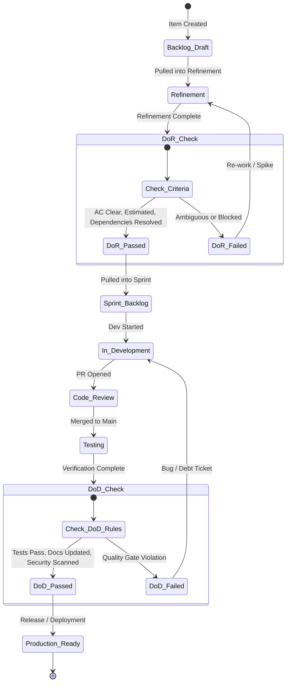

#### Definition of Ready (DoR)
*   **Definition:** A explicit checklist of operational and technical requirements that a backlog item must satisfy before it can be accepted into an execution sprint.
*   **Mechanism:** Serves as an incoming quality gate for the development team. A typical DoR checklist requires:
    1. Clear user story statement and business rationale.
    2. Unambiguous, testable Acceptance Criteria (AC).
    3. UX/UI (User Experience / User Interface) wireframes or design tokens attached (if applicable).
    4. Architectural dependencies and external API dependencies identified and resolved.
    5. Team relative estimate (story points) assigned.
    6. Performance, security, and compliance NFRs explicitly noted.
*   **Decision Implications:** Empowers engineering teams to reject ambiguous, incomplete, or unfeasible work during sprint planning, forcing product management to refine scope upstream.
*   **Common Failure Mode:** Using DoR as a rigid bureaucratic wall that halts collaboration or accepting unrefined "half-baked" tickets into sprints under stakeholder pressure.
*   **Concrete Scenario:** An engineering team refuses to pull an "Export to PDF" story into a sprint because the target PDF generation library's memory consumption profile has not been evaluated via a technical spike.

#### Definition of Done (DoD)
*   **Definition:** An agreed-upon, organization-wide standard of quality that every backlog item must meet before it can be considered complete and eligible for production release.
*   **Mechanism:** Serves as an outgoing quality gate for the development team. A standard engineering DoD requires:
    1. Code written, formatted according to style guides, and peer-reviewed via Pull Request (PR).
    2. Unit and integration test coverage criteria met (e.g., minimum 80% statement coverage).
    3. Automated regression and end-to-end tests passing in the CI pipeline.
    4. Static application security testing (SAST) and dependency vulnerability scans passed cleanly.
    5. OpenAPI / Swagger documentation and internal developer docs updated.
    6. Deployed and verified in a staging or preview environment.
*   **Decision Implications:** Ensures that "done" means production-ready, preventing hidden technical debt and incomplete work from leaking into production.
*   **Common Failure Mode:** Considering a feature "done" when coding is complete, while leaving manual testing, documentation, and deployment pipeline configuration as "follow-up tasks."
*   **Concrete Scenario:** A developer finishes implementing an API endpoint but cannot move the ticket to "Done" because automated integration tests for error-handling paths have not yet been written and executed in the CI server.

---

### 4.4 Backlog Refinement Loop Mechanics

Backlog refinement (historically called "grooming") is not a single isolated meeting; it is a continuous, progressive elaboration engine that transforms raw product ideas, architectural requirements, and customer feedback into DoR-cleared, sprint-ready execution units.

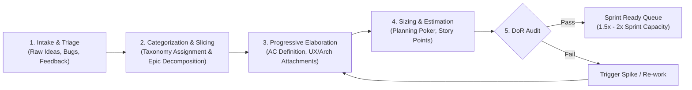

#### Refinement Workflow & Cadence
1.  **Intake and Triage:** Raw inputs (customer requests, bugs, technical debt ideas) are captured in an unrefined intake queue. The Product Owner and Lead Architect perform weekly triage to discard irrelevant items and tag valid items into proper taxonomy categories.
2.  **Progressive Slicing:** Epics scheduled for implementation in the next 1–2 months are sliced horizontally into independent User Stories using INVEST criteria (Independent, Negotiable, Valuable, Estimable, Small, Testable).
3.  **Cross-Functional Elaboration:** PMs, Architects, Developers, and QA leads meet in structured refinement sessions (typically 1–2 hours per week). They walk through sliced stories, interrogate edge cases, formulate Gherkin acceptance criteria, and identify technical risks.
4.  **Sizing and Estimation:** The team estimates relative complexity using story points (e.g., Planning Poker). Discrepancies in estimates (e.g., a developer estimating 2 points while another estimates 8) are used to uncover hidden architectural assumptions or unstated requirements.
5.  **Queue Health Buffer:** Effective refinement maintains a buffer of DoR-cleared, sprint-ready items equal to roughly 1.5× to 2× the team's average iteration velocity. This guarantees that sprint planning is fast and frictionless, while preventing excessive pre-refinement of far-future items.

---

### 4.5 Backlog Debt and Entropy Decay

Without deliberate maintenance, a product backlog acts as a sink for organizational entropy. As tickets accumulate over months and years, the backlog suffers from structural degradation known as **Backlog Debt**.

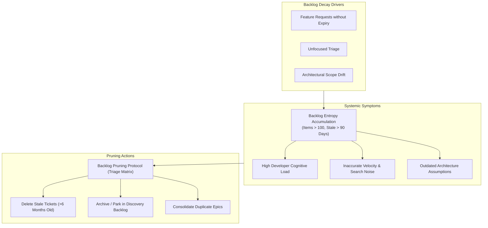

#### Mechanics of Backlog Decay
*   **Ticket Decay Rate:** Information inside a backlog ticket has a half-life. System architecture, third-party APIs, UI design systems, and business priorities evolve continuously. A ticket written 9 months ago almost certainly contains invalid technical assumptions, obsolete wireframes, or outdated acceptance criteria.
*   **Search Noise and Cognitive Overhead:** When a backlog exceeds 150–200 items, searching for existing features or bugs becomes inefficient. Duplicate tickets proliferate, developers waste time reviewing obsolete tickets during refinement, and stakeholders lose visibility into real execution priorities.
*   **The Zombie Ticket Phenomenon:** Tickets that are "too good to delete" but "never important enough to prioritize" linger indefinitely at the bottom of the backlog. They create a false impression of future commitments and consume mental energy.

#### Backlog Pruning Discipline
To combat entropy decay, engineering organizations must enforce strict pruning protocols:
1.  **Strict Size Caps:** Establish an absolute hard cap on active backlog size (e.g., maximum 100 items per development team).
2.  **Automated Staleness Expiry:** Configure automated scripts or workflow rules (e.g., in Jira or GitHub) that flag or auto-close tickets that have been inactive for more than 90–180 days.
3.  **Regular Backlog Audits:** Conduct quarterly "backlog bankruptcy" or cleanup sessions where the Product Owner and Lead Architect systematically delete or archive the bottom 30% of the backlog.

---

### 4.6 Item Dependency Topology & Coupling Analysis

In complex distributed systems, backlog items rarely exist in total isolation. An item in one service's backlog often depends on API endpoints, data model migrations, or infrastructure provisioning managed by another service or team. Failing to model and manage these dependencies leads to sprint blocking, context switching, and cascading project delays.

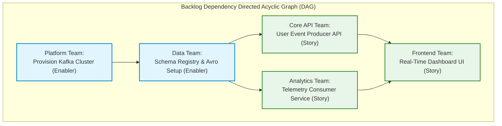

#### Dependency Classification
*   **Hard Technical Dependencies (Sequential):** Item B cannot physically be developed or tested until Item A is fully deployed to a shared environment (e.g., Database Schema Migration must precede API Endpoint implementation).
*   **Soft Functional Dependencies (Logical):** Item B can be built independently using stubs or mocks, but cannot deliver end-user value until Item A is present (e.g., Payment Gateway Integration and Order Confirmation Email).
*   **External/Cross-Team Dependencies:** Items that depend on third-party vendor APIs, compliance sign-offs, or deliverables from external engineering groups.

#### Topological Sort and Critical Path Analysis
Backlog management for interdependent systems requires modeling work as a **Directed Acyclic Graph (DAG)**:
1.  **Coupling Reduction:** Architects must evaluate dependencies to identify architectural tight coupling. If Team A's user story frequently blocks on Team B's internal code changes, the underlying architecture violates the Single Responsibility Principle or microservice boundary guidelines.
2.  **Contract-First Decoupling:** Soft and hard technical dependencies must be decoupled using API contracts (e.g., OpenAPI specs, Protocol Buffers). Team A builds against an agreed-upon interface contract using wiremocks or test doubles, allowing parallel development alongside Team B.
3.  **Critical Path Mapping:** The Lead Architect maps out the longest chain of dependent items across the backlog DAG to establish the minimum structural lead time required for major releases.

---

### 4.7 Backlog Tooling Synchronization Architecture

In modern software organizations, backlog management is rarely confined to a single database or software tool. Product management may use tools like Productboard or Aha! for discovery; engineering teams use Jira, GitHub Issues, or Azure DevOps for delivery tracking; and security teams use platforms like Snyk or Veracode to log vulnerability remediations.

Building a reliable, bi-directional **Backlog Tooling Synchronization Architecture** is a critical systems engineering problem. Without robust sync patterns, systems suffer from state divergence, lost updates, duplicate tickets, and broken audit trails.

\begin{landscape}

\end{landscape}

#### Architectural Patterns for Backlog Synchronization
1.  **Transactional Outbox Pattern:** To ensure that ticket updates in a local tool reliably trigger sync events without dual-write inconsistencies, changes are written to an internal database outbox table within a single transaction before being published to an event broker (e.g., Apache Kafka or RabbitMQ).
2.  **Bi-Directional State Mapping and Idempotency:** Sync engines must maintain an immutable Mapping Table linking internal Universal Unique Identifiers (UUIDs) across heterogeneous APIs (e.g., mapping `Productboard_Feature_ID_102` to `Jira_Issue_PROJ-405`). Event processing workers must be strictly idempotent to handle duplicate webhook deliveries safely.
3.  **Conflict Resolution Protocols:** When an item is updated simultaneously in both discovery and engineering systems, the sync engine must enforce explicit conflict resolution policies (e.g., *Last-Write-Wins with Field-Level Timestamp Auditing*, or *Authority-Based Routing* where Product Management owns Title/Description and Engineering owns Status/Estimate).
4.  **Reconciliation Engine:** A background batch reconciliation worker runs periodically (e.g., nightly) to query both APIs, detect state drift, and re-synchronize divergent ticket states.

---

### 4.8 Concept Ownership and Scope Boundaries

To maintain clarity across this handbook and prevent content duplication, the table below delineates the conceptual boundaries between this chapter and its adjacent sibling chapters:

| Concept / Domain | Owning Chapter | Scope Boundary & Distinction |
| :--- | :--- | :--- |
| **Story Mapping & Narrative Spine** | [Story Mapping](CH20_Story_Mapping.md) | Owns two-dimensional user activity backbones, walking skeleton release cuts, and story slicing techniques. **Backlog** consumes sliced stories and owns their operational lifecycle, DoR/DoD contracts, and backlog debt. |
| **Strategic Roadmaps** | [Roadmaps](CH21_Roadmaps.md) | Owns multi-quarter initiative scheduling, Now/Next/Later horizons, and audience-tiered strategy disclosure. **Backlog** owns ticket-level implementation units derived from roadmap themes. |
| **Strategy Stack & Translation** | [Product Strategy](CH15_Product_Strategy.md) | Owns the strategy-to-roadmap translation contract, outcome hypotheses, and non-goal definitions. **Backlog** handles operational execution of items downstream of this contract. |
| **Prioritization Frameworks** | Prioritization (CH25, unbuilt) | Owns mathematical scoring algorithms (RICE, MoSCoW, Kano). **Backlog** applies priority as a structural property (DEEP "P") and manages execution order. |

---

## 5. Internal Working

The internal operational mechanism of a backlog functions as a state machine coupled with a continuous refinement engine. The diagram below details the end-to-end state transitions, data transformations, and quality gate evaluations that a backlog item undergoes from initial intake to final release.

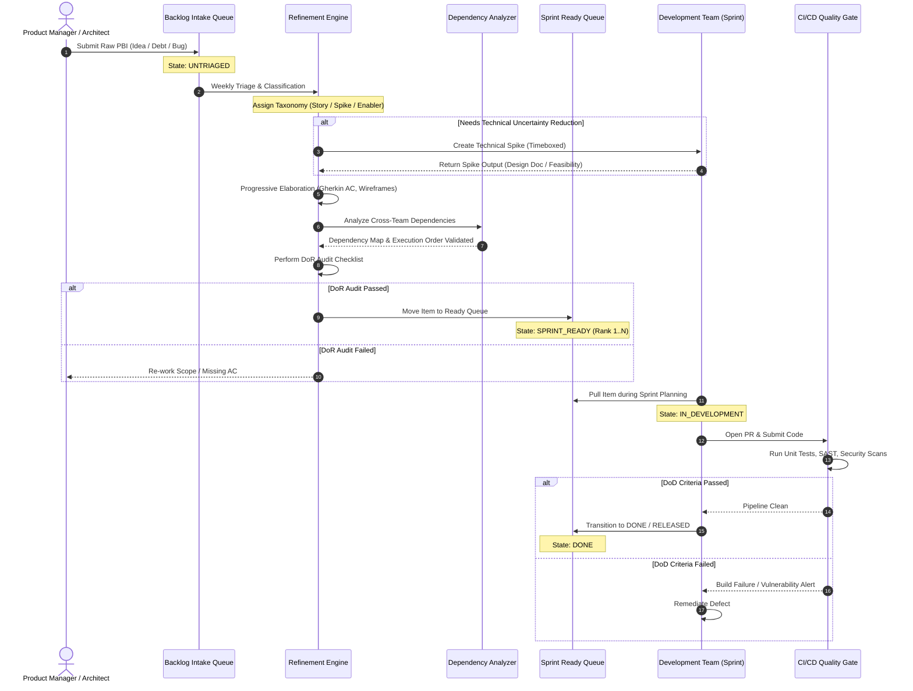

### Operational Steps in Item Lifecycle
1.  **Creation and Ingestion:** Items enter the system via API integration, manual stakeholder submission, or automated error trackers (e.g., Sentry). Items receive a unique immutable ID and enter the `UNTRIAGED` state.
2.  **Triage and Taxonomy Classification:** The Product Owner and Lead Architect evaluate the item, discarding invalid submissions and assigning an explicit taxonomy type (`Story`, `Spike`, `Enabler`, `Debt`, or `Bug`).
3.  **Spike Triggering (Conditional):** If the item exhibits high architectural or feasibility uncertainty, it is paused, and a child `Technical Spike` is spawned to conduct research.
4.  **Elaboration and Slicing:** The item is iteratively refined. Broad requirements are sliced into atomic user stories matching the INVEST framework, and concrete testable Acceptance Criteria are added.
5.  **Dependency Topological Evaluation:** The item's relationships are mapped against the global backlog DAG. Hard dependencies are verified to ensure prerequisite items are already completed or scheduled in earlier iterations.
6.  **DoR Evaluation Gate:** The item undergoes formal audit against the team's Definition of Ready checklist. If approved, it enters the `SPRINT_READY` queue with an explicit 1-to-N priority order.
7.  **Sprint Pull and Execution:** The development team pulls the top-ranked `SPRINT_READY` items into an active iteration.
8.  **DoD Quality Gate Enforcement:** Upon code completion, automated CI pipelines execute tests, static analysis, and security scanning. Only items that pass every DoD criterion transition to `DONE` and are eligible for production deployment.

---

## 6. Design Principles

When designing and maintaining a software engineering backlog, teams should adhere to five foundational design principles:

1.  **Single Source of Truth (SSOT):**
    There must be one, and only one, authoritative backlog per product domain or system boundary. Having separate "engineering backlogs," "product backlogs," and "QA backlogs" causes fragmented priorities, hidden work, and uncoordinated releases. All functional, technical, and bug work must compete for priority in the same unified system.

2.  **Pull over Push (Capacity-Constrained Ingestion):**
    Work is pulled into active execution by the engineering team based on verified empirical velocity, rather than being pushed down by external stakeholders based on arbitrary deadlines. The backlog acts as a rate-limiting buffer that protects development teams from scope overload and burnout.

3.  **Decouple Slicing from Scheduling:**
    Requirement slicing (breaking epics into small, valuable stories) must be performed independently of release scheduling. Slicing is an exercise in understanding domain granularity and reducing risk; scheduling is a business decision based on capacity and market timing.

4.  **Treat Technical Debt as First-Class Work:**
    Technical debt, architectural enablers, and infrastructure upgrades must be explicitly tracked in the backlog using the same taxonomy and estimation rigor as customer-facing features. They must compete transparently for sprint capacity allocation rather than being hidden inside feature estimates.

5.  **Fail-Fast Invalidation (Backlog Hygiene):**
    Backlog items are hypotheses, not binding contracts. If market conditions, user research, or technical spikes prove an item is no longer valuable, feasible, or necessary, it must be deleted or archived immediately. A smaller, lean backlog is vastly superior to a massive, stale inventory.

---

## 7. Architecture Patterns

Different organizational structures, system architectures, and team topologies require distinct backlog architecture patterns.

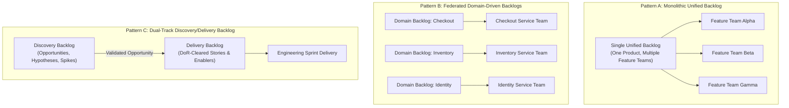

### Pattern A: Monolithic Unified Backlog
*   **Context:** Used in small to mid-sized organizations or single-product architectures where multiple cross-functional feature teams work on a shared codebase.
*   **Mechanism:** A single product backlog owned by a Lead Product Owner. Feature teams pull work from the top of the shared queue during sprint planning.
*   **Pros:** Guarantees absolute alignment across teams; eliminates duplicate work; simplifies strategic prioritization.
*   **Cons:** Becomes a severe operational bottleneck as team headcount scales beyond 4–5 teams; high contention over backlog prioritization.

### Pattern B: Federated Domain-Driven Backlogs
*   **Context:** Suited for enterprise, microservices, or domain-driven design (DDD) architectures where autonomous teams own specific bounded contexts (e.g., Payment, Catalog, Identity).
*   **Mechanism:** Each domain bounded context maintains its own independent backlog. Cross-domain initiatives are coordinated via inter-backlog dependency contracts and API specifications.
*   **Pros:** Highly scalable; enables team autonomy and independent deployment cadences; minimizes cross-team contention.
*   **Cons:** Requires sophisticated dependency management and API contract governance; risk of domain alignment drift.

### Pattern C: Dual-Track Discovery / Delivery Backlog Pattern
*   **Context:** Recommended for product-led organizations implementing continuous discovery and continuous delivery (Dual-Track Agile).
*   **Mechanism:** Maintains two distinct, synchronized backlogs:
    1.  *Discovery Backlog:* Contains problem statements, opportunity trees, user research hypotheses, and technical spikes. Owned jointly by the Product Manager, UX Lead, and Lead Architect.
    2.  *Delivery Backlog:* Contains granular, DoR-cleared user stories, architecture enabler tasks, and bug fixes ready for sprint execution. Owned by the development team.
*   **Pros:** Prevents unvalidated ideas from polluting the engineering delivery queue; maintains high delivery velocity while fostering continuous innovation.
*   **Cons:** Requires disciplined sync mechanics between discovery outcomes and delivery item creation to prevent pipeline disconnects.

---

## 8. Production Architecture

Below is the production deployment architecture for an enterprise-grade **Backlog Synchronization and Event-Driven Integration Engine**. This architecture connects a Product Management SaaS tool (Productboard) with an Engineering Delivery Platform (Jira) and a Cloud Security Platform (Snyk) via an event-driven AWS serverless pipeline.


### Architectural Component Breakdown
1.  **Webhook Ingress Endpoint (Amazon API Gateway):** Receives signed, HTTPS payload POST requests triggered by state changes in Productboard or Snyk (e.g., `feature.promoted`, `vulnerability.created`). Validates HMAC (Hash-based Message Authentication Code) signatures to prevent unauthorized webhook injection.
2.  **Ingestion & Deduplication Worker (AWS Lambda):** Parses incoming event payloads, extracts source IDs, and queries the DynamoDB state ledger to ensure event idempotency. If an event has already been processed, execution halts to prevent duplicate ticket creation.
3.  **Event Router (Amazon EventBridge):** Distributes validated events to dedicated event rules based on event types (e.g., routing security vulnerability alerts to the Technical Debt queue, and feature promotions to the User Story queue).
4.  **State Ledger & Mapping Store (Amazon DynamoDB):** Maintains an immutable audit log and mapping table linking external IDs to Jira issue keys (`Productboard_ID <-> Jira_Key <-> Snyk_Issue_ID`). Implements optimistic locking via version attributes to handle concurrent updates cleanly.
5.  **Sync Transformation Engine (AWS Lambda):** Translates source domain models into Jira REST API v3 schema payloads. Enforces field formatting rules, maps user identities, and handles API rate-limiting using exponential backoff with jitter.
6.  **Dead Letter Queue (Amazon SQS DLQ):** Captures failed transformation messages or unhandled network errors for manual inspection and automated re-drive retry routines.

---

## 9. Implementation

To realize a resilient backlog synchronization engine, software architects must implement robust code abstractions for payload transformation, idempotency verification, and transactional state reconciliation.

### System Sequence Flow for Bi-Directional Item Sync

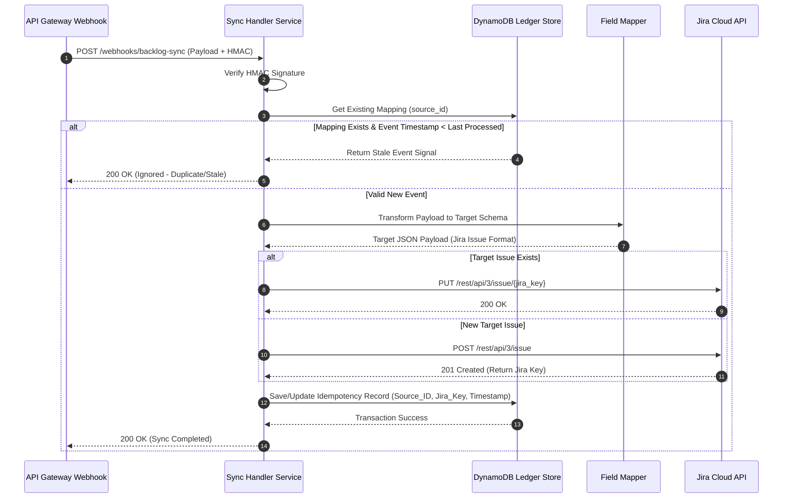

---

## 10. Complete Code Examples

Below is a production-grade implementation of a Backlog Item Synchronization and Idempotent Transformation Service written in Node.js (TypeScript) targeting AWS Lambda and DynamoDB.

```typescript
import { APIGatewayProxyEvent, APIGatewayProxyResult } from 'aws-lambda';
import * as crypto from 'crypto';
import { DynamoDBClient } from '@aws-sdk/client-dynamodb';
import { DynamoDBDocumentClient, GetCommand, PutCommand } from '@aws-sdk/lib-dynamodb';
import axios from 'axios';

// Environment configurations
const DYNAMODB_TABLE = process.env.STATE_LEDGER_TABLE || 'BacklogStateLedger';
const JIRA_BASE_URL = process.env.JIRA_BASE_URL || 'https://myorg.atlassian.net';
const JIRA_API_TOKEN = process.env.JIRA_API_TOKEN || '';
const JIRA_USER_EMAIL = process.env.JIRA_USER_EMAIL || '';
const WEBHOOK_SECRET = process.env.WEBHOOK_SECRET || 'super-secret-key';

// AWS SDK Setup
const ddbClient = new DynamoDBClient({});
const docClient = DynamoDBDocumentClient.from(ddbClient);

// Taxonomy Types
export enum BacklogItemType {
  USER_STORY = 'User Story',
  TECHNICAL_SPIKE = 'Technical Spike',
  ARCHITECTURE_ENABLER = 'Architecture Enabler',
  TECH_DEBT = 'Technical Debt',
  BUG = 'Bug',
}

export interface IncomingWebhookPayload {
  eventId: string;
  sourceSystem: string;
  sourceId: string;
  eventType: 'CREATED' | 'UPDATED' | 'DELETED';
  title: string;
  description: string;
  itemType: BacklogItemType;
  priorityScore: number;
  timestamp: string;
}

export interface StateLedgerRecord {
  sourceKey: string; // Composite key: `${sourceSystem}#${sourceId}`
  targetSystemId: string; // e.g., Jira Key: "PROJ-101"
  lastProcessedTimestamp: string;
  version: number;
}

/**
 * Validates HMAC SHA-256 signature for incoming webhooks
 */
function verifyHmacSignature(payload: string, signatureHeader: string | undefined): boolean {
  if (!signatureHeader) return false;
  const hmac = crypto.createHmac('sha256', WEBHOOK_SECRET);
  const calculatedSignature = 'sha256=' + hmac.update(payload).digest('hex');
  return crypto.timingSafeEqual(Buffer.from(calculatedSignature), Buffer.from(signatureHeader));
}

/**
 * Maps Backlog Item Types to Jira Issue Type IDs
 */
function mapToJiraIssueType(itemType: BacklogItemType): string {
  switch (itemType) {
    case BacklogItemType.USER_STORY:
      return 'Story';
    case BacklogItemType.TECHNICAL_SPIKE:
      return 'Task'; // Custom issue type in Jira
    case BacklogItemType.ARCHITECTURE_ENABLER:
      return 'Task';
    case BacklogItemType.TECH_DEBT:
      return 'Improvement';
    case BacklogItemType.BUG:
      return 'Bug';
    default:
      return 'Story';
  }
}

/**
 * Lambda Handler for processing backlog sync webhooks idempotently
 */
export const lambdaHandler = async (event: APIGatewayProxyEvent): Promise<APIGatewayProxyResult> => {
  try {
    const rawBody = event.body || '';
    const signature = event.headers['X-Hub-Signature-256'] || event.headers['x-hub-signature-256'];

    // 1. Security Check
    if (!verifyHmacSignature(rawBody, signature)) {
      console.error('Invalid HMAC signature verification failed');
      return { statusCode: 401, body: JSON.stringify({ message: 'Unauthorized' }) };
    }

    const payload: IncomingWebhookPayload = JSON.parse(rawBody);
    const sourceKey = `${payload.sourceSystem}#${payload.sourceId}`;

    // 2. Idempotency & State Check
    const getResult = await docClient.send(
      new GetCommand({
        TableName: DYNAMODB_TABLE,
        Key: { sourceKey },
      })
    );

    const existingRecord = getResult.Item as StateLedgerRecord | undefined;

    if (existingRecord && new Date(payload.timestamp) <= new Date(existingRecord.lastProcessedTimestamp)) {
      console.log(`Event ${payload.eventId} ignored: Stale or duplicate timestamp.`);
      return { statusCode: 200, body: JSON.stringify({ message: 'Ignored stale/duplicate event' }) };
    }

    // 3. Construct Jira API Auth Header
    const authHeader = `Basic ${Buffer.from(`${JIRA_USER_EMAIL}:${JIRA_API_TOKEN}`).toString('base64')}`;
    let jiraKey = existingRecord?.targetSystemId;

    if (!jiraKey) {
      // Create New Jira Issue
      const jiraPayload = {
        fields: {
          project: { key: 'PROJ' },
          summary: `[${payload.itemType}] ${payload.title}`,
          description: {
            type: 'doc',
            version: 1,
            content: [
              {
                type: 'paragraph',
                content: [{ type: 'text', text: payload.description }],
              },
            ],
          },
          issuetype: { name: mapToJiraIssueType(payload.itemType) },
        },
      };

      const jiraResponse = await axios.post(`${JIRA_BASE_URL}/rest/api/3/issue`, jiraPayload, {
        headers: { Authorization: authHeader, 'Content-Type': 'application/json' },
      });

      jiraKey = jiraResponse.data.key;
      console.log(`Created Jira issue ${jiraKey} for source key ${sourceKey}`);
    } else {
      // Update Existing Jira Issue
      const updatePayload = {
        fields: {
          summary: `[${payload.itemType}] ${payload.title}`,
        },
      };

      await axios.put(`${JIRA_BASE_URL}/rest/api/3/issue/${jiraKey}`, updatePayload, {
        headers: { Authorization: authHeader, 'Content-Type': 'application/json' },
      });

      console.log(`Updated Jira issue ${jiraKey} for source key ${sourceKey}`);
    }

    // 4. Update Idempotency State Ledger
    const newRecord: StateLedgerRecord = {
      sourceKey,
      targetSystemId: jiraKey!,
      lastProcessedTimestamp: payload.timestamp,
      version: (existingRecord?.version || 0) + 1,
    };

    await docClient.send(
      new PutCommand({
        TableName: DYNAMODB_TABLE,
        Item: newRecord,
      })
    );

    return {
      statusCode: 200,
      body: JSON.stringify({ message: 'Sync successful', jiraKey, sourceKey }),
    };
  } catch (error: any) {
    console.error('Error executing backlog synchronization:', error);
    return {
      statusCode: 500,
      body: JSON.stringify({ message: 'Internal Server Error', error: error.message }),
    };
  }
};
```

---

## 11. Performance

Backlog systems and their associated sync engines must operate under explicit performance parameters to prevent developer friction and API rate-limiting issues.

### Backlog Synchronization Performance Metrics

| Performance Vector | Target Metric | Architectural Strategy | Failure Threshold |
| :--- | :--- | :--- | :--- |
| **Sync Latency (P95)** | $< 2.0 \text{ seconds}$ | Asynchronous event processing via SQS/EventBridge | $> 10.0 \text{ seconds}$ |
| **Search & Query Response** | $< 200 \text{ ms}$ | Indexed search catalogs (Elasticsearch / OpenSearch) | $> 2.0 \text{ seconds}$ |
| **API Rate Limit Headroom** | $> 30\% \text{ capacity}$ | Token-bucket rate limiters & request batching | $0\% \text{ (HTTP 429 Errors)}$ |
| **Bulk Import Throughput** | $> 100 \text{ items/sec}$ | Concurrent Lambda worker pools with DynamoDB batching | $< 10 \text{ items/sec}$ |

### Performance Optimization Strategies
1.  **Batching and Bulk REST API Calls:** Instead of executing individual REST calls per backlog item update, sync engines should aggregate updates into bulk endpoints (e.g., Jira's `/rest/api/3/issue/bulk`) to conserve HTTP connection overhead and API quotas.
2.  **Asynchronous Webhook Ingestion:** Ingress webhooks should immediately return `202 Accepted` after pushing raw events to a queue (e.g., SQS or Kafka), decoupling webhook receipt from execution transformations.
3.  **Caching Frequently Accessed Metadata:** Issue types, project keys, user mapping tables, and custom field IDs should be cached in-memory (e.g., Redis or AWS ElastiCache) with a 1-hour Time-to-Live (TTL) to avoid repetitive metadata queries during transformation.

---

## 12. Scalability

Scaling backlog operations to handle enterprise-level systems involving hundreds of microservices and thousands of developers requires both organizational and systems architecture adjustments.

### Systems Scalability
*   **Partitioning the State Ledger:** In high-throughput environments generating thousands of ticket updates daily, the DynamoDB state ledger must be partitioned effectively. Using a composite primary key (`PartitionKey: TenantID#SourceSystem`, `SortKey: SourceItemID`) ensures even write distribution across DynamoDB shards.
*   **Rate Limit Backpressure Management:** Enterprise SaaS APIs (e.g., Jira Cloud, GitHub Enterprise) enforce strict per-minute rate limits. Sync engines must implement a **Leaky Bucket** or **Token Bucket** algorithm using Redis to buffer outgoing API requests and smooth burst traffic.

### Organizational Scalability
*   **Backlog Hierarchy Slicing:** As engineering organizations expand beyond 100 developers, flat backlogs break down. Organizations must adopt a 3-tier hierarchy:
    1.  *Portfolio Backlog:* Strategic Initiatives and Investment Themes (Managed by VP of Product / EA).
    2.  *Program / Feature Backlog:* Cross-service Epics and Architecture Enablers (Managed by Product Directors and Principal Architects).
    3.  *Team / Execution Backlog:* User Stories, Spikes, and Tech Debt (Managed by Scrum Teams and Tech Leads).

---

## 13. Security

Backlog systems store highly sensitive business assets—including unannounced product features, proprietary architectural designs, customer bug reports, and security vulnerability disclosures. Protecting this data is a critical requirement.

### Key Security Controls for Backlog Systems
1.  **Role-Based Access Control (RBAC) and Least Privilege:** Access to the backlog must be strictly scoped based on team roles. Third-party contractors or external vendors should have view/edit access restricted strictly to their assigned domain projects.
2.  **Vulnerability Exposure Containment:** Security vulnerability tickets (e.g., SAST/DAST findings, zero-day CVE patches) must be tagged with restricted security permissions. Storing unpatched zero-day vulnerabilities in a publicly readable developer backlog exposes the organization to severe insider threats and data leaks.
3.  **Webhook Signature Authentication:** All incoming integration webhooks must be authenticated using cryptographic signatures (e.g., HMAC-SHA256) calculated with shared secret keys to prevent Webhook Spoofing attacks.
4.  **Encryption at Rest and in Transit:** All backlog items, state ledgers, and API payloads must be encrypted in transit using TLS 1.3 and at rest using AES-256 with KMS (Key Management Service) managed keys.

---

## 14. Observability

A production backlog synchronization system requires comprehensive observability to detect data drift, queue backpressure, and API integration failures in real time.

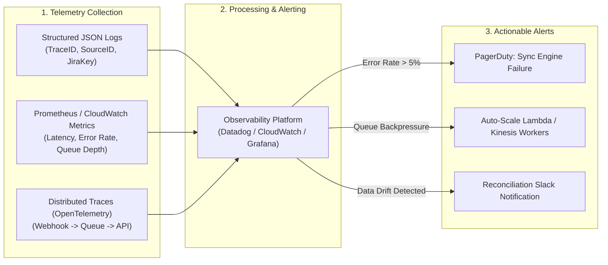

### Essential Backlog Sync Metrics
*   `backlog.sync.latency_ms` (Histogram): Time taken from webhook ingress receipt to target tool execution confirmation.
*   `backlog.sync.errors.total` (Counter, tagged by `error_code` and `source_system`): Count of processing failures (e.g., 401 Unauthorized, 429 Rate Limited, 500 Internal Error).
*   `backlog.queue.depth` (Gauge): Number of unprocessed webhook messages backed up in the ingestion queue.
*   `backlog.drift.count` (Gauge): Number of ticket state mismatches discovered during nightly batch reconciliation jobs.

---

## 15. Failure Scenarios

Understanding common technical and operational failure modes enables architects to build resilient backlog mechanisms.

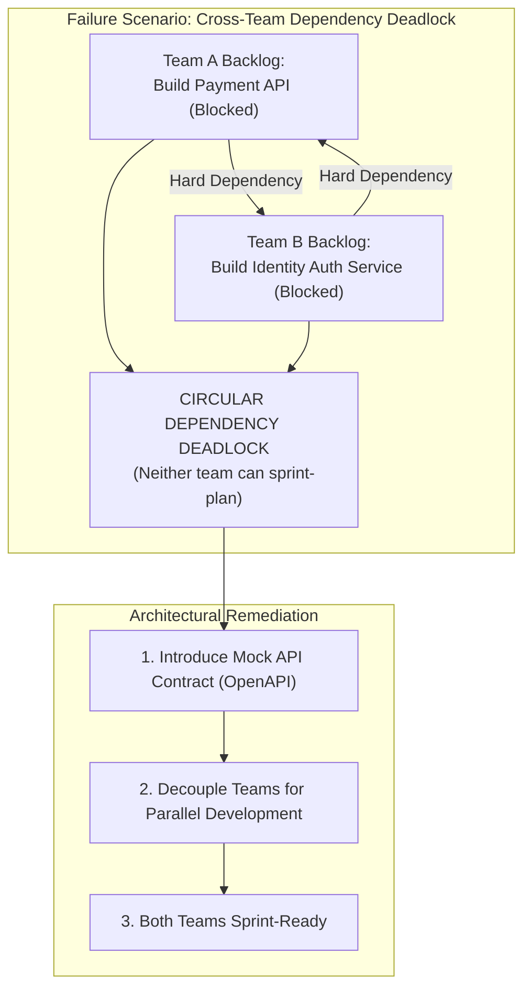

### Analysis of Major Failure Scenarios

| Failure Scenario | Root Cause | System Impact | Mitigation / Remediation |
| :--- | :--- | :--- | :--- |
| **1. Circular Dependency Deadlock** | Two teams create cross-dependent hard requirements without interface contracts. | Both teams are blocked during sprint planning; delivery halts. | Mandate API contract-first design. Use wiremocks so teams develop against stubs in parallel. |
| **2. Sync Engine Event Flood (Rate Limit Lockout)** | A bulk CSV import triggers 10,000 webhooks simultaneously, overwhelming the target REST API. | Target platform issues HTTP 429 rate limit blocks; sync engine drops updates. | Implement an API Gateway rate limiter, SQS queue buffering, and exponential backoff retry policies. |
| **3. State Ledger Reconciliation Drift** | Webhook delivery fails silently or is dropped due to network timeout without retry. | Discovery tool shows feature as "In Progress" while Jira marks it "Closed". | Deploy a nightly reconciliation job that diffs state across both databases using primary keys. |
| **4. Backlog Bankruptcy / Bloat Crisis** | Product Owner accepts all feature requests into the backlog without expiration rules. | Backlog exceeds 500 items; developer refinement efficiency drops by 80%. | Enforce hard caps (max 100 items); execute automated 90-day auto-archive script policies. |

---

## 16. Testing

Testing backlog engineering involves verifying both human process contracts (DoR/DoD) and automated synchronization pipeline logic.

### 1. Testing Sync Engine Pipelines (Integration Testing)
Automated integration tests must verify payload transformation, idempotency, and error handling against mock HTTP servers (e.g., WireMock or Nock).

```typescript
// Nock Integration Test Example for Backlog Sync
import nock from 'nock';
import { lambdaHandler } from '../src/syncHandler';
import { createMockApiGatewayEvent } from './testUtils';

describe('Backlog Sync Engine Integration Tests', () => {
  afterEach(() => nock.cleanAll());

  it('should successfully transform and create a Jira issue when valid webhook is received', async () => {
    // Mock Jira REST API Response
    const jiraScope = nock('https://myorg.atlassian.net')
      .post('/rest/api/3/issue')
      .reply(201, { id: '10001', key: 'PROJ-501' });

    const mockEvent = createMockApiGatewayEvent({
      eventId: 'evt_12345',
      sourceSystem: 'Productboard',
      sourceId: 'feat_99',
      eventType: 'CREATED',
      title: 'Implement OAuth SSO',
      description: 'Add OIDC provider support',
      itemType: 'Architecture Enabler',
      priorityScore: 85,
      timestamp: new Date().toISOString(),
    });

    const response = await lambdaHandler(mockEvent);

    expect(response.statusCode).toBe(200);
    expect(jiraScope.isDone()).toBe(true); // Verifies HTTP call was executed
  });
});
```

### 2. Testing Quality Gates (DoR Audit Auditing)
Organizations should periodically run automated audits on backlog ticket metadata to verify DoR compliance before sprint planning:
*   Verify that 100% of items in `SPRINT_READY` carry an estimate > 0.
*   Verify that 100% of User Stories contain Gherkin Acceptance Criteria.
*   Verify that no tickets in `SPRINT_READY` possess open, unresolved `BLOCKS` dependencies in the DAG.

---

## 17. Common Mistakes

When managing backlogs, engineering organizations frequently fall into five predictable traps:

1.  **The "Everything is High Priority" Trap:**
    When stakeholders refuse to rank order work, assigning "P1 / Critical" to dozens of competing tickets. This forces software developers to make arbitrary business decisions regarding what to build first.
    *Correction:* Enforce a strict 1-to-N linear ranking rule in the backlog. No two tickets can share the same numerical rank.

2.  **Using the Backlog as an Idea Dumpster:**
    Allowing every customer suggestion, internal thought, or speculative feature to be logged as a permanent ticket. This inflates backlog size and obscures actionable work.
    *Correction:* Route raw ideas to a separate, unprioritized Discovery Repository. Only move validated ideas to the delivery backlog when implementation is imminent.

3.  **Hiding Technical Debt inside Feature Estimates:**
    Engineers artificially inflating feature story point estimates (e.g., padding a 3-point story to an 8-point story) to secretly perform code refactoring or dependency upgrades.
    *Correction:* Log explicit `Technical Debt` or `Architecture Enabler` tickets in the backlog so technical maintenance is visible and explicitly prioritized alongside business value.

4.  **Premature Granular Estimation:**
    Requiring developers to provide detailed hour or story point estimates for items scheduled 6–12 months in the future.
    *Correction:* Apply the DEEP framework. Use coarse T-shirt sizes for far-horizon epics, reserving granular story point estimation strictly for near-term stories.

5.  **Ignoring the Definition of Ready (DoR):**
    Pulling ambiguous, unrefined user stories into active execution under stakeholder pressure, leading to mid-sprint halts, context switching, and missed iteration goals.
    *Correction:* Empower the engineering team to strictly enforce the DoR gate during sprint planning, rejecting items that lack clear acceptance criteria or resolved dependencies.

---

## 18. Best Practices

To maintain a high-velocity, clean backlog architecture, adhere to these proven industry practices:

*   **Maintain a 2-Sprint Ready Buffer:** Keep a steady inventory of DoR-cleared, estimated, and fully refined stories equal to roughly 1.5× to 2× the team's average sprint velocity.
*   **Allocate Fixed Capacity for Technical Health:** Establish a standing capacity allocation (e.g., 70% Functional Features, 20% Technical Debt / Architecture Enablers, 10% Bugs / Spikes) to ensure ongoing system maintenance.
*   **Enforce the INVEST Rule for Stories:** Ensure all user stories are Independent, Negotiable, Valuable, Estimable, Small (completable in 1–3 days), and Testable.
*   **Automate Backlog Hygiene:** Implement automated GitHub Actions or Jira Automation scripts that flag unestimated stories, send notifications for stale tickets (>90 days old), and enforce field validation rules.
*   **Decouple API Contracts Before Development:** When stories span multiple microservice boundaries, mandate that API interface specifications (OpenAPI/Protobuf) are drafted and approved before pulling stories into execution.

---

## 19. Anti-Patterns

Recognizing backlog anti-patterns allows teams to intervene before delivery velocity degrades.

### Anti-Pattern 1: The Flat Backlog
*   **Symptom:** Hundreds of unlinked user stories stored in a single, massive, one-dimensional priority list without epics, themes, or narrative mapping.
*   **Impact:** Complete loss of product context. Developers build disconnected feature fragments, missing the overarching user workflow.
*   **Remediation:** Implement [Story Mapping](CH20_Story_Mapping.md) to organize flat stories beneath a two-dimensional user activity backbone.

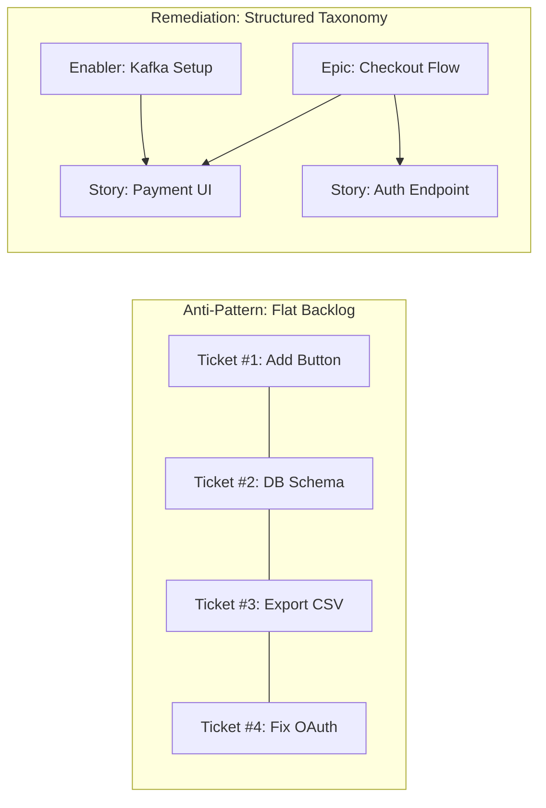

### Anti-Pattern 2: The Iceberg Backlog
*   **Symptom:** A tiny, refined top section sitting above a massive, hidden underwater mass of 500+ stale, conflicting, and unmaintained tickets.
*   **Impact:** Severe cognitive overhead, inaccurate release forecasting, and stakeholder frustration.
*   **Remediation:** Declare "Backlog Bankruptcy." Mass-archive all tickets inactive for over 180 days and institute a maximum cap of 100 active tickets.

### Anti-Pattern 3: The Shadow Backlog
*   **Symptom:** Developers maintaining secret spreadsheets or local notes containing real technical refactoring tasks because the official backlog rejects non-functional items.
*   **Impact:** Total lack of transparency, uncoordinated architectural changes, and unpredictable velocity drops.
*   **Remediation:** Educate product stakeholders on the necessity of Architecture Enablers and establish a formal capacity allocation for technical debt.

---

## 20. Trade-off Analysis

Architecting backlog management mechanisms requires balancing competing operational trade-offs.

```mermaid
quadrantChart
    title Backlog Refinement Granularity vs Planning Velocity
    x-axis Low Granularity (High Ambiguity) --> High Granularity (High Spec)
    y-axis Slow Planning Velocity --> High Planning Velocity
    quadrant-1 Optimal Balance (DEEP Alignment)
    quadrant-2 Under-Specified (Sprint Friction)
    quadrant-3 Chaotic / Reactive
    quadrant-4 Analysis Paralysis (Over-Specified)
    "DEEP Backlog Strategy": [0.70, 0.85]
    "Waterfall Upfront Spec": [0.90, 0.20]
    "No Refinement / Reactive": [0.15, 0.40]
    "Ad-Hoc Ticket Creation": [0.30, 0.60]
```

### Key Architectural Trade-offs in Backlog Management

| Decision Vector | Option A: Heavy Upfront Refinement | Option B: Just-in-Time (JIT) Refinement | Recommended Balance / Trade-off |
| :--- | :--- | :--- | :--- |
| **Refinement Timing** | Refine items months in advance of execution. | Refine items 1–2 sprints immediately prior to execution. | **Just-in-Time (Option B):** Minimizes wasted specification effort and avoids obsolete tickets when priorities shift. |
| **Backlog Scope Limits** | Unlimited backlog size (Capture everything). | Strict Hard Cap (e.g., Max 100 items). | **Strict Hard Cap (Option B):** Forces tough prioritization choices early and reduces cognitive clutter. |
| **Tooling Synchronization** | Real-time Synchronous Sync (Bi-directional). | Eventual Consistent Asynchronous Sync. | **Eventual Consistent Async (Option B):** Prevents target tool outages from blocking developer workflows. |
| **Estimation Mechanics** | Absolute Hour Estimates per Task. | Relative Story Point Sizing (Fibonacci). | **Relative Sizing (Option B):** Faster, accounts for complexity/risk, and avoids false precision. |

---

## 21. Comparison Table

The table below provides a comprehensive structural comparison of different Backlog Items and Artifacts across the product development lifecycle:

| Dimension / Property | User Story | Technical Spike | Architecture Enabler | Technical Debt Ticket | Product Backlog | Story Map |
| :--- | :--- | :--- | :--- | :--- | :--- | :--- |
| **Primary Focus** | User Value Increment | Risk/Uncertainty Reduction | Infrastructure/API Foundation | Code/Architecture Refactoring | Full Scope Inventory | User Journey & Release Cuts |
| **Primary Owner** | Product Owner / Team | Lead Developer / Architect | Principal Architect | Engineering Team | Product Owner | PM + UX + Architect |
| **Lifecycle Horizon** | 1 Sprint (1–3 Days) | Timeboxed (4–16 Hours) | 1–3 Sprints | Ongoing / Dedicated Sprint | Continuous / Living | Release / Quarter |
| **Primary Output** | Working Software | Research Doc / Benchmark | System Component / Pipeline | Refactored Codebase | Prioritized List | Two-Dimensional Map |
| **Estimation Unit** | Story Points (1,2,3,5) | Fixed Timebox Hours | Story Points / Epics | Story Points | Total Cumulative Points | Release Slices |
| **Success Metric** | Acceptance Criteria Met | Learning Hypothesis Solved | Infrastructure Ready | Code Quality / Coverage Up | Predictable Velocity | Coherent Release Cut |

---

## 22. Real-World Case Study

### Core Banking Platform Backlog Transformation: Global Fintech Corp

#### Context and Background
Global Fintech Corp operated a legacy core banking platform servicing 12 million active accounts. The engineering organization comprised 250 developers distributed across 20 feature teams, working within a monolithic Java/Oracle architecture undergoing migration to AWS microservices.

#### The Problem Statement
The organization was experiencing severe delivery paralysis:
*   The primary Jira backlog contained **4,200 unresolved tickets**, accumulating over 6 years.
*   Cross-team dependencies caused **65% of sprint items to become blocked** mid-iteration.
*   Developers spent up to **4 hours per week** searching for tickets or attending unproductive refinement meetings.
*   Security vulnerabilities logged by automated scanners sat unprioritized for an average of 210 days because product managers refused to trade feature capacity for technical debt.
*   Velocity predictability was below 35%, and release dates were routinely missed by quarters.

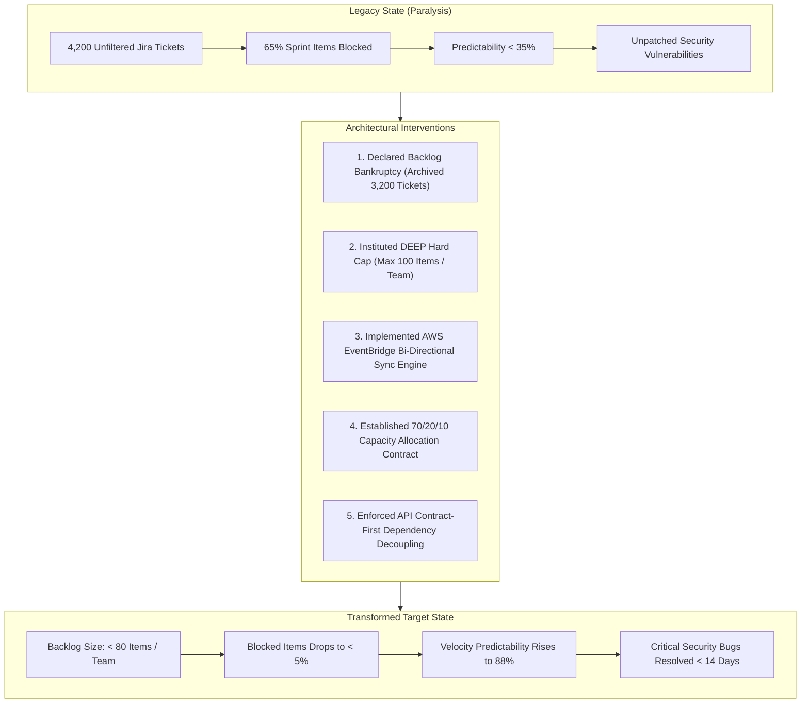

#### The Architecture & Process Intervention
A task force led by the Chief Architect and Head of Product instituted a complete backlog overhaul over a 90-day period:

1.  **Backlog Bankruptcy and Hard Capping:** The team mass-archived 3,200 tickets older than 180 days. A hard cap of **100 active items per team backlog** was strictly enforced in Jira.
2.  **Taxonomy & Capacity Contract Standardization:** All backlog items were recategorized into the 5 core taxonomy types (User Story, Spike, Enabler, Debt, Bug). An executive contract mandated a **70/20/10 capacity allocation** (70% Functional Features, 20% Technical Debt & Enablers, 10% Vulnerabilities & Spikes).
3.  **Dependency Decoupling via API Contracts:** Hard cross-team dependencies were banned. Teams were required to define OpenAPI contracts and deploy mock servers (using WireMock on AWS Fargate) before pulling dependent stories into sprints.
4.  **Automated Backlog Tooling Sync Engine:** Built an event-driven sync engine using AWS API Gateway, Lambda, and DynamoDB to automatically ingest security vulnerabilities from Snyk and feature ideas from Productboard directly into Jira with pre-assigned taxonomy tags.

#### Results and Business Impact
After 6 months of operating under the new backlog architecture:
*   **Sprint Blocking Dropped from 65% to < 5%:** Contract-first decoupling eliminated cross-team sprint stalls.
*   **Delivery Predictability Rose to 88%:** Teams consistently delivered scheduled sprint commitments.
*   **Critical Vulnerability Remediation Lead Time Cut by 85%:** High-severity security tickets dropped from 210 days to < 14 days under the enforced 10% capacity allocation rule.
*   **Developer Satisfaction (eNPS) Increased by +42 Points:** Eliminating backlog noise and refinement friction drastically reduced developer cognitive fatigue.

---

## 23. Interview Questions

Answering senior architecture interview questions regarding backlog engineering requires articulating both technical implementation details and strategic organizational trade-offs.

### Question 1: System Design / Architecture
**Q:** *How would you design an event-driven synchronization architecture between an enterprise discovery tool (e.g., Productboard) and a developer task execution system (e.g., Jira) ensuring eventual consistency, idempotency, and zero data loss under high event volume?*

**A:**
A resilient backlog synchronization engine must employ an **Event-Driven Transactional Outbox Pattern** coupled with an immutable state ledger:
1.  **Ingress & Decoupled Buffering:** Webhook requests from the source system land on an API Gateway endpoint that authenticates HMAC signatures and immediately pushes raw payloads into an AWS SQS queue (or Kafka topic), returning an instant `202 Accepted`. This insulates source webhooks from execution delays.
2.  **Idempotent Worker Processing:** An AWS Lambda worker consumes events from the queue. Before processing, it queries a DynamoDB state ledger table using a composite primary key (`SourceSystem#SourceItemID`). If an event record exists with a higher or equal timestamp, processing halts, preventing duplicate executions.
3.  **Target Transformation & Rate Limiting:** The worker transforms the source payload into the target tool's REST API v3 JSON schema. Outgoing calls pass through a Redis-backed Token Bucket rate-limiter to respect target API constraints.
4.  **State Reconciliation:** Successful updates write the target key (e.g., `JiraKey: PROJ-101`) and execution timestamp back to DynamoDB inside a transaction. Failed requests are routed to a Dead Letter Queue (DLQ) with automated alert triggers. A nightly cron worker queries both systems to diff state and reconcile data drift.

---

### Question 2: Leadership / Trade-off Arbitration
**Q:** *Your product management leadership team insists on filling 100% of sprint capacity with customer-facing features, ignoring a growing backlog of technical debt and critical architectural refactoring. As a Solution Architect, how do you mathematically quantify technical debt and convince leadership to reallocate capacity?*

**A:**
Resolving this conflict requires framing technical debt in terms of **financial cost, delivery velocity degradation, and risk exposure**:
1.  **Quantify Velocity Decay:** Present historical lead time data showing how unaddressed technical debt increases feature cycle times. For example, show that building a feature in a debt-ridden module currently takes 8 days, whereas in a clean module it takes 3 days, calculating the exact developer salary dollars wasted on friction.
2.  **Establish a Fixed Capacity Allocation Contract:** Negotiate a formal capacity budget (e.g., 70% Features, 20% Technical Health/Refactoring, 10% Bugs/Spikes) rather than fighting ticket-by-ticket battles during every sprint planning session.
3.  **Translate Debt into Architecture Enablers:** Reframe raw refactoring requests into explicit "Architecture Enabler" backlog tickets that clearly state the business outcome (e.g., *"Refactor Payment Service ORM layer to support 3x peak Black Friday transaction throughput"*).
4.  **Highlight Risk and Security SLAs:** Map unpatched technical debt and outdated dependencies against organizational Service Level Agreements (SLAs) and security compliance risks, making the cost of inaction explicit to executive stakeholders.

---

## 24. Hands-on Exercises

### Exercise 1: Build a Node.js Idempotent Webhook Transformer
*   **Objective:** Write a runnable Node.js/TypeScript script that ingests a mock feature webhook payload, checks an in-memory idempotency cache, transforms the payload into a standard Jira REST API issue payload, and logs the execution.
*   **Requirements:**
    1. Implement an HMAC verification function using `crypto`.
    2. Build an in-memory Map to simulate a DynamoDB idempotency ledger.
    3. Reject duplicate events with identical or older timestamps.
    4. Format the output to match Jira's v3 document structure.

### Exercise 2: Backlog Dependency DAG Analysis Script
*   **Objective:** Create a Python or JavaScript utility that parses a JSON list of backlog items with `dependsOn` arrays and executes a **Topological Sort** to detect circular dependencies and print the valid execution sequence.
*   **Input Data Structure:**
```json
[
  {"id": "STORY-101", "dependsOn": ["ENABLER-01"]},
  {"id": "ENABLER-01", "dependsOn": []},
  {"id": "STORY-102", "dependsOn": ["STORY-101"]}
]
```
*   **Expected Output:** Valid execution order: `ENABLER-01 -> STORY-101 -> STORY-102`. Throw a explicit `CircularDependencyException` if a cycle is detected.

---

## 25. Design Exercises

### Scenario: High-Scale E-Commerce Fleet System Overhaul
You are the Lead Solution Architect for a global logistics provider expanding into autonomous fleet delivery. The current backlog is in total disarray:
*   4 different teams maintain separate spreadsheets for fleet tracking, driver dispatch, route optimization, and billing.
*   The billing team cannot release payment features because they are waiting on route optimization APIs that are undocumented and unestimated.
*   Security audits flagged 45 critical vulnerabilities in outdated Node.js dependencies that product management refuses to prioritize.

### Design Task
Design an end-to-end Backlog Architecture and Operational Governance Plan addressing these challenges:
1.  **Architecture Blueprint:** Draw an architecture diagram illustrating a unified Backlog Tooling Integration pipeline using cloud-native services (API Gateway, EventBridge, Lambda, DynamoDB, Jira).
2.  **Taxonomy & Capacity Model:** Define a standardized backlog taxonomy and propose an explicit percentage capacity allocation model balancing features, enablers, debt, and security vulnerabilities.
3.  **Dependency Decoupling Contract:** Formulate a step-by-step strategy to decouple the billing team from the route optimization team using OpenAPI contract-first design and mock server instances.
4.  **Governance Protocol:** Create a formal Definition of Ready (DoR) checklist tailored for high-availability logistics systems.

---

## 26. Architecture Review Questions

When reviewing an organization's backlog engineering practices, architects should ask these 10 diagnostic questions:

1.  *Is there a single, authoritative source of truth for the backlog, or do teams maintain hidden "shadow backlogs" in spreadsheets and local notes?*
2.  *Does the backlog enforce a strict, non-ambiguous 1-to-N priority ranking across all active items?*
3.  *Are technical debt items, infrastructure refactoring tasks, and security vulnerabilities explicitly tracked and estimated in the same system as customer features?*
4.  *Does the team enforce an explicit, agreed-upon Definition of Ready (DoR) gate before accepting items into execution sprints?*
5.  *Is the size of the backlog strictly capped (e.g., < 100 items), or is it acting as an unmaintained dumping ground for stale ideas?*
6.  *Are cross-team dependencies mapped using a Directed Acyclic Graph (DAG) and decoupled via explicit API contracts and mock interfaces?*
7.  *Does the team maintain a 1.5× to 2× sprint velocity buffer of DoR-cleared, refined stories prior to iteration planning?*
8.  *Are backlog items evaluated against the INVEST criteria during progressive elaboration sessions?*
9.  *If backlog items are synchronized across multiple software platforms (e.g., Jira, Productboard, GitHub), is the integration architecture idempotent, event-driven, and fault-tolerant?*
10. *Is there an agreed-upon organizational capacity allocation (e.g., 70/20/10) protecting technical health and architectural enablers from feature pressure?*

---

## 27. Summary

A product backlog is not an unorganized list of ticket cards; it is an active operational engine and systems communication contract that bridges strategy, architecture, and engineering execution.

### Key Takeaways
*   **Structured Taxonomy:** Effective backlog management categorizes work into functional deliverables (User Stories, Epics) and technical requirements (Spikes, Architecture Enablers, Tech Debt, Bugs), ensuring all system needs compete transparently for capacity.
*   **The DEEP Principle:** Backlogs require a gradient of detail. Top items must be granular, estimated, and cleared against DoR criteria; bottom items remain high-level abstractions to prevent wasted specification effort.
*   **Strict Quality Gates:** The Definition of Ready (DoR) protects engineering velocity by rejecting ambiguous scope upstream, while the Definition of Done (DoD) guarantees production-grade quality and prevents hidden technical debt leakage.
*   **Managing Backlog Debt:** Backlog items suffer from entropy decay. Enforcing strict hard caps (max 100 items per team) and automated staleness pruning protocols is essential to preserve low cognitive overhead.
*   **Dependency Decoupling & Sync Architecture:** Cross-team backlog dependencies must be managed as a Directed Acyclic Graph (DAG) and decoupled via contract-first API design. Enterprise multi-tool environments require event-driven, idempotent synchronization engines backed by transactional state ledgers to ensure eventual consistency.

By applying these core principles, systems architects and product leaders transform the backlog from a source of paralysis into a high-throughput, predictable engine for software delivery.
