# Chapter 23: MVP (Minimum Viable Product)

Part: [02 — Design Thinking and Product Management](PART_OVERVIEW.md) · Subsection: Product Management · Status: Drafted

## 1. Introduction

A Minimum Viable Product (MVP) is the smallest, simplest version of a system or capability that can be deployed to real users to collect maximum validated learning about core value, usability, feasibility, and business viability hypotheses with minimum engineering expenditure. Far from being a poorly built prototype, a rushed beta, or a feature-stripped codebase that compromises security and reliability, a modern enterprise MVP is a precise, hypothesis-driven learning instrument. It serves as a strategic risk-mitigation boundary that bridges product discovery (see [Product Discovery](CH14_Product_Discovery.md)) and long-term evolutionary system architecture.

Within the Software Development Life Cycle (SDLC), the MVP acts as the definitive operational gate between theoretical value propositions and empirical market validation. While [Rapid Prototyping](CH08_Rapid_Prototyping.md) validates interaction usability in controlled environments, and [Story Mapping](CH20_Story_Mapping.md) identifies task backbones to slice early release lines, the MVP transitions hypotheses into live production environments where real user behavior, monetary transactions, and operational telemetry replace speculative surveys and stakeholder opinions.

For software architects and engineering leaders, the design of an MVP presents a critical trade-off problem. Building too much creates wasted engineering expenditure, delayed time-to-market, and unvalidated architectural complexity. Building too little—or compromising non-functional quality attributes such as security, data integrity, and basic accessibility—leads to false negative signals, where users reject a product due to poor operational reliability rather than a lack of intrinsic demand.

This chapter teaches Minimum Viable Product engineering and architectural strategy from first principles to expert level. It covers the formal operational taxonomy of MVP types, the architectural choice between throwaway facades and evolutionary foundations, Riskiest Assumption Testing (RAT), scope reduction techniques that protect quality and security, automated telemetry infrastructure, and post-launch decision frameworks for pivoting or persevering.

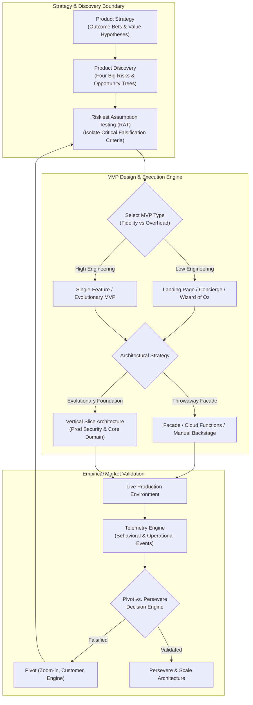

---

## 2. Historical Evolution

The concept of validating business ideas through incremental software builds has evolved dramatically over the past three decades:

*   **1990s: Monolithic Upfront Delivery and "Beta" Releases.** In traditional waterfall development, software was built completely before release. Beta releases existed primarily for technical defect finding, not value or market validation. Millions of dollars were regularly invested in building full software packages before discovering that customers had no desire for the product.
*   **2001: Frank Robinson Coins "Minimum Viable Product".** Frank Robinson, CEO of SyncDev, originally coined the term MVP to describe a product that is synchronously sized to match business risk and engineering capability. Robinson defined it as the intersection of product vision, engineering capacity, and market risk—warning against building either "too much" or "too little."
*   **2009–2011: Steve Blank and Eric Ries Popularize Lean Startup.** Eric Ries integrated the MVP concept into the Lean Startup methodology, redefining it from a simple product release to a core component of the Build-Measure-Learn feedback loop. Ries emphasized that an MVP is an experiment designed to answer specific falsifiable hypotheses. Steve Blank reinforced this in customer development, arguing that "no business plan survives first contact with customers."
*   **2012–2018: Consumer Web Explosion and the "Flawed MVP" Backlash.** The widespread adoption of MVPs led to significant misuse across the industry. Teams frequently released half-baked, broken, or insecure software under the label of "MVP," alienating early adopters. Thought leaders like Marty Cagan and Gibson Biddle introduced frameworks emphasizing that an MVP must be *viable*—meaning it must deliver real value, operate securely, and provide an acceptable user experience.
*   **2020s–Present: Cloud-Native, Serverless, and Evolutionary MVP Architectures.** Today, cloud-native infrastructure, low-code/no-code platforms, serverless execution, and feature management platforms allow software architects to build highly sophisticated MVPs in days rather than months. Modern MVPs leverage architectural patterns like the Strangler Fig, Facade services, and event-driven telemetry engines to validate complex enterprise B2B (Business-to-Business) and B2C (Business-to-Consumer) systems safely without incurring permanent technical debt.

---

## 3. Why It Exists

The Minimum Viable Product framework exists to solve four fundamental engineering and business problems in software architecture:

1.  **Elimination of Wasteful Engineering Expenditure:** Developing full software systems involves high costs in engineering hours, cloud infrastructure, security compliance, and maintenance overhead. The MVP prevents organizations from building expensive, highly scalable software for features or products that fail to generate market demand.
2.  **Reduction of Time-to-Validated-Learning:** Traditional development cycles defer real-world feedback until the end of a long release plan. An MVP shortens the Build-Measure-Learn feedback loop from quarters to days or weeks, enabling teams to validate core hypotheses before market conditions or customer needs shift.
3.  **Capital and Engineering Resource Optimization:** Organizations operate under strict constraints of capital, engineering talent, and time. By deploying MVPs, engineering leaders can distribute capacity dynamically—allocating minimal investment to test new ideas and scaling architecture only when empirical telemetry confirms product-market fit.
4.  **Architectural Over-Engineering Prevention:** Architects often fall prey to premature optimization—designing complex distributed systems, multi-region database replication, and high-throughput caching layers for applications with zero users. An MVP forces architects to defer non-critical structural complexity until operational telemetry demonstrates actual scale requirements.

---

## 4. Core Concepts

### 4.1 Formal Operational MVP Taxonomy

Not all MVPs require software engineering. Selecting the incorrect MVP type for a given learning objective leads to either excessive engineering effort or insufficient validation fidelity. Software architects must evaluate MVPs across four dimensions: technical implementation depth, human-in-the-loop operational overhead, evidence fidelity, and optimal risk context.

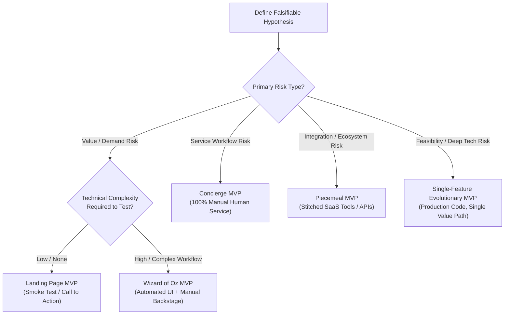

#### 4.1.1 Landing Page MVP (Smoke Test)
*   **Definition:** A static or lightly interactive web page explaining a proposed product, value proposition, or pricing structure, equipped with call-to-action triggers (e.g., pre-registration, waitlist signup, or simulated purchase buttons) to measure user intent.
*   **Mechanism:** Operates entirely at the presentation layer. Leverages web analytics, click tracking, and form submissions. No backend business logic or database infrastructure exists.
*   **Decision Implications:** Use exclusively to test *value risk* and *demand presence* before writing any domain code.
*   **Common Failure Mode:** Measuring low-intent actions (e.g., page views or passive email submissions) instead of high-intent friction signals (e.g., credit card pre-authorization, enterprise deposit booking, or detailed onboarding form completion).
*   **Concrete Scenario:** An enterprise software team creates a Landing Page MVP for an automated cloud cost optimization platform. The page contains pricing tiers and a "Connect AWS Account" button. Clicking the button opens a modal stating the service is in private preview and requests AWS account details. A 14% conversion rate on the button click validates strong demand before any optimization algorithms are built.

#### 4.1.2 Wizard of Oz MVP
*   **Definition:** An MVP where the front-end user interface (UI) appears completely automated, polished, and system-driven to the end user, but all backend operations, decision logic, and data processing are performed manually by human operators behind the scenes.
*   **Mechanism:** Front-end applications (web, mobile, or Application Programming Interface (API) stubs) record user requests into an operational queue (e.g., Slack, Trello, or a basic database). Human operators execute the required business logic manually and return the result through standard system interfaces or notifications.
*   **Decision Implications:** Ideal when backend algorithmic complexity, machine learning models, or automated integrations are extremely expensive to engineer, but front-end interaction patterns must be tested for real-world user adoption.
*   **Common Failure Mode:** Operational scaling collapse. If user demand surges, human operators become bottlenecked, leading to severe latency degradation, operational errors, and compromised user experience.
*   **Concrete Scenario:** A fintech startup tests an automated loan approval engine. Borrowers fill out a digital application and receive an approval decision within 15 minutes. Behind the scenes, three credit risk analysts manually evaluate the applicant's credit score and bank statements using manual spreadsheets before triggering an automated email template.

#### 4.1.3 Concierge MVP
*   **Definition:** An MVP where both the front-end user experience and backend operational fulfillment are provided explicitly as a manual, highly personalized human service—with zero attempt to simulate software automation.
*   **Mechanism:** Direct human-to-human interaction via email, phone, messaging, or face-to-face consulting. The provider acts as a manual service operator while studying customer workflows and requirements to design future software domain models.
*   **Decision Implications:** Best suited for complex B2B workflows, high-value consulting transformations, or domain areas where the precise customer problem and decision criteria are highly ambiguous.
*   **Common Failure Mode:** Premature scaling or attempting to automate before the human concierge process has established a repeatable, deterministic domain algorithm.
*   **Concrete Scenario:** An enterprise team validating an AI-powered compliance auditing tool offers a "Manual Compliance Audit Service" to five enterprise clients. A senior architect manually inspects the clients' architecture diagrams, infrastructure code, and security logs. This hands-on process uncovers the exact rules, exceptions, and data structures required to build the automated engine later.

#### 4.1.4 Piecemeal MVP
*   **Definition:** An MVP constructed by combining and configuring existing third-party Software as a Service (SaaS) products, open-source tools, and API webhooks without writing custom domain backend applications.
*   **Mechanism:** Integrates tools such as Zapier, Make, Typeform, Airtable, Stripe, and Auth0 using webhooks and standard REST (Representational State Transfer) APIs to form a complete functional user workflow.
*   **Decision Implications:** Excellent for testing multi-step transactional e-commerce or workflow systems where speed-to-market is paramount and custom intellectual property (IP) is not required for initial validation.
*   **Common Failure Mode:** Fragile integration topology. Rate limits, schema changes in third-party APIs, and missing transaction boundaries across SaaS platforms can cause data corruption or silent workflow failures.
*   **Concrete Scenario:** A meal-delivery startup creates a Piecemeal MVP using Typeform for menu ordering, Stripe for payment processing, Airtable for inventory and order status management, Zapier for orchestrating notification SMS messages via Twilio, and Google Maps for driver routing.

#### 4.1.5 Single-Feature Evolutionary MVP
*   **Definition:** A fully functional, production-grade software application engineered around exactly *one* core value path or capability, stripped of all secondary or auxiliary features (e.g., custom user profiles, advanced settings, complex reporting, or social integrations).
*   **Mechanism:** Built using production architectural patterns (clean architecture, robust security boundaries, database transactions), but strictly scoped to a single end-to-end user goal.
*   **Decision Implications:** Required when testing deep technical feasibility, low-latency performance constraints, or when the value proposition depends entirely on a unique technical capability.
*   **Common Failure Mode:** Scope creep. Teams gradually add "just one more necessary feature" (e.g., SSO integrations, dark mode, export to PDF), turning a 3-week MVP build into an 8-month engineering project.
*   **Concrete Scenario:** A file-sharing company builds an MVP that does exactly one thing: allows a user to drag a large video file into a browser window, generates an encrypted shareable link, and streams the upload directly to cloud storage. No user accounts, dashboards, or folder structures are created for the initial release.

---

### 4.2 Throwaway vs. Evolutionary MVP Architectural Strategy

A primary decision for software architects is determining whether an MVP's codebase and infrastructure should be designed as a disposable prototype (Throwaway MVP) or as the foundational core of a long-term production platform (Evolutionary MVP).

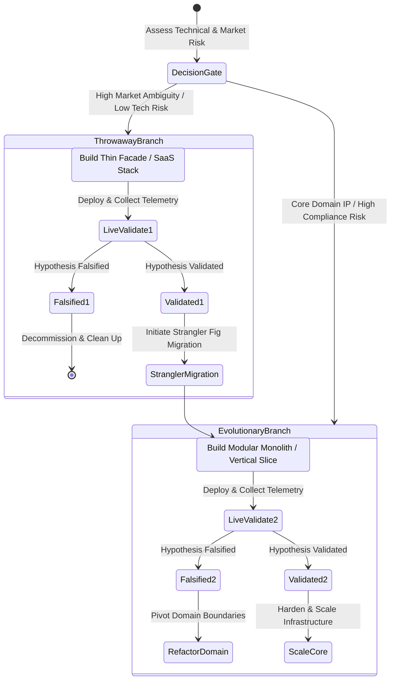

#### 4.2.1 Throwaway MVP Strategy
*   **Mechanism:** Built explicitly with the intention of being discarded once the learning objective is complete. Focuses on speed of assembly over code maintainability, test coverage, or long-term scalability. Utilizes low-code platforms, serverless scripts, or quick UI facades.
*   **Architectural Boundary:** Must be physically isolated from core production databases and enterprise systems. Uses isolated cloud accounts or sandbox environments to prevent tech-debt leakage.
*   **Decision Criteria:** Choose when market ambiguity is extremely high (>80% probability of pivot or rejection) and technical risk is low.
*   **Failure Mode (Accidental Productionization):** The business validates the MVP and immediately demands new features on top of the throwaway codebase. The temporary code becomes a permanent, unmaintainable "spaghetti" system.
*   **Mitigation:** Enforce an explicit **Decommissioning Date or Migration Trigger** in an Architecture Decision Record (ADR) before writing line one.

#### 4.2.2 Evolutionary MVP Strategy
*   **Mechanism:** Architected using production-grade standards (modular monolith, clean domain boundaries, automated testing, secure Identity and Access Management (IAM), structured logging), but strictly limited in domain scope.
*   **Architectural Boundary:** Implements a single complete vertical slice through the presentation, domain, and data access layers.
*   **Decision Criteria:** Choose when market demand is relatively clear, but technical feasibility, performance, compliance, or complex domain rules represent the primary risk.
*   **Failure Mode:** Over-engineering the foundation—spending months establishing microservice meshes, multi-region database clusters, and complex abstraction layers before validating user value.

---

### 4.3 Riskiest Assumption Testing (RAT)

Riskiest Assumption Testing (RAT) is the explicit operational methodology of identifying, isolating, and testing the single most critical unvalidated assumption underlying a product vision *before* designing or building a broader Minimum Viable Product.

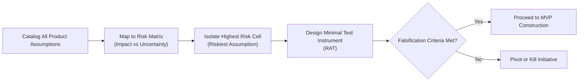

#### 4.3.1 Mechanics of RAT
1.  **Assumption Mapping:** The product trio (Product Manager, Solution Architect, Product Designer) catalogs all explicit and implicit assumptions across Marty Cagan's Four Big Risks:
    *   *Value Risk:* Do customers want this? Will they pay for it?
    *   *Usability Risk:* Can users figure out how to use it?
    *   *Feasibility Risk:* Can our engineering team build this within budget and performance constraints?
    *   *Viability Risk:* Does this align with legal, compliance, financial, and business model constraints?
2.  **Uncertainty vs. Impact Matrix:** Assumptions are scored on a 2x2 grid plotting *Level of Uncertainty* against *Impact of Failure*.
3.  **Falsification Criteria Definition:** Before conducting the test, the team defines an explicit, quantitative pass/fail boundary (e.g., "At least 15 out of 100 target enterprise Security Officers must sign a letter of intent to share production audit logs").
4.  **Targeted Experimentation:** A RAT is executed using the minimal possible instrument—which may be a technical spike, a targeted user interview, or a benchmark script—rather than a full MVP.

---

### 4.4 Quality- and Security-Preserving Scope Reduction ("Vertical Slice" Model)

A common flaw in MVP execution is reducing scope *horizontally*—building incomplete, broken, or insecure layers across the entire system. A viable MVP must reduce scope *vertically*, delivering a complete, robust, and secure experience across a narrow slice of capability.

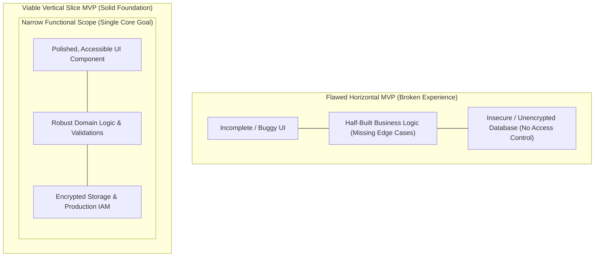

#### 4.4.1 Non-Negotiable Quality Attributes in an MVP
Even in a minimal release, certain non-functional requirements (NFRs) cannot be compromised without destroying validation viability:
*   **Security & Data Privacy:** Authentication, Role-Based Access Control (RBAC), data encryption in transit (TLS) and at rest, and regulatory compliance (e.g., GDPR, HIPAA, PCI-DSS) must meet production standards. A security breach in an MVP permanently destroys customer trust.
*   **Data Integrity & Transactional Consistency:** The database must enforce relational integrity, business invariants, and transactional safety. Losing user data invalidates operational testing.
*   **Core Usability & Accessibility:** The essential user flow must be bug-free, intuitive, and compliant with basic WCAG (Web Content Accessibility Guidelines) standards. Users cannot evaluate value if they cannot complete the core interaction.

---

### 4.5 Post-Launch Pivot vs. Persevere Decision Engine

An MVP is an empirical learning instrument. Once launched into production, its telemetry feeds a structured decision engine that determines whether to **Persevere** (invest in scaling and expanding the validated path), **Pivot** (change a core strategic hypothesis while retaining validated learning), or **Terminate** (stop investment).

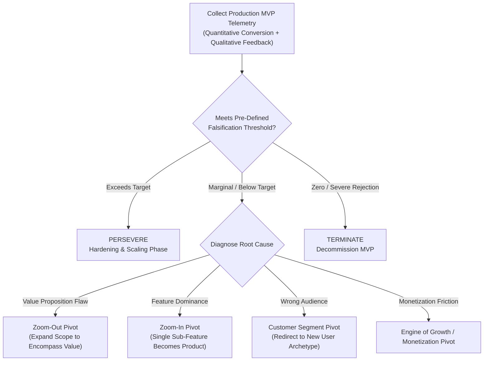

#### 4.5.1 Pivot Taxonomy (Eric Ries)
1.  **Zoom-In Pivot:** A single feature or capability within the initial MVP receives overwhelming user engagement, while the rest of the application is ignored. The product is refactored to focus exclusively on that single feature.
2.  **Zoom-Out Pivot:** What was considered the complete product in the MVP is recognized as merely a small component of a larger, required system workflow. The product scope expands to encompass the broader workflow.
3.  **Customer Segment Pivot:** The product solves a real problem, but not for the user archetype originally targeted. The marketing, messaging, UI, and access controls are redirected to the segment exhibiting real pull.
4.  **Value Capture Pivot:** The business model or monetization structure (e.g., freemium, subscription, usage-based, marketplace commission) changes based on user payment friction telemetry.
5.  **Engine of Growth Pivot:** The strategy for customer acquisition shifts between viral, sticky, or paid growth engines based on measured viral coefficients and retention curves.

---

## 5. Internal Working

To validate an MVP, architects must embed an automated telemetry and behavioral telemetry collection pipeline directly into the application runtime. Without telemetry, an MVP produces opinion-based speculation rather than validated learning.

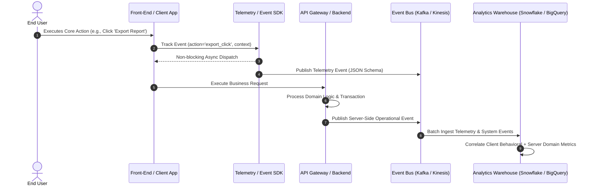

### 5.1 Telemetry Pipeline Architecture
1.  **Client-Side Behavioral Telemetry:** Captures user interaction flows, session durations, UI drop-offs, and feature activation triggers asynchronously via client SDKs (Software Development Kits) without blocking the main UI thread.
2.  **Server-Side Operational Telemetry:** Captures system latency, API response status codes, transaction completion rates, database query performance, and domain-level state transitions.
3.  **Event Schema Standardization:** All telemetry events enforce a structured JSON schema containing:
    *   `event_id`: Unique UUID.
    *   `timestamp`: UTC ISO-8601 timestamp.
    *   `user_id`: Anonymized persistent identifier.
    *   `session_id`: Session correlation ID.
    *   `event_type`: Categorized event action (e.g., `user.onboarding.completed`, `workflow.step_3.failed`).
    *   `metadata`: Context-specific key-value pairs.
4.  **Data Correlation & Warehousing:** Client-side behavioral events and server-side domain records are joined in an analytics warehouse (e.g., Snowflake, Google BigQuery) using correlation IDs to measure conversion funnels accurately against actual backend system state.

---

## 6. Design Principles

When architecting a Minimum Viable Product, engineering teams must adhere to five foundational design principles:

1.  **Simplicity Over Completeness:** Always prefer a complete, working, simple solution over a complex, partially implemented one. Omit secondary features, administrative dashboards, and automated maintenance tools that can be managed via manual operational procedures during initial testing.
2.  **Defer Reversibility-Costly Decisions:** Apply the "Two-Way Door" decision framework (see [Architecture Thinking](01_Architecture_Mindset/CH03_Architecture_Thinking.md)). Defer expensive, hard-to-reverse infrastructure investments (e.g., custom database engine selection, complex distributed caching) until scale demands them.
3.  **Strict Boundary Enclosure:** Isolate MVP code, temporary facades, and third-party SaaS integrations behind clean API contracts and interface boundaries (e.g., using the Facade or Adapter pattern) to allow seamless replacement when migrating to long-term architecture.
4.  **Instrument First, Code Second:** Never deploy a feature or user flow in an MVP without first embedding the telemetry instrumentation required to measure its activation, retention, and failure rates.
5.  **Ruthless Scope Containment:** Every proposed requirement must undergo a "falsification check": *If we remove this requirement, does it prevent us from proving or falsifying our core hypothesis?* If the answer is no, the requirement is immediately cut from the MVP scope.

---

## 7. Architecture Patterns

### 7.1 Facade & Strangler Fig Pattern for Wizard of Oz / Piecemeal MVPs

When building a Wizard of Oz or Piecemeal MVP, the architecture must present a clean, unified API and UI interface to the customer, while abstracting the underlying manual or third-party SaaS execution backend.

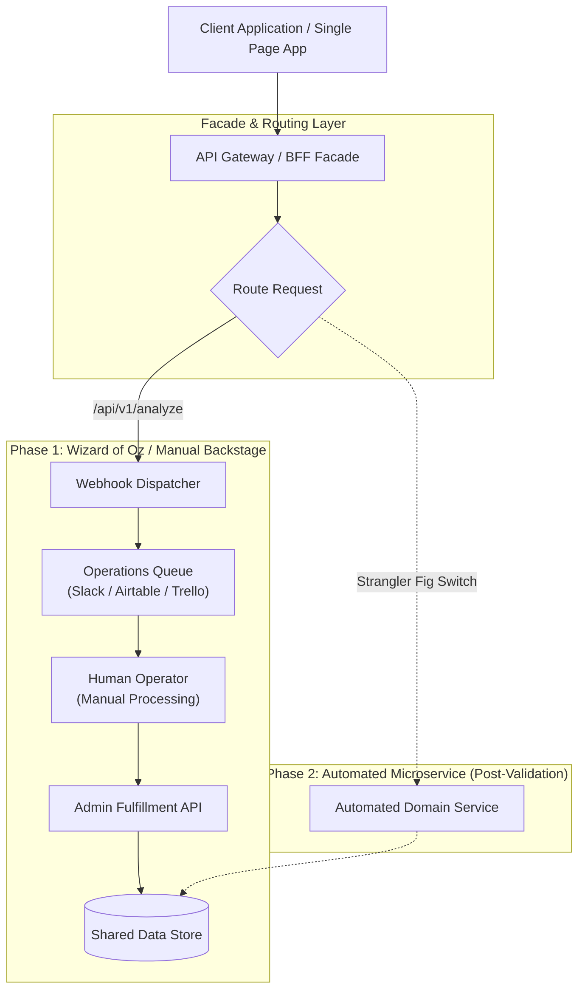

#### 7.1.1 Architectural Mechanics
*   **Backend-for-Frontend (BFF) / API Gateway Facade:** The client app communicates exclusively with a stable API Gateway endpoint (e.g., `/api/v1/credit-check`).
*   **Decoupled Fulfillment:** The Gateway publishes the incoming payload to an internal event queue or webhook. In Phase 1 (Wizard of Oz), this triggers a notification to a human operator queue (e.g., Slack or Airtable). The operator performs the work and calls an internal fulfillment API to update the status.
*   **Seamless Migration (Strangler Fig):** Once the business process is validated and automated microservices are engineered, the API Gateway router redirects incoming requests to the automated service (`Phase 2`) without requiring any changes to the front-end application code.

---

## 8. Production Architecture

The production architecture for an Evolutionary MVP must balance fast initial deployment, strict security boundaries, low operational cost, and seamless telemetry collection.

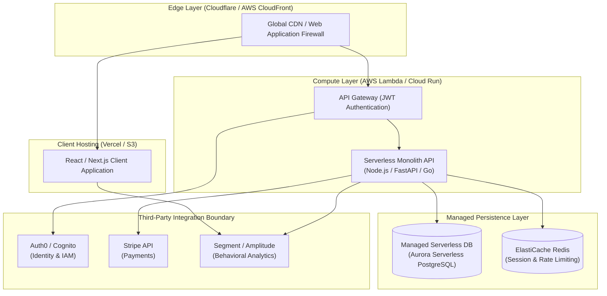

### 8.1 Key Production Components
1.  **Managed Identity Provider (Auth0 / AWS Cognito):** Avoid writing custom user authentication, password reset, or OAuth token handling. Offloading identity guarantees production-grade security and compliance out of the box.
2.  **Serverless Compute Engine (AWS Lambda / Google Cloud Run):** Eliminates infrastructure management overhead and reduces cost to zero when idle. Allows automatic scaling if MVP demand spikes unexpectedly.
3.  **Serverless Relational Database (Aurora Serverless / PlanetScale):** Enforces full relational integrity, schema migrations, and transactional safety while automatically scaling compute capacity up or down based on traffic.
4.  **Feature Flagging Platform (LaunchDarkly / Flagsmith):** Enables dark launches, canary releases, and rapid termination of unviable MVP paths without re-deploying code.

---

## 9. Implementation

This section demonstrates the implementation of an MVP telemetry, feature-flagging, and dynamic routing engine built with Python and FastAPI. It illustrates how to route requests between a manual Wizard of Oz fallback queue and an automated domain handler based on real-time feature flags while capturing structured validation events.

### 9.1 Project Structure
```text
code/python/mvp_engine/
├── main.py               # FastAPI Application & Routing Facade
├── telemetry.py          # Structured Validation Telemetry Collector
├── feature_flags.py      # Feature Flag & MVP Mode Evaluation Engine
└── handlers/
    ├── manual_queue.py   # Wizard of Oz / Manual Backstage Handler
    └── automated.py      # Production Automated Domain Logic
```

---

## 10. Complete Code Examples

### 10.1 Telemetry & Feature Flag Module (`telemetry.py`)

```python
import json
import logging
import uuid
from datetime import datetime, timezone
from typing import Dict, Any, Optional

logging.basicConfig(level=logging.INFO)
logger = logging.getLogger("MVP_Telemetry")

class MVPTelemetryEngine:
    """
    Captures structured telemetry events for MVP validation experiments.
    Guarantees schema compliance and correlation across client and server events.
    """
    def __init__(self, experiment_id: str):
        self.experiment_id = experiment_id

    def capture_validation_event(
        self, 
        user_id: str, 
        event_type: str, 
        payload: Dict[str, Any],
        session_id: Optional[str] = None
    ) -> Dict[str, Any]:
        
        event = {
            "event_id": str(uuid.uuid4()),
            "experiment_id": self.experiment_id,
            "timestamp": datetime.now(timezone.utc).isoformat(),
            "user_id": user_id,
            "session_id": session_id or str(uuid.uuid4()),
            "event_type": event_type,
            "payload": payload
        }
        
        # Log structured JSON for log aggregation (e.g., Datadog, AWS CloudWatch)
        logger.info(f"MVP_EVENT: {json.dumps(event)}")
        return event

# Global Telemetry Instance for Experiment 'EXP_LOAN_APPROVAL_2026'
telemetry = MVPTelemetryEngine(experiment_id="EXP_LOAN_APPROVAL_2026")
```

### 10.2 Facade & Dynamic Handler Router (`main.py`)

```python
from fastapi import FastAPI, Header, HTTPException, BackgroundTasks
from pydantic import BaseModel, Field
import uuid
from telemetry import telemetry

app = FastAPI(
    title="MVP Facade API",
    description="Facade interface routing between Wizard-of-Oz manual queue and automated domain logic."
)

class LoanApplicationRequest(BaseModel):
    applicant_id: str = Field(..., example="usr_99218")
    requested_amount: float = Field(..., gt=0, example=25000.0)
    annual_income: float = Field(..., gt=0, example=85000.0)

class LoanApplicationResponse(BaseModel):
    application_id: str
    status: str
    mode: str
    message: str

# Simulated Feature Flag Check
def is_automation_enabled() -> bool:
    # Set to False for Wizard of Oz MVP, True for Automated Processing
    return False

@app.post("/api/v1/loan/apply", response_model=LoanApplicationResponse)
async def submit_loan_application(
    request: LoanApplicationRequest,
    background_tasks: BackgroundTasks,
    x_session_id: str = Header(default=None)
):
    application_id = f"app_{uuid.uuid4().hex[:8]}"
    
    # 1. Record High-Intent Event
    telemetry.capture_validation_event(
        user_id=request.applicant_id,
        event_type="loan_application_submitted",
        payload={
            "application_id": application_id,
            "amount": request.requested_amount,
            "income": request.annual_income
        },
        session_id=x_session_id
    )

    # 2. Dynamic Routing based on MVP Execution Strategy
    if is_automation_enabled():
        # Automated Domain Processing Path
        status = "APPROVED" if request.annual_income > (request.requested_amount * 2) else "REJECTED"
        mode = "AUTOMATED"
        message = "Application evaluated synchronously by automated decision engine."
    else:
        # Wizard of Oz / Manual Backstage Queue Path
        background_tasks.add_task(dispatch_to_manual_ops_queue, application_id, request)
        status = "PENDING_REVIEW"
        mode = "WIZARD_OF_OZ"
        message = "Application received and placed in high-priority evaluation queue."

    return LoanApplicationResponse(
        application_id=application_id,
        status=status,
        mode=mode,
        message=message
    )

def dispatch_to_manual_ops_queue(app_id: str, request: LoanApplicationRequest):
    """
    Simulates placing the request into a human operational queue (e.g., Slack Webhook / Airtable API).
    """
    logger_msg = f"[WIZARD_OF_OZ_QUEUE] App ID: {app_id} | Applicant: {request.applicant_id} | Amount: ${request.requested_amount}"
    print(logger_msg)
```

---

## 11. Performance

Measuring performance in an MVP differs fundamentally from mature production systems:

1.  **Time-to-Market vs. Latency:** In an early-stage MVP, optimizing engineering delivery speed to test market hypotheses overrides sub-millisecond API response latency. A 200ms latency profile is completely acceptable if it validates a multi-million-dollar product line.
2.  **Telemetry Overhead Minimization:** Telemetry logging must run asynchronously (non-blocking) using background tasks or non-blocking threads. Blocking application processing to send analytics events degrades user experience and produces biased usability metrics.
3.  **Database Query Efficiency:** Avoid writing complex multi-table joins or unindexed queries even in an MVP. Query latency spikes above 3 seconds cause user drop-off, which distorts value metrics into false negative usability failure signals.

---

## 12. Scalability

Architecting an MVP for scalability requires balancing immediate simplicity with an unblocked path to growth:

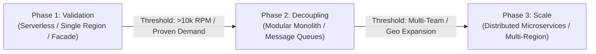

1.  **Vertical Scaling First:** For Evolutionary MVPs, utilize managed cloud services that support automatic vertical scaling (e.g., resizing database instances or compute RAM) rather than engineering complex horizontal partitioning or sharding upfront.
2.  **Asynchronous Decoupling:** Decouple time-consuming operations (e.g., email dispatch, PDF generation, report processing) using background task queues (e.g., Celery, AWS SQS) from day one. This prevents web workers from hanging under traffic spikes.

---

## 13. Security

Security is non-negotiable in an enterprise MVP. Sacrificing security under the guise of "speed" introduces existential compliance and legal risks.

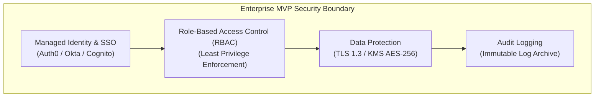

### 13.1 Security Checklist for MVPs
*   **Offload Identity Management:** Never write custom user authentication or password hashing code. Integrate standard OIDC (OpenID Connect) / OAuth 2.0 via managed providers.
*   **Enforce API Authorization:** Validate JWT (JSON Web Tokens) or session tokens on every single backend API route. Ensure users cannot access or mutate resources belonging to another tenant or user ID (Insecure Direct Object Reference - IDOR prevention).
*   **Data Encryption:** Enforce TLS 1.3 for all endpoints in transit and KMS-managed AES-256 encryption at rest for all database volumes and object storage buckets.
*   **Secret Management:** Never hardcode API keys or database credentials in source code. Inject all secrets at runtime using environment variables or secret managers (e.g., AWS Secrets Manager, HashiCorp Vault).

---

## 14. Observability

Observability in an MVP bridges technical system health and product validation telemetry.

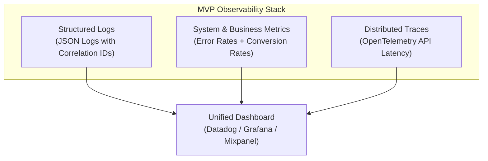

1.  **Correlation IDs:** Pass a unique `X-Correlation-ID` header across all front-end calls, API endpoints, microservices, and telemetry events to trace individual user requests end-to-end.
2.  **Error Budget Monitoring:** Set alert thresholds on core business conversion routes (e.g., HTTP 5xx rates exceeding 1% on `/api/v1/checkout` trigger immediate engineering alerts).

---

## 15. Failure Scenarios

Understanding common failure modes during MVP deployment enables architects to design resilient fallbacks.

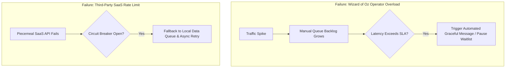

### 15.1 Real-World Failure Mitigation Strategies
*   **Operational Queue Overload (Wizard of Oz / Concierge):** If human operators are overwhelmed by demand, automatically switch the front-end interface into "Private Preview / Capacity Reached" mode, prompting users to join a waitlist rather than letting requests hang indefinitely.
*   **Integration Rate-Limiting (Piecemeal MVP):** Implement the Circuit Breaker and Exponential Backoff retry patterns when invoking third-party SaaS APIs (e.g., Zapier, Stripe) to prevent cascading system failures during rate-limiting events.

---

## 16. Testing

Testing an MVP focuses on validating core domain invariants, security boundaries, and telemetry collection accuracy rather than exhaustive code coverage.

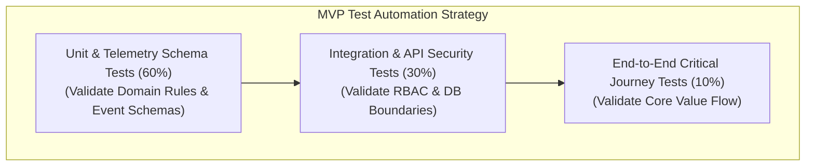

### 16.1 Key Testing Focus Areas
1.  **Telemetry Schema Validation:** Automated unit tests must verify that every emitted telemetry event conforms strictly to expected JSON schemas. Broken telemetry events invalidate experimental learning.
2.  **Security & Authorization Testing:** Automated integration tests must assert that unauthorized or cross-tenant API calls return HTTP 401/403 status codes.
3.  **Core Journey E2E Testing:** Playwright or Cypress end-to-end tests should cover exclusively the happy path of the primary value flow.

---

## 17. Common Mistakes

*   **Building a "Maximum Viable Product":** Including secondary features, user customization options, dark mode, or admin tools in the initial release, delaying market validation by months.
*   **Releasing an "Unviable" Product:** Releasing buggy, insecure, or severely broken software that prevents users from completing core interactions, resulting in false negative demand signals.
*   **Neglecting Telemetry Instrumentation:** Deploying an MVP without automated behavioral tracking, forcing teams to rely on anecdotal feedback or vanity page views.
*   **Accidental Productionization of Throwaway Code:** Failing to establish clear architectural boundaries or migration plans, leading to long-term maintainability disasters when throwaway prototypes are scaled.
*   **Confusing Prototypes with MVPs:** Testing a prototype in internal stakeholder meetings and mistaking it for live production market validation.

---

## 18. Best Practices

1.  **Define Falsification Criteria Before Writing Code:** Document explicit, quantitative pass/fail metrics for value and usability hypotheses in an ADR prior to sprint execution.
2.  **Slice Scope Vertically:** Ensure every MVP delivery represents a complete, secure, accessible, and functional user flow through all system layers.
3.  **Decouple Front-End Facades with Clean APIs:** Use API Gateways and BFF layers to allow backend operations to transition seamlessly from manual (Wizard of Oz) to automated processing without client changes.
4.  **Enforce Timeboxed Execution:** Limit MVP engineering builds to strict timeboxes (e.g., 2 to 4 weeks). If a scope item threatens the deadline, cut the scope, not the timebox or quality testing.
5.  **Clean Up Unviable Experiments:** If an MVP hypothesis is falsified, immediately decommission the associated cloud infrastructure, feature flags, and code branches to prevent system clutter and recurring costs.

---

## 19. Anti-Patterns

### 19.1 The "Goldplated MVP"
*   **Description:** Engineering teams build a fully distributed, microservice-based, multi-region application with custom UI component libraries to test an unvalidated product concept.
*   **Consequence:** Months of engineering capacity and hundreds of thousands of dollars are wasted before discovering customers do not want the product.
*   **Remediation:** Enforce the Single-Feature Evolutionary MVP or Wizard of Oz model; restrict compute infrastructure to serverless monoliths or thin facades.

### 19.2 The "Frankenstein SaaS"
*   **Description:** Assembling a Piecemeal MVP using dozens of nested third-party SaaS tools without defining data ownership, transaction boundaries, or error fallback mechanisms.
*   **Consequence:** Data drift, silent sync failures, security vulnerabilities, and chaotic customer support issues.
*   **Remediation:** Limit Piecemeal SaaS integrations to 3–4 core tools; enforce a central database store or webhooks router to log all state changes centrally.

---

## 20. Trade-off Analysis

Architecting an MVP requires managing fundamental trade-offs across speed, validation fidelity, architectural quality, and operational cost.

```{=latex}
\begin{landscape}
```

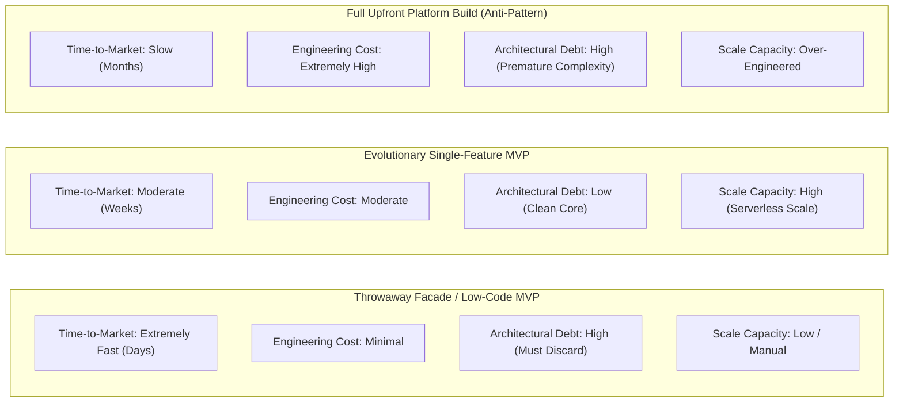

```{=latex}
\end{landscape}
```

| MVP Architectural Strategy | Time-to-Market | Initial Engineering Cost | Tech Debt Risk | Validation Evidence Fidelity | Scale & Hardening Path |
|---|---|---|---|---|---|
| **Landing Page / Smoke Test** | 1–3 Days | Very Low | None | Low (Stated Intent) | Must build functional system if validated |
| **Wizard of Oz / Concierge** | 3–7 Days | Low | Low (Ops Heavy) | High (Real Behavior) | Replace manual backend with automated services |
| **Piecemeal (SaaS Integration)** | 1–2 Weeks | Low–Moderate | Moderate (SaaS Lock-in) | High (Real Transactions) | Migrate critical SaaS nodes to custom APIs |
| **Evolutionary Single-Feature** | 2–4 Weeks | Moderate | Low | Very High (Production Use) | Expand domain capabilities vertically |
| **Full Monolithic Build (Anti-Pattern)** | 3–6 Months | Very High | Severe (Over-engineered) | Delayed Feedback | Expensive re-architecture if assumptions fail |

---

## 21. Comparison Table

### 21.1 MVP Types vs. Learning Objectives

| MVP Type | Primary Risk Targeted | Engineering Effort | Operational Overhead | Best Use Case |
|---|---|---|---|---|
| **Landing Page MVP** | Value / Demand Risk | < 5% | Zero | Unvalidated consumer/B2B product concepts |
| **Wizard of Oz MVP** | Value & Usability Risk | 15%–25% | High (Human Ops) | Algorithmic, AI, or complex automation ideas |
| **Concierge MVP** | Workflow & Need Discovery | < 10% | Very High (Manual Service) | Complex B2B enterprise service transformations |
| **Piecemeal MVP** | Transactional & Market Fit | 10%–20% | Moderate | E-commerce, multi-step booking, marketplace flows |
| **Single-Feature MVP** | Technical Feasibility & Core Value | 30%–50% | Low | Deep tech, unique algorithms, performance-critical apps |

---

## 22. Real-World Case Study

### 22.1 Enterprise Healthtech B2B Patient Intake Platform

#### Background & Challenge
A leading healthcare software vendor sought to build an AI-powered Patient Intake and Clinical Triage platform. The executive team proposed an 18-month, $4M engineering program to build a fully automated, HIPAA-compliant distributed system integrating with major Electronic Health Record (EHR) systems (Epic, Cerner).

#### The Architect's MVP Intervention
The Principal Architect intervened, arguing that spending $4M before validating whether clinical staff and patients would adopt AI-generated triage recommendations represented unacceptable risk. She proposed a phased MVP strategy:

1.  **Phase 1: Riskiest Assumption Test (RAT - 1 Week):** Tested whether clinical staff trusted AI triage outputs by presenting 20 historical patient charts (anonymized) alongside AI-generated triage suggestions to 5 medical directors. *Result:* Falsified the assumption that clinicians wanted full automation; clinicians demanded full visibility into reasoning and manual override controls.
2.  **Phase 2: Wizard of Oz MVP (4 Weeks):** Built a lightweight, secure web application for 2 partner clinics. Patients filled out intake forms online. Behind the scenes, medical triage specialists reviewed the inputs and populated the "AI Recommendations" manually into the clinician dashboard.
3.  **Phase 3: Telemetry & Falsification Metrics:** Tracked clinician override rates, intake completion times, and system latency.
    *   *Target:* >75% clinician acceptance of triage recommendations without manual override.
    *   *Actual Telemetry:* 88% acceptance rate achieved across 1,200 patient intake sessions.

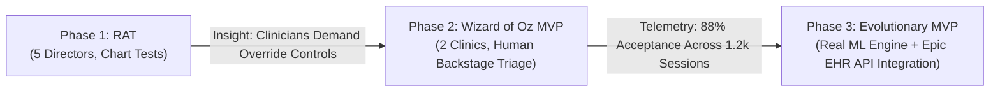

#### Architectural Evolution & Outcome
With market demand and workflow viability empirically proven, the engineering team built an **Evolutionary Single-Feature MVP** replacing the manual triage specialists with an actual machine learning inference pipeline integrated via FHIR (Fast Healthcare Interoperability Resources) APIs. The company saved $2.8M in potential re-engineering costs by discovering the necessity of clinician override controls before writing the core engine.

---

## 23. Interview Questions

1.  **Question:** How do you distinguish a Minimum Viable Product (MVP) from a prototype, and what architectural criteria guide your choice between a Throwaway and an Evolutionary MVP?
    *   *Answer:* A prototype is designed to evaluate usability, interaction flows, or technical feasibility in controlled environments with test users, whereas an MVP is a production-deployed instrument designed to test core business, value, and viability hypotheses with real users in real market conditions. The choice between Throwaway and Evolutionary MVPs depends on market ambiguity and technical risk: high market ambiguity (>80% chance of pivot) favors a Throwaway MVP (facades, serverless scripts) isolated from core infrastructure; low market ambiguity with high technical/compliance risk favors an Evolutionary MVP (vertical slice, production IAM, clean architecture) that forms the durable system foundation.

2.  **Question:** How do you prevent scope creep when stakeholders insist that enterprise security and data encryption can be skipped to speed up an MVP release?
    *   *Answer:* Security, data privacy (GDPR/HIPAA), and relational data integrity are non-negotiable quality attributes that cannot be compromised in a viable MVP. Releasing an insecure MVP exposes the organization to catastrophic legal liability and destroys user trust, producing false negative validation signals. Scope reduction must be executed *vertically* (eliminating secondary features like custom reporting or admin controls) rather than *horizontally* (building insecure or broken system layers).

3.  **Question:** Explain the Wizard of Oz MVP pattern and how you would design an API architecture to transition seamlessly from manual backstage fulfillment to automated microservices.
    *   *Answer:* A Wizard of Oz MVP presents a fully automated front-end interface to the user while backend operations are executed manually by human operators. To architect for a seamless transition, implement a Backend-for-Frontend (BFF) or API Gateway Facade layer. The client app sends requests to a stable API endpoint (`/api/v1/process`). The Gateway publishes requests to an event bus or queue. In Phase 1, the queue routes events to an operational queue (e.g., Slack/Airtable) for human operators. When the automated service is engineered (Phase 2), apply the Strangler Fig pattern at the API Gateway to re-route incoming requests to the new microservice without requiring any client-side code modifications.

---

## 24. Hands-on Exercises

### Exercise 1: Build a Wizard-of-Oz Routing Facade
1.  Set up a local FastAPI or Node.js environment.
2.  Implement an API endpoint `/api/v1/recommendations` that accepts user preference payloads.
3.  Configure a feature flag engine (or environment variable toggle) that routes requests to either:
    *   A manual webhook dispatching payloads to a Discord/Slack channel (Wizard of Oz mode).
    *   A local rule-based recommendation function (Automated mode).
4.  Embed an asynchronous telemetry logger emitting structured JSON events containing correlation IDs to a local log file.
5.  Test both modes using `curl` or Postman, verifying that client response schemas remain identical across both modes.

---

## 25. Design Exercises

### Scenario: B2B Enterprise Logistics Fleet Optimization
You are the Lead Architect for an enterprise logistics company planning to build an AI-driven fleet routing optimization system. Executives want to spend 9 months building a multi-region microservices platform integrated with IoT vehicle telematics.

#### Task
1.  Design a 4-week MVP strategy using the Riskiest Assumption Testing (RAT) framework and the MVP Taxonomy.
2.  Draw a C4 Component diagram showing a Wizard of Oz architectural pattern for initial fleet routing validation.
3.  Define 3 quantitative falsification metrics that must be met to justify proceeding to an Evolutionary MVP build.
4.  Specify the security boundaries and telemetry schemas required for the initial production deployment.

---

## 26. Architecture Review Questions

1.  *Does the proposed MVP architecture enforce strict isolation between temporary facades/third-party SaaS integrations and enterprise production data stores?*
2.  *Are security boundaries (authentication, authorization, encryption at rest and in transit) maintained at production standards across the MVP scope?*
3.  *Has the team defined explicit, quantitative pass/fail falsification criteria in an ADR prior to initiating code development?*
4.  *Is asynchronous behavioral and operational telemetry instrumentation embedded into all core user flows?*
5.  *If the MVP is designed as a Throwaway architecture, is there a documented decommission date and migration strategy to prevent accidental productionization?*

---

## 27. Summary

A Minimum Viable Product (MVP) is a precise, hypothesis-driven learning instrument designed to achieve maximum validated learning with minimum engineering expenditure. By choosing the appropriate MVP type from the formal taxonomy (Landing Page, Wizard of Oz, Concierge, Piecemeal, Single-Feature), software architects can isolate and falsify critical business risks early.

Architects must navigate the strategic choice between disposable Throwaway facades and durable Evolutionary foundations—ensuring that scope is reduced vertically across narrow functional paths without compromising non-negotiable security, data integrity, or accessibility standards. Powered by robust telemetry pipelines and API facade patterns, the MVP converts speculative product visions into empirical operational data, guiding engineering organizations to pivot or persevere with confidence.
