# Chapter 24: Metrics

Part: [02 - Design Thinking and Product Management](PART_OVERVIEW.md) · Subsection: Product Management · Status: Drafted

## 1. Introduction

In modern solution architecture and product management, metrics are the quantitative feedback loops that bind strategic intent, human behavior, and software execution into a coherent operational model. Without rigorous, actionable metrics, engineering organizations risk building high-performance, fault-tolerant software systems that deliver negligible business or user value, while product organizations risk optimizing for superficial engagement indicators that mask long-term churn and structural decline. 

Metrics serve as the ultimate bridge between High-Level Design (HLD) and product outcomes. When an architect designs an event-driven system or a distributed stream-processing pipeline, the underlying telemetry architecture determines whether product teams can observe real-world user behavior, measure system efficacy, and validate strategic hypotheses. Conversely, product metrics dictate non-functional requirements: high-velocity product telemetry demands low-latency client collection, durable stream ingestion, schema evolution controls, and cost-effective time-series storage.

This chapter establishes a comprehensive, first-principles foundation for product and architectural metrics. It explicitly distinguishes between what a system ships (**output metrics**) and how human behavior changes as a result (**outcome metrics**). It teaches the structural taxonomy of metrics, including **Input/Output Metric Trees**, the **HEART Framework** (Happiness, Engagement, Adoption, Retention, Task Success), the **AARRR Acquisition Funnel** (Acquisition, Activation, Retention, Referral, Revenue), **Counter-Metrics and Guardrail Metrics**, **Metric Instrumentation Architecture**, and the rigorous distinction between **Vanity Metrics and Actionable Metrics**.

To maintain strict concept ownership across the handbook, this chapter explicitly scopes its boundaries relative to adjacent and future chapters in Part 02:
- **North Star Metrics** (owned by the future *North Star Metrics* chapter; see [PART_OVERVIEW.md](PART_OVERVIEW.md#chapters--product-management)) focuses on single-metric alignment across multi-product organizations. This chapter recaps the concept and focuses on the underlying input/output trees that feed a North Star Metric.
- **Experimentation and A/B Testing** (owned by the future *Experimentation* and *A/B Testing* chapters; see [PART_OVERVIEW.md](PART_OVERVIEW.md#chapters--product-management)) manage hypothesis formulation, sample allocation, statistical significance, and sequential testing. This chapter owns the telemetry pipeline, event schema contracts, and metric calculations that supply raw data to experimentation engines.
- [Product Strategy](CH15_Product_Strategy.md) owns the strategy stack, Objectives and Key Results (OKRs), and strategy-to-roadmap contracts. This chapter provides the quantitative measurement frameworks that turn strategic key results into verifiable telemetry signals.
- [Journey Mapping (Product Management)](CH19_Journey_Mapping_Product_Management.md) owns commercial lifecycle funnel stages and stage-drop diagnostics. This chapter owns the instrumentation architecture and statistical definitions of funnel metrics.
- [Roadmaps](CH21_Roadmaps.md) owns outcome-based roadmapping. This chapter provides the metric taxonomy used to evaluate whether roadmap themes achieve their intended outcome thresholds.

---

## 2. Historical Evolution

The systematic measurement of production systems and human labor evolved through distinct industrial and technological paradigms:

1. **Scientific Management and Industrial Output (1890s–1950s)**: Frederick Winslow Taylor pioneered time-and-motion studies, establishing output-centric metrics in manufacturing. Measurement focused almost exclusively on physical volume, production throughput, and unit cost. Early software development in the mid-20th century inherited this mindset, evaluating programmer productivity via Lines of Code (LOC) and feature release velocity—pure output metrics that ignored code quality, system stability, and user utility.
2. **System Telemetry and Infrastructure Monitoring (1960s–1990s)**: As mainframe and networked computing matured, system administrators developed infrastructure-level metrics. Protocols such as Simple Network Management Protocol (SNMP) and logging frameworks measured server uptime, Central Processing Unit (CPU) utilization, memory consumption, and packet loss. While essential for system reliability, these infrastructure metrics operated in complete isolation from user behavior and product efficacy.
3. **Web Analytics and the E-Commerce Explosion (1990s–2000s)**: The rise of the commercial internet introduced HTTP server log parsers (e.g., Analog, WebTrends) and client-side JavaScript tracking tags (e.g., Urchin, later acquired as Google Analytics). Organizations began measuring page views, session counts, hit counts, and bounce rates. However, this era gave rise to widespread **vanity metrics**: raw page views and registered user counts were conflated with true product value, leading to distorted business valuations during the dot-com bubble.
4. **The Agile, Lean Startup, and Product Telemetry Revolution (2000s–2010s)**: Eric Ries introduced the Lean Startup methodology, formalizing the Build-Measure-Learn feedback loop and highlighting the danger of vanity metrics versus actionable metrics. Dave McClure introduced the AARRR (Pirate Metrics) framework to structure SaaS conversion funnels, while Kerry Rodden et al. at Google developed the HEART framework to quantify user experience. Simultaneously, event-driven product analytics platforms (e.g., Mixpanel, Amplitude, Heap) shifted telemetry from static URL-based page tracking to rich, user-centric behavioral event streams.
5. **Modern Streaming Architecture and Data Contracts (2020s–Present)**: Today, product metrics instrumentation is a core discipline within solution architecture. Modern enterprise platforms ingest billions of behavioral telemetry events per day via real-time event streams (e.g., Apache Kafka, Apache Flink) into columnar time-series data warehouses (e.g., ClickHouse, Snowflake). Telemetry contracts, schema registries, and privacy-by-design standards (General Data Protection Regulation [GDPR], California Consumer Privacy Act [CCPA]) ensure that product metrics are high-fidelity, schema-governed, real-time, and privacy-compliant.

---

## 3. Why It Exists

Metrics instrumentation exists to solve four fundamental structural problems in software development and product management:

```
+-----------------------------------------------------------------------------------+
|                            THE FOUR STRUCTURAL PROBLEMS                            |
+-----------------------------------------------------------------------------------+
|  1. Output Fallacy         --> Shipping code != Creating business value           |
|  2. Measurement Blindness  --> Unobserved systems cannot be optimized              |
|  3. Local Optimization     --> Maximizing one metric ruins global performance     |
|  4. Telemetry Unreliability--> Low-quality event schemas yield invalid analytics    |
+-----------------------------------------------------------------------------------+
```

- **Mitigating the Output Fallacy**: Engineering teams frequently measure progress by features completed, story points burned, or deployments executed. However, shipping features that users do not adopt or that fail to drive key business outcomes represents wasted engineering capacity. Metrics establish an objective feedback loop that validates whether output translates into measurable outcome.
- **Eliminating Measurement Blindness**: Without structured behavioral instrumentation, product and engineering leaders rely on intuition, loud stakeholder opinions, or lagging financial indicators. Behavioral telemetry reveals exactly how users navigate a system, where friction occurs, and where conversion funnels collapse.
- **Preventing Local Optimization and Unintended Side Effects**: Optimizing a single metric in isolation often degrades system performance or user trust. For example, aggressively pushing push notifications may increase short-term Daily Active Users (DAU) while triggering massive app uninstalls. Guardrail metrics and counter-metrics ensure that local optimizations do not compromise global system health.
- **Enforcing Architectural and Data Quality Contracts**: Telemetry cannot be an afterthought retrofitted onto a user interface. Low-quality, ad-hoc event logging creates fragile analytics, broken data pipelines, and inaccurate business reporting. A dedicated metric instrumentation architecture enforces strict data schemas, explicit processing semantics, and scalable stream ingestion.

---

## 4. Core Concepts

Section 4 teaches the core conceptual models of product metrics from first principles.

```
+-----------------------------------------------------------------------------------+
|                                CORE CONCEPTS MAP                                  |
+-----------------------------------------------------------------------------------+
| 4.1 Output Metrics vs. Outcome Metrics                                            |
| 4.2 Input / Output Metric Trees (Metric Trees)                                    |
| 4.3 The HEART Framework                                                           |
| 4.4 The AARRR Acquisition Funnel (Pirate Metrics)                                 |
| 4.5 Counter-Metrics and Guardrail Metrics                                         |
| 4.6 Metric Instrumentation Architecture                                           |
| 4.7 Vanity Metrics vs. Actionable Metrics                                         |
+-----------------------------------------------------------------------------------+
```

---

### 4.1 Output Metrics vs. Outcome Metrics

#### Definition
An **Output Metric** measures the volume, rate, or completion of activities produced by an engineering or product team (e.g., features shipped, pull requests merged, API endpoints deployed). An **Outcome Metric** measures the quantitative change in human behavior or business value resulting from those outputs (e.g., 30-day user retention rate, checkout completion rate, net revenue expansion).

#### Mechanism
Output metrics are controllable, deterministic, and internal to the development team. Outcome metrics are probabilistic, external, and depend on market and user adoption. The relationship between outputs and outcomes is mediated by user friction, value perception, and architectural performance.

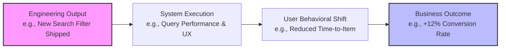

#### Decision Implications
Architects and product managers must construct clear causal bridges from outputs to outcomes. When defining Key Performance Indicators (KPIs) or Objectives and Key Results (OKRs; see [Product Strategy](CH15_Product_Strategy.md#48-objectives-and-key-results-okrs-as-a-strategy-execution-cascade)), key results must be stated as outcome thresholds rather than output delivery milestones.

#### Common Failure Mode
**The Feature Factory Pattern**: The engineering organization measures velocity solely via output metrics (story points completed, releases per month). Features are continuously shipped, but core business metrics (retention, customer lifetime value) remain flat or decline because no telemetry exists to evaluate feature efficacy.

#### Concrete Scenario
A fintech engineering team ships a new automated budget recommendation tool (Output: 1 feature shipped, 100% test coverage). Telemetry reveals that while 40% of users click the feature once (Output/Adoption), only 2% save a budget configuration and 15% disable notifications due to recommendations (Outcome: Negative retention impact). Tracking outcome metrics forces the team to iterate on algorithm accuracy rather than moving to the next roadmap feature.

---

### 4.2 Input / Output Metric Trees (Metric Trees)

#### Definition
An **Input/Output Metric Tree** (or Metric Tree) is a Directed Acyclic Graph (DAG) that decomposes a high-level outcome metric (the root output metric) into actionable, controllable, sub-level input metrics across mathematical or behavioral branches.

#### Mechanism
A metric tree links top-level strategic results to day-to-day operational levers. Relationships between nodes are expressed mathematically (e.g., $\text{Revenue} = \text{Active Users} \times \text{Conversion Rate} \times \text{Average Order Value}$) or behaviorally (decomposing Active Users into Acquisition, Activation, and Retention).

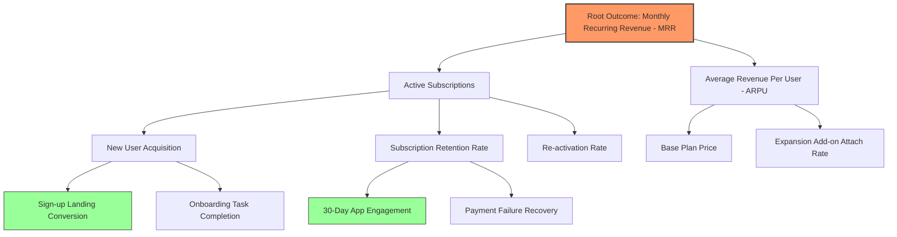

#### Decision Implications
Metric trees enable solution architects and software engineers to understand how system-level performance directly impacts business outcomes. For example, reducing latency on the search API ($D_1$) improves search result interactions, which increases search-to-cart conversion ($C_1$), ultimately driving Monthly Recurring Revenue (MRR).

#### Common Failure Mode
**Unlinked Metrics**: Creating an isolated list of 50 team metrics without establishing DAG parent-child relationships. Teams optimize local metrics that have no mathematical or causal linkage to top-level organizational goals.

#### Concrete Scenario
An e-commerce company decomposes *Gross Merchandise Value (GMV)*:
$$\text{GMV} = \text{Sessions} \times \text{Product Page View Rate} \times \text{Add-to-Cart Rate} \times \text{Checkout Completion Rate} \times \text{Order Value}$$
An architectural bottleneck causes the checkout API response time to degrade from 200ms to 2,500ms. By referencing the metric tree, engineers identify that high checkout latency directly depresses the *Checkout Completion Rate* branch, quantifying the exact financial loss per second of latency.

---

### 4.3 The HEART Framework

#### Definition
Developed by Kerry Rodden, Hilary Hutchinson, and Xin Fu at Google, the **HEART Framework** provides a structured taxonomy for measuring User Experience (UX) quality across five distinct dimensions: **H**appiness, **E**ngagement, **A**doption, **R**etention, and **T**ask Success.

#### Mechanism
To make HEART actionable, every dimension is mapped across three operational columns: **Goals** (what the user or product is trying to achieve), **Signals** (how user behavior maps to the goal), and **Metrics** (the specific, quantifiable telemetry points tracked over time).

```
+----------------------------------------------------------------------------------------------------+
|                                      THE HEART FRAMEWORK MATRIX                                    |
+----------------------------------------------------------------------------------------------------+
| Dimension   | Goal                             | Signal                         | Metric           |
+-------------+----------------------------------+--------------------------------+------------------+
| Happiness   | User satisfaction & visual appeal| In-app rating / Net Promoter   | CSAT score,      |
|             |                                  | Score (NPS) response           | SUS score        |
+-------------+----------------------------------+--------------------------------+------------------+
| Engagement  | Active usage frequency & depth   | Daily interactions, uploads,   | Actions/user/day,|
|             |                                  | comment creations              | Session length   |
+-------------+----------------------------------+--------------------------------+------------------+
| Adoption    | New user onboarding & feature    | First-time feature usage,      | 7-day feature    |
|             | discovery                        | account creation completion    | adoption rate    |
+-------------+----------------------------------+--------------------------------+------------------+
| Retention   | Sustained repeat usage over time | Returning active usage after   | Day-30 / Day-90  |
|             |                                  | $N$ days                       | retention cohort |
+-------------+----------------------------------+--------------------------------+------------------+
| Task        | Efficient, error-free workflow   | Completed task flow,           | Task completion  |
| Success     | execution                        | validation error count         | time, Error rate |
+----------------------------------------------------------------------------------------------------+
```

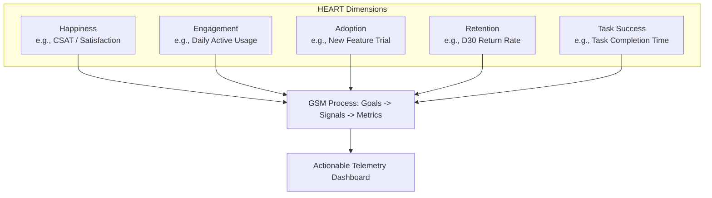

#### Decision Implications
HEART balances purely transactional metrics (e.g., revenue, conversion) with user experience health indicators. Architects use Task Success metrics (e.g., failure rates, latency) to establish Service Level Objectives (SLOs) that directly reflect user friction.

#### Common Failure Mode
**Conflating Engagement with Happiness**: High engagement (e.g., high session frequency, long time spent) is often misinterpreted as high user satisfaction. In reality, inflated time-on-page may indicate a broken user interface where users struggle to complete a task. Pairing Engagement with Task Success and Happiness prevents this misinterpretation.

#### Concrete Scenario
A document management platform launches an electronic signature workflow. They define HEART metrics:
- **Happiness**: In-app Customer Satisfaction (CSAT) survey after signature.
- **Engagement**: Average signature requests sent per active user per week.
- **Adoption**: Percentage of total active accounts sending $\ge 1$ signature request in the first 14 days.
- **Retention**: Percentage of users who send a signature request in Month 1 and return in Month 2.
- **Task Success**: Signature completion rate and median time-to-sign (seconds).

---

### 4.4 The AARRR Acquisition Funnel (Pirate Metrics)

#### Definition
Formulated by Dave McClure, the **AARRR Framework** (Acquisition, Activation, Retention, Referral, Revenue) structures customer conversion and lifecycle monetization into a five-stage sequential funnel.

#### Mechanism
AARRR tracks customer progression from initial awareness to financial contribution, highlighting conversion drop-offs at each funnel boundary.

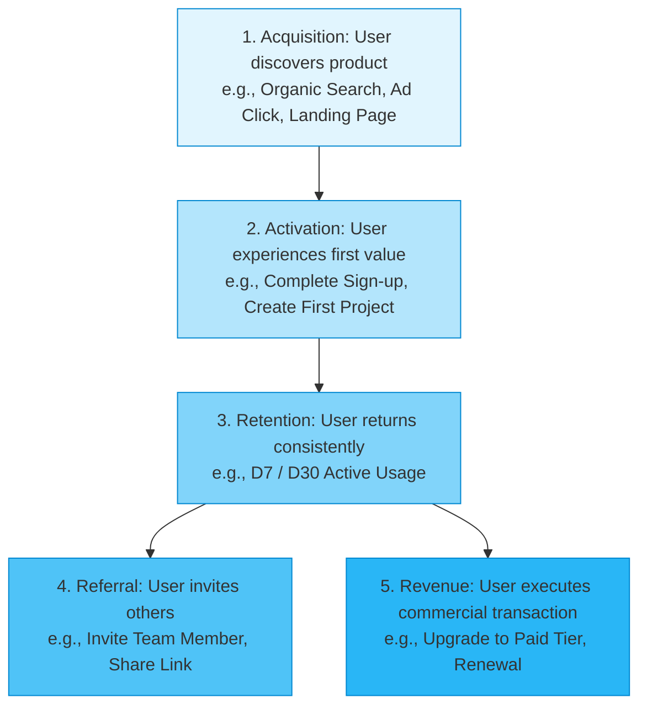

```
+----------------------------------------------------------------------------------------------------+
|                                    AARRR STAGE BREAKDOWN                                           |
+----------------------------------------------------------------------------------------------------+
| Stage       | Core Definition                                  | Typical Telemetry Event           |
+-------------+--------------------------------------------------+-----------------------------------+
| Acquisition | Attracting prospective users to the product      | `page_viewed`, `app_downloaded`   |
| Activation  | Delivering the "Aha!" moment of initial value    | `account_created`, `workspace_set`|
| Retention   | Driving repeated usage over specific timeframes  | `session_started`, `core_action`  |
| Referral    | Turning active users into acquisition channels   | `invite_sent`, `link_shared`      |
| Revenue     | Monctizing user activity and driving expansion   | `subscription_started`, `checkout`|
+----------------------------------------------------------------------------------------------------+
```

#### Decision Implications
Solution architects leverage AARRR stages to design distinct service boundaries and storage patterns. Acquisition demands edge caching and high-throughput web frontends; Activation and Retention require low-latency transactional state stores; Revenue demands ACID-compliant database transactions and audited event streams.

#### Common Failure Mode
**Leaky Bucket Acquisition**: Pouring capital and engineering effort into Acquisition (stage 1) while ignoring Retention (stage 3). High acquisition velocity masks catastrophic churn, resulting in unsustainable Customer Acquisition Cost (CAC) to Lifetime Value (LTV) ratios.

#### Concrete Scenario
A Business-to-Business (B2B) Software as a Service (SaaS) company tracks AARRR metrics:
- **Acquisition**: Unique landing page visitors ($100,000/\text{month}$).
- **Activation**: Percentage of sign-ups creating a active project ($15\% = 15,000$).
- **Retention**: Percentage of activated users returning in Week 4 ($30\% = 4,500$).
- **Referral**: Percentage of retained users inviting $\ge 1$ teammate ($20\% = 900$).
- **Revenue**: Percentage of retained teams converting to a paid tier ($10\% = 900$ paying accounts).

---

### 4.5 Counter-Metrics and Guardrail Metrics

#### Definition
A **Counter-Metric** (or Guardrail Metric) is a system or behavioral metric tracked alongside a primary target metric to ensure that local optimizations do not induce system degradation, revenue loss, user experience deterioration, or operational risk.

#### Mechanism
Target metrics measure *desired directional progress*; guardrail metrics enforce *boundary constraints*. If a target metric improves while a guardrail metric breaches an acceptable threshold, the overall initiative is deemed a failure or reverted.

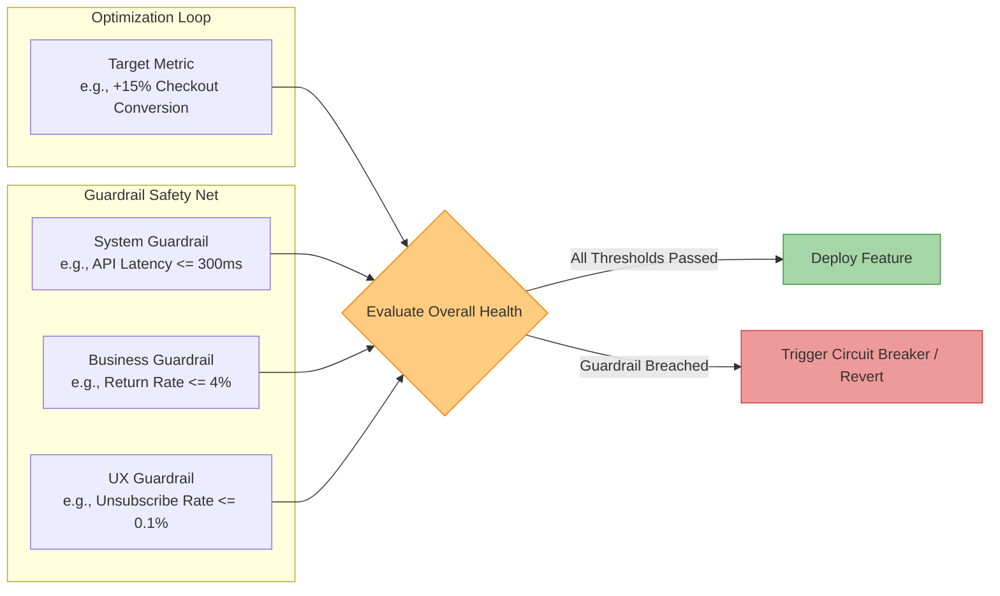

#### Decision Implications
Architects embed guardrail metrics directly into automated release pipelines, feature flag platforms, and deployment canary evaluators. If an A/B test improves target conversion but causes a spike in HTTP 5xx error responses or database memory usage, the automated deployment engine aborts the rollout.

#### Common Failure Mode
**Goodhart's Law Violation**: "When a measure becomes a target, it ceases to be a good measure." Teams optimize a target metric aggressively (e.g., increasing email click-through rate by sending 5x more marketing emails) while failing to track counter-metrics (spam flag rates, unsubscribe rates, brand reputation damage).

#### Concrete Scenario
A media platform aims to increase **Ad Revenue Per Session** (Target Metric) by inserting auto-play video ads between content articles.
- **Target Metric**: Ad Impression Yield ($+22\%$).
- **Guardrail Metrics**:
  1. Page Load Latency ($p99 \le 1,200\text{ms}$).
  2. 7-Day User Retention ($\Delta \ge -0.5\%$).
  3. App Uninstalls ($\le +1.0\%$).
During testing, Ad Impression Yield jumps $22\%$, but 7-Day Retention drops $4.2\%$ and app uninstalls increase $12\%$. The guardrail breach blocks production deployment.

---

### 4.6 Metric Instrumentation Architecture

#### Definition
**Metric Instrumentation Architecture** defines the end-to-end technical system responsible for capturing user behavioral events and system telemetry on client and server devices, validating event schemas, transporting streams asynchronously, and ingesting telemetry into real-time analytical engines.

#### Mechanism
A robust instrumentation architecture comprises six decoupled layers:
1. **Event Producer (SDK)**: Client (web, mobile) or server microservices emitting strongly typed events.
2. **Schema Registry**: Central repository storing event contracts (JSON Schema, Protocol Buffers [Protobuf]).
3. **Ingestion Gateway**: High-throughput HTTP/gRPC API gateway validating and buffering incoming payloads.
4. **Stream Streaming Pipeline**: Distributed message broker (e.g., Apache Kafka, AWS Kinesis) providing durable, ordered log storage.
5. **Stream Processing Engine**: Real-time processing framework (e.g., Apache Flink, Kafka Streams) computing session aggregations and sliding-window metrics.
6. **Analytics Datastore**: Columnar time-series database (e.g., ClickHouse, Apache Pinot, Snowflake) serving low-latency queries to dashboards and feature flag systems.

```
+-----------------------------------------------------------------------------------------------------------------+
|                                 TELEMETRY INSTRUMENTATION PIPELINE FLOW                                        |
+-----------------------------------------------------------------------------------------------------------------+
| [Client SDK / Microservice]                                                                                     |
|       | Emits `track_event(payload)`                                                                            |
|       v                                                                                                         |
| [Ingestion API Gateway] <---- Synchronous Validation ----> [Schema Registry]                                   |
|       | Batch & Buffer (Async HTTP/2)                                                                           |
|       v                                                                                                         |
| [Distributed Stream Broker (Kafka)]                                                                             |
|       | Partitioned Topic Stream                                                                                |
|       +-----------------------------------+-----------------------------------+                                 |
|       |                                   |                                   |                                 |
|       v                                   v                                   v                                 |
| [Real-time Stream Processor]      [Dead Letter Queue - DLQ]           [Object Storage Data Lake]                |
|  (Flink Window Aggregations)       (Invalid Schema Messages)           (Parquet / S3 Cold Analytics)             |
|       |                                                                                                         |
|       v                                                                                                         |
| [Columnar Time-Series DB]                                                                                       |
|  (ClickHouse / Pinot Dashboard Queries)                                                                         |
+-----------------------------------------------------------------------------------------------------------------+
```

#### Decision Implications
Instrumentation architecture requires strict non-functional constraints:
- **Asynchronous non-blocking client emission**: Telemetry batching must never execute on the main UI thread or block critical API request/response paths.
- **At-least-once delivery guarantees with client-side deduplication keys**: Telemetry pipelines must handle network disconnects and retries gracefully without duplicating event counts.
- **Privacy Enforcement at the Edge**: Personally Identifiable Information (PII) must be anonymized or tokenized at client boundaries prior to network transmission.

#### Common Failure Mode
**Ad-Hoc Event Formatting**: Developers manually construct unvalidated JSON payloads throughout front-end codebases (`analytics.track("button_clicked", { name: "submit_btn_1" })`). Over time, field names drift (`user_id` vs `userId`), data types conflict (string vs integer), and downstream analytics pipelines break silently.

#### Concrete Scenario
An enterprise platform replaces ad-hoc tracking with a Protobuf-backed Schema Registry. When a developer attempts to release a mobile update that removes a required `workspace_id` property from the `document_exported` event, the automated Continuous Integration (CI) pipeline flags a breaking schema contract violation, preventing data pipeline failure.

---

### 4.7 Vanity Metrics vs. Actionable Metrics

#### Definition
A **Vanity Metric** is a surface-level quantitative indicator that consistently moves upward over time (or looks impressive on pitch decks) but fails to reflect true product health, customer retention, or operational viability. An **Actionable Metric** is a causal, falsifiable metric that ties directly to human behavior, demonstrates clear cause-and-effect relationships, and instructs teams on specific actions to take.

```
+----------------------------------------------------------------------------------------------------+
|                               VANITY VS. ACTIONABLE METRICS MATRIX                                 |
+----------------------------------------------------------------------------------------------------+
| Attribute               | Vanity Metric                        | Actionable Metric                 |
+-------------------------+--------------------------------------+-----------------------------------+
| Directional Behavior    | Monotonic increase (accumulative)    | Fluctuate based on behavior       |
| Falsifiability          | Non-falsifiable (always looks good)  | Falsifiable (exposes flaws)       |
| Cause-and-Effect Link   | Disconnected from feature decisions  | Directly linked to specific inputs|
| Decision Directionage   | Induces complacency                  | Drives proceed/pivot decisions    |
| Primary Examples        | Total Registered Users, Total        | 30-Day Active Cohort Retention,   |
|                         | App Downloads, Raw Page Views        | Conversion Rate per Signup Cohort |
+----------------------------------------------------------------------------------------------------+
```

```mermaid
decisionTree
    Root[Evaluate Metric Candidate] --> Q1{Is it accumulative and\nalways increasing?}
    Q1 -- Yes --> Vanity1[High Risk of Vanity Metric\ne.g., Total Registered Users]
    Q1 -- No --> Q2{Does it measure a\nspecific cohort behavior?}
    Q2 -- No --> Vanity2[Potential Vanity Metric\ne.g., Total Pageviews]
    Q2 -- Yes --> Q3{If this metric drops 20%,\ndo you know what to change?}
    Q3 -- No --> Ambiguous[Ambiguous Metric - Needs Decomposition]
    Q3 -- Yes --> Actionable[Actionable Metric\ne.g., Checkout Conversion Rate]
```

#### Decision Implications
Product managers and solution architects must design analytics dashboards and OKRs around actionable, cohort-based metrics rather than cumulative totals.

#### Common Failure Mode
**Celebrating Cumulative Registration Spikes**: A marketing campaign generates 500,000 app downloads (Vanity Metric). Executive leadership declares success. However, Day-1 retention is $3\%$ and Day-7 retention is $0.2\%$ (Actionable Metrics). The product is effectively dead, but team members are misled by cumulative download counts.

#### Concrete Scenario
An online learning platform tracks user performance:
- **Vanity Metric**: $2,000,000$ Total Registered Students.
- **Actionable Metric**: 14-Day Course Completion Rate by Cohort.
By tracking cohort completion rates, the team discovers that changing video lesson lengths from 45 minutes to 6 minutes increases course completion from $12\%$ to $68\%$. The total registered user count provided zero signal for this product design decision.

---

## 5. Internal Working

To understand how metrics telemetry functions inside an enterprise software system, we analyze the client-to-database execution flow for a user behavioral event.

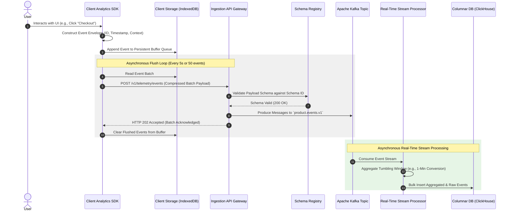

### Event Lifecycle Stages

1. **Client Event Capture & Envelope Wrapping**: The client SDK intercepts user actions or system state changes. It wraps the event payload into a standard telemetry envelope containing:
   - `event_id`: Unique UUIDv4 identifier for deduplication.
   - `event_name`: Namespace-qualified event name (e.g., `checkout.step_completed`).
   - `schema_version`: Semantic version linking to the Schema Registry.
   - `timestamp`: ISO-8601 UTC timestamp of client execution.
   - `user_context`: Anonymized user ID, session ID, tenant ID, device metadata, app version.
   - `properties`: Custom key-value event payload attributes.
2. **Client-Side Persistence & Batching**: To prevent data loss during network disconnections, events are written synchronously to persistent client storage (e.g., `IndexedDB` in browsers, `SQLite`/`CoreData` in mobile apps). An asynchronous background thread flushes batched, compressed event payloads to the server API endpoint when buffer limits (e.g., 50 events) or time thresholds (e.g., 5 seconds) are met.
3. **Server Ingestion & Schema Validation**: The Ingestion Gateway receives compressed HTTP/2 payloads. It extracts the `schema_version` header and verifies the payload structure against the central Schema Registry (e.g., via JSON Schema compiled into memory or Protobuf descriptors). Valid payloads are published to partitioned stream topics (e.g., Apache Kafka); invalid payloads are routed to a Dead Letter Queue (DLQ) for alerting and offline inspection.
4. **Stream Aggregation & Processing**: Distributed stream processing engines (e.g., Apache Flink) consume raw event topics. Flink evaluates sliding and tumbling temporal windows to calculate real-time rolling metrics (e.g., 5-minute checkout success rates, active user session counts) and emits alerts if guardrail thresholds are violated.
5. **Columnar Ingestion & Analytical Storage**: Raw events and pre-aggregated metrics are written in high-throughput bulk inserts to a columnar time-series datastore (e.g., ClickHouse). Columnar compression, vectorization, and primary sorting keys (`tenant_id`, `event_name`, `timestamp`) enable execution of analytical queries across billions of rows in milliseconds.

---

## 6. Design Principles

When designing a product metrics strategy and its technical telemetry architecture, architects must adhere to six core design principles:

1. **Schema-First Data Contracts**: Treat telemetry events with the same architectural rigor as public REST/gRPC APIs. Never emit unversioned, unstructured key-value blobs. Require explicit schemas with backward-compatible evolution rules managed via CI/CD linting and Schema Registries.
2. **Asynchronous Non-Blocking Execution**: Telemetry collection must never block primary application execution or user interface responsiveness. All client collection, server logging, and network transmissions must execute asynchronously off main event loops.
3. **At-Least-Once Delivery with Idempotent Processing**: Design pipelines for network instability. Assume client retries will produce duplicate transmissions. Enforce unique `event_id` keys and construct downstream analytical pipelines to perform idempotent deduplication during stream ingestion or query execution.
4. **Privacy and Compliance by Design**: Enforce data minimisation and edge sanitization. Never emit raw PII (passwords, credit card numbers, Social Security Numbers, precise geolocation) to event streams. Hash or tokenize user identifiers at the client boundary, and incorporate user consent controls (GDPR opt-out, CCPA deletion requests) directly into ingestion gateways.
5. **Balanced Metric Taxonomies**: Never rely on a single metric dimension. Pair every target metric with counter-metrics and balance transactional metrics with user experience metrics (HEART).
6. **Cost-Aware Telemetry Retention**: Telemetry data volumes grow exponentially with application usage. Design multi-tiered storage policies: store high-fidelity raw events in hot columnar databases for 30–90 days, transition to partitioned cold object storage (Parquet on S3) for long-term historical analysis, and downsample ultra-high-volume background heartbeats.

---

## 7. Architecture Patterns

### Pattern 1: Edge-Buffered Asynchronous Telemetry Batching

**Context**: High-frequency web and mobile applications generating hundreds of user interaction events per minute per active user.

**Problem**: Emitting an individual HTTP POST request per user action overwhelms client network interfaces, drains mobile battery life, and saturates ingestion API infrastructure.

**Solution**: Maintain an in-memory and disk-backed persistent queue on the client device. Buffer events locally and execute flush requests in compressed batches over long-lived HTTP/2 or HTTP/3 connections when buffer thresholds or timers expire.

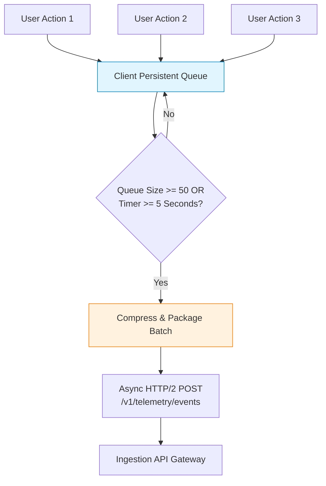

---

### Pattern 2: Dual-Stream Real-Time Alerting and Batch Analytics

**Context**: Enterprise applications requiring both real-time operational alerts (e.g., immediate notification if checkout error rate breaches $2\%$) and complex long-term historical cohort analysis (e.g., 90-day retention decay curves across user personas).

**Problem**: Real-time stream processors cannot cost-effectively store years of raw event history, while batch data warehouses introduce ingestion latencies (minutes to hours) unsuitable for immediate operational safety.

**Solution**: Deploy a Lambda/Kappa-inspired dual-path streaming architecture off a unified message broker. Route raw event streams simultaneously to a real-time stream processor (e.g., Apache Flink) for sliding-window metric evaluation and to a columnar time-series database (e.g., ClickHouse) or data lake (Parquet/S3) for deep analytical querying.

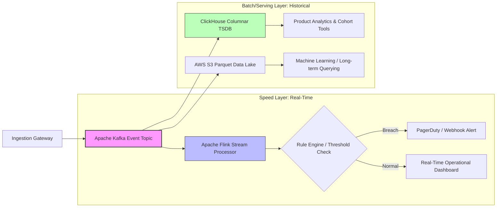

---

## 8. Production Architecture

The following landscape diagram illustrates a production-grade, multi-region telemetry instrumentation architecture capable of ingesting and processing billions of daily events with high availability, schema validation, and multi-tenant isolation.

\begin{landscape}
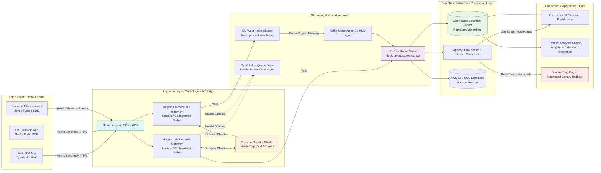
\end{landscape}

### System Component Breakdown

1. **Global CDN / Web Application Firewall (WAF)**: Terminates TLS, provides DDoS protection, routes client traffic to the geographically nearest Ingestion API Gateway, and enforces IP/geolocation privacy filtering.
2. **Ingestion API Gateways**: Stateless, high-concurrency Go or Node.js microservices running in multi-region Kubernetes clusters. Gateways deserialize payload headers, validate schema version compatibility against the Schema Registry, attach server-side receiving timestamps, and publish messages to local Kafka topics.
3. **Schema Registry**: High-availability registry serving compiled JSON Schemas or Protobuf descriptors. Gateways cache schema definitions locally in memory to ensure sub-millisecond validation latency.
4. **Apache Kafka Streaming Backbone**: Partitioned message topics keyed by `tenant_id` or `user_id` to guarantee ordering of user event sequences. Cross-region Kafka MirrorMaker synchronizes global streams to a central processing region.
5. **ClickHouse Columnar Cluster**: Uses `ReplicatedMergeTree` engine tables partitioned by `toYYYYMM(event_date)` and sorted by `(tenant_id, event_name, event_date, user_id)`. Provides sub-second query performance over tens of billions of rows.
6. **Feature Flag Canary Engine**: Consumes real-time error and guardrail metric streams from Apache Flink. If a canary release triggers a spike in client-side error rates or Task Success degradation, the feature flag engine automatically reverts the flag state to $0\%$ target audience.

---

## 8.1 Data Contracts and Event Schema Governance

Telemetry instrumentation requires strict contract enforcement between producers and consumers. The listing below illustrates a production JSON Schema contract for a core e-commerce checkout event (`checkout.completed`).

```json
{
  "$schema": "https://json-schema.org/draft/2020-12/schema",
  "$id": "https://telemetry.enterprise.com/schemas/v1/checkout.completed.json",
  "title": "CheckoutCompletedEvent",
  "description": "Emitted synchronously by the checkout service when a user successfully completes a purchase.",
  "type": "object",
  "required": [
    "event_id",
    "event_name",
    "schema_version",
    "timestamp",
    "tenant_id",
    "user_id",
    "session_id",
    "properties"
  ],
  "properties": {
    "event_id": {
      "type": "string",
      "format": "uuid",
      "description": "Unique UUIDv4 identifier generated at event origination for deduplication."
    },
    "event_name": {
      "type": "string",
      "const": "checkout.completed"
    },
    "schema_version": {
      "type": "string",
      "pattern": "^1\\.[0-9]+\\.[0-9]+$"
    },
    "timestamp": {
      "type": "string",
      "format": "date-time"
    },
    "tenant_id": {
      "type": "string",
      "minLength": 1
    },
    "user_id": {
      "type": "string",
      "description": "Anonymized internal user hash. MUST NOT contain raw PII."
    },
    "session_id": {
      "type": "string",
      "format": "uuid"
    },
    "properties": {
      "type": "object",
      "required": ["order_id", "cart_total_usd", "item_count", "payment_method"],
      "properties": {
        "order_id": { "type": "string" },
        "cart_total_usd": { "type": "number", "minimum": 0.01 },
        "item_count": { "type": "integer", "minimum": 1 },
        "payment_method": {
          "type": "string",
          "enum": ["credit_card", "paypal", "apple_pay", "bank_transfer"]
        },
        "promo_code_applied": { "type": "boolean" }
      },
      "additionalProperties": false
    }
  },
  "additionalProperties": false
}
```

---

## 9. Implementation

A complete client-side telemetry instrumentation library requires:
1. Thread-safe in-memory and persistent queuing.
2. Exponential backoff retry mechanics.
3. Batching logic governed by size and time triggers.
4. Anonymization filters for sensitive fields.

The Node.js/TypeScript implementation below demonstrates a robust production-grade telemetry client.

```typescript
import { v4 as uuidv4 } from 'uuid';

export interface TelemetryEvent {
  eventId: string;
  eventName: string;
  schemaVersion: string;
  timestamp: string;
  tenantId: string;
  userId: string;
  sessionId: string;
  properties: Record<string, unknown>;
}

export interface TelemetryConfig {
  endpoint: string;
  apiKey: string;
  batchSize: number;
  flushIntervalMs: number;
  maxRetries: number;
}

export class TelemetryClient {
  private buffer: TelemetryEvent[] = [];
  private flushTimer: NodeJS.Timeout | null = null;

  constructor(private config: TelemetryConfig) {
    this.startFlushTimer();
  }

  public track(
    eventName: string,
    schemaVersion: string,
    tenantId: string,
    userId: string,
    sessionId: string,
    properties: Record<string, unknown>
  ): void {
    // Edge anonymization: Ensure no raw emails or credit card strings leak
    const sanitizedProperties = this.sanitizePayload(properties);

    const event: TelemetryEvent = {
      eventId: uuidv4(),
      eventName,
      schemaVersion,
      timestamp: new Date().toISOString(),
      tenantId,
      userId: this.hashIdentifier(userId),
      sessionId,
      properties: sanitizedProperties,
    };

    this.buffer.push(event);

    if (this.buffer.length >= this.config.batchSize) {
      this.flush();
    }
  }

  public async flush(): Promise<void> {
    if (this.buffer.length === 0) return;

    const eventsToFlush = [...this.buffer];
    this.buffer = [];

    let attempt = 0;
    let success = false;

    while (attempt < this.config.maxRetries && !success) {
      try {
        attempt++;
        const response = await fetch(this.config.endpoint, {
          method: 'POST',
          headers: {
            'Content-Type': 'application/json',
            'X-API-Key': this.config.apiKey,
          },
          body: JSON.stringify({ batch: eventsToFlush }),
        });

        if (response.ok) {
          success = true;
        } else {
          console.warn(`Telemetry flush failed with status ${response.status}. Attempt ${attempt}`);
        }
      } catch (error) {
        console.error(`Network error during telemetry flush attempt ${attempt}:`, error);
      }

      if (!success && attempt < this.config.maxRetries) {
        const backoffMs = Math.pow(2, attempt) * 200;
        await new Promise((resolve) => setTimeout(resolve, backoffMs));
      }
    }

    if (!success) {
      console.error(`Failed to flush ${eventsToFlush.length} telemetry events after ${this.config.maxRetries} attempts. Re-queuing.`);
      // Re-queue failed events at the beginning of the buffer
      this.buffer = [...eventsToFlush, ...this.buffer];
    }
  }

  private startFlushTimer(): void {
    this.flushTimer = setInterval(() => {
      this.flush();
    }, this.config.flushIntervalMs);
  }

  private sanitizePayload(props: Record<string, unknown>): Record<string, unknown> {
    const sanitized = { ...props };
    const piiKeys = ['email', 'password', 'ssn', 'credit_card', 'phone'];

    for (const key of Object.keys(sanitized)) {
      if (piiKeys.includes(key.toLowerCase())) {
        sanitized[key] = '[REDACTED]';
      }
    }
    return sanitized;
  }

  private hashIdentifier(id: string): string {
    // Simple mock hash function for demonstration (In production, use SHA-256 with salt)
    return `hash_${Buffer.from(id).toString('base64')}`;
  }

  public close(): void {
    if (this.flushTimer) {
      clearInterval(this.flushTimer);
    }
    this.flush();
  }
}
```

---

## 10. Complete Code Examples

For comprehensive server-side event ingestion and real-time metric processing implementations across multiple programming ecosystems, refer to the repository directories below:

- **Java / Spring Boot Ingestion Service**: [code/java/telemetry-ingestion](code/java/) contains a high-throughput Spring Boot service utilizing Project Reactor, Kafka Template batching, and Schema Registry validation filters.
- **Python / FastAPI Schema Processor**: [code/python/metrics-schema-validator](code/python/) provides an asynchronous FastAPI service integrating `jsonschema` validation with Kafka stream publishing.
- **Node.js / Express Telemetry Gateway**: [code/node/telemetry-gateway](code/node/) demonstrates a fast Node.js ingestion gateway with HTTP/2 batch decompression and ClickHouse bulk stream writer.

---

## 11. Performance

Telemetry instrumentation introduces computational overhead across client applications, network transit, and backend databases. Solution architects must optimize performance across three distinct tiers:

### Client-Side Performance Optimization
- **Execution Overhead**: Telemetry tracking calls must execute in $< 1\text{ms}$. Heavy serialization or synchronous network I/O must be strictly avoided on the main browser thread or UI render loop.
- **Memory Management**: Client queues must set hard buffer size limits (e.g., maximum $1,000$ events). If a client remains offline and breaches buffer capacity, the queue must drop the oldest non-critical events (FIFO dropping strategy) rather than inducing Out-Of-Memory (OOM) browser crashes.

### Network and Bandwidth Performance
- **Payload Compression**: Batched HTTP payloads should be compressed using gzip or Brotli algorithm compression at the client boundary, reducing network payload size by $70\%–85\%$.
- **HTTP/2 Multiplexing**: Reusing persistent HTTP/2 TCP connections eliminates connection handshake overhead for recurring batch flushes.

### Database Query Performance
In ClickHouse, metric query performance over billions of events depends heavily on primary key selection and memory-efficient materialization.

```sql
-- ClickHouse Columnar Production Table Schema for Telemetry Events
CREATE TABLE enterprise_telemetry.events_local ON CLUSTER telemetry_cluster
(
    event_date Date DEFAULT toDate(timestamp),
    timestamp DateTime64(3, 'UTC'),
    event_name LowCardinality(String),
    schema_version LowCardinality(String),
    tenant_id String,
    user_id String,
    session_id UUID,
    event_id UUID,
    properties String, -- JSON string or JSON Object type
    ingested_at DateTime DEFAULT now()
)
ENGINE = ReplicatedMergeTree('/clickhouse/tables/{shard}/events_local', '{replica}')
PARTITION BY toYYYYMM(event_date)
PRIMARY KEY (tenant_id, event_name)
ORDER BY (tenant_id, event_name, event_date, user_id, timestamp)
TTL event_date + INTERVAL 365 DAY;

-- Materialized View for Real-Time 1-Minute Event Counter Aggregations
CREATE MATERIALIZED VIEW enterprise_telemetry.events_per_minute_mv
ENGINE = SummingMergeTree()
PRIMARY KEY (tenant_id, event_name, minute_window)
ORDER BY (tenant_id, event_name, minute_window)
AS SELECT
    tenant_id,
    event_name,
    toStartOfMinute(timestamp) AS minute_window,
    count() AS event_count
FROM enterprise_telemetry.events_local
GROUP BY tenant_id, event_name, minute_window;
```

---

## 12. Scalability

Scaling a global metric pipeline from $10^6$ events/day to $10^9+$ events/day requires addressing three primary scaling vectors:

```
+-----------------------------------------------------------------------------------+
|                            TELEMETRY SCALABILITY VECTORS                           |
+-----------------------------------------------------------------------------------+
|  1. Ingestion Layer Scaling   --> Stateless Auto-scaling Gateways + Anycast CDN   |
|  2. Stream Partitioning       --> Partition Kafka Topics by tenant_id / user_id  |
|  3. Analytical Datastore      --> Sharded Columnar DB + Materialized Aggregations |
+-----------------------------------------------------------------------------------+
```

- **Stateless Ingestion Scaling**: Ingestion Gateways perform no stateful session tracking. Horizontal Pod Autoscalers (HPA) scale gateway pods dynamically based on CPU utilization and incoming HTTP request rates.
- **Kafka Partitioning Strategy**: Message topics are partitioned using `tenant_id` or `user_id` as hash keys. This guarantees that events emitted by the same tenant or user land in the same Kafka partition, preserving chronological ordering for downstream session builders while distributing traffic evenly across broker nodes.
- **Columnar Sharding and Read/Write Separation**: ClickHouse clusters separate write-heavy ingestion nodes from read-heavy dashboard query nodes. Distributed tables route bulk writes across data shards using distributed merge trees while serving analytical dashboard queries from pre-aggregated materialized views.

---

## 13. Security

Metric telemetry presents significant security, compliance, and data exposure risks if proper controls are not enforced:

- **PII Leakage & Data Sanitization**: Accidental emission of raw user PII (names, email addresses, credit card numbers) to analytics databases violates GDPR and CCPA. Enforce edge-sanitization regex filters in client SDKs and deploy server-side automated PII detection engines that scrub incoming stream topics.
- **Ingestion API Authentication and Rate Limiting**: Ingestion endpoints must validate API keys or short-lived tenant tokens to prevent malicious actors from flooding analytics pipelines with fake event data (telemetry poisoning). Enforce token bucket rate-limiting at WAF and API Gateway boundaries.
- **Multi-Tenant Data Isolation**: Analytical datastores storing multi-tenant metrics must enforce row-level security or strict query scope parameters (`WHERE tenant_id = :authenticated_tenant`) to prevent cross-tenant data leaks during dashboard rendering.
- **Data Retention & Right-to-be-Forgotten**: Implement automated data lifecycle policies. When a user requests account deletion under GDPR, the telemetry infrastructure must execute tombstone updates across user-indexed partitions or maintain anonymized user mapping tables that scrub primary keys while preserving aggregate behavioral counts.

---

## 14. Observability

To ensure the metric instrumentation pipeline itself remains healthy, architects must instrument the telemetry pipeline using dedicated observability infrastructure:

### Key Telemetry Health Metrics

```
+----------------------------------------------------------------------------------------------------+
|                                TELEMETRY PIPELINE OBSERVABILITY METRICS                            |
+----------------------------------------------------------------------------------------------------+
| Indicator                     | Metric Name                      | Target Threshold                |
+-------------------------------+----------------------------------+---------------------------------+
| Client Drop Rate              | `telemetry_client_dropped_total` | 0% dropped due to buffer overflow|
| Ingestion Success Rate        | `telemetry_ingestion_http_200_pct`| >= 99.95%                      |
| Schema Validation Error Rate  | `telemetry_schema_validation_err`| < 0.01% of total events        |
| Stream Processing Lag         | `kafka_consumer_group_lag`       | < 1,000 messages                |
| ClickHouse Ingestion Latency  | `clickhouse_insert_delay_seconds`| < 2.0 seconds                   |
+----------------------------------------------------------------------------------------------------+
```

- **Pipeline Lag Monitoring**: Monitor Kafka consumer group lag for stream processors (Flink) and database writers (ClickHouse). High consumer lag indicates that downstream analytics tools are operating on stale data.
- **Schema Rejection Alerting**: Alert on spikes in Dead Letter Queue (DLQ) volume. A sudden increase in validation errors indicates a deployed app version emitting mismatched or unversioned telemetry schemas.

---

## 15. Failure Scenarios

Understanding how telemetry pipelines fail enables architects to build resilient containment mechanisms.

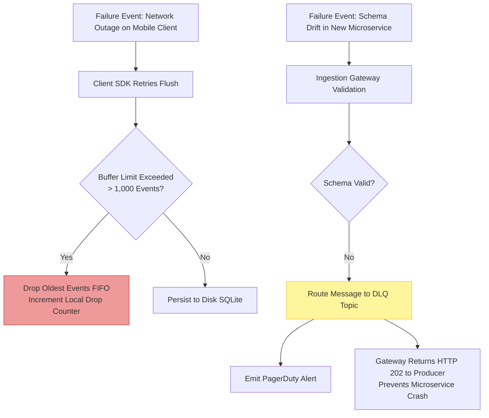

### Scenario 1: Telemetry Ingestion Gateway Outage
- **Failure**: A sudden traffic surge or backend dependency failure crashes the Ingestion API Gateways.
- **System Impact**: Client SDKs receive HTTP 5xx errors or network timeouts.
- **Mitigation**: Client SDKs switch to exponential backoff retries and persist events locally in IndexedDB/SQLite. Gateways deploy circuit breakers that return HTTP 202 Accepted while buffering incoming payloads directly into local NGINX memory buffers before Kafka publication.

### Scenario 2: Schema Drift Poisoning Analytics
- **Failure**: A front-end team updates a checkout button event payload, changing `cart_total` from a float (`99.95`) to a formatted currency string (`"$99.95"`).
- **System Impact**: Downstream ClickHouse ingestion crashes due to type mismatch errors, halting telemetry processing for all events.
- **Mitigation**: The Ingestion Gateway validates events against the Schema Registry prior to Kafka publication. The malformed event fails schema validation and is immediately diverted to the Dead Letter Queue (DLQ). ClickHouse ingestion continues uninterrupted for valid events, and an automated alert notifies the front-end team of the contract breach.

---

## 16. Testing

Validating telemetry instrumentation requires testing across unit, integration, and contract test suites.

### Contract Testing with Schema Verification
Automated tests must verify that client event emitters generate payloads that conform strictly to registered JSON schemas before code is merged.

```typescript
// Jest Contract Test verifying Telemetry Payload Compliance
import { TelemetryClient } from '../src/telemetryClient';
import Ajv from 'ajv';
import addFormats from 'ajv-formats';
import checkoutSchema from '../../schemas/v1/checkout.completed.json';

const ajv = new Ajv({ allErrors: true });
addFormats(ajv);
const validate = ajv.compile(checkoutSchema);

describe('Telemetry Event Schema Contracts', () => {
  it('should generate a valid checkout.completed event payload', () => {
    const emittedEvents: any[] = [];
    
    // Mock network flush to capture payload
    global.fetch = jest.fn().mockImplementation((url, options) => {
      const body = JSON.parse(options.body);
      emittedEvents.push(...body.batch);
      return Promise.resolve({ ok: true, status: 200 });
    });

    const client = new TelemetryClient({
      endpoint: 'https://telemetry.test.com/v1/events',
      apiKey: 'test-key',
      batchSize: 1,
      flushIntervalMs: 1000,
      maxRetries: 1,
    });

    client.track('checkout.completed', '1.0.0', 'tenant-123', 'user-456', 'session-789', {
      order_id: 'ord-999',
      cart_total_usd: 149.99,
      item_count: 3,
      payment_method: 'credit_card',
      promo_code_applied: true,
    });

    expect(emittedEvents.length).toBe(1);
    const event = emittedEvents[0];

    const isValid = validate(event);
    if (!isValid) {
      console.error('Schema Validation Errors:', validate.errors);
    }
    expect(isValid).toBe(true);
  });
});
```

---

## 17. Common Mistakes

When implementing metrics and telemetry, organizations frequently commit four tactical errors:

1. **Measuring Everything, Analyzing Nothing**: Instrumenting every mouse click, scroll event, and hover effect without clear hypothesis mapping. This creates high infrastructure ingestion costs and overwhelms data teams with noise. Focus instrumentation strictly on HEART, AARRR, and metric tree nodes.
2. **Synchronous Server Telemetry Calls**: Placing blocking HTTP analytics calls inside critical backend business logic (e.g., executing a blocking network call to an analytics vendor inside a database transaction). A network delay in the analytics vendor directly degrades core application response time.
3. **Ignoring Client-Side Time Drift**: Relying solely on client-generated timestamps (`Date.now()`) for chronological ordering. User devices frequently have misconfigured system clocks. Ingestion Gateways must append a reliable server-side receiving timestamp (`ingested_at`) to recalculate temporal offsets.
4. **Changing Event Names Without Versioning**: Renaming `user_signup` to `account_created` without updating the schema version or providing backward-compatible mapping views in the datastore. This breaks historical retention trend reports and creates fragmented analytics.

---

## 18. Best Practices

Incorporate these proven industry patterns into your metrics instrumentation discipline:

- **Maintain a Central Data Dictionary**: Document every telemetry event, schema version, property definition, and business owner in a searchable developer portal linked directly to the Schema Registry.
- **Enforce Automated Schema CI/CD Linting**: Integrate breaking-change schema checks into code pull request pipelines. Block deployment if a code change removes required event properties or modifies existing property types.
- **Implement Standardized Event Naming Conventions**: Use strict object-action naming rules across all platforms (e.g., `[domain].[entity]_[action]` $\rightarrow$ `checkout.order_completed`, `document.file_uploaded`).
- **Audit Telemetry Quality Quarterly**: Establish a recurring review to deprecate unused events, verify PII compliance, and archive stale data pipelines.

---

## 19. Anti-Patterns

### Anti-Pattern 1: The Monotonic Vanity Trap
- **Description**: Relying exclusively on cumulative, ever-increasing metrics (e.g., Total Accounts Registered) on executive dashboards.
- **Consequences**: Teams misinterpret account accumulation as business growth, ignoring severe active user churn and failing to address underlying product flaws.
- **Remediation**: Replace cumulative graphs with cohort-based active retention curves and 30-day active user engagement ratios.

### Anti-Pattern 2: The Telemetry Monolith
- **Description**: Hardcoding vendor-specific analytics SDK methods directly into core application UI components (`mixpanel.track()`, `googleAnalytics.send()`).
- **Consequences**: Coupling UI components to specific vendor APIs makes switching analytics platforms extremely difficult and prevents server-side schema validation.
- **Remediation**: Wrap telemetry behind a domain-neutral abstraction layer or internal Telemetry Client SDK that routes events to a vendor-agnostic ingestion gateway.

---

## 20. Trade-off Analysis

Architectural decisions in metric telemetry systems involve balancing competing system trade-offs:

```
+-------------------------------------------------------------------------------------------------------------------+
|                                     TELEMETRY ARCHITECTURE TRADE-OFF MATRIX                                       |
+-------------------------------------------------------------------------------------------------------------------+
| Strategy                 | Primary Advantage                    | Primary Disadvantage / Cost                     |
+--------------------------+--------------------------------------+-------------------------------------------------+
| Synchronous vs.          | Zero data loss on client crash;      | High network overhead; degrades client UI       |
| Asynchronous Batching    | immediate server visibility          | performance and battery life                    |
+--------------------------+--------------------------------------+-------------------------------------------------+
| Client-Side vs.          | Captures exact user UI interactions  | Subject to ad-blockers, network drops,          |
| Server-Side Emitters     | (clicks, view visibility)            | and client device clock drift                   |
+--------------------------+--------------------------------------+-------------------------------------------------+
| Raw Event Storage vs.    | Complete flexibility for ad-hoc      | Massive storage footprint and higher query      |
| Pre-Aggregated Views     | historical re-analysis               | latencies over long time windows                |
+--------------------------+--------------------------------------+-------------------------------------------------+
| Strict Schema Validation | High data quality; prevents          | Requires developer discipline; rejects          |
| vs. Schematic Flexibility| downstream pipeline breakages        | non-compliant events during rapid iteration     |
+-------------------------------------------------------------------------------------------------------------------+
```

---

## 21. Comparison Table

The table below compares the four major product measurement frameworks discussed in this chapter:

```
+-------------------------------------------------------------------------------------------------------------------+
|                                   PRODUCT MEASUREMENT FRAMEWORKS COMPARISON                                       |
+-------------------------------------------------------------------------------------------------------------------+
| Dimension            | Metric Trees             | HEART Framework          | AARRR Pirate Funnel    | Counter-Metrics     |
+----------------------+--------------------------+--------------------------+------------------------+---------------------+
| Primary Focus        | Strategic decomposition  | User Experience quality  | Commercial customer    | System & behavioral |
|                      | of root outcomes         | & user satisfaction      | lifecycle progression  | boundary safety     |
+----------------------+--------------------------+--------------------------+------------------------+---------------------+
| Structural Shape     | Directed Acyclic Graph   | 5x3 Matrix (Dimensions   | Sequential 5-Stage     | Dual-Metric         |
|                      | (DAG)                    | x Goals/Signals/Metrics) | Conversion Funnel      | Balancing Pair      |
+----------------------+--------------------------+--------------------------+------------------------+---------------------+
| Target Audience      | Executive Leadership &   | Product Designers, UX    | Growth Marketing, PMs, | Architects, SREs,   |
|                      | Solution Architects      | Researchers, Engineers   | Revenue Leaders        | Feature Flag Engine |
+----------------------+--------------------------+--------------------------+------------------------+---------------------+
| Primary Failure      | Unlinked, isolated       | Conflating Engagement    | Leaky bucket           | Goodhart's Law;     |
| Mode                 | node metrics             | with Happiness           | acquisition focus      | missing guardrails  |
+----------------------+--------------------------+--------------------------+------------------------+---------------------+
| Integration Level    | Product Strategy &       | Front-end Telemetry &    | Funnel Analytics &     | CI/CD Automated     |
|                      | Business Value Models    | Usability Testing        | Billing Systems        | Canary Rollbacks    |
+-------------------------------------------------------------------------------------------------------------------+
```

---

## 22. Real-World Case Study

### FinTech Global Payment Platform: Overhauling Telemetry and Reclaiming Conversion

#### Context
A global payment processing platform processing $\$ 12\text{B}$ in annual volume experienced a gradual decline in checkout conversion across mobile web clients over a six-month period. Executive leadership was unable to diagnose the root cause because existing telemetry relied on raw pageview counts and unvalidated client-side event logs.

#### Architectural Diagnosis
An architectural audit revealed severe telemetry deficiencies:
1. **Vanity Metric Reliance**: The product team reported $15\text{M}$ monthly active sessions (Vanity Metric), masking a $14\%$ drop in checkout completion.
2. **Schema Drift**: Front-end teams had modified mobile checkout flows across iOS, Android, and Web, resulting in 12 different event names for the payment submission step (`submit_click`, `pay_pressed`, `do_checkout`).
3. **Measurement Blindness**: No Task Success or latency metrics existed for the underlying payment gateway API call.

#### Engineering Intervention & Solution
The Solution Architect led a comprehensive metric instrumentation overhaul:
- **Metric Tree Construction**: Decomposed Checkout Conversion Rate into mathematical inputs:
  $$\text{Conversion} = \text{Form Render Rate} \times \text{Validation Success Rate} \times \text{Gateway API Success Rate}$$
- **HEART Implementation**: Defined Task Success metrics, establishing a strict target threshold of Payment Task Completion Time $< 3.0\text{s}$.
- **Schema Standardization**: Deployed a central Schema Registry with Protobuf contracts for `checkout.payment_submitted`.
- **Infrastructure Upgrade**: Implemented an edge-buffered Go Ingestion Gateway streaming events to Kafka and ClickHouse.

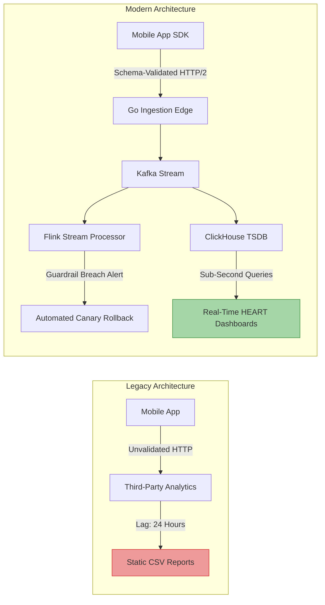

#### Quantitative Results
- **Root Cause Identified**: The HEART Task Success dashboard immediately highlighted that a third-party address autocomplete script introduced a 4.2-second latency spike on mobile web, causing a $22\%$ validation error rate.
- **Conversion Recovery**: Removing the script and optimizing form rendering increased checkout conversion by $+18.4\%$, unlocking an estimated $\$ 42\text{M}$ in incremental annual transaction volume.
- **Telemetry Performance**: Ingestion latency dropped from 24 hours to $< 1.5$ seconds, with $0\%$ schema-drift pipeline breakages over 12 months.

---

## 23. Interview Questions

### Question 1: System Design for Telemetry Ingestion
**Question**: How would you design a multi-tenant telemetry ingestion architecture capable of handling 500,000 events per second while ensuring strict data isolation and schema validation without degrading client app performance?
**Answer**: Detail an architecture utilizing stateless, edge-deployed Ingestion API Gateways backed by an in-memory Schema Registry cache. Emphasize client-side asynchronous batching and local storage persistence (IndexedDB/SQLite). Route validated payloads to a partitioned Apache Kafka topic keyed by `tenant_id`. Downstream, utilize ClickHouse with tenant-partitioned merge trees for multi-tenant analytical isolation and deploy Flink for real-time guardrail evaluation.

### Question 2: Resolving Goodhart's Law in Product Metrics
**Question**: A product manager proposes optimizing user engagement by sending automated push notifications whenever a user is inactive for 48 hours. How do you evaluate this proposal using metric frameworks?
**Answer**: Apply the Counter-Metric and HEART frameworks. Identify the target metric (Engagement: Daily Active Users). Define explicit guardrail metrics: App Uninstall Rate, Notification Opt-Out Rate, and Happiness (NPS/CSAT). Establish a canary deployment controlled by feature flags: if push notifications increase DAU by $5\%$ but trigger a $> 0.5\%$ increase in app uninstalls, the guardrail circuit breaker automatically halts the rollout.

---

## 24. Hands-on Exercises

### Exercise 1: Build a Schema-Validated Telemetry Ingestion Pipeline
1. Setup a local Docker environment containing Apache Kafka and Schema Registry.
2. Write a Node.js or Python Ingestion Gateway service that accepts HTTP POST event batches.
3. Integrate JSON Schema validation middleware. Configure the gateway to publish valid events to Kafka topic `events.validated` and invalid events to `events.dlq`.
4. Emulate 10,000 client events, including 5% intentionally malformed payloads, and verify that all malformed events land in the DLQ without crashing the ingestion service.

### Exercise 2: Construct an Input/Output Metric Tree for a SaaS Product
1. Select a SaaS product domain (e.g., Cloud Developer Workspace).
2. Define the Root Outcome Metric (e.g., Monthly Recurring Revenue expansion).
3. Construct a 3-tier DAG metric tree mapping mathematical and behavioral branches down to engineering-level inputs (e.g., IDE page load latency, workspace creation success rate).
4. Identify two guardrail metrics required to protect system stability during feature optimization.

---

## 25. Design Exercises

### Exercise Design Brief: Telemetry Architecture for a Healthcare Telehealth Platform
**Scenario**: You are the Lead Solution Architect for a healthcare telehealth platform. The platform connects patients with physicians via real-time video, chat, and digital prescription workflows.
**Requirements**:
1. Design an end-to-end Telemetry Instrumentation Architecture that captures patient journey events across AARRR stages.
2. Enforce strict HIPAA and GDPR compliance: ensure zero PII/PHI (Protected Health Information) leaks to analytical datastores.
3. Define a HEART framework matrix for the "Virtual Physician Consultation" core workflow.
4. Design a real-time guardrail alerting mechanism that triggers if video stream drop rates exceed $1.5\%$.
**Deliverables**:
- System architecture block diagram detailing Client SDK, Gateway, Kafka, Schema Registry, and ClickHouse layers.
- JSON Schema contract for `consultation.started`.
- Written trade-off analysis comparing client-side vs. server-side event collection for video quality metrics.

---

## 26. Architecture Review Questions

When reviewing a proposed system architecture or product metrics strategy, evaluate these checklist items:

1. **Schema Governance**: Is every emitted event backed by a registered, versioned schema contract in a Schema Registry?
2. **Client Non-Blocking**: Is client-side telemetry collection completely asynchronous, disk-buffered, and executed off the main UI thread?
3. **PII Sanitization**: Are edge-sanitization filters deployed to strip or tokenize sensitive user identifiers before network transmission?
4. **Guardrail Metric Definition**: Does every primary target metric have corresponding counter-metrics or guardrail metrics defined?
5. **Ingestion Scalability**: Can the ingestion layer scale horizontally independently of analytical query loads?
6. **Dead Letter Queue Handling**: Is there an automated pipeline and alerting mechanism for messages arriving in the Dead Letter Queue?
7. **Actionable Metric Focus**: Do dashboards prioritize cohort-based actionable metrics over cumulative vanity metrics?

---

## 27. Summary

Metrics and telemetry instrumentation constitute an essential architectural discipline that bridges software execution and business value creation. By distinguishing between output and outcome metrics, structuring metrics into Directed Acyclic Metric Trees, balancing user experience with the HEART framework, and tracking customer progression through the AARRR funnel, organizations replace speculative decision-making with empirical feedback loops.

Technically, solution architects must treat telemetry pipelines as mission-critical, enterprise-grade systems. Enforcing schema-first data contracts, deploying edge-buffered asynchronous client SDKs, partitioning Kafka stream topics, and utilizing columnar time-series datastores ensures that product telemetry remains highly scalable, real-time, privacy-compliant, and resilient to failure. When product strategy and solution architecture unite around actionable, schema-governed telemetry, software systems reliably deliver sustained user utility and business growth.
