# Chapter 25: North Star Metrics

Part: [02 — Design Thinking and Product Management](PART_OVERVIEW.md) · Subsection: Product Management · Status: Drafted

## 1. Introduction

A North Star Metric is a single, meaningful quantitative target that serves as the primary organizational focal point for all product and engineering decisions within a product, platform, or company. Unlike the metric taxonomy taught in [Metrics](CH24_Metrics.md) — which establishes the architectural and statistical foundations for measuring input/output relationships, conversion funnels, and guardrail monitoring — the North Star Metric framework solves a distinct, organizational-level problem: how to align hundreds or thousands of engineers, designers, and product managers across many teams toward a unified measure of success, even when those teams are building different features, shipping on different cadences, and operating in different business domains.

The North Star Metric exists because organizations with more than one product team face a structural alignment problem. Without an explicit, shared, singular measure of progress, each team optimizes locally toward its own key results (KRs) as defined in that team's Objectives and Key Results (OKRs), per [Product Strategy](CH15_Product_Strategy.md#48-objectives-and-key-results-okrs-as-a-strategy-execution-cascade). These local optimizations are often individually rational but globally incoherent: one team maximizes feature velocity, another maximizes user retention, and a third maximizes revenue-per-transaction, and none of them can see how their work compounds or conflicts. The North Star Metric framework provides the missing layer: an explicit, company-wide, single measure of organizational health that each team uses to calibrate whether their local work is moving the global dial in the right direction.

This chapter teaches the theory, selection, governance, and organizational dynamics of North Star Metrics from first principles. It covers the definition and mechanism of a North Star Metric itself, the contextual frameworks for selecting a North Star Metric that actually predicts long-term business value (not just engagement vanity), how to cascade a single company North Star into product-level and team-level operational targets without creating a mechanical top-down mandate, how to arbitrate between North Star Metric optimization and OKR-driven goal setting when they point in different directions, and how to evolve or retire a North Star when market conditions change.

Critically, this chapter explicitly scopes its boundaries relative to adjacent chapters in Part 02:

- [Metrics](CH24_Metrics.md) owns the underlying **Input/Output Metric Trees**, **Instrumentation Architecture**, **Telemetry Event Schemas**, **HEART Framework** and **AARRR Funnel** construction, and **Counter-Metrics and Guardrail Metrics**. This chapter assumes those foundational telemetry systems exist and focuses on which single metric, once instrumented, should serve as the North Star. Section 4.1 names the telemetry dependency explicitly.
- [Experimentation](chapters not yet drafted in Part 02) and [A/B Testing](chapters not yet drafted in Part 02) own hypothesis formulation, statistical design, sample allocation, and significance testing that happen *within* a North Star Metric context. A team running an experiment to improve the North Star Metric (e.g., "test a new recommendation algorithm to increase Daily Active Users (DAU)") relies on this chapter's choice of North Star but not its statistical machinery.
- [Product Strategy](CH15_Product_Strategy.md) owns the strategy stack (mission, vision, strategy, objectives, initiatives) and the annual/quarterly OKR-setting cycles. This chapter teaches how to select a North Star that operationalizes strategy and how to keep North Star optimization synchronized with OKR-driven work without allowing them to drift into conflict.
- [Roadmaps](CH21_Roadmaps.md) and [Backlog](chapters not yet drafted in Part 02) own sequencing themes and ticket-level work. This chapter teaches how to evaluate whether a roadmap theme or backlog initiative is predicted to move the North Star before committing to it.

This chapter does not teach statistical hypothesis testing, sample-size calculation, or multi-armed bandit algorithms — those belong to [Experimentation](chapters not yet drafted in Part 02) and [A/B Testing](chapters not yet drafted in Part 02). It does not teach metric instrumentation architecture or event schema contracts in full — those are owned by [Metrics](CH24_Metrics.md).

---

## 2. Historical Evolution

The concept of a single, organization-wide measure of success evolved from industrial-era factory management to modern product development:

1. **1890s–1950s: Scientific Management and the Single KPI Model**: Frederick Winslow Taylor's time-and-motion studies established the idea that organizations needed a single, quantifiable measure of productivity (e.g., widgets per hour). However, this model was brittle: when a single metric becomes the sole measure of organizational success, workers optimize ruthlessly toward that metric, often creating unintended side effects that damage overall system health. A factory optimizing solely for output-per-hour cut corners on safety and quality; a sales organization optimizing for revenue sacrificed customer lifetime value and referrals.

2. **1950s–1970s: The Balanced Scorecard Precursors and Multi-Metric Awareness**: Researchers began documenting the risks of single-metric optimization. Peter Drucker warned that measuring a person or system by a single metric creates perverse incentives. However, without a clear unifying framework, organizations defaulted to broad, unweighted metric dashboards (10+ KPIs per department), creating the opposite problem: too many metrics meant no metric was actually a focal point for decision-making.

3. **1980s–1990s: Balanced Scorecard Framework and Strategic Alignment**: Robert Kaplan and David Norton's Balanced Scorecard framework (1992) proposed organizing metrics into four perspectives — Financial, Customer, Internal Process, and Learning and Growth — weighted by strategic importance. This solved the "too many metrics" problem but created a different one: with four categories of equal weight, organizations still lacked a single answer to "are we winning?"

4. **2000s–2010s: The Lean Startup and Vanity Metrics Backlash**: Eric Ries's *The Lean Startup* (2011) and Sean Ellis's work on "RaaS Metrics" (Revenue-as-a-Service) explicitly warned against measuring success via vanity metrics (raw page views, registered user counts, app downloads) that feel good but do not predict business outcomes. However, Ries and others did not immediately propose a replace-the-dashboard answer; they proposed measuring behavior-change (retention, referral, revenue), which is correct but still lacks a single focal point.

5. **2010s–2020s: North Star Metrics Emerge as a Product-Specific Alignment Tool**: Sean Ellis, Rahul Vohra, and other practitioners at high-growth startups (Dropbox, Slack, Airbnb) began publishing case studies showing that the most successful organizations had a *single* metric that operationalized their core value hypothesis. Dropbox's North Star was "Files Synced" (not "accounts created" or "storage used"); Slack's was "Messages Sent Per Day (DAU)" (not "Enterprise Accounts" or "monthly churn"). This metric was communicated relentlessly to all teams, all roadmap decisions were evaluated against their predicted impact on the North Star, and the metric evolved only when market conditions or business model fundamentally changed.

6. **2020s–Present: Enterprise and Platform Context, and the Cascade Problem**: As North Star Metrics became mainstream, large enterprises discovered that a single company-wide North Star works beautifully for a single-product company but breaks down when a company operates multiple independent products (e.g., a cloud platform with compute, storage, database, and networking services). This evolved the framework from "one North Star per company" to "one North Star per product line + proxy metrics per team" and opened the question: how do multiple product-level North Stars cascade back up to a company-level answer?

---

## 3. Why It Exists

The North Star Metric framework exists to solve four distinct organizational and decision-making problems:

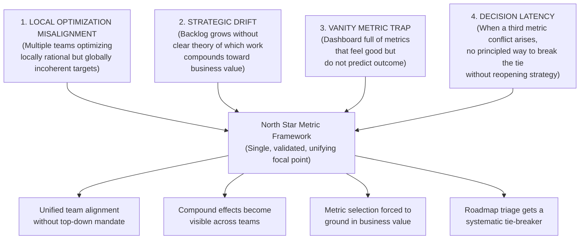

- **Eliminating Local Optimization Misalignment**: Without a single focal point, a mobile team optimizes for Session Duration, a backend team optimizes for API Latency, and a subscription team optimizes for Monthly Recurring Revenue (MRR). Each metric is individually defensible, but collectively they create conflicting pressure: longer sessions demand more API calls, which increases latency; higher MRR may demand raising the price, which decreases session counts. The North Star Metric gives the organization an explicit answer to "which of these tensions is acceptable?" because it operationalizes which outcome, if achieved, would actually win in the market.

- **Preventing Strategic Drift and the Feature Factory Anti-Pattern**: A product team's backlog will grow to fill whatever container it is placed in. Without a North Star Metric enforcing a theory of compounding, that backlog becomes a list of locally-justified work items that never accumulate into a defensible advantage. Six months in, the team has shipped 40 features and the North Star metric is flat. The North Star forces a conversation: which of these 40 features actually moved the dial? Which moved it but not enough to justify the engineering cost? Which are we going to stop building and why?

- **Escaping the Vanity Metric Trap**: Instrumentation is easy; selecting the right metric is not. Raw page views, app downloads, registered users, and cumulative traffic all feel like success metrics — they are large numbers that go up. But they do not predict whether the product will survive the next market shift, whether customers will pay, or whether users will actually use the product once the novelty wears off. The North Star selection framework (Section 4) forces the organization to ground its chosen metric in actual customer value, business model, and long-term viability rather than whatever feels good in the moment.

- **Breaking Systematic Metric Conflicts**: When deciding whether to invest engineering capacity in Platform A (predicted to increase Metric X) or Platform B (predicted to increase Metric Y), an organization without a North Star must re-litigate the strategic importance of X vs. Y *every time the decision arises*. Exhausting. With a North Star Metric, the decision becomes mechanical: which platform is predicted to increase the North Star, and by how much?

---

## 4. Core Concepts

Section 4 teaches the core conceptual models and operational mechanics of North Star Metrics from first principles. Each concept includes definition, mechanism, decision implications, common failure mode, and concrete scenario per the STYLE_GUIDE.md requirement.

```
+-----------------------------------------------------------------------------------+
|                            NORTH STAR CORE CONCEPTS                              |
+-----------------------------------------------------------------------------------+
| 4.1 North Star Metric: Definition, Mechanism, and Organizational Role           |
| 4.2 The Telemetry Foundation: From Event Schema to North Star Instrumentation    |
| 4.3 North Star Selection Frameworks: Contextual, Strategic, and Opportunity-Based |
| 4.4 North Star Metrics vs. OKRs: Arbitration and Synchronized Governance         |
| 4.5 The North Star Cascade: From Company to Product-Line to Team Proxy Metrics   |
| 4.6 North Star Metric Lifecycle: Selection, Evolution, Retirement, and Pivoting  |
| 4.7 Multi-Product and Cross-Product North Star Structures                        |
+-----------------------------------------------------------------------------------+
```

---

### 4.1 North Star Metric: Definition, Mechanism, and Organizational Role

#### Definition
A **North Star Metric** is a single, quantitative measure of core customer value — typically growth in a key behavior or outcome — that an organization selects as the primary focal point for all product, engineering, and operational decisions for a defined time horizon (usually one to three years). It represents the organization's singular, operationalized answer to "what does winning look like for our customers and our business?"

#### Mechanism (How It Works)
A North Star Metric operates at the intersection of three distinct layers:

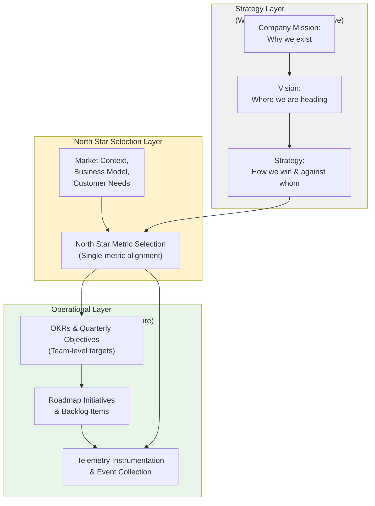

The North Star Metric does *not* replace strategy or OKRs. Instead, it operationalizes strategy into a single, measurable signal and then provides a systematic feedback loop for evaluating whether OKR-driven work is actually moving the dial in the direction that strategy predicts.

**How the metric flows through an organization:**

1. A team considers a new initiative (e.g., "redesign the recommendation algorithm") and asks: "Is this predicted to increase the North Star Metric, and by how much?"
2. If yes, the initiative competes for capacity on its predicted North Star impact. The team estimating it to increase the North Star by +2% gets prioritized over an initiative predicted to increase it by +0.5%, all else equal.
3. The team ships the initiative. Telemetry collects the outcome signal. Six weeks post-launch, the team measures actual North Star movement and compares it to the prediction.
4. If the North Star moved as predicted, the team learns that their causal reasoning was sound and repeats the pattern for the next initiative. If the North Star did not move as predicted, the team learns something about user behavior, market conditions, or their causal understanding, and adjusts. Both outcomes are information.

#### Decision Implications (When and Why to Use It)
- **Single-product organizations**: Use a single company-wide North Star Metric. An example is Slack's "Messages Sent Per Day" across all workspaces, which operationalizes the hypothesis that more active communication (among existing users) predicts retention, viral growth, and defensible value.
- **Multi-product organizations**: Use a single company-level North Star (e.g., AWS's "Active Subscribers" or "Spend Per Account") *and* one North Star Metric per major product line (e.g., "EC2 Usage Hours" for Compute, "Stored GB-Hours" for Storage) to avoid one product cannibalizing another's roadmap. Section 4.7 covers this in full.
- **Platforms and ecosystems**: Define a North Star that reflects the health of the ecosystem (e.g., Marketplace GMV (Gross Merchandise Value), not just buyer transactions) so that supply-side and demand-side products do not pull in opposite directions.

#### Common Failure Mode: The Vanity Metric Masquerading as a North Star
A metric becomes a "false North Star" when it is labeled as the singular focal point but is not actually grounded in customer value or business model. For example:

- **Total Registered Users** feels like growth and is easy to measure, but it does not predict retention, monetization, or churn. An organization optimizing for registered users can add millions by lowering signup barriers, only to discover that 90% churn in week one.
- **Daily Active Users (DAU)** as a North Star for a task-management tool optimizes for *engagement frequency* when the actual business model success is *task completion rate*. A user opening the app 10 times per day but never checking off tasks is not a customer success story.
- **Cumulative Uploads** for a cloud storage service optimizes for growth in total data stored without distinguishing between active, engaged users and a single user who uploaded once then abandoned the service.

The failure mode arises when an organization selects a metric based on what is easy to measure or what feels intuitively important, rather than grounding the selection in a causal theory: "This metric will increase *because customers find more value*."

#### Concrete Scenario
**Scenario: Dropbox's North Star Metric Evolution**

Dropbox's initial hypothesis (circa 2010) was that the company's core value was seamless file synchronization across devices. This led to selecting **"Files Synced"** (total number of files successfully synced per user per month) as the North Star Metric. This metric is powerful because:

1. It operationalizes the core value hypothesis ("sync works") into a quantitative signal.
2. It can be decomposed into sub-drivers: number of files per user, sync success rate, frequency of sync events. Engineering teams can work on sub-components and see the aggregate North Star move.
3. When a new feature (e.g., "selective sync" or "folder sharing") ships, the team measures its impact on Files Synced rather than arguing about whether the feature is "strategic."
4. If Files Synced flatlines while registered users grow, it signals that growth is not bringing engaged users, and the organization adjusts.

By contrast, if Dropbox had selected **"Total Registered Users"** or **"Total Accounts Created"** as the North Star, the organization would have optimized aggressively for signup conversion, likely resulting in millions of inactive accounts and a misleading picture of product health.

---

### 4.2 The Telemetry Foundation: From Event Schema to North Star Instrumentation

#### Definition
The **North Star Metric's Telemetry Foundation** is the end-to-end instrumentation pipeline — event schemas, collection infrastructure, data warehousing, schema validation, and metric calculation procedures — that makes measuring the North Star Metric reliable, repeatable, and attributable to specific product changes. Without this foundation, the North Star Metric becomes a political debate rather than an empirical signal.

#### Mechanism (How It Works)
A North Star Metric is *never* a raw event count. It is always a calculated, aggregated, and validated signal derived from lower-level behavioral events. For example:

| Stated North Star Metric | Underlying Behavioral Events | Calculation |
|---|---|---|
| **Monthly Active Users (MAU)** | `user_session_started`, `api_call`, `content_viewed` | Count of unique user_ids with ≥1 event in calendar month |
| **Files Synced** | `file_sync_initiated`, `file_sync_completed`, `file_sync_failed` | Sum of `file_sync_completed` events grouped by user-month |
| **Messages Sent Per Day (DAU)** | `message_created`, `message_sent`, `delivery_confirmed` | Count of unique user_ids with ≥1 `message_sent` event per calendar day |
| **Revenue Per User** | `subscription_created`, `subscription_renewed`, `payment_received`, `refund_issued` | Sum of `payment_received` - `refund_issued` divided by unique user_ids per month |

The calculation rules must be explicit and versioned:

```mermaid
flowchart LR
    Events["Raw Behavioral Events<br/>(user_id, timestamp, event_type,<br/>event_data)"]
    
    Schema["Event Schema Registry<br/>(Avro / Protobuf contract)"]
    
    Ingestion["Real-Time Ingestion Pipeline<br/>(Kafka / Pub-Sub)"]
    
    Validation["Schema Validation<br/>& Data Quality Checks"]
    
    Warehouse["Time-Series Data Warehouse<br/>(ClickHouse, Snowflake)"]
    
    Calculation["Metric Calculation<br/>(SQL definition, versioned)"]
    
    Dashboard["North Star Dashboard<br/>(Real-time alerting,<br/>trend analysis)"]
    
    Events --> Schema
    Schema --> Ingestion
    Ingestion --> Validation
    Validation --> Warehouse
    Warehouse --> Calculation
    Calculation --> Dashboard
    
    style Events fill:#e3f2fd
    style Schema fill:#f3e5f5
    style Validation fill:#fce4ec
    style Warehouse fill:#e8f5e9
    style Calculation fill:#fff3e0
    style Dashboard fill:#f1f8e9
```

**Key aspects of the foundation:**

- **Event Schema Contract**: Owned by [Metrics](CH24_Metrics.md#4-core-concepts), but the North Star's specific event requirements must be explicit. For example, if the North Star Metric is "Files Synced," the schema must include fields for `user_id`, `file_id`, `sync_timestamp`, and `sync_status` (success/failure), not just an aggregate count.
- **Metric Definition Versioning**: As products evolve, the definition of the North Star Metric may need subtle adjustments (e.g., "Does 'active user' include API-only access or just UI sessions?"). Every change to the metric definition must be tracked in a version history, and historical data must be backfilled or restatements must be explicit. Otherwise, comparing "this month's North Star" to "last year's North Star" becomes statistically meaningless.
- **Aggregation Boundaries**: The North Star Metric must be calculated consistently at all time granularities (daily, weekly, monthly) and geographic or segment boundaries (by country, by customer tier, by product feature). If the North Star is "Monthly Active Users," then the daily and weekly rollups must follow the same definition.
- **Data Quality Assertions**: Automated checks must verify that the North Star Metric does not deviate suddenly from expected range (e.g., if DAU usually varies ±3% day-to-day, an overnight jump of +15% should trigger an alert that the data pipeline may be broken).

#### Decision Implications
- **North Star Selection Must Come After Telemetry Design**: If an organization is considering "Customer Retention Cohort Survival at 12 Weeks" as the North Star Metric but does not have cohort-tracking events in the telemetry pipeline, that metric is not yet ready to be a North Star. Either add the telemetry infrastructure first (days to weeks of engineering effort) or select a different metric that is already instrumented.
- **Do Not Settle for Proxy Metrics Unless Absolutely Necessary**: If the organization cannot instrument the true North Star Metric due to privacy constraints, compliance restrictions, or data loss, explicitly document this limitation and plan for a future upgrade. For example, if GDPR (General Data Protection Regulation) prevents storing user_id-level granular events, the organization might use aggregated cohort survival rates instead, but should not pretend this is as reliable as user-level tracking.

#### Common Failure Mode: The Siloed Metric
An organization measures the North Star Metric in one system (e.g., Google Analytics) but decision-making relies on a different system (e.g., a custom data warehouse). The two systems diverge due to different event definitions, sampling rates, or data pipelines, and the organization ends up debating the *number* instead of the *trend*.

**Example**: The Product team sees "DAU up 5% this month" in their Google Analytics dashboard, but the Analytics Engineering team's warehouse query shows "DAU flat month-over-month." The disagreement paralyzes decision-making. Resolution requires defining a single source of truth: which system owns the North Star Metric calculation, and why are the others not authoritative?

#### Concrete Scenario
**Scenario: Slack's Telemetry Foundation for "Messages Sent Per Day"**

Slack's North Star Metric of "Messages Sent Per Day (DAU)" requires the following telemetry infrastructure:

1. **Event Schema**: Every message send must generate a `message.created` event with `workspace_id`, `channel_id`, `user_id`, `timestamp`, `message_type` (text/file/reaction), and `delivery_status`.
2. **Telemetry Collection**: Events are collected at multiple checkpoints:
   - Client-side: when the user clicks "send"
   - Server-side: when the server receives the message
   - Delivery-side: when the message is delivered to all subscribers
3. **Validation Pipeline**: Automated checks ensure that event_count >= received_count >= delivered_count (if not, alerts fire).
4. **Metric Definition**: "Messages Sent Per Day (DAU)" = count of unique `user_ids` with ≥1 `message.created` event per calendar day.
5. **Versioning**: If Slack later decides to include "reactions to messages" as a separate `message_interaction` event, the company must document this as "North Star Metric Def v2" and backfill historical data or clearly mark the comparison boundary.

With this foundation, Slack can answer questions like:
- "How many unique users sent ≥1 message today?" (DAU, daily)
- "On average, how many messages do active users send per session?" (messages per DAU, weekly)
- "Which regions saw the largest increase in Messages Sent this quarter?" (DAU by geography)

Without this foundation, the North Star Metric becomes a political debate about what "active" means.

---

### 4.3 North Star Selection Frameworks: Contextual, Strategic, and Opportunity-Based

#### Definition
**North Star Selection Frameworks** are systematic approaches for choosing which single metric to elevate to North Star status, rather than selecting a metric arbitrarily or based on executive intuition. Three complementary frameworks exist: **Contextual** (grounded in customer value and business model), **Strategic** (aligned with company strategy per [Product Strategy](CH15_Product_Strategy.md)), and **Opportunity-Based** (ground in competitive or market positioning).

#### Mechanism (How It Works)

North Star selection is fundamentally a **constraint-satisfaction problem**. A candidate metric must satisfy four conditions simultaneously:

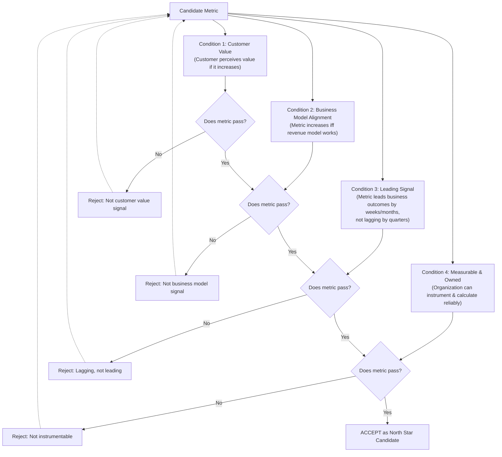

**The Three Frameworks:**

#### 4.3.1 Contextual Framework: Jobs-to-be-Done (JTBD) and Customer Value Theory

This framework uses [Product Strategy](CH15_Product_Strategy.md#45-jobs-to-be-done-jtbd-customer-value-and-strategic-defensibility)'s Jobs-to-be-Done (JTBD) theory to ground the North Star Metric in *what job customers hire the product to do*.

**Mechanism**:
1. Start with the core job the product solves (e.g., for Dropbox: "synchronize my work files across devices so I can access them from anywhere").
2. Identify the core **outcome metric** that would increase *if and only if* that job is being done better (e.g., "Files Synced" increases when sync is faster and more reliable; "Files Not Synced" decreases when sync errors occur).
3. Validate that customers actually perceive this outcome as valuable by testing whether they would prefer the product with higher metric values over lower ones (qualitative validation).

**Decision Implications**: Use the Contextual Framework as the primary selection method. It grounds the North Star in actual customer value rather than business convenience.

**Common Failure Mode**: Conflating the outcome metric with a behavior that correlates with the outcome. For example, in a fitness app, the outcome job is "improve my health," but the observable behavior is "exercises completed." Optimizing for "exercises completed" (the behavior) can backfire if users are doing low-intensity exercises just to hit a count, when "calories burned" or "fitness improvement (measured via VO2 max)" would actually predict health improvement.

#### 4.3.2 Strategic Framework: Operationalizing Competitive Advantage

This framework aligns the North Star Metric to the organization's stated competitive advantage and strategy per [Product Strategy](CH15_Product_Strategy.md).

**Mechanism**:
1. State the organization's competitive advantage claim (e.g., "We are winning because we have the fastest, most reliable sync engine in the market").
2. Identify the metric that would increase *if and only if* that advantage is being realized (e.g., "Files Synced Per User Per Month" increases as sync speed and reliability improve).
3. Verify that this metric is distinct enough from competitors' North Star metrics to be defensible (e.g., if all file-sync competitors use the same metric, it is a commodity metric, not a competitive moat).

**Decision Implications**: Use the Strategic Framework as a secondary validation after the Contextual Framework. If the Contextual metric and the Strategic metric point to different targets, the organization has a misaligned strategy (worth fixing) or a misunderstood competitive advantage (also worth fixing).

**Common Failure Mode**: Selecting a metric that is strategically aligned but not customer-valued. For example, an organization might claim "We win because we have the most enterprise-grade security" (competitive advantage) and select "Security Audits Passed" as the North Star Metric. However, customers do not value the metric itself; they value the *outcome* (reduced breach risk, compliance), which is much harder to measure directly.

#### 4.3.3 Opportunity-Based Framework: Market Positioning and Defensibility

This framework grounds the North Star in market positioning and defensibility against competitive threats.

**Mechanism**:
1. Identify the market or segment the organization is targeting (e.g., "high-volume, latency-sensitive transactional systems").
2. Identify the metric that would make the product defensible in that market (e.g., "99.99% uptime and <10ms response time").
3. Select the metric that captures customer willingness to stay in the face of alternatives (e.g., "Customer Retention Cohort Survival at 6 Months" rather than "New Signups Per Month").

**Decision Implications**: Use the Opportunity-Based Framework when market conditions are rapidly shifting and competitive alternatives are emerging. It ensures the North Star is grounded in defensibility, not just current usage patterns.

**Common Failure Mode**: Selecting a metric optimized for a market the organization is *planning* to enter, not the market it *currently* serves. For example, a B2B SaaS company might select "Enterprise Adoption Rate" as the North Star to chase upmarket, only to discover that the company does not yet have enterprise features (compliance, SSO [Single Sign-On], audit trails), and the metric becomes a distraction from validating the current mid-market position.

#### Concrete Scenario

**Scenario: Selecting North Star Metrics for Three Fictional Products**

**Product A: Fitness Tracking App (B2C)**

*Using Contextual Framework:*
- Core JTBD: "Help me improve my health and fitness."
- Observable outcome metric: "Fitness Improvement (e.g., weekly average VO2 max or resting heart rate change)."
- Challenge: VO2 max tracking requires wearable hardware integrations.
- **Pragmatic selection**: "Users Logging ≥4 Weekly Workouts" (behavior that correlates with health improvement, instrumentable today).

*Using Strategic Framework:*
- Competitive advantage claim: "We have the best personalized coaching algorithm."
- Metric aligned with advantage: "Personalized Workout Plans Completed vs. Skipped" (higher completion = algorithm quality).

*Final Decision:*
- **North Star Metric**: "Retention Cohort Survival at 12 Weeks" (operationalizes both customer value and competitive advantage: users stay because they improved).

**Product B: Cloud Database Service (B2B)**

*Using Contextual Framework:*
- Core JTBD: "Store and query my operational data with confidence."
- Observable outcome metric: "Query Latency" or "Data Durability Assurance."
- Challenge: Durability is not directly observable; it is inferred from uptime and replication metrics.
- **Pragmatic selection**: "Uptime (99.99% or higher) and Queries-Per-Second (QPS) Served."

*Using Strategic Framework:*
- Competitive advantage: "We support the highest QPS per dollar of any database."
- Metric: "Queries-Per-Second Per Customer" (direct test of competitive claim).

*Using Opportunity-Based Framework:*
- Target market: High-volume fintech systems (requiring extreme reliability).
- Defensibility metric: "Customer Retention at 24 Months in Fintech Segment."

*Final Decision:*
- **North Star Metric**: "Queries-Per-Second Served Across Active Customers" (operationalizes both customer value and competitive positioning).

**Product C: Enterprise Identity Platform (B2B)**

*Using Contextual Framework:*
- Core JTBD: "Securely manage employee identity and access across all my systems."
- Observable outcome metric: "Security Breach Incidents" (decrease) or "Policy Compliance Maintenance."
- Challenge: Breaches are rare; compliance is hard to measure externally.
- **Pragmatic selection**: "Users Successfully Authenticated with ≥1 Challenge-Response" (proxy for active identity management).

*Using Strategic Framework:*
- Competitive advantage: "Most comprehensive integration with enterprise systems (Salesforce, SAP, etc.)."
- Metric: "Integrated Systems Activated Per Customer."

*Using Opportunity-Based Framework:*
- Target market: Global enterprises (highly regulated, multi-region).
- Defensibility metric: "Compliance Certifications Maintained" and "Customer Retention in Regulated Industries."

*Final Decision:*
- **North Star Metric**: "Monthly Active Users Authenticated Across Integrated Systems" (operationalizes customer value, competitive advantage, and defensibility in regulated markets).

---

### 4.4 North Star Metrics vs. OKRs: Arbitration and Synchronized Governance

#### Definition
**North Star Metrics vs. OKRs Arbitration** is the operational discipline of managing the relationship between organization-wide North Star Metric optimization and team-level Objectives and Key Results (OKRs), which are set quarterly per [Product Strategy](CH15_Product_Strategy.md#48-objectives-and-key-results-okrs-as-a-strategy-execution-cascade). These two systems can point in different directions, and the organization must have explicit rules for resolving conflicts.

#### Mechanism (How It Works)

OKRs and North Star Metrics serve *different purposes* and operate on *different time horizons*:

| Dimension | North Star Metric | OKRs |
|---|---|---|
| **Time Horizon** | 12–36 months (rarely changed) | Quarterly (reassessed every 3 months) |
| **Scope** | Company or product-line level (singular focal point) | Team or squad level (multiple per organization) |
| **Purpose** | Organizational alignment focal point ("what does winning look like?") | Tactical execution targets ("what will we achieve this quarter?") |
| **Evolution** | Changes when market conditions, business model, or customer needs shift fundamentally | Changes every quarter based on learning and capacity |
| **Relationship to Strategy** | Operationalizes strategy into a single measurable signal | Operationalizes strategy into quarterly tactical work |

**The synchronization challenge arises when they diverge:**

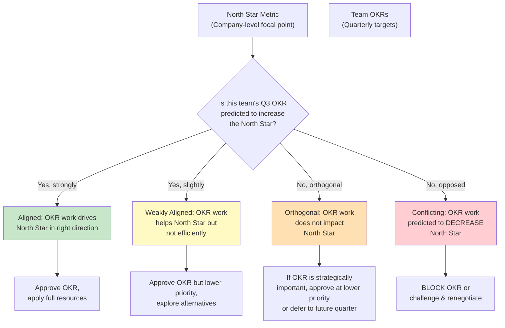

**Synchronization Rules:**

1. **Strong Alignment (Proceed with Priority)**: If a team's OKR is predicted to materially increase the North Star Metric, the OKR gets top priority in that team's roadmap. Example: "We will increase Daily Active Users (DAU) by 8% by improving recommendation relevance," and the North Star Metric is "Daily Active Users." Approve and resource aggressively.

2. **Weak Alignment (Approve at Lower Priority or Explore Alternatives)**: If a team's OKR moves the North Star Metric but inefficiently, the OKR still gets approved but at lower priority. Simultaneously, explore whether there are alternative approaches that move the North Star more efficiently. Example: "We will increase DAU by 2% by launching a new feature nobody asked for," when the team could instead increase DAU by 5% by fixing a known friction point. Approve the OKR but encourage the team to reconsider.

3. **Orthogonal (Approve Selectively)**: If a team's OKR does not impact the North Star Metric (either positively or negatively) but is strategically important (e.g., regulatory compliance, infrastructure resilience), it can be approved — but gets lower priority and may be deferred to a future quarter if capacity is constrained. Example: "We will achieve SOC 2 (System and Organization Controls) compliance" does not directly increase DAU, but is strategically necessary for enterprise sales.

4. **Conflicting (Block or Renegotiate)**: If a team's OKR is predicted to *decrease* the North Star Metric, it should be blocked or fundamentally renegotiated. This is the red flag. Example: "We will increase margin on premium tier by 40% by cutting storage quota in half" might increase revenue-per-user but decrease DAU if it causes churn. This conflict must be explicitly debated: Is the competitive advantage so strong that we can afford to lose users? Is the margin calculation correct? Is there an alternative pricing model?

#### Decision Implications

- **Establish a North Star Governance Forum**: Create a standing meeting (monthly or quarterly) where product leaders, engineering leads, and strategy staff review the backlog of proposed OKRs against predicted North Star impact. This forum should have explicit authority to block OKRs that conflict with North Star optimization.

- **Require Impact Prediction in OKR Proposals**: Before approving any quarterly OKR, require the team to estimate its predicted impact on the North Star Metric (e.g., "We predict this OKR will increase DAU by 3–5%"). If the team cannot articulate a causal prediction, the OKR is likely not well-thought-out.

- **Do Not Let the North Star Dominate All OKRs**: If 100% of organizational OKRs must map to North Star impact, teams will only work on the highest-leverage levers, starving important but lower-leverage work (e.g., technical debt, culture, learning). Typically, 60–70% of OKRs should be directly North Star-aligned; 20–30% should be strategically aligned but North Star-orthogonal; and 10% can be team or individual growth-oriented.

#### Common Failure Mode: The North Star Trap

An organization selects a North Star Metric and then makes it a political mandate: "All OKRs must increase the North Star, no exceptions." This leads to:

1. **Neglect of Important Non-North-Star Work**: Technical debt, infrastructure resilience, compliance, and culture-building are all deferred because they do not directly move the North Star.
2. **Perverse Optimization**: Teams find clever but value-destroying ways to increase the metric. Example: If the North Star is "Daily Active Users," a team might reduce the session timeout from 30 minutes to 1 minute, so the same user activity generates more "sessions" and inflates DAU. Technically the metric goes up, but customer value did not.
3. **Burnout and Misalignment**: Teams whose expertise does not directly impact the North Star (e.g., the infrastructure team) feel deprioritized and disconnected from organizational success.

#### Concrete Scenario

**Scenario: Arbitrating North Star vs. OKR Conflict at a Video Streaming Platform**

Assume the North Star Metric is "Watch Time (hours) Per Monthly Active User," which operationalizes the hypothesis that deeper engagement predicts retention and minimizes churn.

**Quarter 3 OKR Proposals:**

**OKR 1: Content Team**
- Objective: "Maximize content library coverage."
- Key Result: "Add 500 new titles to library and expand international content by 40%."
- Predicted North Star Impact: "+12% Watch Time (users have more content options, discovery improves)."
- **Governance Decision**: Strongly Aligned. Approve with top priority.

**OKR 2: Monetization Team**
- Objective: "Increase Average Revenue Per User (ARPU)."
- Key Result: "Implement tiered ad-load pricing (more ads → lower price, fewer ads → higher price) and increase ads per hour by 50% in base tier."
- Predicted North Star Impact: "–8% Watch Time (users on base tier watch fewer hours due to ad load, churn increases by 3–5%)."
- Revenue prediction: "+25% ARPU."
- **Governance Decision**: Conflicting. The OKR increases revenue but decreases the North Star Metric. Explicit renegotiation required.
  - *Resolution Path A (Renegotiate)*: Implement ads-per-hour increase in a way that is less intrusive; accept lower ARPU growth.
  - *Resolution Path B (Challenge)*: The company accepts that base-tier user experience will degrade. If competitive moat is strong enough and churn does not materialize, revenue win outweighs Watch Time loss — but this is an explicit strategic bet.
  - *Resolution Path C (Defer)*: Defer this OKR to Q4, pending watch-time impact validation from a smaller pilot test first.

**OKR 3: Infrastructure Team**
- Objective: "Migrate to multi-region deployment."
- Key Result: "Achieve <50ms latency in all regions and 99.99% uptime."
- Predicted North Star Impact: "0% (no direct impact on Watch Time; enables future performance improvements)."
- **Governance Decision**: Orthogonal. Approve at lower priority (it is strategically important for reliability and global expansion) but do not resource it as heavily as the Content team's OKR unless it directly unblocks other teams' North Star work.

**OKR 4: Product Team**
- Objective: "Improve recommendation algorithm relevance."
- Key Result: "Increase click-through rate (CTR) on recommendations by 15%."
- Predicted North Star Impact: "Indirect: higher CTR may increase Watch Time, but the team cannot estimate the magnitude without A/B testing."
- **Governance Decision**: Weakly Aligned. Approve but require the team to commit to measuring the actual Watch Time impact post-launch and report back in Q4 planning. If CTR increases but Watch Time does not, the team resets expectations.

---

### 4.5 The North Star Cascade: From Company to Product-Line to Team Proxy Metrics

#### Definition
The **North Star Cascade** is the multi-tier system of metrics flowing from a single company-level North Star Metric down through product lines, platforms, and individual teams, with each tier translating the company North Star into locally-actionable, measurable proxy metrics that teams can optimize directly without losing alignment to the global signal.

#### Mechanism (How It Works)

A single company North Star Metric is often too high-level or too slow-moving for individual teams to act on effectively. For example, if the company North Star Metric is "Annual Customer Lifetime Value (LTV)," a frontend engineer working on page load times cannot directly influence that metric in a way they can observe and learn from (the connection is indirect, and the feedback loop is months long). The North Star Cascade solves this by creating a decomposition hierarchy:

```{=latex}
\begin{landscape}
```

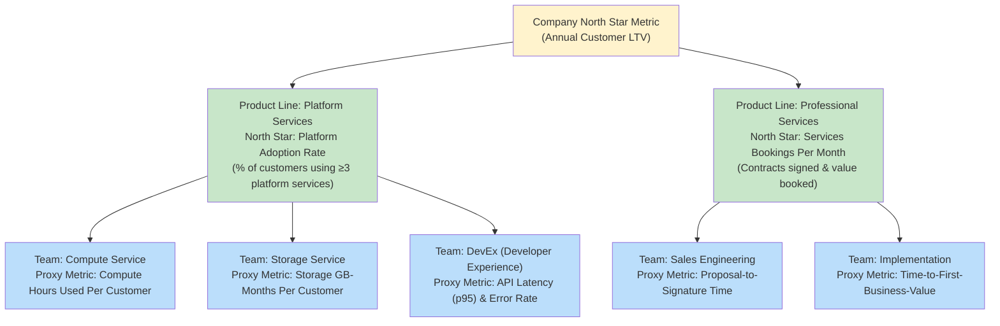

```{=latex}
\end{landscape}
```

**Rules for a Valid Cascade:**

1. **Monotonic Alignment**: If a team increases its proxy metric, the product-line North Star should increase (or at minimum not decrease). If the Compute team increases "Compute Hours Used Per Customer" but Platform Adoption Rate decreases, something is wrong with either the proxy metric or the causal theory.

2. **Aggregation Consistency**: When all team-level proxy metrics improve, the product-line North Star must improve. There should be no mystery "macro" effects that contradict the sum of micro improvements. If the product-line North Star is flat while all team metrics are up, the cascade is broken (possibly due to external market conditions, but that must be explicitly diagnosed).

3. **Isolation Principle**: A team's proxy metric should be under the team's control (or near-control). If a frontend team's proxy metric is "User Retention," but retention is primarily driven by backend infrastructure reliability (out of the team's control), the proxy metric is not actionable.

4. **Feedback Loop Speed**: Proxy metrics at the team level should provide feedback on timescales of days to weeks, not quarters. If a team has to wait a quarter to see whether their work moved the needle, the feedback loop is too slow for rapid iteration.

#### Decision Implications

- **Design Cascade Top-Down, But Validate Bottom-Up**: Start by decomposing the company North Star Metric into product-line drivers (top-down). Then, talk to individual teams to identify which specific activities they control that drive each product-line metric (bottom-up). If a team cannot articulate its contribution to a product-line North Star, the cascade is not aligned.

- **Cascade Depth**: Most organizations do not need more than three tiers: Company → Product Line → Team. Adding a fourth tier (Team → Sub-team) usually creates more overhead than alignment value.

- **Avoid the Proxy Trap**: A proxy metric is useful only when teams understand *why* the proxy predicts the North Star. If a team optimizes its proxy metric without understanding the causal connection to the North Star, they will inevitably drift into perverse optimization.

#### Common Failure Mode: The Broken Aggregate

An organization cascades the North Star Metric down to teams but does not verify that the sum of local improvements equals the global improvement. For example:

- Company North Star: "Monthly Active Users (MAU) = 10M, target +15% to 11.5M"
- Breakdown by platform: Mobile (+12%), Web (+8%), API (+20%)
- Weighted sum: (10M × 0.6) × 1.12 + (10M × 0.3) × 1.08 + (10M × 0.1) × 1.20 = 6.72M + 3.24M + 1.2M = 11.16M (only +11.6%, not +15%)

The problem: the organization set individual team targets that sound aggressive but do not mathematically add up to the company goal. Resolution requires either (a) making some team targets more aggressive, or (b) revisiting whether the +15% company target is realistic.

#### Concrete Scenario

**Scenario: Cascading North Star Metric at a Multi-Product SaaS Company**

**Company Profile**: A customer data platform (CDP) with three product lines: Real-Time Sync (syncs customer data to marketing/analytics tools), Audience Segmentation (builds targeted audiences), and Journey Orchestration (sends personalized messages).

**Company North Star Metric**: "Customers Achieving ≥$50K Annual Contract Value (ACV) or ≥50% revenue retention in Year 2."

This metric operationalizes the hypothesis that as customers integrate more of the platform and see value, they expand spend and persist.

**Cascade (Product Line Level):**

| Product Line | Metric | Reasoning |
|---|---|---|
| Real-Time Sync | "Events Synced Per Day Per Customer" | More data flowing through Sync means customer is more integrated; integration predicts expansion |
| Audience Segmentation | "Audience Segments Created Per Customer Per Month" | More segmentation activity = customer is actively using the product; active users persist |
| Journey Orchestration | "Messages Sent Per Customer Per Month" | More orchestrated campaigns = customer is extracting value; active users expand |

**Cascade (Team Level, Real-Time Sync as example):**

| Team | Proxy Metric | Reasoning |
|---|---|---|
| Connectors (integrations) | "Active Destination Connectors Per Customer" | More destinations connected = more data flowing; enables events synced to increase |
| Ingestion | "Events Ingested Per Second (p95)" | Higher ingestion throughput = system can handle larger customers; removes bottleneck |
| Data Quality | "Duplicate Events Rate" | Lower duplication = events are cleaner; reduces customer data model errors |

**Example Cascade Validation:**

If the Connectors team increases active destination connectors per customer, the Ingestion team increases system throughput, and the Data Quality team reduces duplicates, then "Events Synced Per Day Per Customer" should increase, which should increase annual revenue expansion, which increases the company North Star. If it does not, one of the causal links is broken.

---

### 4.6 North Star Metric Lifecycle: Selection, Evolution, Retirement, and Pivoting

#### Definition
The **North Star Metric Lifecycle** is the operational progression a metric follows from initial selection, through active optimization, to evolution or retirement as market, business model, or customer needs change.

#### Mechanism (How It Works)

A North Star Metric is not static. It evolves through distinct phases:

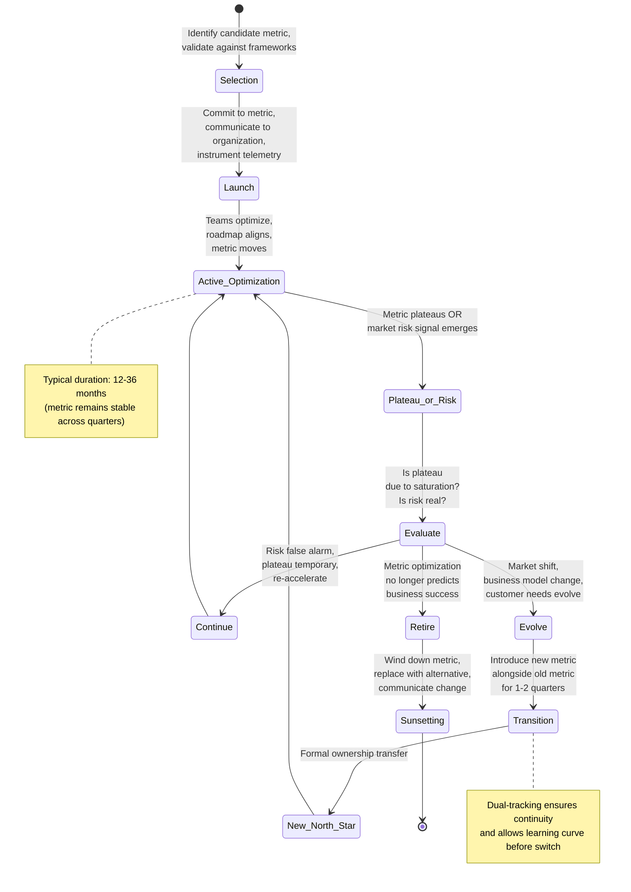

**Key transitions:**

**Selection Phase** (Duration: 2–4 weeks)
- The organization selects a candidate metric using frameworks from Section 4.3.
- The selection is vetted by product, engineering, and business leadership.
- Telemetry infrastructure is verified or built (Section 4.2).
- A formal commitment document is created (e.g., an Architecture Decision Record (ADR) in code or a strategy doc).

**Launch Phase** (Duration: 1–2 weeks)
- The North Star Metric is announced company-wide with explicit reasoning: "We chose this metric because..."
- All teams are trained on the metric, how it is calculated, and how to access the dashboard.
- A public dashboard is deployed showing the North Star Metric trend and any key sub-metrics.

**Active Optimization Phase** (Duration: 12–36 months, typical)
- Teams align OKRs to the North Star Metric.
- Roadmap initiatives are evaluated on predicted North Star impact.
- Monthly or quarterly reviews include North Star trend analysis: "What drove the metric up or down this month?"
- Learning accumulates about which product levers move the metric most efficiently.

**Plateau or Risk Signal** (Trigger event)
- The metric flattens despite continued investment (growth saturation).
- OR external market shift emerges (new competitor, regulatory change, customer behavior shift) that challenges the metric's relevance.
- OR internal learning reveals the metric does not predict long-term business outcomes (e.g., high DAU but revenue flat).

**Evaluation Phase** (Duration: 2–4 weeks)
- Conduct diagnostic: Is the plateau due to *market saturation* (inevitable, may mean success) or *product inadequacy* (fixable)?
- Is the market risk real or a temporary signal?
- Is the causal connection between the North Star Metric and business outcomes still sound, or has it decayed?

**Evolution or Retirement Decision:**
- **Continue** (plateau is temporary, team re-accelerates optimization): Go back to Active Optimization.
- **Evolve** (market or business model shift, new metric more relevant): Initiate Transition phase.
- **Retire** (metric no longer predicts success): Initiate Sunsetting phase.

**Transition Phase** (Duration: 1–2 quarters)
- Introduce the new candidate metric alongside the old one.
- Both metrics are tracked and communicated.
- Teams gradually shift OKRs to optimize the new metric while old OKRs complete.
- Learning is captured about why the old metric plateaued and why the new one predicts better outcomes.

**New North Star Phase**: The new metric becomes the canonical North Star, and the lifecycle continues.

**Sunsetting Phase** (Duration: 1 quarter):
- If a metric is retired without a replacement (rare), teams shift to OKR-driven optimization only (not North Star-driven).
- The old metric is removed from organizational dashboards.
- A final retrospective is conducted: "What did we learn from optimizing this North Star? How did it serve us?"

#### Decision Implications

- **Do Not Change North Star Too Frequently**: Constant metric swaps create organizational whiplash. Teams lose confidence in any metric and default to political prioritization. Minimum recommended duration: 12 months. Maximum recommended duration: 3 years (at which point saturation or market shifts usually force reconsideration).

- **Plan the Transition Before Crisis**: Do not wait until a metric is in crisis (plummeting) to evaluate alternatives. Proactive evaluation during plateaus or when market signals appear gives the organization agency to manage the transition deliberately.

- **Communicate the Why When Transitioning**: If a North Star is retired, explicitly communicate to the organization why it no longer predicts success. This builds credibility in the new metric and signals that the organization is responding to real signals, not whims.

#### Common Failure Mode: The Zombie North Star Metric

An organization chooses a North Star Metric, optimizes it to the point of saturation or market plateau, and then *continues using it anyway* for years because changing it feels like "giving up." The metric becomes zombie-like: teams keep pushing on it, but it does not move and it no longer predicts business outcomes. Investment and morale both decline because the work feels Sisyphean.

**Example**: An e-commerce company's North Star Metric was "New User Signups" (targeting underpenetrated geographic markets). After three years of aggressive user acquisition, the market is saturated, and new signups plateau at 10K/month. However, the company continues to resource the "Signup Optimization" roadmap heavily because that is "what drives the North Star," even though new users churn rapidly (low retention, low purchase rate). Meanwhile, the company misses a market shift toward retention and lifetime value optimization.

**Resolution**: Proactive lifecycle evaluation prevents zombie metrics. Set a regular cadence (quarterly or semi-annual) to evaluate whether the metric is still the highest-leverage lever for business success.

#### Concrete Scenario

**Scenario: YouTube's Hypothetical North Star Metric Evolution**

*Initial North Star Metric (circa 2008): "Videos Watched Per Day"*
- **Rationale**: YouTube was competing against Hulu and other streaming platforms. More watching = more engagement = more ad impressions = more revenue.
- **Duration**: 2008–2012 (Active Optimization for 4 years).
- **Outcome**: The metric grew dramatically (YouTube grew from millions to billions of views per day), but ad revenue did not scale proportionally. The company learned that raw watch time does not predict ad revenue, because low-quality, unwatchable videos can drive high view counts without monetization.

*Transition Signal (circa 2012-2013):*
- Plateau observed: Views per day continued growing, but revenue growth lagged.
- Market shift: Smartphones emerged, changing how users consumed video (shorter sessions, different content types).
- Internal learning: Watch quality and content diversity mattered more than volume.

*Candidate New Metric (circa 2013): "Watch Time Per Unique User Per Day"*
- **Rationale**: Deeper engagement per user predicts retention and higher-quality ad targeting (ad relevance is higher for engaged users, so advertisers pay more).
- **Validation**: Tested for 1–2 quarters alongside "Videos Watched Per Day."
- **Result**: Watch Time Per User grew steadily and correlated with revenue growth.

*New North Star Metric (circa 2014–present): "Watch Time (hours) Per Unique User Per Day"*
- **Active Optimization**: Teams optimized recommendations, playlist features, and content organization to increase watch time.
- **Business Outcome**: Revenue per user scaled as watch time increased, validating the metric.
- **Lessons**: The transition from volume to depth was crucial to scaling revenue and differentiating YouTube from competitor metrics.

---

### 4.7 Multi-Product and Cross-Product North Star Structures

#### Definition
**Multi-Product North Star Structures** are organizational frameworks for defining and governing North Star Metrics across companies that operate multiple independent or interdependent products, where a single company-level metric is insufficient to prevent one product from cannibalizing another's roadmap or market.

#### Mechanism (How It Works)

In a single-product company (Slack, Dropbox), one North Star Metric is sufficient: all teams are building toward the same outcome. In a multi-product company (AWS, Adobe, Salesforce), a single company-level metric creates coordination problems:

- **Problem 1: Inter-Product Cannibalization**: If the company North Star is "Total Cloud Spend Per Customer," all product lines (compute, storage, database, networking) will compete for the same customer spend, with zero incentive to co-innovate or specialize.
- **Problem 2: Product-Specific Metrics Diverge Radically**: Compute teams optimize for "Compute Utilization," Storage teams optimize for "GB Stored," and Database teams optimize for "Queries Per Second" — no coordination.

The solution is a **multi-tier North Star structure**:

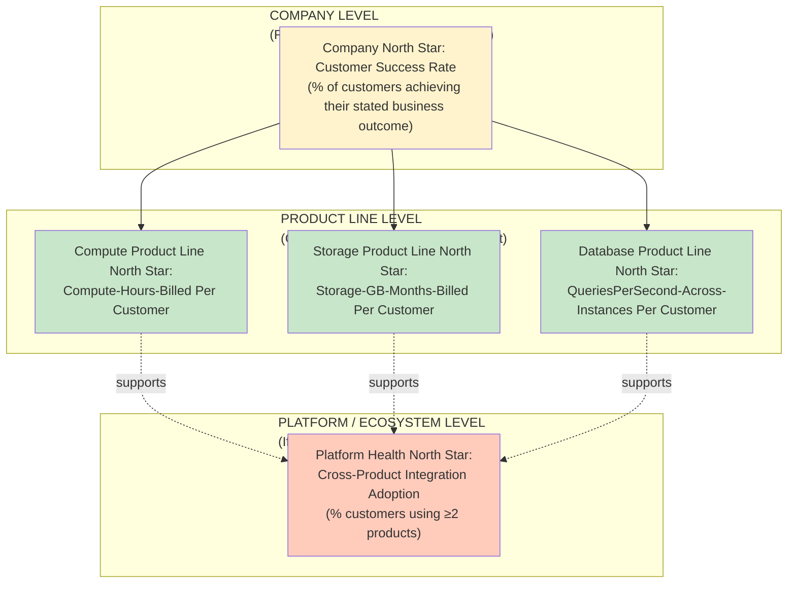

**Key principles:**

**Principle 1: One North Star Per Autonomous Product Line**
- Define which products are truly autonomous (can succeed independently) vs. dependent.
- Each autonomous product line gets its own North Star Metric grounded in its business model and customer value.
- Example: AWS Compute, Storage, and Database are somewhat autonomous; each has a distinct cost model and customer value proposition.

**Principle 2: Platform Health North Star (Optional)**
- If products are intended to be purchased together (or integration drives up-market opportunity), define a separate "Platform North Star" that measures ecosystem adoption.
- Example: "Percentage of AWS customers using ≥2 services" predicts retention and expansion.
- This metric prevents products from pulling against each other while rewarding cross-product use.

**Principle 3: Explicit Arbitration Rules When Metrics Conflict**
- When one product line's North Star increases at the expense of another's, define explicit rules:
  - **Absolute Priority**: If the company is in survival mode (e.g., cash-strapped), prioritize whichever product line has the highest-margin revenue.
  - **Quota System**: Allocate scarce resources (cloud infrastructure, engineering capacity) proportionally to each product line's revenue contribution, letting each line optimize locally.
  - **Ecosystem Rules**: Mandate that no product line can grow by cannibalizing another; if a product line's growth is fueled by migration from another line (not new customers), that growth does not count toward company OKRs.

#### Decision Implications

- **Avoid the Umbrella Anti-Pattern**: Do not create a single "Company North Star" for a multi-product organization unless all product lines genuinely share a single business model and success criterion. An umbrella metric that is too abstract (e.g., "Total Revenue" or "Customer Satisfaction") does not guide individual product teams.

- **Ensure Product-Level Metrics Are Not Zero-Sum**: If "Compute Revenue" and "Storage Revenue" are both increasing, but they are cannibalizing each other's customers, the product lines are competing rather than complementing. Make this visible in governance and explicitly decide whether this is acceptable.

#### Common Failure Mode: The Umbrella Metric Trap

An organization defines a company-wide North Star Metric for a multi-product company (e.g., "Total Annual Recurring Revenue (ARR)"), expecting each product team to align. However, because individual product teams do not directly control the metric and cannot see their contribution, the metric becomes a strategic abstraction that does not guide tactical work. Teams revert to local OKR optimization, and the umbrella metric becomes meaningless.

**Example**: SaaS company with three product lines: CRM, Analytics, and Integration. Company North Star: "Total ARR." CRM team optimizes for "CRM-specific ARR," Analytics team optimizes for "Analytics-specific ARR," and Integration team optimizes for "Integration-specific ARR," treating the product lines as direct competitors for customer spend instead of complementary offerings.

**Resolution**: Define product-line-specific North Stars aligned to the company strategy, with explicit ecosystem rules preventing cannibalization.

#### Concrete Scenario

**Scenario: Multi-Product North Star Structure at a Data Platform Company**

**Company**: "DataCorp" — provides a unified data platform with four product lines: Data Integration (ETL/ELT), Data Warehouse (columnar storage & query engine), Data Governance (access control & compliance), and Analytics (visualization & BI).

**Strategy**: "Enable enterprises to ingest, store, and derive value from all their data with a single, integrated platform."

**North Star Structure:**

```
Company-Level Metric (Strategy Proxy):
  "Customers Achieving ≥50% Data Integration + ≥30% Data Warehouse Utilization"
  (Rationale: Customers who use both integration and warehouse together are most embedded and expand most)

Data Integration North Star:
  "GigaBytes Ingested Per Day Per Customer" 
  (Rationale: More data flowing through integration = customer is more invested; enables warehouse growth)

Data Warehouse North Star:
  "Queries Per Hour Per Customer"
  (Rationale: More queries = more analytics activity; higher utilization drives retention & expansion)

Data Governance North Star:
  "Data Assets Governed (# of tables/schemas with access policies) Per Customer"
  (Rationale: Governance adoption indicates compliance-driven purchases; predicts enterprise expansion)

Analytics North Star:
  "Dashboards Created & Accessed Per Month Per Customer"
  (Rationale: Dashboard creation is indicator of adoption; access patterns indicate sticky usage)

Platform Health North Star:
  "Cross-Product Integration Adoption: % of customers using ≥2 products"
  (Rationale: Customers using multiple products are more sticky, harder for competitors to displace)
```

**Arbitration Example:**

The Governance team proposes an aggressive Q4 OKR: "Require data governance policies on all ingested data (including non-sensitive data), increasing Data Assets Governed by 200%."

**Predicted Impact:**
- Data Governance North Star: +200% ✓
- Data Integration North Star: –15% (customers ingest less because governance overhead increases friction)
- Platform Health North Star: –8% (some customers drop integration, seeing governance as mandatory, not valuable)
- Company-Level Metric: –5% (customers are less integrated, not more)

**Governance Decision**: This OKR conflicts with the company strategy (integrated data platform). Renegotiate: "Implement governance policies as *optional* (not mandatory) first, so customers can opt in. Target +100% Data Assets Governed without cannibalizing integration."

---

## 5. Internal Working

This section walks through how North Star Metrics operate in practice within product organizations, from instrumentation to decision-making.

### 5.0 The North Star in Organizational Context

Before diving into operational mechanics, it is useful to visualize how the North Star Metric interacts with organizational processes. The following diagram shows how a North Star flows through decision-making:

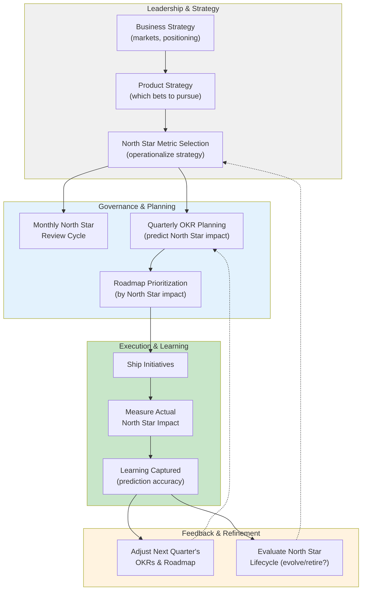

This diagram shows the complete cycle: strategy flows down to North Star selection, which informs OKR and roadmap prioritization, which drives execution, which produces learning, which loops back to refine the next cycle.

### 5.1 The Monthly North Star Review Cycle

A typical product organization implements a monthly North Star review cycle (parallel to quarterly OKR cycles):

1. **Week 1: Metric Calculation & Dashboard Refresh**
   - The analytics/data team calculates the North Star Metric using the versioned formula (Section 4.2).
   - Automated alerts fire if the metric deviates more than X% from trend.
   - A dashboard showing North Star Metric, sub-metrics, and week-over-week/month-over-month trends is published.

2. **Week 2: Diagnostic Analysis**
   - The product analytics team investigates any significant movement (up or down):
     - Which cohorts drove the change? (New users vs. returning? Geographic region? Product feature?)
     - Which shipped initiatives correlate with the change?
     - Were there external factors (marketing campaign, competitor action, seasonal trend)?
   - A written diagnostic report is prepared.

3. **Week 3: Leadership Review & Sense-Making**
   - Product leaders, engineering leaders, and business stakeholders review the diagnostic.
   - Conversation focus: "Do the changes match our causal expectations? If not, what did we learn?"
   - If metric is down unexpectedly, escalate and identify immediate action items (e.g., rollback, urgent investigation).

4. **Week 4: Cascade Communication & Adjustment**
   - Findings are communicated to all teams.
   - Teams adjust their work priorities if needed (e.g., if a shipped feature decreased the North Star instead of increasing it, pause that work).
   - Learnings from the month inform next month's roadmap prioritization.

### 5.2 Integrating North Star Metrics into Product Review Meetings

**Pre-Review (48 hours before):**
- Product managers prepare their roadmap/initiative briefing, explicitly predicting the impact on the North Star Metric.
- Example: "We propose prioritizing the Recommendation Algorithm Redesign (predicted +8% DAU) over the Mobile Rewrite (predicted +2% DAU), based on North Star impact."

**During Review:**
- Leadership evaluates initiatives in order of predicted North Star impact per engineering cost.
- Conversation: "Why do we predict this initiative will increase the North Star by 8%? What could go wrong?"
- Tie-breaking when two initiatives are equally important: "Both are essential infrastructure, but only one fits in Q3. Which is predicted to unlock more North Star-impacting work in Q4?"

**Post-Review (Decision & Communication):**
- Approved initiatives are explicitly linked to North Star targets in the roadmap.
- Teams are held accountable for shipping initiatives that moved the North Star as predicted (or explaining why the prediction was wrong).

### 5.3 Escalation Paths When North Star Conflicts with Other Objectives

When a high-priority strategic initiative does not increase (or decreases) the North Star Metric, explicit escalation is required:

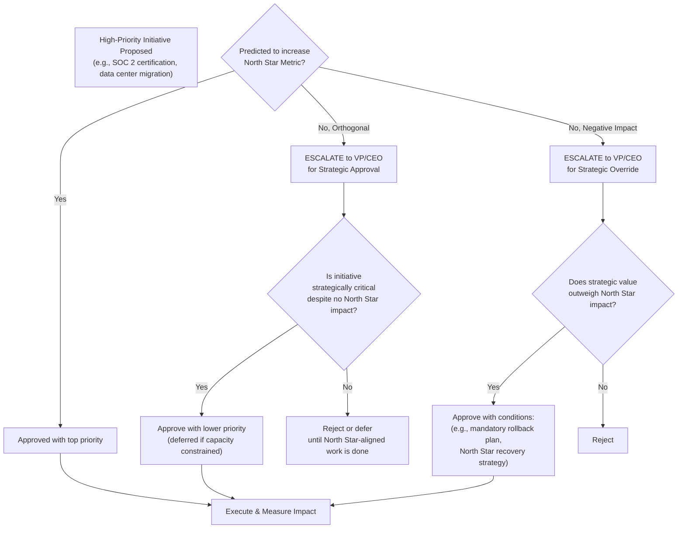

---

## 6. Design Principles

The following design principles guide North Star Metric selection and governance:

1. **Singularity Over Comprehensiveness**: One metric over ten metrics. The trade-off is that a single metric cannot capture every dimension of success (e.g., "DAU" does not measure profitability). Accept this trade-off. A dashboard of 10 metrics creates ambiguity; a single focal point creates clarity, even if imperfect.

2. **Leading Over Lagging**: Select a metric that leads business outcomes by weeks or months, not quarters or years. "Monthly Active Users" is a leading indicator for churn (active users stay longer). "Annual Revenue" is a lagging indicator (it only confirms whether customers paid, after the fact).

3. **Customer Value Over Operational Convenience**: Select a metric grounded in customer value (does the customer prefer higher values of this metric?) over what is easy to measure. "Files Synced" (customer value) is better than "API Calls" (operational convenience), even if API Calls are easier to calculate.

4. **Owned Over Influenced**: Select a metric that is directly owned (the team's actions drive the metric) over influenced (the metric moves, but the connection to the team's work is indirect).

5. **Actionable Over Aspirational**: Select a metric that teams can directly influence through roadmap and execution decisions. "Customer Happiness" is aspirational but not directly actionable; "Task Completion Rate" is actionable (teams can test UI improvements, add guidance, etc.).

---

## 7. Architecture Patterns

North Star Metrics are typically implemented using one of these architectural patterns:

### 7.1 The Funnel Decomposition Pattern

Break the North Star Metric into a series of stages (funnel), where each stage is a prerequisite for the next:

```
DAU = Users × Session Frequency × Session Length × Engagement Quality
```

Each term can be optimized independently, but the product creates the North Star.

### 7.2 The Cohort Analysis Pattern

Segment users into cohorts based on signup date, geography, or feature adoption, and track North Star Metric per cohort:

```
Overall DAU = Σ(Cohort_i DAU) for all signup cohorts
```

This reveals which cohorts are healthy and which are degrading, enabling targeted interventions.

### 7.3 The Leading/Lagging Indicator Pair Pattern

Pair the North Star Metric with a faster-feedback leading indicator to enable early detection of problems:

```
North Star (Monthly): "Monthly Active Users"
Leading Indicator (Daily): "Daily Active Users" or "Daily Sign-In Events"
```

If the leading indicator drops, the team can investigate immediately without waiting for monthly reporting.

---

## 8. Production Architecture

Implementing North Star Metrics at production scale requires integrating with three systems: telemetry infrastructure, data warehousing, and decision-making platforms.

**Overview of Production Integration Points:**

```{=latex}
\begin{landscape}
```

```mermaid
flowchart LR
    subgraph Application["Application Layer"]
        App["Product Applications<br/>(Web, Mobile, API)"]
    end
    
    subgraph Collection["Collection & Ingestion"]
        SDK["Telemetry SDK<br/>(tracking library)"]
        Validation["Schema Validation<br/>(Contract Registry)"]
        App --> SDK
        SDK --> Validation
    end
    
    subgraph Streaming["Real-Time Streaming"]
        Kafka["Event Stream<br/>(Kafka/Pub-Sub)"]
        Processing["Stream Processing<br/>(Flink/Spark)"]
        Validation --> Kafka
        Kafka --> Processing
    end
    
    subgraph Storage["Storage & Aggregation"]
        Warehouse["Data Warehouse<br/>(Snowflake/BigQuery)"]
        Cache["Metric Cache<br/>(Redis/Memcache)"]
        Processing --> Warehouse
        Warehouse --> Cache
    end
    
    subgraph Reporting["Reporting & Decision"]
        Dashboard["Dashboard<br/>(Looker/Tableau)"]
        Alerts["Alerting System<br/>(PagerDuty/OpsGenie)"]
        Cache --> Dashboard
        Cache --> Alerts
    end
    
    Dashboard --> Teams["Product Teams<br/>(prioritization decisions)"]
    Alerts --> Ops["Operations<br/>(incident response)"]
    
    style Application fill:#e3f2fd
    style Collection fill:#c8e6c9
    style Streaming fill:#fff3e0
    style Storage fill:#f3e5f5
    style Reporting fill:#ffe0b2
```

```{=latex}
\end{landscape}
```

This diagram shows the complete production pipeline from application events to decision-making, with each stage optimizing for different concerns.

### 8.1 Telemetry Infrastructure Integration

The North Star Metric feeds from the organization's telemetry pipeline, which [Metrics](CH24_Metrics.md#8-production-architecture) owns in full. Key integration points:

- **Event Schema Contracts**: The North Star Metric's event schema must be versioned and registered in a schema registry (e.g., Confluent Schema Registry for Avro, Protobuf registry).
- **Real-Time Aggregation**: Some North Star Metrics (e.g., "Daily Active Users") benefit from real-time or near-real-time aggregation (updated hourly) rather than daily batch processing, enabling faster response to metric changes.
- **Data Retention**: Historical data must be retained for at least 12–24 months to enable year-over-year comparisons and trend analysis.

### 8.2 Data Warehouse Integration

The North Star Metric calculation typically lives in a data warehouse (ClickHouse, Snowflake, BigQuery, Redshift):

```sql
-- Hypothetical: North Star Metric = "Daily Active Users"
CREATE TABLE public.north_star_metric_dau AS
SELECT 
  DATE(event_timestamp) AS metric_date,
  COUNT(DISTINCT user_id) AS dau,
  CURRENT_TIMESTAMP() AS calculated_at,
  'v1' AS metric_definition_version
FROM events
WHERE event_type IN ('page_view', 'api_call', 'mobile_action')
  AND DATE(event_timestamp) >= DATE_SUB(CURRENT_DATE(), INTERVAL 90 DAY)
GROUP BY DATE(event_timestamp)
ORDER BY metric_date DESC;

-- Real-time/hourly rollup
CREATE VIEW public.north_star_metric_dau_hourly AS
SELECT 
  DATE_TRUNC('hour', event_timestamp) AS metric_hour,
  COUNT(DISTINCT user_id) AS hourly_active_users
FROM events
WHERE event_timestamp >= DATE_SUB(CURRENT_TIMESTAMP(), INTERVAL 48 HOUR)
GROUP BY DATE_TRUNC('hour', event_timestamp);
```

### 8.3 Dashboard and Alerting Integration

The North Star Metric is published to an organization-wide dashboard (e.g., Looker, Tableau, Grafana), with automated alerts for anomalies:

```yaml
# Example alert rule: Detect >5% DAU drop in a single day
alert: north_star_metric_dau_drop
expr: |
  (north_star_metric_dau{} - north_star_metric_dau{} offset 1d) / north_star_metric_dau{} offset 1d < -0.05
for: 1h
annotations:
  summary: "North Star DAU dropped >5% compared to yesterday"
  description: "{{ $labels.product_line }}: {{ $value | humanizePercentage }} drop"
  runbook_url: "https://wiki.company.com/north-star-anomaly-investigation"
```

---

## 9. Implementation

A typical implementation involves:

### 9.1 Selection Phase (Weeks 1–4)

1. **Assemble selection committee** (Product, Engineering, Data/Analytics, Business leads).
2. **Apply selection frameworks** (Section 4.3) to 3–5 candidate metrics.
3. **Validate telemetry infrastructure** (Section 4.2) — confirm events are being collected.
4. **Write North Star Charter** (1–2 page document):
   - Definition of metric.
   - Reasoning for selection (frameworks applied).
   - Expected business outcomes if metric increases.
   - Metric definition version & calculation formula.
   - Expected North Star value range and growth trajectory.
   - Escalation path if metric deviates from expected range.

### 9.2 Launch Phase (Weeks 5–6)

1. **Publish dashboard** with North Star Metric, sub-metrics, and historical trends (≥12 months).
2. **Communicate to all-hands** why this metric was selected and how it operationalizes company strategy.
3. **Train teams** on how to access the dashboard, interpret the metric, and predict their initiatives' impact.
4. **Schedule monthly review cadence** (standing calendar invite for review meeting).

### 9.3 Active Optimization Phase (Quarters 2–8, typically)

1. **Monthly review cycle** (Section 5.1): Diagnostic, leadership review, team communication.
2. **OKR alignment** (Section 4.4): Evaluate new OKRs on predicted North Star impact.
3. **Cascading metrics** (Section 4.5): Define product-line and team-level proxy metrics to enable local action.
4. **Learning capture**: Document which initiatives moved the North Star (and by how much) vs. which did not.

### 9.4 Evaluation Phase (Month 12–15)

1. **Diagnostic review**: Is metric plateauing? Is market shifting? Is causal connection still sound?
2. **Decision**: Continue, Evolve, or Retire (Section 4.6).

---

## 10. Complete Code Examples

This section provides example implementations of North Star Metric instrumentation and calculation.

### 10.1 Event Schema Definition (Protobuf)

```protobuf
// events/v1/user_engagement_event.proto
syntax = "proto3";
package com.company.events;

import "google/protobuf/timestamp.proto";

message UserEngagementEvent {
  string event_id = 1;              // Unique event UUID
  string user_id = 2;               // Unique user identifier
  string workspace_id = 3;          // Multi-tenancy scoping
  google.protobuf.Timestamp event_timestamp = 4; // When event occurred
  
  enum EventType {
    EVENT_TYPE_UNSPECIFIED = 0;
    PAGE_VIEW = 1;
    API_CALL = 2;
    CONTENT_CREATED = 3;
    CONTENT_SHARED = 4;
    USER_INTERACTION = 5;
  }
  EventType event_type = 5;
  
  // Event-specific payload
  oneof event_data {
    PageViewData page_view = 6;
    ApiCallData api_call = 7;
    ContentCreatedData content_created = 8;
  }
  
  string platform = 9;              // "web", "mobile", "api"
  string region = 10;               // Geographic region
  int32 schema_version = 11;        // Schema version for this event
}

message PageViewData {
  string page_url = 1;
  string referrer_url = 2;
  int64 session_duration_ms = 3;
  string device_type = 4;
}

message ApiCallData {
  string endpoint = 1;
  string http_method = 2;
  int32 response_code = 3;
  int64 latency_ms = 4;
}

message ContentCreatedData {
  string content_type = 1;
  string content_id = 2;
  bool is_public = 3;
}
```

### 10.2 North Star Metric Calculation (SQL)

```sql
-- monthly_active_users_dau.sql
-- North Star Metric: Daily Active Users (DAU)
-- Definition v2: Users with ≥1 behavioral event per day (page view, API call, or interaction)

CREATE TABLE IF NOT EXISTS analytics.north_star_daily_active_users (
  metric_date DATE,
  daily_active_users INT64,
  daily_active_users_new INT64,
  daily_active_users_returning INT64,
  dau_by_region ARRAY<STRUCT<region STRING, count INT64>>,
  dau_by_platform ARRAY<STRUCT<platform STRING, count INT64>>,
  calculated_at TIMESTAMP,
  metric_version STRING,
  PRIMARY KEY (metric_date)
);

-- Upsert operation
MERGE INTO analytics.north_star_daily_active_users AS target
USING (
  WITH event_users AS (
    SELECT 
      DATE(event_timestamp) AS metric_date,
      user_id,
      region,
      platform,
      ROW_NUMBER() OVER (PARTITION BY user_id ORDER BY event_timestamp) AS user_event_rank
    FROM events.user_engagement_events
    WHERE event_type IN ('PAGE_VIEW', 'API_CALL', 'USER_INTERACTION')
      AND DATE(event_timestamp) = CURRENT_DATE() - 1  -- Previous day
  ),
  daily_active AS (
    SELECT DISTINCT
      metric_date,
      user_id,
      region,
      platform
    FROM event_users
  ),
  daily_new_vs_returning AS (
    SELECT 
      metric_date,
      user_id,
      region,
      platform,
      CASE 
        WHEN user_event_rank = 1 AND DATE(user_created_at) = metric_date THEN 'new'
        ELSE 'returning'
      END AS user_cohort
    FROM daily_active
    LEFT JOIN users ON daily_active.user_id = users.id
  )
  SELECT 
    metric_date,
    COUNT(*) AS daily_active_users,
    SUM(CASE WHEN user_cohort = 'new' THEN 1 ELSE 0 END) AS daily_active_users_new,
    SUM(CASE WHEN user_cohort = 'returning' THEN 1 ELSE 0 END) AS daily_active_users_returning,
    ARRAY_AGG(
      STRUCT(region, COUNT(*) AS count) 
      IGNORE NULLS
    ) AS dau_by_region,
    ARRAY_AGG(
      STRUCT(platform, COUNT(*) AS count)
      IGNORE NULLS
    ) AS dau_by_platform,
    CURRENT_TIMESTAMP() AS calculated_at,
    'v2' AS metric_version
  FROM daily_new_vs_returning
  GROUP BY metric_date
) AS source
ON target.metric_date = source.metric_date
WHEN MATCHED THEN
  UPDATE SET 
    daily_active_users = source.daily_active_users,
    daily_active_users_new = source.daily_active_users_new,
    daily_active_users_returning = source.daily_active_users_returning,
    dau_by_region = source.dau_by_region,
    dau_by_platform = source.dau_by_platform,
    calculated_at = source.calculated_at,
    metric_version = source.metric_version
WHEN NOT MATCHED THEN
  INSERT (
    metric_date, daily_active_users, daily_active_users_new, 
    daily_active_users_returning, dau_by_region, dau_by_platform,
    calculated_at, metric_version
  ) VALUES (
    source.metric_date, source.daily_active_users, source.daily_active_users_new,
    source.daily_active_users_returning, source.dau_by_region, source.dau_by_platform,
    source.calculated_at, source.metric_version
  );
```

### 10.3 Dashboard Query (Looker LookML)

```looker
view: north_star_daily_active_users {
  derived_table: {
    sql: SELECT * FROM analytics.north_star_daily_active_users ;;
  }

  dimension: metric_date {
    type: date
    sql: ${TABLE}.metric_date ;;
  }

  dimension: metric_version {
    type: string
    sql: ${TABLE}.metric_version ;;
  }

  measure: dau_current {
    type: sum
    sql: ${TABLE}.daily_active_users ;;
    drill_fields: [metric_date, dau_current, dau_new, dau_returning]
  }

  measure: dau_new {
    type: sum
    sql: ${TABLE}.daily_active_users_new ;;
  }

  measure: dau_returning {
    type: sum
    sql: ${TABLE}.daily_active_users_returning ;;
  }

  measure: dau_change_day_over_day {
    type: number
    sql: (${dau_current} - LAG(${dau_current}) OVER (ORDER BY ${metric_date})) / LAG(${dau_current}) OVER (ORDER BY ${metric_date}) ;;
    value_format_name: percent_2
  }

  # Alerting: Fire alert if DAU dropped >5% or increased >20% in one day
  measure: dau_anomaly_flag {
    type: string
    sql: CASE 
      WHEN ABS(${dau_change_day_over_day}) > 0.05 AND ${dau_change_day_over_day} < -0.05 THEN 'DROP_ALERT'
      WHEN ${dau_change_day_over_day} > 0.20 THEN 'SPIKE_ALERT'
      ELSE 'OK'
    END ;;
  }
}

dashboard: north_star_metric {
  title: "Company North Star Metric: Daily Active Users"
  
  elements: [
    {
      name: "dau_trend"
      title: "DAU Trend (Last 90 Days)"
      type: looker_column
      dimensions: [north_star_daily_active_users.metric_date]
      measures: [north_star_daily_active_users.dau_current]
    },
    {
      name: "dau_new_vs_returning"
      title: "DAU Breakdown: New vs. Returning"
      type: looker_column
      dimensions: [north_star_daily_active_users.metric_date]
      measures: [
        north_star_daily_active_users.dau_new,
        north_star_daily_active_users.dau_returning
      ]
    },
    {
      name: "dau_by_region"
      title: "DAU by Geographic Region"
      type: looker_map
      dimensions: [north_star_daily_active_users.region]
      measures: [north_star_daily_active_users.dau_current]
    },
    {
      name: "dau_anomalies"
      title: "Anomaly Alerts"
      type: looker_table
      dimensions: [
        north_star_daily_active_users.metric_date,
        north_star_daily_active_users.dau_anomaly_flag
      ]
      measures: [north_star_daily_active_users.dau_change_day_over_day]
      filters: [north_star_daily_active_users.dau_anomaly_flag: "-OK"]
    }
  ]
}
```

---

## 11. Performance

North Star Metrics are computed on historical data (typically daily or hourly aggregations), not on real-time request paths, so performance is primarily a data warehousing concern rather than an application performance problem.

### 11.1 Computation Efficiency

- **Aggregation Strategy**: Pre-aggregate events into daily/hourly summaries rather than computing from raw events every time. This reduces query time from minutes to seconds.
- **Partitioning**: Partition the `events` table by date so queries scan only recent data, not years of history.
- **Materialized Views**: Pre-compute the North Star Metric as a materialized table, refreshed daily, so dashboard queries run in <1 second.

### 11.2 Historical Data Retention

- **Hot Data**: Retain raw events for 90 days (recent data for diagnostics).
- **Warm Data**: Retain aggregated daily metric data for 24 months (for year-over-year trends).
- **Cold Data**: Archive older data to cold storage (if historical comparison is rarely needed).

---

## 12. Scalability

As an organization grows, North Star Metric management becomes increasingly complex:

### 12.1 Event Volume Scaling

- **Single-product company** (Slack): ~1B events/day → daily aggregation runs in minutes.
- **Large platform** (AWS): ~10B+ events/day → requires distributed processing (Flink, Spark) and stream-based aggregation (Kafka Streams).

### 12.2 Multi-Product Cascade Scaling

As product lines multiply, maintaining cascade alignment (Section 4.5) becomes harder:
- Use a centralized **Metric Governance Registry** (a spreadsheet or database) listing all company, product-line, and team metrics, their definitions, and their relationships.
- Conduct quarterly **Cascade Alignment Audits** to verify that product-line North Stars remain mathematically consistent with company North Star.

---

## 13. Security

North Star Metrics can reveal sensitive business information (e.g., "DAU down 50%" signals product crisis). Access must be restricted:

### 13.1 Data Access Control

- **All-Hands Dashboard**: Aggregated, anonymized North Star Metric (total DAU, trends) can be published to all employees.
- **Leadership-Only Details**: Geographic breakdowns, cohort analysis, and per-customer impact should be restricted to leadership.
- **Legal/Privacy Considerations**: If the North Star Metric includes personally identifiable information (PII), comply with GDPR, CCPA, and local privacy laws.

### 13.2 Metric Definition Versioning

- Track all changes to the North Star Metric formula in version control.
- Require explicit approval for any metric definition change.
- Publish version history alongside the metric (e.g., "Metric updated from v1 to v2 on [date]; historical data backfilled/restated").

---

## 14. Observability

North Star Metric dashboards themselves must be observable:

### 14.1 Metric Calculation Monitoring

- **Freshness**: Alert if the North Star Metric hasn't been recalculated in >24 hours (possible pipeline failure).
- **Data Quality**: Alert if the metric deviates >10% from expected range (possible data corruption or bug).
- **Completeness**: Alert if <95% of events have been processed (possible data loss).

### 14.2 Decision-Making Observability

- Log all decisions made based on the North Star Metric (e.g., "OKR X was prioritized because predicted to increase North Star by 8%").
- Track actual vs. predicted North Star impact for each shipped initiative (learning loop).
- Publish an annual retrospective: "Which predictions were accurate? Which were wrong? What did we learn?"

---

## 15. Failure Scenarios

### 15.1 Scenario: The North Star Stops Moving

**Problem**: The North Star Metric is flat month-over-month despite significant product investment.

**Root Causes**:
1. **Saturation**: The market or user base has reached a natural limit (e.g., DAU saturates at 90% of addressable market).
2. **Measurement Error**: The metric is broken (data pipeline error, definition changed without announcement).
3. **Local Optimization Collapse**: Improvements in one part of the funnel are offset by degradation elsewhere.

**Resolution**:
- Verify the metric is calculating correctly (Section 4.2).
- Decompose the metric into sub-components and identify which have flatlined.
- Explicitly decide: Is saturation acceptable (pivot to new market), or is there a hidden optimization opportunity?
- If saturation is real, initiate the Lifecycle evaluation (Section 4.6) to consider evolving the North Star Metric.

### 15.2 Scenario: North Star Conflicts with Profitability

**Problem**: The North Star Metric is growing (+20% DAU), but the company is losing money.

**Root Cause**: The metric is "leading" business outcomes (retention, revenue) but the causal connection has broken. For example, DAU growth is driven by free-tier spam users who do not convert, or by a feature that drives engagement but cannibalizes higher-margin products.

**Resolution**:
- Segment the North Star Metric by customer cohort (paying vs. free, high-LTV vs. low-LTV) to see which cohorts are driving growth.
- If growth is driven by low-value users, either change the metric to weight high-value users differently, or accept that the North Star is now misaligned and evaluate a pivot (Section 4.6).
- Pair the North Star with a profitability or revenue guardrail metric (e.g., "DAU must grow only if Average Revenue Per User (ARPU) stays flat or increases").

### 15.3 Scenario: North Star Becomes a Liability (Perverse Optimization)

**Problem**: Teams are optimizing the North Star in ways that destroy long-term value (e.g., increasing DAU by dark patterns like over-aggressive notifications).

**Root Cause**: The organization celebrated the metric without building in guardrails. Teams became laser-focused on moving the number without checking whether the underlying customer experience remained healthy.

**Resolution**:
- Immediately add guardrail metrics (Section 4.1 reference to [Metrics](CH24_Metrics.md#45-counter-metrics-and-guardrail-metrics)) that measure customer health (e.g., "Notification opt-out rate," "Session satisfaction rating").
- Audit all shipped initiatives that moved the North Star to identify which had negative side effects.
- Establish a governance rule: North Star growth is not approved if it decreases a guardrail metric by >X%.
- Evaluate a metric pivot if the current metric is fundamentally incentivizing unhealthy behavior.

---

## 16. Testing

### 16.1 Unit Testing: Metric Calculation

Test the North Star Metric calculation logic with known inputs:

```python
# test_north_star_dau_calculation.py
import pytest
from analytics.north_star import calculate_dau

def test_dau_counts_unique_users_per_day():
    """DAU should count unique users, not events."""
    events = [
        ("user1", "2024-01-01", "page_view"),
        ("user1", "2024-01-01", "api_call"),   # Duplicate user, same day
        ("user2", "2024-01-01", "page_view"),
        ("user3", "2024-01-02", "page_view"),  # Different day
    ]
    result = calculate_dau(events)
    assert result[("2024-01-01")] == 2  # user1, user2
    assert result[("2024-01-02")] == 1  # user3

def test_dau_excludes_invalid_events():
    """DAU should only count whitelisted event types."""
    events = [
        ("user1", "2024-01-01", "page_view"),
        ("user1", "2024-01-01", "admin_action"),  # Not whitelisted
    ]
    result = calculate_dau(events)
    assert result[("2024-01-01")] == 1  # user1, but only counts page_view

def test_dau_respects_date_boundaries():
    """DAU for a date should not include events from other dates."""
    events = [
        ("user1", "2024-01-01 23:59:59", "page_view"),
        ("user1", "2024-01-02 00:00:00", "page_view"),  # Next day
    ]
    result = calculate_dau(events)
    assert result[("2024-01-01")] == 1
    assert result[("2024-01-02")] == 1
```

### 16.2 Integration Testing: Pipeline

Test the entire pipeline from event ingestion to metric calculation:

```python
# test_north_star_pipeline.py
import pytest
from analytics.pipeline import ingest_events, calculate_dau
from datetime import datetime

def test_dau_pipeline_end_to_end(mock_event_publisher):
    """Validate the entire DAU calculation pipeline."""
    # Publish test events
    mock_event_publisher.publish_event({
        "user_id": "user1",
        "event_timestamp": "2024-01-01T10:00:00Z",
        "event_type": "page_view"
    })
    mock_event_publisher.publish_event({
        "user_id": "user2",
        "event_timestamp": "2024-01-01T11:00:00Z",
        "event_type": "api_call"
    })
    
    # Run ingestion and calculation
    ingest_events()
    dau_result = calculate_dau("2024-01-01")
    
    # Validate
    assert dau_result["daily_active_users"] == 2
    assert dau_result["calculated_at"] is not None
    assert dau_result["metric_version"] == "v2"
```

### 16.3 Regression Testing: Metric Stability

After every change to the North Star Metric definition, validate that historical data still makes sense:

```python
# test_north_star_stability.py
def test_historical_dau_unchanged_after_definition_v2_upgrade():
    """
    After upgrading from metric definition v1 to v2,
    historical DAU should not change materially (allow ±2% variance).
    """
    v1_dau_jan = get_dau_v1("2024-01-01")  # 1,000,000
    v2_dau_jan = get_dau_v2("2024-01-01")  # Should be ~1,000,000
    
    variance = abs(v2_dau_jan - v1_dau_jan) / v1_dau_jan
    assert variance <= 0.02, f"DAU variance too high: {variance}"
```

---

## 17. Common Mistakes

**Visual Summary of North Star Metric Selection Mistakes:**

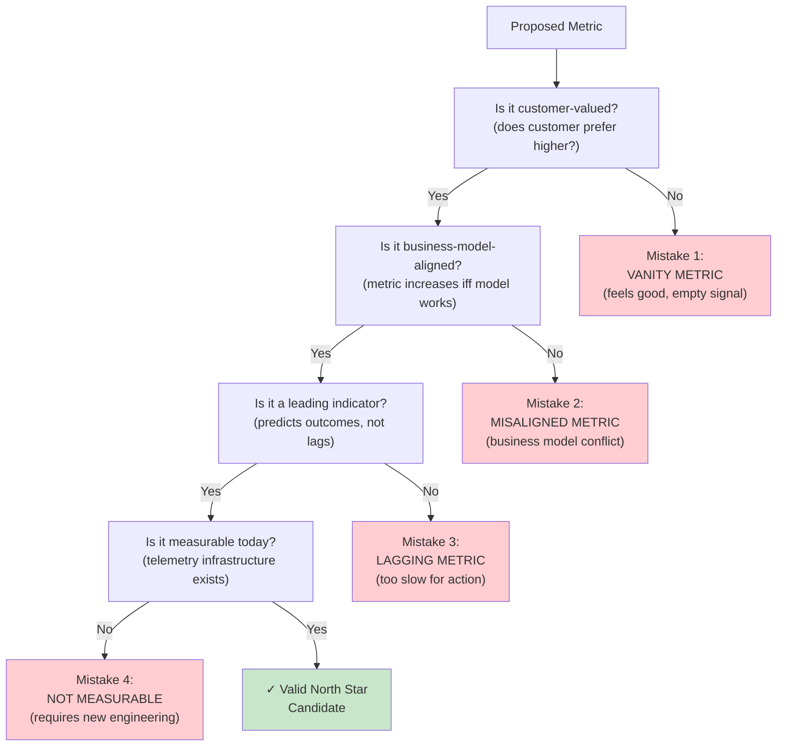

Now let's review the seven most common mistakes in North Star Metric selection and governance:

1. **Selecting a Metric That Is Not Actually Measurable**: "Customer Happiness" feels like a North Star, but it is inherently subjective. Use "Net Promoter Score (NPS)" or "Retention Cohort Survival" instead.

2. **Changing the Metric Definition Without Backfill or Versioning**: "DAU" used to mean "daily UI sessions" but now means "daily API calls." Historical comparisons become meaningless. Version the definition and backfill, or accept a discontinuity.

3. **Making Every Metric "Equally Important"**: If you have 5 North Star Metrics, you have zero. One. Metric. Per organization/product line.

4. **Punishing Teams for Metric Shortfalls Due to External Factors**: If DAU drops because a competitor launched an aggressive campaign, the team is not at fault. Distinguish between team-controlled and market-driven variance.

5. **Optimizing the Metric Without Guardrails**: Without [Metrics](CH24_Metrics.md#45-counter-metrics-and-guardrail-metrics) chapter's guardrails, teams will find unsustainable ways to increase the metric.

---

## 18. Best Practices

1. **Communicate the North Star Relentlessly**: Every all-hands meeting, every product review, every quarterly planning session should reference the North Star Metric. Consistency creates alignment.

2. **Decompose the North Star Into Accessible Sub-Metrics**: Do not make teams wait for monthly reporting. Publish daily/hourly dashboards of sub-components so teams can learn quickly.

3. **Celebrate Accurate Predictions**: When a team predicts the North Star will increase by X% and it does, celebrate that prediction accuracy. Learning emerges when predictions are repeatedly validated.

4. **Invest in Data Quality Infrastructure Early**: A broken North Star Metric definition or data pipeline is worse than no metric. Invest in schema contracts, data validation, and alerting before declaring the North Star live.

5. **Schedule Regular Lifecycle Evaluations**: Monthly reviews watch for anomalies. Quarterly strategic reviews check whether the metric still predicts business success. Annual evaluations decide whether a metric should evolve or retire.

---

## 19. Anti-Patterns

1. **The Vanity North Star**: Selecting a metric that feels good (total users, total revenue) instead of one grounded in customer value.

2. **The Zombie North Star**: Continuing to optimize a metric long after it has plateaued or market conditions have shifted (Section 15.1).

3. **The Umbrella Anti-Pattern**: Defining a single company North Star for a multi-product organization and expecting all products to align (Section 4.7, Common Failure Mode).

4. **The Dashboard Over Strategy**: Publishing a beautiful North Star dashboard without embedding the metric into decision-making processes. The dashboard becomes wall decoration, not a decision tool.

5. **The Disconnected Guardrails**: Defining a North Star without [Metrics](CH24_Metrics.md#45-counter-metrics-and-guardrail-metrics)-owned guardrail metrics, leading to perverse optimization.

---

## 20. Trade-off Analysis

| Trade-off | North Star Choice | Impact |
|---|---|---|
| **Speed vs. Depth** | "Daily Active Users" vs. "Retention Cohort Survival at 12 Weeks" | DAU provides faster feedback but is a leading indicator; retention is slower but a trailing indicator of true loyalty. Use DAU for rapid iteration, retention for strategic validation. |
| **Simplicity vs. Sophistication** | "Files Synced" vs. "Files Synced Adjusted for Quality & User LTV Weight" | Simple metrics are easier to communicate and optimize; weighted metrics are more predictive but require complex calculations and political consensus on weights. Start simple; add sophistication if gaming emerges. |
| **Universality vs. Personalization** | Single metric for all customers vs. personalized North Star per customer segment | Universal metric enables company-wide alignment but may mask segment-specific risks (high-value customer churn vs. low-value cohort growth). Use universal North Star for company alignment + guardrails by segment. |
| **Aggressiveness vs. Realism** | Stretch North Star target (+50% growth) vs. conservative target (+5% growth) | Aggressive targets inspire and focus effort but risk burnout and false negatives if they are hit by external tailwinds. Conservative targets are achievable but may miss upside. Use data-driven targets based on historical growth rates ± competitive context. |

---

## 21. Comparison Table

| Metric Type | Definition | Lifecycle | Best For | Limitations |
|---|---|---|---|---|
| **North Star Metric** | Single, org-wide proxy for customer value & business success | Stable across 12–36 months; rarely changes | High-growth companies, focused product orgs | Too abstract for individual teams; not actionable at team level |
| **OKR Key Results** | Quarterly team-level targets aligned to strategy | Revised every 3 months | Tactical execution, quarterly cycles | Risk of local optimization; quarterly horizon is too short for long-term thinking |
| **Guardrail Metrics** (from [Metrics](CH24_Metrics.md)) | Metrics that *must not* degrade as North Star improves | Always active; monitored alongside North Star | Preventing perverse optimization | Require explicit definition; do not guide positive action (only constrain) |
| **Proxy Metrics** | Sub-metrics that predict the North Star | Aligned to team level, faster feedback than North Star | Enabling team-level action and learning | Risk of misalignment if not validated against North Star |
| **Vanity Metrics** | Metrics that look good but do not predict business outcomes | Short-lived; abandoned when realization sinks in | None; anti-pattern | Waste time and mislead leadership |

---

## 22. Real-World Case Study

### Case Study: Slack's North Star Metric Evolution (2013–Present)

**Context**: Slack is a team communication platform competing against email and Basecamp. Founded in 2013, Slack needed a single metric that operationalized "people are using Slack to communicate more actively."

**Phase 1: Initial North Star (2013–2016)**
- **Metric**: "Messages Sent Per Day (DAU)"
- **Rationale**: More messages sent = users are actively communicating = higher engagement = higher retention and network effects.
- **Calculation**: Count of unique `user_ids` who sent ≥1 message per calendar day.
- **Result**: This metric grew from millions (2013) to billions (2016) as Slack grew and added customers.
- **Learning**: High DAU correlated strongly with customer retention and expansion (customers who sent more messages persisted longer and paid higher prices).

**Phase 2: Refinement (2016–2018)**
- **Challenge**: DAU was growing, but some new customer cohorts had low DAU despite high adoption (e.g., large enterprises with less-frequent communication patterns).
- **Refinement**: "Messages Sent Per Week-Active User (weekly active users who send ≥1 message per week)."
- **Result**: This sub-metric revealed segment-specific patterns (enterprises send fewer messages per day but are stickier; small teams send more messages).

**Phase 3: Multi-Metric Cascade (2018–Present)**
- **Challenge**: As Slack grew to multiple products (Slack App Marketplace, Slack Connect, Slack Huddles), a single DAU metric could not capture health across all products.
- **Evolution**: Layered North Star structure:
  - **Company North Star**: "Workspace Month-Over-Month Retention (% of customers active in month N who are active in month N+1)"
  - **Product-Line North Stars**:
    - Core Messaging: "Messages Sent Per DAU"
    - Integrations: "Third-Party Apps Installed Per Workspace"
    - Huddles (voice): "Huddle Participant Growth"
- **Result**: This cascade allowed Slack to optimize multiple products simultaneously without one cannibalizing the other.

**Key Lessons**:
1. A good North Star Metric is deeply grounded in customer behavior and business model (not arbitrary).
2. As markets mature and organizations grow, cascading North Stars prevent one product from overshadowing others.
3. Metric evolution is not failure; it is learning. Slack's evolution from simple DAU to segmented retention reflects growing sophistication about which behaviors predict success.

---

## 23. Interview Questions

1. **How would you select a North Star Metric for a new product line?** (Candidate should reference frameworks from Section 4.3: customer value, strategic alignment, opportunity-based.)

2. **Your North Star Metric is up 20% month-over-month, but customer churn is also up. What's happening?** (Candidate should recognize metric misalignment, propose guardrails, segment analysis.)

3. **A team proposes an OKR that is predicted to decrease the North Star Metric by 5%, but it is strategically important (compliance). How do you handle it?** (Candidate should reference Section 4.4 escalation paths, articulate the trade-off explicitly.)

4. **Your North Star Metric plateaued at 50M DAU after 18 months of aggressive optimization. What now?** (Candidate should walk through Section 4.6 lifecycle: evaluate saturation, consider evolution or retirement, look for hidden optimization levers.)

5. **In a multi-product organization, how do you prevent one product's North Star growth from cannibalizing another's?** (Candidate should propose cascade structure, cross-product guardrails, platform health metrics.)

---

## 24. Hands-on Exercises

**Exercise 1: North Star Selection Framework Application**

**Scenario**: You are joining a new fitness app startup. The company has built a workout-tracking mobile app and is deciding on a North Star Metric.

**Task**:
1. Identify the core job customers hire the app to do (using [Product Strategy](CH15_Product_Strategy.md#45-jobs-to-be-done-jtbd-customer-value-and-strategic-defensibility)'s JTBD framework).
2. Apply the three selection frameworks (Section 4.3: Contextual, Strategic, Opportunity-Based) to propose 3–5 candidate metrics.
3. Evaluate each against the four conditions (customer value, business model, leading signal, measurable).
4. Recommend a single North Star Metric and justify the selection.

**Expected Output**: A 1-page recommendation memo including metric definition, causal reasoning, and predicted business outcomes.

**Exercise 2: North Star Dashboard Design**

**Scenario**: Your organization has selected "Daily Active Users (DAU)" as the North Star Metric. Design a dashboard that enables all teams to understand and optimize the metric.

**Task**:
1. Propose a dashboard structure with:
   - Primary metric (DAU trend)
   - Sub-metrics (DAU by geography, by platform, new vs. returning)
   - Leading indicators (hourly active users to detect issues early)
   - Guardrails (churn rate, NPS, session satisfaction)
2. Define alert thresholds (e.g., "fire alert if DAU drops >5% day-over-day").
3. Propose a cadence for dashboard review (daily for ops, weekly for leadership, monthly for deep-dive).

**Expected Output**: A dashboard wireframe (sketch or tool) + decision-making playbook for each alert scenario.

**Exercise 3: North Star Cascade Construction**

**Scenario**: Your company operates three product lines: Payments, Fraud Detection, and Compliance. You want to cascade a company North Star Metric ("Annual Spend Per Merchant") down to product-line and team-level metrics.

**Task**:
1. Propose a cascade structure with:
   - Company North Star (already given).
   - Product-line North Stars for Payments, Fraud, and Compliance.
   - Team-level proxy metrics for each product line.
2. Validate the cascade: If all team metrics improve, will the product-line metrics improve? If all product-line metrics improve, will the company North Star improve?
3. Identify any gaps (metrics that are not under team control) and propose solutions.

**Expected Output**: A cascade diagram + validation checklist.

**Exercise 4: OKR-to-North-Star Arbitration**

**Scenario**: Your organization has a North Star Metric of "Monthly Active Users (MAU)," and you are evaluating the following Q3 OKRs:

- OKR A (Product): "Increase MAU by 15% through improved recommendation algorithm" (predicted North Star impact: +12%).
- OKR B (Monetization): "Increase ARPU by 25% through tiered pricing" (predicted North Star impact: –8% if base-tier pricing increases cause churn).
- OKR C (Infrastructure): "Migrate to multi-region deployment" (predicted North Star impact: 0%, but enables future North Star growth).

**Task**:
1. For each OKR, apply the arbitration framework from Section 4.4 (Strong Alignment, Weak Alignment, Orthogonal, Conflicting).
2. Recommend a prioritization order for Q3.
3. For conflicting OKRs, propose renegotiations that increase alignment with the North Star.

**Expected Output**: A prioritization table + renegotiation proposals.

---

## 25. Design Exercises

**Design Exercise 1: Emergency Response to North Star Crisis**

**Scenario**: It is Monday morning. Your North Star Metric (DAU) dropped 25% over the weekend. You have 2 hours before an all-hands meeting where leadership expects answers.

**Task**:
1. Design an emergency diagnostic process:
   - Which data will you pull first to identify the root cause?
   - Which teams do you immediately contact?
   - What hypotheses are you testing first?
2. Propose a communication plan for the all-hands meeting (transparency vs. panic management).
3. Design a 48-hour incident response roadmap.

**Expected Output**: An incident response runbook and escalation matrix.

**Design Exercise 2: Multi-Product North Star Governance**

**Scenario**: Your company is expanding from 1 product to 3 products over the next 12 months. Currently, there is one North Star Metric. Design a governance structure that prevents one product from dominating the others while ensuring alignment.

**Task**:
1. Propose a multi-tier North Star structure (company, product-line, team).
2. Design a monthly governance meeting agenda that reviews all tiers.
3. Create explicit rules for arbitration when product-line metrics conflict (e.g., Compute vs. Storage customer acquisition).

**Expected Output**: Governance charter + sample meeting agendas.

**Design Exercise 3: North Star Metric Transition**

**Scenario**: Your North Star Metric has been "Daily Active Users" for 24 months, and it has plateau at 50M DAU. You want to transition to a new North Star: "Average Session Engagement Score (quality-weighted DAU)." Design the transition plan.

**Task**:
1. Plan a 3-month dual-tracking phase:
   - How will you communicate the transition to all teams?
   - How will you backfill historical data for the new metric?
   - What cadence for reassessing the new metric?
2. Design the formal cut-over decision (when does the new metric become canonical?).
3. Propose a retrospective process to learn from the old metric.

**Expected Output**: Transition plan + communication timeline + success criteria.

---

## 26. Architecture Review Questions

1. **North Star Metric Selection**: Is the chosen North Star Metric grounded in customer value, business model, and strategy (Section 4.3 frameworks), or does it feel like a convenient proxy?

2. **Telemetry Foundation**: Does the organization have the telemetry infrastructure to calculate the North Star Metric reliably (Section 4.2), or is it selecting a metric that requires new engineering work?

3. **Cascade Alignment**: If the organization has multiple products, is the North Star structure (company-level, product-line, team-level) designed to prevent cannibalization (Section 4.5)?

4. **OKR Synchronization**: Do the governance forums (Section 5.2) explicitly evaluate OKRs on predicted North Star impact, or do OKRs and North Star optimization drift into conflict?

5. **Lifecycle Planning**: Has the organization established a cadence for evaluating the North Star Metric's continued relevance (Section 4.6), or will the metric live forever regardless of market conditions?

6. **Guardrail Protection**: Are guardrail metrics ([Metrics](CH24_Metrics.md#45-counter-metrics-and-guardrail-metrics) chapter) monitoring to prevent perverse optimization of the North Star (Section 15.3)?

---

## 27. Summary

A North Star Metric is the single, quantitative focal point that aligns an organization's product, engineering, and business decisions toward a shared definition of success. Unlike the broader [Metrics](CH24_Metrics.md) chapter's focus on instrumentation architecture and metric taxonomy, this chapter teaches the organizational and strategic discipline of *selecting, cascading, governing, and evolving* a single metric that operationalizes customer value and business strategy.

**Key takeaways**:

- **Singularity Over Dashboards**: One North Star Metric focuses organizational energy; a dashboard of ten metrics diffuses it. Accept the trade-off.
- **Customer Value Grounding**: Select a metric that answers "what job do customers hire our product to do?" Section 4.3 frameworks ensure the metric is grounded in reality, not executive intuition.
- **Cascading Without Mandate**: The North Star flows from company strategy down through product lines and teams, but it does not impose a top-down mandate. Team-level proxy metrics enable local action while maintaining alignment.
- **Synchronized with OKRs**: North Star optimization and quarterly OKRs serve different purposes (long-term alignment vs. short-term execution). Section 4.4 teaches explicit arbitration rules to prevent drift.
- **Lifecycle Discipline**: A North Star Metric is not static. Section 4.6 teaches how to evolve or retire a metric when market conditions change or saturation signals emerge.
- **Telemetry is Non-Negotiable**: A North Star Metric without reliable telemetry (Section 4.2) becomes a political debate, not an empirical signal. Invest in data quality early.

Organizations that successfully implement North Star Metrics report dramatically improved product team alignment, faster decision-making, and reduced "feature factory" waste. The metric itself is not magic — the discipline of *selecting and maintaining* the metric is what drives results.

---
