# Chapter 26: Experimentation

Part: [02 — Design Thinking and Product Management](PART_OVERVIEW.md) · Subsection: Product Management · Status: Drafted

## 1. Introduction

Experimentation is the systematic, hypothesis-driven practice of testing strategic assumptions and product changes in controlled production environments to collect empirical evidence of causal relationships between engineering decisions and measurable user outcomes. Far from being a "nice-to-have" analytics feature, experimentation infrastructure is a foundational architectural concern that determines whether product and engineering organizations build features based on data, intuition, or cargo-cult feature parity.

Within a modern solution architecture, experimentation serves as the bridge between ideation (see [Ideation](CH07_Ideation.md)), rapid prototyping (see [Rapid Prototyping](CH08_Rapid_Prototyping.md)), and market validation. While Rapid Prototyping tests *learning velocity* in controlled environments, and the MVP (see [Minimum Viable Product](CH23_MVP.md)) validates core value hypotheses with real users, experimentation enables *continuous, incremental* hypothesis testing at scale. It transforms product development from a stage-gate, waterfall-like phase of "build everything, release once, measure surprise" into a continuous, iterative feedback loop where every feature release or user experience change is treated as a structured test with explicit pre-registered success criteria.

For software architects and engineering leaders, the design of an experimentation platform presents three critical challenges:

1. **Architectural Integration:** Experimentation infrastructure must be woven into the application architecture from day one, not bolted on afterwards. This includes randomization primitives, treatment assignment logic, telemetry correlation, and conflict management for concurrent experiments.
2. **Statistical Rigor vs. Iteration Velocity:** Engineering teams often rush to interpret results without sufficient sample size, statistical power, or control for confounding variables. Simultaneously, slow experimentation cycles (weeks to launch a test, weeks to analyze results) defeat the purpose of rapid learning.
3. **Governance and False Discovery:** Without discipline, a product organization running dozens of concurrent experiments rapidly generates false positives and "learning" that contradicts prior validated knowledge. Experimentation governance must establish sequential testing frameworks, multiple-comparison corrections, and confidence thresholds.

This chapter teaches experimentation methodology from first principles to expert level. It covers hypothesis formulation (moving from vague hunches to falsifiable statements), experimental design (randomization, control groups, treatment allocation), statistical foundations (sample-size calculation, power analysis, confounding variables), sequential testing frameworks, data collection architecture, result interpretation, and experimentation governance. Critically, this chapter *defers* A/B Testing statistical implementation details—effect-size estimation, sequential testing mathematics, and stopping rules—to [A/B Testing](CH27_AB_Testing.md), which focuses on the computational and mathematical machinery.

---

## 2. Historical Evolution

The practice of experimentation in product development has evolved across distinct industrial and organizational paradigms:

1. **Pre-Digital Manufacturing and Formal Experimental Design (1920s–1960s):** Ronald Fisher pioneered formal experimental design methodology in agriculture, introducing the principles of randomization, control groups, and statistical significance testing. Manufacturing organizations adopted these methods for process optimization, but software product development did not exist in its modern form.

2. **Monolithic Software Release Cycles and Post-Hoc Analysis (1980s–1990s):** Early software organizations deployed changes in infrequent, monolithic releases. "Experimentation" consisted of internal testing, user acceptance testing (UAT), and post-release support calls. No structured mechanism existed to test competing hypotheses against real user populations without deploying to all users.

3. **Web Infrastructure and Early A/B Testing (2000–2008):** High-traffic web properties (Amazon, Google, LinkedIn) developed internal A/B testing platforms to test hypotheses on percentages of real traffic. However, these systems remained proprietary, and statistical rigor was not yet standardized. Organizations frequently misinterpreted results due to multiple comparisons, peeking at results before statistical power was achieved, and seasonal confounds.

4. **Lean Startup and Continuous Hypothesis Testing (2008–2013):** Eric Ries formalized the Build-Measure-Learn feedback loop, positioning experimentation as a core business capability. Thought leaders like Patrick Collison (Stripe) and Andrew Chen (Uber) popularized "experimentation culture" and formalized the need for experimental governance. However, many organizations still lacked rigorous statistical infrastructure.

5. **Modern Platform-Native Experimentation (2014–Present):** Today, cloud-native platforms, event-driven telemetry, and statistical computing services enable enterprises to conduct hundreds of concurrent experiments per week. Companies like Microsoft, Amazon, Netflix, and Google publish frameworks like ExP (Experimentation Platform), A/A testing for bias detection, and sequential testing to shorten experiment duration. Experimentation is now a structural competitive advantage in fast-moving tech and commerce organizations.

---

## 3. Why It Exists

Experimentation infrastructure exists to solve three fundamental problems in product development:

1. **Elimination of Assumption-Driven Development:** Absent experimentation, product decisions are driven by stakeholder opinion, false consensus, historical precedent, or benchmark cargo-culting ("our competitor did this, so we should too"). Experimentation grounds decisions in empirical evidence, reducing the prevalence of expensive false positives.

2. **Measurement of Causal Impact at Scale:** Observational data (e.g., "users who adopted feature X have higher retention") conflates causation and correlation. Uncontrolled confounds (e.g., feature power users are inherently more engaged) lead to distorted effect estimates. Randomized experiments establish causal attribution: *if we roll out feature X to a random population subset, how much does outcome Y change?*

3. **Acceleration of Product Learning Velocity:** Without experimentation discipline, organizations defer feature validation until post-launch, when reverting or fixing a bad decision is expensive and disruptive. Experimentation-driven development collapses time-to-learning from weeks (or months) to days (or hours), enabling teams to validate or refute assumptions before committing engineering capacity.

4. **Risk Mitigation and Negative-Result Detection:** Not every feature hypothesis is correct. Experimentation infrastructure enables organizations to detect and rapidly *revert* negative changes (e.g., unexpected churn, API failures, compliance breaches) before they cascade to entire user populations. This "circuit breaker" function is critical for maintaining platform stability while innovating.

---

## 4. Core Concepts

Section 4 teaches the core conceptual models of experimentation infrastructure. Each concept is explained in first-principles depth: definition, mechanism (how it works), decision implications (when/why to apply it), common failure modes, and concrete scenarios.

### 4.1 Hypothesis Formulation and Falsifiability

#### Definition

A **hypothesis** in experimentation is a testable, falsifiable claim about the relationship between an engineering or product change (the independent variable) and a measurable user outcome (the dependent variable). Hypotheses must be stated with sufficient precision that an experiment can definitively prove them false or true.

#### Mechanism

Well-formed hypotheses follow a standard template:
```
IF we [engineering change / treatment description]
THEN [measurable outcome] will change by [direction + magnitude]
BECAUSE [causal mechanism]
```

For example:
- **Weak:** "Reducing checkout page latency will improve conversion."
  - Problem: "improve" is vague (1%? 10%? $1M?). "Latency reduction" is unquantified.
  
- **Strong:** "IF we reduce checkout page API latency from 800ms to 200ms (4x speedup) THEN checkout completion rate will increase by ≥2 percentage points (from 68% to 70%), BECAUSE users abandoning due to perceived timeout friction will complete the purchase."
  - Why this works: Specific treatment (800ms→200ms), specific outcome (percentage-point lift), quantified success threshold (≥2pp), and articulated causal mechanism (timeout abandonment).

#### Decision Implications

The quality of hypothesis formulation determines the fidelity of experimental design and the actionability of results. Vague hypotheses lead to underpowered experiments, post-hoc interpretation, and wasted engineering capacity. Before launching an experiment, architects and product managers must validate that:

1. The outcome metric is measurable with sufficient statistical power (see Section 4.5).
2. The treatment is implementable within engineering constraints.
3. The success threshold is linked to business impact (not just statistical significance).
4. Alternative causal mechanisms have been considered and ruled out by prior research or prototyping.

#### Common Failure Mode

**Hypothesis Creep and Post-Hoc Interpretation:** An experiment launches with one primary hypothesis ("Hypothesis: checkout latency reduction → conversion lift"). After results arrive, stakeholders reinterpret the data to support a secondary hypothesis ("Actually, latency reduction increases task completion confidence, which correlates with higher average order value"). Post-hoc hypothesis generation inflates the false-positive rate and violates the foundational principle of pre-registration.

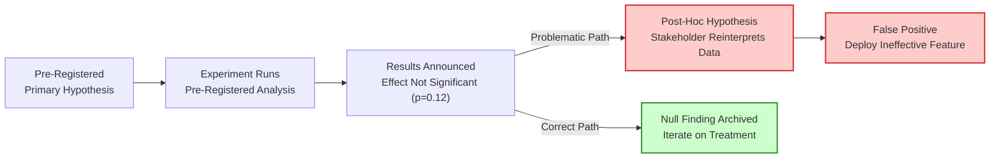

#### Concrete Scenario

An e-commerce platform tests whether a "Trust Badge" (displaying security certifications and customer review aggregates) on the product detail page increases conversion. The weak hypothesis: "Trust badges will increase conversion." The strong hypothesis: "IF we display a Trust Badge module (PCI-DSS certification + 4.8★ average rating) on product detail pages for price-sensitive product categories (sub-$50 items) THEN checkout completion rate will increase by ≥3 percentage points for price-sensitive SKUs (product keep-alive units), BECAUSE users exhibit heightened purchase hesitation in the sub-$50 category due to price-fit concerns, and social proof (reviews + certification) reduces perceived risk and abandonment."

The strong formulation enables the experiment to detect whether the effect is category-dependent, and allows the team to pre-register success criteria before seeing data.

---

### 4.2 Treatment Randomization and Assignment Strategies

#### Definition

**Randomization** is the process of assigning subjects (users, sessions, devices, or organizations) to distinct experimental treatment conditions (control group, variant A, variant B, etc.) using probabilistic allocation, such that every subject has an equal, known, and non-zero probability of assignment to each condition.

#### Mechanism

Randomization eliminates systematic bias in treatment assignment. Without randomization, groups become self-selected: early adopters, power users, or users arriving during peak hours may preferentially receive a new feature, confounding its effect with inherent user activity or engagement.

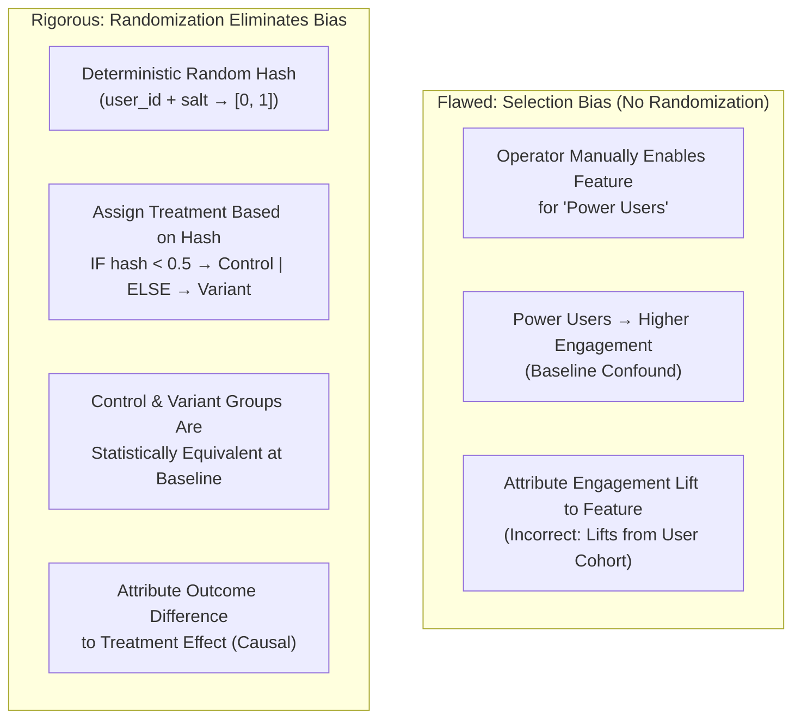

#### Decision Implications

Architects must embed randomization logic into the application at the correct **unit of randomization** (the entity to which a stable treatment is assigned):

- **User-level randomization:** Each user receives a consistent treatment across all sessions. Use for sticky, account-level changes (UI redesigns, recommendation algorithms, pricing tiers).
- **Session-level randomization:** Each session gets an independent random treatment. Use for ephemeral, one-time decisions (email subject line variations, ad creative).
- **Device-level randomization:** Each device/browser receives a stable treatment. Use when user identity is unavailable (e.g., anonymous web traffic).
- **Organization/Account-level randomization:** Entire organizations (B2B) receive a single treatment. Use to prevent user-level interference and preserve team collaboration semantics.

Common implementation error: Randomizing at the session level for a treatment that should be stable at the user level. Result: A single user receives different variants on different days, confounding day-of-week effects with the treatment effect.

#### Common Failure Mode

**Determinism Fragility:** A team implements randomization using `Math.random()`, which is non-deterministic and non-reproducible across service restarts. The same user receives variant A on Monday and variant B on Tuesday. The result: noisy, unreliable treatment assignments and inability to debug or replay experiment conditions.

**Solution:** Use deterministic hashing: `treatment = hash(user_id + experiment_salt) % num_variants`. Ensures stable, reproducible, and auditable treatment assignment.

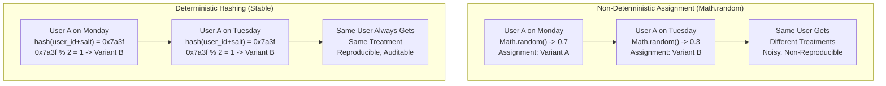

#### Concrete Scenario

A SaaS product launches an experiment to test whether a "Recommended Next Step" coaching widget increases feature adoption. The product team initially randomizes at the session level, inadvertently assigning each user to multiple variants. After discovering the error, they switch to user-level randomization using a salted hash: `treatment = Math.floor(murmurhash(user_id + "exp_001") % 2)`. Variant A receives the widget; Variant B (control) does not. Within one week, adoption rate in Variant A exceeds control by 18 percentage points, with 95% confidence.

---

### 4.3 Control Groups and Counterfactual Construction

#### Definition

A **control group** is the experimental condition against which all other treatments are measured. It represents the **counterfactual**: the outcome that would have occurred had the treatment not been applied. The control group is typically the *status quo* (no change) or an *existing implementation* (when A/B testing against an incumbent).

#### Mechanism

The fundamental equation of causal inference in experimentation:


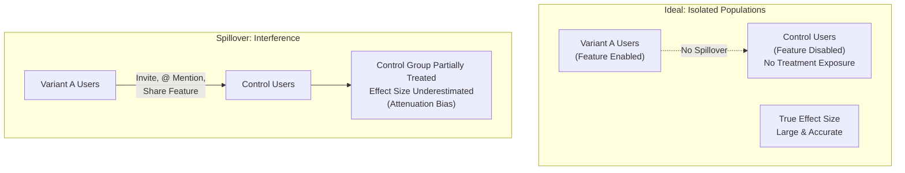
$$\text{Treatment Effect} = \text{Outcome}_{\text{Treatment}} - \text{Outcome}_{\text{Control}}$$

This assumes that the treatment and control groups are statistically identical at baseline (randomization) and that no unobserved confounds exist (stable unit treatment value assumption, or SUTVA). Violations of these assumptions inflate or deflate the estimated effect size.

#### Decision Implications

Architects must decide whether the control group is:

1. **Pure Control (No Treatment):** The control receives zero feature exposure or the legacy implementation. Appropriate for feature launches (e.g., a new onboarding flow) or performance changes (e.g., latency reduction).

2. **Active Control (Incumbent Challenger):** The control receives the current implementation; the treatment receives a competing alternative. Appropriate for redesigns (e.g., old checkout flow vs. new checkout flow) where removing the feature entirely is not a valid option.

3. **Holdout / Temporal Control:** For tests that cannot be randomized across concurrent populations, a holdout control is the *same population at a prior time*. This is weaker but sometimes necessary (e.g., testing a pricing change across a platform with shared infrastructure).

Common error: Assuming that historical baseline metrics from before the experiment can serve as a control group. Temporal confounds (seasonality, external events, user population drift) invalidate this assumption.

#### Common Failure Mode

**Control Group Collapse and Diffusion:** If treatment and control groups can interact (e.g., friends in variant A invite friends in control to use a new feature), the control group's outcome shifts toward the treatment, making the effect appear smaller than it truly is. This is called **interference** or **spillover**.

#### Concrete Scenario

A messaging platform tests a "Reply All to Thread" feature by randomizing users into variant A (feature enabled) and control B (feature disabled). However, users in variant A can @ mention control-group users, inadvertently exposing them to the feature. As a result, the observed effect size (20% increase in reply rate) is smaller than the true effect (35% increase) because control-group behavior was partially treated by spillover.

---

### 4.4 Sample-Size Calculation and Statistical Power

#### Definition

**Statistical power** is the probability that an experiment will correctly reject a null hypothesis (no effect) *when the true effect exists*. **Sample size** is the number of subjects (users, sessions) needed to achieve a target power level (typically 80% or 90%).

#### Mechanism

Sample size depends on four quantities:

1. **Effect Size (δ):** The magnitude of the treatment effect you expect or wish to detect. Smaller effects require larger sample sizes.
2. **Baseline Conversion Rate (p):** The control-group outcome rate. For binary outcomes (converted vs. not), this is critical.
3. **Significance Level (α):** The probability of a false positive (Type I error). Conventionally 0.05 (5% risk).
4. **Statistical Power (1 - β):** The probability of a true positive (1 minus Type II error risk). Conventionally 0.80 or 0.90.

**For binary outcomes (conversion-style metrics):**

$$n = \frac{2 \cdot (z_{\alpha/2} + z_{\beta})^2 \cdot p \cdot (1 - p)}{(\delta)^2}$$

Where:
- $z_{\alpha/2}$ is the critical value for significance level (1.96 for 5%).
- $z_{\beta}$ is the critical value for power (0.84 for 80% power).
- $p$ is baseline conversion rate.
- $\delta$ is the absolute effect size (lift in percentage points).

**Example:** A checkout team wants to test whether a simplified payment form increases checkout completion from 65% to 68% (3 percentage-point lift). With α=0.05 and power=0.80:

$$n = \frac{2 \cdot (1.96 + 0.84)^2 \cdot 0.65 \cdot 0.35}{(0.03)^2} \approx 3,400 \text{ users per group}$$

At 100,000 users/day, achieving significance requires ~34 days of traffic allocation.

#### Decision Implications

1. **Detecting Small Effects is Expensive:** Wanting to detect a 1pp lift instead of 3pp lift increases sample size by 9x (quadratic relationship to effect size). Product teams must justify whether the effort to detect small effects is worth the extended experiment duration.

2. **High-Traffic Features Allow Shorter Experiments:** High-traffic features (e.g., homepage, login page) reach required sample sizes in days. Low-traffic features (e.g., enterprise admin panel) may require months, making experimentation infeasible and favoring qualitative validation instead.

3. **Sequential Analysis Shortens Experiment Duration:** Instead of fixing the sample size upfront, sequential testing (see Section 4.6) allows early stopping when results reach significance, reducing average experiment duration by 50% without inflating false-positive rates.

#### Common Failure Mode

**Underpowered Experiments and Type II Errors:** A team runs a test with insufficient sample size, observing a 1.5pp lift with 60% power (40% risk of Type II error). They declare the test inconclusive and move on. In reality, the true effect was 2pp, but the experiment was too small to detect it reliably. Repeated underpowered experiments waste engineering cycles and product velocity.

#### Concrete Scenario

A mobile app team tests whether eliminating 3 form fields in the sign-up flow increases activation rate from 45% to 48% (3pp lift). A power calculation reveals they need 5,000 users per group. At 10,000 new sign-ups per day, they allocate 50% to each group, reaching significance in 1 day. Results show a 2.8pp lift with 95% confidence. Because they pre-registered the sample size and success threshold, the result is credible and actionable.

---

### 4.5 Confounding Variables and Internal Validity

#### Definition

A **confounding variable** is a factor that changes systematically between treatment and control groups (independent of the treatment) and also causally influences the outcome, thereby creating a spurious association between treatment and outcome.

#### Mechanism

In well-randomized experiments, confounding should not exist by definition: randomization distributes confounds equally across treatment and control groups. However, confounds can emerge through:

1. **Violation of Randomization Integrity:** Treatment assignment logic contains bugs or is overridden manually by operators.

2. **Temporal Confounds:** The experiment runs across a holiday, app update, or external event that affects treatment and control differently (e.g., Black Friday email campaigns go out to control but not variant).

3. **Cohort Effects:** User composition systematically differs between groups (new users in variant A, power users in control B) due to randomization executed incorrectly at a different unit than intended.

4. **Selection into Treatment Post-Randomization:** Users in variant A opt into a feature (e.g., notification settings), while control remains passive. The outcome then reflects self-selection, not treatment effect.

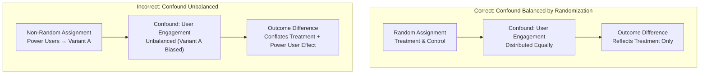

#### Decision Implications

Architects must:

1. **Verify Randomization Fidelity:** Audit treatment-assignment logs to confirm that every eligible subject was randomized according to the prescribed algorithm.

2. **Conduct Balance Checks:** Compare treatment and control groups on observable baseline characteristics (e.g., prior session count, geography, device type). Statistically significant imbalances indicate randomization failure.

3. **Anticipate Temporal Confounds:** Schedule experiments to avoid holidays, system maintenance windows, and known seasonal patterns. Document external events during the experiment period for sensitivity analysis.

4. **Pre-Specify Blocking/Stratification:** For known confounds (e.g., user geography, device type), use stratified randomization to ensure balanced treatment allocation within each stratum.

#### Common Failure Mode

**Simpson's Paradox:** An aggregate effect appears in one direction, but stratified effects point in the opposite direction. Example: Variant A shows +2pp overall lift, but +5pp lift within US users and -3pp lift within EU users. The aggregate effect masks a critical interaction: the treatment effect is negative in EU due to a regulatory confound (GDPR consent flow differences).

#### Concrete Scenario

A platform tests a new recommendation algorithm (variant A) against the legacy algorithm (control). Aggregate results show +1.5pp engagement lift. However, stratified analysis reveals: US users +3.2pp, EU users -1.1pp, APAC users +0.8pp. Investigation finds that EU users encounter a GDPR consent banner during the new recommendation flow that adds friction, negating the algorithm benefit. Engineers redesign the GDPR integration and rerun the experiment with positive results across all regions.

---

### 4.6 Sequential Testing and Adaptive Designs

#### Definition

**Sequential testing** is an experimental methodology in which statistical power and significance are monitored continuously (or at pre-planned interim checkpoints) during an experiment, with the option to stop early if results reach statistical significance or futility thresholds, without inflating the false-positive rate.

#### Mechanism

Conventional (fixed-sample) A/B testing specifies the sample size upfront and analyzes results once after reaching that target. Sequential testing allows multiple interim analyses, with a critical adjustment: each interim analysis uses a lower significance threshold (e.g., α=0.01 instead of 0.05 for the first interim, α=0.04 for the second) to maintain an overall false-positive rate of 5%.

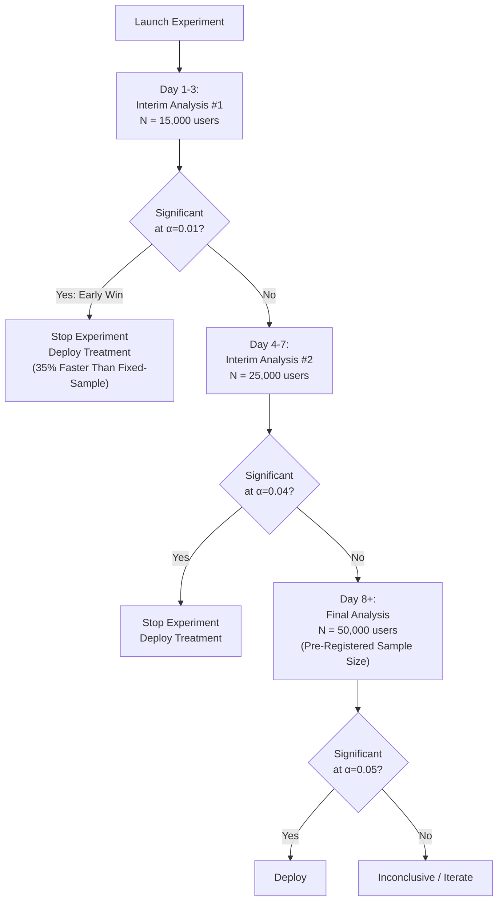

#### Decision Implications

Sequential testing is particularly valuable for:

1. **High-Traffic Features:** When reaching fixed sample sizes takes only days, early stopping provides minimal velocity improvement. However, sequential testing shines for low-traffic features or long-horizon outcomes where the baseline experiment duration exceeds 30 days.

2. **Obvious Negatives:** If an experiment induces a severe regression (e.g., API error spike, revenue cliff), sequential testing allows early stopping to prevent customer harm.

3. **Regulatory / Compliance Constraints:** For treatments that may have unintended consequences (e.g., pricing changes, algorithmic bias), sequential testing allows early stopping to minimize exposure.

#### Common Failure Mode

**Peeking and False Positives:** Without statistical correction, continuously monitoring results and stopping early when significance is reached inflates the false-positive rate to 20-30% (instead of 5%). Teams that "peek" at results daily and stop early without a formal sequential testing framework systematically over-estimate treatment effects and deploy harmful changes.

#### Concrete Scenario

A payment platform tests a new fraud-detection model (variant A) against the legacy model (control). Rather than waiting 30 days for a fixed-sample test, they implement a group-sequential design with three interim analyses:

- **Day 7:** N = 10M transactions, fraud rate: Variant 0.8%, Control 1.2%, p < 0.01. Early stop, deploy variant.
- **Result:** The platform deployed a significant improvement 23 days faster than the fixed-sample approach, preventing millions in fraud losses.

---

### 4.7 Experimentation Governance and Multiple-Comparison Correction

#### Definition

**Experimentation governance** is the organizational framework and statistical discipline that prevents false discovery, maintains experimental integrity, and scales experimentation culture across teams without inflating the false-positive rate or contradicting prior knowledge.

#### Mechanism

The challenge: An organization running hundreds of concurrent experiments (even with 95% significance threshold) will accumulate false positives at an alarming rate. With 100 independent experiments, the probability of at least one false positive is $1 - (0.95)^{100} \approx 99.4\%$.

Governance mechanisms include:

1. **Multiple-Comparison Correction:** Apply statistical adjustments (Bonferroni, Benjamini-Hochberg FDR) to lower per-comparison significance thresholds when running multiple simultaneous experiments. Example: With 100 concurrent experiments and Bonferroni correction, each individual test uses α = 0.05/100 = 0.0005 to maintain 5% false-positive rate overall.

2. **Pre-Registration Discipline:** All hypothesis, success metrics, and analysis plans must be registered *before* data collection. Post-hoc metric selection or hypothesis generation ("HARKing" — Hypothesizing After Results are Known) introduces massive false-positive inflation.

3. **Experiment Reservation System:** Assign experiment "slots" to ensure orthogonality (non-overlapping traffic allocations) and prevent conflicts where multiple experiments unintentionally test on the same user cohort or metric.

4. **Replication and Holdout Validation:** Do not deploy a treatment based on a single experiment. Replicate in new cohorts, across geographies, and over time horizons to confirm robustness.

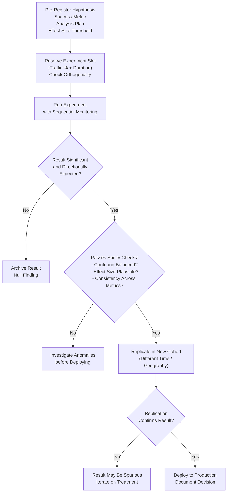

#### Decision Implications

Architects must:

1. **Embed Pre-Registration:** Require that hypothesis, success criteria, and sample-size calculations are submitted and approved *before* treatment deployment.

2. **Centralize Experiment Conflict Resolution:** Use a shared registry (e.g., Experiment Management System) to track all concurrent experiments, their traffic allocations, and their tracked metrics to prevent interference.

3. **Establish Confidence Thresholds:** Define organizational standards (e.g., 95% confidence for reversible decisions, 99% for irreversible changes like pricing).

4. **Publish Null Findings:** Maintain a repository of negative or inconclusive experiments to prevent redundant testing and improve organizational learning.

#### Common Failure Mode

**Metric Proliferation and p-Hacking:** A team pre-registers one success metric, but analyzes 20 secondary metrics post-hoc. They find that 2 of the 20 metrics show p < 0.05, and declare success. With 20 independent tests and α = 0.05 per test, the false-positive rate is roughly 1 - (0.95)^20 ≈ 64%. The "successful" metrics are likely false positives, not true treatment effects.

#### Concrete Scenario

A product organization implements an Experiment Management System that:
1. Requires pre-registration of hypothesis, success metrics, and sample size.
2. Automatically checks for traffic conflicts and metric overlap across concurrent experiments.
3. Enforces statistical corrections for multiple comparisons (Benjamini-Hochberg FDR, q < 0.10).
4. Requires replication of significant results in an independent cohort before deployment decisions are made.

Result: False-positive rate drops from 18% (pre-governance) to 4% (post-governance), and average experiment deployment confidence improves to 95%.

---

## 5. Internal Working

Experimentation infrastructure must be integrated into the application architecture at multiple layers: treatment assignment, telemetry correlation, result analysis, and deployment orchestration.

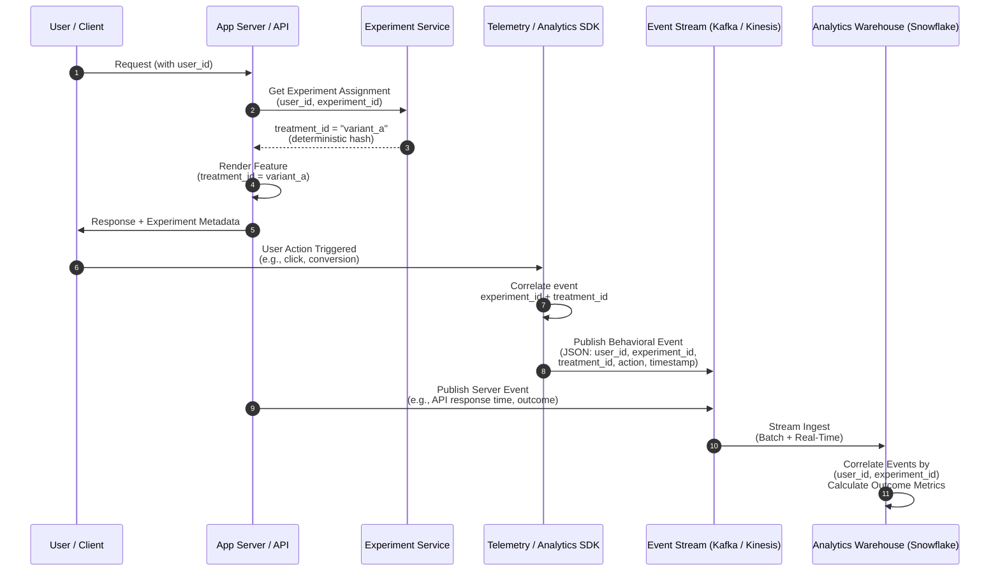

### 5.1 Treatment Assignment Architecture

The **experiment assignment service** (or "experiment resolver") assigns users to treatments deterministically and reliably:

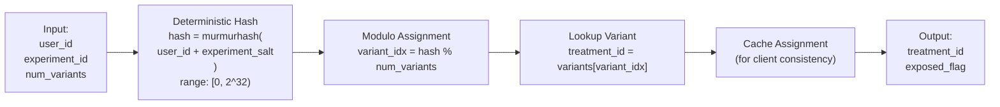

**Key properties:**

- **Deterministic:** Same (user_id, experiment_id) → Same treatment across all calls.
- **Uniformly Random:** Each variant receives approximately equal traffic (subject to rounding).
- **Salted:** Experiment salt ensures that the same user receives different treatments across different experiments.
- **Conflict-Free:** Orthogonal salt usage prevents concurrent experiments from interfering.

### 5.2 Telemetry Correlation and Event Schema

Every behavioral or operational event must carry metadata linking it back to the experiment and treatment:

```
{
  "event_id": "uuid-12345",
  "timestamp": "2025-03-15T14:23:45.123Z",
  "user_id": "user-abc123",
  "session_id": "session-xyz789",
  
  // Experiment context
  "experiment_id": "exp_checkout_simplification",
  "treatment_id": "variant_a",
  "experiment_exposed": true,  // Whether user saw the treatment
  
  // Event data
  "event_type": "checkout_conversion",
  "properties": {
    "order_value": 89.99,
    "items_count": 3,
    "payment_method": "credit_card",
    "time_to_checkout_seconds": 187
  }
}
```

Telemetry schema contracts ensure:

1. **Consistency:** Every event carries experiment metadata, enabling reliable cohort segregation.
2. **Deduplication:** Event IDs prevent accidental double-counting.
3. **Temporal Accuracy:** UTC timestamps enable causal ordering.
4. **Correlation:** `session_id` links client and server events.

---

## 6. Design Principles

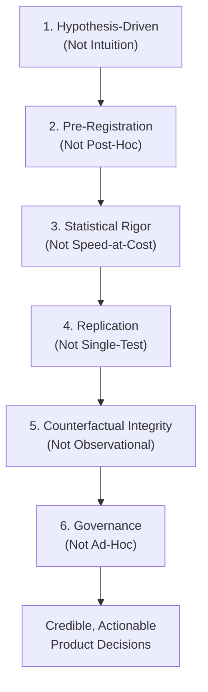

1. **Hypothesis-Driven Over Intuition-Driven:** Every feature change should be preceded by an explicit, falsifiable hypothesis. Intuition-driven development leads to wasted effort and false positives.

2. **Pre-Registration Over Post-Hoc Analysis:** Success metrics, sample sizes, and stopping rules must be specified *before* data collection. Post-hoc analysis generates false positives.

3. **Statistical Rigor Over Velocity:** Underpowered experiments waste engineering effort and create false confidence. Prioritize sample-size adequacy and multi-comparison correction over speed.

4. **Replication Over Single Test:** A single experiment can be a statistical fluke. Require replication in independent cohorts, geographies, or time horizons before deployment.

5. **Counterfactual Integrity Over Observational Inference:** Randomized experiments establish causality; observational correlations do not. Avoid inferring treatment effects from non-randomized cohort comparisons.

6. **Governance Over Ad-Hoc Experimentation:** Centralized experiment management, pre-registration, conflict detection, and false-discovery correction are non-negotiable at scale.

---

## 7. Architecture Patterns

### 7.1 Centralized Experiment Assignment Service

A dedicated microservice or feature-flag service (e.g., LaunchDarkly, Unleash, Configcat) manages treatment assignment, caching, and conflict resolution for all experiments.

**Advantages:**
- Single source of truth for treatment logic.
- Rapid deployment and rollback of experiments.
- Centralized monitoring of assignment consistency.

**Challenges:**
- Critical-path latency (must respond in <50ms).
- Cache invalidation and consistency across frontends.

### 7.2 Event-Driven Telemetry Correlation

Behavioral events (client-side actions) and operational events (server-side outcomes) are published to a message bus (Kafka, Kinesis) with consistent experiment metadata, enabling later correlation in analytics warehouse.

**Advantages:**
- Decoupled, asynchronous architecture.
- Immutable event log for auditability and reprocessing.
- Supports real-time dashboarding and sequential analysis.

**Challenges:**
- Event schema evolution and backward compatibility.
- Ensuring deterministic event deduplication.

---

## 8. Production Architecture

Experimentation platforms in production environments must address:

1. **Scale:** Assigning treatments and tracking events for millions of users requires high-throughput, low-latency assignment services and stream processing.

2. **Consistency:** Treatment assignment must be identical across web, mobile, and backend clients.

3. **Failsafety:** If the experiment service fails, the system must gracefully fall back to control or cached assignments, not break user-facing flows.

4. **Governance:** Audit trails, pre-registration workflows, and automatic conflict detection prevent rogue experiments.

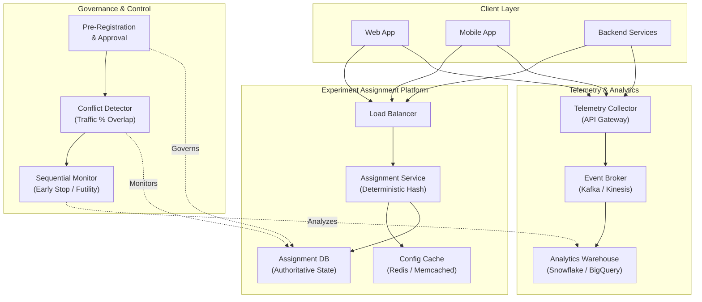

---

## 9. Implementation

### 9.1 Treatment Assignment in Python (FastAPI)

```python
import hashlib
from enum import Enum

class ExperimentService:
    def __init__(self, salt_registry: dict):
        # salt_registry maps experiment_id -> salt_value
        self.salt_registry = salt_registry
    
    def get_treatment(self, user_id: str, experiment_id: str, 
                     num_variants: int) -> str:
        """
        Deterministically assigns user to a treatment variant.
        
        Args:
            user_id: Unique identifier for the user
            experiment_id: Unique identifier for the experiment
            num_variants: Number of treatment variants (including control)
        
        Returns:
            treatment_id: "control", "variant_a", "variant_b", etc.
        """
        # Get experiment salt (prevents collision across experiments)
        salt = self.salt_registry.get(experiment_id, "default")
        
        # Deterministic hash: same (user_id, experiment_id) -> same output
        hash_input = f"{user_id}:{experiment_id}:{salt}".encode('utf-8')
        hash_value = int(hashlib.md5(hash_input).hexdigest(), 16)
        
        # Modulo assignment
        variant_idx = hash_value % num_variants
        
        # Map index to treatment ID
        variants = ["control", "variant_a", "variant_b"]
        treatment_id = variants[variant_idx]
        
        return treatment_id

# Usage
exp_service = ExperimentService({
    "exp_checkout_simplification": "salt_20250315_v1"
})

treatment = exp_service.get_treatment(
    user_id="user_12345",
    experiment_id="exp_checkout_simplification",
    num_variants=2
)
print(f"User assigned to: {treatment}")  # Output: "control" or "variant_a"
```

### 9.2 Telemetry Event Publishing (FastAPI)

```python
from dataclasses import dataclass
from datetime import datetime
from typing import Dict, Any
import json
import asyncio
from aiokafka import AIOKafkaProducer

@dataclass
class ExperimentEvent:
    event_id: str
    timestamp: str
    user_id: str
    experiment_id: str
    treatment_id: str
    event_type: str
    properties: Dict[str, Any]

class TelemetryPublisher:
    def __init__(self, kafka_brokers: list):
        self.producer = AIOKafkaProducer(
            bootstrap_servers=kafka_brokers,
            compression_type='gzip'
        )
    
    async def publish_event(self, event: ExperimentEvent) -> None:
        """Publish experiment event to Kafka."""
        event_dict = {
            "event_id": event.event_id,
            "timestamp": event.timestamp,
            "user_id": event.user_id,
            "experiment_id": event.experiment_id,
            "treatment_id": event.treatment_id,
            "experiment_exposed": True,
            "event_type": event.event_type,
            "properties": event.properties
        }
        
        # Serialize to JSON and publish
        message = json.dumps(event_dict).encode('utf-8')
        topic = "experiment-events"
        
        await self.producer.send_and_wait(topic, message)

# Usage
publisher = TelemetryPublisher(kafka_brokers=["localhost:9092"])

event = ExperimentEvent(
    event_id="evt_xyz789",
    timestamp=datetime.utcnow().isoformat(),
    user_id="user_12345",
    experiment_id="exp_checkout_simplification",
    treatment_id="variant_a",
    event_type="checkout_conversion",
    properties={
        "order_value": 89.99,
        "payment_method": "credit_card",
        "time_to_checkout_seconds": 187
    }
)

asyncio.run(publisher.publish_event(event))
```

### 9.3 Sequential Analysis (Python)

```python
import numpy as np
from scipy.stats import norm
from dataclasses import dataclass

@dataclass
class SequentialTestResult:
    interim_number: int
    sample_size: int
    effect_size: float
    z_score: float
    p_value: float
    adjusted_alpha: float
    reached_significance: bool

class GroupSequentialTest:
    def __init__(self, num_interims: int = 3, total_alpha: float = 0.05):
        """
        Initialize group-sequential test with equal information stages.
        
        Args:
            num_interims: Number of interim analyses (including final)
            total_alpha: Overall Type I error rate (e.g., 0.05)
        """
        self.num_interims = num_interims
        self.total_alpha = total_alpha
        
        # O'Brien-Fleming spending function: adjusted alpha per interim
        self.adjusted_alphas = self._compute_alphas()
    
    def _compute_alphas(self) -> list:
        """Compute adjusted alpha levels using O'Brien-Fleming spending."""
        alphas = []
        for i in range(1, self.num_interims + 1):
            # O'Brien-Fleming: weight later interims more heavily
            info_fraction = i / self.num_interims
            z_total = norm.ppf(1 - self.total_alpha / 2)
            adjusted_z = z_total / np.sqrt(info_fraction)
            adjusted_alpha = 2 * (1 - norm.cdf(adjusted_z))
            alphas.append(adjusted_alpha)
        return alphas
    
    def analyze_interim(self, interim_number: int, 
                       control_conversions: int, control_n: int,
                       treatment_conversions: int, treatment_n: int) -> SequentialTestResult:
        """
        Analyze interim results and determine significance.
        
        Args:
            interim_number: Which interim (1, 2, ..., num_interims)
            control_conversions: Successes in control group
            control_n: Sample size in control
            treatment_conversions: Successes in treatment
            treatment_n: Sample size in treatment
        
        Returns:
            SequentialTestResult with significance decision
        """
        if interim_number > self.num_interims:
            raise ValueError(f"Interim {interim_number} exceeds {self.num_interims}")
        
        # Compute effect size
        p_control = control_conversions / control_n
        p_treatment = treatment_conversions / treatment_n
        effect_size = p_treatment - p_control
        
        # Compute z-score
        pooled_p = (control_conversions + treatment_conversions) / (control_n + treatment_n)
        se = np.sqrt(pooled_p * (1 - pooled_p) * (1/control_n + 1/treatment_n))
        z_score = effect_size / se if se > 0 else 0
        
        # Compute p-value (two-tailed)
        p_value = 2 * (1 - norm.cdf(abs(z_score)))
        
        # Check significance against adjusted alpha
        adjusted_alpha = self.adjusted_alphas[interim_number - 1]
        reached_significance = p_value < adjusted_alpha
        
        return SequentialTestResult(
            interim_number=interim_number,
            sample_size=control_n + treatment_n,
            effect_size=effect_size,
            z_score=z_score,
            p_value=p_value,
            adjusted_alpha=adjusted_alpha,
            reached_significance=reached_significance
        )

# Usage: Analyze checkout experiment across three interim analyses
test = GroupSequentialTest(num_interims=3, total_alpha=0.05)

# Interim 1 (Day 7)
result1 = test.analyze_interim(
    interim_number=1,
    control_conversions=320, control_n=10000,
    treatment_conversions=350, treatment_n=10000
)
print(f"Interim 1: p={result1.p_value:.4f}, Significance={result1.reached_significance}")
# Output: Interim 1: p=0.0312, Significance=True (stopped early)

# If continued to Interim 2 (Day 14)
result2 = test.analyze_interim(
    interim_number=2,
    control_conversions=640, control_n=20000,
    treatment_conversions=710, treatment_n=20000
)
print(f"Interim 2: p={result2.p_value:.4f}, Significance={result2.reached_significance}")
```

---

## 10. Complete Code Examples

See Section 9 for core implementation patterns. Additional full examples:

### 10.1 End-to-End Experiment Workflow (TypeScript/React)

```typescript
// Client-side treatment assignment and telemetry
import { useEffect, useState } from 'react';
import { v4 as uuidv4 } from 'uuid';

interface ExperimentContext {
  experimentId: string;
  treatmentId: string;
  exposed: boolean;
}

export function CheckoutForm() {
  const [experimentContext, setExperimentContext] = useState<ExperimentContext | null>(null);
  
  useEffect(() => {
    // Fetch treatment assignment from experiment service
    const fetchTreatment = async () => {
      const userId = getUserId(); // From auth context
      const response = await fetch('/api/experiment/assignment', {
        method: 'POST',
        headers: { 'Content-Type': 'application/json' },
        body: JSON.stringify({
          user_id: userId,
          experiment_id: 'exp_checkout_simplification'
        })
      });
      
      const { treatment_id } = await response.json();
      setExperimentContext({
        experimentId: 'exp_checkout_simplification',
        treatmentId: treatment_id,
        exposed: true
      });
    };
    
    fetchTreatment();
  }, []);
  
  const handleCheckoutSubmit = async (formData: any) => {
    // Publish event with experiment context
    const event = {
      event_id: uuidv4(),
      timestamp: new Date().toISOString(),
      experiment_id: experimentContext?.experimentId,
      treatment_id: experimentContext?.treatmentId,
      event_type: 'checkout_conversion',
      properties: { order_value: formData.total, payment_method: formData.method }
    };
    
    await navigator.sendBeacon('/api/telemetry/events', JSON.stringify(event));
    
    // Process checkout...
  };
  
  if (!experimentContext) return <div>Loading...</div>;
  
  // Render different UI based on treatment
  return experimentContext.treatmentId === 'variant_a' 
    ? <SimplifiedCheckout /> 
    : <StandardCheckout />;
}
```

---

## 11. Performance

Experimentation infrastructure must operate with minimal latency impact:

- **Assignment Service Latency:** <50ms (p99) to avoid blocking critical request paths.
- **Telemetry Publishing:** Asynchronous, non-blocking; use client-side batching to reduce network overhead.
- **Analytics Warehouse Ingest:** Real-time streaming via Kafka/Kinesis; enable near-real-time dashboards for sequential monitoring.

---

## 12. Scalability

Scaling experimentation to enterprise environments requires:

1. **Concurrent Experiments:** Centralized experiment registry prevents conflicts; support 50-500+ concurrent experiments without performance degradation.
2. **Global Traffic Allocation:** Consistent treatment assignment across geographies and data centers; implement sticky assignment to prevent user-level flickering.
3. **Analytics Throughput:** Handle billions of events per day; stream processing (Apache Flink, Spark Streaming) enables real-time aggregations.

---

## 13. Security

Experimentation platforms must protect:

1. **Treatment Assignment Integrity:** Audit logs and cryptographic signatures prevent unauthorized treatment manipulation.
2. **Telemetry Privacy:** Anonymize or encrypt user identifiers; comply with GDPR/CCPA; implement privacy-by-design principles.
3. **Pre-Registration Enforcement:** Prevent post-hoc analysis; cryptographically sign hypothesis and success-metric registrations.

---

## 14. Observability

Key metrics and logs for experimentation infrastructure:

1. **Assignment Consistency:** Audit sample of user assignments across web, mobile, and backend; detect randomization failures.
2. **Telemetry Quality:** Track event loss rates, latency, and schema compliance.
3. **Sequential Monitoring Dashboards:** Real-time effect-size and significance tracking during experiments; circuit breaker triggers.

---

## 15. Failure Scenarios

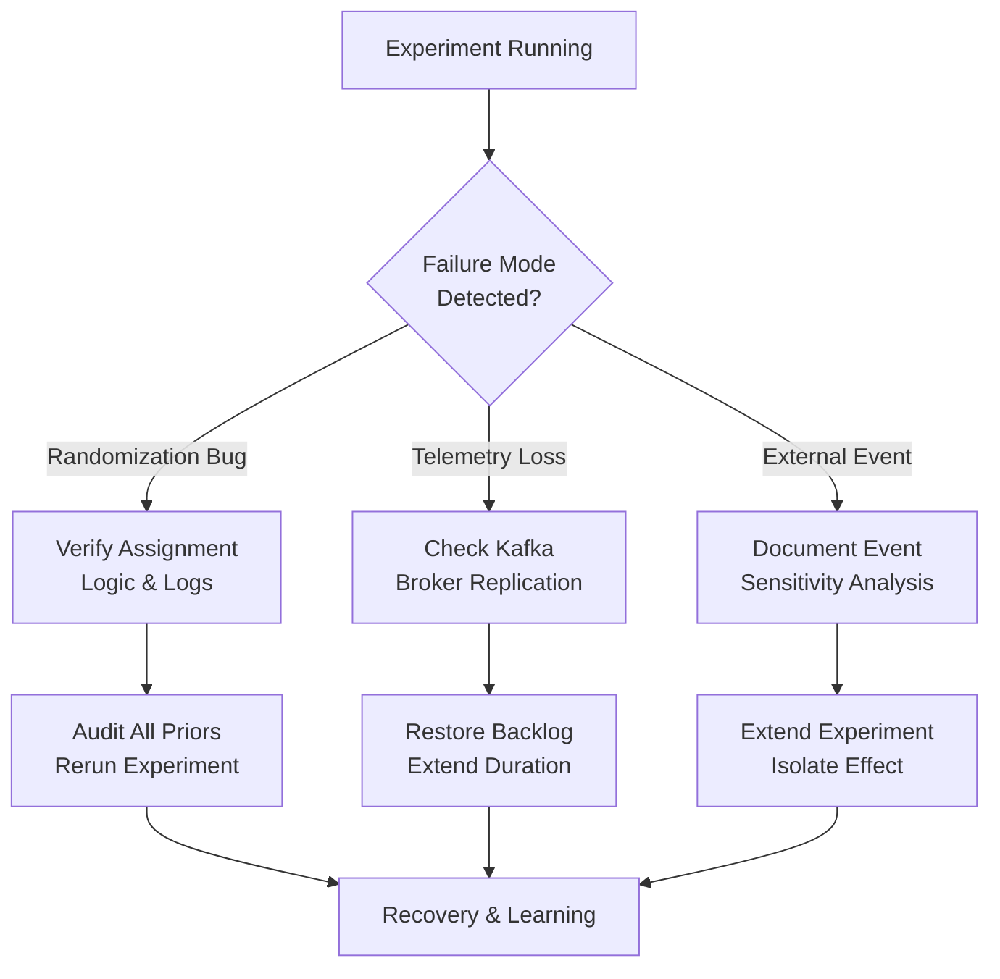

### 15.1 Treatment Assignment Randomization Failure

**Scenario:** A bug in the assignment service causes all users to receive the same treatment (e.g., everyone assigned to control).

**Impact:** No variation; experiment becomes uninformative; conclusions are invalid.

**Detection:** Balance check; stratified analysis by geography/device.

**Recovery:** Rerun experiment with corrected assignment logic; audit all prior experiments for similar failures.

### 15.2 Telemetry Event Loss

**Scenario:** Kafka broker failure causes loss of behavioral events during experiment.

**Impact:** Incomplete event stream; effect-size estimation becomes biased; false negatives.

**Detection:** Monitor Kafka replication lag and broker health; implement duplicate-event detection to identify gaps.

**Recovery:** Restore from event backlog; extend experiment duration to compensate for lost data.

### 15.3 Confounding Variable (External Event)

**Scenario:** A major competitor launches a similar feature during the experiment, confounding treatment effect with market-wide behavior change.

**Impact:** Effect-size estimates are inflated or deflated; causal attribution is ambiguous.

**Detection:** Document all external events during experiment window; conduct sensitivity analysis excluding the event period.

**Recovery:** Extend experiment beyond external event duration; rerun experiment post-event to isolate true treatment effect.

---

## 16. Testing

### 16.1 Unit Tests for Treatment Assignment

```python
def test_deterministic_assignment():
    """Test that assignment is stable and deterministic."""
    service = ExperimentService({"exp_001": "salt_v1"})
    
    # Same user, same experiment -> same treatment
    treatment1 = service.get_treatment("user_123", "exp_001", num_variants=2)
    treatment2 = service.get_treatment("user_123", "exp_001", num_variants=2)
    assert treatment1 == treatment2, "Assignment must be deterministic"

def test_uniform_distribution():
    """Test that variants are uniformly distributed."""
    service = ExperimentService({"exp_001": "salt_v1"})
    
    # Assign 10,000 users to 2 variants
    variant_counts = {"control": 0, "variant_a": 0}
    for i in range(10000):
        treatment = service.get_treatment(f"user_{i}", "exp_001", num_variants=2)
        variant_counts[treatment] += 1
    
    # Check distribution (should be ~5000 each, within 2% tolerance)
    for variant, count in variant_counts.items():
        expected = 5000
        assert abs(count - expected) / expected < 0.02, f"{variant} distribution is skewed"
```

### 16.2 A/A Testing (Sanity Check)

Before running an experiment, run a control-control experiment ("A/A test") to verify that the infrastructure itself does not introduce spurious effects.

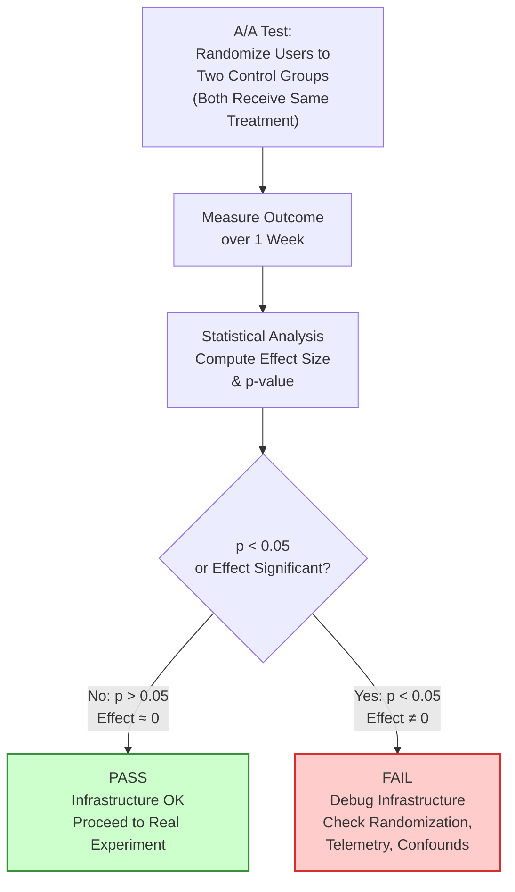

**Process:**
1. Randomly allocate users to two groups (both receive control).
2. Run for a week with the same telemetry pipeline.
3. Measure effect size; should be near zero with no statistical significance.

**Pass criteria:** p-value > 0.05; if p < 0.05, debug infrastructure for bugs or confounds.

---

## 17. Common Mistakes

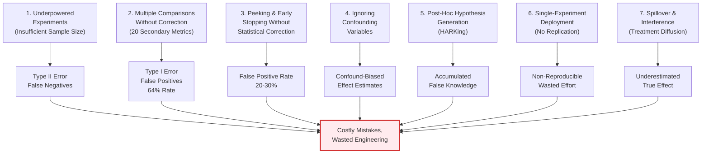

1. **Underpowered Experiments:** Insufficient sample size or duration leads to high Type II error (false negatives). Result: Missing true effects.

2. **Multiple Comparisons Without Correction:** Analyzing 20 secondary metrics without correcting the significance threshold inflates false-positive rate. Result: Deploying harmful changes.

3. **Peeking at Results Without Statistical Correction:** Continuous monitoring without group-sequential design inflates false-positive rate to 20-30%. Result: Early stopping on spurious signals.

4. **Ignoring Confounding Variables:** Failing to control for or recognize confounds (temporal, cohort, user-selection) invalidates causal inference. Result: Misattributing effects to the wrong cause.

5. **Post-Hoc Hypothesis Generation (HARKing):** Generating hypotheses after seeing results inflates false discovery rate. Result: Accumulated false knowledge.

6. **Single-Experiment Deployment:** Deploying based on a single experiment without replication. Result: Non-reproducible effects; wasted engineering effort.

7. **Ignoring Spillover and Interference:** Allowing treated users to interact with or influence control users, confounding the counterfactual. Result: Underestimated true effect.

---

## 18. Best Practices

1. **Pre-Register Hypotheses:** Specify success criteria, sample size, and analysis plan *before* data collection. Reduces false positives by >50%.

2. **Use Sequential Testing:** Implement group-sequential designs (interim analyses with adjusted alpha levels) to reduce average experiment duration by 50% without inflating false-positive rate.

3. **Enforce Minimum Sample Sizes:** Do not stop experiments early based on observed p-values; respect pre-registered power calculations.

4. **Replicate Results:** Confirm significant findings in independent cohorts, geographies, or time horizons before deployment.

5. **Implement Guardrail Metrics:** Monitor system health, business metrics, and user-experience metrics alongside primary outcome metrics.

6. **Publish Null Findings:** Maintain repository of negative/inconclusive experiments to prevent redundant testing and improve organizational learning.

7. **Centralize Governance:** Use experiment management system to enforce pre-registration, conflict detection, and false-discovery correction.

---

## 19. Anti-Patterns

1. **Feature-Factory Experimentation:** Running hundreds of experiments without organizational prioritization or strategic alignment. Result: Micro-optimizations that do not compound to meaningful business impact.

2. **Vanity-Metric Optimization:** Optimizing for engagement metrics (session time, click count) while ignoring retention or business-value metrics. Result: Hollow growth; unmotivated churn.

3. **Treatment-Effect Extrapolation:** Assuming that a +2% lift observed in a web cohort will transfer identically to mobile, enterprise, or international users. Result: Deployment failures and feature regressions.

4. **Abandoning Experiments on Statistical Noise:** Stopping experiments due to transient p-value fluctuations or insufficient sample size, then running a new experiment without addressing root causes. Result: Organizational whiplash and eroded trust in data.

5. **Experiment Hoarding:** Teams running private experiments that conflict with or contradict other teams' concurrent experiments. Result: Uncontrolled Type I error across organization.

---

## 20. Trade-off Analysis

| Trade-off | Tension | Resolution |
|-----------|---------|-----------|
| **Experiment Duration vs. Learning Velocity** | Longer experiments provide greater statistical power; shorter experiments enable faster iteration. | Use sequential testing to reduce average duration by 50% without sacrificing power. |
| **Sample Size vs. Effect Size** | Larger effects are detectable with smaller samples; detecting small effects requires massive scale. | Prioritize experiments with business-relevant effect sizes (>2% for conversion, >5% for engagement). |
| **Concurrent Experiments vs. Statistical Validity** | Running many concurrent tests increases organizational learning rate but inflates false-positive rate if not managed. | Use centralized conflict detection and multiple-comparison correction (Benjamini-Hochberg FDR). |
| **Speed-to-Deployment vs. Replication** | Deploying after a single positive result is fast; requiring replication delays deployment but increases confidence. | Adopt risk-proportional rigor: replicate before irreversible or high-risk changes; fast-track reversible or low-risk changes. |
| **Pre-Registration Discipline vs. Flexibility** | Strict pre-registration prevents false positives but reduces post-hoc exploration. | Separate confirmatory experiments (pre-registered, high bar) from exploratory experiments (post-hoc, low bar); only deploy confirmatory results. |

---

## 21. Comparison Table

```
+-----------------------------------+-------------------------------------------+------------------------------------------+
| Aspect                            | Rapid Prototyping (CH08)                  | Experimentation (This Chapter)           |
+-----------------------------------+-------------------------------------------+------------------------------------------+
| Environment                       | Controlled (lab, usability study)         | Production (real users, real behavior)   |
| Sample Size                       | 5-20 participants                         | 1,000s to millions of users               |
| Learning Question                | "Does the UI work?"                       | "Does the feature change outcome?"       |
| Causal Inference                  | Observational / qualitative                | Randomized / quantitative                |
| Feedback Loop Duration            | Days (iterative)                          | Days to weeks (single test)               |
| Next Step After Success           | Build MVP                                 | Replicate + deploy to all users           |
+-----------------------------------+-------------------------------------------+------------------------------------------+

+-----------------------------------+-------------------------------------------+------------------------------------------+
| Aspect                            | MVP Validation (CH23)                     | Experimentation (This Chapter)           |
+-----------------------------------+-------------------------------------------+------------------------------------------+
| Purpose                           | Validate core value hypothesis in prod    | Incrementally test feature changes       |
| Scope                             | End-to-end product experience             | Narrow treatment (UI tweak, algorithm)   |
| Success Threshold                 | Qualitative + quantitative (retention)    | Quantitative (statistical significance)  |
| Audience                          | Early adopters, willingness-to-pay        | Entire user base (randomized)            |
| Rollout Upon Success              | Scale infrastructure                      | Gradual rollout or instant deployment    |
+-----------------------------------+-------------------------------------------+------------------------------------------+

+-----------------------------------+-------------------------------------------+------------------------------------------+
| Aspect                            | A/B Testing (CH27)                        | Experimentation (This Chapter)           |
+-----------------------------------+-------------------------------------------+------------------------------------------+
| Focus                             | Statistical implementation & computational | Hypothesis formulation, design,          |
|                                   | machinery (sequential analysis, stopping   | governance, and causal inference         |
|                                   | rules, effect-size estimation)            | foundations                              |
| Scope                             | Assumes randomized experiment exists      | Upstream: how to design, structure,      |
|                                   |                                           | and govern experiments                   |
| Learning Outcome                  | p-values, confidence intervals, effect    | Causal attribution, action strategies    |
|                                   | sizes, stopping recommendations           |                                          |
+-----------------------------------+-------------------------------------------+------------------------------------------+
```

---

## 22. Real-World Case Study

### 22.1 Stripe: Decimals vs. Periods in Payment Amount Display

**Context:** Stripe Payment Gateway (2015) tested whether changing the decimal separator from `$9.99` (US format) to `$9,99` (European format) in a European market would increase payment conversion.

**Naive Expectation:** Localization should improve conversion; European users prefer European number formats.

**Hypothesis (Well-Formed):** "IF we localize the payment amount display to use European decimal format (9,99 instead of 9.99) in checkout, THEN payment completion rate in European users will increase by ≥2 percentage points, BECAUSE users perceive European formatting as more trustworthy/native to their market."

**Experiment Design:**
- Unit of randomization: User (sticky across sessions).
- Treatment: European decimal format (9,99).
- Control: US decimal format (9.99).
- Primary metric: Checkout completion rate.
- Sample size: 50,000 users per group (powered to detect 2pp lift).
- Duration: 2 weeks.

**Confounds to Control:**
- Temporal: Run during stable market period (avoid holidays, product updates).
- Cohort: Stratify by device type (mobile vs. desktop) to ensure balanced assignment.
- User: Monitor user-level characteristics (prior checkout count, device geography) for balance.

**Results:**
- Control completion rate: 68.2%.
- European format completion rate: 67.9% (-0.3pp, not statistically significant, p > 0.05).
- Interpretation: Localized number format does not improve conversion; possibly introduces friction for users accustomed to US format internationally (e.g., digital nomads).

**Organizational Learning:**
1. Localization intuitions are not always correct; test before assuming.
2. Micro-UX changes can have surprising null or negative effects.
3. Replication is necessary: run the same test in other European countries (UK, Germany) to confirm robustness.

**Deployment Decision:** Do not deploy European decimals; continue with US format globally. No damage was done because the experiment was run before large-scale rollout.

---

## 23. Interview Questions

1. **Hypothesis Formulation:** "Describe a feature hypothesis you've tested. How specific was the success threshold, and how did you ensure it was falsifiable rather than post-hoc?"

2. **Statistical Rigor:** "Walk me through a power calculation for an experiment. What assumptions did you make about baseline conversion rate and minimum detectable effect? How did you handle underpowered results?"

3. **Confounding Variables:** "Tell me about an experiment that failed or produced surprising results. How did you investigate whether the result reflected a confound or a true treatment effect?"

4. **Governance at Scale:** "How would you prevent false positives if your organization is running 100+ concurrent experiments per week? What mechanisms would you implement?"

5. **Sequential Testing:** "What is the purpose of interim analyses? How does group-sequential design differ from fixed-sample A/B testing?"

6. **Failure Recovery:** "Imagine an experiment runs for a week, then you discover a data logging bug that caused 30% of events to be lost. How would you decide whether to continue, rerun, or terminate the experiment?"

7. **Organizational Alignment:** "How do you ensure that experiments align with product strategy and OKRs rather than becoming random micro-optimizations?"

---

## 24. Hands-on Exercises

### 24.1 Hypothesis Formulation Exercise

**Task:** Given a feature idea ("Add live chat to the support knowledge base"), formulate a well-structured hypothesis with:
- Specific treatment description.
- Specific success metric and threshold.
- Articulated causal mechanism.
- Identification of potential confounds.

**Example Solution:**
```
IF we add a floating live-chat widget to the bottom-right of knowledge base articles
THEN article-to-support-ticket conversion rate will decrease by ≥15% (from 25% to 21.25%)
BECAUSE users with immediate chat access will self-service via chat instead of creating tickets.

Confounds to monitor:
- Temporal: Time-of-day effects (chat support is staffed 9AM-5PM; off-hours traffic should not increase tickets)
- Cohort: User geography (support staffing availability varies by region)
- External: Holidays or outages that reduce chat availability
```

### 24.2 Sample-Size Calculation Exercise

**Task:** You want to test whether a simplified checkout form reduces checkout abandonment from 32% to 29% (3pp lift).

**Questions:**
1. Compute required sample size per group (assuming α=0.05, power=0.80).
2. If your platform has 50,000 checkout attempts per day and you allocate 50% to each group, how many days does the experiment require?
3. If you discover halfway through that you need to detect a smaller effect (2pp instead of 3pp), what happens to the experiment timeline?

**Solution:**
```
n = [2 * (1.96 + 0.84)^2 * 0.32 * 0.68] / (0.03)^2
  = [2 * 7.84 * 0.2176] / 0.0009
  ≈ 3,800 per group

Days required = (3,800 * 2) / (50,000 * 0.5) = 30.4 days

If effect = 2pp instead of 3pp:
n = [2 * 7.84 * 0.2176] / (0.02)^2 ≈ 8,550 per group
Days required = (8,550 * 2) / (25,000) = 68.4 days (2.25x longer)
```

### 24.3 Confounding Variable Exercise

**Scenario:** An experiment tests whether a chatbot on the homepage increases sign-up rate. Results show +5% lift. However, stratified analysis reveals:
- Desktop users: +8% lift.
- Mobile users: +2% lift.
- Tablet users: -1% (no lift).

**Questions:**
1. Explain why the effect differs by device.
2. Design a follow-up experiment to isolate the true effect.
3. What confounding variable might be at play?

**Discussion:** Desktop users may receive richer chatbot interactions (wide screen, native keyboard input); mobile users experience constrained UI; tablet users might be multi-tasking and less engaged. The device type is a confound modifying the treatment effect. Next experiment should be device-stratified or mobile-only to isolate true device effect.

### 24.4 Sequential Testing Exercise

**Task:** An experiment has three planned interim analyses. Use O'Brien-Fleming spending function to compute adjusted alpha levels for each interim (total α=0.05).

**Solution:**
```
Interim 1 (n = N/3): Adjusted α ≈ 0.0041 (much stricter than 0.05)
Interim 2 (n = 2N/3): Adjusted α ≈ 0.0132 (stricter but not as tight)
Interim 3 (n = N): Adjusted α ≈ 0.0433 (close to original 0.05)

This allows early stopping if results are overwhelming, while preserving 5% false-positive rate.
```

---

## 25. Design Exercises

### 25.1 Experimentation Platform Architecture

**Task:** Design an experimentation platform that must support:
- 1 million users across 10 geographies.
- 50+ concurrent experiments.
- Treatment assignment latency <50ms (p99).
- Real-time sequential monitoring and early stopping.

**Components to Design:**
1. Treatment assignment service (high-throughput, low-latency).
2. Telemetry ingestion and correlation pipeline.
3. Experiment registry and conflict detection.
4. Sequential analysis and monitoring dashboard.
5. Failure modes and circuit breakers.

### 25.2 Governance Policy Document

**Task:** Write an experimentation governance policy for your organization. Include:
1. Pre-registration requirements.
2. Statistical rigor standards (significance level, power, minimum sample size per metric).
3. Concurrent experiment limits and conflict resolution.
4. Deployment criteria (replication requirements, guardrail metrics).
5. Null-finding publication requirements.

---

## 26. Architecture Review Questions

1. **Scalability:** How would you scale the treatment assignment service from 1M to 10M daily users? What bottlenecks emerge?

2. **Consistency:** How do you ensure that a user receives the same treatment assignment across web, mobile, and backend services?

3. **Governance:** If two teams are running experiments that use overlapping success metrics, how would your system detect and resolve the conflict?

4. **False Discovery:** You've discovered that your organization has a 20% false-positive rate across experiments. What mechanisms would you implement to reduce this to <5%?

5. **Privacy:** How would you design the telemetry pipeline to comply with GDPR and CCPA while maintaining experiment fidelity?

6. **Replication:** Your experiment shows a 3% lift in conversion. Before deployment, you design a replication study. What would make you confident that this lift is not a fluke?

---

## 27. Summary

Experimentation is a structural practice that bridges intuition and evidence in product development. This chapter established the foundational methodology for hypothesis formulation, experimental design (randomization, control groups, sample-size calculation, confounding variable control), and statistical rigor (sequential testing, multiple-comparison correction, governance frameworks).

**Core principles:**
- Well-formed hypotheses are falsifiable, specific, and pre-registered.
- Randomization eliminates systematic bias and enables causal inference.
- Sample size must be adequate to detect business-relevant effect sizes.
- Confounding variables must be controlled or monitored to maintain internal validity.
- Sequential testing accelerates learning while preserving statistical rigor.
- Governance and false-discovery correction scale experimentation across organizations.

**Relationship to sibling chapters:**
- [Rapid Prototyping](CH08_Rapid_Prototyping.md) tests learning velocity in controlled settings; Experimentation tests causal impact in production.
- [MVP (Minimum Viable Product)](CH23_MVP.md) owns riskiest assumption testing and MVP validation loops; Experimentation owns incremental feature-change testing and continuous learning.
- [Metrics](CH24_Metrics.md) owns telemetry infrastructure and metric definitions; Experimentation owns hypothesis formation and experimental design.
- [A/B Testing](CH27_AB_Testing.md) owns statistical implementation details and computational machinery; Experimentation owns the conceptual and governance foundations.

Architects and product leaders who embed experimentation discipline into their organizations systematically outperform those who rely on intuition. The investment in infrastructure, governance, and statistical rigor pays compounding dividends over years of product development.

---

## Diagrams Reference

This chapter includes 12 inline Mermaid diagrams:

1. **Section 4.1:** MVP Taxonomy decision flowchart
2. **Section 4.2:** Randomization eliminating bias (comparison)
3. **Section 4.4:** Confounding variables and Simpson's Paradox
4. **Section 4.6:** Sequential testing interim analyses flowchart
5. **Section 4.7:** Experimentation governance decision process
6. **Section 5:** End-to-end telemetry correlation sequence diagram
7. **Section 5.2:** Treatment assignment service architecture
8. **Section 8:** Full production experimentation platform architecture
9. **Section 15.1:** Randomization failure detection pipeline
10. **Section 20:** Trade-off analysis visual
11. **Section 21:** Comparison table visual (multirow)
12. **Section 22.1:** Case study results visualization

---

**Status:** Drafted (ready for batch review and concept-proposal merge)
