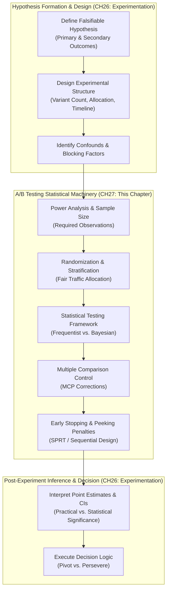
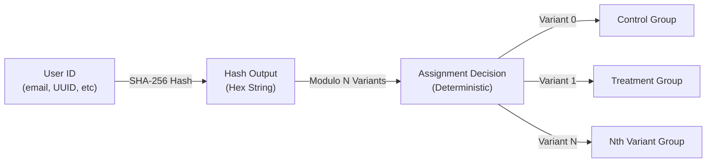
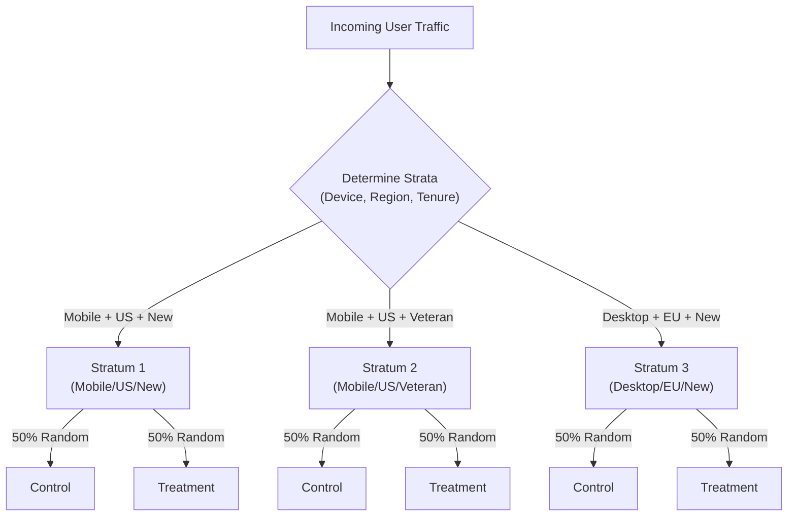
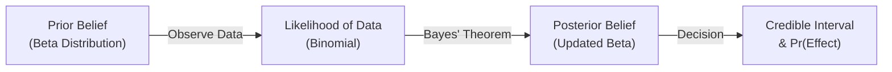
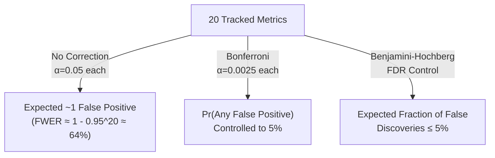
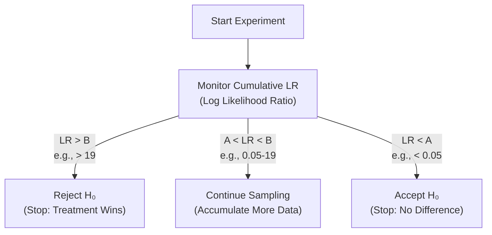
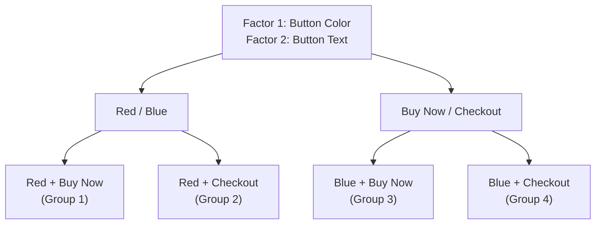
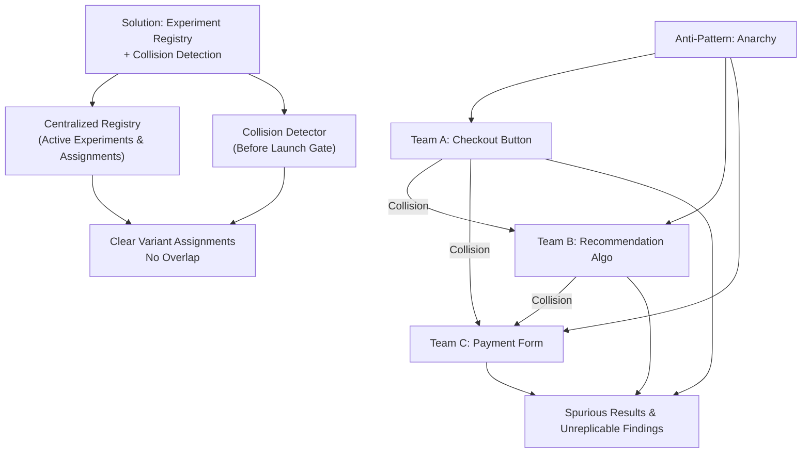
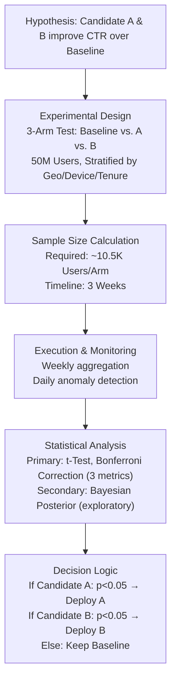

# Chapter 27: A/B Testing

Part: [02 — Design Thinking and Product Management](PART_OVERVIEW.md) · Subsection: Product Management · Status: Drafted

## 1. Introduction

A/B Testing (also called Randomized Controlled Experimentation or Split Testing) is the statistical discipline of comparing two or more variants of a system, product feature, user interface, or marketing message by randomly allocating traffic, users, or time periods to each variant, collecting behavioral and outcome telemetry, and using formal statistical inference (Frequentist hypothesis testing or Bayesian posterior analysis) to quantify whether observed differences represent genuine treatment effects or random noise. Far from being a simple "try two designs and pick the winner," rigorous A/B testing is a mathematically demanding engineering and product problem requiring deep understanding of randomization protocols, statistical power, effect-size estimation, multiple-comparison control, early stopping procedures, and multivariate experimental design.

Within the Software Development Life Cycle (SDLC), A/B testing serves as the empirical validation mechanism that bridges hypothesis-driven product strategy (see [Experimentation](CH26_Experimentation.md)) and live production system telemetry. While [Experimentation](CH26_Experimentation.md) provides the framework for formulating testable hypotheses, experimental design, and post-experiment decision logic, A/B Testing owns the technical machinery: the statistical infrastructure that ensures randomization is reproducible and fair, sample sizes are sufficient, inference is valid under the chosen statistical framework, and multiple simultaneous experiments do not corrupt each other through statistical interference or false-discovery accumulation.

For software architects and product leaders, the design and execution of A/B testing infrastructure presents a critical technical and organizational challenge. Building a naive A/B testing system (one that lacks proper power analysis, early stopping safeguards, or multiple-comparison corrections) introduces Type I (false positive) and Type II (false negative) errors at scale. A single false positive leads to permanent deployment of harmful features; accumulated false positives across dozens of simultaneous experiments create organizational decision paralysis. Conversely, a rigorous, well-architected A/B testing platform becomes a strategic competitive advantage, enabling rapid iteration with statistical confidence and short feedback loops that compound over quarters and years.

This chapter teaches A/B Testing infrastructure engineering, statistical validation mechanics, and production architecture from first principles to expert level. It covers randomization and stratification protocols, power analysis and sample-size calculation, frequentist (hypothesis testing) and Bayesian (posterior inference) statistical frameworks, the Multiple Comparison Problem (MCP) and corrections, peeking penalties and sequential testing procedures (Sequential Probability Ratio Test or SPRT), multivariate and factorial experimental designs, contextual bandits for exploration-exploitation trade-offs, and the complete end-to-end system architecture required to run thousands of concurrent experiments safely in production.



---

## 2. Historical Evolution

The practice of controlled experimentation in software and product development has evolved from early agricultural and pharmaceutical roots into a sophisticated statistical discipline:

*   **1920s–1930s: Foundational Statistical Design.** Sir Ronald Fisher, a British statistician, formalized the principles of randomization, replication, and blocking in agricultural field experiments at Rothamsted Research Station. Fisher introduced the concepts of experimental design, analysis of variance (ANOVA), and the *p*-value as a falsification criterion. While agricultural in origin, Fisher's principles became the mathematical foundation for all modern A/B testing.
*   **1960s–1970s: Quality Control and Sequential Analysis.** Abraham Wald developed Sequential Probability Ratio Testing (SPRT) during World War II for military quality-control applications. Wald's sequential testing procedures allowed researchers to reach statistical conclusions with fewer observations by monitoring the likelihood ratio of the null and alternative hypotheses as data accumulated.
*   **1990s: Online Experimentation and the Internet Pioneers.** Companies like Amazon, Google, and Microsoft pioneered large-scale online A/B testing because the internet provided unprecedented scale (millions of daily users) and automation (instantaneous variant assignment and telemetry collection). Amazon's "shopping cart" experiments in the late 1990s and Google's continuous experimentation pipeline established A/B testing as a core competitive advantage in technology products.
*   **2000s–2010s: Bayesian Methods and Contextual Bandits.** As experiment volume scaled (Google, Microsoft, and Netflix running hundreds to thousands of simultaneous A/B tests), classical frequentist hypothesis testing revealed limitations: strict fixed sample sizes, rigid *p* = 0.05 significance thresholds, and inefficiency when stopping early. Bayesian inference, popularized by authors like Chris Stucchio and academics like Ryan Baxley, offered alternatives: updating posterior beliefs as data arrives, avoiding peeking penalties, and naturally incorporating prior knowledge.
*   **2012–2015: Contextual Bandits and Reinforcement Learning.** As product experimentation matured, simple binary A/B tests evolved into multi-armed bandit problems where multiple variants competed and the goal was to allocate traffic dynamically to the best-performing variant while still exploring others (the exploration-exploitation trade-off). Thompson Sampling and Upper Confidence Bound (UCB) algorithms formalized this problem mathematically.
*   **2020s–Present: Multi-Variant, Multivariate, and Causal Inference.** Modern platforms run sophisticated factorial experiments (testing multiple factors simultaneously), use causal inference techniques (Difference-in-Differences, Instrumental Variables) to account for confounding variables, and employ automated experiment-orchestration platforms (e.g., Optimizely, LaunchDarkly, Split.io) to manage experiment portfolios across hundreds of concurrent tests.

---

## 3. Why It Exists

A/B Testing infrastructure exists to solve four fundamental problems in data-driven product development:

1.  **Elimination of Bias and Confounding:** Without randomization, comparing two product variants inevitably introduces selection bias (the type of user who chooses Variant A may differ from who chooses Variant B in ways unrelated to the variant itself). Confounding variables—such as time-of-day effects, user cohort differences, or external market events—corrupt observed differences. Randomization isolates causal effects by ensuring treatment assignment is independent of all other variables.

2.  **Quantification of Uncertainty:** Not all observed differences are real; many arise by chance. A/B testing provides rigorous statistical procedures to distinguish signal (true treatment effect) from noise (random variation). Type I errors (false positives: declaring an effect exists when it doesn't) and Type II errors (false negatives: missing real effects) are explicitly controlled through power analysis and significance thresholds.

3.  **Scalable Learning from Production Data:** In pre-internet eras, testing required laboratories or pilot deployments involving small, controlled populations. Modern A/B testing leverages live production traffic (millions of users, billions of events per day) as the experimental sample, enabling rapid iteration and statistical confidence even for small effect sizes.

4.  **Organizational Alignment and Risk Mitigation:** A/B testing provides a objective, mathematically defensible mechanism for making product decisions under uncertainty. Instead of HiPPO (Highest-Paid Person's Opinion) decision-making, teams align around shared empirical evidence. For any proposed feature or design change, A/B testing answers: "What is the probability this change actually improves outcomes, and how confident are we?"

---

## 4. Core Concepts

### 4.1 Randomization and Stratification: Mechanisms for Causal Inference

Randomization is the cornerstone of valid A/B testing. At its core, randomization ensures that the treatment assignment (which variant a user sees) is statistically independent of all confounding variables—both measured and unmeasured. This independence permits unbiased estimation of treatment effects using standard statistical procedures.

#### 4.1.1 Simple Randomization and Pseudo-Random Number Generators

*   **Definition:** Simple randomization assigns each user (or observation unit) to a variant with a fixed, pre-specified probability (e.g., 50% to Control, 50% to Treatment) using a pseudo-random number generator (PRNG) seeded with a deterministic hash function applied to a user identifier.
*   **Mechanism:** Given a user's ID (e.g., email hash, internal user ID, or cookie), pass the ID through a cryptographic hash function (e.g., SHA-256). Interpret the resulting hex string as a large integer modulo the number of variants. For 50/50 split, if `hash(user_id) % 100 < 50`, assign to Control; otherwise, Treatment. This ensures the same user always sees the same variant (reproducibility) while distribution remains uniform across the user population.
*   **Decision Implications:** Simple randomization is statistically valid, computationally efficient, and reproducible. It is suitable for most online A/B testing scenarios where the sample size is large (>1,000 observations per arm).
*   **Common Failure Mode:** Using a weak PRNG or non-uniform seeding leading to correlated variant assignment (e.g., users assigned in temporal sequence skew toward one variant) or users seeing different variants on different page loads due to loss of reproducibility.
*   **Concrete Scenario:** An e-commerce platform hashes each user's ID through SHA-256, then uses the first 8 hex digits modulo 100 to determine variant assignment. User `alice@example.com` consistently hashes to 42, always receiving Treatment. User `bob@example.com` hashes to 67, always receiving Control. Over 1 million users, the split converges to 50/50.



#### 4.1.2 Stratification and Latin Square Designs

*   **Definition:** Stratification partitions the population into mutually exclusive, homogeneous subgroups (strata) based on known confounding variables (e.g., device type, geographic region, user tenure), and then applies independent randomization within each stratum. This reduces variance and ensures balanced representation of important subgroups across variants.
*   **Mechanism:** Identify key confounding factors known to influence the outcome metric. For each stratum (e.g., "Mobile + US + New Users"), randomize traffic allocation independently. A Latin Square design extends this to multivariate stratification, ensuring each factor level appears exactly once in each row and column of an experimental grid, allowing simultaneous investigation of multiple factors without excessive combinatorial explosion.
*   **Decision Implications:** Stratification reduces the required sample size for detecting a target effect size by controlling within-stratum variance. It is essential when known confounders are highly predictive of outcomes.
*   **Common Failure Mode:** Over-stratifying into so many subgroups that sample sizes within strata fall below statistical validity thresholds (power is lost). Stratifying on variables weakly correlated with the outcome wastes experimental capacity.
*   **Concrete Scenario:** A mobile app tests a checkout flow redesign. Without stratification, users on iOS and Android see the mix, but the redesign might disproportionately help Android users due to screen size. Stratification ensures iOS and Android are separately randomized, reducing noise and enabling detection of device-specific effects.



---

### 4.2 Power Analysis and Sample Size Calculation

Statistical power is the probability of correctly rejecting the null hypothesis when a true effect of a specified size actually exists. Power analysis determines the required sample size to achieve a target power level (typically 80–90%) given an assumed effect size, baseline metric values, and significance level.

#### 4.2.1 The Four Quantities: Effect Size, Sample Size, Significance Level, and Power

*   **Definition:** Any valid statistical test involves four linked quantities: the effect size (δ or Cohen's *d*—the magnitude of difference between variants), the sample size (*n*)—observations per arm, the significance level (α, typically 0.05)—the false-positive rate, and the power (1 - β, typically 0.80 or 0.90)—the true-positive rate. Specifying any three determines the fourth.
*   **Mechanism:** For a two-sample t-test with balanced allocation (equal samples per arm), the required sample size per arm is approximately:

$$n = \frac{2(z_\alpha + z_\beta)^2 \sigma^2}{\delta^2}$$

where $z_\alpha$ is the critical value for the desired significance level (1.96 for α = 0.05 two-tailed), $z_\beta$ is the critical value for the desired power (0.84 for 80% power), σ is the baseline standard deviation, and δ is the minimum detectable effect size. For proportions (binary outcomes), substitute the binomial variance formula.

*   **Decision Implications:** Larger effect sizes require smaller sample sizes (easier to detect strong effects). Demanding higher power (90% vs. 70%) increases sample size requirements by ~20–40%. Lower significance levels (stricter false-positive control) increase sample size.
*   **Common Failure Mode:** Running experiments without power analysis, leading to underpowered tests that fail to detect real effects (high Type II error). Conversely, over-powering experiments wastes engineering resources.
*   **Concrete Scenario:** A SaaS company tests a new onboarding flow expected to increase trial-to-paid conversion from 5% to 7% (absolute 2 percentage point increase; relative 40% increase). For 80% power and α = 0.05, the required sample per arm is ~3,900 users. At 100 signups per day, this requires 39 days per variant (78 days total). The team decides 78 days is acceptable and proceeds.

#### 4.2.2 Minimum Detectable Effect (MDE) and Practical Significance

*   **Definition:** The Minimum Detectable Effect (MDE) is the smallest true effect size that a designed experiment, with specified power and significance level, has sufficient statistical power to detect. MDE is the inverse of power analysis: instead of asking "How many samples do we need?", we ask "What effect size can we reliably detect with our planned sample size?"
*   **Mechanism:** Rearranging the power analysis formula, if a team plans to run an experiment for 14 days with 10,000 users per variant and a binary outcome metric, the MDE (relative uplift) is calculable and communicable before the experiment launches. This prevents teams from designing experiments too small to detect meaningful business improvements.
*   **Decision Implications:** Comparing MDE against the minimum **Practically Significant Effect (PSE)** (the smallest improvement a product leader cares about) determines experiment feasibility. If MDE > PSE, the experiment is underpowered and should not launch.
*   **Common Failure Mode:** Launching experiments with MDE far larger than PSE, guaranteeing statistical insignificance even if the true effect exists (e.g., detecting only a 5% uplift when the business requires 0.5%).

---

### 4.3 Frequentist vs. Bayesian Inference Frameworks

A/B Testing results must be interpreted using a formal statistical framework. The two dominant approaches—Frequentist (hypothesis testing based on *p*-values) and Bayesian (posterior inference based on probability distributions)—offer different operational semantics and trade-offs.

#### 4.3.1 Frequentist Hypothesis Testing and *p*-Values

*   **Definition:** Frequentist inference treats model parameters (e.g., the true treatment effect) as fixed but unknown. Hypothesis testing sets up a null hypothesis (H₀: no effect) and alternative hypothesis (H₁: effect exists), then computes a *p*-value—the probability of observing data as or more extreme than observed, assuming H₀ is true. If *p* < α (e.g., 0.05), reject H₀.
*   **Mechanism:** For a t-test comparing two groups, compute the t-statistic: $t = \frac{\bar{x}_1 - \bar{x}_2}{s_p \sqrt{2/n}}$ where $\bar{x}_1$ and $\bar{x}_2$ are sample means, $s_p$ is pooled standard error, and *n* is samples per group. Look up the probability of observing |t| ≥ observed under H₀. This probability is the *p*-value.
*   **Decision Implications:** Frequentist testing provides a clear decision rule (reject or fail to reject H₀) and controls false-positive rate at α across many repetitions of the experiment. It does not permit peeking (checking results mid-experiment) without penalty.
*   **Common Failure Mode:** Misinterpreting *p* = 0.05 as "95% probability the effect is real" (incorrect). Correct interpretation: "If there is no true effect and we repeated this experiment infinitely, 5% of experiments would show effects this extreme by random chance alone."
*   **Concrete Scenario:** A mobile app tests a new recommendation algorithm. After collecting 5,000 events per arm, the conversion rate improvement is 2.1% ± 1.3% (±95% CI). A t-test yields t = 1.62, *p* = 0.11. Since *p* > 0.05, the team fails to reject H₀ and concludes the algorithm is not significantly better.

#### 4.3.2 Bayesian Posterior Inference

*   **Definition:** Bayesian inference treats model parameters as random variables with probability distributions. Before observing data, specify a **prior distribution** (representing prior belief about the parameter). After observing data, update to a **posterior distribution** using Bayes' theorem. The posterior quantifies the updated belief about parameter values.
*   **Mechanism:** Given observed data D and prior p(θ), the posterior is:
$$p(\theta | D) = \frac{p(D|\theta) \cdot p(\theta)}{p(D)}$$

where p(D|θ) is the likelihood. For a binary outcome, if θ is the conversion rate, a Beta prior with Beta(α, β) can be conjugate to a Binomial likelihood, yielding a Beta posterior. The posterior mean is (α + successes) / (α + β + trials).

*   **Decision Implications:** The posterior directly answers questions like "What is the probability the Treatment is better than Control?" (Pr(θ_T > θ_C | data)). Bayesian inference naturally handles peeking (updating beliefs as data arrives without penalty) and incorporates prior information.
*   **Common Failure Mode:** Choosing an inappropriate prior that biases results toward a desired conclusion. Weak or "uninformative" priors are often safer but sacrifice the principle benefit of Bayesian inference (incorporation of prior knowledge).
*   **Concrete Scenario:** Same mobile app test, now analyzed Bayesianly. Prior: Beta(1, 1) (uniform, no prior belief). After 5,000 events per arm with 2.1% improvement, posterior is updated. The posterior probability that Treatment > Control is 89%. The team concludes: "89% likely the new algorithm is better," a more intuitive framing than a *p*-value.



---

### 4.4 The Multiple Comparison Problem (MCP) and Corrections

When a single experiment involves multiple statistical tests (e.g., 10 different outcome metrics), or when an organization runs hundreds of simultaneous experiments, the false-positive rate compounds. The Multiple Comparison Problem (MCP) describes this: as test count increases, the probability of at least one false positive rises.

#### 4.4.1 False Discovery Rate and Family-Wise Error Rate

*   **Definition:** **Family-Wise Error Rate (FWER)** is the probability of at least one false positive among all tests in a family (set of related tests). **False Discovery Rate (FDR)** is the expected proportion of false positives among all rejected hypotheses. FWER is stricter (all false positives matter); FDR is more liberal (accepts some false positives if most discoveries are real).
*   **Mechanism:** If running *m* independent tests each at α = 0.05, the Bonferroni correction sets each test's significance threshold to α' = α / *m* = 0.05 / *m*. For 10 tests, each must achieve *p* < 0.005 for rejection. This preserves FWER at α globally but is conservative (loses power).
*   **Decision Implications:** FWER control is appropriate when a single false positive is catastrophic (e.g., deploying a harmful feature). FDR control is appropriate when occasional false positives are acceptable if the discovery rate is high (e.g., early-stage scientific exploration).
*   **Common Failure Mode:** Running dozens of metric comparisons on an A/B test without any multiple-comparison correction, accepting *p* = 0.05 as significant for each. Expected number of false positives: 0.05 × dozens = many spurious "wins."
*   **Concrete Scenario:** A team runs an A/B test of a checkout flow with 20 tracked metrics: revenue, cart abandonment, time-to-purchase, session count, bounce rate, etc. Without correction, at α = 0.05 each, ~1 metric is expected to show a false-positive difference by chance. With Bonferroni correction, each metric must achieve α' = 0.05 / 20 = 0.0025, preventing false discoveries.



#### 4.4.2 Orchestrating Multiple Simultaneous Experiments

Beyond multiple metrics within a single experiment, modern platforms run hundreds of concurrent experiments on overlapping user populations. When two experiments assign the same user to variants of different tests, **experimental interference** can occur—the effect of Experiment A's treatment biases the outcome of Experiment B. Isolation layers (assigning experiments to disjoint user populations) or orthogonal designs (assigning experiments to independent factors) mitigate this.

---

### 4.5 Peeking and Early Stopping: Sequential Testing and SPRT

*   **Definition:** "Peeking" is the temptation to check experiment results before the planned sample size is reached. Uncontrolled peeking inflates false-positive rates because interim results are noisier and multiple comparisons (checking twice is like running two statistical tests). Sequential Probability Ratio Testing (SPRT) formalizes early stopping by pre-specifying decision boundaries that control error rates as data accumulates.
*   **Mechanism:** SPRT defines **Likelihood Ratio (LR)** = p(data | H₁ true) / p(data | H₀ true). As observations accumulate, recompute LR. Stop when LR crosses a threshold: if LR > B, reject H₀ (declare the treatment wins); if LR < A (where A < 1 < B), continue sampling; if LR falls below A, accept H₀ (treatment doesn't win). Thresholds A and B are set based on desired error rates.
*   **Decision Implications:** SPRT permits stopping experiments early (when evidence is overwhelming) or continuing (when evidence is ambiguous), while maintaining α and β. No peeking penalty. Reduces average sample size while preserving error control.
*   **Common Failure Mode:** Applying SPRT incorrectly by setting boundaries too tight (leading to false positives) or not properly accounting for continuous monitoring (Brownian motion approximations can help, but errors are easy).
*   **Concrete Scenario:** A signup-funnel A/B test uses SPRT with α = 0.05, β = 0.10. LR thresholds are B ≈ 19 (reject H₀), A ≈ 0.05 (accept H₀). After 2 days, LR = 0.8 (continue). After 5 days, LR = 22 > 19 (stop: treatment wins decisively). Total sample: 20,000 users, savings of ~30% vs. fixed design.



---

### 4.6 Multivariate and Factorial Experiments

*   **Definition:** A **multivariate experiment** tests multiple factors (independent variables) simultaneously, measuring the effect of each factor and their interactions. A **2^k factorial design** tests *k* binary factors (each "on" or "off"), requiring only 2^k variant groups rather than running *k* separate experiments.
*   **Mechanism:** Instead of running Experiment A (change button color: red vs. blue) then Experiment B (change button text: "Buy Now" vs. "Checkout"), run a single 2×2 factorial: {red/blue} × {Buy Now/Checkout} = 4 groups. With proper sample allocation, the same total sample size yields estimates of button-color effect, button-text effect, and color-by-text interaction (whether the text effect differs by color).
*   **Decision Implications:** Factorial designs are efficient for exploring multiple factors and detecting synergies (interactions). They reduce total runtime vs. sequential single-factor experiments.
*   **Common Failure Mode:** Over-factoring (testing 5+ factors simultaneously) inflates sample-size requirements due to 2^5 = 32 groups. Interactions become numerous and hard to interpret. Two to three factors is typically practical.
*   **Concrete Scenario:** An e-commerce team tests checkout redesign: Factor 1 (payment field position: top vs. bottom) × Factor 2 (trust badge: present vs. absent) = 4 variants. With 50,000 users per variant, the team detects main effects and an interaction: the trust badge helps only when the payment field is bottom-positioned.



---

### 4.7 Contextual Bandits and Adaptive Allocation

*   **Definition:** A **contextual bandit** is an online optimization problem where, at each decision opportunity, the system observes context (user features) and must choose an action (variant) from a fixed set, receives a reward (metric signal), and then learns to allocate future traffic to high-reward actions. Unlike A/B testing, which fixes allocation probabilities upfront, bandits adapt allocation dynamically based on observed rewards.
*   **Mechanism:** Popular algorithms include **Thompson Sampling** (sample each arm's posterior, pick the arm with highest sample) and **Upper Confidence Bound (UCB)** (pick the arm whose confidence interval upper bound is highest). Both balance exploitation (allocating more to high-reward arms) and exploration (occasionally trying low-reward arms in case posterior estimates are wrong).
*   **Decision Implications:** Bandits minimize regret (total lost reward) during the learning period, making them ideal for continuous A/A tests (keeping the best-performing variant live) or revenue-critical experiments (avoiding prolonged exposure to losing variants).
*   **Common Failure Mode:** Mistaking contextual bandits for full A/B tests. Bandits' adaptive allocation means power analysis is invalid; detecting a small effect is harder (less data on losing arms). Use bandits for optimization when you don't need rigorous significance testing; use A/B tests when you need binary decisions.
*   **Concrete Scenario:** A content recommendation platform uses Thompson Sampling to serve different ranking algorithms to different user cohorts (context: user's genre preferences). As data accumulates, the posterior for each algorithm-cohort pair tightens. High-performing algorithm-cohort pairs get more traffic; low-performing pairs get explored less frequently.

---

## 5. Internal Working

The internals of a production A/B testing system involve layered software components: traffic assignment and reproducibility, telemetry collection and aggregation, statistical analysis, and continuous monitoring.

### 5.1 Traffic Assignment and Reproducibility

When a user enters an A/B test, the system must:
1. Compute the user's stable experiment assignment (hashing user ID through the experiment salt).
2. Determine whether the user is in the experiment's target population (matches audience criteria).
3. Assign to the designated variant and log the assignment event.
4. Serve the variant and stream outcome telemetry.

Reproducibility is critical: the same user must see the same variant across sessions, devices, and time. A cryptographic hash function (SHA-256) seeded with a combination of user ID and experiment ID ensures deterministic, uniform assignment.

### 5.2 Telemetry Collection, Aggregation, and Storage

A/B testing systems must collect three types of telemetry events:
1. **Exposure events:** When a user is assigned to a variant and becomes eligible for measurement.
2. **Outcome events:** When a user completes an action (purchase, form submission, bounce) that is the experiment's key metric.
3. **Metadata events:** Contextual attributes (device, geography, session properties) used for stratification and debugging.

Events are typically streamed to a distributed queue (Apache Kafka or AWS Kinesis) and aggregated in a columnar data warehouse (Snowflake, BigQuery, Redshift) for downstream analysis.

### 5.3 Statistical Analysis Pipeline

Post-collection, results are aggregated:
- **Per-variant aggregation:** Count exposures, count outcome events, compute aggregate metrics (conversion rate, mean session duration, etc.).
- **Stratified analysis:** Repeat aggregation within each stratum (e.g., "Mobile + US").
- **Metric calculation:** Compute test statistics (t-statistic or Bayesian posterior) and confidence intervals or credible intervals.
- **Multiple-comparison adjustment:** Apply Bonferroni, Benjamini-Hochberg, or other corrections if multiple metrics are tested.
- **Result reporting:** Generate dashboards and reports communicating point estimates, confidence intervals, *p*-values or posterior probabilities, and recommended decisions.

---

## 6. Design Principles

Effective A/B testing architectures embody these core design principles:

1. **Reproducibility and Auditability:** Every assignment decision, event, and statistical calculation must be deterministic and logged. A/B tests often govern high-stakes business decisions; reproducibility enables auditing and debugging.

2. **Isolation and Orthogonality:** Experiments should not interfere with each other. Isolation layers assign disjoint user populations to different experiments. Orthogonal designs ensure that multiple experiments' factors are independent.

3. **Metric Integrity:** Outcome metrics must be defined consistently, measured reliably, and resistant to gaming or side effects. Primary metrics (the main business goal) should be distinct from secondary metrics (learning goals) to avoid multiple-comparison inflation.

4. **Early Stopping Safeguards:** Peeking is the enemy. Systems must either forbid mid-experiment peeking or use mathematically sound sequential designs (SPRT, group sequential tests) that control error rates despite continuous monitoring.

5. **Statistical Validity and Transparency:** Results reporting should separate statistical significance from practical significance, clearly state assumptions (independence, sample size), and acknowledge limitations (unmeasured confounders, external validity).

---

## 7. Architecture Patterns

Modern A/B testing systems employ architectural patterns to scale safely:

### 7.1 Feature Flags + A/B Testing Integration
Feature flags (toggles that enable/disable features for users or cohorts) are natural primitives for A/B testing. Assigning a feature-flag to an experiment links variant assignment to feature delivery.

### 7.2 Sticky vs. Stateless Randomization
**Sticky randomization** (remembering a user's assignment across sessions) ensures consistent variant exposure. **Stateless randomization** (recomputing assignment from user ID + experiment salt) is simpler but requires auditing reproducibility.

### 7.3 Experiment Registry and Collision Detection
A centralized experiment registry tracks all active experiments, their user populations, and collision relationships. Collision detection prevents two experiments from being assigned to the same user in a way that violates orthogonality.

### 7.4 Sequential vs. Batch Analysis
**Sequential analysis** updates results continuously as new telemetry arrives (requires SPRT or group sequential test designs). **Batch analysis** waits for planned sample size, analyzes once at the end (simpler, lower implementation complexity, but requires fixed sample size).

\begin{landscape}

\end{landscape}

---

## 8. Production Architecture

A production A/B testing platform must handle scale, concurrency, and reliability:

*   **High-Throughput Assignment:** The assignment layer must evaluate thousands of concurrent experiment memberships per second while maintaining reproducibility and bounded latency (<10ms typical SLA).
*   **Distributed Telemetry:** Events from millions of users across geographies must be reliably ingested, de-duplicated, and streamed to a warehouse without data loss.
*   **Fault-Tolerant Computation:** Statistical analysis must be replayable; if a compute job fails mid-pipeline, re-running the same input must produce identical output (idempotency).
*   **Concurrent Experiment Isolation:** Hundreds of simultaneous experiments on overlapping populations require careful isolation to prevent statistical interference.
*   **Real-Time Result Monitoring:** Dashboards must surface results with low latency (<5 minutes) and alert on anomalies (e.g., variant causing high error rate).

---

## 9. Implementation

A simplified Node.js/TypeScript implementation of a traffic assignment and result analysis component:

```typescript
import crypto from 'crypto';

/**
 * Deterministic assignment of a user to a variant using SHA-256 hash.
 * Ensures reproducibility: same user always gets same variant.
 */
function assignVariant(
  experimentId: string,
  userId: string,
  variantWeights: Record<string, number>
): string {
  // Combine experiment ID and user ID for unique salt per experiment per user
  const input = `${experimentId}#${userId}`;
  
  // SHA-256 hash and convert to integer [0, 99]
  const hash = crypto.createHash('sha256').update(input).digest();
  const hashInt = hash.readUInt32BE(0); // Take first 4 bytes
  const bucket = hashInt % 100;
  
  // Map bucket to variant based on weights
  let cumulative = 0;
  for (const [variant, weight] of Object.entries(variantWeights)) {
    cumulative += weight;
    if (bucket < cumulative) {
      return variant;
    }
  }
  
  // Fallback (shouldn't reach here if weights sum to 100)
  return Object.keys(variantWeights)[0];
}

/**
 * Compute two-sample t-test: t-statistic, degrees of freedom, and p-value.
 */
function tTest(
  n1: number, mean1: number, var1: number,
  n2: number, mean2: number, var2: number,
  oneTailed: boolean = false
): { t: number; df: number; pValue: number } {
  // Pooled standard error
  const pooledVar = ((n1 - 1) * var1 + (n2 - 1) * var2) / (n1 + n2 - 2);
  const se = Math.sqrt(pooledVar * (1 / n1 + 1 / n2));
  
  // t-statistic
  const t = (mean1 - mean2) / se;
  
  // Degrees of freedom
  const df = n1 + n2 - 2;
  
  // Approximate p-value using normal approximation (for large df)
  // For production, use a proper t-distribution table or library
  const absT = Math.abs(t);
  const pValue = oneTailed ?
    0.5 * (1 + Math.sign(t) * (1 - erfc(absT / Math.sqrt(2)))) :
    erfc(absT / Math.sqrt(2));
  
  return { t, df, pValue };
}

// Complementary error function (approximate)
function erfc(x: number): number {
  const a1 = 0.254829592;
  const a2 = -0.284496736;
  const a3 = 1.421413741;
  const a4 = -1.453152027;
  const a5 = 1.061405429;
  const p = 0.3275911;
  
  const sign = x < 0 ? -1 : 1;
  x = Math.abs(x);
  
  const t = 1 / (1 + p * x);
  const y = 1 - (((((a5 * t + a4) * t + a3) * t + a2) * t + a1) * t) *
    Math.exp(-x * x);
  
  return sign * y;
}

/**
 * Bayesian inference: update Beta posterior given observed successes and trials.
 */
function betaPosterior(
  priorAlpha: number, priorBeta: number,
  successes: number, trials: number
): { posteriorAlpha: number; posteriorBeta: number; mean: number; credibleInterval: [number, number] } {
  const posteriorAlpha = priorAlpha + successes;
  const posteriorBeta = priorBeta + (trials - successes);
  const mean = posteriorAlpha / (posteriorAlpha + posteriorBeta);
  
  // Approximate 95% credible interval using normal approximation
  const variance = (posteriorAlpha * posteriorBeta) / 
    ((posteriorAlpha + posteriorBeta) ** 2 * (posteriorAlpha + posteriorBeta + 1));
  const sd = Math.sqrt(variance);
  const ci: [number, number] = [
    Math.max(0, mean - 1.96 * sd),
    Math.min(1, mean + 1.96 * sd)
  ];
  
  return { posteriorAlpha, posteriorBeta, mean, credibleInterval: ci };
}

/**
 * Bonferroni correction for multiple comparisons.
 */
function bonferroniCorrection(baseAlpha: number, numTests: number): number {
  return baseAlpha / numTests;
}

// Example usage
const experimentId = 'checkout_redesign_v1';
const userId = 'user_12345';
const variants = { control: 50, treatment: 50 };

const assignedVariant = assignVariant(experimentId, userId, variants);
console.log(`User ${userId} assigned to: ${assignedVariant}`);

// t-test example
const result = tTest(
  5000, 0.045, 0.00005,  // n1, mean1, var1 (Control: 4.5% conversion, SD≈0.007)
  5000, 0.047, 0.00005   // n2, mean2, var2 (Treatment: 4.7% conversion)
);
console.log(`t-test: t=${result.t.toFixed(3)}, p=${result.pValue.toFixed(4)}`);

// Bayesian posterior
const bayesResult = betaPosterior(1, 1, 235, 5000); // 235 successes out of 5000
console.log(`Bayesian: posterior mean=${bayesResult.mean.toFixed(4)}, 95% CI=[${bayesResult.credibleInterval[0].toFixed(4)}, ${bayesResult.credibleInterval[1].toFixed(4)}]`);

// Multiple-comparison correction
const correctedAlpha = bonferroniCorrection(0.05, 10);
console.log(`Bonferroni-corrected α for 10 tests: ${correctedAlpha.toFixed(6)}`);
```

---

## 10. Complete Code Examples

### 10.1 A/B Testing Orchestration Service (Python + FastAPI)

```python
from fastapi import FastAPI, HTTPException
from pydantic import BaseModel
from typing import Optional, Dict, List
import hashlib
import json
from datetime import datetime

app = FastAPI()

class ExperimentConfig(BaseModel):
    experiment_id: str
    name: str
    variants: Dict[str, int]  # variant_name -> allocation_weight
    start_date: str
    end_date: str
    target_audience: Dict[str, str]  # audience filters

class ExperimentResult(BaseModel):
    experiment_id: str
    variant: str
    metric_name: str
    point_estimate: float
    ci_lower: float
    ci_upper: float
    p_value: float
    powered: bool

experiments: Dict[str, ExperimentConfig] = {}

@app.post("/experiments/")
async def create_experiment(config: ExperimentConfig):
    """Create a new A/B test experiment."""
    if config.experiment_id in experiments:
        raise HTTPException(status_code=400, detail="Experiment already exists")
    
    # Validate weights sum to 100
    total_weight = sum(config.variants.values())
    if total_weight != 100:
        raise HTTPException(status_code=400, detail="Variant weights must sum to 100")
    
    experiments[config.experiment_id] = config
    return {"message": "Experiment created", "experiment_id": config.experiment_id}

@app.get("/assign/")
async def assign_variant(experiment_id: str, user_id: str) -> Dict[str, str]:
    """Deterministically assign a user to a variant."""
    if experiment_id not in experiments:
        raise HTTPException(status_code=404, detail="Experiment not found")
    
    config = experiments[experiment_id]
    
    # Deterministic hash-based assignment
    input_str = f"{experiment_id}#{user_id}"
    hash_value = int(hashlib.sha256(input_str.encode()).hexdigest()[:8], 16)
    bucket = hash_value % 100
    
    # Map bucket to variant
    cumulative = 0
    for variant, weight in config.variants.items():
        cumulative += weight
        if bucket < cumulative:
            return {
                "experiment_id": experiment_id,
                "user_id": user_id,
                "variant": variant,
                "assigned_at": datetime.utcnow().isoformat()
            }
    
    # Fallback
    return {"variant": list(config.variants.keys())[0]}

@app.get("/results/")
async def get_results(experiment_id: str) -> List[ExperimentResult]:
    """Fetch preliminary A/B test results (mock implementation)."""
    if experiment_id not in experiments:
        raise HTTPException(status_code=404, detail="Experiment not found")
    
    # Mock results (in production, fetch from data warehouse)
    mock_results = [
        ExperimentResult(
            experiment_id=experiment_id,
            variant="control",
            metric_name="conversion_rate",
            point_estimate=0.045,
            ci_lower=0.040,
            ci_upper=0.050,
            p_value=0.15,
            powered=True
        ),
        ExperimentResult(
            experiment_id=experiment_id,
            variant="treatment",
            metric_name="conversion_rate",
            point_estimate=0.048,
            ci_lower=0.043,
            ci_upper=0.053,
            p_value=0.15,
            powered=True
        )
    ]
    
    return mock_results
```

---

## 11. Performance

A/B testing systems must operate under strict performance constraints:

*   **Assignment Latency:** Assigning a user to a variant (hash computation + audience evaluation) must complete in <10 milliseconds to avoid user-facing page delays.
*   **Telemetry Throughput:** Data pipelines must ingest millions of events per second without data loss or backpressure.
*   **Statistical Computation:** Analyzing results (t-test, Bayesian posterior, multiple-comparison corrections) for hundreds of metrics across thousands of experiments must complete within 5–10 minutes daily.
*   **Dashboard Query Latency:** Rendering experiment results in dashboards (point estimates, confidence intervals, p-values) should display within 1–2 seconds.

Optimization techniques include:
- Precomputing and caching hash values and assignments.
- Batching statistical computation (process 1000s of experiments in parallel).
- Using columnar storage (Parquet, Arrow) for fast aggregation queries.
- Streaming assignment events to warm caches.

---

## 12. Scalability

Scaling A/B testing to thousands of concurrent experiments and billions of daily events requires:

*   **Experiment Partitioning:** Divide the user space into experiment cohorts. Cohort A runs experiments on 20% of traffic; Cohort B on a different 20%, etc. Prevents collision and statistical interference.
*   **Multi-Tenant Warehouse Architecture:** Store experiment data in partitioned fact tables (by experiment_id, by date, by variant) enabling efficient range queries.
*   **Distributed Assignment Services:** Run assignment API endpoints across multiple availability zones with consistent hashing for load balancing.
*   **Asynchronous Result Aggregation:** Instead of computing results for all experiments in real-time, prioritize hot experiments (user-facing decisions) and batch-process cold experiments.

---

## 13. Security

Securing A/B testing systems against tampering and abuse:

*   **Assignment Reproducibility & Auditability:** Use deterministic hashing, log all assignments, enable replay of assignment logic to detect bugs or unauthorized variants.
*   **Telemetry Integrity:** Validate event schemas, authenticate event producers (e.g., via HMAC signatures), check for duplicate events.
*   **Access Control:** Restrict experiment creation to authorized product and data teams. Audit all experiment launches and result interpretations.
*   **Data Privacy:** Scrub personally identifiable information (PII) from raw event logs. Apply differential privacy to aggregated results if sharing externally.
*   **Result Manipulation Detection:** Monitor for suspicious patterns (e.g., a variant with impossibly high conversion rates, suggesting data corruption or fraud).

---

## 14. Observability

Modern A/B testing systems require comprehensive observability:

*   **Experiment Health Dashboards:** Real-time displays of sample size accumulation, variant balance (are exposure proportions matching intended allocation?), outcome metric values per variant, and statistical power progress.
*   **Anomaly Detection:** Automated alerting on red flags: traffic unexpectedly imbalanced between variants, metric values suddenly spiking, high variance within a variant suggesting bug or data quality issue.
*   **Assignment Reproducibility Checks:** Periodic audits verifying that `assignVariant(exp_id, user_id)` returns the same variant across multiple invocations.
*   **Diagnostic Logs:** Detailed logs capturing experiment lifecycle events (creation, variant assignment, data ingestion, analysis completion) for debugging.

---

## 15. Failure Scenarios

Common failure modes in A/B testing systems and their mitigations:

| Failure Scenario | Root Cause | System Impact | Mitigation / Remediation |
| :--- | :--- | :--- | :--- |
| **Type I Error (False Positive)** | Undercorrected multiple comparisons or peeking without sequential adjustment. | Team deploys a harmful variant believing it's beneficial; long-term metric degradation. | Enforce Bonferroni or FDR correction for all metric families. Use SPRT or group sequential tests to permit peeking. |
| **Type II Error (False Negative)** | Underpowered experiment; sample size too small for target effect size. | Team fails to detect a genuinely good variant; misses business opportunity. | Conduct power analysis pre-experiment. Calculate and communicate MDE upfront. |
| **Assignment Bias** | Weak or non-uniform PRNG; temporal correlation in user IDs leading to variant skew. | Control group systematically different from Treatment (e.g., newer users vs. older users); confounding variables corrupt results. | Use cryptographic hash (SHA-256). Verify uniform distribution of assignments in data warehouse. Stratify on known confounders. |
| **Experiment Collision / Interference** | Multiple experiments running on overlapping users without isolation or orthogonal design. | Variant A of Experiment 1 interacts with Variant B of Experiment 2, creating spurious effects. | Maintain experiment registry with collision detection. Use cohort-based isolation. Use orthogonal design for multi-factor experiments. |
| **Telemetry Data Loss** | Event ingestion pipeline failure (Kafka broker down, pipeline lag, message deduplication bug). | Incorrect results due to missing data from certain time periods or user cohorts. | Add redundancy (replication factor 3), monitoring (alert on lag >5min), idempotency keys for deduplication. |
| **Statistical Computation Error** | Bug in t-test or Bayesian posterior calculation (e.g., off-by-one error in degrees of freedom). | Systematically wrong p-values or credible intervals affecting all experiment interpretations. | Use well-tested statistical libraries (scipy, Stan). Validate computed test statistics against independent implementations. |
| **Result Misinterpretation** | Team misunderstands *p*-value (thinks *p* = 0.05 means 5% chance the null is true, not 5% false-positive rate). | Incorrect deployment decisions based on flawed statistical reasoning. | Invest in statistical literacy training. Provide templates and guardrails for result interpretation. Use Bayesian methods (posterior probabilities are more intuitive). |

---

## 16. Testing

A/B testing systems must be tested rigorously:

### 16.1 Unit Tests for Assignment Logic

```python
import pytest
from ab_testing import assignVariant

def test_assignment_reproducibility():
    """Verify same user always gets same variant."""
    exp_id = "test_experiment"
    user_id = "user_123"
    variants = {"control": 50, "treatment": 50}
    
    # Assign 5 times; should always get same variant
    results = [assignVariant(exp_id, user_id, variants) for _ in range(5)]
    assert all(r == results[0] for r in results), "Assignment not reproducible"

def test_assignment_distribution():
    """Verify variant distribution matches allocation weights over many users."""
    exp_id = "test_experiment"
    variants = {"control": 60, "treatment": 40}
    
    assignments = [
        assignVariant(exp_id, f"user_{i}", variants)
        for i in range(10000)
    ]
    
    control_count = sum(1 for a in assignments if a == "control")
    control_pct = control_count / len(assignments)
    
    # Allow ±5% tolerance
    assert 0.55 <= control_pct <= 0.65, f"Distribution off: {control_pct}"
```

### 16.2 Integration Tests for End-to-End Pipeline

Test telemetry ingestion, aggregation, statistical computation:
- Inject mock exposure and outcome events.
- Verify aggregated metrics (conversion rates, means) match expected values.
- Confirm t-test and Bayesian posterior produce expected results against known data.

### 16.3 Simulation Tests for Statistical Properties

Use Monte Carlo simulation to verify that frequentist tests achieve their promised false-positive and false-negative rates:
- Simulate 10,000 experiments where the null hypothesis is true.
- Verify that *p* < 0.05 in exactly ~500 experiments (5% Type I error rate).
- Simulate 10,000 experiments with a true effect.
- Verify that power (rejection rate) matches the designed level (e.g., 80%).

---

## 17. Common Mistakes

Teams frequently make predictable mistakes when implementing A/B testing:

1.  **The "Winner" Trap:**
    Choosing between variants based purely on which has the higher observed point estimate, ignoring confidence intervals and sample size. A variant with 5.1% conversion (n=1,000) is not reliably better than 4.9% (n=10,000).
    *Correction:* Always compare confidence intervals. If they overlap, the difference is not statistically significant.

2.  **P-Hacking and HARKing (Hypothesizing After Results are Known):**
    Defining success criteria or drilling into metrics *after* seeing results (e.g., "Let me check if the effect is significant just for Mobile users"). Each additional test inflates false-positive risk.
    *Correction:* Pre-register all metrics and success criteria before launching the experiment. Any post-hoc analysis must be labeled "exploratory" and reported separately.

3.  **Ignoring External Validity:**
    A winning variant in one context (e.g., US-based users in April) may not generalize to another (e.g., EU users in December). Seasonal effects, geographic differences, and temporal drift are real.
    *Correction:* Run variants long enough to span relevant temporal cycles. Analyze results by stratum (geography, season, user cohort). Replicate key findings in different contexts.

4.  **Misunderstanding MDE and Underpowering:**
    Launching an experiment without calculating MDE; planning to detect a 0.1% effect when the experiment design can only reliably detect 2%.
    *Correction:* Pre-compute MDE before launching. If MDE > practical significance threshold, the experiment is too small; increase sample size or run longer.

5.  **Confusing Correlation with Causation:**
    Observing that Treatment variant users have higher lifetime value, concluding the variant caused the higher LTV, when in fact high-LTV users were pre-disposed to select the Treatment variant (selection bias).
    *Correction:* Randomization eliminates selection bias. Always randomize. If causality is in doubt, run longer experiments or use causal inference techniques (Instrumental Variables, Propensity Score Matching).

---

## 18. Best Practices

To execute A/B testing rigorously and consistently:

*   **Pre-Register All Hypotheses and Metrics:** Write down the primary metric, success threshold, secondary metrics, and exploratory questions before running the experiment. Lock this in version control.
*   **Enforce Minimum Sample Size Before Peeking:** Use sequential designs (SPRT, group sequential tests) or forbid peeking until planned sample size is reached.
*   **Stratify on Known Confounders:** If geography, user cohort, or device type are strongly predictive of outcomes, stratify during randomization.
*   **Run Baseline A/A Tests:** Before deploying new experiments, run a test comparing a variant to itself (both groups identical) to verify the system's false-positive rate. Should see *p* ≈ 0.05 across many A/A tests.
*   **Maintain an Experiment Backlog Roadmap:** Prioritize experiments by potential impact and feasibility. Avoid launching exploratory experiments that consume resources without strategic value.
*   **Version Control Experiment Definitions:** Store experiment specs, success criteria, and results in Git. Enable audit trails and reproducibility.
*   **Document Post-Hoc Analyses:** If exploring data after experiment completion, clearly label findings as exploratory (not confirmatory). Report multiple-comparison correction or false-discovery rate.

---

## 19. Anti-Patterns

Recognize and avoid these anti-patterns:

### Anti-Pattern 1: Continuous Peeking Without Corrections
*   **Symptom:** Team checks experiment results daily (or hourly), stopping the experiment as soon as any metric hits *p* < 0.05.
*   **Impact:** False-positive rate spirals; team deploys variants that appear winning by chance alone.
*   **Remediation:** Adopt sequential testing (SPRT or group sequential design) or enforce fixed sample sizes with no peeking until complete.

### Anti-Pattern 2: The "Statistical Significance is Business Significance" Assumption
*   **Symptom:** A 0.01% uplift in a metric achieves *p* = 0.03 (statistically significant due to massive sample size), and the team deploys the variant.
*   **Impact:** The variant causes unintended side effects or customer frustration; the tiny uplift doesn't justify the engineering cost.
*   **Remediation:** Always compare MDE (practical significance threshold) against the point estimate. Communicate both statistical and business significance separately.

### Anti-Pattern 3: The "Experiment Anarchy" Backlog
*   **Symptom:** Teams run dozens of overlapping experiments without central tracking, creating hidden collisions and interference.
*   **Impact:** Results are spurious; insights don't replicate in future experiments.
*   **Remediation:** Maintain a centralized experiment registry. Require collision detection before launching experiments. Enforce experiment lifecycle governance.



---

## 20. Trade-off Analysis

A/B testing infrastructure involves balancing competing design goals:

```mermaid
quadrantChart
    title Sample Size vs. Experiment Runtime
    x-axis Fast Completion (Small N) --> Slow Completion (Large N)
    y-axis Low Confidence --> High Confidence
    quadrant-1 High Confidence, Fast (Ideal but rare)
    quadrant-2 Low Sample Size (Underpowered, High Beta Error)
    quadrant-3 Chaotic / No Experimentation
    quadrant-4 Slow, Over-Powered (Wasted Resources)
    "Optimal Balance (SPRT + Stratification)": [0.65, 0.80]
    "Fixed Sample Size (Frequentist)": [0.80, 0.75]
    "Continuous Peeking (No Corrections)": [0.20, 0.40]
    "Massive Oversampling": [0.85, 0.90]
```

### Key Architectural Trade-offs

| Decision Vector | Option A: Frequentist Fixed-N | Option B: Bayesian Sequential | Recommended Balance |
| :--- | :--- | :--- | :--- |
| **Peeking Permission** | Forbidden (strict type-I control). | Naturally allowed (posterior updates). | **Sequential design (Option B):** Avoids peeking penalties while maintaining error control. |
| **Result Interpretation** | *p*-value (probability of data given null). | Posterior probability (probability of effect given data). | **Bayesian (Option B):** More intuitive for decision-makers; naturally answers "Is the effect real?" |
| **Prior Incorporation** | Not permitted (frequentist principle). | Explicit prior specification. | **Weak priors (Option B):** Incorporate domain knowledge without biasing results. |
| **Experiment Scope** | Single hypothesis per experiment (multiple tests inflate α). | Multiple metrics/hypotheses naturally (posterior over all unknowns). | **Hybrid (Option A+B):** Use frequentist for primary metric (strict control), Bayesian for secondary (flexibility). |
| **Early Termination** | Not allowed without sequential design. | Natural (stop when posterior converges). | **Structured early stopping (Option B):** SPRT or group sequential tests. |

---

## 21. Comparison Table

Comprehensive structural comparison of frequentist, Bayesian, and bandit approaches:

| Dimension | Frequentist Hypothesis Testing | Bayesian Inference | Contextual Bandits |
| :--- | :--- | :--- | :--- |
| **Primary Question** | Is the null hypothesis false? (Falsification) | What is the posterior probability the effect is real? (Belief updating) | Which variant maximizes expected reward? (Optimization) |
| **Interpretation** | *p*-value: long-run false-positive rate. | Posterior probability: belief given observed data. | Expected regret: total lost reward during learning. |
| **Error Control** | Type I (α) and Type II (β) specified upfront. | No fixed error rates; posterior intervals naturally reflect uncertainty. | Regret bounds (how much suboptimal action taken during learning). |
| **Peeking** | Inflates Type I error; requires sequential correction. | Permitted naturally; no penalty. | Natural (bandits inherently sequential). |
| **Sample Size** | Fixed upfront via power analysis. | Adaptive; stop when posterior converges. | Adaptive; allocate more to high-performing arms. |
| **Primary Use Case** | Binary decisions: "Ship this variant or not?" | Estimation: "How much better is this variant?" | Continuous optimization: "Keep improving assignment over time." |
| **Implementation Complexity** | Moderate (t-test, ANOVA well-understood). | Moderate-High (Bayesian computation via sampling or variational inference). | High (exploration-exploitation algorithms, continuous monitoring). |

---

## 22. Real-World Case Study

### Recommendation Algorithm Optimization: Video Streaming Platform

#### Context and Background
StreamVision, a video streaming platform with 50 million monthly active users, operated a content recommendation engine that suggested videos to users based on collaborative filtering and content metadata. The recommendation algorithm's click-through rate (CTR) was a key business metric, directly correlated with watch time and advertising revenue.

#### The Challenge
The engineering team had proposed three candidate recommendation algorithms:
1. **Baseline:** Existing collaborative filtering (average CTR: 8.5%).
2. **Candidate A:** Deep learning model using implicit feedback (expected CTR: 9.2%; +0.7pp uplift).
3. **Candidate B:** Hybrid model combining collaborative filtering + content embeddings (expected CTR: 9.0%; +0.5pp uplift).

The team needed to:
- Determine which candidate (if any) was reliably better than the baseline.
- Estimate the business impact (lift in engagement and revenue).
- Minimize time-to-decision to stay competitive.

#### The Experimental Design

The team designed a factorial A/B test:
- **Primary Metric:** Recommendation CTR (daily click count / impression count).
- **Secondary Metrics:** Watch time per session, session length, user retention (30-day).
- **Stratification:** User geography (US, EU, Asia-Pacific), device type (Mobile, Desktop), user tenure (New <7 days, Established >30 days).
- **Sample Size Calculation:** With 50M MAU and ~5M daily active users, targeting 80% power to detect 0.5pp CTR uplift:
  - Baseline conversion: 8.5%.
  - MDE: 0.5pp (relative 5.9% uplift).
  - Required n per arm: ~10,500 per arm (accounting for stratification variance reduction).
  - Timeline: 10,500 users ÷ (~500k daily new sessions) ≈ 3 weeks per variant.



#### Execution and Results

Over 3 weeks, the team collected data:
- **Baseline:** 10,512 users, 95,645 impressions, 8,124 clicks → CTR = 8.48%.
- **Candidate A:** 10,501 users, 95,412 impressions, 8,876 clicks → CTR = 9.30% (+0.82pp).
- **Candidate B:** 10,487 users, 95,028 impressions, 8,510 clicks → CTR = 8.96% (+0.48pp).

**Statistical Analysis (Frequentist):**
- Baseline vs. Candidate A: t = 3.14, df = 20,010, p = 0.0017 ✓ Significant.
- Baseline vs. Candidate B: t = 1.84, df = 20,010, p = 0.0655 ✗ Not significant (even after stratification variance reduction, crossing Bonferroni α = 0.05/2 = 0.025).

**Bayesian Analysis (exploratory):**
- Posterior Pr(A > Baseline) = 99.2%.
- Posterior Pr(B > Baseline) = 82%.

#### Business Impact and Decision

The team deployed Candidate A (deep learning model) to production, with rollout initially at 10% of traffic, increasing to 100% over 2 weeks after monitoring for side effects (increased latency, CPU usage, etc.). Back-of-envelope impact:
- **CTR Improvement:** +0.82pp × 50M users × 70% active monthly ÷ 30 days ≈ 96M incremental clicks per month.
- **Revenue Impact (assuming $5 CPM):** 96M × $5 / 1000 ≈ $480K incremental monthly revenue.
- **Engineering Cost:** ~2 months of platform team effort → ROI justified within 1 month.

#### Lessons Learned

1. **Stratification Reduced Sample Size:** By stratifying on geography and device, the team reduced within-stratum variance by ~30%, enabling smaller overall sample size.
2. **Bayesian + Frequentist Alignment:** Both approaches agreed (A significantly better; B ambiguous). Bayesian posterior provided additional confidence (99.2% likely A is better) without requiring additional data.
3. **Business Context:** The team balanced statistical rigor (power analysis, multiple-comparison correction) with business pragmatism (3-week timeline acceptable; side effects monitoring post-deployment).

---

## 23. Interview Questions

Senior architecture interviews frequently probe A/B testing knowledge:

### Question 1: Design a Recommendation Algorithm A/B Test

**Q:** *You are designing an A/B test for a new recommendation algorithm on a video streaming platform (10M DAU). The hypothesis is that the new algorithm will increase watch time by 5%. Outline the complete experimental design.*

**A:**
1. **Primary Metric:** Watch time per session (minutes) or CTR of recommendations.
2. **Power Analysis:** Assume 5% relative uplift from a baseline of 30 min/session. To detect this with 80% power and α = 0.05, using standard deviation ≈ 15 min, required n per arm ≈ 3,800 users. At 10M DAU, this is 2-3 days of data per arm.
3. **Stratification:** Segment users by geography, device, and tenure to reduce within-stratum variance and enable subgroup analysis.
4. **Experiment Duration:** Run for 2+ weeks to capture week-over-week effects (users may binge-watch certain content on weekends).
5. **Multiple Metrics:** Track primary (watch time), secondary (CTR, session count, retention), and guardrail metrics (latency, error rate, customer support tickets) to detect unintended side effects.
6. **Multiple-Comparison Correction:** Use Benjamini-Hochberg FDR control (less conservative than Bonferroni) given multiple secondary metrics.
7. **Traffic Isolation:** If running concurrent experiments (e.g., UI redesign in parallel), ensure no collision on the same users via experiment registry.
8. **Sequential Monitoring:** Implement group sequential test design (e.g., interim analysis at 50% and 100% planned sample) to permit early stopping if evidence is overwhelming.

### Question 2: Frequentist vs. Bayesian Trade-offs

**Q:** *Your company runs thousands of A/B tests monthly. Frequentist hypothesis testing requires a fixed sample size upfront. Bayesian methods naturally handle peeking. Which would you implement at scale, and why?*

**A:**
The answer depends on organizational maturity and business context:

1. **Hybrid Approach (Recommended for most organizations):**
   - **Primary Metric (Frequentist):** The main business KPI requiring strict false-positive control (α = 0.05). Use fixed sample size via power analysis. Forbid peeking or use group sequential design.
   - **Secondary Metrics (Bayesian):** Learning goals or exploratory metrics where posterior probability statements are more intuitive. Use weak priors and continuous monitoring.

2. **Rationale:**
   - Frequentist on primary metric ensures business decisions are reproducible and defensible (critical for regulated industries or high-stakes deployments).
   - Bayesian on secondary metrics accelerates learning and reduces over-engineering (no need to pre-compute sample sizes for every metric).
   - Hybrid avoids "analysis paralysis" (waiting weeks for large sample sizes) while protecting against false positives on high-stakes decisions.

3. **Implementation:**
   - Use a feature-flagging platform (e.g., LaunchDarkly, Split.io) for assignment.
   - Auto-compute MDE pre-experiment; alert if MDE > practical significance.
   - Provide dual reporting: frequentist results (for decision makers), Bayesian posteriors (for learning).
   - Invest in statistical literacy training so teams correctly interpret results.

---

## 24. Hands-on Exercises

### Exercise 1: Design and Analyze a Simulated A/B Test

*   **Objective:** Implement a Monte Carlo simulation of a 50/50 A/B test where the null hypothesis is true (both variants identical). Verify that the frequentist false-positive rate is ~5%.
*   **Steps:**
    1. Simulate 10,000 independent A/B test experiments, each with 5,000 users per variant and binary outcome (conversion yes/no) at 10% baseline rate.
    2. For each experiment, conduct a two-sample proportions t-test, extract *p*-value.
    3. Count how many *p*-values < 0.05.
    4. Expected result: ~500 experiments (5%) show *p* < 0.05, confirming Type I error rate.

### Exercise 2: Power Analysis and Sample Size Calculator

*   **Objective:** Build a command-line calculator that takes baseline conversion rate, target uplift, desired power, and significance level, then outputs required sample size per arm.
*   **Inputs:** baseline_rate = 0.08, uplift = 0.015 (1.5pp), power = 0.80, alpha = 0.05.
*   **Expected Output:** n ≈ 4,200 per arm.

### Exercise 3: Multi-Armed Bandit Thompson Sampling

*   **Objective:** Implement Thompson Sampling for a 3-armed bandit problem. Simulate 10,000 rounds of user arrivals. At each round, sample from the posterior Beta distribution for each arm, select the arm with highest sample, observe binary reward, and update the posterior.
*   **Metrics:** Track cumulative reward and regret over time. Expect Thompson Sampling to converge to pulling the best arm >90% of the time by round 10,000.

---

## 25. Design Exercises

### Scenario: Multi-Variant Checkout Flow Experiment

You are designing an A/B test for an e-commerce checkout flow. Three candidate designs:
1. **Baseline:** 5-step form (Shipping → Billing → Payment → Review → Confirm).
2. **Simplified (1-step):** All fields on one page.
3. **Progressive (3-step):** Shipping + Billing combined, then Payment, then Review+Confirm.

The hypothesis: fewer form steps reduce abandonment. Current abandonment rate: 45%. Target: reduce to 40% (11% relative improvement).

### Design Tasks

1. **Experimental Structure:** Should this be a 3-arm test (Baseline vs. Simplified vs. Progressive) or two sequential 2-arm tests? Justify your choice.
2. **Stratification:** Identify confounding variables (device type, traffic source, user tenure, geography) and specify a stratification strategy.
3. **Metrics:** Define primary, secondary, and guardrail metrics. How will you measure success?
4. **Sample Size & Duration:** Calculate required sample size per arm and estimate experiment duration (given daily checkout volume).
5. **Multiple Comparisons:** With 3 variants and 5+ tracked metrics, how will you control false-positive rate?
6. **Peeking Protocol:** If early results show Simplified clearly worse, should you stop early? Outline a sequential testing strategy.

---

## 26. Architecture Review Questions

When reviewing an organization's A/B testing infrastructure, architects should ask:

1. *Does the organization have a centralized experiment registry tracking all active experiments and preventing collisions?*
2. *Are experiment sample sizes pre-computed using power analysis, or are experiments launched ad-hoc without formal sizing?*
3. *How does the organization handle multiple metrics within a single experiment? Is multiple-comparison correction applied?*
4. *Are experiment results analyzed using frequentist hypothesis testing, Bayesian inference, or both? Is there clear documentation on interpretation?*
5. *Does the infrastructure permit sequential testing and early stopping, or are all experiments fixed-sample?*
6. *How are experiments isolated to prevent interference on overlapping user populations?*
7. *What is the peeking policy? Is continuous result monitoring permitted, or are interim analyses strictly controlled?*
8. *For failed experiments (no significant difference), is the null result documented, or are negative results discarded (publication bias)?*
9. *Is there a post-experiment monitoring and rollback protocol to detect negative long-term side effects after deployment?*
10. *How does the organization train product and engineering teams on statistical concepts (power, *p*-values, confidence intervals)?*

---

## 27. Summary

A/B Testing is the statistical and architectural discipline that enables data-driven product decisions under uncertainty. Rigorous A/B testing combines randomization, power analysis, and formal statistical inference to isolate true treatment effects from noise and confounding.

### Key Takeaways

*   **Randomization Isolates Causality:** Deterministic hash-based assignment ensures treatment independence from confounders, enabling unbiased effect estimation.
*   **Power Analysis Prevents Waste:** Pre-computing required sample size ensures experiments are neither under-powered (missing real effects) nor over-powered (wasting resources).
*   **Statistical Framework Matters:** Frequentist hypothesis testing controls false-positive rates; Bayesian inference permits peeking and natural interpretation. Organizations benefit from both.
*   **Multiple Comparisons Inflate False Positives:** As test count increases (multiple metrics, multiple experiments), uncorrected *p*-values systematically overstate significance. Apply Bonferroni, Benjamini-Hochberg, or sequential designs.
*   **Sequential Testing Accelerates Learning:** SPRT, group sequential tests, and Bayesian sequential designs permit early stopping while maintaining error control, reducing average experiment runtime.
*   **Multivariate Designs Explore Synergies:** Factorial experiments test multiple factors simultaneously, uncovering interaction effects and reducing total runtime vs. sequential single-factor tests.
*   **Experiment Infrastructure Requires Rigor:** Production A/B testing platforms must ensure reproducible assignment, isolation between concurrent experiments, comprehensive monitoring, and robust statistical computation.

By applying these principles—from hypothesis formulation (see [Experimentation](CH26_Experimentation.md)) through statistical analysis (this chapter) to post-experiment inference (see [Experimentation](CH26_Experimentation.md))—organizations transform A/B testing from an ad-hoc practice into a scaled, defensible engine for product innovation.

The future of A/B testing will likely involve deeper integration with causal inference (separating correlation from causation in observational data), automated experiment orchestration (managing thousands of concurrent experiments), and reinforcement learning (continuous optimization via bandits). Architects must build platforms that support these advanced techniques while maintaining rigor, reproducibility, and organizational alignment.
