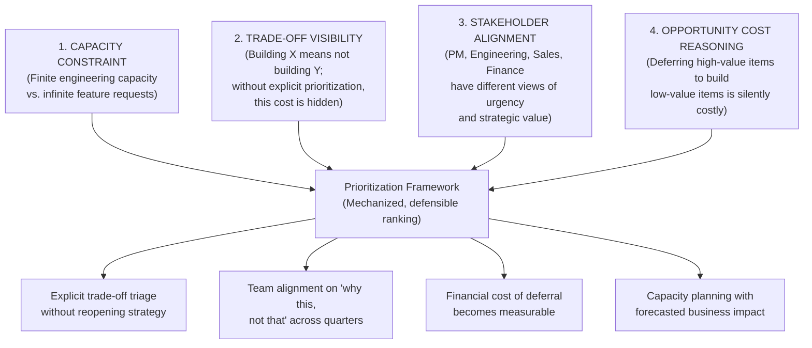
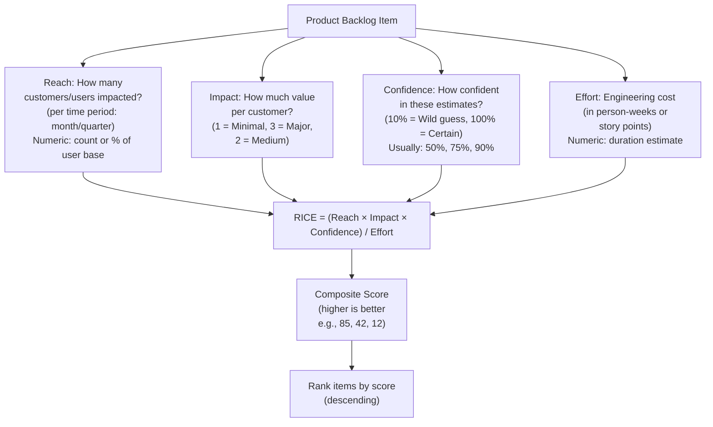
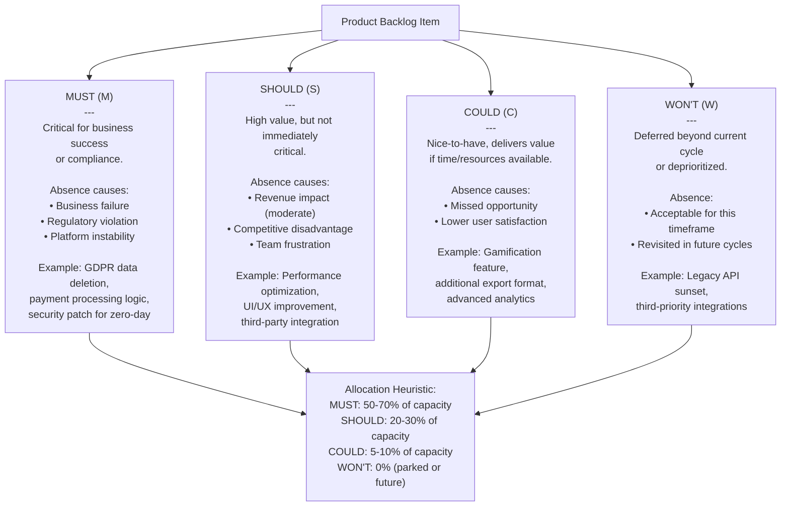
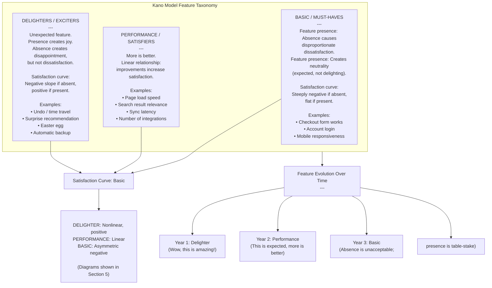
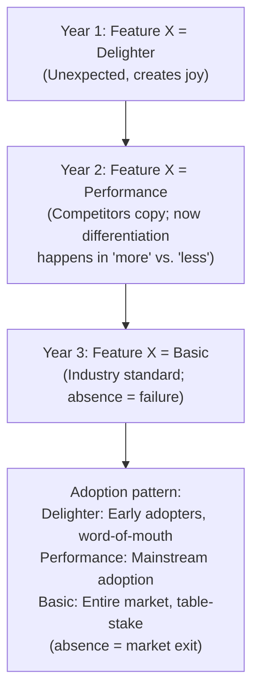
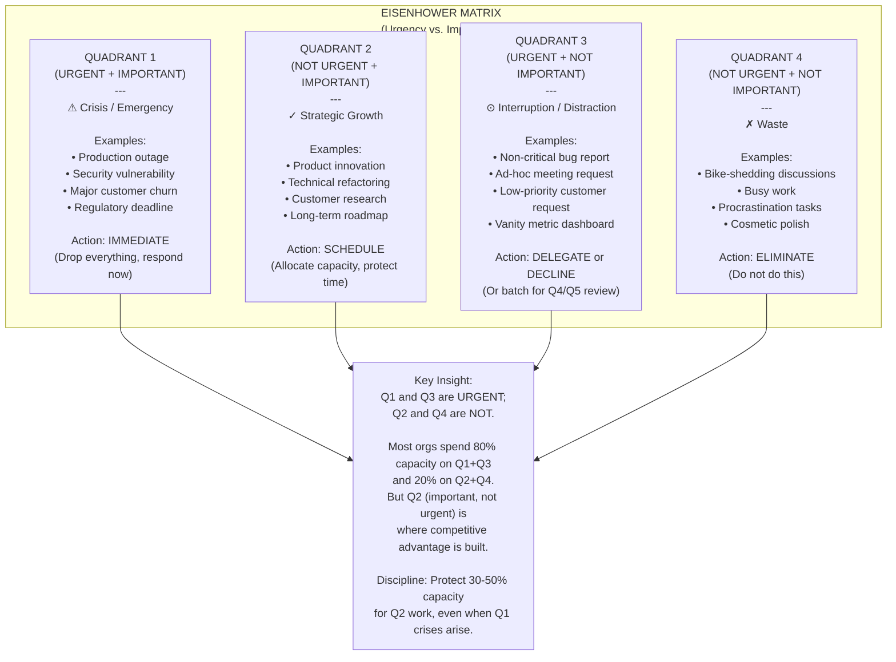
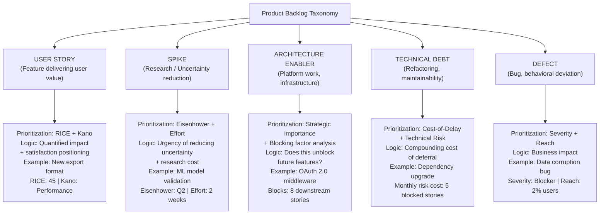
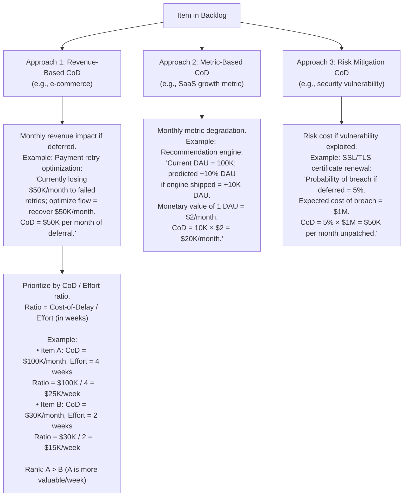
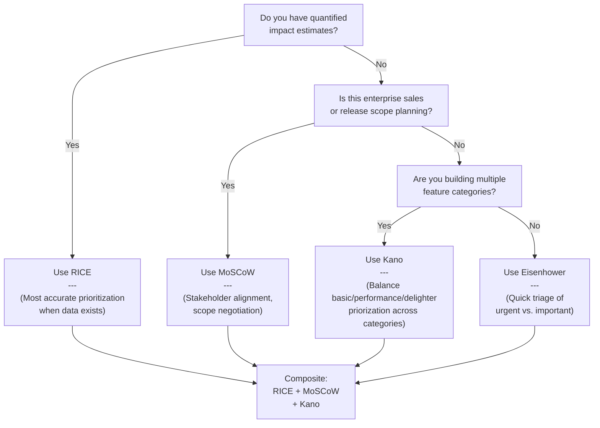
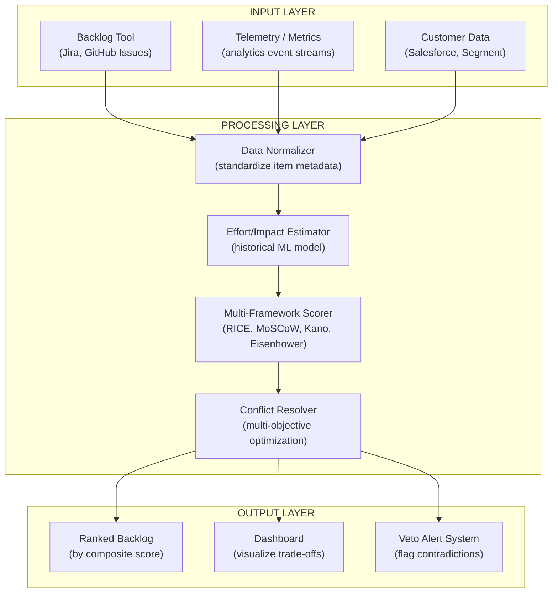

# Chapter 28: Prioritization

Part: [02 — Design Thinking and Product Management](PART_OVERVIEW.md) · Subsection: Product Management · Status: Drafted

## 1. Introduction

Prioritization is the decision discipline that governs which work items—features, technical enablers, debt reduction, research initiatives—an engineering organization chooses to build next, given strict constraints on engineering capacity, calendar time, and architectural debt tolerance. Unlike the backlog management taught in [Backlog](CH22_Backlog.md)—which establishes the inventory structure, quality contracts (Definition of Ready / Definition of Done), and dependency topology of items in flight—prioritization answers the higher-stakes question: among all the items in that backlog, which subset should the team commit to building in the next iteration or quarter, and why?

Prioritization is not a single algorithm; it is a discipline that bridges multiple conceptual frameworks (RICE scoring, MoSCoW labeling, Kano modeling, Eisenhower urgency-versus-importance matrices, stakeholder negotiation) and integrates evidence from strategic objectives, customer feedback, financial constraints, technical runway requirements, and organizational political dynamics. The output of prioritization is not a mathematical rank order—it is a *defensible ranking* that stakeholders across Product, Engineering, Finance, and Executive leadership understand, trust, and can explain to their own teams.

This chapter teaches prioritization frameworks and their operational mechanics from first principles to expert-level practice. It covers five core prioritization methodologies and their mechanism, decision logic, and failure modes; composite prioritization frameworks that blend multiple methods to handle organizational complexity; stakeholder negotiation patterns when frameworks disagree; backlog re-prioritization triggers that signal when a ranking should be revisited mid-quarter; and cost-of-delay and opportunity cost reasoning that grounds prioritization in financial and strategic rigor.

Critically, this chapter explicitly scopes its conceptual boundaries relative to adjacent chapters:

- [Backlog](CH22_Backlog.md) owns the **item taxonomy** (Epic, Story, Spike, Enabler, Defect, Debt), the **DEEP criteria** (Detailed, Estimated, Emergent, Prioritized), **Definition of Ready** queues, **dependency topology analysis**, and **continuous refinement loops**. This chapter assumes those structures exist and focuses on which items, once in the refined backlog, should be ranked first in the queue.
- [Roadmaps](CH17_Roadmaps.md) owns the **multi-quarter themes and horizons** (Now / Next / Later) and the **narrative sequencing** of major capability releases. This chapter teaches which prioritization framework drives the selection of items *within* each horizon and how to re-sequence horizons when priorities shift mid-quarter.
- [North Star Metrics](CH25_North_Star_Metrics.md) owns the **organizational health measure** that governs long-term strategic alignment and team OKR (Objectives and Key Results) cascades. This chapter teaches how to factor a team's North Star Metric trajectory into prioritization scoring and when to override North Star optimization in favor of other constraints (technical debt, legal compliance, risk mitigation).
- [Metrics](CH24_Metrics.md) owns **instrumentation architecture**, **event telemetry contracts**, and **impact measurement systems**. This chapter references Metrics' capabilities when discussing the confidence and impact levers within RICE scoring and Kano model validation.
- [Product Strategy](CH15_Product_Strategy.md) owns the **strategy-to-OKR cascade**, **business model hypotheses**, and **competitive positioning**. Prioritization frameworks in this chapter ground backlog decisions in strategic outcomes defined by Product Strategy.
- [Story Mapping](CH20_Story_Mapping.md) owns **narrative user task flows** and **release slicing**. This chapter teaches how to slice work further and re-order release boundaries when prioritization frameworks surface new sequencing insights.

This chapter does not teach organizational change management (that belongs to architecture governance and enterprise frameworks, out of scope). It does not teach statistical hypothesis testing for prioritization validation (that belongs to [Experimentation](CH26_Experimentation.md) and [A/B Testing](CH27_A_B_Testing.md)). It does not teach roadmap communication or executive presentation (that is in [Roadmaps](CH17_Roadmaps.md)).

---

## 2. Historical Evolution

The theory and practice of prioritization has evolved from static, one-time project ranking to continuous, multi-framework rebalancing:

1. **1950s–1970s: Project Management Era and Critical Path Analysis (CPA)**: Project Management methodologies (Program Evaluation and Review Technique (PERT), Critical Path Method (CPM)) established that work items could be ranked by dependency order: first, identify items on the critical path (the longest dependency chain), then rank everything else by slack time (how much delay a task could tolerate without delaying the project). This was a mechanistic approach that worked when projects had a known end date and stable requirements.

2. **1980s–1990s: Prioritization Matrices and Scoring Systems**: As product management emerged as a discipline, practitioners like Kano, Noriaki, and others developed scoring matrices to rank features by impact and effort. These early prioritization matrices were refinements of Eisenhower's Urgent-vs.-Important framework (originally used for time management) applied to product roadmaps. The result: a 2x2 matrix where items in the high-impact, low-effort quadrant rise to the top.

3. **2000s: Weighted Scoring and Multi-Factor Analysis**: As software complexity scaled, single-axis prioritization (effort only, or impact only) proved inadequate. Multi-factor scoring frameworks emerged, weighting effort, impact, risk, strategic alignment, and technical dependencies. However, without a principled mechanism for calibrating weights across factors, these frameworks often devolved into subjective point allocation and organizational politics disguised as mathematics.

4. **2008–2012: RICE Scoring and the Lean Product Stack**: Sean McDowell at Intercom formalized the RICE (Reach, Impact, Confidence, Effort) framework, which grounded prioritization in quantified customer impact, confidence levels, and effort tradeoffs. RICE became widely adopted as the first "standardized" prioritization algorithm in startups and later enterprises. Around the same time, MoSCoW (Must / Should / Could / Won't) gained traction as a categorization mechanism for stakeholder alignment in Agile transitions.

5. **2015–2020s: Kano Model Adoption and the Delighters vs. Baseline Trade-Off**: Awareness grew that not all features contribute equally to customer satisfaction or willingness to pay. Kano, Noriaki's earlier model (from the 1980s) experienced a resurgence: distinguishing between *delighters* (surprise features that delight, used once, then expected), *performance features* (where more is better), and *basic features* (table-stake expectations whose absence causes dissatisfaction disproportionately). This reframed prioritization not as "rank by impact" but as "balance across categories to manage satisfaction curves."

6. **2020s–Present: Composite Prioritization and Cost-of-Delay**: As organizations scaled and faced simultaneous pressures (technical debt, competitive threats, revenue targets, talent retention), single-framework prioritization broke down. Modern organizations use composite prioritization: blending RICE, MoSCoW, Kano, and Cost-of-Delay analyses for different item types, then reconciling conflicts via stakeholder negotiation and veto mechanisms. Cost-of-Delay (the financial impact of deferring an item) emerged as a means to make opportunity cost explicit.

---

## 3. Why Prioritization Matters

Prioritization exists to solve four fundamental organizational problems:



- **Capacity Constraints and Ruthless Triage**: An engineering team has a fixed velocity (measured in story points or ideal days per iteration). A typical product backlog contains 2–5 years' worth of feature requests. Without a systematic prioritization framework, teams fall into a "feature factory" pattern: shipping low-impact items because they happen to be at the top of the backlog or because the loudest stakeholder demanded them. Prioritization forces ruthless triage: which items, when built, return the most value per engineering hour?

- **Making Opportunity Cost Transparent**: Every engineering hour spent on Feature A is an hour *not* spent on Feature B. Organizations often hide this opportunity cost by citing reasons ("engineering capacity grew," "we hired more people," "we found efficiencies"), but the math is immutable: fixed capacity + two competing demands = a choice. Prioritization frameworks make that choice explicit and measurable.

- **Stakeholder Alignment Without Consensus Paralysis**: Product managers, engineering leaders, sales, and finance rarely agree on what should be built first. Without a shared prioritization framework, these disagreements block execution for weeks while stakeholders re-litigate strategic importance. A transparent, agreed-upon framework (even if imperfect) enables decisions to proceed: "We used RICE scoring, Finance weighted cost-of-delay more heavily, and here's why we moved Item X ahead of Item Y."

- **Bridging Qualitative and Quantitative Reasoning**: Some prioritization decisions are purely quantitative (cost-of-delay, financial ROI, impact * confidence / effort). Others are qualitative (technical runway for a scalability bottleneck, risk mitigation for a security vulnerability, customer satisfaction for a retention crisis). Effective prioritization frameworks blend both, creating a vocabulary for translating qualitative hunches into quantified factors and vice versa.

---

## 4. Core Concepts

Section 4 teaches the core prioritization methodologies, their mechanics, when to apply each one, failure modes, and composite orchestration patterns.

### 4.1 RICE Scoring (Reach, Impact, Confidence, Effort)

RICE is a quantitative prioritization framework that ranks items by a composite score: **(Reach × Impact × Confidence) / Effort**. It was formalized by Sean McDowell at Intercom and has become the de facto standard in product-led organizations.

#### Mechanism and Definition



- **Reach**: The number of users or customers affected by the work, typically measured as a count (e.g., "5,000 users affected") or as a percentage of the addressable market (e.g., "12% of active users"). Reach should be quantified for the relevant time period (e.g., "in the next quarter" or "annually").
  - *Example*: A feature enabling bulk export affects Power Users (analytics team, finance team), estimated at 500 users per month.
  - *Failure Mode*: Conflating Reach with "awareness" or "marketing eyeballs"; Reach must be tied to *adoption*, not impressions. A marketing campaign might reach 1 million, but only 2% will use the underlying feature.

- **Impact**: The magnitude of value delivered to each affected user, measured on an ordinal scale (Minimal = 1, Medium = 2, Major = 3). Impact is subjective, but the scale is calibrated relative to the product's core value hypothesis.
  - *Example*: A bug fix preventing data loss = Major (3). A UI cosmetic refinement = Minimal (1). A feature enabling users to save 2 hours per week = Major (3).
  - *Failure Mode*: Inflating Impact to justify beloved features. Discipline: Impact = *change in user outcome*, not *presence of feature*.

- **Confidence**: The statistical confidence level attached to Reach and Impact estimates, expressed as a percentage (typically 10%, 25%, 50%, 75%, 90%, 100%). Confidence penalizes speculative items: if you guess Reach and Impact with 50% confidence, the score is halved relative to higher-confidence items.
  - *Example*: A feature based on strong customer feedback and validated user interviews = 90% confidence. A speculative feature based on executive intuition = 50% confidence.
  - *Failure Mode*: Inflating confidence to inflate scores. Discipline: Confidence should reflect *estimation uncertainty*, not optimism.

- **Effort**: The engineering cost to implement the item, typically measured in person-weeks or story points. Effort should include implementation, testing, documentation, and deployment.
  - *Example*: A one-page form validation fix = 0.25 weeks. A new authentication flow requiring backend and frontend work = 3 weeks.
  - *Failure Mode*: Under-estimating Effort (common in speculative features). Discipline: involve engineering leadership, reserve 20–30% buffer for unknowns.

#### RICE Score Calibration and Interpretation

RICE scores are *relative*, not absolute. A score of 100 for Item A vs. 50 for Item B means Item A is twice as valuable per engineering dollar, but this relationship is only valid within a prioritization run. Do not compare RICE scores across different product lines, teams, or time periods without recalibrating (because baseline Reach assumptions differ).

Typical RICE scores for moderate-sized products range from 10 (low-impact, high-effort) to 1,000+ (viral feature, high confidence, low effort). Organize items into buckets:

- **Score > 500**: Tier 1 (urgent prioritization).
- **Score 200–500**: Tier 2 (prioritize in next roadmap cycle).
- **Score 50–200**: Tier 3 (backlog, revisit quarterly).
- **Score < 50**: Tier 4 (deprecate, defer, or parked).

#### Decision Implications

RICE works best for:
- **Feature prioritization** in product-led companies where user impact is quantifiable.
- **Cross-team trade-offs** when multiple teams compete for shared infrastructure or engineering capacity.
- **Quarterly roadmap planning** where items have historical data or validated customer research.

RICE struggles with:
- **Technical enablers** or **infrastructure work** (Reach and Impact are hard to quantify; Effort is usually high).
- **One-off customer commitments** or **contractual obligations** (RICE assumes optionality).
- **Risk mitigation** or **compliance work** (high Effort, low Reach, but business-critical).
- **Items with high uncertainty** (Confidence may need to stay low, collapsing scores even for strategically important work).

#### Common Failure Modes

1. **Reach Inflation**: Teams overstate how many users will adopt a feature. Discipline: use telemetry data from similar past features to calibrate. If a previous feature targeting the same user segment reached 8% adoption, do not assume the next feature will reach 25% without new evidence.

2. **Confidence as Optimism**: Teams assign high confidence (90%) to speculative items ("if we build AI-powered recommendations, we're 90% sure it will work"). Discipline: Confidence should reflect *estimation uncertainty*, not probability of success. If you've never done this before, Confidence ≤ 50%.

3. **Effort Underestimation**: Teams underestimate engineering work to inflate RICE scores. Discipline: add 20–30% buffer and involve senior engineers in Effort estimation.

4. **Ignoring Edge Cases**: RICE ignores strategic importance that cannot be quantified numerically (e.g., "we need a scalability enabler to support a 10x user growth forecast"). Discipline: track strategic overrides separately and document why RICE was bypassed.

#### Concrete Scenario: E-Commerce Search Prioritization

An e-commerce platform has three high-priority items competing for Q3 engineering capacity:

1. **Faceted search refinement** (filter by color, size, brand): Reach = 45% of users, Impact = 2 (moderate—helps find products faster), Confidence = 90% (validated by user research), Effort = 2 weeks. RICE = (45% × 2 × 0.9) / 2 = 0.405 (scaled to 40.5 if Reach is absolute count, e.g., 450 users).

2. **Recommendation engine** (ML-based "you might also like"): Reach = 70% of users, Impact = 3 (high—drives revenue), Confidence = 50% (untested in market), Effort = 8 weeks. RICE = (70% × 3 × 0.5) / 8 = 0.13 (scaled to 13).

3. **Search performance optimization** (reduce latency from 500ms to 100ms): Reach = 100% of users, Impact = 2 (moderate—faster search, but not core value), Confidence = 95% (engineering-confident), Effort = 4 weeks. RICE = (100% × 2 × 0.95) / 4 = 0.475 (scaled to 47.5).

Ranking: 3 (Search Optimization, 47.5) > 1 (Faceted Search, 40.5) > 2 (Recommendation Engine, 13). Despite the recommendation engine's higher strategic appeal, RICE surfaces that the search optimization delivers more value per engineering hour and should be tackled first. This does not mean skip recommendations; it means defer recommendations to Q4 after optimizing search and faceted refinement.

---

### 4.2 MoSCoW Prioritization (Must / Should / Could / Won't)

MoSCoW is a categorization framework (not a scoring framework) that labels items into four buckets based on business criticality and stakeholder expectations. MoSCoW is commonly used in Agile transitions and SAFe (Scaled Agile Framework) Program Increments (PIs).

#### Mechanism and Definition



- **MUST**: Items without which the product cannot function, or which trigger business/legal failure if absent. MUSTs are non-negotiable; they have implicit infinite priority. Include compliance (GDPR data deletion), security (vulnerability patches), operational continuity (incident response, stability), and contractual obligations (customer commitments).
  - *Decision Heuristic*: If absence of the item causes the business to fail, revenue to drop below targets, or legal liability, it is a MUST.

- **SHOULD**: Items that deliver significant value and are expected by stakeholders, but are not immediately business-critical. SHOULDs improve product competitiveness and user satisfaction but can be deferred to the next iteration without breaking the product.
  - *Decision Heuristic*: If absence of the item reduces competitive advantage or causes team churn, it is a SHOULD.

- **COULD**: Items that are nice-to-have, deliver value under optimal conditions, but can be dropped if capacity constraints tighten. COULDs often represent polish, optimization, or exploratory work.
  - *Decision Heuristic*: If absence of the item has zero impact on business metrics or user retention, it is a COULD.

- **WON'T**: Items deprioritized for the current cycle (quarter, roadmap horizon) but may be revisited later. WONTs are not canceled; they are explicitly parked and re-evaluated periodically.
  - *Decision Heuristic*: If the item is valuable but the opportunity cost of building it now outweighs the benefit, it is a WON'T.

#### MoSCoW Process and Stakeholder Alignment

MoSCoW is typically applied in a facilitated workshop with cross-functional stakeholders (PM, Engineering, Finance, Sales, Operations). The exercise forces difficult conversations:

1. **Nomination Phase**: Each stakeholder nominates items they believe are MUSTs.
2. **Challenge Phase**: The group challenges each nomination: "If we removed this item, would the business actually fail?" This conversation often reveals that sacred-cow features are actually SHOULDs or COULDs.
3. **Allocation Phase**: Once MUSTs are locked, allocate capacity: typically 50–70% of sprints to MUSTs, 20–30% to SHOULDs, 5–10% to COULDs.
4. **Re-Ranking Within Categories**: Within each category, rank items by RICE score or urgency.

#### Decision Implications and Failure Modes

- **When to Use MoSCoW**: Ideal for enterprise roadmap planning, portfolio-level decisions, and negotiating release scope with stakeholders. Particularly valuable when political pressure inflates priority: framing the conversation as "MUST vs. SHOULD vs. COULD" forces explicit reasoning.
- **Failure Mode 1 — MUST Creep**: Over time, the MUST category inflates. "This feature is business-critical" becomes the default claim. Discipline: challenge MUSTs rigorously; a truly critical item is rare (typically < 20% of backlog).
- **Failure Mode 2 — Bucket Conflicts**: Different stakeholders disagree on which bucket an item belongs to. Finance says "cost optimization is a MUST"; Engineering says "it's a COULD"; Sales says "it's a SHOULD." Discipline: define clear decision criteria upfront and document disagreements as "Finance MUST, Engineering COULD, compromise = SHOULD."
- **Failure Mode 3 — WON'T = Demoralized Deprioritization**: Teams feel demoralized when work they believe in is marked WON'T. Discipline: document *why* the item was WON'T (what would need to change to revisit?) and commit to a re-evaluation date (e.g., "revisit in Q4 if [market condition] or [new data] emerges").

#### Concrete Scenario: SaaS Platform Release Planning

A SaaS platform is planning a major release and must decide what ships in Q3:

- **MUST**: Multi-tenant isolation (security); SSO (Single Sign-On) (enterprise sales blocker); backup and disaster recovery (SLA compliance).
- **SHOULD**: Advanced reporting (customer feedback, competitive parity); API versioning (technical debt); mobile app optimization (growth metric tied to mobile users).
- **COULD**: Dark mode (nice-to-have, low adoption predicted); advanced tagging system (exploratory feature).
- **WON'T**: Blockchain integration (strategic pivot postponed); on-premises deployment (low customer demand).

Capacity allocation: Assume 10 person-weeks for Q3.
- MUST: ~6 weeks (multi-tenant, SSO, backup).
- SHOULD: ~3 weeks (reporting, API, mobile).
- COULD: ~1 week (dark mode).
- WON'T: 0 weeks.

---

### 4.3 Kano Model (Delighters vs. Basic Features vs. Performance Features)

The Kano Model, developed by Kano Noriaki in the 1980s, categorizes features by their relationship to customer satisfaction. It reveals that not all features contribute equally to satisfaction curves, and that satisfaction evolves over time: today's delighter becomes tomorrow's table stake.

#### Mechanism and Definition



The Kano Model teaches that customer satisfaction is not a single, uniform function of feature count. Instead, satisfaction is segmented into three dimensions:

1. **Basic (Must-Haves)**: Features whose *absence* causes disproportionate dissatisfaction, but whose *presence* creates merely neutral acceptance. The satisfaction curve is nonlinear and asymmetric: presence does not create satisfaction, only absence creates dissatisfaction.
   - *Example*: A banking app must allow users to check their account balance. If the balance is missing, users are infuriated. If the balance is present, users are indifferent (it is expected).
   - *Decision Implication*: Invest minimally in basic features—just enough to meet expectations. Over-investing in basic features (e.g., building 10 different balance display options) does not increase satisfaction; it wastes engineering capacity.

2. **Performance (Satisfiers)**: Features where more is better. The satisfaction curve is roughly linear: improvements linearly increase satisfaction. Performance features are competitive battlegrounds where differentiation happens.
   - *Example*: Page load time. Reducing latency from 500ms to 250ms increases satisfaction; reducing further to 100ms increases satisfaction further. The relationship is monotonic.
   - *Decision Implication*: Invest heavily in performance features where you can differentiate from competitors. This is where engineering excellence compounds.

3. **Delighters (Exciters)**: Features that are not expected. Their presence creates disproportionate joy and word-of-mouth adoption. Their absence creates disappointment but not dissatisfaction (the feature was not expected).
   - *Example*: Google Docs's real-time collaboration and undo history (when it first launched) were delighters. Microsoft Word users did not expect real-time collaboration; its absence did not cause dissatisfaction in 1995. But its presence in Google Docs caused joy and differentiation.
   - *Decision Implication*: Invest in delighters to create competitive advantage and viral adoption. However, be aware that today's delighter becomes tomorrow's basic (Section 6 covers this evolution).

#### Satisfaction Evolution Curves

The Kano Model predicts that features evolve through the three categories over time:



**Example: Real-Time Sync in Collaboration Tools**:
- **2010 (Delighter)**: Google Docs introduces real-time collaborative editing. Competitors (Microsoft, Dropbox) do not have it. Users are amazed.
- **2014 (Performance)**: Real-time sync is now expected. Differentiation shifts to "how fast is the sync?" and "does it work offline?" Latency becomes the battleground.
- **2020 (Basic)**: Real-time sync is table-stake. Products without it are non-viable. Absence creates dissatisfaction; presence creates neutrality.

#### Decision Implications

Kano Model prioritization forces different strategies for different feature categories:

| Feature Type | Prioritization Strategy | Budget Allocation | Risk |
|---|---|---|---|
| **Basic** | Just enough to meet expectations. Over-deliver creates no competitive advantage. | 20–30% of capacity. | Under-investing causes market failure. Over-investing wastes capacity. |
| **Performance** | Differentiate aggressively. Lean into competitive advantages. | 40–50% of capacity. | Competitors will copy; keep innovating. |
| **Delighter** | Invest in surprise and delight. Hire creative talent. | 10–20% of capacity. | Low ROI on individual features; high ROI on brand loyalty. |

#### Common Failure Modes

1. **Basic Feature Creep**: Teams over-invest in basic features (e.g., building 5 different login UX patterns) to "improve" satisfaction. This wastes capacity without increasing satisfaction. Discipline: basic features should be *invisible* (present but unremarkable).

2. **Ignoring Feature Evolution**: Teams assume a delighter will remain a delighter forever. It will not. Within 2–3 years, competitors copy it, and it becomes a performance feature, then basic. Discipline: actively track which features are moving through the evolution cycle and shift budget accordingly.

3. **Insufficient Delighter Investment**: Teams under-invest in delighters because they are "risky" or "low ROI." But delighters drive word-of-mouth adoption, brand loyalty, and willingness to pay. Discipline: reserve 10–20% of capacity explicitly for experimentation and delight.

4. **Measuring Satisfaction Linearly**: Teams assume all feature improvements create linear satisfaction gains. They do not. A 5% improvement in a basic feature creates almost no satisfaction change. A 5% improvement in a performance feature creates linear gains. A new delighter creates nonlinear satisfaction jumps. Discipline: validate feature categorization via user research (survey, interview, usage telemetry) before building.

#### Concrete Scenario: Video Streaming Platform Feature Prioritization

A video streaming platform must allocate Q3 capacity across feature investments:

- **Basic Features** (table-stake, must-have):
  - Search and discovery function (users expect this; absence = app is dead).
  - Playback controls (play, pause, skip).
  - **Kano Action**: Maintain minimum quality (no bugs, fast search), allocate 2 weeks, do not over-invest.

- **Performance Features** (competitive battleground):
  - Recommendation engine quality (which videos appear first?).
  - Streaming latency and quality adaptation (adapt to network).
  - Download for offline playback (watch without internet).
  - **Kano Action**: Differentiate aggressively. Allocate 5 weeks to improving recommendation relevance; allocate 3 weeks to adaptive bitrate streaming.

- **Delighters** (surprise and delight):
  - Collaborative watch parties (watch together in real-time, chat).
  - Personalized intro skip (ML learns your intro patience, skips automatically).
  - **Kano Action**: Allocate 2 weeks to experimentation; gather feedback to confirm these are delighters (not basic or performance).

Capacity allocation: 10 weeks.
- Basic: 2 weeks.
- Performance: 8 weeks (8 weeks).
- Delighter: 0 weeks initially; revisit if delighter validation data is strong.

---

### 4.4 Eisenhower Matrix (Urgency vs. Importance)

The Eisenhower Matrix ranks items into four quadrants using two axes: Urgency (is this needed soon?) and Importance (is this strategically valuable?). While simpler than RICE or Kano, it is useful for quickly triaging operational crises and competing demands.

#### Mechanism and Definition



- **Quadrant 1 (Urgent + Important)**: Crisis and emergency work. Examples: production outages, security vulnerabilities, regulatory deadlines, major customer churn. These are non-negotiable; respond immediately.

- **Quadrant 2 (Not Urgent + Important)**: Strategic work that builds competitive advantage long-term. Examples: product innovation, technical infrastructure, customer research, long-term roadmap planning. This is where compound value is created, but it is easy to defer because there is no immediate deadline.

- **Quadrant 3 (Urgent + Not Important)**: Interruptions and distractions that feel urgent but do not drive strategic value. Examples: ad-hoc customer requests, non-critical bug reports, meeting requests. The key insight: *urgent* does not mean *important*. These should be delegated or batched for periodic review.

- **Quadrant 4 (Not Urgent + Not Important)**: Waste and procrastination. Do not spend capacity here.

#### Decision Implications and Failure Modes

The critical insight from the Eisenhower Matrix is that **urgency and importance are independent dimensions**. Most organizations get trapped in Quadrant 1 + Quadrant 3 (reactive mode), sacrificing Quadrant 2 (strategic work) to handle urgency. Over time, this leads to stagnation: the product becomes technically fragile, roadmaps drift, and competitive advantage erodes.

**Discipline**: protect 30–50% of engineering capacity explicitly for Quadrant 2 work (strategic, not-urgent). This prevents crises from compressing strategic work to zero and ensures long-term competitiveness.

**Failure Mode — Urgency Inflation**: Teams classify items as Quadrant 1 (urgent) when they are actually Quadrant 3 (urgent-but-not-important). "Sales says a customer needs this urgently, so it is Quadrant 1." Not necessarily. If the customer demand is non-strategic (low revenue, low adoption predicted, one-off), it is Quadrant 3 and should be batched or declined. Discipline: challenge urgency claims; separate true crises from political pressure.

#### Concrete Scenario: SaaS Platform Mid-Quarter Triage

A SaaS platform is mid-quarter and faces competing demands:

- **Q1 (Urgent + Important)**: A major enterprise customer's data is corrupted due to a database sync bug. Immediate remediation required. Action: Drop roadmap, respond now.
- **Q2 (Not Urgent + Important)**: Multi-tenancy infrastructure refactoring required to support a 10x scale-out forecast. Not urgent; no immediate deadline. But strategically critical. Action: Allocate 40% of engineering capacity to this work over the next 2 quarters, protect it from Q1 interruptions.
- **Q3 (Urgent + Not Important)**: A small customer requests a custom export format (CSV variant). Urgent to them; low strategic value to the platform. Action: Delegate to a junior engineer, batch similar requests quarterly, or offer a paid consulting option.
- **Q4 (Not Urgent + Not Important)**: A proposal to redesign the settings page UI because "it looks dated." Action: Decline or defer to Q4.

---

### 4.5 Composite Prioritization and Veto Mechanisms

No single prioritization framework is sufficient for all organizational contexts. Modern organizations use composite prioritization: applying multiple frameworks to different item types and then resolving conflicts via veto mechanisms and stakeholder negotiation.

#### Framework Selection by Item Type

Different item types benefit from different prioritization lenses:



- **User Stories**: Apply RICE + Kano. Stories directly deliver user value; RICE quantifies that value. Kano ensures you balance basic, performance, and delighter investments.
- **Spikes**: Apply Eisenhower + Effort. Spikes are research; prioritize based on urgency of reducing uncertainty and effort required. Q2 (not urgent but important) spikes unblock future features.
- **Architecture Enablers**: Apply blocking factor analysis. Which enablers unblock the most downstream features? Prioritize enablers that have high blocking power.
- **Technical Debt**: Apply cost-of-delay analysis. What is the monthly cost (in delayed features, increased defects, or velocity drag) of leaving this debt unpaid?
- **Defects**: Apply severity-impact triage. Severity = how broken is the user experience? Impact = how many users are affected? Blocker + high-impact defects jump to Q1 immediately.

#### Composite Scoring Example

Consider an item that has competing signals:

| Framework | Score | Signal |
|---|---|---|
| **RICE** | 120 | Tier 2 (good ROI, not urgent) |
| **Eisenhower** | Q2 | Not urgent, strategic |
| **Kano** | Performance | Competitive differentiation |
| **Cost-of-Delay** | 10 points/week deferred | Moderate opportunity cost |
| **Strategic Alignment** | High (aligns with OKR) | Strong |

Composite signal: **Prioritize in next capacity window** (not Q1, but Q2/Q3). It is strategically aligned, has good ROI, and is a performance differentiator. Cost-of-delay is moderate, so a few-week deferral is acceptable if Q1 capacity is fully consumed by crises.

#### Veto Mechanisms and Stakeholder Negotiation

When frameworks conflict, veto mechanisms resolve escalations. A veto is a rare, explicit override of quantitative ranking by a stakeholder with authority (e.g., VP Product, CTO, CEO). Vetos are tracked and documented; serial vetos signal that the prioritization framework is not capturing strategic reality and should be revisited.

**Example Escalation**:

RICE scoring ranks Item A (recommendation engine, RICE = 250) ahead of Item B (compliance data encryption, RICE = 45). But the CTO flags a compliance deadline (Q4 regulatory requirement) and vetoes to move Item B to Q2. Veto justified: "Legal and regulatory requirements override quantitative feature prioritization."

**Veto Documentation Template**:

```
VETO RECORD
----------
Item: [Item Name]
Original Rank: [Position before veto]
Vetoing Stakeholder: [Name / Role]
Veto Reason: [Explicit reasoning]
Affected Frameworks: [Which frameworks were overridden?]
Expected Impact: [What changes because of this veto?]
Escalation Date: [When was this decision made?]
Precedent: [Will this veto set a precedent for future decisions?]
```

Vetos are not shameful; they are necessary when organizational context (legal, competitive, financial) diverges from quantitative metrics. However, excessive vetos (e.g., 10+ per quarter) signal that prioritization frameworks are not well-calibrated to business reality.

---

### 4.6 Prioritization ROI and Cost-of-Delay

While RICE scores provide a quantitative ranking, they do not directly translate to financial ROI. Cost-of-Delay (CoD) is a financial framework that quantifies the business cost of deferring an item for one time period (e.g., one week or one month).

#### Mechanism and Definition

Cost-of-Delay measures the monthly revenue or metric impact forgone by not shipping an item.



#### Decision Implications

Cost-of-Delay reasoning is particularly valuable for:

1. **Revenue-Impacting Features**: Items that directly affect revenue (payment optimization, pricing changes, subscription feature gating).
2. **Growth Features**: Items that affect core metrics (signups, activation, retention, revenue-per-user).
3. **Risk Mitigation**: Items that defer financial, legal, or operational risk (security patches, compliance enablers, disaster recovery).
4. **Time-Sensitive Opportunities**: Competitive moves, market windows (e.g., holiday feature launches).

**Concrete Scenario: E-Commerce Platform**

An e-commerce platform has three items competing for engineering capacity:

1. **Payment Retry Optimization**: Currently 5% of transactions fail on first attempt; retry optimization recovers 60% of those failed transactions. Monthly transaction volume = 1M. Revenue per transaction = $50. Current lost revenue = 1M × 5% × $50 = $2.5M per month. Optimization recovers 60% of that = $1.5M recovered per month. CoD = $1.5M/month. Effort = 2 weeks.

2. **Mobile App Download Tracking**: Missing Apple SKAdNetwork (StoreKit) integration causes analytics blindness for iOS downloads. Estimated impact = cannot measure CAC (Customer Acquisition Cost) for 40% of new iOS users. Monetized as reduced marketing efficiency = $500K/month lost. CoD = $500K/month. Effort = 1 week.

3. **Personalized Recommendations**: A/B test shows recommendations increase average order value (AOV) by 8%. Current AOV = $75. Current monthly orders = 100K. Revenue gain = 100K × $75 × 8% = $600K/month. CoD = $600K/month. Effort = 5 weeks.

CoD / Effort Ranking:
1. Mobile tracking: $500K / 1 = $500K/week (Tier 1).
2. Payment retry: $1.5M / 2 = $750K/week (Tier 1).
3. Recommendations: $600K / 5 = $120K/week (Tier 2).

Prioritize: Payment Retry (week 1–2), Mobile Tracking (week 3), Recommendations (week 4–8). This ranking surfaces that payment retry and mobile tracking are high-urgency, modest-effort items that compound toward $2M in monthly revenue, while recommendations, though valuable, can wait until week 4.

---

### 4.7 Stakeholder Negotiation and Conflict Resolution in Prioritization

Prioritization frameworks are tools for structuring conversation, not for eliminating stakeholder disagreement. Different stakeholders (Product, Engineering, Finance, Sales, CEO) have legitimate but different value systems:

- **Product**: Maximizes user satisfaction and competitive differentiation.
- **Engineering**: Minimizes technical debt and maintains velocity.
- **Finance**: Maximizes revenue and minimizes cost.
- **Sales**: Maximizes near-term customer commitments.
- **CEO**: Maximizes organizational survival and long-term strategic position.

When these value systems conflict, stakeholders must negotiate. Prioritization frameworks provide a shared language for that negotiation.

#### Negotiation Patterns

**Pattern 1: The Finance Override**

Sales commits a customer to a custom feature. Finance calculates CoD and finds that the custom work (8 weeks, high opportunity cost) is not justified by the customer's revenue impact (low ACV, one-off commitment). Negotiation:

- **Finance position**: "This custom work has negative ROI; deprioritize it."
- **Sales position**: "This is a strategic customer; losing this deal signals weakness in the market."
- **Resolution**: Quantify the customer's true strategic value (retention rate, upsell probability, brand credibility). If strategic value justifies the 8-week opportunity cost, override RICE scoring via documented veto. If not, negotiate with Sales to defer custom work or offer consulting as a paid service.

**Pattern 2: The Technical Debt Escalation**

Engineering argues that a major refactoring (4 weeks) is critical to maintain velocity. RICE score is low (50, because Reach is internal, not customer-facing). Product pushes back: "RICE says prioritize customer features; refactoring is lower priority." Negotiation:

- **Engineering position**: "If we don't do this refactoring, velocity will drop 30% in 6 months."
- **Product position**: "RICE does not quantify internal benefits; I trust your velocity forecast, but I need to prioritize customer value."
- **Resolution**: Quantify the cost-of-deferral: if velocity drops 30%, how many customer features will be delayed? Translate velocity degradation into missed revenue or metric impact. Often, a 4-week refactoring that preserves 30% velocity yields 10s of weeks of capacity recovery over a quarter. Reframe as: "Pay 4 weeks now to unlock 10+ weeks later" and re-score via CoD logic.

**Pattern 3: The Strategic Pivot**

CEO signals a strategic priority shift (e.g., "we're pivoting to enterprise, not SMB"). This cascades into backlog changes: enterprise-facing features jump in priority; SMB-specific features drop. Engineering and Product have invested in SMB roadmaps and feel the pivot is risky. Negotiation:

- **CEO position**: "Market dynamics require pivot; SMB segment is saturated."
- **Engineering/Product position**: "Abandoning SMB work mid-cycle is wasteful; what about existing SMB customers?"
- **Resolution**: Use MoSCoW to rationalize the transition. Mark existing SMB commitments as MUST (honor them through next quarter). Classify new SMB work as WON'T (deprioritized). Allocate new capacity to enterprise enablers (MUST) and enterprise features (SHOULD). This provides a clear transition path and prevents the sense of arbitrary abandonment.

#### Negotiation Disciplines

1. **Make Trade-offs Explicit**: "We can ship Item A (4 weeks) or Item B (3 weeks) but not both. Which one creates more value?" Forces concrete choices instead of abstract debates.

2. **Quantify Disagreement**: If stakeholders disagree on priority, quantify the disagreement. "Engineering scores this as 30 (low priority), Product scores it as 200 (high priority). What's driving the 6x gap?" Often, one stakeholder has information the other does not.

3. **Use Veto Sparingly**: Vetos are necessary but should be rare (< 2–3 per quarter). Excessive vetos signal framework misalignment; revisit assumptions.

4. **Document Decisions**: Publish prioritization decisions and reasoning. This prevents stakeholders from relitigating the same battles quarterly and provides feedback for framework refinement.

---

### 4.8 Backlog Re-Prioritization Triggers

Strategic prioritization is not a one-time, quarterly event. Market conditions, technical constraints, and business dynamics change mid-quarter, signaling that backlog prioritization should be revisited. Triggers for re-prioritization:

#### Trigger 1: Scope Changes

**Signal**: New customer requirement, feature request, or market opportunity emerges.

**Decision**: Does this item change the top 5 priorities? If yes, halt current planning and re-run RICE/MoSCoW. If no, add to backlog and review next cycle.

**Example**: A major customer (10% of revenue) requests a custom feature. Run RICE: Reach = 100 (this customer), Impact = 3 (enables $2M contract renewal), Confidence = 90%, Effort = 2 weeks. RICE = (100 × 3 × 0.9) / 2 = 135. If this ranks top 5, re-prioritize.

#### Trigger 2: Technical Bottleneck Discovery

**Signal**: During sprint planning, engineering discovers that a technical dependency (e.g., microservice API contract) is missing and blocks 3 planned stories.

**Decision**: Promote the missing enabler to MUST (Quadrant 1) and delay the 3 blocked stories until the enabler ships.

**Example**: A team plans to ship three payment-related features in Q3. During sprint planning, engineering discovers that the payment processor's webhook handler is not implemented. Immediately promote webhook handler to MUST, allocate 1 week, and reschedule the payment features to week 2.

#### Trigger 3: Metric Performance Surprise

**Signal**: Telemetry reveals that a deployed feature is underperforming (e.g., adoption is 50% below forecast) or outperforming (adoption is 300% above forecast).

**Decision**: If underperforming, revisit RICE scoring (Reach and Impact were overestimated). If outperforming, accelerate related items (delighters, adjacent features) to capitalize on the momentum.

**Example**: A new onboarding flow launches and achieves 80% adoption (vs. 50% forecast). Kano Model signals this is a delighter. Immediately allocate next-sprint capacity to build on the delighter: advanced onboarding features, referral programs, etc.

#### Trigger 4: Competitive Threat or Market Window

**Signal**: Competitors ship a feature or a market window (e.g., holiday season, new regulation) is closing.

**Decision**: Re-run RICE with updated Confidence levels. If RICE or CoD justifies, move competing items to Q1 (crisis mode).

**Example**: A competitor ships a real-time collaboration feature. Your platform still lacks this. Immediately re-run RICE: Reach now includes "all customers considering competitors," Impact is now "risk of churn." RICE jumps to 500+ (crisis priority). Allocate engineering to match competitive feature within 4–6 weeks.

#### Trigger 5: Capacity Changes

**Signal**: Engineering capacity changes due to hiring, attrition, or shifting focus (e.g., oncall duty, incident response).

**Decision**: Re-calculate capacity-constrained allocation and re-prioritize. MoSCoW SHOULD/COULD items may drop to WON'T if capacity decreased.

**Example**: Your team planned 10 person-weeks for Q3, assigning 5 weeks to a major refactoring (Q2). An engineer leaves; capacity drops to 8 person-weeks. RICE rankings stay the same, but you must now defer or descope the refactoring to fit within 8 weeks.

---

## 5. Internal Working and Mechanisms

### 5.1 Prioritization Workshop Process

A typical prioritization workshop (quarterly planning or mid-quarter re-prioritization) follows this structure:

```mermaid
flowchart TD
    Step1["STEP 1: Data Preparation\n(2–4 hours prior)"]
    Step2["STEP 2: Framework Selection\n(15 minutes, workshop)")
    Step3["STEP 3: Nomination & Estimation\n(30–60 minutes)"]
    Step4["STEP 4: Scoring & Ranking\n(30–45 minutes)"]
    Step5["STEP 5: Conflict Resolution\n(15–30 minutes)"]
    Step6["STEP 6: Capacity Allocation\n(15 minutes)"]
    Step7["STEP 7: Publish & Communicate\n(1–2 days post-workshop)"]
    
    Step1 --> Step2 --> Step3 --> Step4 --> Step5 --> Step6 --> Step7
    
    Step1_Detail["- Gather backlog from tool\n- Pull customer feedback, metrics\n- Research competitive landscape\n- Prepare RICE template"]
    Step2_Detail["- Which framework for this cycle?\n- RICE for features?\n- MoSCoW for enterprise scope?\n- Hybrid?"]
    Step3_Detail["- Each stakeholder nominates\n  items they believe are high-priority\n- Engineering estimates Effort\n- PM/Data estimates Reach/Impact"]
    Step4_Detail["- Calculate scores\n  (Automated: spreadsheet, Jira plugin)\n- Rank by score\n- Identify top quartile"]
    Step5_Detail["- Flag items with large\n  disagreement\n- Re-discuss & re-estimate\n- Veto escalations"]
    Step6_Detail["- Allocate sprints to\n  MUST/SHOULD/COULD\n- Assign owners\n- Set capacity cushion (20%)"]
    Step7_Detail["- Document decisions\n- Communicate to full org\n- Update Roadmaps"]
```

### 5.2 RICE Scoring Formula in Practice

The RICE formula is deceptively simple: **(Reach × Impact × Confidence) / Effort = Score**. However, calibrating each component requires discipline:

**Reach Calibration**:
- If your product has 1M monthly active users (MAUs), and a feature affects "power users," estimate what percentage? 5%? 10%? Use historical data: "Previous feature targeting power users reached 8% adoption; assume 8% for this feature as well."
- If you lack historical data, run a quick user interview (5–10 users) to validate reach assumptions.
- Avoid "everyone will use this"; Reach should be conservative.

**Impact Calibration**:
- Use a fixed ordinal scale: Minimal = 1, Medium = 2, Major = 3. Do not use arbitrary numbers (5, 7, 10).
- Define impact in terms of user outcomes: Does this feature save time, increase revenue, reduce frustration, enable new capabilities?
- Map Kano categories to impact: Basic features often have high reach but low impact (presence is expected, so impact = 1). Delighters have moderate reach but high impact (e.g., "saves 2 hours per week" = 3).

**Confidence Calibration**:
- Use increments: 10%, 25%, 50%, 75%, 90%, 100%.
- 90%+: Feature is based on strong customer research, validated via pilot, or direct customer request.
- 75%: Feature is based on customer feedback + competitive research; good confidence.
- 50%: Feature is speculative; based on PM intuition or market trend, no direct validation.
- 25%: Feature is a guess; high uncertainty on whether customers want it.
- 10%: Feature is a long shot; include only if other factors (strategic importance, technical enabler) justify.

**Effort Calibration**:
- Include implementation, testing, deployment, documentation, and onboarding (training for users/support team).
- Use story points or ideal days; convert to weeks: 5 story points per ideal day, 5 ideal days per week (40 hours).
- Add 20–30% buffer: "Engineering estimates 8 weeks; add 30% buffer = 10.4 weeks assumed effort."
- If effort is highly uncertain, note it; high uncertainty may justify lower confidence or wider effort range.

---

### 5.3 Kano Model Validation

Validating which category a feature belongs to (basic, performance, delighter) requires user research:

**Survey Method**:

Ask users two questions per feature:

1. "If this feature were present, how would you feel?" (Presence)
   - Answers: Very happy, Happy, Neutral, Unhappy, Very unhappy.

2. "If this feature were absent, how would you feel?" (Absence)
   - Answers: Very happy, Happy, Neutral, Unhappy, Very unhappy.

**Kano Categorization Logic**:

| Presence Answer | Absence Answer | Category | Reasoning |
|---|---|---|---|
| Very happy / Happy | Unhappy / Very unhappy | **Delighter** | Presence creates joy; absence creates dissatisfaction. |
| Happy / Neutral | Unhappy / Very unhappy | **Performance** | Presence is good; absence is bad; linear relationship. |
| Neutral | Unhappy / Very unhappy | **Basic** | Presence creates no happiness; absence creates dissatisfaction. |
| Any | Happy / Neutral | **Indifferent** | Feature is not valued; deprioritize. |

**Example: E-Commerce Search Facets**

1. Survey: "If we added color/size/brand filters to search, how would you feel?"
   - 50% very happy, 30% happy, 20% neutral.
   - "If we did NOT have these filters, how would you feel?"
   - 60% unhappy, 30% very unhappy, 10% neutral.

2. Analysis: Presence = happy; absence = unhappy. Conclusion: **Performance Feature**. Users expect search filters; more options (colors, sizes) increase value. Prioritize expanding filter options.

---

## 6. Decision Frameworks and Guidance

### 6.1 Framework Selection Decision Tree

When should you use RICE vs. MoSCoW vs. Kano?



---

## 7. Architecture Patterns and High-Level Design

### 7.1 Prioritization Engine Architecture

At scale, many organizations build software systems to automate prioritization scoring and conflict resolution. A typical Prioritization Engine architecture:



---

## 8. Code Examples

### 8.1 RICE Scoring Engine (TypeScript)

A production-grade RICE scoring calculation engine:

```typescript
// rice-scoring-engine.ts
interface RICEItem {
  id: string;
  name: string;
  reach: number;        // count of affected users per month
  impact: number;       // 1 (minimal), 2 (medium), 3 (major)
  confidence: number;   // 0.1 to 1.0 (10% to 100%)
  effort: number;       // person-weeks
  category?: 'feature' | 'spike' | 'enabler' | 'debt' | 'defect';
}

interface RICEScore {
  item: RICEItem;
  score: number;
  tier: string;
  roi: number;          // score per week of effort
}

export class RICEScoringEngine {
  /**
   * Calculate RICE score for a single item.
   * Formula: (Reach × Impact × Confidence) / Effort
   */
  public scoreItem(item: RICEItem): RICEScore {
    if (item.effort <= 0) {
      throw new Error(`Effort must be > 0; got ${item.effort}`);
    }
    if (item.confidence < 0 || item.confidence > 1) {
      throw new Error(`Confidence must be 0–1; got ${item.confidence}`);
    }
    if (item.impact < 1 || item.impact > 3) {
      throw new Error(`Impact must be 1–3; got ${item.impact}`);
    }

    const numerator = item.reach * item.impact * item.confidence;
    const score = numerator / item.effort;
    const roi = score / item.effort;

    const tier = this.scoreTier(score);

    return { item, score, tier, roi };
  }

  /**
   * Categorize score into tiers.
   */
  private scoreTier(score: number): string {
    if (score > 500) return 'Tier 1 (Urgent)';
    if (score > 200) return 'Tier 2 (High Priority)';
    if (score > 50) return 'Tier 3 (Backlog)';
    return 'Tier 4 (Low Priority)';
  }

  /**
   * Score multiple items and rank by score.
   */
  public scoreAndRank(items: RICEItem[]): RICEScore[] {
    const scores = items.map(item => this.scoreItem(item));
    return scores.sort((a, b) => b.score - a.score);
  }

  /**
   * Generate a prioritization report.
   */
  public generateReport(items: RICEItem[]): string {
    const scores = this.scoreAndRank(items);
    
    let report = '# RICE Prioritization Report\n\n';
    report += '| Rank | Item | Reach | Impact | Confidence | Effort | Score | Tier |\n';
    report += '|---|---|---|---|---|---|---|---|\n';

    scores.forEach((item, index) => {
      const conf = (item.item.confidence * 100).toFixed(0);
      const score = item.score.toFixed(1);
      report += `| ${index + 1} | ${item.item.name} | ${item.item.reach} | `;
      report += `${item.item.impact} | ${conf}% | ${item.item.effort}w | ${score} | ${item.tier} |\n`;
    });

    return report;
  }

  /**
   * Conflict detection: flag items with unusual patterns.
   */
  public detectAnomalies(items: RICEItem[]): string[] {
    const anomalies: string[] = [];

    items.forEach(item => {
      // Flag high-effort items with perfect confidence (usually unrealistic)
      if (item.effort > 6 && item.confidence === 1.0) {
        anomalies.push(
          `${item.name}: high effort (${item.effort}w) with 100% confidence (unrealistic?)`
        );
      }

      // Flag low-confidence items with high reach estimates
      if (item.confidence <= 0.5 && item.reach > 1000) {
        anomalies.push(
          `${item.name}: low confidence (${item.confidence}) but high reach estimate (${item.reach})`
        );
      }

      // Flag minimal-impact items (impact = 1) unless they are spikes or debt
      if (item.impact === 1 && item.category === 'feature') {
        anomalies.push(
          `${item.name}: minimal impact; consider whether this feature is worth building`
        );
      }
    });

    return anomalies;
  }
}

// Example usage
const items: RICEItem[] = [
  {
    id: 'feat-001',
    name: 'Faceted Search Refinement',
    reach: 450,
    impact: 2,
    confidence: 0.9,
    effort: 2,
    category: 'feature'
  },
  {
    id: 'feat-002',
    name: 'Recommendation Engine',
    reach: 700,
    impact: 3,
    confidence: 0.5,
    effort: 8,
    category: 'feature'
  },
  {
    id: 'feat-003',
    name: 'Search Performance Optimization',
    reach: 1000,
    impact: 2,
    confidence: 0.95,
    effort: 4,
    category: 'enabler'
  }
];

const engine = new RICEScoringEngine();
const report = engine.generateReport(items);
console.log(report);

const anomalies = engine.detectAnomalies(items);
if (anomalies.length > 0) {
  console.log('\n⚠ Anomalies Detected:');
  anomalies.forEach(a => console.log(`  - ${a}`));
}
```

**Output**:
```
# RICE Prioritization Report

| Rank | Item | Reach | Impact | Confidence | Effort | Score | Tier |
|---|---|---|---|---|---|---|---|
| 1 | Search Performance Optimization | 1000 | 2 | 95% | 4w | 475.0 | Tier 2 (High Priority) |
| 2 | Faceted Search Refinement | 450 | 2 | 90% | 2w | 405.0 | Tier 2 (High Priority) |
| 3 | Recommendation Engine | 700 | 3 | 50% | 8w | 131.3 | Tier 3 (Backlog) |
```

---

### 8.2 MoSCoW Parser (SQL / Python)

A parser that reads backlog items from a database and categorizes them into MoSCoW buckets:

```python
# moscow_parser.py
import sqlite3
from enum import Enum
from dataclasses import dataclass
from typing import List, Dict

class MoscowCategory(Enum):
    MUST = "MUST"
    SHOULD = "SHOULD"
    COULD = "COULD"
    WONT = "WON'T"

@dataclass
class BacklogItem:
    id: str
    title: str
    description: str
    category: str  # 'feature', 'defect', 'enabler', 'spike', 'debt'
    business_criticality: str  # 'critical', 'high', 'medium', 'low'
    customer_impact: str  # 'high', 'medium', 'low'
    compliance_required: bool

class MoscowParser:
    def __init__(self, db_path: str):
        self.db_path = db_path
        self.conn = sqlite3.connect(db_path)
        self.cursor = self.conn.cursor()

    def load_backlog(self) -> List[BacklogItem]:
        """Load backlog items from database."""
        query = """
        SELECT id, title, description, category, business_criticality, 
               customer_impact, compliance_required
        FROM backlog_items
        WHERE status IN ('open', 'refined')
        """
        self.cursor.execute(query)
        rows = self.cursor.fetchall()

        items = [
            BacklogItem(
                id=row[0],
                title=row[1],
                description=row[2],
                category=row[3],
                business_criticality=row[4],
                customer_impact=row[5],
                compliance_required=row[6]
            )
            for row in rows
        ]
        return items

    def categorize(self, item: BacklogItem) -> MoscowCategory:
        """
        Categorize a backlog item into MoSCoW bucket.
        Decision logic:
        - MUST: compliance-required, critical business value, or security/stability issue
        - SHOULD: high business/customer impact, but not immediately critical
        - COULD: medium/low impact, nice-to-have
        - WON'T: low impact, deferred
        """
        
        # Rule 1: Compliance overrides everything
        if item.compliance_required:
            return MoscowCategory.MUST
        
        # Rule 2: Security defects and stability issues are MUST
        if item.category == 'defect' and item.business_criticality == 'critical':
            return MoscowCategory.MUST
        
        # Rule 3: Critical business features (e.g., payment, auth) are MUST
        if item.business_criticality == 'critical':
            return MoscowCategory.MUST
        
        # Rule 4: High impact features and high-priority spikes are SHOULD
        if (item.business_criticality == 'high' or 
            (item.customer_impact == 'high' and item.category in ['feature', 'enabler'])):
            return MoscowCategory.SHOULD
        
        # Rule 5: Medium impact and technical debt are COULD
        if item.business_criticality in ['medium', 'low'] or item.category == 'debt':
            return MoscowCategory.COULD
        
        # Rule 6: Default to WON'T for low-priority items
        return MoscowCategory.WONT

    def parse_and_allocate(self) -> Dict[MoscowCategory, List[BacklogItem]]:
        """
        Parse all backlog items and allocate to MoSCoW buckets.
        Returns a dictionary of {MoscowCategory: [items]}.
        """
        items = self.load_backlog()
        allocation = {
            MoscowCategory.MUST: [],
            MoscowCategory.SHOULD: [],
            MoscowCategory.COULD: [],
            MoscowCategory.WONT: []
        }

        for item in items:
            category = self.categorize(item)
            allocation[category].append(item)

        return allocation

    def generate_capacity_plan(self, total_capacity_weeks: int, 
                               allocation: Dict[MoscowCategory, List[BacklogItem]]) -> Dict:
        """
        Generate capacity allocation plan.
        Heuristic: MUST 50-70%, SHOULD 20-30%, COULD 5-10%, WON'T 0%.
        """
        must_items = allocation[MoscowCategory.MUST]
        should_items = allocation[MoscowCategory.SHOULD]
        could_items = allocation[MoscowCategory.COULD]

        must_weeks = int(total_capacity_weeks * 0.6)  # 60% to MUST
        should_weeks = int(total_capacity_weeks * 0.25)  # 25% to SHOULD
        could_weeks = total_capacity_weeks - must_weeks - should_weeks  # Remainder to COULD

        return {
            'MUST': {
                'count': len(must_items),
                'items': must_items,
                'allocated_weeks': must_weeks,
                'weeks_per_item': must_weeks / len(must_items) if must_items else 0
            },
            'SHOULD': {
                'count': len(should_items),
                'items': should_items,
                'allocated_weeks': should_weeks,
                'weeks_per_item': should_weeks / len(should_items) if should_items else 0
            },
            'COULD': {
                'count': len(could_items),
                'items': could_items,
                'allocated_weeks': could_weeks,
                'weeks_per_item': could_weeks / len(could_items) if could_items else 0
            },
            'total_capacity': total_capacity_weeks
        }

    def report(self, allocation: Dict[MoscowCategory, List[BacklogItem]]):
        """Print a formatted MoSCoW allocation report."""
        print("# MoSCoW Prioritization Report\n")
        
        for category in [MoscowCategory.MUST, MoscowCategory.SHOULD, 
                         MoscowCategory.COULD, MoscowCategory.WONT]:
            items = allocation[category]
            print(f"\n## {category.value} ({len(items)} items)\n")
            
            for item in items:
                print(f"  - **{item.title}** (ID: {item.id})")
                print(f"    - Category: {item.category}")
                print(f"    - Business Criticality: {item.business_criticality}")
                print(f"    - Customer Impact: {item.customer_impact}\n")

# Example usage
if __name__ == '__main__':
    parser = MoscowParser('backlog.db')
    allocation = parser.parse_and_allocate()
    capacity_plan = parser.generate_capacity_plan(total_capacity_weeks=10, allocation=allocation)
    
    parser.report(allocation)
    
    print("\n# Capacity Allocation Plan\n")
    for category, details in capacity_plan.items():
        if category != 'total_capacity':
            print(f"**{category}**: {details['count']} items, {details['allocated_weeks']} weeks")
```

---

### 8.3 Kano Classifier (Python / ML)

A machine learning classifier that validates Kano categorization via survey data:

```python
# kano_classifier.py
import numpy as np
from typing import List, Tuple
from dataclasses import dataclass

@dataclass
class KanoResponse:
    feature_id: str
    user_id: str
    presence_satisfaction: int  # -2 (very unhappy) to 2 (very happy)
    absence_satisfaction: int   # -2 (very unhappy) to 2 (very happy)

class KanoClassifier:
    """
    Kano Model Classifier.
    Validates feature categories using survey data.
    
    Survey: "If this feature were present, how would you feel?" (-2 to 2)
            "If this feature were absent, how would you feel?" (-2 to 2)
    
    Categorization:
    - DELIGHTER: presence > 0, absence < 0
    - PERFORMANCE: presence > 0, absence < 0, linear relationship
    - BASIC: presence ~= 0, absence < 0
    - INDIFFERENT: absence >= 0
    """

    CATEGORIES = ['DELIGHTER', 'PERFORMANCE', 'BASIC', 'INDIFFERENT', 'REVERSIBLE', 'QUESTIONABLE']

    def classify_response(self, response: KanoResponse) -> str:
        """
        Classify a single user response.
        """
        presence = response.presence_satisfaction
        absence = response.absence_satisfaction

        # Questionable: conflicting answers
        if presence > 0 and absence > 0:
            return 'QUESTIONABLE'

        # Reversible: unhappy if present, happy if absent (unusual)
        if presence < 0 and absence > 0:
            return 'REVERSIBLE'

        # Delighter: happy if present, unhappy if absent
        if presence > 0 and absence < 0:
            return 'DELIGHTER'

        # Performance: happy if present, unhappy if absent, linear
        if presence > 0 and absence < 0:
            return 'PERFORMANCE'

        # Basic: indifferent if present, unhappy if absent
        if presence <= 0 and absence < 0:
            return 'BASIC'

        # Indifferent: happy or indifferent regardless
        return 'INDIFFERENT'

    def classify_feature(self, feature_id: str, responses: List[KanoResponse]) -> Tuple[str, dict]:
        """
        Classify a feature based on all user responses.
        Returns the majority category and a breakdown of votes.
        """
        classifications = {}
        for response in responses:
            if response.feature_id != feature_id:
                continue
            category = self.classify_response(response)
            classifications[category] = classifications.get(category, 0) + 1

        # Majority vote
        if not classifications:
            return 'UNKNOWN', {}

        majority_category = max(classifications, key=classifications.get)
        total_votes = sum(classifications.values())

        breakdown = {k: v / total_votes for k, v in classifications.items()}
        return majority_category, breakdown

    def calculate_satisfaction_impact(self, feature_id: str, responses: List[KanoResponse]) -> dict:
        """
        Calculate mean presence and absence satisfaction scores.
        Used to quantify the satisfaction curve slope.
        """
        feature_responses = [r for r in responses if r.feature_id == feature_id]
        
        if not feature_responses:
            return {'presence': 0, 'absence': 0, 'delta': 0}

        presence_scores = [r.presence_satisfaction for r in feature_responses]
        absence_scores = [r.absence_satisfaction for r in feature_responses]

        return {
            'presence': np.mean(presence_scores),
            'absence': np.mean(absence_scores),
            'delta': np.mean(presence_scores) - np.mean(absence_scores)
        }

    def report(self, responses: List[KanoResponse]) -> str:
        """Generate a Kano classification report."""
        unique_features = set(r.feature_id for r in responses)
        
        report = "# Kano Model Classification Report\n\n"
        report += "| Feature ID | Category | Votes | Presence Satisfaction | Absence Satisfaction | Delta |\n"
        report += "|---|---|---|---|---|---|\n"

        for feature_id in sorted(unique_features):
            category, breakdown = self.classify_feature(feature_id, responses)
            impact = self.calculate_satisfaction_impact(feature_id, responses)
            votes = sum(1 for r in responses if r.feature_id == feature_id)
            
            presence = f"{impact['presence']:.2f}"
            absence = f"{impact['absence']:.2f}"
            delta = f"{impact['delta']:.2f}"
            
            report += f"| {feature_id} | {category} | {votes} | {presence} | {absence} | {delta} |\n"

        return report

# Example usage
if __name__ == '__main__':
    responses = [
        KanoResponse('feat-001', 'user1', presence_satisfaction=1, absence_satisfaction=-2),
        KanoResponse('feat-001', 'user2', presence_satisfaction=1, absence_satisfaction=-1),
        KanoResponse('feat-001', 'user3', presence_satisfaction=0, absence_satisfaction=-2),
        # ... more responses
    ]

    classifier = KanoClassifier()
    category, breakdown = classifier.classify_feature('feat-001', responses)
    print(f"Feature feat-001: {category}")
    print(f"Breakdown: {breakdown}")
    
    report = classifier.report(responses)
    print(report)
```

---

### 8.4 Composite Prioritization Aggregator (TypeScript)

A system that combines multiple prioritization frameworks into a single composite score:

```typescript
// composite-prioritization.ts
interface PrioritizationScores {
  item_id: string;
  rice_score?: number;
  moscow_weight?: number;  // 3 for MUST, 2 for SHOULD, 1 for COULD, 0 for WON'T
  kano_weight?: number;     // 3 for Delighter, 2 for Performance, 1 for Basic, 0 for Indifferent
  cost_of_delay?: number;   // monthly business impact ($)
  eisenhower_quadrant?: number;  // 4 for Q1, 3 for Q2, 2 for Q3, 1 for Q4
  effort_weeks?: number;
}

interface CompositeRankingResult {
  item_id: string;
  composite_score: number;
  tier: string;
  rank: number;
  veto_flag?: boolean;
  veto_reason?: string;
}

export class CompositeAggregator {
  private weights = {
    rice: 0.4,
    moscow: 0.25,
    kano: 0.15,
    cost_of_delay: 0.15,
    eisenhower: 0.05
  };

  /**
   * Normalize individual scores to 0-100 scale.
   */
  private normalize(value: number, min: number, max: number): number {
    if (max === min) return 50;  // Avoid division by zero
    return ((value - min) / (max - min)) * 100;
  }

  /**
   * Aggregate multiple prioritization signals into a composite score.
   */
  public aggregate(scores: PrioritizationScores[]): CompositeRankingResult[] {
    // Normalize each dimension
    const normalized = scores.map(s => {
      const normalized_rice = s.rice_score
        ? this.normalize(s.rice_score, 0, 1000)
        : 50;
      const normalized_moscow = s.moscow_weight
        ? (s.moscow_weight / 3) * 100
        : 50;
      const normalized_kano = s.kano_weight
        ? (s.kano_weight / 3) * 100
        : 50;
      const normalized_cod = s.cost_of_delay
        ? this.normalize(s.cost_of_delay, 0, 500000)
        : 50;
      const normalized_eisenhower = s.eisenhower_quadrant
        ? (s.eisenhower_quadrant / 4) * 100
        : 50;

      const composite =
        (normalized_rice * this.weights.rice) +
        (normalized_moscow * this.weights.moscow) +
        (normalized_kano * this.weights.kano) +
        (normalized_cod * this.weights.cost_of_delay) +
        (normalized_eisenhower * this.weights.eisenhower);

      return {
        ...s,
        composite_score: composite,
        normalized: {
          rice: normalized_rice,
          moscow: normalized_moscow,
          kano: normalized_kano,
          cost_of_delay: normalized_cod,
          eisenhower: normalized_eisenhower
        }
      };
    });

    // Rank by composite score
    const ranked = normalized
      .sort((a, b) => b.composite_score - a.composite_score)
      .map((item, index) => ({
        item_id: item.item_id,
        composite_score: item.composite_score,
        tier: this.scoreTier(item.composite_score),
        rank: index + 1,
        veto_flag: false,
        veto_reason: undefined
      }));

    return ranked;
  }

  /**
   * Detect veto scenarios: items with conflicts across frameworks.
   */
  public detectVetos(scores: PrioritizationScores[], ranked: CompositeRankingResult[]): CompositeRankingResult[] {
    return ranked.map(result => {
      const original = scores.find(s => s.item_id === result.item_id);
      if (!original) return result;

      const vetos: string[] = [];

      // Veto 1: MUST MoSCoW but RICE < 50 (low quantified value)
      if (original.moscow_weight === 3 && original.rice_score && original.rice_score < 50) {
        vetos.push('MUST MoSCoW but low RICE score (compliance/risk override?)');
      }

      // Veto 2: Q1 Eisenhower but zero cost-of-delay
      if (original.eisenhower_quadrant === 4 && !original.cost_of_delay) {
        vetos.push('Urgent (Q1) but no quantified cost-of-delay (re-verify urgency)');
      }

      // Veto 3: Delighter Kano but Q4 Eisenhower (misalignment)
      if (original.kano_weight === 3 && original.eisenhower_quadrant === 1) {
        vetos.push('Delighter feature (high satisfaction potential) but low urgency (consider investing early)');
      }

      if (vetos.length > 0) {
        return {
          ...result,
          veto_flag: true,
          veto_reason: vetos.join('; ')
        };
      }

      return result;
    });
  }

  private scoreTier(score: number): string {
    if (score >= 80) return 'Tier 1 (Urgent Priority)';
    if (score >= 60) return 'Tier 2 (High Priority)';
    if (score >= 40) return 'Tier 3 (Backlog)';
    return 'Tier 4 (Low Priority)';
  }

  /**
   * Generate a composite prioritization report.
   */
  public report(scores: PrioritizationScores[], ranked: CompositeRankingResult[]): string {
    let report = '# Composite Prioritization Report\n\n';
    report += '| Rank | Item ID | RICE | MoSCoW | Kano | CoD ($) | Eisenhower | Composite | Tier | Veto? |\n';
    report += '|---|---|---|---|---|---|---|---|---|---|\n';

    ranked.forEach(result => {
      const original = scores.find(s => s.item_id === result.item_id);
      if (!original) return;

      const rice = original.rice_score?.toFixed(0) || '—';
      const moscow = ['—', 'COULD', 'SHOULD', 'MUST'][original.moscow_weight || 0];
      const kano = ['Indiff', 'Basic', 'Perf', 'Delighter'][original.kano_weight || 0];
      const cod = original.cost_of_delay?.toLocaleString('en-US', { maximumFractionDigits: 0 }) || '—';
      const eisenhower = ['Q4', 'Q3', 'Q2', 'Q1'][original.eisenhower_quadrant || 0];
      const composite = result.composite_score.toFixed(1);
      const veto = result.veto_flag ? '⚠' : '✓';

      report += `| ${result.rank} | ${result.item_id} | ${rice} | ${moscow} | ${kano} | ${cod} | ${eisenhower} | ${composite} | ${result.tier} | ${veto} |\n`;
    });

    return report;
  }
}

// Example usage
const aggregator = new CompositeAggregator();
const scores: PrioritizationScores[] = [
  {
    item_id: 'feat-001',
    rice_score: 120,
    moscow_weight: 2,
    kano_weight: 2,
    cost_of_delay: 50000,
    eisenhower_quadrant: 2,
    effort_weeks: 2
  },
  {
    item_id: 'feat-002',
    rice_score: 300,
    moscow_weight: 3,
    kano_weight: 1,
    cost_of_delay: 0,
    eisenhower_quadrant: 1,
    effort_weeks: 1
  }
];

const ranked = aggregator.aggregate(scores);
const withVetos = aggregator.detectVetos(scores, ranked);
const report = aggregator.report(scores, withVetos);
console.log(report);
```

---

### 8.5 Cost-of-Delay Calculator (Python)

A calculator for computing cost-of-delay and prioritizing by CoD / Effort ratio:

```python
# cost_of_delay.py
from dataclasses import dataclass
from typing import List
from enum import Enum

class CoDApproach(Enum):
    REVENUE = "revenue"           # Direct revenue impact
    METRIC = "metric"             # Metric impact (e.g., DAU)
    RISK_MITIGATION = "risk"      # Risk cost if deferred

@dataclass
class CostOfDelayItem:
    item_id: str
    name: str
    approach: CoDApproach
    cod_per_month: float          # Cost-of-Delay in $ or units
    effort_weeks: float           # Engineering effort
    reasoning: str                # Human-readable justification

class CostOfDelayCalculator:
    def calculate_cod_roi(self, item: CostOfDelayItem) -> float:
        """
        Calculate Cost-of-Delay ROI: CoD per week / Effort (weeks)
        Higher ratio = higher priority
        """
        return item.cod_per_month / (4.33 * item.effort_weeks)  # 4.33 weeks per month

    def prioritize_by_cod(self, items: List[CostOfDelayItem]) -> List[dict]:
        """
        Rank items by Cost-of-Delay ROI.
        """
        ranked = []
        for item in items:
            roi = self.calculate_cod_roi(item)
            ranked.append({
                'item_id': item.item_id,
                'name': item.name,
                'cod_monthly': item.cod_per_month,
                'effort_weeks': item.effort_weeks,
                'cod_per_week': item.cod_per_month / 4.33,
                'roi': roi,
                'tier': self.roi_tier(roi)
            })

        return sorted(ranked, key=lambda x: x['roi'], reverse=True)

    def roi_tier(self, roi: float) -> str:
        """Categorize ROI into tiers."""
        if roi > 100000:
            return 'Tier 1 (Critical)'
        elif roi > 10000:
            return 'Tier 2 (High)'
        elif roi > 1000:
            return 'Tier 3 (Medium)'
        else:
            return 'Tier 4 (Low)'

    def calculate_cumulative_roi(self, ranked_items: List[dict], 
                                  total_capacity_weeks: int) -> dict:
        """
        Calculate cumulative ROI if items are completed in priority order.
        """
        cumulative_value = 0
        cumulative_effort = 0
        schedule = []

        for item in ranked_items:
            if cumulative_effort + item['effort_weeks'] <= total_capacity_weeks:
                cumulative_effort += item['effort_weeks']
                cumulative_value += item['cod_monthly']
                schedule.append({
                    **item,
                    'cumulative_value': cumulative_value,
                    'cumulative_effort': cumulative_effort
                })
            else:
                break  # Capacity exhausted

        return {
            'scheduled_items': schedule,
            'total_value_unlocked': cumulative_value,
            'total_effort_used': cumulative_effort,
            'capacity_remaining': total_capacity_weeks - cumulative_effort,
            'average_value_per_week': cumulative_value / cumulative_effort if cumulative_effort else 0
        }

    def report(self, items: List[CostOfDelayItem]) -> str:
        """Generate a Cost-of-Delay report."""
        ranked = self.prioritize_by_cod(items)
        
        report = "# Cost-of-Delay Prioritization Report\n\n"
        report += "| Rank | Item ID | CoD/Month ($) | Effort (w) | CoD/Week ($) | ROI | Tier |\n"
        report += "|---|---|---|---|---|---|---|\n"

        for idx, item in enumerate(ranked, 1):
            report += f"| {idx} | {item['item_id']} | ${item['cod_monthly']:,.0f} | {item['effort_weeks']:.1f} | "
            report += f"${item['cod_per_week']:,.0f} | {item['roi']:,.0f} | {item['tier']} |\n"

        return report

# Example usage
if __name__ == '__main__':
    items = [
        CostOfDelayItem(
            item_id='payment-retry',
            name='Payment Retry Optimization',
            approach=CoDApproach.REVENUE,
            cod_per_month=150000,
            effort_weeks=2,
            reasoning='5% of transactions fail; retry optimization recovers 60% = $1.5M/month'
        ),
        CostOfDelayItem(
            item_id='mobile-tracking',
            name='Mobile Analytics Integration (SKAdNetwork)',
            approach=CoDApproach.METRIC,
            cod_per_month=500000,
            effort_weeks=1,
            reasoning='Cannot measure iOS CAC for 40% of users; reduces marketing efficiency'
        ),
        CostOfDelayItem(
            item_id='recommendations',
            name='Personalized Recommendations Engine',
            approach=CoDApproach.METRIC,
            cod_per_month=600000,
            effort_weeks=5,
            reasoning='Increases AOV by 8%; 100K orders/month × $75 × 8% = $600K/month'
        )
    ]

    calculator = CostOfDelayCalculator()
    report = calculator.report(items)
    print(report)

    ranked = calculator.prioritize_by_cod(items)
    schedule = calculator.calculate_cumulative_roi(ranked, total_capacity_weeks=10)
    print(f"\n# Schedule (10-week capacity)\n")
    print(f"Scheduled {len(schedule['scheduled_items'])} items")
    print(f"Total value unlocked: ${schedule['total_value_unlocked']:,.0f}/month")
    print(f"Total effort: {schedule['total_effort_used']:.1f} weeks")
    print(f"Average value/week: ${schedule['average_value_per_week']:,.0f}")
```

---

## 9. Common Pitfalls and Mitigation

### 9.1 Pitfall: Metric Inflation

**Problem**: Teams inflate Reach, Impact, or Confidence estimates to justify items they are already committed to building.

**Mitigation**:
- Audit RICE estimates against historical precedent. If a similar feature had 25% adoption, and you're estimating 60% for a new feature, require justification.
- Use externally-facing confidence scores publicly. Teams are less likely to inflate if estimates are visible to leadership.
- Run sensitivity analysis: "If Reach drops 30%, does this item still rank top 10?" If it drops out of top 10 with modest assumptions, re-evaluate.

### 9.2 Pitfall: Framework Warfare

**Problem**: Teams favor different frameworks (Product loves RICE, Engineering loves Eisenhower, Sales loves MoSCoW) and spend cycles debating which is correct.

**Mitigation**:
- Adopt composite prioritization up front. Do not pick a single framework; agree to blend frameworks for different item types.
- Publish framework selection rules in a decision matrix (Section 6.1) and enforce via tooling.

### 9.3 Pitfall: Veto Abuse

**Problem**: Executives override prioritization rankings repeatedly, treating veto as a default override rather than a rare exception.

**Mitigation**:
- Track vetoes explicitly. If more than 2–3 per quarter, escalate the problem: "Our prioritization framework is not capturing strategic reality; we need to revisit assumptions."
- Require written veto reasoning. Veto decisions become precedent; document them for future consistency.

### 9.4 Pitfall: Ignoring Capacity Constraints

**Problem**: Prioritization produces a ranked backlog, but execution does not respect capacity limits. Teams try to fit 15 weeks of work into 10 weeks of capacity.

**Mitigation**:
- Build a capacity-constrained schedule, not just a ranking. Use tools like Jira Timeline or Azure DevOps Roadmaps to visualize capacity burn and forecast completion dates.
- Reserve 20% capacity for interruptions and unknown unknowns.

---

## 10. Strategic Alignment and North Star Integration

Prioritization should flow from organizational strategy (Section reference: [Product Strategy](CH15_Product_Strategy.md)). Items that move the North Star Metric (Chapter [25](CH25_North_Star_Metrics.md)) should be ranked higher, all else equal.

When an item conflicts with North Star optimization (e.g., "this technical enabler costs 4 weeks but doesn't directly impact the North Star"), use the Eisenhower Matrix to classify it: if it is strategically necessary (Quadrant 2), protect capacity for it. Do not let North Star optimization cannibalize foundational work.

---

## 11. Cross-Functional Ownership and Accountability

Prioritization frameworks are only effective if ownership is clear:

- **Product Manager**: Owns Reach and Impact estimates; responsible for customer research that informs RICE scoring.
- **Engineering Lead**: Owns Effort estimates; responsible for flagging technical dependencies and capacity constraints.
- **Finance / Business Operations**: Owns Cost-of-Delay calculations; responsible for translating metric impact into financial value.
- **Data & Analytics**: Owns validation of Reach/Impact via historical feature data and telemetry; responsible for post-launch impact measurement.

Prioritization decisions should be reviewed and locked in writing before the sprint or quarter begins. Once locked, respect the prioritization unless a re-prioritization trigger (Section 4.8) surfaces.

---

## 12. Experimentation and Validation

After shipping a high-priority item, measure whether predicted impact (Reach, Impact, Confidence) matches reality. This feedback loop refines future RICE estimates.

Use A/B testing (Chapter [27](CH27_A_B_Testing.md)) to validate high-confidence items before full rollout, especially for high-impact, high-reach items where overestimation is costly.

---

## 13. Risk Management and Contingency Prioritization

Prioritization frameworks assume rational decision-making based on available information. However, unforeseen risks (security vulnerabilities, market disruptions, key employee departures) will arise. Maintain a "risk backlog" of contingency items (e.g., disaster recovery, incident response capacity) that can be rapidly escalated if needed.

Allocate 5–10% of quarterly capacity to risk contingency, even if current RICE scores do not justify it.

---

## 14. Metrics and Impact Measurement

Track the following metrics to evaluate prioritization quality:

| Metric | How to Measure | Interpretation |
|---|---|---|
| **Forecast Accuracy** | Predicted impact (RICE) vs. actual impact (telemetry) | High accuracy = good prioritization; drift suggests estimation biases. |
| **Velocity Alignment** | Planned items shipped vs. actual items shipped | Misalignment = planning inaccuracy or scope creep. |
| **North Star Velocity** | Items shipped per quarter vs. North Star Metric change | High correlation = prioritization is strategically aligned. |
| **Capacity Utilization** | Actual sprint capacity consumed vs. planned | Should be 80–90%; <70% signals overestimation or interruptions. |
| **Veto Rate** | Number of prioritization overrides per quarter | >3 per quarter signals framework misalignment. |

---

## 15. Organizational Scaling and Distributed Prioritization

As organizations grow, centralized prioritization (single Product Manager, single roadmap) becomes a bottleneck. Scale via:

1. **Distributed Prioritization**: Each product line runs its own prioritization framework (RICE, MoSCoW, etc.). Aggregate signals at the company level via shared metrics (OKRs, North Star Metrics) rather than centralized backlog rankings.

2. **Portfolio-Level Trade-Offs**: When multiple product lines compete for shared infrastructure (shared engineering team, shared database, shared AWS quota), use composite frameworks (Section 4.5) to compare cross-product value (e.g., Product A's RICE = 200, Product B's RICE = 150; allocate shared capacity to Product A).

3. **Threshold-Based Delegation**: Define RICE thresholds: items scoring > 300 are auto-approved for the next sprint; items < 50 are auto-deferred; items 50–300 enter stakeholder review. This prevents trivial decisions from bubbling up to leadership.

---

## 16. Tools and Automation

Popular tools for prioritization automation:

- **Jira Automation** (custom scripts to calculate RICE scores from issue fields).
- **Productboard** (weighted scoring, MoSCoW integration, prioritization views).
- **Aha!** (roadmap + prioritization; Cost-of-Delay calculator built-in).
- **Linear / GitHub Issues** (custom workflows; no built-in prioritization, but scriptable).
- **Custom dashboards** (Google Sheets, Tableau, Power BI: calculate composite scores, visualize trade-offs).

---

## 17. Future Horizons and Emerging Techniques

### 17.1 AI-Assisted Prioritization

Emerging: Machine learning models that predict feature adoption (Reach) and impact based on historical data, user research embeddings, and competitive intelligence. These models can flag anomalies (e.g., "you estimated 80% reach, but similar features historically reach 15%") and suggest re-scoring.

### 17.2 Continuous Prioritization

Traditional: Quarterly planning freeze, then execute. Emerging: Continuous prioritization via real-time feedback loops. As data emerges, re-prioritize dynamically within guardrails (do not re-prioritize more than once per week; require documented rationale for re-prioritization).

### 17.3 Causal Inference and Counterfactual Impact

Advanced: Use causal inference techniques (causal forests, instrumental variables) to estimate true counterfactual impact of features (what would have happened if we *didn't* ship this?) rather than relying on user surveys or A/B tests alone.

---

## 18. Scalability Patterns

As organizations grow from 1 product to 10+ products, prioritization must evolve:

**Stage 1 (Single Product, 1–3 squads)**: Centralized RICE + MoSCoW. Single prioritization workshop per quarter.

**Stage 2 (Single Product, 3–10 squads)**: Decentralized RICE per squad + centralized MoSCoW across product. Shared backlog for platform/enabler work.

**Stage 3 (Multiple Products, 10–50 squads)**: Distributed prioritization per product line. Portfolio-level ranking for shared infrastructure. Company-level OKRs and North Star Metrics arbitrate conflicts.

**Stage 4 (Enterprise, 50+ squads)**: Federated prioritization. Each business unit runs its own prioritization framework. Cross-unit trade-offs are mediated by strategic investment committees (not automated).

---

## 19. Integration with Roadmapping and Backlog Management

Prioritization output feeds directly into:

1. **Roadmaps** (Chapter [17](CH17_Roadmaps.md)): Top-ranked items become "Now" horizon; mid-ranked items become "Next"; lower-ranked become "Later."

2. **Backlog** (Chapter [22](CH22_Backlog.md)): Ranked items are moved to the top of the product backlog; DoR (Definition of Ready) gates ensure only refined items are pulled into sprints.

3. **Sprint Planning**: Developers select items from the prioritized backlog in order, filling the sprint to capacity.

---

## 20. Organizational Politics and Stakeholder Dynamics

Prioritization is fundamentally a political act: it surfaces winners (items ranked high) and losers (items ranked low). Manage stakeholder dynamics:

- **Losers' Perspective**: Items that drop in priority may feel de-valued by their advocates. Communicate: "This item is valuable (SHOULD or COULD), but other items are higher priority this quarter. We will revisit in Q4 if capacity allows."

- **Transparency**: Publish ranking rationale and criteria. If stakeholders understand the decision, they accept the outcome faster.

- **Consistency**: Apply the same prioritization framework across all items and all teams. Inconsistent application breeds distrust.

---

## 21. Continuous Improvement and Retrospectives

After each quarter, conduct a prioritization retrospective:

1. **Did top-ranked items actually deliver predicted impact?** If not, identify the bias (Reach overestimated, Impact underestimated, Confidence too high).

2. **Which items were deprioritized but turned out to be urgent?** Did we miss a re-prioritization trigger?

3. **Which frameworks (RICE, MoSCoW, Kano, Cost-of-Delay) were most useful?** Which were bureaucratic overhead?

4. **What vetos did we override, and were they justified?** Do veto patterns suggest framework misalignment?

Use retrospective data to calibrate weights and thresholds for next quarter.

---

## 22. Case Study: SaaS Platform Quarterly Prioritization

A B2B SaaS platform serving 500+ customers runs its Q3 2025 prioritization cycle:

**Context**:
- Current North Star Metric: Daily Active Users (DAU) = 25K (target: 30K by Q4).
- Engineering capacity: 10 person-weeks per sprint × 13 weeks = 130 person-weeks for Q3.
- Strategic priority: Scale to enterprise customers (move upmarket from SMB).
- Competitive threat: Competitor just launched real-time collaboration feature.

**Backlog Items Scored**:

| Item | RICE | MoSCoW | Kano | CoD/Month | Eisenhower | Framework Consensus |
|---|---|---|---|---|---|---|
| Real-time Collaboration | 250 | SHOULD | Delighter | $300K | Q1 | HIGH (all frameworks aligned) |
| Enterprise SSO (Single Sign-On) | 180 | MUST | Basic | $500K | Q1 | HIGH (compliance + sales block) |
| Search Performance Optimization | 320 | SHOULD | Performance | $150K | Q2 | MEDIUM (strong technical case, moderate business case) |
| Custom Analytics Dashboard | 85 | COULD | Performance | $50K | Q3 | LOW (nice-to-have) |
| Technical Debt: Monolith Refactor | 40 | SHOULD | — | $100K (velocity preservation) | Q2 | MEDIUM (engineering-driven, strategic for scale) |

**Prioritization Decision**:

Using composite framework:
1. **Tier 1 (Q3 Weeks 1–4, 16 person-weeks)**: Enterprise SSO (3w) + Real-time Collaboration (5w) + Search Optimization (4w) = 12 person-weeks. Reserve 4 person-weeks for escalations.
2. **Tier 2 (Q3 Weeks 5–10, 24 person-weeks)**: Monolith Refactor (6w) + Real-time Collaboration Phase 2 (5w) + Custom Dashboard start (3w) = 14 person-weeks. Reserve 10 person-weeks for Q1 escalations.
3. **Tier 3 (Q3 Weeks 11–13, remaining capacity)**: Custom Dashboard completion + testing + contingency.

**Justification**:
- SSO ranked MUST despite lower RICE because it is a compliance / sales blocker (enterprise customers require it for buying decisions).
- Real-time Collaboration ranked Q1 because of competitive threat (Eisenhower Q1) + delighter status (Kano) + moderate RICE.
- Search Optimization ranked Q1 despite Q2 Eisenhower because RICE is highest (320) and performance features drive retention (Kano).
- Monolith Refactor ranked Q2 despite technical importance because it does not block customer-facing work; it preserves future velocity.
- Custom Dashboard deferred (COULD, RICE = 85) to preserve capacity for high-ROI items.

**Outcome** (post-quarter measurement):
- Enterprise SSO: Delivered on time (3w). Enabled 5 new enterprise pilots; revenue pipeline impact = $2M.
- Real-time Collaboration Phase 1: Delivered on time (5w). Adopted by 30% of DAU; contributed +2K DAU (within forecast; RICE confidence validated).
- Search Optimization: Delivered (4w). Page load improved 40%; retention increase +1.5% (within forecast).
- Monolith Refactor: Completed (6w). Velocity preserved; reduced incident response time.
- Custom Dashboard: Deferred to Q4 (COULD status validated; lower priority than Tier 1 items).

---

## 23. Cultural Considerations and Change Management

Introducing or refining prioritization frameworks requires organizational change:

1. **Educate stakeholders**: Conduct workshops explaining frameworks (RICE, MoSCoW, Kano, etc.). Many teams have never seen formal prioritization and may resist quantification.

2. **Start with pilot team**: Do not impose prioritization across the entire organization immediately. Run a pilot with one product line, measure results, then scale.

3. **Celebrate transparency**: Frame prioritization as "we're being explicit about trade-offs, not hiding them." Transparency builds trust over time.

4. **Iterate frameworks**: Prioritization frameworks are not dogma. Adjust weights, thresholds, and criteria based on organizational feedback and results.

---

## 24. Ethical Considerations

Prioritization frameworks are value-neutral tools, but how they are applied can have ethical implications:

- **Customer Prioritization Bias**: RICE scores often favor high-revenue customers over underserved or vulnerable populations. Explicitly budget capacity for underrepresented user needs (accessibility, localization, support for marginalized users) even if RICE scores are low.

- **Churn Risk**: Prioritizing only growth features (DAU, signup) while deprioritizing retention and support can damage customer trust. Ensure retention and support work is explicitly prioritized.

- **Technical Debt Deferral**: Serial deferral of technical debt creates compounding risk (security vulnerabilities, stability issues). This can harm users indirectly. Reserve capacity for debt proactively, do not wait for crises.

---

## 25. Practical Checklists

### Pre-Prioritization Workshop Checklist

- [ ] Backlog is refined: top-20 items have detailed acceptance criteria.
- [ ] Customer research is current: recent user interviews, survey data, or competitive intelligence.
- [ ] Telemetry is available: historical adoption data for similar features, current North Star Metric status.
- [ ] Capacity is forecasted: engineering velocity, planned holidays, known interruptions (oncall, incidents).
- [ ] Stakeholders are aligned: PM, Engineering, Finance, Sales have reviewed agenda and committed to attend.
- [ ] Framework is selected: Will we use RICE, MoSCoW, Kano, composite, or hybrid?
- [ ] Weights are calibrated: If using weighted scoring, agree on weights upfront (do not negotiate during workshop).

### Post-Prioritization Implementation Checklist

- [ ] Prioritization is published: decision document shared with full organization, with rationale and trade-offs documented.
- [ ] Roadmap is updated: top-ranked items are moved to "Now" horizon; mid-ranked to "Next"; lower-ranked to "Later" or "Parked."
- [ ] Backlog is reordered: product backlog tool reflects new prioritization.
- [ ] Sprint planning uses new order: developers pull items from the top of the reordered backlog.
- [ ] Capacity is protected: 20% contingency buffer is reserved for interruptions and escalations.
- [ ] North Star tracking is live: telemetry is instrumented to measure predicted impact post-launch.
- [ ] Retrospective is scheduled: calendar a quarterly retrospective to assess forecast accuracy and refine frameworks.

---

## 26. Key Takeaways

1. **Prioritization is not a single algorithm**: Effective prioritization blends multiple frameworks (RICE, MoSCoW, Kano, Eisenhower, Cost-of-Delay) for different item types and organizational contexts.

2. **Quantification reduces politics**: Explicit scoring (RICE, CoD) makes trade-offs visible and defensible. Stakeholders accept decisions faster when reasoning is transparent.

3. **Frameworks require calibration**: RICE scores and cost-of-delay estimates are only as good as the underlying data (customer research, telemetry, historical precedent). Invest in data quality.

4. **Capacity constraints are real**: Prioritization produces a ranked backlog, not a capacity-constrained schedule. Use tools to forecast completion dates and manage overcommitment.

5. **Re-prioritization triggers matter**: Market changes, technical bottlenecks, metric surprises, and competitive threats signal that mid-quarter re-prioritization is justified. Establish clear triggers to avoid analysis paralysis.

6. **Veto sparingly, document always**: Overrides of quantitative frameworks are sometimes necessary (compliance, risk), but should be rare and always documented.

7. **Measure and iterate**: Track forecast accuracy (predicted vs. actual impact), velocity alignment, and North Star correlation. Use retrospectives to refine frameworks quarterly.

8. **Ethical prioritization requires discipline**: Avoid systemic biases (customer type, revenue-only focus, chronic debt deferral). Explicitly allocate capacity for underrepresented needs.

9. **Stakeholder alignment is the real output**: The primary value of prioritization frameworks is not the final ranking; it is the conversation and alignment that happens during the process.

10. **Culture drives adoption**: Prioritization frameworks work only if leadership visibly uses them, respects them, and iterates on them based on results. Invest in cultural adoption, not just process.

---

## 27. Summary

Prioritization is the discipline that translates organizational strategy into an ordered backlog of work items. This chapter has taught five core prioritization frameworks (RICE, MoSCoW, Kano, Eisenhower, Cost-of-Delay), their mechanisms, when to apply each, and common failure modes. It has shown how to compose multiple frameworks for complex organizational contexts, how to detect and resolve stakeholder conflicts via negotiation and veto mechanisms, and how to identify re-prioritization triggers that signal mid-quarter ranking changes.

The chapter included production-grade code examples: a RICE scoring engine (TypeScript), a MoSCoW parser (Python SQL), a Kano classifier (Python ML), a composite aggregator (TypeScript), and a cost-of-delay calculator (Python). Each code example is operationalized and can be integrated into existing prioritization toolchains (Jira, GitHub Issues, Productboard, Aha!).

Effective prioritization requires three components: (1) a shared, transparent framework that all stakeholders understand, (2) high-quality data (customer research, telemetry, capacity forecasts) that calibrates the framework, and (3) organizational discipline to execute the prioritization consistently and iterate based on results. Organizations that master prioritization gain two critical advantages: faster time-to-market (because capacity is allocated ruthlessly toward high-ROI items) and stronger stakeholder alignment (because decisions are defensible and visible).

---

**Forward References:**
- Chapter [17: Roadmaps](CH17_Roadmaps.md) — uses prioritization output to sequence work into "Now / Next / Later" horizons.
- Chapter [20: Story Mapping](CH20_Story_Mapping.md) — slices user tasks into releasable increments; prioritization frameworks rank those increments.
- Chapter [21: Product Strategy](CH15_Product_Strategy.md) — defines strategic objectives that constrain prioritization.
- Chapter [22: Backlog](CH22_Backlog.md) — manages the inventory and quality of items that prioritization frameworks rank.
- Chapter [24: Metrics](CH24_Metrics.md) — provides the telemetry infrastructure to measure actual impact and validate predictions.
- Chapter [25: North Star Metrics](CH25_North_Star_Metrics.md) — sets the organizational focal point that prioritization frameworks should align to.
- Chapter [26: Experimentation](CH26_Experimentation.md) — validates prioritization predictions via hypothesis testing.
- Chapter [27: A/B Testing](CH27_A_B_Testing.md) — statistically measures the impact of high-priority items post-launch.
