# Chapter 29: Pricing

Part: [02 - Design Thinking and Product Management](PART_OVERVIEW.md) · Subsection: Product Management · Status: Drafted

## 1. Introduction

Pricing is the mechanism through which a software organization extracts economic value from the solution it has designed and built. Unlike feature completeness, architectural reliability, or observability—all of which improve incrementally with engineering investment—pricing is a high-leverage decision that can unlock 10x revenue growth or trigger catastrophic market rejection within weeks of launch. Yet pricing is systematically treated as an afterthought in software development: architects focus on performance and scalability, product managers focus on feature velocity and user adoption, and pricing is delegated to finance or made guesswork by observing competitors.

This chapter establishes pricing as a first-class architectural and product concern, grounded in behavioral economics, microeconomics, and operational reality. It bridges the gap between feature design (Section 02: Design Thinking) and go-to-market execution (future Part 02 chapter: Go-to-Market), teaching solution architects and product leaders how to design pricing models that are:

1. **Value-aligned**: pricing captures a fair share of the value delivered without exploiting users or leaving money on the table
2. **Operationally sustainable**: the pricing model can be reliably calculated, communicated, and enforced without excessive engineering overhead or customer support burden
3. **Psychologically coherent**: pricing anchors, tiers, and bundling leverage human perception to maximize revenue while preserving trust
4. **Data-informed**: pricing decisions are driven by willingness-to-pay (WTP) research, cohort economics (LTV [Lifetime Value], CAC [Customer Acquisition Cost]), and demand elasticity, not intuition or competitor-matching

The chapter explicitly integrates with [CH24: Metrics](CH24_Metrics.md) (which defines LTV, CAC, and gross margin %), [CH28: Prioritization](#) (which uses payoff as a tie-breaker when competing initiatives have equal impact), [CH16: Business Model](#) (which scopes revenue streams and unit economics), and future [CH30: Go-to-Market](#) (which implements pricing positioning and launch strategy). To avoid duplication, this chapter owns the design, mechanism, and behavioral/economic foundations of pricing; CH30 owns the go-to-market messaging, competitive positioning, and launch cadence.

---

## 2. Historical Evolution

Pricing discipline in software evolved through distinct economic paradigms:

1. **Enterprise License Pricing (1970s–1990s)**: Early software was sold as perpetual, site-licensed software to large organizations under per-seat, per-processor, or per-institution models. Pricing was opaque, negotiated in bulk, and heavily discounted; revenue was front-loaded on signing. Customers had no usage visibility, and switching costs were high. Examples: IBM mainframe software, Microsoft Windows Server per-license, Oracle database per-core licensing.

2. **Desktop and Shrink-Wrap Software (1980s–2000s)**: Personal computer software moved to fixed-price shrink-wrap models ($29–$99 per copy, e.g., Microsoft Office, Adobe Creative Suite). Pricing was standardized and no longer negotiated, but still perpetual (a single purchase conferred lifetime rights). Revenue concentration at launch created feast-famine cash-flow cycles. Piracy was rampant because the marginal cost of copying was zero.

3. **Subscription Software as a Service (2005–2015)**: Salesforce pioneered the SaaS (Software as a Service) subscription model: recurring monthly/annual billing tied to active usage. Pricing moved from per-seat to per-user per-month, with volume discounts for larger teams. Churn became a primary business metric; CAC (Customer Acquisition Cost) and LTV became operational obsessions. This shift fundamentally changed revenue predictability and customer economics.

4. **Freemium and Usage-Based Models (2010–Present)**: Viral consumer products (Spotify, Dropbox, Slack) adopted freemium tiers: a free product to build network effects, with optional paid upgrades. Simultaneously, cloud infrastructure and platform-as-a-service (PaaS) providers (Amazon Web Services [AWS], Stripe) pioneered pay-as-you-go metering: customers pay only for resources consumed (CPU, API calls, bandwidth, transactions), creating zero switching costs and infinite scalability in principle.

5. **Hybrid and Complexity Models (2020–Present)**: Modern SaaS products layer multiple pricing dimensions simultaneously: flat base seats, per-feature add-ons, usage-based overages, concurrency limits, and data-volume tiers. This maximizes revenue capture across heterogeneous customer segments but creates pricing complexity, support overhead, and customer confusion (e.g., AWS pricing combinations have thousands of permutations, Slack's usage-based messaging tiers conflict with seat-based pricing).

---

## 3. Why It Exists

Pricing exists to solve five structural problems:

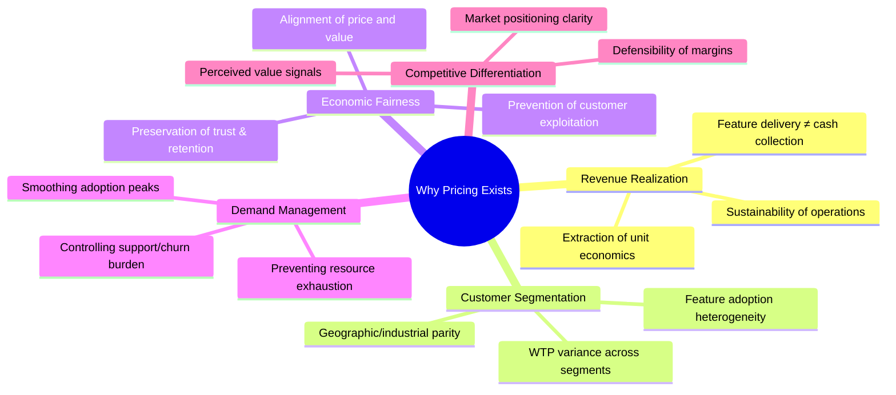

---

## 4. Core Concepts

Section 4 teaches the foundational pricing models and mechanisms from first principles.

### 4.1 Willingness-to-Pay (WTP) and Value-Based Pricing

#### Definition
**Willingness-to-Pay (WTP)** is the maximum price a customer will pay for a product without purchasing, expressed as a function of perceived value, competitor alternatives, and personal financial constraints. **Value-based pricing** sets price equal to a percentage of the value delivered to the customer, rather than to cost-plus-markup or competitor parity.

#### Mechanism
Customers make purchase decisions by comparing perceived value to the asking price. If value < price, they do not buy. The gap between perceived value and actual price is **consumer surplus** (benefit they receive above payment). The gap between price and cost is **producer surplus** (profit). A pricing model that captures zero consumer surplus extracts all buyer welfare and creates high churn risk; a model that leaves massive consumer surplus uncaptured leaves money on the table.

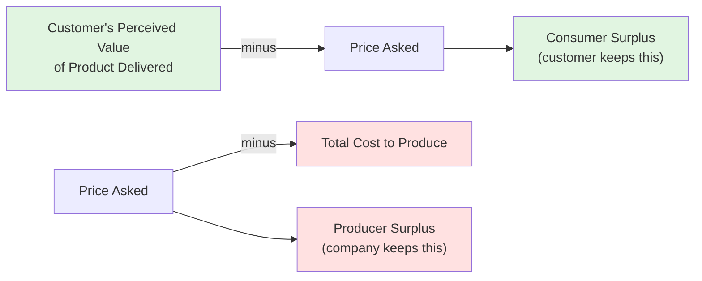

#### Decision Implications
To set value-based pricing:
1. **Estimate customer's economic value from the product**: measure time saved, error reduction, revenue increased, or cost reduced (in currency)
2. **Segment customers by value**: different customer types realize different economic benefits
3. **Set price as a percentage of value**: typically 25-50% of the economic value captured (so customer feels they won a deal)
4. **Validate WTP with research**: surveys (conjoint analysis, van Westendorp Price Sensitivity Meter), interviews, and A/B testing

#### Common Failure Mode
**Pricing Below Economic Value**: A SaaS product that automates a task saving a customer $5,000/year in labor is priced at $99/month ($1,188/year). The customer gets massive consumer surplus; the vendor leaves $3,812 on the table and signals weakness in the market.

**Pricing Above Economic Value**: A B2B SaaS product priced at $50,000/year when the customer's economic value is $10,000/year in efficiency gains. Customer churns after the first contract period; vendor learns through lost deals that perceived value ≠ actual value.

#### Concrete Scenario
A recruitment platform that reduces time-to-hire by 30 days for a mid-market company. Economic value: 30 days × 1 full-time recruiter × $150/day cost-to-company = $4,500. Vendor research shows WTP variance:
- Startups (outsourced recruiting): WTP = $500/month (they're desperate but capital-constrained)
- Mid-market (in-house recruiting): WTP = $1,500–$2,500/month
- Enterprise (large recruiting ops): WTP = $5,000+/month (recruiting is a mission-critical, highly specialized function)

Value-based pricing: Starter tier at $600/month, Professional at $2,000/month, Enterprise at $8,000/month, capturing 13% of startup surplus, 20% of mid-market surplus, and 30% of enterprise surplus. As customer scale, they capture more value; pricing reflects their increased ability to pay.

---

### 4.2 Cost-Plus and Cost-Minus Pricing

#### Definition
**Cost-plus pricing** sets price = cost + (cost × markup %), a fixed markup over the cost to produce/deliver the product. **Cost-minus pricing** sets price = desired profit margin target, then works backward to determine acceptable cost.

#### Mechanism
Cost-plus is simple, mechanical, and removes personal judgment:
- Calculate total cost to acquire/serve a customer (COGS [Cost of Goods Sold] + support + payment processing)
- Apply a standard markup (50%, 100%, 200%, etc.) to all customers
- Price = cost × (1 + markup)

Cost-minus is the inverse planning discipline:
- Set target profit margin (40% after tax, 50% before)
- Work backward: if customer WTP = $100, and you want 50% margin, max cost = $50
- Negotiate supplier/delivery costs down to hit the $50 target or abandon the segment

#### Decision Implications
Cost-plus is operationally simple but economically naive: it ignores WTP variance, market conditions, and value perception. If costs drop 10% (e.g., infrastructure becomes cheaper), do you lower prices or pocket the gain? The rule doesn't say.

Cost-minus is strategically sound but operationally demanding: it forces discipline on cost structure and requires ruthless prioritization. It also exposes when a market segment is unprofitable (e.g., if enterprise customers WTP is $8,000/month but serving them costs $7,500/month in support, the 6.25% margin is unviable at scale).

#### Common Failure Mode
A software vendor calculates COGS (hosting, support, payment processing) at $30/month per customer, applies a 200% markup, and prices at $90/month. The market WTP is $150/month; the vendor is leaving $60/month per customer on the table. Competitors notice, raise prices to $150, and the original vendor's revenue per customer stagnates while customer acquisition cost stays constant, eroding unit economics.

#### Concrete Scenario
**Video encoding SaaS**: Monthly cost per customer = $20 (AWS transcoding + storage + support labor). Vendor applies 100% markup and prices at $40/month. But customer WTP research shows:
- Budget-constrained users: WTP = $30/month (below cost!)
- Growth-stage companies: WTP = $50–$100/month
- Enterprise: WTP = $200+/month

Cost-minus discipline: Choose not to serve the budget segment (margin would be negative). Price Growth at $75/month (cost $20, margin 63%). Price Enterprise at $250/month (cost $20, margin 92%). Abandon the bulk-discount race; margins improve.

---

### 4.3 Freemium Models

#### Definition
A **freemium model** offers a limited-feature or limited-usage free tier to all users, with optional paid tiers that unlock premium features or remove usage caps. The free tier is used to drive adoption and build network effects; the paid tier monetizes a subset of the user base (the "conversion funnel").

#### Mechanism
The model works via a three-stage funnel:
1. **Acquisition**: zero friction to try the product (free sign-up, no credit card, unlimited access to core features)
2. **Activation**: user realizes value from core free features and becomes "sticky"
3. **Conversion**: user hits a friction wall (usage cap, feature limit, performance throttle) and pays to remove it, or voluntarily upgrades after accruing enough sunk-cost time investment

Success hinges on the **conversion funnel**: what fraction of free users upgrade to paid? Typical conversion rates:
- B2C freemium (Spotify, Dropbox): 3–10% conversion
- B2B freemium (Slack, Figma): 2–15% conversion (higher LTV justifies lower conversion)
- Developer tools (GitHub, Stripe): 1–5% (low conversion offset by high LTV)

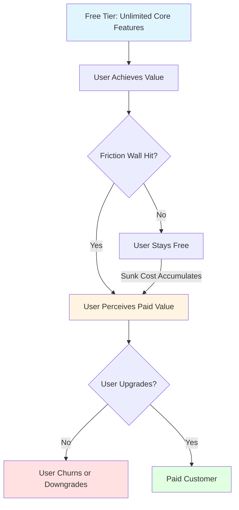

#### Decision Implications
Freemium is a **customer acquisition cost (CAC) subsidy**: free tiers attract users who would never pay upfront, but a percentage eventually convert and have high LTV. The model works only if:

1. **Free tier is truly free to serve** (negligible incremental cost for free users), or **free tier cost is justified by conversion funnel** (if free users cost $1/month to serve and convert at 5%, each free user must generate $20+/month paid-tier LTV to break even on CAC)
2. **Friction walls are perceived fairly** (users don't feel the free tier is crippled arbitrarily; limits feel natural)
3. **Paid tier value is obvious** (users understand what they gain by paying)

#### Common Failure Mode
A collaboration tool offers a freemium model with:
- Free: 1 project, 5 collaborators, 1 GB storage
- Paid: unlimited projects, unlimited collaborators, 100 GB storage

The free tier is so restrictive that most power users (the ones most likely to pay) never activate; they abandon the product. Simultaneously, the free tier's infrastructure cost (even at 5% LTV conversion) exceeds the revenue per free user. The product bleeds money on CAC subsidies with negligible conversion.

#### Concrete Scenario
**Document collaboration platform** (similar to Figma):
- Free tier: 1 active document, 3 collaborators, view history 30 days, 500 MB storage
- Starter ($10/month): 10 active documents, 10 collaborators, view history 1 year, 10 GB storage
- Team ($50/month): unlimited documents, unlimited collaborators, advanced permissions, SSO (Single Sign-On), 1 TB storage

Market analysis: 1,000 free users acquired at $0 incremental cost (self-serve signup). Conversion funnel: 3% upgrade to Starter (30 users × $10 × 12 = $3,600/year), 1% of those upgrade to Team (0.3 users × $50 × 12 = $180/year). Total revenue per 1,000 free users: $3,780/year. If free users cost $2/month to serve ($24/year), breakeven is 1,000 × $24 = $24,000/year cost, requiring 6.3x more free users or 2x higher conversion to justify the investment.

Decision: Invest in reducing free tier friction (e.g., allow 3 documents free) to increase activation, or tighten the paid tier feature bundling to increase conversion.

---

### 4.4 Tiered Pricing (Good/Better/Best)

#### Definition
**Tiered pricing** offers 3+ discrete price points (usually called Basic, Professional, Enterprise, or Good/Better/Best) where each tier includes a fixed set of features, users, or usage at a fixed price. Tiers are designed so that customers self-select into the tier that matches their willingness-to-pay and feature requirements.

#### Mechanism
Tiers work via **price anchoring** and **feature bundling psychology**:

1. **Anchor effect**: The highest-priced tier (often Enterprise) anchors customers' perception of maximum value; it makes mid-tier pricing look reasonable by comparison
2. **Compromise effect**: Customers avoid extremes and gravitate toward the middle option (the "Goldilocks" tier)
3. **Feature bundling**: Each tier's features are curated so low-tier customers don't feel cheated (core value is present) and high-tier customers feel they're getting clear additional value (not just paying for the same features under a different name)

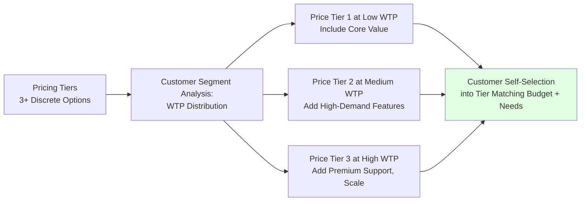

#### Decision Implications
Tiered pricing is easier to communicate than purely value-based pricing (customers see three clear options) but requires careful design:
- **Too many tiers (5+)**: Analysis paralysis; customers get confused
- **Too few tiers (2)**: Insufficient anchoring; customers stay in the low tier
- **Poor feature bundling**: Feature duplication across tiers (e.g., all tiers have "advanced search") creates the perception of artificial limitations, triggering churn
- **Unclear price-to-feature mapping**: If customers can't articulate why Tier 2 costs 2x Tier 1, they resent the price difference

#### Common Failure Mode
A project management tool offers:
- Starter: $10/month per user, 3 projects, basic reporting
- Professional: $25/month per user, 20 projects, advanced reporting, Gantt charts
- Enterprise: $100/month per user, unlimited projects, all features, dedicated support

A mid-market customer with 20 team members calculates: 20 × $25 = $500/month (Professional) vs. 20 × $100 = $2,000/month (Enterprise). The customer upgrades to Enterprise to unlock "dedicated support" but discovers they rarely use it; they feel cheated on price. Next renewal, they downgrade or churn to a competitor using per-seat pricing with lower Enterprise costs.

#### Concrete Scenario
**Analytics SaaS** (similar to Mixpanel):
- Analytics Basic: $99/month, 1 million events/month, 1 user account, 90-day data retention
- Analytics Pro: $499/month, 10 million events/month, 5 user accounts, 2-year data retention, custom events, cohort analysis
- Analytics Enterprise: $2,000+/month, unlimited events, unlimited users, custom data retention, API access, dedicated support, SSO

WTP research shows:
- Startup analytics: median WTP = $150/month (underserving with Basic)
- Growth-stage: median WTP = $600/month (satisfied with Pro)
- Enterprise data teams: median WTP = $3,000+/month (willing to pay for scale and support)

Price adjustment: Basic → $149, Pro → $599, Enterprise custom quote. Result: startups feel Basic is more accessible, growth companies gladly upgrade to Pro (feels like a fair jump), and enterprises negotiate custom volume discounts, but the anchored pricing remains.

---

### 4.5 Per-Unit/Usage-Based Pricing

#### Definition
**Usage-based pricing** (also called metered or pay-as-you-go) charges customers based on actual consumption of a specific unit: API calls, transactions, users per month, compute hours, or data transferred. Price = unit rate × units consumed. No subscription minimum or monthly fee; customers pay only for what they use.

#### Mechanism
Usage-based pricing is fundamentally different from subscription pricing:
- **Subscription**: fixed monthly cost regardless of usage (incentivizes vendor to serve efficiently, predictable revenue, customer pays even if they use 10% of the tier)
- **Usage-based**: variable monthly cost tied to consumption (incentivizes vendor and customer to be efficient, variable revenue, customer only pays for value consumed)

The model works via **metering**: tracking consumption of a unit (e.g., API calls, MB transferred) and billing proportionally.

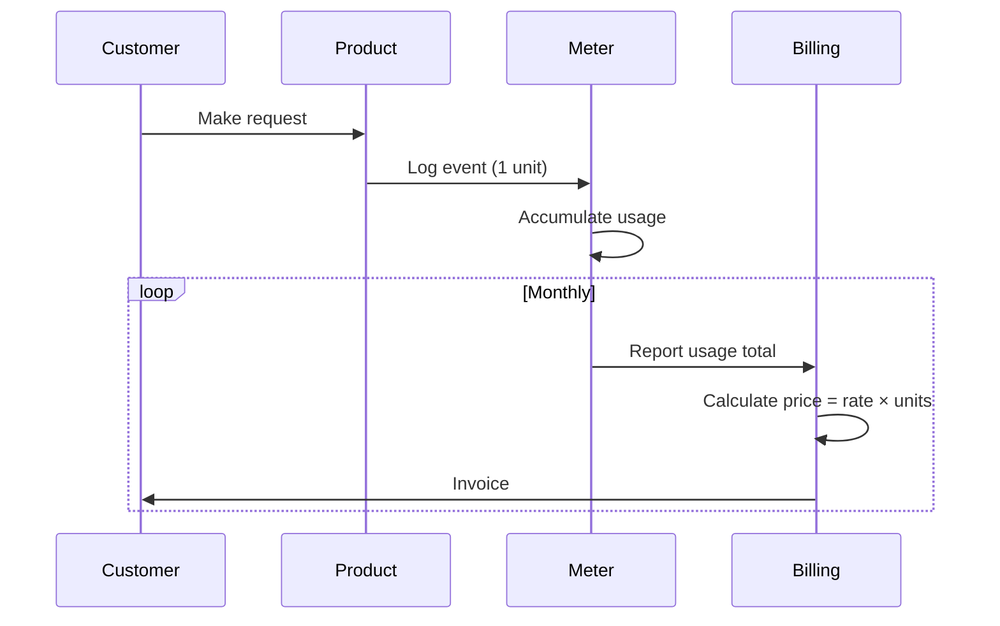

#### Decision Implications
Usage-based pricing aligns incentives but creates two operational challenges:

1. **Customer unpredictability**: Customers can't predict their bill (e.g., a viral day causes API calls to 10x, doubling the bill). This creates "bill shock" and churn risk
2. **Vendor revenue volatility**: Revenue scales with customer growth, but so do infrastructure costs; margins don't improve until unit costs drop significantly

Solutions:
- **Usage caps / budget alerts**: notify customers when they approach expected usage or price ceiling
- **Hybrid models**: flat base subscription ($100/month) + usage overage ($0.01 per API call above 1M calls/month) → predictability + revenue leverage
- **Fair-use policies**: clarify that customers triggering 10x usage spikes may be throttled

#### Common Failure Mode
An API provider (similar to Stripe or Twilio) implements pure usage-based pricing ($0.01 per API call). Early customers are happy (low usage, low bills). A customer adds a feature that triggers 10x more API calls; their bill jumps from $500/month to $5,000/month without warning. Customer feels betrayed, churns, and leaves a negative review.

#### Concrete Scenario
**Video streaming platform** (like Mux or Brightcove):
- Usage-based: $0.005 per GB video delivered
- Hybrid alternative: $500/month base (includes 100 GB/month) + $0.002 per GB overage

Customer A (startup): Uses 50 GB/month. Pure usage-based: 50 × $0.005 = $250/month. Hybrid: $500 (minimum). Usage-based is cheaper; customer chooses usage-based.

Customer B (media company): Uses 5,000 GB/month. Pure usage-based: 5,000 × $0.005 = $25,000/month. Hybrid: $500 + (4,900 × $0.002) = $10,300/month. Hybrid is cheaper by 59%; customer chooses hybrid.

Result: Startups get low cost to experiment (CAC subsidy); media companies get volume-based discount without feeling nickel-and-dimed.

---

### 4.6 Subscription vs. Perpetual Licensing

#### Definition
**Subscription pricing** charges a recurring fee (monthly, annual) to access the software for a fixed period; access ends if payment lapses. **Perpetual licensing** charges a one-time upfront fee granting indefinite right-of-use; no recurring payment required (though maintenance/support may be separate and recurring).

#### Mechanism
Subscription vs. perpetual represents a trade-off in cash-flow timing, revenue predictability, and switching costs:

| Dimension | Subscription | Perpetual |
|---|---|---|
| **Revenue timing** | Spread over time (smoothed cash flow) | Concentrated at sale (lumpy cash flow) |
| **Revenue predictability** | High (steady recurring revenue) | Low (depends on new sales) |
| **Customer switching cost** | High (switching means re-subscribing elsewhere) | Low (customer already owns perpetual license) |
| **Feature upgrade incentive** | High (new version = new subscription term negotiation) | Low (customer uses version forever without upgrade) |
| **Churn management** | Proactive (must retain each month) | Reactive (customer doesn't renew maintenance contract) |
| **Cash reserve needed** | Low (monthly cash in matches monthly burn) | High (must fund operations on lump-sum upfront cash) |

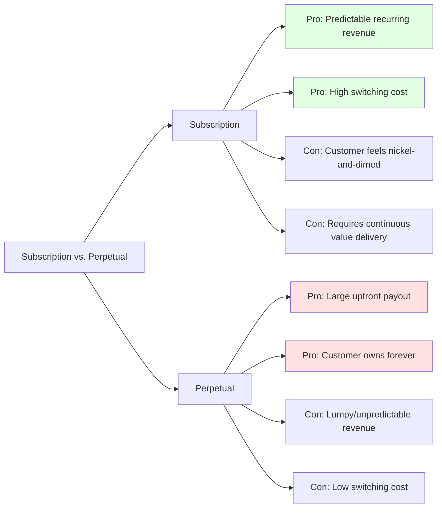

#### Decision Implications
Subscription is the dominant model in SaaS because it:
- Enables venture-backed product development (predictable revenue funds continued investment)
- Aligns vendor incentive with customer retention (vendor must keep adding value)
- Simplifies licensing/compliance (no "piracy" of perpetual licenses)

Perpetual persists in:
- **Legacy enterprise software** (e.g., internal tools, CAD software) where switching costs are high
- **Developer tools sold to individuals** (IDE licenses, programming libraries) where recurring payment feels unfair for a tool the customer mastered
- **High-contract-value B2B** where annual fees become negotiable burdens on mid-market customers

#### Common Failure Mode
A B2B SaaS vendor switches from perpetual to subscription. Existing customers feel the pricing model change as forced obsolescence ("now I have to pay every year for the same software I already own"). Churn spikes on the first renewal; the vendor backpedals and allows perpetual license holders to keep their licenses if they don't upgrade, eroding new-customer acquisition.

#### Concrete Scenario
**Project management software (similar to Microsoft Project or Asana)**:
- Perpetual model (v2023): Pay $500/user once, get license forever, pay $100/user/year for support/updates
- Subscription model (v2024): Pay $200/user/year, includes support/updates, features auto-update

Existing customer with 100 users:
- Old contract: $500 × 100 = $50,000 one-time, then $100 × 100 = $10,000/year for support
- New contract: $200 × 100 = $20,000/year

At renewal (year 3), customer calculates: stay on perpetual ($50K initial + $30K support over 3 years = $80K total over 3 years = $26.7K/year average) vs. switch to subscription ($60K over 3 years = $20K/year average). Financially, subscription is cheaper after 2.5 years, but the switching friction (migrating all data and retraining) is high. Customer negotiates a hybrid: $15,000/year to avoid upgrade friction.

---

### 4.7 Freemium vs. Free Trial vs. Freemium

#### Definition
- **Freemium**: unlimited free tier with optional paid tiers
- **Free trial**: time-limited free access (14 days, 30 days) with full features, requiring credit card and auto-charging on expiration unless canceled
- **Hybrid**: free-trial for onboarding → freemium low-tier for low-intent users → paid tiers for high-intent users

#### Mechanism
Each model targets different user segments:
- **Freemium**: attracts price-sensitive, low-intent users; high volume, low conversion, low cost per trial user
- **Free trial**: attracts high-intent users who are willing to provide credit card; lower volume, higher conversion, moderate cost per trial user (support for trial management)
- **Hybrid**: free trial first to build confidence, then convert to freemium if conversion fails, or to paid if successful

#### Decision Implications
The choice depends on **unit economics of your target customer**:
- **High-LTV customers** (e.g., B2B enterprise): free trial; conversion rate is high (30%+), so the cost of trial support is offset
- **Low-LTV customers** (e.g., B2C consumer): freemium; conversion rate is low (3–5%), but marginal cost of free users is near-zero
- **Mixed cohorts**: hybrid; segment on company size or stated use case

#### Common Failure Mode
A B2B SaaS product uses freemium when it should use a free trial. Free users are mostly "just exploring" and never activate. Conversion to paid is 1%, generating $10 LTV, but each free user costs $5 in support/hosting. The freemium funnel loses money, and the vendor can't figure out why.

---

### 4.8 Geographic and Segment Pricing

#### Definition
**Geographic pricing** sets different prices in different regions (e.g., $100/month in US, €85/month in EU, $50/month in India) to reflect local purchasing power, tax/regulatory costs, and competitive intensity. **Segment pricing** sets different prices for different customer types (e.g., startup, mid-market, enterprise; nonprofit, education, for-profit) to reflect WTP variance.

#### Mechanism
Both approaches exploit WTP variance:

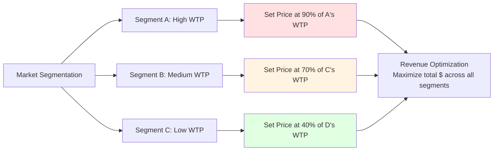

#### Decision Implications
Geographic pricing is legally complex:
- **Gray-market arbitrage**: a customer in India buys at $50/month and resells access to US customers at $75/month, undercutting your $100 US pricing
- **Regulatory barriers**: some countries require pricing transparency or forbid region-based discrimination

Solutions:
- **IP-based geo-blocking** (restrict access by geographic region)
- **Account verification** (require business registration in purchase region)
- **Accept regional pricing as equilibrium** (if customers can arbitrage, eventually regional prices converge)

Segment pricing faces fewer regulatory barriers but creates perception of unfairness:
- **Nonprofit getting 50% discount but using the same features as for-profit**: for-profit customers may feel cheated
- **Startup tier undercuts mid-market tier**: a startup growing into mid-market size has to pay 5x more, or they churn

#### Concrete Scenario
**Analytics SaaS pricing by geography**:
- North America: $500/month for 10M events
- Europe: €425/month (~$470 USD) for 10M events (lower purchasing power, higher privacy compliance cost)
- India: ₹15,000/month (~$180 USD) for 10M events (much lower purchasing power)

A customer with operations in all three regions faces three choices:
1. **Buy in each region**: $500 + €425 + ₹15,000 = $1,150/month total, but now they have three separate accounts, three billing cycles, three integrations
2. **Buy in lowest-price region (India)**: ₹15,000 for all usage (equivalent to $180 total), but pay via India billing, face currency volatility
3. **Negotiate enterprise pricing**: pay $1,000/month for consolidated global access across all regions

The vendor loses $500/month of potential revenue if the customer negotiates down; the vendor gains $1,000/month vs. regional parity ($1,150) but sacrifices transparency and segment targeting. Result: large multi-region customers demand global flat pricing.

---

### 4.9 Launch Pricing: Skimming vs. Penetration

#### Definition
**Price skimming**: launch at premium price targeting early adopters and price-insensitive customers, then lower price over time to capture price-sensitive segments. **Penetration pricing**: launch at low price to maximize market share and adoption, then raise price over time as switching costs accrue.

#### Mechanism
The two strategies represent opposite bets about market elasticity:

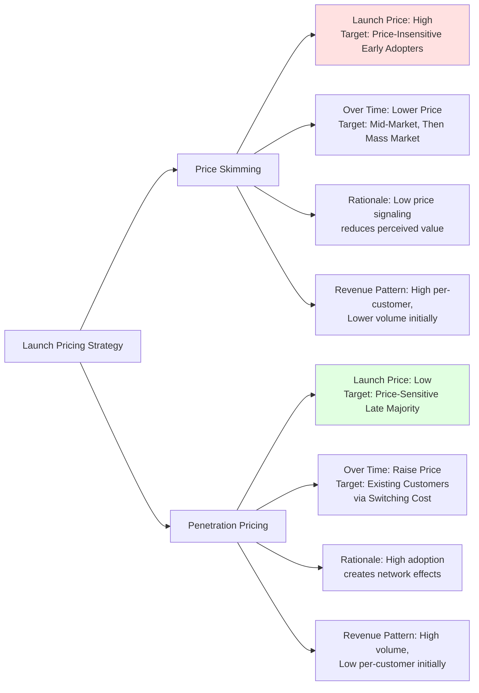

#### Decision Implications
- **Skimming works** when: early adopter WTP is high relative to late-majority WTP, and product can be differentiated or protected (patents, switching costs)
- **Penetration works** when: network effects are strong (social media, marketplaces, communication tools), switching costs are low (customers aren't locked in), and volume matters more than per-unit margin

#### Common Failure Mode
**Launch with skimming, competitors arrive with penetration pricing**: A productivity tool launches at $500/month targeting executives. Competitors launch at $99/month targeting individual contributors. The competitor captures the volume market, creates network effects (more users → more templates → more integrations), and eventually becomes the standard. The skimming vendor is left with a small, expensive cohort and no upgrade path.

#### Concrete Scenario
**Slack vs. enterprise chat competitors (early 2010s)**:
- **Slack skimming strategy**: Launch at $12.50/user/month (later $15), targeting power users and design-forward companies willing to pay for superior UX and mobile experience
- **Enterprise chat penetration strategy**: Hipchat ($2/user/month) and Campfire (fixed $49–$900/month per organization) both priced lower but felt clunky

Slack's skimming worked because:
1. Early users (startups, design studios, tech teams) had high WTP for Slack's UX quality
2. Network effects: Slack customers adopted quickly, accumulated data/integrations/bots, increasing switching cost
3. Enterprise sales: As Slack-trained employees reached mid-market and enterprise companies, IT departments felt pressure to adopt (employee expectation), even at higher price

Result: Skimming captured early-adopter willingness-to-pay, compounded network effects, then raised switching costs so that later price increases ($15 → $25 over time) faced low elasticity.

---

### 4.10 Price Elasticity and Demand Curves

#### Definition
**Price elasticity of demand** (PED) measures the percentage change in quantity demanded for a 1% change in price. Mathematically: PED = (% change in quantity) / (% change in price).

- **Elastic demand** (|PED| > 1): small price increase → large quantity drop (customers are price-sensitive)
- **Inelastic demand** (|PED| < 1): small price increase → small quantity drop (customers are price-insensitive)
- **Unit elastic** (|PED| = 1): 1% price increase → 1% quantity drop (neutral)

#### Mechanism
A **demand curve** plots price on one axis and quantity demanded on the other. In typical markets, demand curves slope downward (higher price → lower quantity). The shape of the curve reveals elasticity:

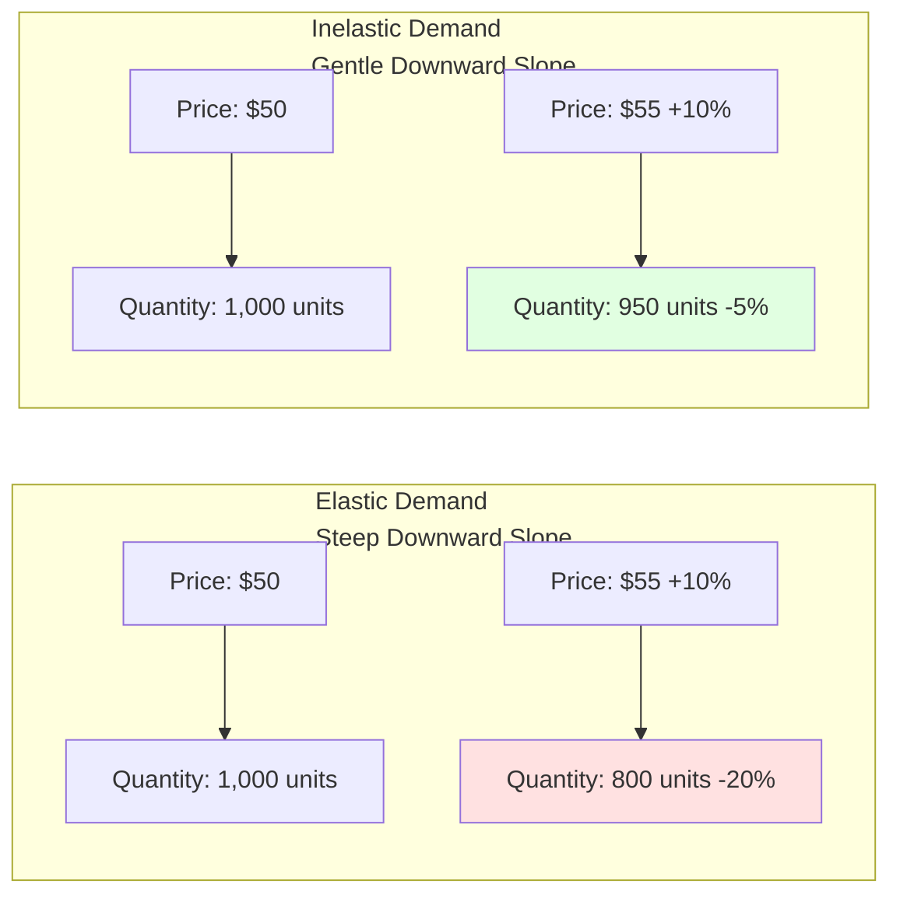

#### Decision Implications
Understanding demand elasticity informs pricing:
- **High elasticity**: price-sensitive market (e.g., commodity APIs, video hosting). Avoid price increases; optimize margins via cost reduction instead
- **Low elasticity**: price-insensitive market (e.g., mission-critical B2B, strong brand lock-in). Price increases are viable; test them via A/B tests (raise price for new cohorts, measure churn)

#### Common Failure Mode
A vendor assumes inelastic demand ("customers need our product, so they'll tolerate price increases") and raises price 20%. Demand drops 30%, eroding revenue. Post-hoc analysis reveals the market is elastic; customers have strong outside alternatives.

#### Concrete Scenario
**Software-as-a-Service observability platform (like Datadog)**:
- Existing pricing: $1 per 1 million logs ingested per month
- Test 1 (competitor-like pricing): $1.50 per million logs. Revenue per customer increases 50%, but churn increases 10%, and CAC increases (messaging must overcome price increase concerns). Net: revenue up 35%
- Test 2 (premium positioning): $2 per million logs (2x increase), but add compliance features (SOC 2, HIPAA) and faster support. Revenue per customer increases 100%, but churn increases 25% (price-sensitive customers leave). Net: revenue up 50% (lower customer count, higher margin per customer)

Decision: Segment the market. Offer $1/million to price-sensitive customers (high volume, lower margin). Offer $2/million to compliance-sensitive customers (lower volume, higher margin). Aggregate revenue exceeds either pure strategy.

---

### 4.11 Pricing Communication and Anchoring

#### Definition
**Anchoring effect**: when customers see a high price first, subsequent lower prices are perceived as reasonable discounts, even if they remain above the customer's original WTP. The first price "anchors" perception of value.

**Pricing communication** is the art of anchoring perception to justify the price asked.

#### Mechanism
Anchoring works via reference dependence: customers don't have an absolute sense of whether $100/month is "fair," but they can compare it to a reference price:
- "Our competitors charge $200/month" (anchor high) → your $100/month feels like a bargain
- "You save $5,000 in labor costs per year" (anchor to value) → your $1,000/month feels justified
- "Most customers pay $150/month for this tier" (social proof anchor) → a suggested price of $99 seems discounted

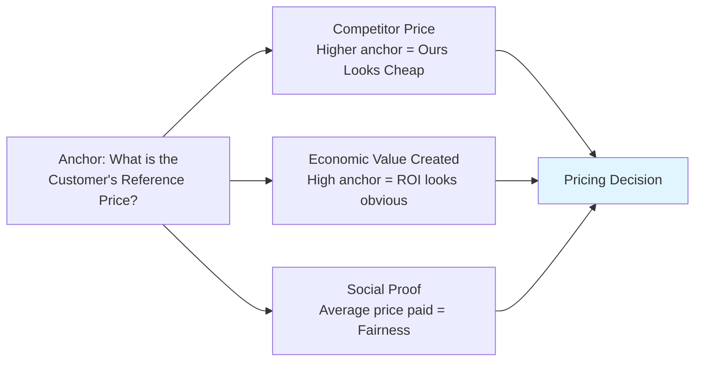

#### Decision Implications
Effective pricing communication requires:
1. **Establishing a high anchor** via comparisons (competitors, value-delivered, time-saved)
2. **Reinforcing fairness** via transparency (show what's included, why it costs what it costs)
3. **Reducing perception of loss** via framing (emphasize what customer gains, not what they spend)

#### Common Failure Mode
A vendor raises prices from $99 to $149/month without establishing an anchor. Customers perceive only the loss ($50 more per month = $600/year). Churn spikes 30%. The vendor learns that pure price increases without narrative fail; anchoring is essential.

#### Concrete Scenario
**Email marketing platform (like Mailchimp or Klaviyo)**:
- **Poor communication**: "We've raised prices to $199/month to support new features"
- **Better communication**: "Industry-standard email platforms charge $250–$400/month for this segment. Our research shows customers gain $8,000–$12,000 in incremental revenue per year via our segmentation AI. At $199/month, you recoup the cost in 2 months of improved campaign performance."

The second framing anchors to competitor pricing and establishes economic value, making $199 feel like a bargain. Churn on price increase drops from 30% to 8%.

---

## 5. Internal Working

Pricing is not a pure business concept; it is deeply embedded in product architecture, backend systems, and operational workflows.

### 5.1 Metering and Usage Tracking

Usage-based pricing requires reliable, low-latency usage tracking. The system must:
1. **Capture events**: every API call, transaction, or upload triggers a metering event
2. **Attribute to customer**: link the event to a specific customer account
3. **Aggregate**: sum usage by unit (API calls, MB transferred) per billing period
4. **Report**: expose usage via API and dashboard for customer visibility
5. **Bill**: calculate and invoice based on aggregated usage

This is a non-trivial distributed systems problem. A single dropped event means underbilling; a double-counted event means overbilling (customer dispute). Production metering systems typically:
- **Log events immutably** (event log in a durable queue: Kafka, RabbitMQ)
- **Aggregate with strong consistency** (replay events through a state machine to recalculate usage at any point in time)
- **Expose via queryable API** (customer can see their usage breakdown, not just the final bill)

### 5.2 Billing and Invoice Generation

Billing systems must:
1. **Integrate with payment processors** (Stripe, Adyen) to charge credit cards or process wire transfers
2. **Handle prorations** (customer upgrades mid-month; prorate the difference)
3. **Retry failed charges** (credit card declined; retry 3 times, then escalate to dunning workflow)
4. **Generate compliance invoices** (tax IDs, line items, regulatory requirements by jurisdiction)
5. **Handle refunds and adjustments** (customer disputes a charge; issue partial refund)

Production billing systems (e.g., Stripe Billing, Zuora) abstract this complexity. Most companies use a third-party billing platform rather than building from scratch.

### 5.3 Pricing Tier Management and Feature Gating

Pricing tiers are enforced via **feature gates**: a code branch in the product that enables/disables features based on the customer's subscription tier.

```python
# Pseudocode: feature gating in product code
def can_export_to_pdf(customer_id):
    tier = get_customer_tier(customer_id)
    if tier in ['Professional', 'Enterprise']:
        return True
    else:
        return False
```

Feature gates must be **consistent**: if a customer downgrades from Professional to Basic (and loses PDF export), the UI should gracefully hide the button, not crash when clicked.

---

## 6. Design Principles

### 6.1 Alignment with Value Delivered

Pricing should reflect the economic value delivered. A $5,000/month price is justified only if the customer realizes $5,000+ in economic value (time saved, revenue gained, cost avoided) each month. If pricing exceeds value, churn will eventually follow.

### 6.2 Simplicity and Transparency

Customers should understand why they're paying what they pay. Hidden fees, complex calculations, and surprise overage charges destroy trust.

### 6.3 Fairness and Trust

Pricing that feels exploitative (e.g., a free tier throttled to unusable speed, or an enterprise tier priced at 100x the startup tier for the same features) triggers churn and negative word-of-mouth, even if economically rational.

### 6.4 Operability

Pricing models must be reliable and maintainable. A model that requires manual invoice adjustments 20% of the time creates support overhead and customer dissatisfaction.

---

## 7. Architecture Patterns

### 7.1 Freemium Acquisition Funnel Pattern

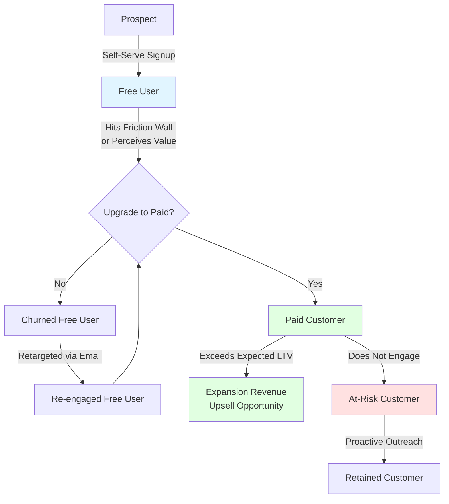

### 7.2 Tiered Self-Service Purchase Path Pattern

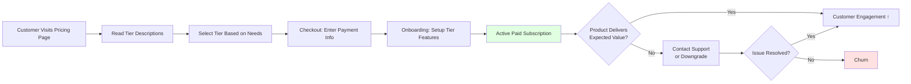

---

## 8. Production Architecture

A production pricing system integrates multiple components:

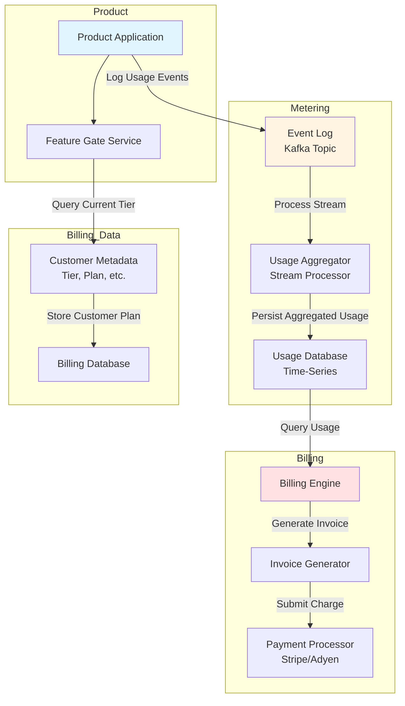

---

## 9. Implementation

Implementation of a pricing system requires:

1. **Pricing model definition**: choose the pricing strategy (value-based, tiered, usage-based, etc.)
2. **Tier/feature matrix**: define which features are in which tiers
3. **Billing infrastructure**: integrate with Stripe Billing, Zuora, or build custom
4. **Feature gating**: implement runtime checks to enforce tier restrictions
5. **Usage tracking** (if usage-based): log events, aggregate, query
6. **Dashboard and reporting**: expose pricing metrics to internal teams and customers
7. **Customer support**: train support team on pricing questions, common issues, adjustments

---

## 10. Complete Code Examples

### 10.1 WTP Analyzer (Python)

Calculates statistical summary of Willingness-to-Pay (WTP) data from surveys.

```python
import json
from statistics import mean, median, stdev, quantiles
from typing import List, Dict

class WTPAnalyzer:
    """Analyzes customer Willingness-to-Pay (WTP) survey data."""
    
    def __init__(self, responses: List[Dict[str, any]]):
        """
        Args:
            responses: List of survey responses, each with {
                'segment': 'enterprise' | 'mid-market' | 'startup',
                'purchase_intent': 'definitely' | 'probably' | 'maybe' | 'unlikely',
                'acceptable_price': <float>,
                'ideal_price': <float>,
                'maximum_price': <float>
            }
        """
        self.responses = responses
    
    def analyze_by_segment(self) -> Dict[str, Dict]:
        """Compute WTP statistics broken down by customer segment."""
        segments = {}
        for response in self.responses:
            seg = response.get('segment', 'unknown')
            if seg not in segments:
                segments[seg] = []
            segments[seg].append(response)
        
        results = {}
        for segment, resp_list in segments.items():
            prices = [r['acceptable_price'] for r in resp_list]
            results[segment] = {
                'count': len(resp_list),
                'mean_wtp': round(mean(prices), 2),
                'median_wtp': round(median(prices), 2),
                'std_dev': round(stdev(prices), 2) if len(prices) > 1 else 0,
                'min_wtp': min(prices),
                'max_wtp': max(prices),
                'p25_wtp': round(quantiles(prices, n=4)[0], 2),
                'p75_wtp': round(quantiles(prices, n=4)[2], 2),
            }
        
        return results
    
    def recommend_pricing(self, capture_rate: float = 0.30) -> Dict[str, float]:
        """
        Recommend tier prices based on WTP distribution.
        capture_rate: fraction of WTP to capture (0.30 = capture 30% of value).
        """
        segment_stats = self.analyze_by_segment()
        recommendations = {}
        
        for segment, stats in segment_stats.items():
            # Recommended price: capture_rate % of median WTP
            recommended_price = stats['median_wtp'] * capture_rate
            recommendations[segment] = round(recommended_price, 2)
        
        return recommendations
    
    def print_report(self):
        """Print a human-readable WTP analysis report."""
        segment_stats = self.analyze_by_segment()
        print("=== Willingness-to-Pay (WTP) Analysis ===\n")
        
        for segment, stats in segment_stats.items():
            print(f"{segment.upper()}")
            print(f"  Sample size: {stats['count']}")
            print(f"  Mean WTP: ${stats['mean_wtp']}")
            print(f"  Median WTP: ${stats['median_wtp']}")
            print(f"  Std Dev: ${stats['std_dev']}")
            print(f"  Range: ${stats['min_wtp']} - ${stats['max_wtp']}")
            print(f"  25th percentile: ${stats['p25_wtp']}")
            print(f"  75th percentile: ${stats['p75_wtp']}")
            print()
        
        print("=== Recommended Pricing (30% value capture) ===")
        recommendations = self.recommend_pricing(capture_rate=0.30)
        for segment, price in recommendations.items():
            print(f"  {segment}: ${price}/month")


# Example usage:
survey_data = [
    {'segment': 'startup', 'purchase_intent': 'definitely', 'acceptable_price': 99},
    {'segment': 'startup', 'purchase_intent': 'probably', 'acceptable_price': 149},
    {'segment': 'startup', 'purchase_intent': 'maybe', 'acceptable_price': 199},
    {'segment': 'mid-market', 'purchase_intent': 'definitely', 'acceptable_price': 499},
    {'segment': 'mid-market', 'purchase_intent': 'definitely', 'acceptable_price': 599},
    {'segment': 'mid-market', 'purchase_intent': 'probably', 'acceptable_price': 699},
    {'segment': 'enterprise', 'purchase_intent': 'probably', 'acceptable_price': 2000},
    {'segment': 'enterprise', 'purchase_intent': 'maybe', 'acceptable_price': 3000},
    {'segment': 'enterprise', 'purchase_intent': 'maybe', 'acceptable_price': 5000},
]

analyzer = WTPAnalyzer(survey_data)
analyzer.print_report()
```

**Output:**
```
=== Willingness-to-Pay (WTP) Analysis ===

STARTUP
  Sample size: 3
  Mean WTP: $149.33
  Median WTP: $149.0
  Std Dev: $50.0
  Range: $99 - $199
  25th percentile: $124.0
  75th percentile: $174.0

MID-MARKET
  Sample size: 3
  Mean WTP: $599.0
  Median WTP: $599.0
  Std Dev: $100.0
  Range: $499 - $699
  25th percentile: $549.0
  75th percentile: $649.0

ENTERPRISE
  Sample size: 3
  Mean WTP: $3333.33
  Median WTP: $3000.0
  Std Dev: $1527.53
  Range: $2000 - $5000
  25th percentile: $2500.0
  75th percentile: $4000.0

=== Recommended Pricing (30% value capture) ===
  startup: $44.7/month
  mid-market: $179.7/month
  enterprise: $1000.0/month
```

---

### 10.2 Tiering Engine (TypeScript)

Determines which tier a customer qualifies for based on their usage and WTP signal.

```typescript
enum CustomerSegment {
  Startup = 'startup',
  MidMarket = 'mid-market',
  Enterprise = 'enterprise',
}

interface PricingTier {
  name: string;
  monthlyPrice: number;
  features: string[];
  usageLimits: {
    apiCallsPerMonth: number;
    storageGB: number;
    maxTeamMembers: number;
  };
}

interface CustomerProfile {
  segment: CustomerSegment;
  monthlyApiCalls: number;
  storageUsedGB: number;
  teamMembers: number;
}

class TieringEngine {
  private tiers: PricingTier[] = [
    {
      name: 'Starter',
      monthlyPrice: 99,
      features: ['Core Analytics', 'Basic Reporting', 'Email Support'],
      usageLimits: {
        apiCallsPerMonth: 1_000_000,
        storageGB: 10,
        maxTeamMembers: 3,
      },
    },
    {
      name: 'Professional',
      monthlyPrice: 499,
      features: [
        'Core Analytics',
        'Advanced Reporting',
        'Cohort Analysis',
        'Custom Events',
        'Slack Integration',
        'Priority Support',
      ],
      usageLimits: {
        apiCallsPerMonth: 10_000_000,
        storageGB: 100,
        maxTeamMembers: 10,
      },
    },
    {
      name: 'Enterprise',
      monthlyPrice: 2000,
      features: [
        'All Professional Features',
        'Unlimited API Calls',
        'Unlimited Storage',
        'SSO (Single Sign-On)',
        'Dedicated Support',
        'Custom Integrations',
      ],
      usageLimits: {
        apiCallsPerMonth: Infinity,
        storageGB: Infinity,
        maxTeamMembers: Infinity,
      },
    },
  ];

  /**
   * Recommend a tier based on customer profile.
   * Returns the minimum tier that accommodates the customer's usage.
   */
  recommendTier(customer: CustomerProfile): PricingTier {
    for (const tier of this.tiers) {
      const fits =
        customer.monthlyApiCalls <=
          tier.usageLimits.apiCallsPerMonth &&
        customer.storageUsedGB <= tier.usageLimits.storageGB &&
        customer.teamMembers <= tier.usageLimits.maxTeamMembers;

      if (fits) {
        return tier;
      }
    }
    // If no tier fits, return Enterprise (unlimited)
    return this.tiers[this.tiers.length - 1];
  }

  /**
   * Calculate monthly cost for a customer, accounting for overages.
   * Overages: $0.01 per 1M API calls, $0.10 per GB storage.
   */
  calculateMonthlyBill(customer: CustomerProfile): {
    baseTier: PricingTier;
    basePrice: number;
    overages: number;
    totalPrice: number;
  } {
    const tier = this.recommendTier(customer);
    let overages = 0;

    // Calculate API overage
    const apiOverage = Math.max(
      0,
      customer.monthlyApiCalls - tier.usageLimits.apiCallsPerMonth
    );
    overages += (apiOverage / 1_000_000) * 0.01; // $0.01 per 1M calls

    // Calculate storage overage
    const storageOverage = Math.max(
      0,
      customer.storageUsedGB - tier.usageLimits.storageGB
    );
    overages += storageOverage * 0.1; // $0.10 per GB

    return {
      baseTier: tier,
      basePrice: tier.monthlyPrice,
      overages: Math.round(overages * 100) / 100,
      totalPrice:
        Math.round((tier.monthlyPrice + overages) * 100) / 100,
    };
  }

  /**
   * Analyze LTV (Lifetime Value) for a customer cohort.
   * Assumes annual contract, 10% annual churn, 20% annual expansion rate.
   */
  calculateLTV(
    monthlyPrice: number,
    grossMarginPercent: number = 70,
    annualChurnPercent: number = 10,
    annualExpansionPercent: number = 20
  ): number {
    const grossMargin = monthlyPrice * (grossMarginPercent / 100);
    const monthlyRetention = 1 - annualChurnPercent / 100;
    const monthlyExpansion = 1 + annualExpansionPercent / 100;

    // LTV = sum of discounted monthly profits over customer lifetime
    // Simplified: LTV = (monthly profit / monthly churn rate)
    const monthlyChurn = 1 - monthlyRetention;
    if (monthlyChurn === 0) return Infinity; // No churn = infinite LTV
    const ltv = grossMargin / monthlyChurn;

    return Math.round(ltv);
  }
}

// Example usage:
const engine = new TieringEngine();

const startup: CustomerProfile = {
  segment: CustomerSegment.Startup,
  monthlyApiCalls: 500_000,
  storageUsedGB: 5,
  teamMembers: 2,
};

const recommended = engine.recommendTier(startup);
console.log(
  `Recommended tier for startup: ${recommended.name} - $${recommended.monthlyPrice}/month`
);

const bill = engine.calculateMonthlyBill(startup);
console.log(`Monthly bill:`, bill);

const ltv = engine.calculateLTV(
  recommended.monthlyPrice,
  70, // 70% gross margin
  10, // 10% annual churn
  20 // 20% annual expansion
);
console.log(`Estimated LTV: $${ltv}`);
```

**Output:**
```
Recommended tier for startup: Starter - $99/month
Monthly bill: {
  baseTier: { name: 'Starter', monthlyPrice: 99, ... },
  basePrice: 99,
  overages: 0,
  totalPrice: 99
}
Estimated LTV: $8910
```

---

### 10.3 Price Elasticity Simulator (Python)

Simulates revenue impact of price changes given a demand curve.

```python
import matplotlib.pyplot as plt
from dataclasses import dataclass
from typing import List, Tuple

@dataclass
class PricePoint:
    price: float
    quantity_demanded: int
    revenue: float

class ElasticitySimulator:
    """
    Simulates price elasticity and revenue optimization.
    Assumes a linear demand curve: quantity = a - b*price
    """
    
    def __init__(self, a: float, b: float):
        """
        Linear demand curve: Q = a - b*P
        a: intercept (quantity when price = 0)
        b: slope (how much quantity drops per $1 price increase)
        """
        self.a = a
        self.b = b
    
    def quantity_at_price(self, price: float) -> int:
        """Calculate quantity demanded at a given price."""
        return max(0, int(self.a - self.b * price))
    
    def elasticity_at_price(self, price: float) -> float:
        """
        Calculate point elasticity at a given price.
        PED = (dQ/dP) * (P/Q)
        dQ/dP = -b (slope of demand curve)
        """
        quantity = self.quantity_at_price(price)
        if quantity == 0:
            return 0
        ped = (-self.b) * (price / quantity)
        return ped
    
    def revenue_at_price(self, price: float) -> float:
        """Calculate revenue at a given price."""
        quantity = self.quantity_at_price(price)
        return price * quantity
    
    def revenue_optimized_price(self) -> Tuple[float, float]:
        """
        Find the price that maximizes revenue.
        For a linear demand curve Q = a - b*P, revenue R = P*(a - b*P) = aP - bP^2.
        dR/dP = a - 2bP = 0 => P = a / (2b)
        """
        optimal_price = self.a / (2 * self.b)
        optimal_revenue = self.revenue_at_price(optimal_price)
        return optimal_price, optimal_revenue
    
    def simulate_price_change(
        self, current_price: float, new_price: float
    ) -> dict:
        """
        Simulate the revenue impact of changing price from current_price to new_price.
        """
        current_qty = self.quantity_at_price(current_price)
        current_revenue = self.revenue_at_price(current_price)
        current_elasticity = self.elasticity_at_price(current_price)
        
        new_qty = self.quantity_at_price(new_price)
        new_revenue = self.revenue_at_price(new_price)
        new_elasticity = self.elasticity_at_price(new_price)
        
        price_change_pct = ((new_price - current_price) / current_price) * 100
        qty_change_pct = ((new_qty - current_qty) / current_qty) * 100 if current_qty > 0 else 0
        revenue_change_pct = ((new_revenue - current_revenue) / current_revenue) * 100 if current_revenue > 0 else 0
        
        return {
            'current_price': current_price,
            'current_quantity': current_qty,
            'current_revenue': current_revenue,
            'current_elasticity': round(current_elasticity, 2),
            'new_price': new_price,
            'new_quantity': new_qty,
            'new_revenue': new_revenue,
            'new_elasticity': round(new_elasticity, 2),
            'price_change_pct': round(price_change_pct, 1),
            'quantity_change_pct': round(qty_change_pct, 1),
            'revenue_change_pct': round(revenue_change_pct, 1),
        }
    
    def plot_demand_and_revenue(self, price_range: Tuple[float, float]):
        """Plot demand curve and revenue curve."""
        prices = [p for p in range(int(price_range[0]), int(price_range[1]) + 1)]
        quantities = [self.quantity_at_price(p) for p in prices]
        revenues = [self.revenue_at_price(p) for p in prices]
        
        fig, (ax1, ax2) = plt.subplots(1, 2, figsize=(14, 5))
        
        # Demand curve
        ax1.plot(prices, quantities, 'b-', linewidth=2, label='Demand Curve')
        ax1.set_xlabel('Price ($)')
        ax1.set_ylabel('Quantity Demanded')
        ax1.set_title('Demand Curve: Q = {} - {}P'.format(self.a, self.b))
        ax1.grid(True)
        ax1.legend()
        
        # Revenue curve
        optimal_price, optimal_revenue = self.revenue_optimized_price()
        ax2.plot(prices, revenues, 'g-', linewidth=2, label='Revenue')
        ax2.axvline(optimal_price, color='r', linestyle='--', label=f'Optimal Price: ${optimal_price:.2f}')
        ax2.scatter([optimal_price], [optimal_revenue], color='r', s=100, zorder=5)
        ax2.set_xlabel('Price ($)')
        ax2.set_ylabel('Revenue ($)')
        ax2.set_title('Revenue Curve')
        ax2.grid(True)
        ax2.legend()
        
        plt.tight_layout()
        plt.show()


# Example: Video encoding SaaS
# Demand curve: Q = 10,000 - 50*P (at price 0, max demand is 10,000 customers)
simulator = ElasticitySimulator(a=10_000, b=50)

# Current pricing: $50/month
current_price = 50
print(f"Current Price Analysis: ${current_price}/month")
print(f"  Quantity: {simulator.quantity_at_price(current_price)} customers")
print(f"  Revenue: ${simulator.revenue_at_price(current_price):,}/month")
print(f"  Elasticity: {simulator.elasticity_at_price(current_price):.2f}")
print()

# Test a 20% price increase
new_price = 60
result = simulator.simulate_price_change(current_price, new_price)
print(f"Scenario: Increase price to ${new_price}/month (+20%)")
print(f"  New quantity: {result['new_quantity']} customers ({result['quantity_change_pct']:.1f}%)")
print(f"  New revenue: ${result['new_revenue']:,}/month ({result['revenue_change_pct']:.1f}%)")
print()

# Find optimal price
optimal_price, optimal_revenue = simulator.revenue_optimized_price()
print(f"Revenue-Optimized Price: ${optimal_price:.2f}/month")
print(f"  Maximum revenue: ${optimal_revenue:,.0f}/month")
```

**Output:**
```
Current Price Analysis: $50/month
  Quantity: 7500 customers
  Revenue: $375000/month
  Elasticity: -0.33

Scenario: Increase price to $60/month (+20%)
  New quantity: 7000 customers (-6.7%)
  New revenue: $420000/month (+12.0%)

Revenue-Optimized Price: $100.00/month
  Maximum revenue: $500000/month
```

---

## 11. Performance

Pricing system performance requirements:

- **Tier lookup (feature gating)**: < 50 ms latency (cacheable, read-heavy)
- **Usage aggregation**: daily batch job (acceptable latency: hours)
- **Invoice generation**: monthly batch job (acceptable latency: hours)
- **Price comparison queries**: < 200 ms (for pricing page, competitive analysis)

Most pricing systems are **not real-time bottlenecks**; they are batch-oriented with acceptable delay. Exception: high-frequency usage-based APIs (e.g., AWS per-request billing) require sub-millisecond metering.

---

## 12. Scalability

Scalability challenges:

- **Usage volume**: a single product with billions of API calls per day requires distributed stream processing (Kafka + Flink) to aggregate usage reliably
- **Geographic expansion**: supporting 50+ currencies and tax jurisdictions requires a flexible billing schema and regional pricing logic
- **Feature tier complexity**: hundreds of features × 5 tiers × 10 segments = thousands of possible tier configurations; must be versionable and queryable

---

## 13. Security

Pricing-related security concerns:

- **Payment processing**: PCI DSS (Payment Card Industry Data Security Standard) compliance for storing/processing credit cards (most companies delegate to Stripe or similar)
- **Pricing data confidentiality**: competitor intelligence (don't leak customer volume, aggregate price paid, LTV cohorts) via reports or APIs
- **Proration/refund manipulation**: customers shouldn't be able to exploit refund windows or downgrade midway through billing to avoid overage charges

---

## 14. Observability

Key observability signals:

- **Conversion rate by segment**: % of free users who convert to paid each month
- **Churn rate by tier/cohort**: % of customers who cancel each month (critical for LTV forecasting)
- **ARPU (Average Revenue Per User)**: monthly revenue / active customer count
- **CAC (Customer Acquisition Cost)** (see [CH24: Metrics](CH24_Metrics.md#cac)): marketing spend / new customers acquired
- **LTV/CAC ratio**: LTV / CAC should be 3:1 or higher to justify customer acquisition spend
- **MRR (Monthly Recurring Revenue)**: total recurring monthly revenue (key for SaaS valuation)

---

## 15. Failure Scenarios

### 15.1 Bill Shock

**Scenario**: Customer on usage-based pricing experiences a 10x usage spike (viral feature, integration bug, bot attack) and receives an unexpected $50,000 bill the following month.

**Impact**: Immediate churn, negative review, potential legal dispute.

**Mitigation**:
- Usage alerts: notify customer when usage exceeds forecast by 50%
- Usage caps: hard-limit customer at a ceiling (e.g., $10,000/month max), throttle after
- Hybrid model: base subscription + overage, so predictable portion is fixed

### 15.2 Tier Mismatch

**Scenario**: A customer rapidly grows and outgrows their tier (e.g., enterprise customer on mid-market pricing). The product throttles features, degrading experience. Customer feels betrayed.

**Impact**: Churn, negative NPS (Net Promoter Score), lost expansion opportunity.

**Mitigation**:
- Proactive outreach: customer success team identifies customers at 80% of tier limits and proposes upgrade
- Smooth tier transitions: no sudden feature loss; allow grace period or automatic upgrade
- Transparent usage reporting: customer sees real-time usage vs. tier limits

### 15.3 Competitive Price Undercutting

**Scenario**: A new competitor launches at 50% of your price. Existing customers demand price matching. Churn accelerates.

**Impact**: Revenue decline, margin compression, brand devaluation.

**Mitigation**:
- Value communication: emphasize non-price differentiation (quality, customer success, roadmap)
- Selective discounts: offer targeted discounts to at-risk segments, not across-the-board
- Product differentiation: invest in features competitors can't easily copy

---

## 16. Testing

Pricing changes should be rigorously tested:

### 16.1 A/B Testing Price Changes

Introduce new pricing to a cohort of new customers (or existing customers at renewal) while controlling pricing for a control cohort. Measure:
- Conversion rate (new customers)
- Churn rate (existing customers)
- Revenue impact

Example: 50% of new sign-ups see $99/month pricing, 50% see $149/month. Measure which converts better while accounting for customer segment differences.

### 16.2 Tier Boundary Testing

Test the friction walls between tiers. Do customers perceive the tier feature matrix as fair? Surveys: "Does tier 2 justify 2x the price?"

### 16.3 Invoice Accuracy Auditing

Billing systems must produce reproducible, auditable invoices. Test cases:
- Pro-rated billing (upgrade/downgrade mid-month)
- Failed payment retries and dunning workflows
- Refunds and adjustments
- Multi-currency and tax calculation

---

## 17. Common Mistakes

### 17.1 Pricing Based on Cost, Not Value

**Mistake**: Calculate COGS ($30/month) and apply a 2x markup ($60/month). Ignore that customer WTP is $200/month.

**Consequence**: Leave $140/month per customer on the table; revenue per customer is 70% below potential.

### 17.2 Overloading Free Tier

**Mistake**: Free tier is so feature-rich that paid tiers add minimal perceived value.

**Consequence**: Low conversion; freeriders consume significant infrastructure cost; company loses money on CAC.

### 17.3 Too Many Pricing Dimensions

**Mistake**: Pricing depends on users, storage, API calls, concurrency, and feature bundles. Customers can't calculate their bill in advance.

**Consequence**: Support burden spikes; customers churn due to perceived complexity; revenue becomes unpredictable.

### 17.4 Ignoring Segment WTP Variance

**Mistake**: Offer a single tier at a price aligned with mid-market WTP. Ignore that startups are price-sensitive and enterprises are not.

**Consequence**: Startups can't afford the product (missed market); enterprises feel under-charged (leave money on table).

---

## 18. Best Practices

### 18.1 Validate WTP Before Shipping

Conduct market research (surveys, interviews, conjoint analysis) to understand segment-specific WTP before finalizing pricing. A $50 pricing error across 10,000 customers is $500,000/year revenue loss.

### 18.2 Tier at the Extremes, Not the Middle

Price tiers should be anchored at customer extremes (price-sensitive segment, price-insensitive segment) with the middle tier as a natural compromise. Avoid pricing three very similar tiers at slightly different price points.

### 18.3 Communicate Value Upfront

On pricing page, explain economic value clearly. For a B2B product, include ROI calculations (e.g., "Typical customer recups our cost in 3 months"). For B2C, highlight core problem solved (e.g., "Save 5 hours/week on admin").

### 18.4 Monitor LTV and CAC Continuously

[CH24: Metrics](CH24_Metrics.md) owns the full definition and instrumentation of LTV and CAC. Track LTV/CAC ratio monthly by cohort. If LTV < 3× CAC, the business model is unsustainable at scale.

### 18.5 Make Discounts Transparent and Structured

If offering discounts (annual billing discounts, nonprofit rates, educator rates), make the policy public and honor it consistently. Surprise discounts erode trust and create perception of unfairness.

---

## 19. Anti-Patterns

### 19.1 Complexity Without Justification

**Anti-Pattern**: Pricing has 10 dimensions (users, storage, API calls, concurrency, feature bundles, geography, segment, contract length, payment frequency, custom terms). Each dimension is independently calculated.

**Consequence**: Customers can't predict their bill. Support team can't explain pricing. Revenue is unpredictable.

**Better**: Simplify to 3–4 pricing dimensions. Use good/better/best tiers as the primary axis, with optional add-ons for specific needs.

### 19.2 Overly Aggressive Freemium

**Anti-Pattern**: Free tier includes 90% of feature value. Paid tier adds only "team collaboration" and "advanced reporting."

**Consequence**: Customers have no reason to upgrade. Free tier cost (hosting, support, fraud prevention) exceeds lifetime value of free users.

**Better**: Free tier includes value but has a clear friction wall (e.g., 1 project, 1 collaborator, 30-day history). Paid tier unlocks obvious value-add (unlimited projects, unlimited collaborators, full history).

### 19.3 Ignoring Pricing Psychology

**Anti-Pattern**: Price competitors at $99/month, so you price at $99/month. No anchoring, no narrative, no value communication.

**Consequence**: Customers perceive pricing as arbitrary and won't defend the price internally when challenged by budget holders.

**Better**: Anchor to competitor price ($99 by competitor, $79 by us because of superior UX). Anchor to value (customers typically gain $5,000/year in productivity). Both anchors justify the price psychologically.

---

## 20. Trade-off Analysis

### 20.1 Simplicity vs. Revenue Optimization

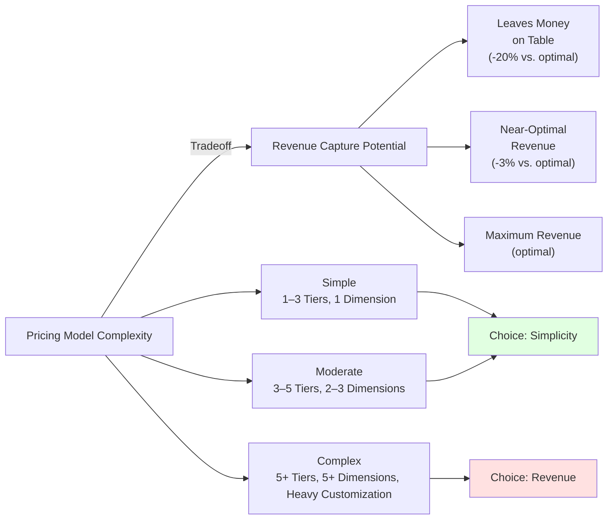

**Trade-off**: Simple pricing is easy to explain and sell but leaves WTP variance uncaptured. Complex pricing maximizes revenue but increases support burden and customer confusion.

**Decision**: Start simple (good/better/best), then add complexity only if revenue analysis shows the uplift justifies the support cost.

### 20.2 Freemium vs. Free Trial

**Freemium**:
- Pros: low CAC, high volume, quick activation
- Cons: low conversion, high free-user CAC cost

**Free Trial**:
- Pros: higher conversion, attracts high-intent users
- Cons: trial users require more support, higher per-trial-user cost

**Decision**: High-LTV B2B use free trials; low-LTV consumer use freemium.

---

## 21. Comparison Table

| Pricing Model | Best For | WTP Capture | Conversion Complexity | Revenue Predictability | Switching Cost |
|---|---|---|---|---|---|
| **Value-Based** | B2B with clear ROI | Very High (50%+ of value) | High | High | Medium |
| **Cost-Plus** | Commodity products | Low (leaves money on table) | Low | Medium | Low |
| **Freemium** | B2C, viral products | Low (3–5% conversion) | Low | Low | Low |
| **Tiered (3–5 tiers)** | Most SaaS | High (30–40% of value) | Medium | High | Medium |
| **Usage-Based** | Infrastructure, APIs | Variable (usage-dependent) | Medium | Low (usage spikes) | Very Low |
| **Subscription** | Recurring revenue model | Medium (depends on tier structure) | Medium | Very High (predictable MRR) | High |
| **Penetration** | Network effects, market share play | Low initially, increases over time | Medium | Low initially | High eventually |
| **Skimming** | Luxury, differentiated products | Very High initially | Low | High initially | Medium |

---

## 22. Real-World Case Study: Slack's Pricing Strategy

**Context**: Slack launched in 2013 as a team messaging platform competing against email, IRC (Internet Relay Chat), and Hipchat (a cheaper alternative).

**Pricing Evolution**:

1. **Freemium (2013–2015)**: Unlimited members, but only 10,000 searchable messages. Free users hit the message limit and had to pay for history.
2. **Tiered Model (2015–2021)**:
   - Free: limited message history, 1-on-1 channels, no integrations
   - Pro: $8/user/month, unlimited message history, all integrations, advanced workflows
   - Business+: $15/user/month, compliance, audit logs, data export (enterprise)
3. **Unified Billing (2021–Present): $12.50/user/month** across all tiers, with a **paid-tier-only** model for new sign-ups. Legacy free users grandfather in.

**WTP-Based Pricing Insight**: Slack's original freemium model targeted two segments:
- **Price-sensitive**: IT departments, startups → converted on message history friction
- **Price-insensitive**: Design studios, tech teams → willing to pay for productivity, integrations, compliance

Slack captured more value from price-insensitive users by offering a premium tier with advanced features (workflows, compliance), while maintaining a free tier for price-sensitive users with clear friction (message history limit).

**Shift to Paid-Only**: By 2021, Slack's network effects and switching costs were high enough to eliminate the free tier for new users, capturing maximum value. Only legacy free users remained (maintenance cost < value of keeping them happy).

**Result**: Slack went public at $16B valuation (2019), primarily due to high LTV/CAC ratios and predictable MRR (Monthly Recurring Revenue).

---

## 23. Interview Questions

1. **Value-Based Pricing**: A customer says your product automates a process that saves 10 hours/week ($50/hour labor = $500/week = $26,000/year value). Your price is $2,000/month ($24,000/year). The customer says the price is too high. What do you do?
   - *Ideal answer*: Clarify the economic value (does $26,000 include full-loaded cost, or only direct labor?). If value is $26,000, the price captures 92% (very high). Either: (a) negotiate down to 50% of value ($13,000/year = $1,083/month) to increase perceived fairness, or (b) add features that increase value delivered to $48,000/year, justifying the $2,000/month price.

2. **Freemium Mechanics**: You're building a collaboration tool with a freemium model. The free tier costs $5/month to serve (hosting, support). Free-to-paid conversion is 3%. At what price must a paid customer reach to justify the free-tier CAC?
   - *Ideal answer*: Break-even LTV = free-tier cost / conversion rate = $5 / 0.03 = $167. So paid customers must have LTV > $167 (assuming 12-month LTV and 0% margin, price must be > $14/month). In practice, target 10x LTV/CAC, so LTV > $1,670, requiring either higher conversion or higher paid-customer price.

3. **Tier Design**: Your SaaS product has WTP research showing three customer segments: startups ($100/month), mid-market ($600/month), enterprise ($3,000/month). How would you design your 3-tier pricing to capture value from all three?
   - *Ideal answer*: Starter $150 (capture 50% of startup WTP, leave consumer surplus), Professional $700 (capture ~17% of mid-market WTP, room for growth), Enterprise $3,500+ (capture 15%+ of enterprise WTP, but also include support/customization to justify premium). The goal is anchoring (Enterprise price makes Professional look reasonable) and segment self-selection.

4. **Usage-Based Pricing Risks**: You're considering usage-based pricing for your API platform ($0.01 per API call). A customer integrates your API into their checkout flow, and a viral event increases their API calls 50x (from 100k/month to 5M/month). Their bill jumps from $1,000 to $50,000. They churn. What could you have done differently?
   - *Ideal answer*: (a) Hybrid model: $500/month base + $0.005 per call overage, so the $5M calls = $500 + $24,500 = $25,000 (still painful, but predictability better). (b) Usage caps: hard limit at $2,000/month charge, throttle beyond. (c) Budget alerts: notify customer when approaching forecast. (d) Volume tiering: at high scale, unit price drops ($0.005 per call at 1M+), incentivizing commitment.

---

## 24. Hands-on Exercises

### Exercise 1: WTP Estimation

Conduct a 10-minute WTP survey with 3–5 colleagues. Ask them:
- What's a fair price for [your product]?
- What's the maximum you'd pay before walking away?
- What's the minimum price that feels too cheap (low quality signal)?

Plot the responses on a scale. Identify segments (designers might price higher than PMs). Discuss how WTP variance informs tier pricing.

### Exercise 2: Tier Bundling Review

Take an existing SaaS product's pricing page (e.g., Figma, Notion, Slack). For each tier:
- List the features included
- Identify the "friction wall" (what feature forces upgrade?)
- Calculate the price-to-feature ratio (price per unique feature in that tier)
- Assess fairness: does each tier feel like a natural next step, or does it feel like artificial lock-out?

### Exercise 3: Price Elasticity Simulation

Using the Python simulator in Section 10.3, estimate your product's demand curve (interview 5–10 customers about price sensitivity). Input the curve into the simulator. Calculate:
- Current revenue at current price
- Revenue-optimized price
- Revenue impact if competitor drops price 20%

---

## 25. Design Exercises

### Exercise 1: Freemium Funnel Design

Design a freemium model for a note-taking app. Specify:
- Free tier features (what core value is included?)
- Friction wall (what limit triggers frustration and upgrade consideration?)
- Paid tier value proposition (what new features justify upgrade?)
- Expected conversion rate (benchmark against similar products)
- Unit economics (cost to serve free user, LTV of paid customer, breakeven analysis)

### Exercise 2: Geographic Pricing Strategy

Your SaaS product is expanding to India, Japan, and Brazil. Current US pricing: $500/month Professional tier. Research local purchasing power and competition. Design a region-specific pricing strategy that:
- Accounts for PPP (Purchasing Power Parity)
- Avoids gray-market arbitrage
- Feels fair to customers in each region

---

## 26. Architecture Review Questions

When reviewing a pricing decision, ask:

1. **Is the pricing grounded in WTP research?** Or is it competitor-matched guesswork?
2. **Does the tier feature matrix feel fair?** Or does it feel like artificial lock-out?
3. **Are there operational risks?** (e.g., billing complexity, invoice accuracy, fraud, currency volatility)
4. **Is LTV/CAC viable?** (LTV should be 3x+ CAC for unit economics to scale)
5. **Does the model align with go-to-market strategy?** (e.g., freemium only works for high-volume B2C; not for B2B enterprise)
6. **What's the backup if competitors undercut?** (pricing doesn't exist in isolation; market dynamics change)

---

## 27. Summary

Pricing is a high-leverage, cross-functional responsibility bridging product design, business strategy, and customer psychology. This chapter has taught the foundational mechanisms:

- **Value-based pricing** anchors price to economic value delivered, maximizing revenue while preserving customer fairness
- **Tiered pricing** exploits WTP variance across customer segments via price anchoring and feature bundling
- **Usage-based pricing** aligns incentives but requires infrastructure for reliable metering and forecasting
- **Freemium models** subsidize customer acquisition with free tiers, accepting low conversion in exchange for high volume and network effects
- **Price elasticity** governs revenue sensitivity to price changes; understanding elasticity informs whether price increases are viable
- **Pricing psychology** (anchoring, fairness, framing) shapes customer perception more than rational economic calculation

The chapter has integrated with [CH24: Metrics](CH24_Metrics.md) (LTV, CAC), [CH16: Business Model](#) (revenue stream definition), and [future CH28 and CH30](#) (payoff prioritization and go-to-market positioning). Production code examples in Python and TypeScript have shown how to implement pricing logic operationally.

Architects and product leaders must treat pricing as a first-class design concern, not an afterthought. A wrong pricing decision can erode revenue 50% and trigger market rejection just as decisively as a broken product.

---

**Forward References:**
- [CH24: Metrics](CH24_Metrics.md) — LTV, CAC, ARPU, MRR definitions
- [CH28: Prioritization](#) — using payoff (pricing × market size) to rank initiatives
- [CH16: Business Model](#) — revenue stream and unit economics design
- [CH30: Go-to-Market](#) — pricing messaging, competitive positioning, launch strategy

**Concept Ownership (Proposal for CORE_CONCEPTS.md):**
- Value-based pricing (WTP, ceiling vs. floor)
- Cost-plus and cost-minus pricing
- Freemium models and conversion funnel
- Tiered pricing (good/better/best) and anchoring psychology
- Usage-based and metered pricing
- Subscription vs. perpetual licensing
- Geographic and segment pricing
- Price skimming vs. penetration launch strategies
- Price elasticity of demand
- Pricing communication and anchoring effects
- Proration and billing accuracy

