# Chapter 30: Go-to-Market Strategy

Part: [02 - Design Thinking and Product Management](PART_OVERVIEW.md) · Subsection: Product Management · Status: Drafted

## 1. Introduction

Go-to-Market (GTM) strategy is the operational execution engine that translates a designed product, validated market demand, and a chosen pricing model into sustained revenue, customer adoption, and competitive defensibility. Where product design asks *what should we build*, and pricing strategy asks *how much should we charge*, GTM strategy asks the harder questions: *how do we reach the first paying customer*, *how do we scale from pilot to production adoption*, *how do we defend our market position against competitive entry*, and *how do we build a self-sustaining flywheel of customer acquisition, retention, and expansion*?

A technical architect who designs an impeccable microservices platform or a zero-latency real-time system but deploys it without GTM strategy is guaranteed to watch the product languish in obscurity, regardless of technical merit. Conversely, a mediocre product backed by exceptional GTM discipline—clear positioning, relentless beachhead targeting, well-rehearsed sales motions, and obsessive customer success metrics—can achieve market penetration and defensible unit economics. GTM strategy is where product meets business, where engineering discipline meets behavioral psychology, and where organizational clarity replaces hope.

This chapter teaches solution architects and product leaders how to design and execute a GTM strategy that is:

1. **Market-Realistic**: based on validated customer discovery and demand signals, not internal enthusiasm or competitive fear
2. **Operationally Coherent**: sales motions, marketing tactics, and customer success workflows are mechanically aligned to move customers through a predictable lifecycle
3. **Capital-Efficient**: customer acquisition cost (CAC), payback period, and marketing spend are deliberately controlled and measured
4. **Defensible**: the GTM motion creates barriers to competitive substitution through switching costs, network effects, or economic moats
5. **Scalable**: the motion can be reproduced at 10x customer volume without architectural failure or organizational burnout

The chapter integrates tightly with [CH29: Pricing](CH29_Pricing.md) (which establishes pricing positioning and unit economics), [CH24: Metrics](CH24_Metrics.md) (which defines CAC, LTV [Lifetime Value], and conversion funnel metrics), [CH25: North Star Metrics](CH25_North_Star_Metrics.md) (which aligns organizational focus during scaling), [CH28: Prioritization](CH28_Prioritization.md) (which ranks GTM initiatives by payoff and effort), and the customer feedback and market research foundations established throughout Part 02.

---

## 2. Historical Evolution

Go-to-Market discipline evolved through distinct eras of software commercialization:

1. **Enterprise Sales and Account Management (1970s–1990s)**: Early software vendors (IBM, Informix, Sybase, Oracle) sold primarily through direct enterprise sales: a sales team identified large organizations with a need, negotiated contracts over months, and closed deals valued at $500K–$10M per customer. GTM was inseparable from relationship-based selling; marketing was secondary. Revenue was lumpy and highly dependent on individual sales leaders.

2. **Desktop Marketing and Channel Distribution (1980s–2000s)**: Shrink-wrap software (Microsoft, Adobe, Intuit) adopted retail GTM: mass-media advertising (TV, print, billboards), retail shelf placement (Best Buy, CompUSA), and channel partnerships (resellers, system integrators). GTM shifted from 1:1 relationship sales to 1:many direct-to-consumer marketing. Success required brand recognition, advertising budget scale, and retail relationships.

3. **Web-Scale Freemium and Viral GTM (2005–2015)**: Consumer internet products (Flickr, YouTube, Dropbox, Slack) pioneered viral, freemium GTM: a free product created network effects and habit formation; conversion to paid happened through upsell, not sales cycles. Marketing was primarily organic (word-of-mouth, viral sharing, search engine optimization [SEO]); user-paid acquisition (Google Ads, Facebook Ads) was secondary. GTM success was measured in acquisition cost per viral loop iteration, not in closing sales cycles.

4. **Product-Led Growth (2010–Present)**: SaaS products (Figma, Stripe, Twilio) adopted product-led growth (PLG): the product itself is the primary sales and marketing vehicle. Free trials, generous freemium tiers, and embedded upsell funnels drive adoption and conversion without a traditional sales team. GTM is product-centric (signup flow, onboarding, in-app monetization) rather than sales-centric.

5. **Hybrid and Segmented GTM (2015–Present)**: Modern software increasingly segments GTM by customer persona: small businesses and individual users adopt through PLG, while mid-market and enterprise segments use sales-led growth (SLG) with account executives, customer success managers, and long sales cycles. A single product can operate with multiple parallel GTM motions (product-led for self-serve, sales-led for enterprise, partner-led for channel).

---

## 3. Why It Exists

GTM strategy exists to solve five structural problems in software commercialization:

```
+-----------------------------------------------------------------------------------+
|                            THE FIVE GTM PROBLEMS                                  |
+-----------------------------------------------------------------------------------+
| 1. Discovery Blindness    --> Customers cannot find product without targeted GTM   |
| 2. Adoption Friction      --> Even aware customers encounter barriers to purchase  |
| 3. Scaling Collapse       --> Growth-channel effectiveness degrades at scale       |
| 4. Churn and CAC Spiral   --> High churn forces ever-increasing acquisition spend  |
| 5. Competitive Erosion    --> Without GTM defensibility, competitors replicate     |
+-----------------------------------------------------------------------------------+
```

- **Mitigating Discovery Blindness**: Without deliberate GTM, a product is invisible to its market. Even excellent products fail if target customers never encounter them. GTM ensures targeted messaging reaches the right customer cohort via the right channel at the right moment.

- **Eliminating Adoption Friction**: Awareness alone is insufficient. A customer must navigate signup, onboarding, proof-of-value demonstration, pricing negotiation, and contract execution. GTM removes friction at each step through clear positioning, frictionless signup, responsive sales support, and trial-to-paid conversion.

- **Preventing Scaling Collapse**: A GTM motion that works at 10 customers per month often breaks at 100 per month (sales team cannot scale 10x faster than hiring allows), or at 1,000 per month (marketing channels hit saturation or affordability walls). Successful scaling requires deliberate transition between GTM motion types (product-led to sales-led, single-channel to multi-channel).

- **Breaking the CAC Spiral**: High churn (customers leaving faster than retention improves) forces escalating acquisition spend just to maintain flat growth. Without customer success discipline and retention optimization, GTM becomes a leaky bucket, and unit economics collapse. GTM includes lifecycle management: acquisition, activation, retention, and expansion.

- **Establishing Competitive Defensibility**: In commoditized markets, competitors can replicate features within months. GTM creates defensibility through brand equity, customer switching costs (lock-in through data portability, integrations), network effects, and land-and-expand revenue models.

---

## 4. Core Concepts

Section 4 teaches the core conceptual models of GTM strategy from first principles.

```
+-----------------------------------------------------------------------------------+
|                                CORE CONCEPTS MAP                                  |
+-----------------------------------------------------------------------------------+
| 4.1  Target Customer Segmentation and Persona Mapping                             |
| 4.2  Beachhead Markets and Market Selection                                       |
| 4.3  Sales-Led Growth (SLG) vs. Product-Led Growth (PLG)                          |
| 4.4  Launch Phasing and the GTM Timeline                                          |
| 4.5  Sales Motions and Sales Cycle Mechanics                                      |
| 4.6  Market Positioning and Competitive Differentiation                           |
| 4.7  Pricing Positioning in Go-to-Market                                          |
| 4.8  Customer Success and Retention Economics                                     |
| 4.9  GTM Metrics: CAC, LTV, Payback Period, and Churn                            |
+-----------------------------------------------------------------------------------+
```

---

### 4.1 Target Customer Segmentation and Persona Mapping

#### Definition
**Target Customer Segmentation** divides a total addressable market (TAM) into cohorts based on job-to-be-done (JTBD), willingness-to-pay (WTP), purchase process, and adoption friction. **Persona Mapping** associates each segment with a representative fictional character (decision-maker, end-user, buyer, influencer) who embodies the behaviors, constraints, and motivations of the segment.

#### Mechanism
A GTM strategy that treats all customers identically will fail because customer acquisition cost (CAC), adoption friction, sales cycle length, and expansion potential vary wildly across segments. A $1M/year mid-market customer expects a 6-month sales cycle, dedicated account management, custom integrations, and security audits; a $50/month individual user expects a 5-minute signup, no calls, and self-service. Attempting to use the same GTM for both results in either wasted enterprise sales spend (if optimized for individual users) or abandoned individual users (if optimized for enterprise).

Segmentation must be based on **structural differences**, not demographic labels:
- **JTBD Alignment**: does this segment have an urgent, expensive problem the product solves?
- **Purchase Friction**: how many stakeholders must approve? How long is the sales cycle?
- **WTP**: what economic value does the product deliver to this segment? Can they afford it?
- **Adoption Friction**: do they have the technical capability and organizational readiness to implement?
- **Expansion Potential**: can the product expand within the account (additional users, additional use cases)?

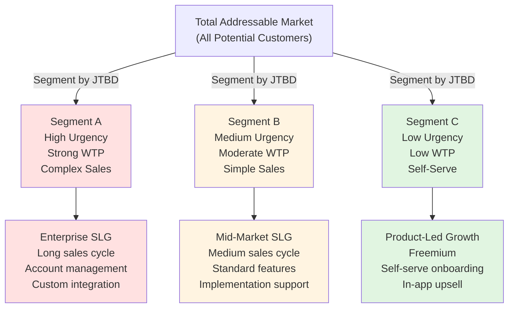

#### Decision Implications
1. **Do NOT attempt a single GTM motion**: allocate the primary GTM budget to the highest-CAC-efficiency segment (usually mid-market for SaaS), then build secondary motions for enterprise (high-touch) and individual users (product-led).
2. **Design personas as behavioral archetypes, not demographics**: e.g., "DevOps Engineer at a Series-C startup" is more actionable than "technical decision-maker ages 25–45."
3. **Map each segment to its GTM motion explicitly**: avoid ambiguous positioning that tries to appeal to everyone.

#### Common Failure Mode
**Over-Segmentation and Messaging Ambiguity**: A product tries to appeal simultaneously to individual developers (via PLG), DevOps teams (via product features), and enterprises (via sales team). Marketing messaging attempts to address all three and ends up resonating with none. The product acquires a scattered customer base with low retention and high churn.

---

### 4.2 Beachhead Markets and Market Selection

#### Definition
A **Beachhead Market** is an initial target customer segment chosen for its combination of size, accessibility, and profitability such that the company can establish dominant market share and operational credibility before expanding to adjacent markets. A beachhead is small and defensible enough to win quickly, but large and profitable enough to justify the GTM investment.

#### Mechanism
Most software companies attempting to serve a large market simultaneously distribute their GTM budget too thinly, resulting in zero dominant position, weak brand recognition, and high churn. Beachhead strategy—derived from military amphibious operations—recommends instead establishing a stronghold in a smaller, more defensible segment first, then expanding from that base.

**Beachhead Selection Criteria**:
- **Segment Size**: $10M–$100M annual customer-addressable spending in the segment (large enough to justify GTM, small enough to dominate)
- **Accessibility**: existing customers or strong referral channels in the segment (e.g., the founder's prior company, a specific vertical)
- **Competition**: low incumbent entrenched competition (e.g., legacy solutions, spreadsheets, manual processes)
- **Urgency**: customers have an expensive, urgent problem (high purchase intent)
- **Expansion Vector**: clear adjacency to larger markets after beachhead establishment (e.g., win in retail, then expand to hospitality)

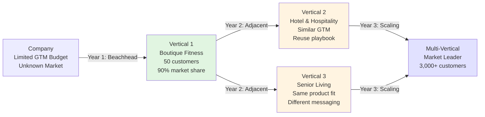

#### Decision Implications
1. **Choose ONE beachhead market**: do not try to enter three segments simultaneously.
2. **Build GTM positioning around beachhead specificity**: marketing, sales messaging, and product roadmap decisions are all tailored to the beachhead segment.
3. **Measure beachhead success by market share and profitability, not raw customer count**: aim for >25% market share within the beachhead segment before expansion.

#### Common Failure Mode
**Beachhead Drift and Missed Adjacency**: A company chooses boutique fitness as beachhead but captures only 5 customers, realizes the vertical is too small, abandons it, and pivots to enterprise fitness (requiring different GTM, longer sales cycle, higher CAC). The company ends up with no dominant position anywhere and burns through cash with no clear expansion path.

---

### 4.3 Sales-Led Growth (SLG) vs. Product-Led Growth (PLG)

#### Definition
**Sales-Led Growth (SLG)** is a GTM motion in which a dedicated sales team directly engages prospects, manages relationships, negotiates contracts, and closes deals; marketing's role is lead generation and qualification. **Product-Led Growth (PLG)** is a GTM motion in which the product itself is the primary acquisition and onboarding vehicle; prospective customers sign up, use the product in a free trial, experience value directly, and convert to paid without human intervention.

#### Mechanism
SLG and PLG sit on a spectrum determined by customer acquisition cost (CAC), customer lifetime value (LTV), and sales cycle length:

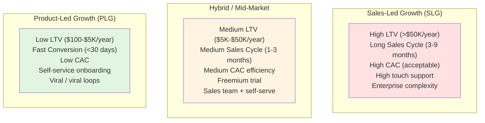

**SLG Model**: Prospect enters sales funnel via inbound marketing (content, SEO, events) or outbound sales (cold email, phone). Sales rep (Account Executive) schedules discovery call, qualifies opportunity, creates a proposal, handles objections, and closes contract. Customer Success Manager (CSM) owns post-sale onboarding, adoption, retention, and expansion. Typical CAC: $5K–$50K per customer. Typical LTV: $100K–$1M over customer lifetime.

**PLG Model**: Prospect discovers product via organic search, app store, or word-of-mouth. Signs up with email, enters onboarding flow, experiences immediate value from core feature. Trial period (usually 14–30 days) allows free usage; conversion happens via in-app upsell (feature unlock, seat add-on, usage overage). No direct human interaction during adoption. Typical CAC: $50–$2K per customer. Typical LTV: $500–$50K over customer lifetime.

**Hybrid Model**: Most mid-market SaaS operate on a spectrum: a self-serve free trial (PLG component) qualifies buyers; if they show engagement signals (feature usage, team size growth), a sales rep engages (SLG component).

#### Decision Implications
1. **SLG is appropriate if LTV > $100K/year and customer is willing to engage in sales process**: enterprise, complex integrations, custom development.
2. **PLG is appropriate if LTV < $10K/year and customer has low purchase friction**: individuals, small teams, self-service use cases.
3. **Hybrid is appropriate for LTV $10K–$50K/year**: initial PLG trial, then sales engagement if customer shows readiness.
4. **Do NOT try to operate two complete GTM motions in parallel with limited resources**: focus on the one appropriate for your primary segment, then expand to secondary motions.

#### Common Failure Mode
**Hybrid Confusion and Misaligned Incentives**: A company simultaneously invests in PLG (engineering product features, optimizing signup/onboarding) and SLG (hiring sales team, funding outbound campaigns). Neither gets sufficient budget or clarity; the product is neither great for self-serve nor positioned for enterprise; sales team blames marketing for lack of leads; product team complains that sales closes deals the product cannot support. GTM drifts and CAC climbs while LTV stagnates.

---

### 4.4 Launch Phasing and the GTM Timeline

#### Definition
**Launch Phasing** breaks GTM execution into distinct phases, each with explicit objectives, success metrics, and resource allocation: MVP launch, beachhead scaling, adjacent market entry, and company-scale operations.

#### Mechanism
GTM maturity scales through phases:

1. **Phase 1: MVP Launch (Month 0–3)**
   - Objective: validate problem-market fit, achieve first 10–50 paying customers
   - GTM Motion: direct sales + founder-led sales + strategic partnerships
   - Marketing: minimal; rely on founder network and inbound from product publicity
   - Success Metric: $10K–$100K MRR (Monthly Recurring Revenue) with >3 referenceable customers
   - Failure Point: inability to close first paying customer or discovery that customers do not see urgency

2. **Phase 2: Beachhead Scaling (Month 4–12)**
   - Objective: establish dominant position in beachhead segment; reach 20–100 customers
   - GTM Motion: hire first account executive (AE), implement repeatable sales playbook, increase marketing spend
   - Marketing: targeted content, case studies, vertical-specific positioning, early brand building
   - Success Metric: $50K–$500K MRR, >70% win rate in target segment, <3-month sales cycle
   - Failure Point: sales cycle remains unpredictable, CAC exceeds LTV payback threshold

3. **Phase 3: Scaling (Month 12–24)**
   - Objective: prove unit economics, expand to 2–3 adjacent markets, scale GTM investment
   - GTM Motion: hire sales team (2–5 AEs), implement marketing automation, add CSM role, launch secondary product lines
   - Marketing: multi-channel approach (content, paid ads, events, partnerships), build brand authority
   - Success Metric: $500K–$5M MRR, consistent <12-month LTV payback, >30% year-over-year growth
   - Failure Point: customer churn increases as company scales; product quality degrades

4. **Phase 4: Market Leadership (Month 24+)**
   - Objective: defend beachhead market share, establish category leadership, optimize GTM efficiency
   - GTM Motion: hire GTM specialists (demand gen managers, product marketing, partner managers), implement predictive lead scoring, invest in brand
   - Marketing: mix of inbound (content, brand) and outbound (sales development, partnerships), thought leadership
   - Success Metric: >50% market share in beachhead, >20% margins, >40% retention rate

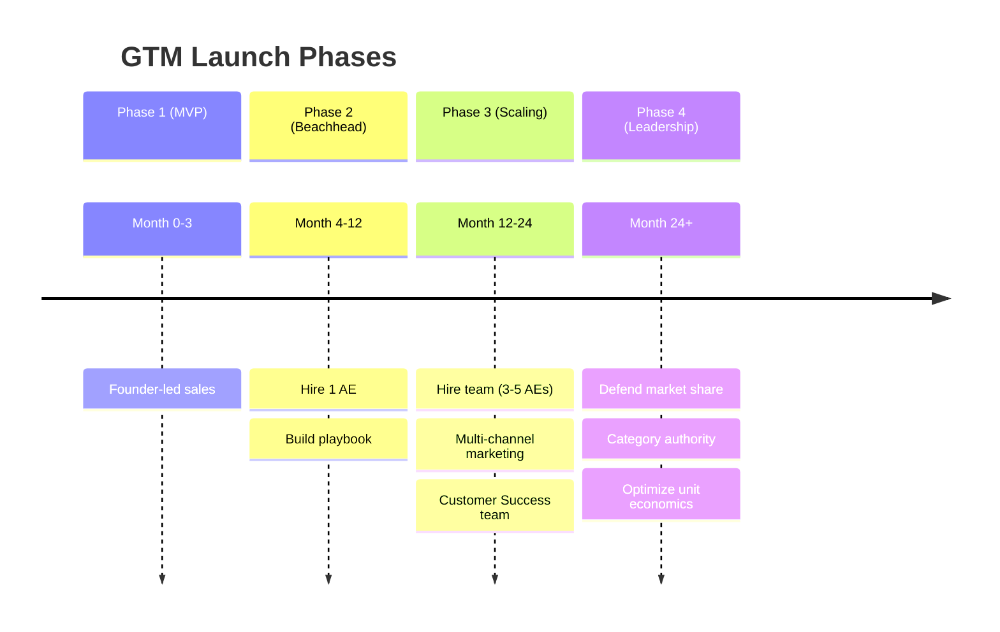

#### Decision Implications
1. **Each phase has different success criteria**: do NOT measure Phase 1 by MRR targets; measure by customer discovery and problem validation.
2. **Phase transitions require organizational restructuring**: moving from founder-led sales (Phase 1) to hired AE-led sales (Phase 2) requires explicit sales playbook documentation and onboarding.
3. **Do NOT skip phases**: many companies attempt to jump from MVP to $1M MRR (skipping beachhead scaling phase) and fail because they lack repeatable GTM.

#### Common Failure Mode
**Premature Scaling**: A company closes 3 customers in month 1, declares victory, hires 10 salespeople, allocates $500K marketing budget, and attempts to enter 5 markets simultaneously. Within 6 months, 2 of the 3 initial customers churn, the sales team closes 0 new deals, and the company runs out of cash with no clear GTM motion.

---

### 4.5 Sales Motions and Sales Cycle Mechanics

#### Definition
A **Sales Motion** is the standardized sequence of activities and tactics an account executive (AE) follows to move a prospect from awareness to close: prospecting, qualification, discovery, proposal, negotiation, and close. A **Sales Cycle** is the elapsed time (typically weeks to months) from initial contact to contract signature.

#### Mechanism
Sales motions vary by market segment and product type:

1. **Outbound Sales Motion** (enterprise/complex deals):
   - Sales Development Representative (SDR) identifies target account and prospect list (account-based marketing)
   - SDR sends highly personalized cold email with specific problem reference or company research
   - If prospect responds, SDR qualifies interest and schedules AE discovery call
   - AE conducts discovery call to understand customer's situation, pain points, buying process
   - AE produces custom proposal or demo addressing prospect's specific needs
   - AE negotiates contract (pricing, implementation timeline, SLAs, security requirements)
   - AE closes contract and hands to Customer Success Manager (CSM)
   - Typical cycle: 60–180 days from first contact to signature

2. **Inbound Sales Motion** (freemium/product-led):
   - Prospect discovers product via Google search, software review sites, or referral
   - Prospect signs up for free trial via website
   - Product sends automated onboarding emails, in-app tips, and upgrade prompts
   - Prospect reaches usage limit or feature paywall; in-app prompt offers paid upgrade
   - Prospect converts via self-serve purchase or contacts sales team for enterprise contract
   - Typical cycle: 14–30 days from signup to first paid transaction

3. **Inside Sales Motion** (mid-market):
   - Prospect enters funnel via inbound marketing content, SEO, or warm referral
   - Inside Sales Rep (less expensive than AE, uses phone + email) conducts lightweight discovery
   - Rep determines if prospect is qualified; if not, disqualifies and moves to next prospect
   - If qualified, rep prepares simple proposal (often templated) and presents via video call
   - Rep handles negotiation and closes deal
   - Typical cycle: 30–60 days from first contact to signature

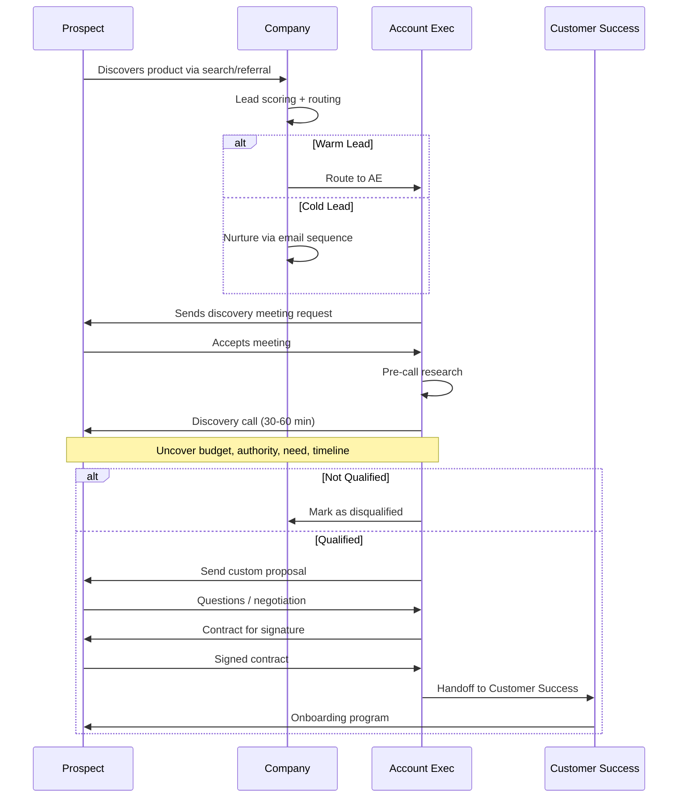

#### Decision Implications
1. **Match sales motion to customer acquisition cost and sales cycle tolerance**: 
   - Enterprise (LTV > $500K): outbound motion justified despite long cycle
   - Mid-market (LTV $50K–$500K): inside sales or lightweight outbound
   - SMB (LTV < $50K): inbound + product-led

2. **Optimize sales cycle through explicit pipeline stages**: define clear stage-exit criteria (e.g., "qualified" = identified budget owner, acknowledged problem, fit assessment completed) to prevent deals getting stuck in "negotiation limbo" for 6 months.

3. **Measure and optimize conversion rates at each stage**: if 50% of prospects in "proposal" stage never advance to "negotiated," the proposal process is broken; investigate and iterate.

#### Common Failure Mode
**Undefined Sales Motion and Pipeline Stagnation**: A company hires a sales team without documenting the ideal customer profile (ICP) or sales motion steps. Sales reps pursue leads inconsistently; some close deals in 2 weeks, others take 6 months; there is no predictability. Pipeline forecasting is inaccurate; quarter-end deals slip repeatedly; company misses revenue targets consistently.

---

### 4.6 Market Positioning and Competitive Differentiation

#### Definition
**Market Positioning** is the distinct place a product occupies in the customer's mind relative to competitors, determined by feature set, target customer segment, price, and brand messaging. **Competitive Differentiation** is the specific, defensible reason a customer should choose this product over alternatives.

#### Mechanism
Positioning fails when a product occupies the same mental space as competitors or when the differentiation is not credible or defensible. Effective positioning establishes:

1. **Target Customer Clarity**: "We serve boutique fitness studios with <50 locations" (specific, defensible)
2. **Problem Ownership**: "We solve boutique fitness's member retention problem" (not facility scheduling, not billing)
3. **Differentiation Axis**: "We provide AI-driven member churn prediction and personalized outreach" (specific advantage over competitors who offer only manual reporting)
4. **Credibility/Proof**: case studies, technical depth, founder background (why should customer believe this claim?)

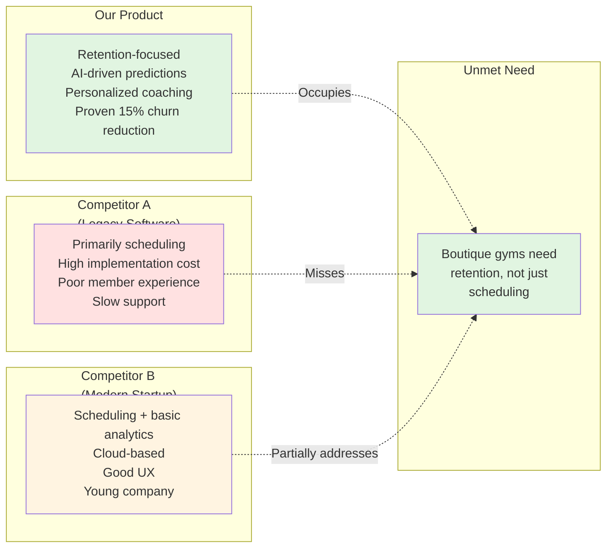

#### Decision Implications
1. **Position in an underserved dimension, not as a direct competitor on the same axis**: do not claim "better scheduling than Competitor A" if customers already perceive Competitor A as adequate at scheduling; claim "we solve retention" instead.
2. **Ensure positioning is defensible for 18+ months**: proprietary data, network effects, or switching costs prevent competitors from copying it.
3. **Communicate positioning consistently across sales, marketing, product, and customer success**: misaligned messaging signals confusion.

#### Common Failure Mode
**Positioning Ambiguity and Feature Creep**: A company initially positions as "retention-focused," but during sales, the product is perceived as needing to compete on scheduling features, billing features, and employee management. Product roadmap is pulled in all directions; positioning becomes "all-in-one fitness platform," which is weak and matches competitors. Customer acquisition cost rises; win rates fall.

---

### 4.7 Pricing Positioning in Go-to-Market

#### Definition
**Pricing Positioning** is the deliberate communication of price relative to perceived value and competitor alternatives such that customers understand *why* they are paying this price and do not perceive price as a barrier to adoption.

#### Mechanism
See [CH29: Pricing](CH29_Pricing.md) for the mechanics of pricing model design (value-based pricing, tiering, usage-based models). Pricing positioning—how GTM *communicates* price—is distinct and equally important.

**Pricing Positioning Tactics**:
1. **Anchor to economic value delivered**: "Members save an average of 8 hours per week on administrative tasks (valued at $400/week in labor cost). Our price is $199/month ($10K annually), which pays for itself in 2.5 weeks of labor savings."
2. **Emphasize value over feature count**: do not list 50 features and charge $99/month; articulate the outcome (churn reduction, revenue increase).
3. **Use tiering to establish affordability**: $99/month entry-level tier (Starter, for small studios) makes the product feel accessible; enterprise customers see the $499/month or custom tier as appropriate for their scale.
4. **Communicate pricing transparency**: make pricing public and clear to reduce sales cycles and improve customer perception of fairness.

The GTM implications are significant: if pricing positioning is weak, sales conversations stall at the price objection; if it is strong, price becomes a proxy for quality and the negotiation moves to implementation details.

#### Decision Implications
1. **Do NOT use pricing as a sales negotiation tactic**: communicate price confidently and expect rare discounts (only for volume or multi-year commitments).
2. **Ensure pricing is justified by documented customer value**: in sales calls, leads with specific financial evidence of ROI, not generic claims.
3. **Monitor win/loss reasons to validate pricing positioning**: if "price too high" is a top loss reason, pricing positioning may be weak (customers do not perceive value clearly) or pricing model may be misaligned to segment.

#### Common Failure Mode
**Hidden Pricing and Sales Friction**: A company hides pricing behind a "contact us" form because sales leadership believes price negotiation creates differentiation. Prospects cannot compare value-to-price quickly; sales conversations take 3x longer; many prospects self-eliminate due to perceived opacity. CAC climbs; conversion rates fall.

---

### 4.8 Customer Success and Retention Economics

#### Definition
**Customer Success** is the operational discipline of systematically ensuring customers achieve their stated business outcomes, leading to sustained retention and expansion (cross-sell and upsell).

#### Mechanism
After a customer is acquired and onboarded, the retention and expansion phase determines whether the business has sustainable unit economics. Many companies focus all GTM resources on acquisition (getting the customer to pay for month 1) but neglect retention (ensuring the customer pays for months 2–12+).

**Customer Success Mechanics**:
1. **Onboarding** (weeks 1–4): dedicated CSM or product onboarding sequence ensures customer can use core features and achieve immediate value. Failure here results in high churn within 30 days.
2. **Adoption Tracking** (weeks 4–12): CSM monitors customer's usage telemetry (feature adoption, logins, activity level) and proactively intervenes if adoption is low.
3. **Business Review** (monthly): CSM conducts periodic check-ins (formal for enterprise, light touch for SMB) to review customer's progress toward stated outcomes and identify expansion opportunities.
4. **Expansion** (ongoing): CSM identifies and communicates additional products or features the customer could adopt (cross-sell, upsell). Expansion revenue is the highest-margin revenue in SaaS (existing customer base, no acquisition cost).
5. **Retention Decision** (month 11): customer decides whether to renew; CSM's relationship and evidence of ROI drive renewal likelihood.

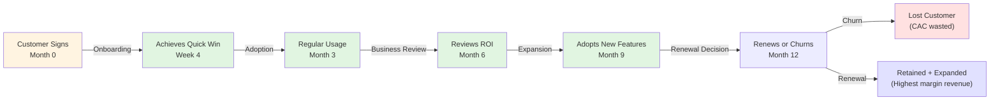

#### Decision Implications
1. **Implement customer success **before** scaling acquisition**: if churn is >5% per month, scaling acquisition is wasteful (leaky bucket).
2. **Measure and optimize stage-exit metrics**: track % of customers achieving quick win in week 4 (should be >80%); track adoption rate by month 3 (target >50% weekly active users); track retention by month 12 (target >90% for SaaS).
3. **Allocate CSM resources by LTV**: high-LTV customers ($100K+) deserve dedicated CSM; low-LTV customers ($1K) should self-serve or use automation.

#### Common Failure Mode
**Acquisition-Only Focus and Unit Economics Collapse**: A company acquires 100 customers at $20K CAC, but average LTV is $30K with 50% monthly churn. Customer lifetime is ~2 months; LTV payback is never achieved. Company burns through $2M acquisition budget acquiring customers that leave before becoming profitable.

---

### 4.9 GTM Metrics: CAC, LTV, Payback Period, and Churn

#### Definition and Mechanism
[CH24: Metrics](CH24_Metrics.md) establishes customer acquisition cost (CAC), lifetime value (LTV), and churn definitions. This section connects them explicitly to GTM strategy execution.

**Customer Acquisition Cost (CAC)**: total marketing and sales spend divided by number of new customers acquired in a period.
$$\text{CAC} = \frac{\text{Total S\&M Spend (1 period)}}{\text{Number of New Customers Acquired}}$$

For GTM: CAC governs which GTM motion is viable. Enterprise SLG can support CAC of $50K; PLG cannot.

**Lifetime Value (LTV)**: discounted sum of all future gross margins from a customer relationship.
$$\text{LTV} = \text{ARPU} \times \text{Gross Margin \%} \times \text{Customer Lifetime (months)} / (1+\text{Discount Rate})^{\text{time}}$$

For GTM: LTV determines payback period and GTM viability threshold. Ratio LTV/CAC should be >3:1 (meaning each customer acquisition dollar generates $3+ in lifetime gross margin).

**Payback Period**: elapsed time from customer acquisition until cumulative gross margin exceeds cumulative CAC.
$$\text{Payback Period (months)} = \frac{\text{CAC}}{\text{Monthly Gross Margin per Customer}}$$

For GTM: if payback period is >18 months, GTM efficiency is poor. Benchmark: enterprise SLG should have <15-month payback; PLG should have <6-month payback.

**Churn Rate**: percentage of customers who do not renew or cancel in a period.
$$\text{Monthly Churn Rate} = \frac{\text{Customers Cancelled in Month}}{\text{Customers at Start of Month}}$$

For GTM: monthly churn >5% makes acquisition-based growth unsustainable. Every 1% reduction in monthly churn increases LTV by ~12% (since customer stays ~1 month longer).

#### Decision Implications
1. **Monitor CAC, LTV, and Payback Period as primary GTM KPIs** (not just revenue or customer count).
2. **Model GTM scenarios**: "If we hire 5 additional AEs (cost $500K/year) and they each close 10 customers at $50K CAC, and LTV is $150K with 3% monthly churn, what is our payback period?" Adjust GTM investment based on modeled outcomes.
3. **Optimize for CAC efficiency in early stages**: do not scale GTM spend if LTV/CAC ratio is <2:1.

#### Common Failure Mode
**Metric Blindness and Unsustainable Growth**: A company celebrates "10,000 new customers acquired this year" without monitoring CAC, LTV, or churn. When forced to look at the numbers, CAC is $30K, LTV is $40K, and churn is 8% per month; the company is acquiring customers faster than they retain them and accelerating cash burn with every new acquisition.

---

## 5. Internal Working and GTM Architecture

This section details the operational structures and processes required to execute a modern GTM strategy at scale.

### 5.1 Sales Team Structure and Roles

A GTM organization typically includes:

1. **Vice President of Sales**: oversees sales strategy, rep hiring, quota setting, deal management, and forecast accuracy.
2. **Account Executives (AEs)**: close deals, own customer relationships, manage contract negotiation. 1 AE typically closes 5–15 deals per year (depending on sales cycle length).
3. **Sales Development Representatives (SDRs)**: source outbound prospects, qualify inbound leads, schedule calls for AEs. 1 SDR typically books 20–40 AE meetings per month.
4. **Customer Success Managers (CSMs)**: own post-sale onboarding, adoption, retention, and expansion for assigned customer accounts. 1 CSM typically manages 20–50 customers (depending on LTV and complexity).
5. **Revenue Operations / Sales Operations**: manage CRM (Customer Relationship Management), pipeline reporting, forecast accuracy, compensation, and GTM process improvements.

Sales efficiency ratios:
- **AE:SDR ratio**: typically 1 AE per 0.5–1 SDR (SDRs hand off qualified meetings; AEs close)
- **AE:CSM ratio**: typically 1 AE per 1–2 CSMs (each AE's new customers are taken over by CSM at close)
- **Sales Productivity**: revenue per sales employee per year should improve as company scales (e.g., $1M per AE at $500K MRR → $1.5M per AE at $5M MRR due to improved processes)

### 5.2 Marketing and Demand Generation Functions

1. **Demand Generation / Growth Marketing**: owns lead generation strategy (inbound + outbound), marketing campaigns, content creation, and funnel optimization.
2. **Product Marketing**: owns positioning, messaging, competitive analysis, and launch go-to-market.
3. **Content Marketing**: creates blog posts, whitepapers, webinars, case studies that generate inbound leads and establish thought leadership.
4. **Paid Acquisition**: manages Google Ads, Facebook Ads, LinkedIn Ads; optimizes cost-per-lead and cost-per-acquisition.
5. **Marketing Operations**: manages marketing automation platforms (e.g., HubSpot, Marketo), lead scoring, and attribution modeling.

### 5.3 Customer Success and Retention Operations

1. **VP Customer Success**: owns retention strategy, CSM hiring, adoption metrics, and churn reduction.
2. **Customer Success Managers**: assigned to customer accounts by segment (high-touch for enterprise, nurture-automation for SMB).
3. **Customer Support / Technical Support**: provides reactive support for customer issues (separate from proactive success management).
4. **Customer Success Operations**: manages customer data, adoption dashboards, health scoring, and automated interventions.

---

## 6. GTM Strategy Types and Selection Framework

GTM strategies vary along three primary axes: **Customer segment focus** (B2B vs. B2C, enterprise vs. SMB, vertical-specific vs. horizontal), **primary acquisition channel** (direct sales vs. product-led, partnerships vs. organic), and **business model** (SaaS subscription vs. transaction-based vs. marketplace).

### 6.1 Horizontal vs. Vertical GTM Strategies

**Horizontal Product** (targets many industries with the same product):
- GTM challenges: high CAC (must educate many personas), weak positioning (benefits vary by industry), long sales cycles (different procurement processes per industry)
- GTM strength: large TAM, diversified revenue
- Example: Slack, Asana, Zoom serve all industries equally
- Positioning: "Collaboration platform" (generic) or vertical-specific messaging (Asana for "product teams," Slack for "engineering teams")
- Beachhead: choose 1 vertical (e.g., tech startups, marketing teams) and dominate, then expand

**Vertical Product** (solves deep problem in single industry):
- GTM advantage: strong positioning, lower CAC (focused persona, distribution), shorter sales cycle
- GTM weakness: limited TAM, high dependence on one industry's health
- Example: Greenhouse (hiring software for HR), HubSpot (CRM for sales), Fitbod (fitness analytics for gym chains)
- Positioning: "Hiring software for mid-market tech companies" (specific, credible)
- Beachhead: entire industry is potential beachhead; focus on customer size (e.g., Series B–D startups, not Fortune 500)
- Expansion: adjacency to related verticals (e.g., hiring software to recruiting software to talent management)

### 6.2 Sales-Led, Product-Led, and Hybrid Decisions

SLG decisions:
- Enterprise customers (LTV > $500K, complex implementation)
- Industries with procurement rituals (enterprise, government, healthcare)
- Pricing > $10K/month (economics support AE headcount)
- Long customer lifecycle (>2 years), high expansion potential

PLG decisions:
- Individual users or small teams (LTV < $5K)
- Self-service problem (customer can understand and solve without help)
- Affordable pricing (<$100/month)
- Fast decision-making (no committee required)

---

## 7. Beachhead Market Selection and Validation

Beachhead selection is one of the highest-leverage decisions in GTM strategy. A poor beachhead choice condemns the company to 18+ months of undefined market, weak positioning, and scattered customer acquisition.

### 7.1 Beachhead Selection Criteria

1. **Addressable Market Size**: ideal beachhead serves $20M–$200M annual customer-addressable market (large enough for a meaningful company, small enough to dominate)
   - *Too small* (<$10M): not enough TAM to build billion-dollar company
   - *Too large* (>$500M): too many competitors, too hard to establish dominance

2. **Competitive Intensity**: low incumbent competition, legacy solutions, or underserved segment
   - Score: 1=highly competitive, 5=green-field opportunity
   - Ideal: 4–5 (low competition, high opportunity)

3. **Customer Pain Severity**: customers have an urgent, expensive problem; high willingness-to-pay
   - Score: 1=nice-to-have, 5=mission-critical
   - Ideal: 4–5 (high urgency, high budget)

4. **Founder/Team Fit**: team has existing relationships, credibility, or deep industry knowledge in beachhead
   - Score: 1=zero prior knowledge, 5=founder led team in this space previously
   - Ideal: 3–5 (some existing relationships or knowledge)

5. **Expansion Potential**: clear adjacency to larger markets after beachhead dominance
   - Score: 1=dead end, 5=many adjacent markets
   - Ideal: 3–5 (at least 2–3 adjacent markets possible)

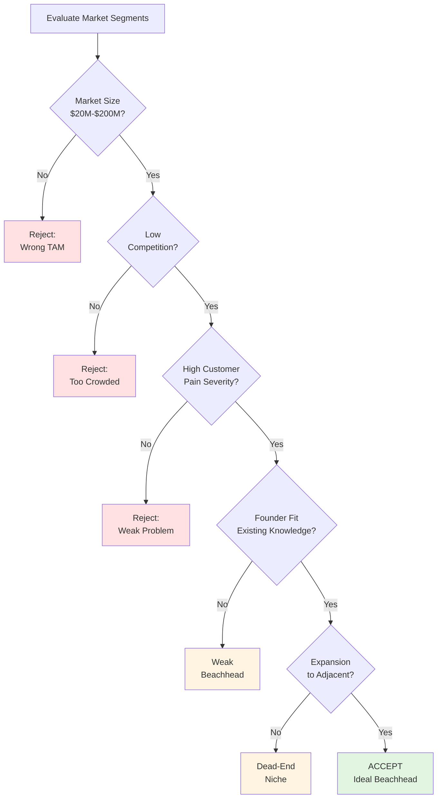

### 7.2 Beachhead Validation Process

Before fully committing GTM resources to a beachhead, validate the choice:

1. **Customer Discovery (weeks 1–4)**: conduct 20–30 customer interviews in target segment. Document: problem severity, economic value, purchase process, existing solutions. Success metric: >80% of interviewees report urgent, expensive problem.

2. **Value Proposition Testing (weeks 5–6)**: present product/solution to same cohort. Measure willingness-to-pay (WTP) via Van Westendorp pricing study, Gabor-Granger curve, or survey. Success metric: median WTP is 2–3x your planned price.

3. **Pilot Customer Acquisition (weeks 7–12)**: attempt to acquire 3–5 pilot customers in beachhead segment. Success metric: close at least 2 customers within 12 weeks; customers report problem-solution fit.

4. **Reference Credibility**: ensure 2+ pilot customers are willing to serve as references (testimonial, case study, reference call). Success metric: reference customer reports measurable ROI (time saved, cost reduced, revenue increased).

If validation fails at any stage (no urgent problem identified, WTP is low, cannot close pilot customers, pilots report low fit), restart beachhead search. Forcing a bad beachhead will waste 18–24 months.

---

## 8. Launch Phasing and Go-to-Market Timeline

### 8.1 Pre-Launch Phase (Weeks -8 to 0)

**Objective**: prepare organization and market for launch; validate product-market fit.

**Activities**:
- Finalize positioning, messaging, and product narrative
- Record founder/CEO video testimonial and demo
- Create landing page and pitch deck
- Prepare 3–5 case study or pilot customer success stories
- Recruit launch partners (influencers, industry analysts, media contacts)
- Prepare email announcement list (founders' networks, investors, community)

**Success Metrics**:
- Landing page conversion rate: target >2–5% (visitors to email signups)
- Pitch deck review: get 5+ experts to review messaging for clarity and positioning consistency
- Case study quality: at least 2 pilot customers provide quotes and measurable ROI numbers

### 8.2 Launch Week (Week 0)

**Objective**: announce product and generate initial inbound interest.

**Activities**:
- Send launch email to founders' network and announcement list
- Publish blog post or announcement on company site
- Submit to product community sites (Product Hunt, Hacker News, indie hacker communities, vertical-specific forums)
- Reach out to launch partners for amplification (influencers share, analysts write about)
- Prepare sales team and CSM team for incoming interest surge

**Success Metrics**:
- Email open rate: >40% (well-targeted list)
- Product Hunt launch: top 10 products of the day or higher
- Website traffic surge: 10–50x normal daily traffic
- Sales pipeline: 20–100 inbound leads from launch

### 8.3 Post-Launch Weeks 1–4

**Objective**: convert launch momentum into committed pilot customers; gather feedback to refine positioning.

**Activities**:
- Founder/CEO personal outreach to launch-week inbound leads (identify high-potential customers)
- Product team gathers feedback from engaged users; iterate on core workflows if needed
- Marketing team documents customer feedback and updates positioning if misalignment detected
- Prepare case study materials from successful pilots (customer logos, quotes, ROI numbers)
- Early community building: respond to all comments/feedback, nurture engaged users

**Success Metrics**:
- Pilot customer close rate: target >20% of serious inbound leads convert to pilot or paid
- NPS (Net Promoter Score) from pilot users: target >50 (strong initial product experience)
- Feedback themes: clear pattern of primary problem solved (if no pattern, positioning may be off)

### 8.4 Post-Launch Month 2–3: Beachhead Scaling

**Objective**: establish repeatable sales motion, document sales playbook, begin scaling marketing.

**Activities**:
- Hire first AE (if SLG) or scale marketing channels (if PLG)
- Document ideal customer profile (ICP) based on pilot customer cohort analysis
- Refine sales playbook: discovery process, objection handling, proposal template, negotiation strategy
- Launch paid marketing experiments (Google Ads, LinkedIn Ads) to test messaging and landing pages
- Publish 2–3 case studies and content pieces to establish thought leadership

**Success Metrics**:
- Sales productivity: first AE should close 2–5 deals in Month 3 (if SLG)
- CAC: track cost-per-acquisition; target <1/3 of LTV
- Sales cycle: document average deal cycle length (should be consistent ±30%)
- Marketing engagement: blog posts, case studies accumulating 100–500 views per week

---

## 9. Sales Motions and Sales Cycle Mechanics

### 9.1 Outbound Sales Playbook Template

An effective outbound sales motion requires documented, repeatable processes:

**Step 1: Target Account Selection**
- Define ideal customer profile (ICP) by company characteristics: industry, company size, revenue, technology stack, geography, funding stage
- Build target account list (TAL) of 100–500 accounts fitting ICP
- Research: identify economic decision-maker, economic buyer (controls budget), champion (end-user), saboteur (resists implementation)

**Step 2: Personalized Outreach (SDR or AE)**
- Send highly personalized cold email (not generic mass email):
  - Reference specific company context or recent company news (IPO, funding, acquisition, product launch)
  - Articulate specific problem based on company profile (not generic benefit)
  - Propose 15-minute discovery call (low commitment)
  - Use 3-email sequence: initial, follow-up if no response at day 3, follow-up at day 7

**Step 3: Qualification (Discovery Call)**
- AE or SDR conducts 15–30 minute discovery call
- Goal: determine if customer has Budget, Authority, Need, Timeline (BANT)
  - Budget: does customer have budget allocated? When does budget year start/end?
  - Authority: is this person authorized to make decision, or will they need committee approval?
  - Need: does customer have urgent, expensive problem matching our solution?
  - Timeline: when does customer want to make a decision? (e.g., Q3, end-of-year)
- Document findings in CRM; advance qualified leads to next stage, disqualify non-qualified

**Step 4: Demonstration and Proposal**
- For qualified leads: schedule in-depth demo call or in-person meeting
- Tailor demo to customer's specific use case (not a generic product tour)
- Articulate ROI: "Based on your usage profile, you will save 10 hours/week (valued at $5K/month) and reduce churn by 2 percentage points (valued at $100K/year revenue impact). Our price is $50K/year, so ROI is 23x in year 1."
- Send written proposal after meeting: problem statement, solution overview, pricing, implementation timeline, contract terms

**Step 5: Negotiation and Close**
- Respond to customer objections: address concerns about price, implementation, vendor stability
- Negotiation typically focuses on: price discount (resist; offer volume commitment or longer contract instead), implementation timeline, security/compliance requirements
- Close by securing contract signature: email for SaaS, wet signature for enterprise

**Step 6: Customer Handoff**
- AE hands customer to CSM; provide context on customer's business outcomes, technical requirements, key contacts, any custom commitments
- CSM begins onboarding

### 9.2 Sales Cycle Optimizations

Common sales-cycle bottlenecks and mitigations:

1. **Deal Stalls in "Proposal" Stage**
   - Problem: customer receives proposal but does not advance (asking follow-up questions, "thinking about it," committee delay)
   - Mitigation: pre-proposal agreement on decision process. Before proposing, confirm: "If this proposal addresses your needs, who needs to approve? When can we get on a call with them?"

2. **Multiple Stakeholders Delay Decision**
   - Problem: proposal goes to procurement/finance for approval; they ask for SOC 2 audit, security documentation, reference checks (adding 4–8 weeks)
   - Mitigation: early education. Before close, learn all stakeholder requirements and prepare documentation in advance.

3. **Competitive Pressure and Last-Minute Discounting**
   - Problem: at the last minute, customer reveals competitor is also under consideration; wants discount to choose us
   - Mitigation: establish value clearly before proposal; do not position price as a negotiation variable. If competitor has lower price, emphasize non-price differentiation (implementation speed, support quality, product capability).

---

## 10. Market Messaging and Positioning

### 10.1 Core Messaging Pillars

Effective market messaging is built on 3–4 core pillars:

1. **Problem Articulation**: define the customer's problem precisely and emotionally
   - Example: "Boutique fitness studios are losing 30% of members in their first year due to lack of personalization and community. This costs studios $50K+ per year in lost recurring revenue."

2. **Solution Positioning**: position product as uniquely solving the problem
   - Example: "Our AI-driven member engagement platform predicts churn risk and automates personalized outreach, reducing member churn by an average of 15%."

3. **Differentiation**: explain why this solution is better than alternatives (competitors, doing nothing, manual workarounds)
   - Example: "Unlike generic fitness software, we specialize in retention, not just scheduling. Our AI is trained on 50,000+ boutique fitness members; we know patterns that humans miss."

4. **Credibility/Proof**: demonstrate the solution works through case studies, data, references
   - Example: "40+ boutique fitness studios use our platform. Average customer reports 15% churn reduction and $75K annual revenue savings. See case studies from [Studio A], [Studio B], [Studio C]."

### 10.2 Messaging Across Channels and Personas

Messaging should be calibrated for audience and channel:

- **Website/Landing Page**: 30-second hook (problem), 2-minute value articulation (solution), visual proof (case studies, customer logos)
- **Sales Call Discovery**: open with tailored problem discovery ("Tell me about your member retention challenge"), listen 70% of the time, articulate solution last
- **Proposal/Email**: structure as: problem recap (show we listened), solution overview, quantified ROI, next steps
- **Customer Success Onboarding**: articulate customer's expected outcomes and success metrics explicitly; set retention/expansion ambitions

---

## 11. Marketing Channel Strategy and Demand Generation

### 11.1 Channel Selection Framework

Choose marketing channels based on **cost-per-acquisition (CPA)**, **quality of leads**, **time-to-revenue**, and **scalability**:

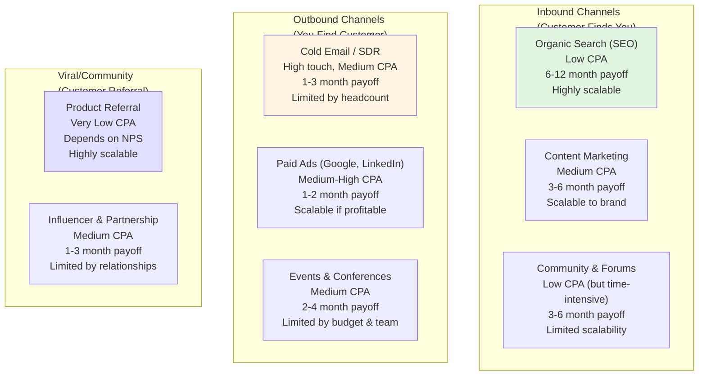

### 11.2 Early-Stage Demand Generation (Months 1–6)

Typical channel mix for early-stage SaaS startup:

1. **Organic/Content-Driven (50% of inbound)**:
   - Blog posts on customer pain points (e.g., "5 Reasons Boutique Fitness Members Churn and How to Prevent Them")
   - SEO optimization for high-intent keywords (e.g., "member retention for boutique fitness," "gym member churn reduction")
   - Guest posts on industry blogs or publications
   - Target: 100–500 organic search visits per month by month 6

2. **Outbound Sales-Driven (40% of pipeline)**:
   - Cold email from founder or AE to 50–100 target accounts per month
   - LinkedIn outreach to specific prospects (personal connection, short message)
   - Attend 1–2 industry conferences; capture 50–100 qualified leads
   - Target: 10–50 qualified meetings per month by month 6

3. **Community & Virality (10% of pipeline)**:
   - Product Hunt launch and follow-up on community feedback
   - Participate in industry Slack groups, forums, subreddits (helpful, non-salesy)
   - Encourage early customers to refer others (referral bonus)
   - Target: 1–3 deals per month from word-of-mouth

### 11.3 Mid-Stage Demand Generation (Months 6–18)

As GTM matures, expand channel mix:

1. **Paid Ads** (20–30% of budget):
   - Google Ads on high-intent keywords: "member retention software," "boutique fitness software"
   - LinkedIn Ads targeting account decision-makers in target industry/company size
   - Facebook/Instagram Ads (for B2C segments)
   - Target CPA: <$500 (depends on LTV)

2. **Content Marketing** (30–40% of budget):
   - Blog (publishing 2–4 posts per month)
   - Webinars and virtual events (attracting 100–500 registrants)
   - Email nurture sequences (automated follow-up to leads not yet ready to buy)
   - Case studies and white papers (gated content)
   - Target: 1,000–5,000 marketing-qualified leads (MQLs) per month

3. **Partnerships & Referral** (10–20% of budget):
   - Partner with complementary vendors (e.g., studio management software, payment processors) for co-marketing, integration, referrals
   - Affiliate/referral program for agencies, consultants, industry associations
   - Target: 10–30% of new customers from partnership channel

---

## 12. Sales Enablement and Tooling

### 12.1 Sales Enablement Artifacts

Sales enablement ensures the sales team has the tools, knowledge, and support to execute GTM strategy:

1. **ICP and Sales Playbook Documentation**
   - Ideal Customer Profile (ICP): documented company characteristics, personas, pain points, buying process
   - Sales Playbook: step-by-step process for discovery → qualification → proposal → negotiation → close
   - Common objections and response strategies
   - Target: 1 page ICP, 5–10 page playbook

2. **Pitch Deck and Messaging Framework**
   - Company/product overview: 1-slide problem, 1-slide solution, 1-slide differentiation, 1-slide credibility
   - Customer journey deck: tailored version for each ICP persona
   - ROI calculator: tool to estimate customer's annual savings/revenue impact
   - Competitive comparison: feature matrix comparing to top 3 competitors (optional; sometimes dangerous to emphasize competition)

3. **Proposal Template and Pricing Guide**
   - Standardized proposal template (problem statement, solution, timeline, pricing, contract terms)
   - Pricing guide: clear guidance on when/how much to discount (usually: do not; offer volume commitment or longer contract instead)
   - Implementation timeline template: week-by-week onboarding plan
   - Security/compliance template: SOC 2, GDPR, HIPAA documentation

4. **Case Studies and Customer Testimonials**
   - 3–5 case studies covering: different customer sizes (SMB, mid-market), different use cases, measurable ROI
   - Each case study: 1-page format with problem, solution, and quantified outcome
   - Video testimonials: 3–5 minute customer interviews on problem-solution fit and business impact
   - Reference contact list: customers willing to take reference calls from prospects

### 12.2 Sales Technology Stack

Typical enterprise GTM tech stack:

- **CRM (Customer Relationship Management)**: Salesforce, HubSpot, Pipedrive
  - Central repository for leads, opportunities, accounts, contacts
  - Tracks deal stage, probability, expected close date, deal amount
  - Sales forecasting and pipeline reporting

- **Email and Sequences**: Outreach, SalesLoft, HubSpot
  - Automated cold email sequences
  - Meeting scheduling and calendar integration
  - Activity tracking (emails sent, opened, clicked)

- **Sales Engagement**: ZoomInfo, Apollo, Clearbit
  - Prospect database and company intelligence
  - Email finder and phone number lookup
  - Account intelligence and buying signals

- **Proposal and Sales Collateral**: PandaDoc, Proposify
  - E-signature for contracts
  - Proposal customization and tracking
  - Document analytics (page views, engagement)

- **Performance Tracking**: Tableau, Looker, Amplitude
  - Sales dashboards: pipeline velocity, win rate, CAC, quota attainment
  - Customer health dashboards: adoption metrics, churn risk
  - Real-time forecast accuracy

---

## 13. Pricing Positioning in Go-to-Market

See [CH29: Pricing](CH29_Pricing.md) for the mechanics of pricing model design. This section focuses on how GTM *communicates* and *enforces* pricing.

### 13.1 Pricing Transparency and Communication Strategy

**Pricing Communication Decisions**:

1. **Public Pricing vs. Hidden Pricing**:
   - **Public Pricing** (display price on website): reduces sales friction, allows self-qualification, improves lead quality, shortens sales cycle
   - **Hidden Pricing** (sales contact required): allows dynamic pricing, increases sales control, extends sales cycle, misses self-qualifying leads
   - Recommendation: public pricing for PLG and mid-market; hidden pricing only for enterprise with highly variable implementation costs

2. **Simple vs. Complex Pricing**:
   - **Simple Pricing** (1 tier, flat annual price): easy to understand, reduces decision friction, may leave money on table for willing-to-pay variation
   - **Complex Pricing** (3+ tiers, usage-based components, add-ons): captures more revenue, requires explanation, increases sales friction and customer confusion
   - Recommendation: launch with simple pricing (1 tier at beachhead price point); add complexity only after achieving market fit

3. **Anchoring Strategy**:
   - Price anchor: use first/lowest tier price to make higher tiers seem more reasonable
   - Example: Stripe Billing is $99/month (Tier 1) or $999/month (Tier 3); the $99 price anchors perception that Tier 3 is premium-but-reasonable

### 13.2 Sales Pricing Discipline

**Pricing in Sales Conversations**:
- **Do NOT initiate price discussions**: let customer reveal their budget first, or position price as investment justified by ROI
- **Do NOT discount early**: offer discount only after customer has acknowledged understanding of value (risks anchoring customer to negotiation mindset)
- **Do offer non-price concessions**: multi-year contract commitment (e.g., 20% discount for 2-year commitment), volume discounts (additional seats), implementation bundle
- **Do anchor price to customer's economic value**: "This solution will save you $150K/year; we're asking for $50K/year. Your payback is 4 months."

---

## 14. Sales Performance Metrics and Forecasting

### 14.1 Core Sales KPIs

1. **Pipeline Generation**:
   - Inbound Qualified Leads (IQLs): high-intent leads generated by marketing (website form submissions, trial signups)
   - Outbound Opportunities: leads engaged by sales team (responses to cold email, referral leads)
   - Target: 20–40 qualified opportunities per AE per month

2. **Sales Conversion**:
   - Win Rate: % of opportunities that close
   - Sales Cycle: average time from first contact to close (weeks/months)
   - Deal Size: average contract value (ACV)
   - Target: >25% win rate, <90-day sales cycle, ACV aligned to pricing model

3. **Sales Productivity**:
   - Revenue per AE: total ACV closed by AE / 12 months
   - Deals per AE: number of closed deals per AE per year
   - Target: $1M–$5M revenue per AE (depends on industry, deal size, sales cycle)

4. **Customer Acquisition Cost (CAC)**:
   - Fully Loaded CAC: total S&M spend / new customers acquired
   - CAC Payback Period: time for customer's gross margin to exceed CAC
   - CAC:LTV Ratio: LTV / CAC; target >3:1

### 14.2 Sales Forecasting and Pipeline Management

**Opportunity Stage Definitions** (enable accurate forecasting):
- **Stage 1 - Prospect**: initial contact, does not yet qualify
- **Stage 2 - Qualified**: meets ICP criteria, problem acknowledged, fit confirmed
- **Stage 3 - Proposal**: proposal sent, customer reviewing
- **Stage 4 - Negotiation**: customer interested, discussing terms and pricing
- **Stage 5 - Close**: contract ready to sign

**Win Probability by Stage**:
- Stage 1 Prospect: 5% probability (early, unknown)
- Stage 2 Qualified: 25% probability (fit confirmed but no proposal)
- Stage 3 Proposal: 50% probability (proposal in active review)
- Stage 4 Negotiation: 75% probability (negotiating terms, not fit)
- Stage 5 Close: 95% probability (contract ready, legal review)

**Forecast = Σ(Deal Amount × Win Probability for Each Stage)**

Example: $500K in Stage 2, $1M in Stage 3, $300K in Stage 4
Forecast = ($500K × 25%) + ($1M × 50%) + ($300K × 75%) = $125K + $500K + $225K = $850K expected close

---

## 15. Customer Success and Retention Metrics

### 15.1 Customer Health and Adoption Metrics

1. **Onboarding Completion**:
   - % of customers completing core onboarding workflow (training, first data import, first report generation)
   - Target: >80% complete onboarding within 2 weeks of contract

2. **Feature Adoption**:
   - % of active users using core features (e.g., member engagement prediction, churn intervention)
   - Target: >50% of seats using core features by month 3

3. **Engagement/Activity**:
   - Weekly Active Users (WAU) / Monthly Active Users (MAU): % of customer seats logging in and using product
   - Feature usage: frequency of key actions (e.g., interventions sent, engagement campaigns created)
   - Target: >70% monthly active rate; active users should use product 2+ times per week

### 15.2 Retention and Expansion Metrics

1. **Net Revenue Retention (NRR)**:
   - Beginning MRR + expansion MRR (upsells, cross-sells) - churned MRR / Beginning MRR
   - Example: Month 1: $100K MRR. New customers add $30K. Churned customers subtract $10K. Existing customers upsell $5K. NRR = ($100K + $30K + $5K - $10K) / $100K = 125%
   - Target: >100% (growth from existing customer base; >120% indicates strong expansion)

2. **Churn Rate**:
   - Monthly churn: % of customers churned in month
   - Expansion revenue as % of new revenue (if expansion is >50% of new revenue, business is dependent on upsell)
   - Target: <3% monthly churn (enterprise/mid-market), <5% (SMB)

3. **Customer Lifetime Value (LTV) and CAC Payback**:
   - See Section 4.9 for definitions
   - Target: LTV/CAC > 3:1; CAC payback <15 months

### 15.3 Customer Health Scoring

Predict churn risk through health score combining:
- Feature adoption score: weighted score based on feature usage
- Engagement score: weighted score based on login frequency, action frequency
- Support score: inverse of support ticket volume/intensity (high support often signals low product fit)
- Expansion score: upsell/expansion opportunity indicators

Overall health = (adoption × 30%) + (engagement × 30%) + (support × 20%) + (expansion × 20%)

Score 0–33: "Red" (churn risk), proactive CSM intervention required
Score 34–66: "Yellow" (at-risk), CSM engagement recommended
Score 67–100: "Green" (healthy), routine check-ins adequate

---

## 16. Product-Led Growth (PLG) vs. Sales-Led Growth (SLG): Mechanics and Trade-offs

### 16.1 PLG Mechanics: Signup-to-Paid Funnel

PLG optimization focuses on maximizing conversion through a product-native funnel:

**Funnel Stages**:
1. **Awareness**: customer discovers product (search, community, viral)
2. **Signup**: customer creates account
3. **Onboarding**: customer completes core workflow (first use of critical feature)
4. **Activation**: customer achieves stated goal or "aha moment"
5. **Paywall/Trial Limit**: customer hits feature limit or trial expiration
6. **Conversion**: customer upgrades to paid or adds payment method
7. **Retention**: customer uses product regularly (low churn)
8. **Expansion**: customer upgrades tier or adds seats

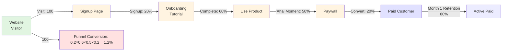

**PLG Optimization Priorities**:
1. **Signup friction**: reduce form fields (name + email only), offer OAuth (sign in with Google)
2. **Time to value**: guide new user to core feature in <2 minutes (vs. 30-minute setup)
3. **Paywall strategy**: limit features by seats, data volume, or time-based trial (14–30 days); offer in-app upgrade button prominently
4. **Upgrade messaging**: communicate value of paid tier clearly (unlocked features, usage limits, customer support)
5. **Trial-to-paid conversion**: measure conversion rate; test 7-day vs. 14-day vs. 30-day trials; optimize based on observed behavior

### 16.2 SLG Mechanics: Sales Pipeline

SLG optimization focuses on pipeline velocity and deal quality:

**Sales Efficiency Ratios**:
- **Activity Ratios**: calls/emails per day (sales touch volume)
- **Qualification Rates**: % of meetings that advance to proposal stage
- **Close Rates**: % of proposals that close as deals
- **Cycle Time**: average time from discovery to close

**SLG Optimization Priorities**:
1. **Lead qualification**: improve ICP definition and inbound qualification; reduce time spent on non-qualified prospects
2. **Discovery effectiveness**: AE communication skills, discovery framework (MEDDIC, BANT) to surface objections early
3. **Proposal quality**: custom proposals tailored to customer (not generic), quantified ROI, clear next steps
4. **Negotiation discipline**: do not compete on price; emphasize value; offer non-price concessions
5. **Close coaching**: remove objections, establish executive sponsorship, secure commitment to implementation timeline

### 16.3 Hybrid Strategies: Segmented GTM

Most mature SaaS products layer both PLG and SLG:

- **PLG for Self-Serve**: individual users, small teams, low-LTV customers
- **SLG for Enterprise**: mid-market, high-touch customers, complex deals

**Segmentation Logic**:
- Signup experience and trial rules are unified (same PLG funnel for all)
- If trial user displays "enterprise" signals (large company, many team members, integration requests), route to sales team for outreach
- Reverse: if enterprise prospect shows low engagement with trial, do not push sales motion; may indicate poor product fit

---

## 17. Partnership and Channel Strategies

### 17.1 Vertical Partnerships and Reseller Channels

**Reseller/Partner Channel Opportunities**:

1. **Technology Partners** (integration partners):
   - Integrate with complementary platforms (e.g., boutique fitness studio management software, payment processors, email platforms)
   - Customer discovers our product through partner's ecosystem or marketplace
   - Revenue model: revenue share (20–30% of ACV), referral fee, or co-selling arrangement

2. **Agency/Consultant Partners**:
   - Implementation agencies, management consultants recommend our product to clients
   - Revenue model: referral fee (10–25% of first-year ACV) or whitelabel/reseller arrangement
   - Example: Accenture, Deloitte, industry-specific consultants

3. **Reseller Channels**:
   - Software resellers, systems integrators, distribution partners purchase product at wholesale and resell to customers
   - Revenue model: 40–50% wholesale discount on ACV
   - Advantages: fast channel expansion, reduced GTM cost
   - Disadvantages: less control over customer experience, risk of margin compression

### 17.2 Co-Marketing and Joint GTM

**Co-Marketing Opportunities**:
- Joint webinar or event: both companies promote, split attendee list, share leads
- Content partnership: write joint white paper, case study, or research report
- Product integration: public announcement of integration, integrate partner into demo/onboarding
- Revenue model: typically no direct revenue share; each company handles their own customers; indirect benefit through brand association and lead generation

---

## 18. Geographic Expansion and Localization

### 18.1 International GTM Considerations

**Market Maturity Decisions**:
1. **Tier 1 Markets** (first priority): English-speaking, high-GDP markets with strong SaaS adoption (US, UK, Canada, Australia, Germany)
   - GTM: use existing playbook with minimal localization; hire local sales team if LTV supports it

2. **Tier 2 Markets** (second priority): Non-English European markets, developed Asia-Pacific (France, Germany, Japan, Singapore)
   - GTM: localize website + marketing content; hire local sales or partner with reseller; establish local entity for taxation

3. **Tier 3 Markets** (opportunistic): emerging markets, languages with smaller addressable market
   - GTM: product localization only; use partner channel; do not invest in direct sales until market maturity

**Localization Checkpoints**:
- Website translation: at minimum, product website + key marketing pages translated and culturally adapted
- Pricing localization: price in local currency; account for local purchasing power parity
- Legal/compliance: GDPR (EU), data residency requirements, local tax ID
- Sales support: website chat, email support, or sales team responsive to local time zone

---

## 19. Competitive Positioning and Response Strategy

### 19.1 Competitor Differentiation Matrix

Map competitive landscape explicitly:

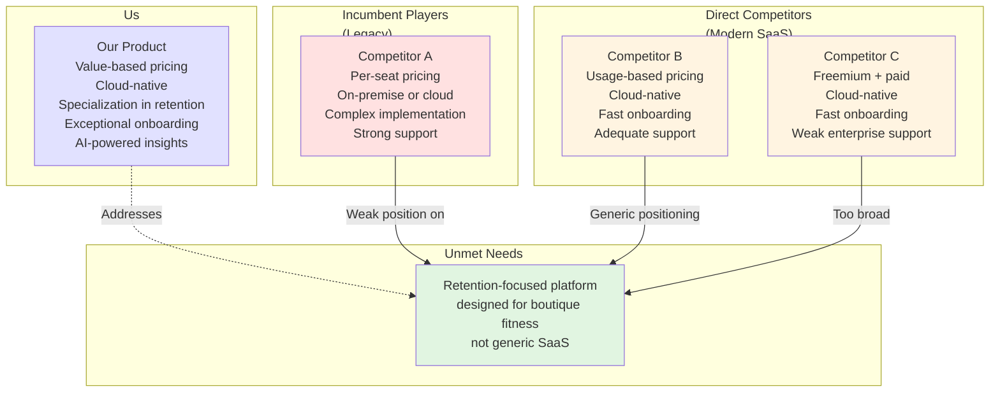

### 19.2 Competitive Response and Price Wars

**When Competitor Enters or Drops Price**:
1. **Do NOT respond with price cuts immediately**: instead, emphasize differentiation (product capability, support quality, customer outcomes)
2. **Document competitor positioning**: track how they position against you in win/loss analysis
3. **Adjust messaging if needed**: if competitor has genuine advantage, acknowledge it internally and plan product investment (do not hide from customers)
4. **Protect existing customers**: increase customer success engagement, expand customer use cases, build switching costs (integrations, data lock-in)

---

## 20. Customer Acquisition Cost (CAC) and Payback Period

### 20.1 CAC Calculation and Benchmarking

**Fully-Loaded CAC**:
$$\text{CAC} = \frac{\text{Total S\&M Spend (period)}}{\text{New Customers Acquired (period)}}$$

**S&M Spend includes**:
- Sales team salaries (AE, SDR, CSM, management)
- Marketing budget (ads, content, events)
- Sales tools (CRM, proposal software, engagement tools)
- Customer success onboarding (initial training, support)
- Sales/marketing overhead (office space, benefits, taxes)

**CAC by Channel**:
- Organic/inbound (self-serve signup): $0–$500 (no direct cost; only underlying marketing)
- Content marketing (blog, webinar): $500–$2K per lead, $5K–$20K per customer
- Paid ads (Google, LinkedIn): $1K–$10K per customer
- Outbound sales (SDR + AE): $5K–$50K per customer
- Partnerships/referral: $5K–$20K per customer

**Benchmarks by Segment**:
- PLG (SMB): CAC $500–$5K, CAC payback 3–6 months
- Mid-market: CAC $10K–$50K, CAC payback 9–15 months
- Enterprise: CAC $50K–$200K+, CAC payback 12–24 months

### 20.2 CAC Payback Period and Unit Economics

**CAC Payback Period**:
$$\text{Payback Period (months)} = \frac{\text{CAC}}{\text{Monthly Gross Margin per Customer}}$$

Example: CAC $50K, average customer generates $10K/year gross margin = $833/month
Payback = $50K / $833 = 60 months (5 years) — **unsustainable**

Revised example with higher LTV: Customer generates $50K/year gross margin = $4,167/month
Payback = $50K / $4,167 = 12 months — **acceptable**

**GTM Health Indicators**:
- Payback period <12 months: healthy (customer ROI evident within 1 year)
- Payback period 12–18 months: acceptable (for high-LTV segments like enterprise)
- Payback period >18 months: risky (requires strong expansion revenue or churn rate reduction)

### 20.3 Modeling CAC Scenarios

```
Example: Projected GTM Investment vs. Revenue

                            Month 1   Month 6   Month 12   Month 24
AE Headcount                1         3         8          15
Monthly S&M Spend           $150K     $400K     $800K      $1.5M
New Customers Acquired      3         20        50         100
CAC (fully loaded)          $50K      $20K      $16K       $15K
ARR (Annual Recurring Rev)  $200K     $1.5M     $4M        $10M
CAC Payback (months)        12        12        10         9
LTV:CAC Ratio               3:1       4:1       5:1        5.5:1
```

Interpretation: As GTM matures, CAC decreases (better efficiency) and LTV:CAC ratio improves (better unit economics), indicating healthy scaling.

---

## 21. Viral Loops and Network Effects

### 21.1 Viral Mechanics and K-Factor

**Network Effects** and **Viral Loops** are GTM mechanics where customer acquisition accelerates as customer base grows (positive feedback loop).

**Viral Coefficient (K-factor)**: average number of new customers acquired by each existing customer through referral

$$k = \text{invitation\_rate} \times \text{accept\_rate}$$

Where:
- invitation_rate = % of customers who invite friends
- accept_rate = % of invited friends who sign up

Example: 30% of Slack users invite colleagues to their Slack workspace × 40% of invitees accept = k = 0.12

**Viral Dynamics**:
- k > 1.0: each customer generates >1 new customer; exponential growth (viral)
- k = 1.0: each customer generates exactly 1 new customer; linear growth
- k < 1.0: customer acquisition slows over time (requires continuous external acquisition)

**Viral Growth Timeline** (if k = 0.3):
- Day 1: 1 customer (founder)
- Day 7: 1 + 0.3 = 1.3 customers
- Day 30: ~1 + (0.3)^1 + (0.3)^2 + ... ≈ 1.43 customers (slow, because k < 1.0)
- Day 365: still only ~1.5 customers organically (viral motion alone insufficient)

### 21.2 Creating Viral Loop Opportunities

Viral is difficult to engineer but possible in specific product categories:

**Conditions Favoring Viral**:
1. **Network effects inherent to product**: product becomes more valuable as more users join (e.g., Slack, Zoom, social media)
2. **Low friction to invite and join**: inviting friends is 1 click; accepting is 1 tap; no payment required
3. **Personal value to inviter**: user has direct incentive to invite others (e.g., earn referral bonus, unlock features)
4. **High accept rate**: friend is likely to respond positively (trusted source, relevant recommendation)

**Viral Tactics**:
- Referral bonuses: give existing customer free service credit (e.g., "Refer a friend, both get 1 month free")
- Feature unlocks: free tier limited to single-user; unlock multi-user sharing if friend joins
- Social sharing: "Share results" button that generates shareable link or social media post
- Integration with high-reach platforms: Slack integrations (install in many workspaces), email forwarding rules, browser extensions (auto-install for colleagues)

**Viral Risks**:
- Over-incentivized referrals can lead to low-quality signups (users incentivized to refer friends who do not have real need)
- Spam perception: users tired of referral offers abandon the product
- CAC illusion: viral may appear to create free acquisition, but referral incentives are costly

---

## 22. Real-World Case Study: B2B SaaS Go-to-Market (Helpdesk Platform)

### 22.1 Company Context

**Company**: CloudSupport (fictional)
**Product**: AI-powered customer support platform (ticket routing, response suggestion, sentiment analysis)
**Market**: mid-market SaaS companies (10–500 employees)
**TAM**: $5B+ (thousands of SaaS companies globally)

### 22.2 GTM Strategy Selection

**Beachhead Market**: SaaS companies with 50–200 employees, US-based, Series A–C funding stage
- Why: strong product-market fit, high urgency (customer support quality drives retention), willing-to-pay ($500–$5K/month), founder's prior experience in this segment

**GTM Motion**: Hybrid (PLG + SLG)
- PLG component: free trial (14-day) with sandbox data
- SLG component: if trial user shows high engagement (>10 support tickets analyzed), route to sales team for enterprise conversation

**Pricing Model**: per-seat + usage-based
- Base: $500/month for first 5 support agents + $100/agent/month
- Usage: $0.10 per support ticket analyzed (capped at $2K/month)
- Enterprise: custom pricing for >20 agents

### 22.3 Launch Execution (Phase 1–2)

**Pre-Launch (Month -2 to 0)**:
- Position as "AI-powered support for SaaS," not "competitor to Zendesk" (Zendesk is stronger at core helpdesk features; CloudSupport differentiates on AI-driven efficiency)
- Create 2 case studies from seed customers: case study 1 (Series B SaaS company, "reduced support ticket backlog by 40% in 3 months"), case study 2 (Series C logistics SaaS, "improved first-response time from 4 hours to 10 minutes")
- Prepare Product Hunt launch strategy: outbound to relevant product hunters, product feature highlights
- Recruit launch partners: 3 SaaS industry newsletters, 2 support/customer success Slack communities

**Launch Week (Week 0)**:
- Product Hunt launch: top 3 products of the day
- Founder sends announcement email to 500-person founder network and investors
- Publish launch blog post: "Why SaaS Companies Lose Customers to Poor Support (And How AI Fixes It)"
- Engage with community comments and questions

**Weeks 1–4**:
- Convert inbound from launch: 50 trial signups, 5 sales conversations, 2 pilot customers
- Founder does 1:1 calls with top 10 engaged trials
- Gather feedback: what works, what features are missing, what pricing feels fair?
- Update positioning if feedback reveals misalignment (e.g., if customers focus on "cost savings" vs. "speed," adjust messaging)

### 22.4 Beachhead Scaling (Month 2–6)

**Hiring and Team Building**:
- Hire first Account Executive (month 2)
- Hire Head of Demand Generation (month 3)
- Build small customer success team: 1 CSM (month 4)

**Sales Playbook Documentation**:
- ICP: "Series A–C SaaS company, $1M–$50M ARR, 25+ support agents, US-based, customer support is significant cost center"
- Sales motion: outbound cold email to 100 target companies + inbound from trial
- Sales cycle: 30–60 days from first contact to close
- Objections: "We already use Zendesk / can't integrate another tool" → response: "Our AI integrates with Zendesk via API; you keep Zendesk, add our AI layer. No rip-and-replace."

**Marketing Campaigns**:
- Content: publish 1 blog post per week on SaaS support challenges (ticket backlog, agent burnout, first-response time, NPS)
- SEO: optimize for "SaaS support software," "AI customer support," "support ticket automation"
- Paid ads: Google Ads on high-intent keywords, LinkedIn ads targeting VP of Customer Success
- Community: participate in SaaS community Slack, answer support questions, promote without being salesy

**Metrics and Targets (Month 6)**:
- Trial signups: 200 per month
- Trial-to-paid conversion: 10% (20 customers/month)
- CAC: $15K (from 100% sales motion; expect to drop as marketing scales)
- AE productivity: first AE closes 5–10 deals in months 2–6
- Customer NPS (from pilots): >50 (strong product satisfaction)
- Churn (pilots): 0% (early customers sticky)

### 22.5 Scaling Phase (Month 6–12)

**Team and Process Scaling**:
- Hire 2 more AEs (total 3)
- Hire 2 more CSMs (total 3)
- Implement CRM (HubSpot or Salesforce) for pipeline management
- Document repeatable sales process: lead scoring, qualification criteria, proposal template, close strategy

**GTM Channel Mix**:
- Sales-driven (40%): outbound cold email + inbound leads from paid ads + partnerships
- Marketing-driven (40%): content marketing, SEO, paid ads, webinars
- Viral (20%): customer referral program (offer free month for successful referral)

**Pricing Positioning Updates**:
- Public pricing on website
- Customer ROI calculator: "Input your support ticket volume, agent cost, desired efficiency gain. We calculate your annual ROI from using CloudSupport AI."
- Position as "support automation," not "support replacement" (customers worried about job loss for support agents; reframe as "agents do higher-value work")

**Metrics and Targets (Month 12)**:
- Customer base: 200+ customers
- MRR (Monthly Recurring Revenue): $150K–$200K
- CAC: $12K (improved from month 6)
- LTV: $120K (3-year average, assuming <3% monthly churn)
- LTV:CAC: 10:1 (excellent unit economics)
- Win rate: >30% (proposal-to-close)
- Sales cycle: 45 days average
- NPS: 50+ (strong product satisfaction)
- Churn: <2% monthly (customers renewing and expanding)

---

## 23. Real-World Case Study: B2C Product Launch (Fitness App)

### 23.1 Company Context

**Company**: MuscleFlow (fictional)
**Product**: AI-powered personal workout planner (form feedback via phone camera, adaptive workout intensity)
**Market**: individual fitness enthusiasts (mostly home-gym users)
**TAM**: $100B+ (global fitness app market)

### 23.2 GTM Strategy Selection

**Beachhead Market**: Home fitness enthusiasts ages 25–45 with access to smartphones and basic equipment (dumbbells, yoga mat)
- Why: growing category (post-COVID home fitness), low switching costs (free and cheap alternatives exist), high usage variability (viral potential if "aha moment" achieved)

**GTM Motion**: Product-Led Growth (PLG)
- Free tier: 3 workouts per week, basic form feedback, no personalization
- Paid tier: unlimited workouts, advanced form feedback (AI video analysis), personalized progression, $9.99/month
- Referral incentive: invite friend to free tier; if friend converts to paid, both get 1 month free

**Positioning**: "Personal trainer in your pocket with AI form feedback" (not "fitness app" — too generic)

### 23.3 Launch Execution (Phase 1–2)

**Pre-Launch**:
- Develop 30-second video demo: user starts workout, phone camera gives real-time form feedback ("Lower your chest toward the floor"), app tracks reps/sets, shows progress
- Create landing page with video, 5-star testimonials from beta users, clear CTA ("Download Now")
- Prepare app store optimization (ASO): keywords ("AI personal trainer," "form feedback workout," "home gym"), description, screenshots
- Recruit micro-influencers (fitness TikTok creators, fitness YouTubers) to try app and potentially post organic content

**Launch Week**:
- Launch on iOS App Store (free, full-featured trial tier)
- Micro-influencer organic posts (not paid sponsorship; authentic "I tried this app" content)
- Organic social media from founder's accounts and fitness communities
- App store featured placement application (competitive; success rate ~20%)

**Weeks 1–4**:
- Organic install target: 5K–10K downloads in week 1 (if micro-influencer reach and app store features align)
- Daily Active Users (DAU): 500–1K by week 2 (install-to-DAU conversion typically 10–20% for fitness apps)
- Free-to-paid conversion: 2–5% by week 4 (free tier users converting to paid; typical for fitness apps is 1–3%)
- Gather user feedback: which workouts are most used? At what point do users churn?

### 23.4 Optimization Phase (Month 2–3)

**Cohort Analysis**:
- Day 1 retention (% of installers who open app again next day): track by device type, age cohort, workout type
- Day 7 retention: key metric for app viability (if <20%, app is dead; fitness apps typically 30–50%)
- Week 4 free-to-paid conversion: optimize by testing paywall message, timing (when should paywall appear?), trial length (3 days vs. 7 days)

**Funnel Optimization**:
- Onboarding: reduce signup friction (email, password) → allow "Sign in with Apple" or "Sign in with Google"
- First workout experience: guide user through their first workout with the app (camera setup, form feedback intro, success celebration)
- Paywall placement: test appearing at 3 workouts completed vs. 7 workouts vs. day 7 of free trial

**Virality Optimization**:
- Referral button after first paid workout: "Share your progress with friends. Invite a friend → both get 1 month free."
- Test viral coefficient: measure % of paid users who send referral invites × % of invitees who convert
- Target: k-factor of 0.2+ (each paid user generates 0.2 new paid users through referral)

### 23.5 Growth Phase (Month 3–12)

**User Acquisition Channels**:
- Organic (40%): App store featuring (if achieved), word-of-mouth, fitness communities (Reddit, Facebook groups)
- Paid ads (40%): TikTok ads (target fitness enthusiasts, retarget app installs), Facebook/Instagram ads (demographics matching ideal user)
- Influencer partnerships (20%): micro-influencers ($1K–$5K per partnership) and macro-influencers (fitness celebrities, $10K–$50K per partnership); measure install lift from each collaboration

**Paid Acquisition ROI**:
- Paid install cost: $2–$5 per install (dependent on ad targeting)
- Trial-to-paid conversion: 3–5%
- Cost per paid user: $40–$100
- Year 1 LTV (assuming $9.99/month, 50% retention): ~$50 (customer pays for ~5 months, 1/3 of lifetime potential; conservative)
- LTV:CAC: 0.5:1 (poor — unsustainable)

**Profitability Strategy**:
- Reduce CAC: improve organic/referral to reduce paid acquisition dependency
- Increase LTV: add features to improve retention (e.g., social communities, leaderboards, achievement badges; these increase DAU and reduce churn)
- Increase ARPU (Average Revenue Per User): test higher pricing tiers ($14.99/month for premium with coaching) or add-ons (nutrition tracking, $4.99/month)

**Metrics and Targets (Month 12)**:
- Installs: 500K+ (cumulative)
- Monthly Active Users (MAU): 150K–200K
- Paid subscribers: 15K–20K
- MRR: $150K–$200K
- Monthly churn: 5–7% (typical for fitness apps; users commit for 3–4 months on average)
- Day 7 retention: >40%
- Referral coefficient: 0.1+ (each paid user generates 0.1 new users via referral)

---

## 24. Ethics and Responsible Go-to-Market

### 24.1 GTM Ethics and Customer Protection

Ethical GTM practices build long-term brand trust and customer loyalty; unethical practices destroy them.

**Ethical Principles**:
1. **Honest Positioning**: claims about product capability, customer outcomes, and pricing must be true and substantiated with data
   - Do NOT: claim "40% improvement" if only 3 customers achieved it and 10 did not
   - DO: claim "average customers report 15% improvement; results vary based on implementation" with data backing

2. **Transparent Pricing**: all pricing, fees, and contract terms must be clearly communicated upfront
   - Do NOT: hide annual commitment requirement until contract stage
   - DO: clearly state contract length, auto-renewal, cancellation terms on pricing page

3. **Informed Consent**: customers must understand what they are purchasing and what the product does (and does not do)
   - Do NOT: market AI product as "intelligent automation" without disclosing it is rule-based logic
   - DO: explain product mechanics clearly; set realistic expectations

4. **Privacy and Data**: customer data must be handled per stated privacy policy and legal requirements (GDPR, CCPA, etc.)
   - Do NOT: use customer data for purposes beyond agreed scope (e.g., use customer support tickets to train AI model without consent)
   - DO: obtain explicit consent for data use; allow customers to opt out

### 24.2 Avoiding Dark Patterns in GTM

**Dark Patterns to Avoid**:
- **Roach Motel**: easy signup, difficult cancellation (customers trapped)
- **Nag Screens**: aggressive upgrade prompts that obstruct core product use
- **Hidden Fees**: charges appearing in contract fine print, not communicated upfront
- **Misleading Free Trials**: free trial auto-converts to paid; billing starts before customer is aware
- **Inflated Social Proof**: fake customer testimonials, fabricated case studies, faked user numbers

---

## 25. Common GTM Failures and Recovery Strategies

### 25.1 Failure Modes and Diagnosis

1. **Beachhead Ambiguity**
   - Symptom: sales team pursues leads scattered across 5 industries with inconsistent messaging
   - Cause: no clear beachhead market chosen; insufficient GTM focus
   - Recovery: step back, analyze which customers are easiest to win (lowest CAC, shortest cycle, highest LTV); declare that segment as beachhead; redirect GTM spend there exclusively

2. **Product-GTM Misalignment**
   - Symptom: GTM positions product as "all-in-one platform," but product is narrow and deep
   - Cause: GTM strategy chosen before validating product-market fit; marketing overpromises
   - Recovery: audit customer win/loss reasons; reposition product to match actual use case; align product roadmap with GTM promise

3. **CAC Spiral**
   - Symptom: CAC increases every quarter despite increasing marketing spend; LTV stagnates or decreases
   - Cause: churn is high; marketing channels saturate; new customer acquisition becomes increasingly expensive
   - Recovery: pause new acquisition spending; focus on customer retention (improve onboarding, CSM engagement); reduce churn; revisit GTM channel mix

4. **Sales Team Inefficiency**
   - Symptom: sales team hires 3 AEs but closes fewer deals than founder did alone; sales cycle elongates
   - Cause: no documented sales playbook; reps inconsistent in approach; no qualification discipline
   - Recovery: document ideal customer profile and sales process explicitly; hire sales operations manager; implement sales training; use CRM to ensure stage discipline

5. **Marketing-Sales Misalignment**
   - Symptom: marketing generates 100 leads/month; sales converts 5%; each side blames the other
   - Cause: lead quality misalignment; sales expects "ready-to-buy" leads, marketing sends "interested" leads; no SLA on lead hand-off
   - Recovery: define Marketing Qualified Lead (MQL) criteria explicitly; create SLA on lead follow-up timing; implement closed-loop reporting so marketing sees which leads close

---

## 26. Design Exercises and Implementation Templates

### 26.1 GTM Strategy Workshop Exercise

**Objective**: design beachhead and GTM motion for fictional software company.

**Scenario**: You are GTM lead at StartupXYZ, a B2B SaaS company providing "workflow automation for finance teams" (expense reporting, approval routing, payment processing). TAM is large ($50B+, serving all companies with expense processes). You have 1 seed customer (mid-market tech company, 200 employees). You have $2M in seed funding; runway is 18 months.

**Deliverable**: 5-page GTM Plan including:
1. **Beachhead Selection**: identify 1 target segment (industry + company size + use case); justify by size, competition, pain severity, and founder fit
2. **Positioning Statement**: 1-sentence problem, 1-sentence solution, 1-sentence differentiation
3. **GTM Motion**: describe primary GTM channel (sales-led, product-led, hybrid); justify by LTV and sales cycle expectations
4. **Launch Phase 1 Plan**: activities for months 1–3 (target: 5–10 paying customers)
5. **Beachhead Scaling Plan** (months 4–12): hiring, marketing campaigns, success metrics

### 26.2 Sales Playbook Template

**Document Template**:
```
SALES PLAYBOOK: [Product Name]

1. IDEAL CUSTOMER PROFILE (ICP)
   - Industry: [vertical(s)]
   - Company size: [employees, revenue]
   - Key pain points: [list]
   - Typical budget: [annual]
   - Decision process: [committee, individual buyer, etc.]

2. SALES PROCESS
   - Stage 1: Prospecting
     Activity: [cold email, phone, referral, etc.]
     Success criteria: [meeting scheduled]
   - Stage 2: Qualification
     Activity: [discovery call]
     Success criteria: [BANT confirmed]
   - Stage 3: Proposal
     Activity: [demo + proposal sent]
     Success criteria: [proposal reviewed]
   - Stage 4: Negotiation
     Activity: [pricing/contract negotiation]
     Success criteria: [terms agreed]
   - Stage 5: Close
     Activity: [contract signed]
     Success criteria: [payment received]

3. OBJECTIONS AND RESPONSES
   - Objection 1: "Price too high"
     Response: [anchor to ROI, emphasize value, offer multi-year discount]
   - Objection 2: "We use competitor already"
     Response: [emphasize differentiator, integration potential]

4. SALES COLLATERAL
   - 1-pager: [product overview + ROI]
   - Case study (SMB): [small company, quick win]
   - Case study (Enterprise): [large customer, complex implementation]
   - ROI calculator: [tool to estimate customer's payback]
   - Competitive comparison: [feature matrix vs. top 3 competitors]
```

---

## 27. Summary and Key Takeaways

Go-to-market strategy is the execution engine of product and business strategy. This chapter taught the core concepts, mechanics, and decision frameworks required to design and scale a GTM strategy from MVP launch through market leadership.

### Key Principles

1. **Start with Beachhead Selection**: choose ONE small, defensible market segment where you can dominate quickly, establish credibility, and expand adjacently. Do not attempt to serve the entire TAM.

2. **Align GTM Motion to Customer Segment**: sales-led growth is appropriate for high-LTV enterprise customers; product-led growth is appropriate for low-LTV self-serve customers; hybrid models serve mid-market.

3. **Measure and Optimize Unit Economics**: customer acquisition cost (CAC), lifetime value (LTV), payback period, and churn are the primary health metrics. Sustainable unit economics require LTV/CAC > 3:1 and CAC payback <12–15 months.

4. **Build Repeatable Sales and Marketing Processes**: document ideal customer profile, sales playbook, and marketing campaigns explicitly. Repeatable processes scale; ad-hoc practices collapse.

5. **Invest in Customer Success**: acquisition alone is insufficient. High-touch customer onboarding, adoption tracking, and proactive success management are required to achieve retention and expansion revenue.

6. **Establish Competitive Defensibility**: position in an underserved market dimension, build switching costs through integrations and data, invest in brand and thought leadership, and establish network effects if possible.

7. **Monitor and Iterate**: GTM strategy is not static. Measure performance against explicit targets; conduct win/loss analysis; adjust messaging, channel mix, and operations based on feedback.

### GTM Playbooks by Customer Segment

**Enterprise (LTV > $500K)**:
- Sales motion: Account-based marketing (ABM) + direct outbound sales
- Sales cycle: 90–180 days
- CAC: $50K–$200K
- Team: VP Sales, 3–5 AEs, 2–3 SDRs, 2–3 CSMs per 10 customers
- Success metrics: win rate >25%, CAC payback <18 months, NRR >120%

**Mid-Market (LTV $50K–$500K)**:
- Sales motion: Inside sales + marketing-qualified leads
- Sales cycle: 30–90 days
- CAC: $10K–$50K
- Team: Sales Manager, 1–2 AEs, 1 SDR, 1 CSM per 20–30 customers
- Success metrics: win rate >30%, CAC payback <12 months, churn <3% monthly

**SMB/Self-Serve (LTV < $50K)**:
- Sales motion: Product-led growth + self-serve trial
- Sales cycle: <30 days
- CAC: $500–$5K
- Team: 1 sales operations person, customer support, product-driven conversions
- Success metrics: trial-to-paid >5%, month 1 retention >80%, LTV:CAC >5:1

### Go-Forward Recommendations

1. **Start with clarity**: document your beachhead market, target persona, positioning, and primary GTM motion explicitly before hiring or spending money.

2. **Validate with customers**: do 20–30 customer interviews with target segment; ensure problem urgency and WTP align with your pricing and GTM assumptions.

3. **Establish metrics early**: instrument your GTM funnel (leads, qualified opportunities, proposals, closed deals) from day 1. Measure CAC, LTV, payback period, and churn continuously.

4. **Iterate ruthlessly**: GTM strategy is not set-and-forget. Run monthly reviews of GTM metrics; conduct quarterly win/loss analysis; adjust messaging, channels, and operations based on data.

5. **Build GTM ops discipline**: hire sales operations manager early (when sales team is 3–5 people). CRM discipline, forecast accuracy, and process documentation are force multipliers.

6. **Invest in customer success**: do not spend 100% of budget on acquisition. Allocate 30–40% of S&M budget to customer success and retention; the payoff is higher-LTV customers and sustainable growth.

7. **Create GTM transparency**: share GTM metrics (CAC, conversion rates, churn, pipeline) with entire company monthly. Transparency drives alignment and accountability.

Go-to-market excellence is not mysterious. It is the disciplined execution of customer discovery, repeatable processes, and ruthless metric-driven optimization. The companies that master GTM strategy compound advantages: strong unit economics attract capital, which funds product innovation, which improves customer outcomes, which drives retention and expansion, which makes GTM increasingly efficient. This virtuous cycle is how great companies are built.

---

## References and Further Reading

- Christensen, C. M. (2003). The Innovator's Dilemma. Harvard Business School Press.
- Ries, E. (2011). The Lean Startup. Crown Business.
- Mullins, J., & Komisar, R. (2009). Getting to Plan B. Harvard Business School Press.
- Bussgang, J., et al. (2013). The Lean Product Playbook. Techstars Press.
- Staudenmaier, N. (2019). Predictable Revenue. CreateSpace Independent Publishing.

