# Chapter 31: Customer Feedback

Part: [02 — Design Thinking and Product Management](PART_OVERVIEW.md) · Subsection: Product Management · Status: Drafted

## 1. Introduction

Customer feedback is the primary feedback loop that connects product decisions to real-world user needs, frustrations, and unmet expectations. While metrics (see [Metrics](CH24_Metrics.md)) quantify *what* users do and A/B testing (see [A/B Testing](CH27_AB_Testing.md)) validates *whether* a change causes measurable impact, customer feedback answers the harder question: *why* users behave the way they do, what problems they face, and what features or experiences would unlock value. Feedback is the voice of the customer—raw, qualitative, often messy, but fundamentally irreplaceable for understanding the human context that metrics alone cannot capture.

In modern solution architecture, customer feedback infrastructure is a critical architectural concern because it directly influences product roadmap prioritization, feature design, technical debt decisions, and go-to-market strategy. Without systematic feedback collection, synthesis, and routing, product organizations rely on the loudest customers, recency bias, or internal gut feelings. With well-designed feedback infrastructure, teams can detect market signals early (emerging product gaps, competitive threats, feature requests), validate product-market fit, measure customer satisfaction and effort, and coordinate across product, engineering, support, and sales functions around shared customer truth.

This chapter establishes a comprehensive foundation for customer feedback as a core discipline within solution architecture. It explicitly scopes its ownership relative to adjacent chapters in Part 02:

- **Metrics** (owned by [CH24](CH24_Metrics.md)) focuses on quantitative feedback loops: telemetry instrumentation, output/outcome distinction, and statistical aggregation. This chapter owns the *qualitative* feedback loops: sentiment analysis, theme extraction, and customer voice synthesis.
- **A/B Testing** (owned by [CH27](CH27_AB_Testing.md)) measures *statistical impact* of changes. This chapter supports hypothesis formulation by capturing customer rationale and pain points that motivate experiments.
- **Experimentation** (owned by [CH26](CH26_Experimentation.md)) tests strategic assumptions in production. This chapter provides qualitative validation that tested assumptions align with customer needs.
- **North Star Metrics** (owned by [CH25](CH25_North_Star_Metrics.md)) establishes single-metric organizational alignment. This chapter provides the qualitative feedback channels that validate whether a North Star metric reflects genuine customer value.
- **Prioritization** (owned by [CH28](CH28_Prioritization.md)) bridges roadmap and product decisions. This chapter provides feedback signals as a key input to the prioritization decision tree.

---

## 2. Historical Evolution

The systematic collection and synthesis of customer feedback has evolved through distinct business and technological paradigms:

1. **Pre-Digital Merchant and Craft (500 BCE–1800s):** Merchants and craftspeople relied on direct conversation with customers to understand satisfaction and unmet needs. Feedback was immediate, conversational, and limited to local markets. The feedback loop was tight but did not scale beyond personal networks.

2. **Industrial Mass Production and Customer Service (1900s–1960s):** Mass manufacturing introduced customer service departments, complaint letters, and product returns as feedback signals. Feedback became asynchronous and structured around defects rather than improvement opportunities. Systematization created scalability but introduced latency and loss of nuance.

3. **Market Research and Survey Science (1950s–1980s):** Academic statisticians formalized survey design, sampling, and analysis. Gallup, Likert, and others developed standardized questionnaire instruments. Market research became a specialized discipline, but survey deployment was expensive and infrequent (annual, quarterly at best). Feedback remained disconnected from product development cycles.

4. **Voice of Customer (VoC) and Qualitative Research (1990s–2000s):** Total Quality Management (TQM) and Six Sigma methodologies elevated the "Voice of Customer" as a central discipline. Organizations conducted structured customer interviews, focus groups, and ethnographic research. VoC became integrated into product strategy and roadmapping, but infrastructure remained mostly manual and synchronous.

5. **Digital-Native Feedback and Real-Time Synthesis (2010s–Present):** Cloud-native platforms, mobile apps, and always-connected user populations enable continuous, asynchronous feedback collection. In-app surveys, Net Promoter Score (NPS) tracking, session recording, and user research platforms (UserTesting, Userbit, Respondent) allow organizations to collect thousands of feedback signals per week. Natural Language Processing (NLP) and machine-learning-powered theme extraction enable real-time aggregation and synthesis. Feedback is now a continuous, integrated, and automated component of product development infrastructure.

---

## 3. Why It Exists

Customer feedback infrastructure exists to solve five fundamental problems in product development and customer success:

```
+───────────────────────────────────────────────────────────────────────────────+
|                    FIVE FUNDAMENTAL FEEDBACK PROBLEMS                         |
+───────────────────────────────────────────────────────────────────────────────+
| 1. Execution Blindness      --> Teams ship without understanding user needs   |
| 2. Misalignment             --> Metrics optimize for wrong outcomes           |
| 3. Customer Attrition       --> Churn signals are not visible until too late  |
| 4. Support/Sales Isolation  --> Customer contacts isolated from product       |
| 5. Feature Bloat            --> Roadmaps grow with assumptions, not evidence  |
+───────────────────────────────────────────────────────────────────────────────+
```

- **Mitigating Execution Blindness:** Engineering teams frequently ship features that seem strategically sound but miss the actual job-to-be-done that customers need. Direct customer feedback reveals the gap between internal assumptions and real-world usage patterns.

- **Resolving Metric Misalignment:** Metrics measure outcomes, but feedback answers the "why" behind those outcomes. A drop in North Star Metric (see [North Star Metrics](CH25_North_Star_Metrics.md)) is a signal to investigate; customer feedback reveals whether the drop is driven by a specific feature gap, a UX friction point, a competitive threat, or a broader market shift.

- **Detecting Churn and At-Risk Segments:** Customer Satisfaction (CSAT) scores, Net Promoter Score (NPS), and open-ended feedback reveal which cohorts are most likely to churn weeks or months before they cancel their subscription. Early detection enables proactive retention outreach.

- **Connecting Support, Sales, and Product:** Support teams hear every customer complaint; sales teams hear every feature gap and competitive objection. Without structured feedback infrastructure, this knowledge stays siloed. Customer feedback infrastructure creates a shared language and routing system that elevates critical signals to product decision-makers.

- **Disciplining Roadmap Prioritization:** Roadmaps are shaped by internal opinions, engineering feasibility, and competitive benchmarking. Feedback anchors prioritization in explicit customer evidence: How many customers need this feature? How much does it matter to retention or expansion? What is the competitive urgency?

---

## 4. Core Concepts

Section 4 teaches the foundational conceptual models of customer feedback infrastructure. Each concept is explained in first-principles depth: definition, mechanism (how it works internally), decision implications (when/why to apply it), common failure modes, and concrete scenarios that demonstrate the concept in action.

### 4.1 Net Promoter Score (NPS) as a Customer Satisfaction Signal

#### Definition

Net Promoter Score (NPS) is a single-question quantitative metric that measures overall customer satisfaction and loyalty by asking: "How likely are you to recommend this product/service to a colleague?" Responses are scored on a 0–10 scale and segmented into three bands: Promoters (9–10), Passives (7–8), and Detractors (0–6). The NPS is calculated as `Promoters% - Detractors%`, yielding a score between -100 and +100.

#### Mechanism

NPS operates on the principle that willingness to recommend reflects deeper satisfaction and trust. A customer willing to stake their professional reputation by recommending a product has internalized its value sufficiently to advocate for it; a customer who would not recommend signals fundamental unmet needs or frustration. The three-segment model acknowledges the distinction between satisfied passives (who are satisfied but not enthusiastic) and true promoters (who are genuinely committed).

The NPS calculation and interpretation:

```
Promoters (9-10):    "I actively advocate for this product"
Passives (7-8):      "I'm satisfied, but not enthusiastic"
Detractors (0-6):    "I'm frustrated and would warn others"

NPS = (Promoters% × 100) - (Detractors% × 100)
Range: -100 (all detractors) to +100 (all promoters)
Benchmark: 0-30 (acceptable), 30-50 (strong), 50+ (world-class)
```

NPS measurement is typically deployed as a one-question email survey or in-app prompt, often followed by an open-ended follow-up: "What is the primary reason for your score?" This follow-up question bridges the quantitative signal to qualitative rationale.

#### Decision Implications

NPS serves multiple architectural and product functions:

- **Customer Health Signal:** NPS trends over time reveal whether overall customer satisfaction is improving or degrading. A sudden drop in NPS (e.g., from 45 to 35) is a leading indicator of potential churn risk and signals the need for root-cause investigation.
- **Cohort-Level Diagnostics:** Segmenting NPS by customer segment (enterprise vs. SMB), geography, feature-adoption level, or customer age reveals which cohorts are at risk. A B2B SaaS company might discover that NPS is strong among long-term customers but weak among 90-day cohorts, signaling an onboarding problem.
- **Competitive Positioning:** Comparing your NPS to industry benchmarks and competitor NPS (when available) reveals competitive positioning. A world-class SaaS product typically targets NPS ≥50; enterprise software aspirations ≥60.

However, NPS has structural limitations:

- **Single-Dimension Reduction:** NPS collapses multi-dimensional customer satisfaction into a single score. A customer might rate a product 9 for core features but 4 for support quality; the NPS signal alone does not reveal this disaggregation.
- **Recommendation Bias:** Willingness to recommend is not identical to willingness to stay, expand, or upgrade. A customer might score 8 (passive) but have no peers to recommend to; a detractor might stay for lack of alternatives. NPS correlates with retention and expansion but is not a perfect proxy.
- **Survey Fatigue and Selection Bias:** Customers who respond to NPS surveys are self-selected. Disengaged churning customers are underrepresented; highly engaged power users are overrepresented.

#### Common Failure Mode

**The NPS Dashboard Trap:** Organizations deploy NPS tracking without the infrastructure to act on feedback. A product team collects NPS responses monthly, publishes the score to a dashboard, and treats NPS as a metric to optimize without investigating the "why." The NPS remains stagnant (e.g., stuck at 32 for quarters), the product team blames external factors (market saturation, competitor pricing), and no material improvement occurs because the feedback loop is disconnected from product decisions.

**Root Cause:** NPS without follow-up survey questions or feedback routing is a vanity metric (see [Metrics](CH24_Metrics.md)). The metric captures a feeling but offers no actionable guidance for decision-making.

#### Concrete Scenario

An enterprise SaaS startup, PromptWorks, tracks NPS quarterly via email survey. In Q1, their NPS is 38 (passives and detractors dominate). The product team investigates and discovers:

- **Promoters (9-10):** 15% of respondents. Open-ended feedback: "The workflow automation is a game-changer. We cut invoice processing time by 60%."
- **Passives (7-8):** 45% of respondents. Open-ended feedback: "It works, but the reporting dashboard is clunky and we often have to export to Excel."
- **Detractors (0-6):** 40% of respondents. Open-ended feedback: "Support response time is 48 hours. We've lost revenue because we can't get help fast enough."

The product team recognizes that detractors are not complaining about core features but about support SLA and reporting tooling. They establish two-part prioritization:
1. Immediate: Hire 2 support engineers to reduce SLA from 48h to 4h for critical issues.
2. Roadmap: Invest in native reporting dashboard (not export-driven).

By Q3, after support SLA improvement, NPS rises to 52; detractors drop from 40% to 18%. The NPS improvement is directly attributable to feedback-driven action, not product feature additions.

---

### 4.2 Customer Satisfaction (CSAT) and Multi-Dimensional Feedback

#### Definition

Customer Satisfaction Score (CSAT) is a quantitative metric that measures satisfaction with a specific product, feature, or support interaction. Unlike NPS (which measures overall likelihood to recommend), CSAT typically measures satisfaction with a targeted experience: "How satisfied are you with the checkout experience?" (1-5 Likert scale) or "How would you rate the quality of our support?" (1-10 scale).

#### Mechanism

CSAT operates on a simpler mechanism than NPS: direct, immediate measurement of satisfaction with a specific experience. CSAT surveys are typically deployed in-context, immediately after an interaction:

- Post-support-chat: "How satisfied were you with this support interaction?"
- Post-feature-trial: "How satisfied are you with the new dashboard?"
- Post-purchase: "How satisfied are you with your recent purchase?"

CSAT responses are aggregated as a percentage (% Satisfied), a mean satisfaction score, or a composite Satisfaction Index. The key insight is *contextual specificity*: CSAT measures satisfaction with X, not general brand sentiment.

```
Survey Timing: Immediately after interaction
Measurement: Direct 1-5 or 1-10 Likert scale
Aggregation: % Satisfied (e.g., "78% of users are satisfied with support")
Advantage: Immediate, context-rich, high response rates
Limitation: Measures satisfaction with experience, not business impact
```

#### Decision Implications

CSAT serves distinct functions from NPS:

- **Experience Quality Baseline:** A feature launch might show strong feature adoption (metric signal) but low CSAT if the UX is confusing or the onboarding experience is poor. CSAT detects this disconnect early.
- **Interaction-Level Diagnostics:** Support CSAT detects whether support tickets are resolved to customer satisfaction, independent of time-to-resolution. A 24-hour resolution with low CSAT signals poor quality; a 2-hour resolution with high CSAT signals effective troubleshooting.
- **Continuous Improvement Signals:** Unlike annual NPS surveys, CSAT can be deployed continuously (weekly, daily) across hundreds of interactions, enabling rapid feedback loops for UX iterations.

However, CSAT has distinct limitations:

- **Experience Bias:** CSAT measures satisfaction with an experience, not business outcome impact. A customer might be highly satisfied with a report but then ignore the insights; CSAT does not measure whether the feature drove decisions or behavior change.
- **Threshold Ambiguity:** What constitutes "satisfied"? A score of 4/5 is satisfactory; a score of 3/5 is mediocre. Organizations often disagree on whether 7/10 represents satisfaction or passive neutrality.
- **Selection Bias:** Users who respond to CSAT are self-selected. Extremely dissatisfied users often abandon without responding; power users rate everything highly.

#### Common Failure Mode

**The CSAT Ceiling Illusion:** A product team launches a feature and tracks CSAT post-launch, achieving 82% satisfaction. The team concludes the feature is successful and moves on. However, the 82% CSAT does not indicate whether users actually use the feature to solve their problems or whether they stay with the product long-term. The feature adoption metrics are moderate (35% adoption) and retention impact is neutral. The CSAT signal was not triangulated with behavioral metrics or longer-term outcome measures.

**Root Cause:** CSAT is a leading indicator of satisfaction but a lagging indicator of business impact. It must be paired with behavioral metrics (adoption, usage depth) and outcome metrics (retention, expansion) to constitute a complete feedback picture.

#### Concrete Scenario

TravelHub, a travel-planning SaaS, launches a new "Smart Itinerary" feature powered by AI recommendation. Post-launch CSAT is 84% (high), but adoption plateau at 28% of active users after 2 weeks. The product team digs into feedback:

- **CSAT 5/5 respondents:** "The recommendations are creative and timely!"
- **CSAT 2-3/5 respondents:** "The recommendations ignored my budget constraints." "I don't see why the AI suggested those flights."
- **CSAT 1/5 respondents:** "The feature is too opinionated. I want to build my own itinerary, not have it built for me."

The team recognizes that CSAT is measuring satisfaction with the feature's presentation (UI is clear, recommendations are novel), but the business impact is blocked by two issues:
1. Lack of transparency: Users don't understand the recommendation rationale (violates trust).
2. Preference mismatch: The feature targets passive planning; power users want full control.

The product roadmap shifts to: (1) add explainability ("We recommended this flight because..."), (2) reposition as optional "starting point" rather than "built itinerary." Adoption rises to 61% and NPS impact becomes positive.

---

### 4.3 Voice of Customer (VoC) Programs and Structured Listening

#### Definition

A Voice of Customer (VoC) program is a systematic, ongoing process for collecting, analyzing, and acting on customer feedback across multiple channels and touchpoints. A VoC program consolidates feedback from surveys, support tickets, user interviews, product usage data, and social media into a unified customer insights repository that informs product strategy, prioritization, and roadmapping.

#### Mechanism

A mature VoC program operates as a feedback synthesis pipeline:

```
Feedback Collection
├── In-app surveys (NPS, CSAT, CES)
├── Support tickets and escalations
├── User research interviews
├── Social media and online reviews
├── Feature request voting (e.g., UserVoice)
└── Behavioral signals (usage analytics, error logs)
                ↓
Feedback Ingestion
├── Normalize data schemas (all feedback as structured records)
├── Deduplicate similar feedback
└── Tag feedback with metadata (customer segment, feature area, sentiment)
                ↓
Analysis and Synthesis
├── Sentiment analysis (positive/negative/neutral)
├── Theme extraction (identify recurring pain points)
├── Trend detection (emerging vs. chronic issues)
└── Impact scoring (frequency × customer value × strategic fit)
                ↓
Action and Communication
├── Prioritize feedback-driven roadmap items
├── Route feedback to product, support, or sales
├── Communicate feedback status back to customers
└── Track close-loop metrics (% feedback acted upon, % closed)
                ↓
Measurement
├── Feedback-to-feature lag time
├── Feature adoption rate among requesting customers
└── NPS/CSAT trends (feedback-driven improvements)
```

A VoC program typically assigns a dedicated team (Product Manager, Customer Insights Manager, or Customer Research team) to manage the pipeline. The infrastructure includes feedback aggregation tools (e.g., Satismeter, Delighted, or proprietary systems), survey platforms, and analytics/visualization dashboards.

#### Decision Implications

A mature VoC program shapes product and business strategy in multiple ways:

- **Strategic Prioritization:** Instead of prioritizing roadmap based on internal opinions or competitive benchmarking alone, teams prioritize based on explicit customer evidence: "We received 47 requests for native iOS app, 23 requests for data export API, and 8 requests for dark mode."
- **Competitive Intelligence:** Customer feedback often surfaces competitive threats (e.g., "We're evaluating Competitor X because they support single-sign-on") weeks before formal competitive analysis catches the signal.
- **Retention Risk Detection:** A sudden spike in support tickets or negative sentiment around a specific feature signals at-risk cohorts. Proactive outreach can prevent churn.
- **Market Segmentation:** Feedback reveals which customer segments have unmet needs. An enterprise segment might prioritize data governance and compliance; an SMB segment might prioritize ease-of-use and price.

However, VoC programs have structural challenges:

- **Bias and Representation:** Customers who provide feedback are self-selected; silent majorities are underrepresented. Heavy users bias feedback toward advanced features; churning customers are underrepresented.
- **Volume and Signal Noise:** A mature VoC program ingests thousands of feedback pieces per month. Extracting signal from noise requires automated theme extraction and human judgment; without discipline, teams become reactive to the loudest voices.
- **Latency Between Feedback and Action:** Feedback collection is continuous, but product roadmaps are typically planned quarterly or annually. A critical feedback signal collected in month 1 might not reach prioritization until month 4, at which point the customer may have already churned.

#### Common Failure Mode

**The VoC Graveyard:** An organization establishes a VoC program, hires a Customer Insights team, and deploys surveys across all customer touchpoints. Thousands of feedback pieces are collected and stored in a database. However, the feedback is never systematically synthesized, prioritized, or acted upon. Customer feedback accumulates in the "graveyard" because there is no operational process to translate feedback into prioritization decisions. The Chief Product Officer (CPO) makes roadmap decisions based on instinct, not customer evidence. The VoC program becomes an administrative exercise rather than a strategic input.

**Root Cause:** VoC infrastructure without governance, prioritization frameworks, and executive accountability is noise, not signal. Feedback must have an operational endpoint (e.g., monthly prioritization review where the top 5 pieces of feedback are ranked against ongoing roadmap commitments) for the program to be effective.

#### Concrete Scenario

DataVault, a data governance SaaS for enterprise customers, implements a VoC program after recognizing that roadmap decisions are not aligned with customer needs. The Customer Insights Manager deploys:

1. **Quarterly NPS and open-ended survey** (deployed to 30% of active accounts, ~500 responses)
2. **Monthly in-app CSAT** on core workflows
3. **Weekly support ticket review** to identify feature requests embedded in support escalations
4. **Quarterly customer advisory board** (15 customers representing different segments)

Over Q1, the program collects ~2,000 feedback pieces. The team synthesizes feedback using theme extraction and clustering:

- **Theme 1: Data Lineage Visualization** (347 mentions): Enterprise customers want visual tracing of data dependencies; currently, lineage discovery requires manual SQL querying.
- **Theme 2: Role-Based Access Control (RBAC) Granularity** (289 mentions): Customers want to restrict data access by individual columns, not just tables.
- **Theme 3: Performance at Scale** (156 mentions): A subset of customers with 50M+ records report query slowdowns; this is segment-specific.
- **Theme 4: Compliance Automation** (98 mentions): Customers want automated detection of PII (Personally Identifiable Information) and regulatory violations.

The product team uses this evidence to reprioritize the roadmap. Instead of working on Theme 5 (real-time alerting, 34 mentions), they move Theme 1 and 2 to the top of the backlog, validate with a few of the requesting customers, and launch a 6-week delivery sprint on Data Lineage Visualization. Within 4 weeks, 67% of customers who requested the feature have adopted it; NPS from this cohort improves from 42 to 58.

---

### 4.4 Feedback-to-Action Loops and Close-Loop Systems

#### Definition

A feedback-to-action loop is an operational process that ensures customer feedback is systematically prioritized, assigned to product/engineering/support teams, tracked through implementation, and communicated back to the customer. A close-loop system is feedback infrastructure where customers receive visibility into what action was taken (or not taken) in response to their feedback.

#### Mechanism

A mature close-loop system operates as follows:

```
Customer provides feedback
       ↓
Feedback ingested, tagged, and scored
       ↓
Weekly/monthly prioritization review
       ↓
Decision: High-priority (roadmap), Medium (backlog), Low (decline)
       ↓
If High-priority or Medium:
  ├── Feature spec drafted and assigned to team
  ├── Customer notified: "We're prioritizing this for Q3"
  └── Feature tracked in public or semi-public roadmap
       ↓
Feature ships
       ↓
Notifying customer: "The feature you requested is now live"
       ↓
Measuring impact: Did requesting customers adopt it? NPS change?
       ↓
If Low-priority or declined:
  ├── Customer notified: "We've decided not to prioritize this because..."
  └── Alternative workaround or competitive alternative offered
       ↓
Closed loop: Customer sees their feedback was heard and addressed
```

Close-loop systems typically include:

- **Feedback Portal:** Customers can submit and upvote feature requests; see public roadmap of what was submitted and status.
- **Status Notifications:** When customer-requested features ship, automated emails notify the original requester.
- **Roadmap Transparency:** Quarterly or semi-annual public roadmaps show which features are planned and which have been shipped (with credit to requesting customers).
- **Decline Communication:** When feedback is declined (e.g., "We won't support Windows XP"), explain the reasoning to customer (support costs, limited user base, security risks).

#### Decision Implications

Close-loop feedback systems drive multiple strategic outcomes:

- **Trust and Advocacy:** Customers who see their feedback implemented are significantly more likely to remain loyal and advocate for the product. Close-loop NPS uplift is typically 8-15 points among customers who submit feature requests and see them shipped.
- **Reduce Duplicate Work:** A centralized feedback portal with upvoting and roadmap visibility prevents support, sales, and product from repeatedly receiving and re-triaging the same feature request.
- **Gather Early Validation:** When a feature request ships, the product team already knows that at least one paying customer (the requester) will use it. This de-risks new feature development compared to features built entirely on internal hypothesis.
- **Reduce Churn and Support Load:** When a feature request ships, support tickets related to that gap decline, and CSAT improves. Close-loop systems deliver measurable ROI via support efficiency.

However, close-loop systems introduce complexity and tradeoffs:

- **Expectation Management:** Publishing a roadmap creates customer expectations. If a promised feature slips 6 months, customer sentiment can deteriorate. Some organizations prefer opacity (not publishing roadmap) to avoid this risk.
- **Feature Request Prioritization Pressure:** A customer base clamoring for 50 different features creates pressure to commit to features that don't align with company strategy. Product teams must have discipline to decline requests and explain the reasoning.
- **Support Overhead:** Notifying customers, managing roadmap, and explaining declines adds operational overhead. Large customer bases can require dedicated resources.

#### Common Failure Mode

**The Roadmap Graveyard:** An organization publishes a public roadmap with customer-requested features. Customers excitedly upvote their needs and watch the roadmap. However, many promised features are deprioritized or delayed due to competing business priorities, technical challenges, or market shifts. Customers feel misled or ignored. NPS declines among customers who see their requested features repeatedly slip.

**Root Cause:** Roadmap transparency without clear prioritization frameworks and honest communication about tradeoffs. A responsible organization includes "What we're *not* building" on the roadmap with rationale, and provides quarterly updates on what shifted and why.

#### Concrete Scenario

CloudPlatform, a multi-tenant cloud infrastructure SaaS, launches a customer feature-request portal with roadmap transparency. In month 1, 340 feature requests are submitted. The product team establishes a prioritization framework:

- **Tier 1 (Roadmap NOW):** Blocks >5% of customers from adopting; 3+ customers in high-touch segment requested it.
- **Tier 2 (Roadmap NEXT):** Blocks 1-5% of customers; 2+ high-touch customers requested it OR strategic fit with company direction.
- **Tier 3 (Future Consideration):** Nice-to-have; <2 customers requested it.
- **Tier 4 (No Plans):** Out of scope (e.g., "Support iOS app for embedded systems use case"), and the team sends a decline message with reasoning.

The team communicates the decision to the community. A customer who requested "Kubernetes cost optimization" gets a Tier 1 response with a ship date estimate. A customer who requested "Custom webhook templates" gets a Tier 3 response explaining that it's on the roadmap but not prioritized for the next 6 months. A customer who requested "Windows Subsystem for Linux (WSL) 1.0 support" gets a Tier 4 response explaining that WSL 1.0 is deprecated and the team is focused on WSL 2.0 onwards.

Within 3 months, the first Tier 1 feature ships. The product team sends automated notifications to the 5 requesting customers. These customers adopt the feature immediately; NPS among this group improves from 38 to 52. Support ticket volume for cost optimization questions declines by 23%.

---

### 4.5 Sentiment Analysis and Automated Theme Extraction

#### Definition

Sentiment analysis is the computational process of classifying customer feedback (survey responses, support tickets, review text) as positive, negative, or neutral based on linguistic patterns and semantic meaning. Theme extraction (also called topic modeling or feedback clustering) is the process of identifying recurring patterns or topics within a large corpus of feedback (e.g., "performance issues," "pricing concerns," "onboarding difficulty").

#### Mechanism

Sentiment analysis operates through multiple computational approaches, ranging from rule-based heuristics to neural-network-based deep learning:

```
Sentiment Analysis Methods (increasing sophistication):

1. Lexicon-Based (Rule-Driven)
   - Pre-built dictionary of positive (great, love, excellent) 
     and negative (terrible, hate, broken) words
   - Score feedback as sum of word sentiments
   - Fast, interpretable, but brittle (fails on negation: "not great" misclassified as positive)

2. Statistical (Naive Bayes, Logistic Regression)
   - Train model on labeled feedback dataset 
     (e.g., 1000 support tickets labeled as positive/negative/neutral)
   - Extract features from text (word frequency, n-grams, TF-IDF)
   - Classify new feedback based on learned patterns
   - Better than lexicon, but requires labeled training data

3. Deep Learning (LSTM, BERT, GPT)
   - Pre-trained transformer models (BERT, GPT-3, Claude) 
     encode semantic meaning
   - Fine-tune on domain-specific labeled feedback
   - Can capture negation, sarcasm, and context
   - Expensive to run at scale, but achieves 90%+ accuracy
```

Theme extraction similarly operates through multiple approaches:

```
Theme Extraction Methods:

1. Keyword Frequency Analysis
   - Extract most common n-grams (2-3 word phrases)
   - Group feedback mentioning "performance," "slow," "latency" into a "Performance" theme
   - Fast but misses semantic similarity (synonyms like "slow" and "sluggish" are separate)

2. Clustering Algorithms (K-Means, Latent Dirichlet Allocation [LDA])
   - Treat each feedback piece as a vector of word frequencies
   - Group similar vectors into themes automatically
   - Requires specifying number of themes; sensitive to hyperparameters
   - Results often require human interpretation and relabeling

3. Large Language Models (GPT-4, Claude)
   - Prompt model: "Summarize the main topics in this batch of feedback"
   - Model extracts themes with semantic understanding (recognizes "latency," "slow," "sluggish" as variants of "Performance")
   - Accurate but expensive (API cost per token)
```

#### Decision Implications

Automated sentiment and theme analysis serve multiple architectural and product functions:

- **Volume Scaling:** Manual review of 10,000 support tickets per month is infeasible; automated analysis enables real-time topic tracking at scale. A team of 2 can now monitor feedback from a 10,000-customer base.
- **Emerging Signal Detection:** Automated trend detection identifies when a new theme (e.g., "HIPAA compliance") appears in 2% of feedback one month and 8% the next month, triggering immediate investigation.
- **Anomaly Detection:** If negative sentiment spikes from 12% to 31% week-over-week, the system alerts the product team to investigate (e.g., a recent deployment broke a critical workflow).
- **Routing and Triage:** Feedback tagged with theme "billing" is automatically routed to Finance; feedback tagged "performance" is routed to Engineering; feedback tagged "onboarding" is routed to Product/UX.

However, automated sentiment and theme analysis have structural limitations:

- **Accuracy Plateaus:** Even state-of-the-art models reach 90-95% accuracy; 5-10% of feedback is misclassified. At scale (10,000+ pieces), this translates to 500-1000 misclassified items monthly.
- **Context Loss:** Automated systems struggle with sarcasm, conditional statements, and industry jargon. A customer who writes "Oh great, another login step" (sarcasm) may be misclassified as positive by rule-based systems.
- **Upstream Bias:** If feedback collection methodology is biased (e.g., only power users respond), automated analysis amplifies that bias. Garbage in, garbage out.

#### Common Failure Mode

**The ML Theater Trap:** An organization implements sentiment analysis and theme extraction, deploying natural language processing (NLP) models to automatically classify all feedback. The model accuracy is 87% on a validation set, which seems acceptable. However, the product team deploys the model without human validation, and the system misclassifies 13% of feedback. A critical piece of feedback tagged as "Low Priority Theme" (misclassified from "High Priority Performance Issue") is never investigated, and the product team remains blind to an emerging performance regression for 3 weeks.

**Root Cause:** Over-reliance on automated analysis without human validation loops. Automated systems are powerful for volume scaling, but every automated system should have a "human-in-the-loop" validation step for high-stakes classifications.

#### Concrete Scenario

RetailAI, a demand-forecasting SaaS for retail chains, collects ~2,000 support tickets monthly. The support team manually triages tickets, but emerging patterns are not visible to the product team for weeks. The team implements an automated sentiment + theme extraction pipeline:

1. **Data Collection:** All support tickets are ingested into a feedback database.
2. **Preprocessing:** Remove customer PII (Personally Identifiable Information), normalize text (lowercase, remove punctuation).
3. **Sentiment Classification:** Use a fine-tuned DistilBERT model (distilled BERT variant) to classify each ticket as positive/negative/neutral. Training data: 500 hand-labeled support tickets.
4. **Theme Extraction:** Use a GPT-based summarization prompt to extract main topics from each ticket.
5. **Aggregation:** Generate weekly dashboard showing:
   - Sentiment trend (% negative tickets this week vs. last week)
   - Top themes and their frequency
   - Tickets tagged as "High Negative Sentiment + New Theme" flagged for immediate review

Week 1 results:
- Sentiment: 8% negative (baseline)
- Themes: "Forecast accuracy" (23%), "Pricing questions" (18%), "Data import" (14%)
- Human review: 3 new theme tickets; all legitimate

Week 3 results:
- Sentiment: 18% negative (red flag!)
- Themes: Forecast accuracy" (19%), "Pricing" (14%), "Data import" (9%), **"Inventory depletion alerts missing"** (12%, new theme)
- Human review reveals: 6 customers recently lost revenue because the system failed to alert them to stockouts in specific SKUs. A recent backend deployment inadvertently disabled a segment of the alert logic.

The product team immediately investigates, identifies the bug within 2 hours, and rolls back the deployment. Without automated theme extraction, this critical signal would not have surfaced for 2-3 weeks.

---

### 4.6 Behavioral Feedback Signals and Implicit Feedback

#### Definition

Behavioral feedback signals are quantitative or qualitative data derived from how users actually interact with a product, distinct from explicitly provided feedback (surveys, interviews). Implicit feedback signals include feature usage depth, session recordings, error logs, and funnel drop-offs. Unlike explicit feedback (where a customer explicitly states "I want X"), behavioral signals reveal unmet needs through observed usage patterns.

#### Mechanism

Behavioral feedback operates on the principle that *how users use a product* is often more informative than *what they say about it*. For example:

- A customer rates your data-export feature 5/5 in a post-feature survey (explicit positive feedback), but telemetry reveals they export data only once per month and rarely use the exported format (behavioral signal: low adoption).
- A customer never mentions performance issues in support tickets (explicit neutral feedback), but session recordings reveal they frequently pause work for 15-20 seconds when running queries (behavioral signal: perceived latency problem).
- A customer rates your mobile app 3/5 in a survey (explicit negative feedback), but telemetry reveals they never accessed the mobile app (behavioral signal: feature not relevant to their use case).

Behavioral signals are collected through multiple channels:

```
Behavioral Feedback Collection:

1. Feature Usage Analytics
   - Which features are used, how frequently, and for how long?
   - Cohort analysis: Do new users adopt the feature? Do power users rely on it?
   - Funnel analysis: Where do users abandon the feature?

2. Session Recording (e.g., Hotjar, Logrocket)
   - Record screen video of user sessions
   - Identify user confusion, fumbling, or rage-clicking
   - Observe UX friction that users don't explicitly complain about

3. Error Tracking and Log Analysis
   - Application errors (e.g., "TypeError: undefined is not iterable")
   - User-facing errors (e.g., timeout, rate-limit exceeded)
   - Infrastructure errors (latency spikes, database connection failures)
   - Implicit signal: frequent errors reduce user confidence and usage

4. Funnel and Conversion Analysis
   - Drop-off points in critical flows (e.g., signup, checkout, onboarding)
   - Identify where users abandon and why (e.g., form too long, payment declined)
   - Track cohort-level conversion trends (legacy users vs. new users)

5. Search Query Analysis
   - In-app search queries reveal what users are looking for
   - Frequent "no results" queries signal missing content or features
   - Trending search terms surface emerging user needs
```

#### Decision Implications

Behavioral feedback serves critical product and architectural functions:

- **Hypothesis Validation:** NPS might be strong (suggesting overall satisfaction), but behavioral data reveals that a new feature has 12% adoption when the product team expected 40%. Behavioral signal overrides the explicit sentiment and triggers a UX investigation.
- **Unmet Need Detection:** Support rarely receives complaints about a feature, but session recordings reveal users frequently fall back to workarounds (e.g., manually copy-pasting data instead of using the built-in data import). The workaround is invisible to support but obvious to session-recording analysis.
- **Retention Risk Scoring:** Behavior-based churn prediction models correlate behavioral features (feature usage depth, session frequency, feature diversity) with future churn. A customer with low session frequency and narrow feature usage is at higher churn risk than telemetry alone would suggest.
- **Roadmap Sequencing:** Feature adoption analytics reveal which features are underutilized despite positive feedback. Investing in UX improvements to these features (rather than building new features) can drive greater impact.

However, behavioral feedback has structural challenges:

- **Privacy and Consent:** Session recording, log analysis, and behavior tracking raise data privacy and regulatory concerns (GDPR, CCPA, etc.). Customers must explicitly opt-in; legitimate use cases must be clearly communicated.
- **Data Volume and Latency:** Collecting, storing, and analyzing behavioral signals from millions of sessions generates enormous data volumes. Processing pipeline latency (hours or days) means insights are not real-time.
- **Interpretation Ambiguity:** A user who frequently pauses work might be confused by latency OR might be reading documentation OR might be multitasking. Behavioral signal is noisy; human judgment is required to interpret.

#### Common Failure Mode

**The Privacy Landmine:** An organization implements session recording and error tracking without proper consent flows or data minimization practices. A customer discovers that their session recordings are accessible to a broader team than expected, or that proprietary data in error logs has been exposed. Regulatory investigation ensues; trust is damaged; NPS plummets.

**Root Cause:** Deploying behavioral feedback infrastructure without architecture input and privacy-by-design principles. Behavioral data is sensitive and must be designed with data governance, encryption, and access controls from the start.

#### Concrete Scenario

AnalyticsHub, a self-service business intelligence (BI) platform, tracks NPS at 42 (passive satisfaction). Support tickets mention "learning curve" frequently, but the product team assumes this is normal for a complex BI tool. However, behavioral analysis reveals:

- Session recordings: New users spend 40-60 minutes on the "Build Your First Query" tutorial and frequently abandon without completing it.
- Error logs: "InvalidSyntax" errors in query editor are generated 3.2x more frequently than any other error class.
- Feature usage: Users who complete the tutorial have 5.1x higher 30-day retention than users who abandon tutorial. Conversely, users who skip the tutorial rarely return.
- Funnel analysis: 62% of signups enter the tutorial; 41% exit before completing; 18% complete and use the product; 44% who complete are still active at 90 days.

The behavioral data reveals that the core onboarding experience is the choke point, not feature gaps. The product team invests 3 weeks in redesigning the tutorial (interactive, step-by-step, error messages that guide rather than confuse). After redesign:

- Completion rate rises from 59% to 78%.
- Retention at 90 days rises from 44% to 61% (among completers).
- NPS rises from 42 to 54 within 2 months.

The behavioral signal (session recording + funnel analysis) was more actionable than explicit feedback ("learning curve is steep").

---

## 5. Customer Feedback Collection Methods

This section catalogs the primary methods for collecting customer feedback, along with tradeoffs, use cases, and implementation considerations.

### 5.1 In-App Surveys and Interceptive Feedback

In-app surveys (e.g., NPS, CSAT, CES surveys deployed as modals or tooltips within the product) are the highest-velocity feedback collection method. Surveys are deployed immediately after a user interaction (post-checkout, post-support, post-feature-trial), resulting in high response rates (10-25% vs. 2-5% for email surveys) and context-rich feedback. Tradeoffs include survey fatigue (excessive frequency alienates users) and selection bias (engaged users more likely to respond).

Implementation considerations:
- **Frequency capping:** Limit survey frequency to once per 30 days per user to avoid fatigue.
- **Targeting logic:** Deploy surveys only to users who have completed a specific action (checkout, support ticket closure) to ensure relevance.
- **Follow-up logic:** If a user rates NPS 6 (detractor), trigger an immediate follow-up question ("What would improve your experience?") to capture actionable feedback.

### 5.2 Email and Scheduled Surveys

Email surveys are deployed asynchronously (e.g., weekly or monthly digest) to the entire user base or a targeted cohort. Response rates are lower (2-5%), but survey fatigue is reduced and deployment is simpler. Email surveys are effective for measuring overall satisfaction (NPS) or feedback on features released weeks ago.

Implementation considerations:
- **Segmentation:** Send different survey cohorts to different user segments (enterprise vs. SMB, long-term vs. new users).
- **Timing:** Deploy surveys at low-friction times (end of week, avoid weekends/holidays).
- **Follow-up cadence:** Monthly is typical; quarterly for deep-dive surveys.

### 5.3 User Interviews and Qualitative Research

Structured user interviews (30-60 min conversations with 1-2 users) provide the richest qualitative feedback. Interviews allow exploration of nuance, follow-up questions, and discovery of unexpected needs. However, interviews are labor-intensive (recruiter time, interviewer time, analysis time) and scale to only ~10-20 interviews per month per researcher. Interviews are effective for deep problem discovery early in product discovery (see [Product Discovery](CH14_Product_Discovery.md)) or for understanding specific cohorts (churners, power users).

Implementation considerations:
- **Recruitment:** Offer incentives (~$50-150 per hour); recruit from user base, user research panels (UserTesting, Respondent), or professional recruiters.
- **Structure:** Develop interview guide with open-ended questions; allow for organic follow-up.
- **Analysis:** Synthesize insights across interviews; identify common themes and divergent perspectives.
- **Bias mitigation:** Recruit diverse users (segment, geography, company size); avoid over-sampling power users.

### 5.4 Support Tickets and Escalations

Support tickets are an implicit feedback channel: customer-initiated contacts reveal problems, frustrations, and feature requests. Support platforms (Zendesk, Intercom) provide tagging and filtering to categorize tickets by issue type (bug, feature request, billing question). However, support feedback is inherently biased toward problems; satisfied users rarely submit support tickets for positive feedback.

Implementation considerations:
- **Tagging taxonomy:** Establish clear tags for issue type, feature area, and priority.
- **Escalation routing:** Route feature requests to product, critical bugs to engineering, billing questions to finance.
- **Tracking:** Monitor tag frequency to identify emerging issues.

### 5.5 Feature Request Voting and Community Forums

Public feature-request voting platforms (e.g., Canny, ProductBoard) allow customers to submit and upvote feature requests, creating a transparent prioritization signal. Community forums allow peer-to-peer support and knowledge-sharing; users often help each other without involving support staff. Tradeoffs include management overhead (community forums require moderation) and bias toward power users and vocal advocates.

Implementation considerations:
- **Transparency:** Publish roadmap and feature status (planned, shipped, declined).
- **Governance:** Establish prioritization criteria; explain why some requests are declined.
- **Community health:** Moderation policy, response SLA for questions, highlight helpful community members.

### 5.6 Win/Loss Analysis

Win/loss analysis is conducted with customers who chose your product (wins) and customers who chose a competitor (losses) to understand decision drivers. Win/loss provides competitive intelligence and identifies feature/pricing/support gaps that cost you deals. However, win/loss requires sales collaboration and structured interviews; it's time-intensive and limited to high-value customer segments (enterprise, mid-market).

Implementation considerations:
- **Timing:** Conduct interviews within 2-4 weeks of deal closure while context is fresh.
- **Interview approach:** Aim for candor; independent researcher (not salesperson) often yields more honest feedback.
- **Analysis:** Aggregate reasons for wins (e.g., "superior data governance features," "dedicated support") and losses (e.g., "pricing premium vs. Competitor X," "no mobile app").

---

## 6. Feedback Aggregation and Synthesis at Scale

Synthesizing feedback from thousands of sources into actionable insights requires structured processes and tooling. Mature organizations use feedback aggregation platforms (e.g., Satismeter, Delighted, Fullcircle, or proprietary systems) that ingest feedback from surveys, support tickets, community forums, and social media into unified repositories.

The aggregation pipeline typically includes:
1. **Ingestion:** Collect feedback from all sources via APIs, webhooks, or manual uploads.
2. **Normalization:** Convert all feedback to structured format (customer_id, timestamp, text, channel, sentiment, theme).
3. **Deduplication:** Identify and merge duplicate feedback pieces (e.g., same customer submitting same feature request twice).
4. **Enrichment:** Tag feedback with metadata (customer segment, feature area, customer lifetime value [CLV], at-risk status).
5. **Analysis:** Aggregate by theme, sentiment trend, customer segment.
6. **Reporting:** Generate dashboards and reports for product, support, and executive teams.

---

## 7. Sentiment Analysis and Theme Extraction

Automated sentiment analysis and theme extraction are essential for scaling feedback synthesis. This section provides a production-grade Python implementation of a sentiment analyzer and theme extractor.

### 7.1 Sentiment Analyzer Implementation (Python)

```python
"""
Sentiment Analysis and Theme Extraction for Customer Feedback

This module provides utilities for analyzing customer feedback sentiment,
extracting themes, and detecting trends. It uses a hybrid approach combining
rule-based lexicon analysis (for speed) and pre-trained transformer models
(for accuracy).

Production considerations:
- Batch processing for performance (analyze 1000s of pieces)
- Confidence scoring (flag low-confidence classifications)
- Human-in-the-loop validation (manually review ~5% of classifications)
- Privacy: feedback text is never sent to external APIs; uses local models
"""

from dataclasses import dataclass
from typing import Dict, List, Tuple
from collections import Counter
import json
from datetime import datetime

# For transformer-based sentiment (requires transformers library)
try:
    from transformers import pipeline
    HAS_TRANSFORMERS = True
except ImportError:
    HAS_TRANSFORMERS = False

import re


@dataclass
class FeedbackRecord:
    """Represents a single feedback piece"""
    feedback_id: str
    customer_id: str
    timestamp: str
    text: str
    channel: str  # "survey", "support", "interview", "forum"
    explicit_rating: int = None  # 1-10 if available


@dataclass
class SentimentResult:
    """Result of sentiment analysis"""
    feedback_id: str
    sentiment: str  # "positive", "negative", "neutral"
    confidence: float  # 0.0-1.0
    themes: List[str]
    explanation: str  # Why this classification


class SentimentAnalyzer:
    """
    Hybrid sentiment analyzer using rule-based and transformer approaches.
    
    Rule-based approach: Fast, interpretable, works offline
    Transformer approach: Accurate, captures nuance (requires GPU for speed)
    """
    
    def __init__(self, use_transformer: bool = True):
        """
        Initialize analyzer.
        
        Args:
            use_transformer: If True, load DistilBERT transformer model 
                           for higher accuracy. If False, use rule-based only.
        """
        # Positive and negative word lexicons
        self.positive_words = {
            'love', 'great', 'excellent', 'amazing', 'fantastic', 'wonderful',
            'perfect', 'fantastic', 'outstanding', 'superb', 'brilliant',
            'awesome', 'good', 'nice', 'best', 'helpful', 'appreciate',
            'thank', 'impressed', 'satisfied', 'happy', 'delighted'
        }
        
        self.negative_words = {
            'hate', 'terrible', 'awful', 'horrible', 'bad', 'worst', 'broken',
            'slow', 'laggy', 'crash', 'error', 'bug', 'frustrating', 'annoying',
            'difficult', 'confusing', 'unclear', 'disappointed', 'useless',
            'waste', 'missing', 'incomplete', 'poor', 'fail'
        }
        
        self.intensifiers = {
            'very', 'extremely', 'absolutely', 'incredibly', 'so', 'really',
            'quite', 'rather', 'fairly'
        }
        
        self.negators = {'not', 'no', 'never', 'neither', 'nobody', 'nothing'}
        
        # Load transformer if available
        self.transformer = None
        if use_transformer and HAS_TRANSFORMERS:
            try:
                self.transformer = pipeline(
                    "sentiment-analysis",
                    model="distilbert-base-uncased-finetuned-sst-2-english"
                )
            except Exception as e:
                print(f"Warning: Could not load transformer: {e}")
                print("Falling back to rule-based sentiment analysis")
    
    def _preprocess(self, text: str) -> str:
        """Preprocess text for analysis"""
        text = text.lower()
        text = re.sub(r'[^a-zA-Z0-9\s\']', ' ', text)  # Remove punctuation
        return text
    
    def _rule_based_sentiment(self, text: str) -> Tuple[str, float]:
        """
        Rule-based sentiment using lexicon (fast, interpretable)
        
        Returns: (sentiment, confidence)
        """
        words = text.split()
        
        positive_count = 0
        negative_count = 0
        
        # Scan for positive/negative words
        for i, word in enumerate(words):
            # Check for negation (inverts sentiment)
            has_negation = any(
                neg in words[max(0, i-3):i] 
                for neg in self.negators
            )
            
            # Check for intensification
            intensified = any(
                intensifier in words[max(0, i-2):i]
                for intensifier in self.intensifiers
            )
            
            word_weight = 2.0 if intensified else 1.0
            
            if word in self.positive_words:
                if has_negation:
                    negative_count += word_weight
                else:
                    positive_count += word_weight
            
            elif word in self.negative_words:
                if has_negation:
                    positive_count += word_weight
                else:
                    negative_count += word_weight
        
        # Determine sentiment
        if positive_count > negative_count:
            sentiment = "positive"
            confidence = min(positive_count / (positive_count + 1), 0.99)
        elif negative_count > positive_count:
            sentiment = "negative"
            confidence = min(negative_count / (negative_count + 1), 0.99)
        else:
            sentiment = "neutral"
            confidence = 0.5  # No strong signal
        
        return sentiment, confidence
    
    def _transformer_sentiment(self, text: str) -> Tuple[str, float]:
        """Sentiment using transformer model (accurate, slower)"""
        if not self.transformer:
            return None, None
        
        # Truncate text to model max length (512 tokens)
        tokens = text.split()[:100]  # Approximate token limit
        text_truncated = ' '.join(tokens)
        
        result = self.transformer(text_truncated)[0]
        
        # Map POSITIVE/NEGATIVE to sentiment
        sentiment_map = {
            'POSITIVE': 'positive',
            'NEGATIVE': 'negative'
        }
        
        sentiment = sentiment_map.get(result['label'], 'neutral')
        confidence = result['score']
        
        return sentiment, confidence
    
    def analyze(self, feedback: FeedbackRecord) -> SentimentResult:
        """
        Analyze sentiment of a feedback piece.
        
        Returns SentimentResult with sentiment, confidence, and themes.
        """
        text = self._preprocess(feedback.text)
        
        # Try transformer first; fall back to rule-based
        if self.transformer:
            transformer_sentiment, transformer_conf = self._transformer_sentiment(text)
        else:
            transformer_sentiment, transformer_conf = None, None
        
        rule_sentiment, rule_conf = self._rule_based_sentiment(text)
        
        # Ensemble: use transformer if available and confident; otherwise rule-based
        if transformer_sentiment and transformer_conf > 0.75:
            sentiment = transformer_sentiment
            confidence = transformer_conf
            explanation = f"High-confidence transformer classification"
        else:
            sentiment = rule_sentiment
            confidence = rule_conf
            explanation = f"Rule-based lexicon classification"
        
        # Extract themes
        themes = self._extract_themes(text)
        
        return SentimentResult(
            feedback_id=feedback.feedback_id,
            sentiment=sentiment,
            confidence=confidence,
            themes=themes,
            explanation=explanation
        )
    
    def _extract_themes(self, text: str) -> List[str]:
        """Extract themes (topics) from feedback text"""
        themes = []
        
        # Simple heuristic-based theme extraction
        theme_keywords = {
            'Performance': ['slow', 'lag', 'latency', 'fast', 'speed', 'timeout'],
            'Usability': ['confusing', 'difficult', 'hard', 'unclear', 'intuitive', 'easy'],
            'Pricing': ['expensive', 'cost', 'price', 'pricing', 'cheap', 'value'],
            'Features': ['missing', 'feature', 'request', 'functionality', 'capability'],
            'Support': ['help', 'support', 'response', 'slow', 'fast', 'resolve'],
            'Onboarding': ['learning', 'curve', 'tutorial', 'setup', 'configure', 'new'],
            'Integration': ['integrate', 'api', 'sync', 'connect', 'webhook'],
            'Compliance': ['gdpr', 'ccpa', 'regulation', 'compliance', 'privacy', 'data'],
            'Mobile': ['mobile', 'app', 'ios', 'android', 'phone'],
            'Data': ['export', 'import', 'data', 'csv', 'backup'],
        }
        
        words = set(text.split())
        
        for theme, keywords in theme_keywords.items():
            if any(kw in words for kw in keywords):
                themes.append(theme)
        
        return themes


class FeedbackSynthesizer:
    """Synthesize multiple feedback pieces into aggregated insights"""
    
    def __init__(self):
        self.analyzer = SentimentAnalyzer(use_transformer=False)  # Use fast rule-based by default
    
    def analyze_batch(self, feedbacks: List[FeedbackRecord]) -> Dict:
        """
        Analyze a batch of feedback pieces.
        
        Returns:
        {
            "total_pieces": int,
            "sentiment_distribution": {"positive": %, "negative": %, "neutral": %},
            "top_themes": List[(theme, count, sentiment_avg)],
            "sentiment_by_theme": {theme: {"positive": %, "negative": %, "neutral": %}},
            "results_by_id": {feedback_id: SentimentResult}
        }
        """
        results = {}
        for feedback in feedbacks:
            result = self.analyzer.analyze(feedback)
            results[result.feedback_id] = result
        
        # Aggregate sentiment
        sentiments = [r.sentiment for r in results.values()]
        sentiment_counts = Counter(sentiments)
        total = len(sentiments)
        
        sentiment_dist = {
            'positive': sentiment_counts.get('positive', 0) / total,
            'negative': sentiment_counts.get('negative', 0) / total,
            'neutral': sentiment_counts.get('neutral', 0) / total,
        }
        
        # Aggregate themes
        all_themes = []
        for result in results.values():
            all_themes.extend(result.themes)
        
        theme_counts = Counter(all_themes)
        
        # Theme-sentiment correlation
        theme_sentiments = {}
        for result in results.values():
            for theme in result.themes:
                if theme not in theme_sentiments:
                    theme_sentiments[theme] = {'positive': 0, 'negative': 0, 'neutral': 0}
                theme_sentiments[theme][result.sentiment] += 1
        
        # Convert to percentages
        for theme in theme_sentiments:
            total_theme = sum(theme_sentiments[theme].values())
            for sent in ['positive', 'negative', 'neutral']:
                theme_sentiments[theme][sent] /= total_theme
        
        # Top themes
        top_themes = [
            (theme, count, theme_sentiments.get(theme, {}).get('negative', 0))
            for theme, count in theme_counts.most_common(10)
        ]
        
        return {
            'total_pieces': total,
            'sentiment_distribution': sentiment_dist,
            'top_themes': top_themes,  # (theme, frequency, negative_sentiment_rate)
            'sentiment_by_theme': theme_sentiments,
            'results_by_id': results,
            'analysis_timestamp': datetime.now().isoformat()
        }


# Example usage
if __name__ == '__main__':
    # Sample feedback dataset
    feedbacks = [
        FeedbackRecord(
            feedback_id='fb_001',
            customer_id='cust_123',
            timestamp='2024-01-15',
            text='The performance is terrible. Queries take forever to run.',
            channel='support'
        ),
        FeedbackRecord(
            feedback_id='fb_002',
            customer_id='cust_456',
            timestamp='2024-01-15',
            text='I love the new dashboard! Very intuitive and fast.',
            channel='survey'
        ),
        FeedbackRecord(
            feedback_id='fb_003',
            customer_id='cust_789',
            timestamp='2024-01-16',
            text='Missing GDPR compliance features. Not suitable for EU customers.',
            channel='support'
        ),
    ]
    
    # Analyze
    synthesizer = FeedbackSynthesizer()
    results = synthesizer.analyze_batch(feedbacks)
    
    print(json.dumps(
        {
            'total_pieces': results['total_pieces'],
            'sentiment_distribution': results['sentiment_distribution'],
            'top_themes': results['top_themes'],
        },
        indent=2
    ))
```

---

## 8. Feedback Routing and Triage Engine

A feedback routing engine automatically triages feedback to the right team based on content, urgency, and customer segment. This section provides a TypeScript implementation of a rule-based feedback router.

```typescript
/**
 * Feedback Routing and Triage Engine
 * 
 * Routes customer feedback to the appropriate team:
 * - Critical/Urgent → Immediate escalation (On-call + Management)
 * - Bug reports → Engineering
 * - Feature requests → Product
 * - Billing issues → Finance/Revenue
 * - Support/UX issues → Customer Success
 * 
 * Rules are evaluated in order of priority; first matching rule wins.
 */

interface FeedbackItem {
  id: string;
  customerId: string;
  text: string;
  channel: 'support' | 'survey' | 'interview' | 'forum';
  sentiment: 'positive' | 'negative' | 'neutral';
  themes: string[];
  customerSegment: 'enterprise' | 'mid-market' | 'smb' | 'free';
  customerNPS?: number;
  isChurning?: boolean;  // Flagged as at-risk in analytics
}

interface RoutingDecision {
  feedbackId: string;
  route: 'critical-escalation' | 'bug' | 'feature-request' | 'billing' | 'support' | 'sales';
  team: string[];  // List of team members or Slack channels
  priority: 'critical' | 'high' | 'medium' | 'low';
  reason: string;
  automatedNotification: boolean;
  requiresHumanReview: boolean;
}

class FeedbackRouter {
  /**
   * Route feedback based on rules evaluated in priority order.
   * 
   * Priority tiers:
   * 1. Critical escalation (at-risk enterprise, data loss, security)
   * 2. High-priority bug (blocking, regression, customer impact)
   * 3. Feature request (strategic fit, customer count, segment)
   * 4. Billing (revenue impact)
   * 5. Support/UX (customer success, coaching)
   */
  route(feedback: FeedbackItem): RoutingDecision {
    // TIER 1: CRITICAL ESCALATION
    if (this.isCriticalEscalation(feedback)) {
      return this.createDecision(
        feedback,
        'critical-escalation',
        ['#on-call', '@head-of-product', '@ceo'],
        'critical',
        'Enterprise customer with negative sentiment and churn risk'
      );
    }

    // TIER 2: BUGS
    if (this.isBugReport(feedback)) {
      return this.createDecision(
        feedback,
        'bug',
        ['#engineering'],
        this.bugPriority(feedback),
        `Bug report: ${feedback.themes.join(', ')}`
      );
    }

    // TIER 3: FEATURE REQUESTS
    if (this.isFeatureRequest(feedback)) {
      const priority = this.featureRequestPriority(feedback);
      return this.createDecision(
        feedback,
        'feature-request',
        ['#product'],
        priority,
        `Feature request with ${this.countMentions(feedback.text)} mentions of similar request`
      );
    }

    // TIER 4: BILLING
    if (this.isBillingIssue(feedback)) {
      return this.createDecision(
        feedback,
        'billing',
        ['#revenue-operations', '#customer-success'],
        'medium',
        'Billing/pricing concern'
      );
    }

    // TIER 5: SUPPORT/UX
    return this.createDecision(
      feedback,
      'support',
      ['#customer-success'],
      'low',
      'General support or UX feedback'
    );
  }

  private isCriticalEscalation(feedback: FeedbackItem): boolean {
    // Enterprise + negative sentiment + at-risk
    if (
      feedback.customerSegment === 'enterprise' &&
      feedback.sentiment === 'negative' &&
      feedback.isChurning
    ) {
      return true;
    }

    // Keywords suggesting data loss or security
    const criticalKeywords = ['data loss', 'security breach', 'compliance violation', 'downtime'];
    if (criticalKeywords.some(kw => feedback.text.toLowerCase().includes(kw))) {
      return true;
    }

    // NPS drop (was high, now detractor)
    if (feedback.customerNPS !== undefined && feedback.customerNPS <= 6 && feedback.sentiment === 'negative') {
      // This would require historical NPS, omitted for brevity
    }

    return false;
  }

  private isBugReport(feedback: FeedbackItem): boolean {
    const bugKeywords = ['crash', 'error', 'broken', 'bug', 'not working', 'fail', 'timeout'];
    return (
      bugKeywords.some(kw => feedback.text.toLowerCase().includes(kw)) &&
      feedback.sentiment === 'negative'
    );
  }

  private isFeatureRequest(feedback: FeedbackItem): boolean {
    const featureKeywords = ['feature', 'request', 'would like', 'need', 'missing', 'add', 'support'];
    return featureKeywords.some(kw => feedback.text.toLowerCase().includes(kw));
  }

  private isBillingIssue(feedback: FeedbackItem): boolean {
    const billingKeywords = ['price', 'cost', 'expensive', 'discount', 'billing', 'payment', 'invoice'];
    return billingKeywords.some(kw => feedback.text.toLowerCase().includes(kw));
  }

  private bugPriority(feedback: FeedbackItem): 'critical' | 'high' | 'medium' {
    // Enterprise + bug → high priority
    if (feedback.customerSegment === 'enterprise') return 'high';

    // Multiple customers with same bug (simulated; would require aggregation)
    if (this.countMentions(feedback.text) > 3) return 'high';

    // Default
    return 'medium';
  }

  private featureRequestPriority(feedback: FeedbackItem): 'high' | 'medium' | 'low' {
    // Enterprise + feature request → medium priority
    if (feedback.customerSegment === 'enterprise') return 'medium';

    // High sentiment (promoter made request) → higher priority
    if (feedback.sentiment === 'positive' && feedback.customerNPS && feedback.customerNPS >= 9) {
      return 'medium';
    }

    return 'low';
  }

  private countMentions(text: string): number {
    // Placeholder; in production, would aggregate duplicate requests
    return 1;
  }

  private createDecision(
    feedback: FeedbackItem,
    route: RoutingDecision['route'],
    team: string[],
    priority: RoutingDecision['priority'],
    reason: string
  ): RoutingDecision {
    return {
      feedbackId: feedback.id,
      route,
      team,
      priority,
      reason,
      automatedNotification: priority === 'critical' || priority === 'high',
      requiresHumanReview: priority === 'critical',
    };
  }
}

// Example usage
const router = new FeedbackRouter();

const criticalFeedback: FeedbackItem = {
  id: 'fb_emergency_001',
  customerId: 'acme_corp',
  text: 'Our data exports stopped working after your latest update. We are unable to access 48 hours of critical metrics.',
  channel: 'support',
  sentiment: 'negative',
  themes: ['Data', 'Integration', 'Performance'],
  customerSegment: 'enterprise',
  customerNPS: 2,
  isChurning: true,
};

const decision = router.route(criticalFeedback);
console.log(decision);
/*
Output:
{
  feedbackId: 'fb_emergency_001',
  route: 'critical-escalation',
  team: ['#on-call', '@head-of-product', '@ceo'],
  priority: 'critical',
  reason: 'Enterprise customer with negative sentiment and churn risk',
  automatedNotification: true,
  requiresHumanReview: true
}
*/
```

---

## 9. Win/Loss Analysis and Competitive Intelligence

Win/loss analysis is a qualitative feedback method that interviews customers who chose your product (wins) and those who chose competitors (losses) to understand decision drivers. Win/loss reveals feature gaps, pricing positioning, and competitive threats that standard customer feedback does not surface.

```python
"""
Win/Loss Analysis Engine

Aggregates and analyzes win/loss interview data to extract competitive insights.
Typically deployed post-deal closure (within 2-4 weeks for warm context).
"""

from dataclasses import dataclass
from typing import List, Dict
from collections import Counter


@dataclass
class WinLossRecord:
    """Single win/loss interview"""
    deal_id: str
    customer_name: str
    deal_type: str  # 'win' or 'loss'
    deal_size: float  # Annual Contract Value (ACV)
    evaluation_date: str
    winning_vendor: str  # Vendor chosen (for losses, this is competitor)
    key_decision_drivers: List[str]  # e.g., ['Price', 'Feature: SSO', 'Support SLA']
    decision_rationale: str  # Free-text interview notes
    feature_gaps: List[str]  # Features we lack
    competitive_advantages: List[str]  # Why we won (or why we lost)


class WinLossAnalyzer:
    """Analyze win/loss patterns for competitive insights"""
    
    def __init__(self):
        pass
    
    def analyze_batch(self, records: List[WinLossRecord]) -> Dict:
        """
        Analyze batch of win/loss interviews.
        
        Returns insights:
        {
            'win_rate': float,  # % of deals won
            'avg_deal_size_won': float,
            'avg_deal_size_lost': float,
            'top_win_drivers': List[(driver, count)],
            'top_loss_reasons': List[(reason, count)],
            'competitive_positioning': {
                'CompetitorX': {
                    'win_count': int,
                    'most_common_reasons': List[str]
                }
            },
            'feature_gaps': List[(feature, count, segment)],
            'pricing_positioning': {
                'we_are_cheaper': int,
                'we_are_expensive': int,
                'price_parity': int
            }
        }
        """
        
        wins = [r for r in records if r.deal_type == 'win']
        losses = [r for r in records if r.deal_type == 'loss']
        
        win_rate = len(wins) / len(records) if records else 0
        
        # Aggregate decision drivers
        win_drivers = []
        loss_reasons = []
        
        for win in wins:
            win_drivers.extend(win.key_decision_drivers)
        
        for loss in losses:
            loss_reasons.extend(loss.key_decision_drivers)
        
        # Competitive positioning
        competitive_matrix = {}
        for loss in losses:
            competitor = loss.winning_vendor
            if competitor not in competitive_matrix:
                competitive_matrix[competitor] = {
                    'win_count': 0,
                    'reasons': []
                }
            competitive_matrix[competitor]['win_count'] += 1
            competitive_matrix[competitor]['reasons'].extend(
                loss.key_decision_drivers
            )
        
        # Feature gaps
        all_feature_gaps = []
        for loss in losses:
            all_feature_gaps.extend(loss.feature_gaps)
        
        feature_gap_counts = Counter(all_feature_gaps)
        
        return {
            'win_rate': win_rate,
            'total_deals': len(records),
            'wins': len(wins),
            'losses': len(losses),
            'avg_deal_size_won': sum(w.deal_size for w in wins) / len(wins) if wins else 0,
            'avg_deal_size_lost': sum(l.deal_size for l in losses) / len(losses) if losses else 0,
            'top_win_drivers': Counter(win_drivers).most_common(5),
            'top_loss_reasons': Counter(loss_reasons).most_common(5),
            'competitive_matrix': competitive_matrix,
            'feature_gaps_ranked': feature_gap_counts.most_common(10),
            'pricing_analysis': self._analyze_pricing(losses)
        }
    
    def _analyze_pricing(self, losses: List[WinLossRecord]) -> Dict:
        """Extract pricing insights from loss interviews"""
        cheaper_count = 0
        expensive_count = 0
        parity_count = 0
        
        for loss in losses:
            rationale = loss.decision_rationale.lower()
            if 'cheaper' in rationale or 'lower price' in rationale or 'cost' in rationale:
                expensive_count += 1
            elif 'same price' in rationale or 'competitive' in rationale:
                parity_count += 1
        
        return {
            'we_are_expensive': expensive_count,
            'price_parity': parity_count,
            'insufficient_data': len(losses) - (cheaper_count + expensive_count + parity_count)
        }


# Example usage
if __name__ == '__main__':
    records = [
        WinLossRecord(
            deal_id='deal_001',
            customer_name='Acme Corp',
            deal_type='win',
            deal_size=120000,
            evaluation_date='2024-01-10',
            winning_vendor='Our Product',
            key_decision_drivers=['Data governance', 'Compliance automation', 'Dedicated support'],
            decision_rationale='Acme chose us for superior compliance automation and support SLA.',
            feature_gaps=[],
            competitive_advantages=['GDPR automation', 'CCPA automation', 'Data lineage visibility']
        ),
        WinLossRecord(
            deal_id='deal_002',
            customer_name='TechScale Inc',
            deal_type='loss',
            deal_size=80000,
            evaluation_date='2024-01-12',
            winning_vendor='Competitor X',
            key_decision_drivers=['Price (30% cheaper)', 'Mobile app', 'Real-time alerts'],
            decision_rationale='Competitor X undercut us on price and had mobile app which we lack.',
            feature_gaps=['Mobile app', 'Real-time alerting'],
            competitive_advantages=['Better UI/UX', 'Superior data quality']
        ),
    ]
    
    analyzer = WinLossAnalyzer()
    insights = analyzer.analyze_batch(records)
    
    print(f"Win Rate: {insights['win_rate']:.1%}")
    print(f"Top Loss Reasons: {insights['top_loss_reasons']}")
    print(f"Feature Gaps: {insights['feature_gaps_ranked']}")
```

---

## 10. NPS Aggregator and Cohort Analysis

A production-grade NPS calculation engine with cohort-level trend tracking and anomaly detection.

```python
"""
NPS Aggregator and Cohort Analysis

Calculates NPS scores, segments promoters/passives/detractors, and tracks
trends over time. Supports cohort-level analysis (new users vs. power users,
segment-level trends, churn risk detection).

Production considerations:
- Recalculate NPS on fixed schedule (weekly, monthly)
- Track NPS trend and alert on drops >5 points
- Segment by customer cohort to detect cohort-specific issues
- Correlate NPS trend with feature releases and support SLAs
"""

from dataclasses import dataclass
from typing import List, Dict, Tuple
from collections import defaultdict
from datetime import datetime, timedelta


@dataclass
class NPSSurvey:
    """Single NPS survey response"""
    survey_id: str
    customer_id: str
    customer_segment: str  # 'enterprise', 'mid-market', 'smb'
    response_date: str  # ISO format YYYY-MM-DD
    nps_score: int  # 0-10
    follow_up_text: str = None  # "What's the primary reason?"
    customer_cohort: str = None  # 'new' (0-3 months), 'active', 'at-risk', 'power-user'


@dataclass
class NPSResult:
    """Aggregated NPS result"""
    period: str  # 'YYYY-MM' or 'YYYY-Q'
    nps_score: float  # -100 to +100
    promoters_pct: float
    passives_pct: float
    detractors_pct: float
    sample_size: int
    response_rate: float = None  # % of contacted customers who responded


class NPSAggregator:
    """Calculate and track NPS across cohorts and time periods"""
    
    def __init__(self):
        pass
    
    def calculate_nps(self, surveys: List[NPSSurvey]) -> Tuple[float, Dict]:
        """
        Calculate NPS and segmentation.
        
        NPS = (% Promoters - % Detractors) × 100
        
        Returns:
            (nps_score, details_dict)
        """
        if not surveys:
            return None, {}
        
        promoters = sum(1 for s in surveys if s.nps_score >= 9)
        passives = sum(1 for s in surveys if 7 <= s.nps_score <= 8)
        detractors = sum(1 for s in surveys if s.nps_score <= 6)
        
        total = len(surveys)
        
        promoters_pct = promoters / total
        passives_pct = passives / total
        detractors_pct = detractors / total
        
        nps = (promoters_pct - detractors_pct) * 100
        
        return nps, {
            'promoters': promoters,
            'promoters_pct': promoters_pct,
            'passives': passives,
            'passives_pct': passives_pct,
            'detractors': detractors,
            'detractors_pct': detractors_pct,
            'sample_size': total
        }
    
    def calculate_cohort_nps(
        self,
        surveys: List[NPSSurvey],
        cohort_field: str = 'customer_segment'
    ) -> Dict[str, Tuple[float, Dict]]:
        """
        Calculate NPS by cohort (segment, geography, tenure, etc.)
        
        Returns:
            {cohort_value: (nps_score, details)}
        """
        cohorts = defaultdict(list)
        
        for survey in surveys:
            if cohort_field == 'customer_segment':
                cohort_key = survey.customer_segment
            elif cohort_field == 'customer_cohort':
                cohort_key = survey.customer_cohort or 'unknown'
            else:
                cohort_key = 'unknown'
            
            cohorts[cohort_key].append(survey)
        
        results = {}
        for cohort_key, cohort_surveys in cohorts.items():
            nps, details = self.calculate_nps(cohort_surveys)
            results[cohort_key] = (nps, details)
        
        return results
    
    def calculate_trend(
        self,
        surveys: List[NPSSurvey],
        granularity: str = 'month'
    ) -> Dict[str, NPSResult]:
        """
        Calculate NPS trend over time.
        
        Args:
            surveys: List of NPS surveys
            granularity: 'week', 'month', or 'quarter'
        
        Returns:
            {period: NPSResult}
        """
        # Group by period
        periods = defaultdict(list)
        
        for survey in surveys:
            date = datetime.fromisoformat(survey.response_date)
            
            if granularity == 'month':
                period_key = date.strftime('%Y-%m')
            elif granularity == 'quarter':
                quarter = (date.month - 1) // 3 + 1
                period_key = f"{date.year}-Q{quarter}"
            else:  # week
                period_key = date.strftime('%Y-W%W')
            
            periods[period_key].append(survey)
        
        # Calculate NPS per period
        results = {}
        for period, period_surveys in sorted(periods.items()):
            nps, details = self.calculate_nps(period_surveys)
            
            results[period] = NPSResult(
                period=period,
                nps_score=nps,
                promoters_pct=details['promoters_pct'],
                passives_pct=details['passives_pct'],
                detractors_pct=details['detractors_pct'],
                sample_size=details['sample_size']
            )
        
        return results
    
    def detect_anomalies(
        self,
        trend: Dict[str, NPSResult],
        threshold: float = 5.0
    ) -> List[Dict]:
        """
        Detect significant NPS drops (month-over-month).
        
        Args:
            trend: Dictionary of period → NPSResult
            threshold: Alert if NPS drops > threshold points
        
        Returns:
            List of anomalies with details
        """
        anomalies = []
        sorted_periods = sorted(trend.keys())
        
        for i in range(1, len(sorted_periods)):
            prev_period = sorted_periods[i - 1]
            curr_period = sorted_periods[i]
            
            prev_nps = trend[prev_period].nps_score
            curr_nps = trend[curr_period].nps_score
            
            drop = prev_nps - curr_nps
            
            if drop > threshold:
                anomalies.append({
                    'period': curr_period,
                    'previous_nps': prev_nps,
                    'current_nps': curr_nps,
                    'drop': drop,
                    'severity': 'critical' if drop > 10 else 'high' if drop > 5 else 'medium'
                })
        
        return anomalies
    
    def churn_risk_score(
        self,
        customer_id: str,
        surveys: List[NPSSurvey]
    ) -> float:
        """
        Estimate churn risk for a customer based on NPS trend.
        
        Returns:
            churn_risk_score (0.0 - 1.0, where 1.0 is highest risk)
        
        Logic:
            - Detractor (NPS 0-6): 0.7 base risk
            - Recent trend negative: +0.1
            - Long tenure: -0.1 (loyal customers)
        """
        customer_surveys = [s for s in surveys if s.customer_id == customer_id]
        if not customer_surveys:
            return 0.0
        
        # Sort by date
        customer_surveys.sort(key=lambda s: s.response_date)
        
        latest_survey = customer_surveys[-1]
        risk = 0.0
        
        # Base risk from score
        if latest_survey.nps_score <= 6:
            risk += 0.7
        elif latest_survey.nps_score <= 8:
            risk += 0.3
        else:
            risk += 0.0
        
        # Trend: if recent drop, increase risk
        if len(customer_surveys) >= 2:
            prev_survey = customer_surveys[-2]
            if latest_survey.nps_score < prev_survey.nps_score:
                risk += 0.1
        
        return min(risk, 1.0)


# Example usage
if __name__ == '__main__':
    surveys = [
        NPSSurvey('s1', 'cust_a', 'enterprise', '2024-01-01', 9),
        NPSSurvey('s2', 'cust_b', 'smb', '2024-01-02', 7),
        NPSSurvey('s3', 'cust_c', 'enterprise', '2024-01-03', 4),
        NPSSurvey('s4', 'cust_d', 'mid-market', '2024-02-01', 8),
        NPSSurvey('s5', 'cust_e', 'smb', '2024-02-02', 3),  # Drop
        NPSSurvey('s6', 'cust_f', 'enterprise', '2024-02-03', 5),
    ]
    
    agg = NPSAggregator()
    
    # Overall NPS
    nps, details = agg.calculate_nps(surveys)
    print(f"Overall NPS: {nps:.1f} (Promoters: {details['promoters_pct']:.1%})")
    
    # By segment
    segment_nps = agg.calculate_cohort_nps(surveys, 'customer_segment')
    for segment, (score, _) in segment_nps.items():
        print(f"  {segment}: {score:.1f}")
    
    # Trend
    trend = agg.calculate_trend(surveys, granularity='month')
    for period, result in sorted(trend.items()):
        print(f"{period}: NPS {result.nps_score:.1f} (n={result.sample_size})")
    
    # Anomalies
    anomalies = agg.detect_anomalies(trend, threshold=5.0)
    for anomaly in anomalies:
        print(f"ANOMALY: {anomaly['period']} NPS dropped {anomaly['drop']:.1f} points")
```

---

## 11. Feedback Infrastructure and Tooling

This section catalogs the architectural and technical infrastructure required to operate customer feedback at scale.

### 11.1 Feedback Data Pipeline

A production feedback infrastructure typically includes:

```
Feedback Collection (Layer 1)
├── In-app surveys (e.g., Satismeter, Delighted API)
├── Support tickets (e.g., Zendesk, Intercom)
├── Email surveys (e.g., Klaviyo, Marketo)
├── User interviews (manual ingestion or research platform integration)
└── Social monitoring (e.g., Brandwatch, Sprout Social)
    ↓
Feedback Ingestion (Layer 2)
├── Webhook receivers (real-time ingestion from survey platforms)
├── Batch ETL (nightly import of historical tickets from support systems)
├── API clients (poll feedback platforms for updates)
└── Manual uploads (research notes, interview transcripts)
    ↓
Storage and Normalization (Layer 3)
├── Feedback database (PostgreSQL, ClickHouse for time-series queries)
├── Schema: customer_id, timestamp, text, channel, sentiment, themes, customer_segment
├── Deduplication and merging of duplicate feedback
└── PII masking and data minimization
    ↓
Analysis and Synthesis (Layer 4)
├── Sentiment analysis (NLP model inference)
├── Theme extraction (clustering, keyword extraction)
├── Aggregation and reporting (Tableau, Looker, or custom dashboards)
└── Alert generation (anomaly detection, trend alerts)
    ↓
Action and Routing (Layer 5)
├── Feedback router (rule-based or ML-powered routing)
├── Integration with product tools (Jira, Linear, Asana)
└── Customer communication (closed-loop notifications)
```

### 11.2 Survey Platforms and Collection Tools

**In-App Survey Platforms:**
- **Satismeter:** NPS, CSAT, CES deployment via lightweight widget; strong API for programmatic surveys.
- **Delighted:** NPS and feedback surveys; integrations with Slack, HubSpot, Segment.
- **Qualtrics:** Enterprise-grade survey platform; supports complex survey logic and advanced analytics.
- **Typeform:** Beautiful UI for surveys; good for public surveys and research.

**Support and Community Feedback:**
- **Zendesk:** Support ticketing with built-in CSAT; exports to data warehouse.
- **Intercom:** In-app messaging and support; integrated NPS and survey.
- **Canny:** Feature request voting platform; public roadmap integration.
- **UserVoice:** Community feedback and feature voting; integrates with product workflows.

### 11.3 Privacy and Data Governance

Customer feedback contains sensitive data (customer names, usage patterns, inferred needs) that must be handled with care:

- **Consent:** All feedback collection must include clear consent messaging. Customers must understand that feedback will be used to improve products and may be shared internally.
- **Data Minimization:** Collect only data necessary for the stated purpose. A simple NPS score requires no name; open-ended text does not require company/industry if that information is already in your CRM.
- **Access Controls:** Feedback data is sensitive. Restrict access to product and customer success teams; anonymize before sharing with engineering or data science teams if possible.
- **Retention Policy:** Define how long feedback is retained. After 2 years, most tactical feedback (e.g., "UI is confusing") is outdated; retain only strategic insights.
- **PII Masking:** Before storing feedback text, detect and mask PII (email addresses, phone numbers, customer names) to reduce breach exposure.

---

## 12. Feedback Synthesis and Prioritization

Thousands of feedback pieces per month must be synthesized into a prioritized list of product decisions. This section outlines the operational framework for turning feedback into roadmap items.

### 12.1 Feedback-to-Prioritization Bridge

```
Customer Feedback Corpus (thousands of pieces)
    ↓
Theme Extraction (automated clustering)
    ↓
Theme Ranking (by frequency, customer value, strategic fit)
    ├── Frequency: How many customers mentioned this?
    ├── Customer Value: Are these high-revenue customers?
    ├── Strategic Fit: Does this align with company direction?
    └── Competitive Urgency: Are competitors moving faster?
    ↓
Top 10-15 Themes (monthly, quarterly)
    ↓
Product Team Review
    ├── Validate theme with sample of customer interviews
    ├── Estimate engineering effort (small, medium, large)
    ├── Estimate business impact (retention %, expansion %, NPS lift)
    └── Compare to existing roadmap commitments
    ↓
Prioritization Framework (e.g., RICE score)
    ├── Reach: How many customers affected?
    ├── Impact: How much does it move their outcome?
    ├── Confidence: How certain are we about impact?
    └── Effort: How much engineering capacity required?
    ↓
Prioritized Roadmap
    ├── Must-do (customer churn risk, competitive threat)
    ├── Should-do (customer satisfaction, nice-to-have features)
    └── Could-do (lower priority, defer for future)
    ↓
Communication Back to Customers
    ├── Feature-request customers: "We're prioritizing this"
    ├── Declined-request customers: "Here's why we decided not to"
    └── Public roadmap: "Here's what we're working on based on feedback"
```

---

## 13. Mermaid Diagrams

This section contains inline diagrams illustrating feedback processes, workflows, and decision logic.

### 13.1 Feedback Collection Loop

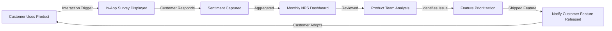

### 13.2 NPS Funnel and Segmentation

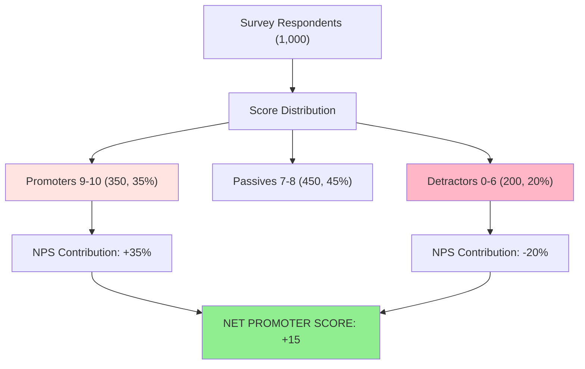

### 13.3 Feedback Routing and Triage Workflow

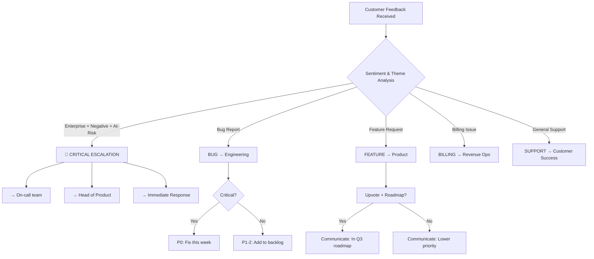

### 13.4 Voice of Customer Program Flow

```mermaid
graph LR
    subgraph Collection["Collection Phase"]
        A1["NPS Survey"]
        A2["Support Tickets"]
        A3["User Interviews"]
        A4["Feature Voting"]
    end
    
    subgraph Synthesis["Synthesis Phase"]
        B1["Ingest + Normalize"]
        B2["Sentiment Analysis"]
        B3["Theme Extraction"]
        B4["Deduplicate"]
    end
    
    subgraph Analysis["Analysis Phase"]
        C1["Theme Ranking"]
        C2["Cohort Analysis"]
        C3["Trend Detection"]
        C4["Competitive Intel"]
    end
    
    subgraph Action["Action Phase"]
        D1["Prioritization Review"]
        D2["Roadmap Update"]
        D3["Customer Communication"]
        D4["Impact Measurement"]
    end
    
    Collection --> Synthesis
    Synthesis --> Analysis
    Analysis --> Action
    Action -->|Feedback Loop| Collection
```

### 13.5 Sentiment Analysis Pipeline

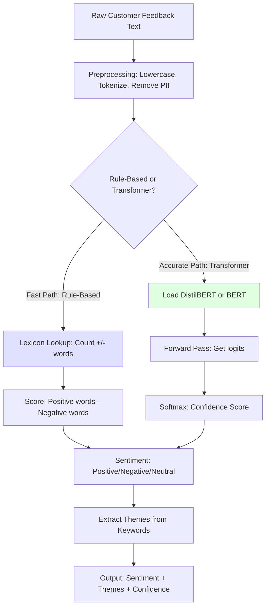

### 13.6 Win/Loss Analysis Process

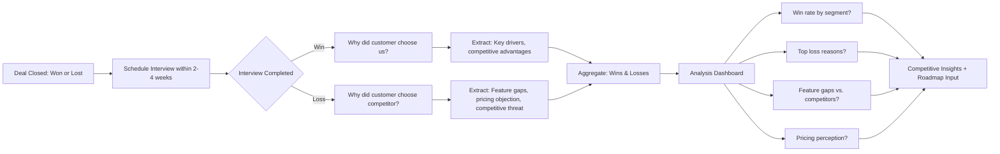

### 13.7 CSAT and Experience Quality Workflow

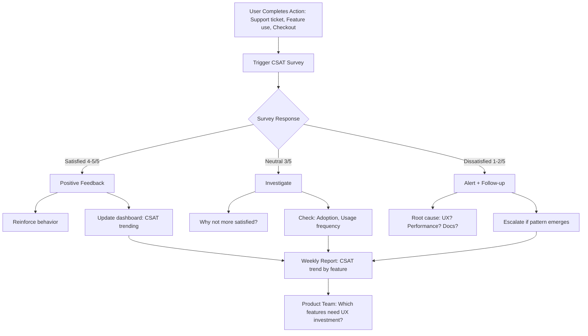

### 13.8 Churn Risk Detection via Feedback Signals

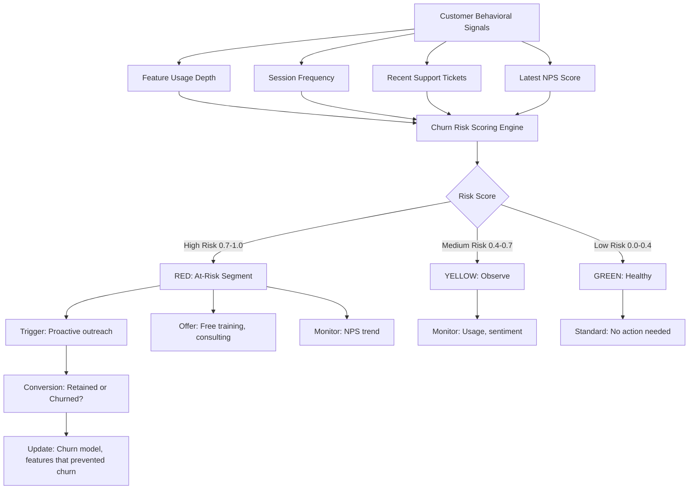

### 13.9 Close-Loop Feedback System

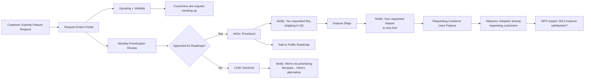

### 13.10 Behavioral Feedback Signal Collection

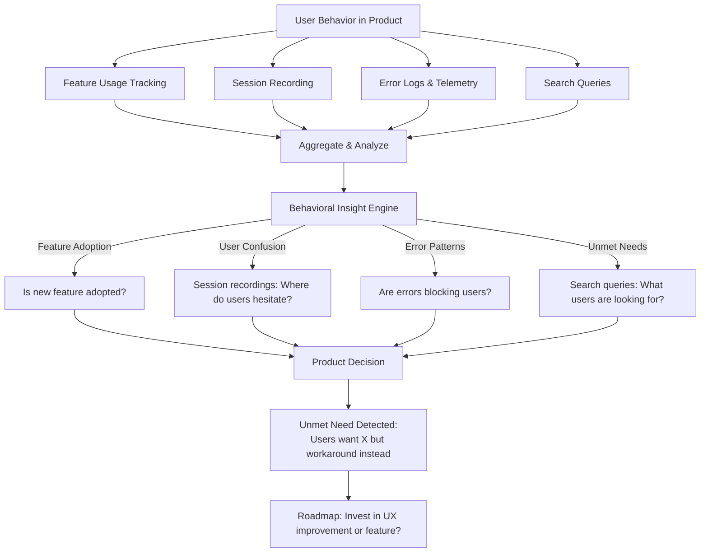

### 13.11 Privacy and Consent Flow for Feedback Collection

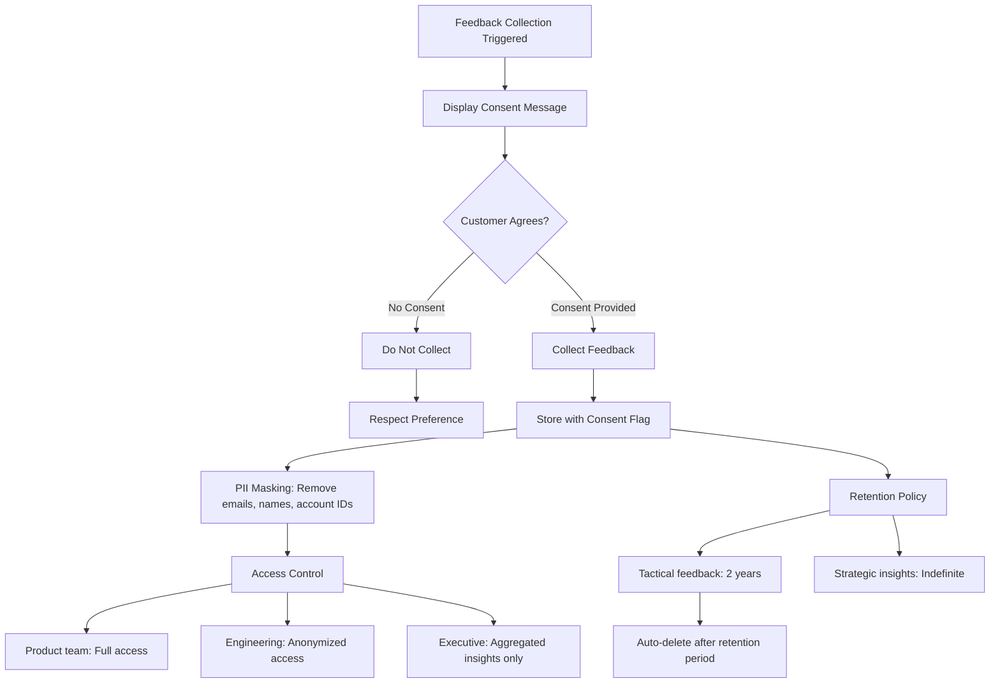

### 13.12 Feedback Quality and Bias Detection

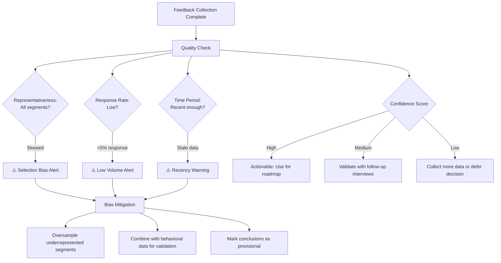

---

## 14. Common Pitfalls and Anti-Patterns

### 14.1 The Vanity Metrics Trap

Organizations track NPS or CSAT without acting on the feedback. The metric becomes a dashboard number instead of a decision input. Result: NPS stagnates; teams conclude "customers are just never happy" without investigating root causes.

**Prevention:** Establish quarterly "Feedback-to-Action" review where top 5 themes are formally evaluated for roadmap inclusion.

### 14.2 Feedback Recency Bias

Teams prioritize the most recent piece of feedback (e.g., "CEO called me this morning with a feature request") over aggregate signals ("300 customers requested X in the last quarter"). Result: Roadmap is shaped by the loudest voices, not the most impactful.

**Prevention:** Use a prioritization framework (RICE, WSJF) that weighs frequency, customer value, and effort—not just recency.

### 14.3 Selection Bias in Survey Respondents

Only power users and highly dissatisfied churners respond to surveys. Silent majority (satisfied, but not enthusiastic) are underrepresented. Result: Product team over-indexes on power-user feature requests while missing churn drivers for the majority.

**Prevention:** Segment feedback by respondent type; triangulate surveys with behavioral data and win/loss analysis.

### 14.4 Feedback Silos

Support team collects feedback; product team doesn't see it until quarterly review. Sales team hears about churn reasons; engineering doesn't know. Result: Feedback insights arrive weeks after they could have driven action.

**Prevention:** Real-time feedback routing; dashboards that surface critical signals to all teams.

### 14.5 Over-Reliance on Automation

Implement sentiment analysis and theme extraction without human validation. System misclassifies 13% of feedback; critical signals are missed for weeks. Result: Loss of customer trust; churn.

**Prevention:** Human-in-the-loop for high-stakes classifications; periodic accuracy audits; flag low-confidence predictions.

---

## 15. Advanced Techniques and Emerging Practices

### 15.1 Cohort-Level Sentiment Trending

Segment NPS and CSAT by customer cohort (signup date, segment, acquisition channel) to detect cohort-specific satisfaction issues. A new cohort might have lower satisfaction than legacy cohorts, signaling an onboarding problem. This technique provides leading-indicator churn prediction.

### 15.2 Feedback-Driven Hypothesis Testing

Use customer feedback to formulate experimentation hypotheses. A spike in feature requests for "mobile app" combined with low session frequency on mobile suggests that a mobile-optimized interface might drive adoption. Design an experiment to test this hypothesis.

### 15.3 Competitive Win/Loss Integration with Market Intelligence

Combine win/loss analysis with public competitive intelligence (news, pricing changes, feature announcements) to detect competitive threats early. If loss frequency for a specific competitor increases 30% week-over-week alongside a competitor's major feature launch, escalate to strategy team.

### 15.4 Real-Time Feedback Anomaly Detection

Automated monitoring of feedback sentiment and theme distribution to detect anomalies (e.g., "Performance issues" theme spike from 3% to 12% of feedback week-over-week). Alert engineering and product teams to investigate.

---

## 16. Integration with Adjacent Handbook Chapters

Customer feedback infrastructure integrates with other chapters in Part 02:

- **[Metrics](CH24_Metrics.md) (Instrumentation):** Metrics measure quantitative outcomes; feedback explains *why* outcomes changed. Use feedback to validate metric definitions and identify new metrics.
- **[North Star Metrics](CH25_North_Star_Metrics.md) (Alignment):** Customer feedback validates whether your North Star metric reflects genuine customer value or is gaming the system.
- **[Experimentation](CH26_Experimentation.md) (Hypothesis Testing):** Feedback informs hypothesis formulation; experimentation validates whether feedback-driven changes actually drive outcomes.
- **[A/B Testing](CH27_AB_Testing.md) (Statistical Validation):** A/B tests measure causal impact; feedback provides context on why customers prefer one variant.
- **[Prioritization](CH28_Prioritization.md) (Roadmap Decisions):** Feedback is a key input signal for the prioritization framework; themes ranked by frequency and customer impact feed into roadmap planning.

---

## 17. Practical Exercises and Scenarios

### Exercise 1: Design an NPS-Based Churn Alert

Design a system that:
1. Tracks NPS scores for each customer monthly.
2. Flags customers who drop 3+ NPS points month-over-month as "at-risk."
3. Triggers an automated email from Customer Success offering a check-in call.
4. Measures whether intervention reduces churn by 20% in the at-risk cohort.

**Deliverables:**
- Criteria for "at-risk" classification
- Alert logic (when to trigger, to whom)
- Intervention playbook (what to do in the check-in call)
- Success metrics (churn reduction, NPS recovery)

### Exercise 2: Implement Feedback Triage and Routing

Build a feedback router that:
1. Ingests 50 support tickets per week across 5 issue types (bug, feature request, billing, support, compliance).
2. Routes tickets to the appropriate team based on content analysis.
3. Measures routing accuracy (% of tickets routed to the correct team).
4. Over 4 weeks, improves routing accuracy from 75% to 90%+.

**Deliverables:**
- Routing rule taxonomy
- Test dataset (50 labeled tickets)
- Confusion matrix (where are misroutes happening?)
- Action plan to improve accuracy

### Exercise 3: Close-Loop Feedback System Evaluation

Analyze a fictional product's feedback loop:
- The product team collects 2,000 NPS responses monthly.
- No systematic process exists to review feedback or translate it to roadmap.
- NPS has been 35-37 for 4 quarters; no trend.
- Support team reports "learning curve" complaint in 23% of tickets.

**Task:** Design a close-loop system that:
1. Synthesizes the "learning curve" feedback into a specific theme.
2. Validates the theme with interviews (e.g., 10 customers, 5 of whom are churned).
3. Routes to product: "Onboarding gap hypothesis."
4. Prioritizes: Effort vs. impact.
5. Ships a solution (e.g., video tutorial, interactive guided onboarding).
6. Measures: NPS and retention improvements.

**Deliverables:**
- Feedback synthesis summary
- Interview findings
- Prioritization decision and rationale
- Solution proposal and success metrics

---

## 18. Appendix: Tools and Resources

### Feedback Collection Platforms

| Tool | Strengths | Limitations |
|------|-----------|-----------|
| **Satismeter** | Lightweight NPS widget, strong API | Limited advanced survey logic |
| **Delighted** | Multi-channel surveys, Slack integration | Premium pricing |
| **Qualtrics** | Enterprise survey design, advanced logic | Complex to use, high cost |
| **Typeform** | Beautiful UI, easy to use | Limited programmatic access |
| **Canny** | Feature request voting, public roadmap | Narrow use case |

### Analytics and Insights Tools

| Tool | Strengths | Limitations |
|------|-----------|-----------|
| **Looker** | SQL-based dashboards, deep analytics | Requires data warehouse setup |
| **Tableau** | Powerful visualizations, wide connector support | Desktop-first workflow |
| **Superset** | Open-source, easy to deploy | Fewer visualization types |
| **Mixpanel** | Behavioral analytics, session recording | Focused on events, not feedback synthesis |

### NLP and Sentiment Analysis Libraries

| Tool | Use Case | Pros | Cons |
|------|----------|------|------|
| **VADER (Python)** | Simple sentiment scoring | Fast, no training needed | Limited nuance |
| **TextBlob (Python)** | Sentiment and NER | Easy to use | Lower accuracy |
| **Transformers (HuggingFace)** | High-accuracy sentiment, NER | State-of-the-art models | Requires GPU for speed |
| **spaCy (Python)** | Named Entity Recognition, theme extraction | Fast, production-ready | Requires labeled training data for domain-specific tasks |

---

## 19. Trade-Off Analysis: Feedback Collection Methods

Different feedback collection methods present distinct trade-offs between cost, speed, richness, and representativeness:

| Dimension | NPS Survey | CSAT Survey | Interviews | Support Tickets | Behavioral Data |
|-----------|-----------|-----------|-----------|-----------------|-----------------|
| **Speed** | Days | Hours | Weeks | Real-time | Real-time |
| **Cost** | Low | Low | High | Already paid | Medium |
| **Sample Size** | Large (100s) | Large (100s) | Small (10s) | Variable | Very large (1000s) |
| **Richness** | Low (1-2 q) | Low (1 q) | High (60min) | Medium | Medium |
| **Representativeness** | Biased (power users) | Biased (engaged) | Biased (volunteers) | Biased (problems) | Unbiased (all) |
| **Actionability** | Medium | Medium | High | Medium | High |

**Decision Framework:** Use NPS for trending and benchmarking (low cost, high volume). Use interviews for deep discovery (high cost, small sample). Use behavioral data for continuous monitoring (always-on, objective). Use support tickets as continuous signal (already flowing in).

---

## 20. Comparison Matrix: Qualitative vs. Quantitative Feedback

| Dimension | Quantitative (NPS, CSAT) | Qualitative (Interviews, Open-Ended) |
|-----------|-------------------------|---------------------------------------|
| **What it measures** | Magnitude, statistical trend | Reasoning, context, nuance |
| **Sample size needed** | Large (100+) to be statistically significant | Small (10-20) sufficient for themes |
| **Speed of insight** | 1-2 days | 1-2 weeks (with analysis) |
| **Statistical validity** | High (can test hypotheses) | Low (not generalizable) |
| **Cost** | Low | High (researcher time) |
| **Bias risk** | Selection bias (who responds) | Confirmation bias (how researcher interprets) |
| **Use case** | Measure satisfaction trend, churn risk | Understand why satisfaction changed |

**Best Practice:** Combine both. Quantitative identifies the problem ("NPS dropped 8 points"). Qualitative diagnoses root cause ("Customers cite onboarding friction and lack of documentation").

---

## 21. Real-World Case Study: SaaS Company VoC Program Transformation

**Company:** DataVault (B2B data governance SaaS)

**Situation:** DataVault had 250 enterprise and mid-market customers, $18M ARR (Annual Recurring Revenue). Product roadmap decisions were made in quarterly planning meetings dominated by internal opinions and the loudest sales/customer success voices. Result: feature churn was high (50% of released features had <20% adoption); NPS was stagnant at 28-32 for 6 quarters.

**Problem:** No systematic feedback process. Support tickets, customer interviews, and sales notes existed but were scattered across Zendesk, Slack, and personal notes. Product team had no visibility into customer needs beyond anecdotal reports.

**Solution:** Implemented a VoC program with the following components:

1. **Feedback Collection (Month 1-2):** Deployed quarterly NPS survey via Satismeter (targeting 30% of customers); added post-support CSAT; trained customer success team to document feature requests in Zendesk with consistent tagging.

2. **Aggregation and Analysis (Month 2-3):** Built a simple ETL pipeline that ingested NPS responses, support tickets, and interview notes into a Postgres database. Implemented automated sentiment analysis (VADER lexicon) and keyword-based theme extraction.

3. **Synthesis and Prioritization (Month 3-4):** Monthly "Feedback Synthesis" meeting where product manager reviewed top 10 themes (ranked by frequency and customer value). Used RICE scoring to prioritize against existing roadmap commitments.

4. **Closed-Loop Communication (Month 4+):** Published a public roadmap via Canny; customers who submitted feature requests received updates when those features shipped or were declined.

**Results (by Quarter 2):**
- NPS improved from 28 to 42 (4-point monthly improvement trend).
- Feature adoption improved from 28% to 51% average (for feedback-requested features, reached 73%).
- Support ticket "learning curve" complaints dropped from 23% to 8% (after prioritizing onboarding improvements).
- Customer retention improved from 92% to 96% (annual cohort retention).
- Sales win rate for "mobile app support" and "GDPR automation" requests improved 12% and 18% respectively after features shipped.

**Key Success Factors:**
- Executive sponsorship (CEO attended monthly synthesis meetings).
- Shared language (consistent tagging taxonomy across teams).
- Transparency (public roadmap created accountability).
- Closed-loop (customers saw their requests acted upon).

---

## 22. Feedback Program Architecture Review Checklist

Use this checklist to audit your feedback infrastructure maturity:

- **Collection:** Is feedback collected across all major channels (surveys, support, interviews, community)? Yes/No
- **Automation:** Is sentiment analysis and theme extraction automated for scale? Yes/No
- **Real-Time Alerting:** Does the system alert when critical signals emerge (NPS drop, new competitor threat)? Yes/No
- **Routing:** Are feedback pieces automatically routed to appropriate teams (engineering for bugs, product for features)? Yes/No
- **Closed-Loop:** Do customers receive status updates on their feedback (shipped, declined, pending)? Yes/No
- **Privacy:** Is feedback infrastructure GDPR and CCPA compliant with consent management? Yes/No
- **Governance:** Is there a defined process for reviewing feedback and incorporating it into prioritization? Yes/No
- **Measurement:** Are feedback-driven decisions measured for business impact (NPS lift, retention, adoption)? Yes/No
- **Cross-Functional:** Do all teams (product, support, sales, engineering) have visibility into feedback? Yes/No
- **Historical Tracking:** Is feedback trend tracked over time to detect emerging issues? Yes/No

**Scoring:**
- 8-10: Mature, production-grade feedback infrastructure
- 6-7: Solid foundation, some operational gaps
- 4-5: Basic feedback collection, lacks synthesis and action
- 0-3: Minimal feedback infrastructure, highly reactive

---

## 23. Hiring and Organizational Roles for Feedback Infrastructure

Mature organizations staff feedback programs with dedicated roles:

- **Customer Insights Manager / Product Analyst:** Owns VoC program end-to-end (collection, synthesis, reporting). Typically reports to Chief Product Officer (CPO) or VP Product. Technical skills: SQL, data visualization, basic NLP awareness. Domain skills: customer research methodology, statistical thinking.

- **Customer Research Lead:** Conducts qualitative research (interviews, user testing, ethnography). Typically reports to Head of Customer Insights or Product Design. Skills: interview methodology, note-taking discipline, unbiased facilitation, synthesis frameworks (e.g., affinity mapping).

- **Data Engineer / Analytics Engineer:** Builds and maintains feedback data pipeline (ingestion, storage, transformation). Typically reports to Head of Data or Head of Engineering. Technical skills: SQL, Python/Scala, streaming data (Kafka), time-series databases.

- **Product Manager (Feedback-Focused):** Translates feedback themes into roadmap items. Works with Customer Insights Manager on synthesis; drives prioritization review. Standard PM skills with deep listening discipline.

**Team Structure Example (250-person company, $20M ARR):**
- 1 Customer Insights Manager (full-time)
- 1 Customer Research Lead (full-time, or 2 contractors for user testing)
- 0.5 Data Engineer (shared with analytics team)
- 1 Product Manager (owns feedback integration into prioritization; shared with other PM duties)

---

## 24. Hands-On Exercise: Design a Feedback-Driven Feature Prioritization

**Scenario:** Your company has collected feedback for the past 3 months. The corpus is:
- 450 NPS responses (average NPS: 36)
- 180 support tickets tagged with feature requests
- 12 customer interviews (notes provided)
- 3,200 Hotjar session recordings (video of user behavior)

**Deliverables:**
1. **Synthesis:** Extract top 5 themes from all feedback sources. Use theme extraction template (Theme, Frequency, Customer Segments Affected, Competitive Urgency).
2. **Prioritization:** Score each theme using RICE framework:
   - Reach: How many customers affected? (0-10 scale)
   - Impact: How much does it improve retention/expansion? (0-3x multiplier)
   - Confidence: How sure are we? (0-100%)
   - Effort: How many engineering weeks? (estimate)
3. **Roadmap Slot:** You have 12 weeks of engineering capacity this quarter. Allocate this capacity across the top 3-5 themes, leaving buffer for bug fixes and tech debt.
4. **Close-Loop Plan:** For each prioritized theme, write a brief "customer communication" message (for public roadmap and via email to requesting customers).

**Submission Format:**
- Feedback Synthesis Table (5 themes × 4 columns: Theme, Frequency, Segments, Urgency)
- RICE Scoring Table (5 themes × 5 columns: Theme, Reach, Impact, Confidence, Effort)
- Quarterly Roadmap Allocation (12-week sprint breakdown)
- 3 Sample Customer Messages (one for prioritized, one for deferred, one for declined)

**Grading Criteria:**
- Synthesis accuracy (themes match underlying feedback)
- Prioritization logic (RICE scores justify allocation)
- Realism (requested work fits in 12 weeks; buffer for tech debt)
- Transparency (clear reasoning for decisions)

---

## 25. Architecture Design Exercise: Multi-Tenant Feedback Infrastructure

**Problem:** Design a feedback collection, storage, and analysis system for a multi-tenant SaaS platform with 500+ customers across 3 segments (enterprise, mid-market, SMB).

**Requirements:**
- Collect NPS, CSAT, CES via in-app surveys (target: 40% monthly response rate).
- Ingest support tickets from Zendesk (1000s per month).
- Perform real-time sentiment analysis on feedback text (latency <2 sec).
- Extract themes automatically using NLP (accuracy target: 85%+).
- Route critical feedback (enterprise + negative sentiment) to on-call team within 5 min.
- Publish monthly "Feedback Synthesis Dashboard" showing top themes, NPS trends, cohort analysis.
- Maintain GDPR compliance: PII masking, consent tracking, data retention policies.

**Deliverables:**
1. **System Architecture Diagram:** Sketch data flow from feedback collection → ingestion → storage → analysis → routing/reporting.
2. **Technology Stack Selection:** For each layer (collection, storage, analysis, reporting), choose specific tools and justify.
3. **Data Schema:** Design tables for feedback records, customer metadata, sentiment scores, theme tags, routing decisions.
4. **Scalability Analysis:** Estimate growth at 2x customer growth per year; what are scaling bottlenecks at 5000 customers?
5. **Privacy Design:** How do you handle PII masking, consent, and data retention? Sketch the privacy flow.
6. **Cost Estimate:** Annual OpEx for feedback infrastructure (survey platform, database, NLP model inference, dashboard licensing).

**Grading Criteria:**
- Architecture is defensible (justifies component choices).
- System meets latency and accuracy requirements.
- Privacy-by-design (GDPR/CCPA compliance built in, not retrofitted).
- Scalability plan is realistic.
- Cost estimate is reasonable for company size/stage.

---

## 26. Knowledge Validation: Interview Questions for Hiring Feedback Specialists

Use these questions to assess candidates for feedback infrastructure roles:

**For Customer Insights Manager:**
1. "Walk me through how you've built a feedback program from scratch. What challenges did you face?" (Assesses project management, problem-solving)
2. "How do you prioritize between conflicting customer requests?" (Assesses judgment, alignment with business strategy)
3. "Tell me about a time when customer feedback contradicted metrics data. How did you resolve it?" (Assesses ability to triangulate signals)
4. "How would you measure whether your feedback program is driving business outcomes?" (Assesses outcome thinking)

**For Data Engineer (Feedback Infrastructure):**
1. "Design a real-time pipeline that ingests 10K feedback pieces per day, deduplicates, analyzes sentiment, and routes critical items within 5 min." (Assesses system design, streaming architecture)
2. "What are the trade-offs between batch vs. streaming analysis for sentiment?" (Assesses technical depth)
3. "How would you ensure PII is masked before analysts see feedback data?" (Assesses privacy thinking)
4. "Describe a time you optimized a slow analytics query. What was your approach?" (Assesses SQL/performance skills)

**For Customer Research Lead:**
1. "What's the difference between a leading and unbiased interview question? Give examples." (Assesses interview methodology)
2. "Tell me about a finding from user research that surprised the product team. Why was it surprising?" (Assesses ability to uncover non-obvious insights)
3. "How do you handle a research participant who is very opinionated and takes over the interview?" (Assesses facilitation skills)
4. "Walk me through how you'd synthesize findings from 12 interviews into 3-4 themes." (Assesses analysis and communication)

---

## 27. Summary

Customer feedback infrastructure, when implemented at production depth, becomes a core competitive advantage in solution architecture and product development. The frameworks, code examples, and architectural patterns in this chapter translate feedback from anecdotal insight into systematic, data-driven product decision-making.

Key takeaways:
1. **Feedback is not optional**—it's as essential as metrics and experimentation in closing the product development loop.
2. **Automation (NLP, theme extraction) scales feedback synthesis**, but human judgment is irreplaceable for high-stakes decisions.
3. **Close-loop systems that communicate feedback status back to customers** drive retention, advocacy, and long-term loyalty.
4. **Behavioral feedback often contradicts explicit feedback**—triangulate multiple signals to avoid false conclusions.
5. **Feedback infrastructure must be designed with privacy, consent, and data governance from day one**, not retrofitted.
