# Chapter 1 — Java Architecture

## 1. Introduction

Java is one of the few general-purpose platforms that a Solution Architect
must understand not as "a language" but as an **execution substrate**: a
managed runtime, a memory model, a concurrency model, a module system, a
packaging format, and an ecosystem of frameworks that together determine how
a system built on top of it will scale, fail, and evolve. Choosing Java for a
system is really choosing the Java Virtual Machine (JVM) — its class loading
model, its garbage collectors, its just-in-time (JIT) compiler, its
concurrency primitives — because almost every other language on the JVM
(Kotlin, Scala, Groovy, Clojure) inherits these same architectural
properties. An architect who treats Java as "just syntax" will misjudge
capacity planning, latency budgets, deployment topology, and failure modes.

This chapter treats Java as an architectural substrate, not a syntax
tutorial. We will not spend time on `for` loops, generics syntax, or
collection APIs — assume working fluency in the language. Instead we go
underneath the language to the JVM: how classes are loaded and verified, how
memory is organized and reclaimed, how bytecode becomes optimized machine
code, how the concurrency model has evolved from raw operating system (OS)
threads to lightweight virtual threads, how the module system reshapes
encapsulation at the platform level, how build tools model dependencies and
classpaths, how enterprise frameworks like Spring implement Inversion of
Control (IoC), and how the packaging and deployment model — including
ahead-of-time (AOT) compiled native images — changes the cost/latency
trade-offs of running Java in the cloud.

General concurrency theory (locks, race conditions, the general theory of
parallel execution) and general system design concerns (load balancing,
horizontal scaling, distributed consensus) are owned by other chapters in
this handbook and are only recapped here where Java's specific mechanism
(the Java Memory Model, `java.util.concurrent`, virtual threads) diverges
from or specializes that general theory.

## 2. Historical Evolution

Java's architecture cannot be understood without its history, because almost
every distinctive design decision — the JVM's existence, bytecode
verification, the module system, the shift to a six-month release cadence —
was a direct response to a real production failure mode from an earlier era.

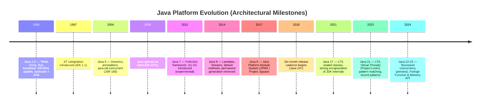

Early Java (1995-2004) optimized for one architectural property above all
others: **portability**. "Write Once, Run Anywhere" meant compiling to a
platform-neutral intermediate representation (bytecode) and shipping a
verifier and interpreter (the JVM) for every target platform, rather than
compiling to native machine code per platform like C++. This decision is the
root of almost everything else in this chapter: it created the need for
class loading, bytecode verification, an abstract memory model independent
of any one processor's cache-coherency guarantees, and a garbage-collected
heap (since a portable language cannot assume a single, platform-specific
manual memory management convention).

The 2004-2011 era (Java 5-7) was about **concurrency and hardware scaling**.
Multi-core processors were becoming mainstream and the original
`synchronized`/`wait`/`notify` primitives from Java 1.0 were too low-level
for application developers to use correctly at scale. `java.util.concurrent`
(JSR 166, led by Doug Lea) introduced high-level concurrency
building blocks — thread pools, concurrent collections, atomics, the
fork/join framework — directly into the platform rather than leaving every
team to hand-roll its own lock-based abstractions.

The 2014-2017 era (Java 8-9) addressed **two separate failure modes from
production experience**: verbose boilerplate for functional-style
transformations (solved by lambdas and streams) and the "JAR hell" /
monolithic `rt.jar` problem where the JDK itself was an undifferentiated pile
of classes with no enforced internal boundaries (solved, eventually, by the
Java Platform Module System in Java 9, discussed in Section 4.8).

The most recent era (2017-present) is about **cloud-native economics**:
containers charge by memory and central processing unit (CPU) reservation,
and cold-start latency directly affects auto-scaling cost. This produced
Project Loom's virtual threads (Java 21, cheap concurrency without giving up
the thread-per-request programming model), and GraalVM native image (ahead-
of-time compilation to a standalone native executable, discussed in Section
4.11), both of which are direct architectural responses to running Java
efficiently inside containers and serverless platforms rather than on
long-lived, generously resourced application servers.

## 3. Why It Exists

Java exists to solve a specific tension that predates it: portability versus
performance versus safety, at enterprise scale. Before Java, organizations
had to choose between C/C++ (fast, but with manual memory management, no
runtime bounds/type safety, and platform-specific binaries) or scripting
languages of the era (safe and portable, but too slow for server-side
workloads at scale). Java's founding bet was that a managed runtime — a JVM
that verifies bytecode before execution, manages memory automatically via a
garbage collector, and JIT-compiles hot code paths to near-native speed —
could deliver most of C++'s throughput with far fewer classes of production
failure (buffer overflows, use-after-free, manual memory leaks, undefined
behavior across platforms).

For a Solution Architect the relevant "why" is not history trivia but a set
of concrete guarantees Java's design buys a system:

- **Memory safety by construction.** Because the JVM controls all memory
  allocation, a Java program cannot corrupt arbitrary memory through a
  dangling pointer or buffer overrun the way a C program can — a whole class
  of security vulnerabilities (memory-corruption remote code execution) is
  structurally eliminated at the language/runtime boundary, not merely
  discouraged by convention.
- **Platform portability of the compiled artifact.** A compiled `.class`
  file runs unmodified on any conforming JVM (Linux, Windows, embedded,
  cloud) — this decouples the build artifact from the deployment target,
  which materially simplifies CI/CD (Continuous Integration/Continuous
  Delivery) pipelines compared to native-compiled languages that must build
  per target platform.
- **A single, standardized concurrency and memory model.** Every JVM
  language shares one memory model (Section 4.4) and one set of concurrency
  primitives, so libraries, frameworks, and engineers can be reused across
  Java, Kotlin, and Scala codebases without re-deriving concurrency
  semantics per language.
- **An enormous, stable, backward-compatible ecosystem.** Binary
  compatibility guarantees mean a JAR compiled against Java 8 typically still
  runs on Java 21 — a property few other ecosystems maintain at this scale,
  which materially lowers the cost of long-lived enterprise systems.

These guarantees come at architectural cost — a managed runtime has startup
latency, a memory footprint overhead for the JVM itself, and a garbage
collector that must be tuned — and Section 20 (Trade-off Analysis) makes
those costs explicit against alternatives.

## 4. Core Concepts

### 4.1 The JVM as an Architectural Substrate

**Definition.** The JVM is a specification (implemented by OpenJDK
HotSpot, Eclipse OpenJ9, GraalVM, Azul Zing, and others) for an abstract
computing machine that executes Java bytecode. It is the actual unit of
deployment and the actual unit of architectural reasoning — "Java" the
language is merely one of several front-ends (alongside Kotlin, Scala,
Groovy, Clojure) that compile down to the same bytecode and run on the same
machine.

**Mechanism.** The JVM is composed of four cooperating subsystems: the
**class loader subsystem** (Section 4.2, locates, reads, and links
`.class` bytecode into runtime `Class` objects); the **runtime data areas**
(the method area/metaspace holding class metadata, the heap holding
objects, per-thread stacks holding frames and local variables, and the
program counter register per thread); the **execution engine** (the
bytecode interpreter plus the JIT compiler, Section 4.6, which together
execute bytecode, and the garbage collector, Section 4.5, which reclaims
heap memory); and the **native interface** (the Java Native Interface (JNI)
and, since Java 22, the Foreign Function & Memory API, for calling into and
being called from native code).

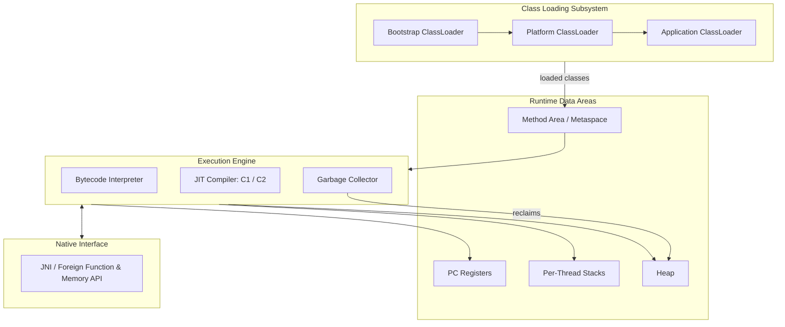

**Decision implications.** Because the JVM — not the language — is the unit
of deployment, an architect's capacity-planning questions (heap size,
container memory limit, startup latency, GC pause budget) are JVM questions
that apply identically whether the application is written in Java or
Kotlin. Conversely, JVM *choice* is itself an architectural decision:
HotSpot (the default, general-purpose, most widely operated), GraalVM
(adds a polyglot engine and the native-image AOT compiler, Section 4.11),
and Azul Zing/Prime (specialized for ultra-low-pause GC in latency-sensitive
trading systems) trade off differently on startup time, pause time, and
peak throughput.

**Common failure mode.** Teams frequently tune "Java" (e.g., add
`-Xmx4g`) without understanding which runtime data area is actually under
pressure — a `metaspace` leak (too many classes loaded, often from
dynamic proxy generation or classloader leaks, Section 15) produces
`OutOfMemoryError: Metaspace`, which increasing heap size (`-Xmx`) does
nothing to fix, because metaspace is a separate memory region from the
heap.

**Concrete scenario.** A microservice repeatedly redeploys a hot-reloaded
plugin subsystem in a long-running process (e.g., a rules engine that
compiles and loads new rule classes at runtime). Each reload creates a new
classloader and a new set of `Class` objects; if the old classloader is
never fully dereferenced (a lingering static reference or an unclosed
thread holding a reference to it), neither the classes nor the classloader
can be garbage collected. Metaspace grows unbounded until the JVM throws
`OutOfMemoryError: Metaspace` — a classic "classloader leak," diagnosed via
a heap dump inspected for duplicate classloader instances (Section 15).

### 4.2 Class Loading & the Class Loader Hierarchy

**Definition.** Class loading is the process by which the JVM locates a
compiled `.class` file (from a JAR, a directory, a module, or the network),
reads its bytecode, and constructs an in-memory `Class` object representing
that type — a prerequisite for ever instantiating an object of that type.

**Mechanism.** Class loading happens in three phases — **loading**
(finding bytes and creating the `Class` object), **linking** (verification,
preparation of static fields, and resolution of symbolic references), and
**initialization** (running static initializers and static field
assignments) — and is performed by a hierarchy of class loaders that
delegate upward by default (the **parent-delegation model**): the
**bootstrap class loader** (native code, loads core `java.*` classes from
the JDK's own modules), the **platform class loader** (loads JDK-provided
but non-core classes, e.g. those in the `java.se` aggregate module's
supporting APIs), and the **application/system class loader** (loads
classes from the application's classpath or module path). Custom class
loaders (used by application servers, plugin systems, and dependency-
isolation frameworks like OSGi) sit below or beside this hierarchy.

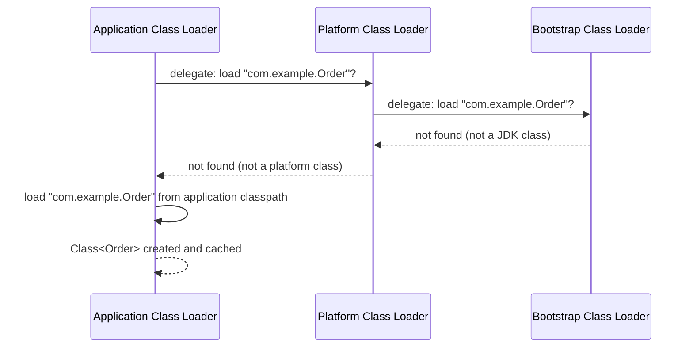

Parent delegation exists specifically so that application code cannot
shadow or spoof core JDK classes: a rogue JAR shipping its own
`java.lang.String` cannot silently replace the trusted JDK implementation,
because every class loader asks its parent first and only loads the class
itself if the parent cannot find it.

**Decision implications.** Each loaded class is identified at runtime not
just by its fully-qualified name but by the *pair* (class name, defining
class loader) — two classes with an identical name loaded by two different
class loaders are considered distinct, incompatible types by the JVM even
though their bytecode is identical. This is precisely how application
servers (and, historically, applet sandboxes) achieve dependency isolation
between deployed applications: each web application archive (WAR) typically
gets its own class loader so that App A's Jackson 2.9 and App B's Jackson
2.15 can coexist in the same JVM process without colliding.

**Common failure mode.** `ClassCastException: com.example.Order cannot be
cast to com.example.Order` — the same fully-qualified name printed on both
sides — is the signature symptom of a classloader mismatch: the object was
loaded by one class loader (e.g., a plugin's isolated loader) and the code
attempting the cast expects the type as loaded by a different class loader
(e.g., the application's main loader). This is *not* a bug in the class
definition; it is architecture: two logically "same" types are not the same
type across loader boundaries.

**Concrete scenario.** A plugin architecture loads third-party JARs via a
dedicated `URLClassLoader` per plugin so that plugins can be hot-swapped
independently. A shared data-transfer object (DTO) interface, `PluginEvent`,
is defined once but ends up loaded twice — once by the application loader
(because it is also on the main classpath) and once by a plugin's isolated
loader (because the plugin JAR also bundles it) — and passing an instance
across that boundary throws `ClassCastException` despite both sides
compiling against what looks like an identical interface. The fix is an
architectural one: shared API types must be loaded by a single, common
ancestor loader (e.g., a shared "API" JAR placed on the parent classpath),
never bundled separately inside each isolated plugin.

### 4.3 Bytecode & Verification

**Definition.** Bytecode is the platform-neutral instruction set that
`javac` (or any JVM-language compiler) emits instead of native machine
code; verification is the mandatory, automatic static-analysis pass the JVM
runs over every loaded class's bytecode before it may execute, checking
that the bytecode cannot violate the JVM's type-safety and memory-safety
invariants regardless of how it was produced or by whom.

**Mechanism.** Bytecode is a stack-based instruction set (as opposed to a
register-based one) — instructions like `iload`, `invokevirtual`, and
`areturn` push and pop values from a per-frame operand stack rather than
naming registers. The bytecode verifier performs data-flow analysis over
this instruction stream to confirm, among other invariants, that: the
operand stack never underflows or overflows its declared maximum depth;
every local variable is definitely assigned before it is read; every
branch target is a valid instruction boundary, not an arbitrary offset into
the middle of another instruction; and object references are only used as
the type they were actually assigned (no re-interpreting a `String`
reference as an `int`).

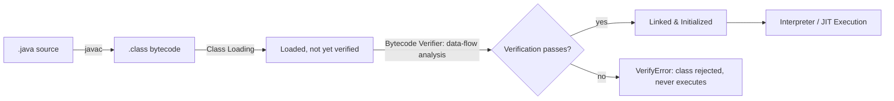

**Decision implications.** Verification is what makes it architecturally
safe to load bytecode from an *untrusted* source (a plugin, a dynamically
generated proxy class, code fetched over a network) without first trusting
the compiler that produced it: the JVM does not trust `javac`, it trusts
its own verifier, which re-derives the same safety guarantees directly
from the bytecode stream regardless of provenance. This is why hand-crafted
or maliciously modified bytecode cannot bypass Java's type system merely by
skipping the compiler — the verifier runs unconditionally at class-loading
time.

**Common failure mode.** `VerifyError` at class-loading time (not a
runtime exception on a specific line, but a hard failure to even load the
class) most often shows up after bytecode manipulation — libraries that
generate or rewrite bytecode at build or load time (ASM, ByteBuddy,
older AspectJ weavers, or a Java version upgrade that changes an internal
class file format assumption a bytecode-manipulation library depended on)
can produce bytecode the verifier rejects. This differs architecturally
from a compile error: it means bytecode that `javac` would never itself
emit is being loaded, usually via reflection-adjacent tooling, dynamic
proxies, or a mismatched bytecode-manipulation library version against the
running JVM version.

**Concrete scenario.** An Object-Relational Mapping (ORM) framework
generates dynamic proxy subclasses at runtime (to intercept lazy-loading
field access) using a bytecode-generation library. The team upgrades the
JVM from Java 17 to Java 21 but does not upgrade the ORM's bytecode-
generation dependency, which still targets the Java 17 class file version.
Some generated proxies begin throwing `VerifyError` or
`UnsupportedClassVersionError` in production because the dynamically
generated bytecode is not consistent with invariants the newer JVM's
verifier enforces more strictly — this is a *dependency-version*
architecture problem masquerading as a runtime bug, and the fix is
upgrading the bytecode-generation library in lockstep with the JVM, not
patching application code.

### 4.4 The Java Memory Model (JMM)

**Definition.** The Java Memory Model, specified formally in the Java
Language Specification (JLS) chapter 17 and implemented by the
`happens-before` relation, is the contract that defines under what
conditions a write to a shared variable by one thread is guaranteed to be
visible to a read of that variable by another thread — independent of the
underlying processor's actual cache-coherency protocol.

This section recaps rather than fully re-derives general memory-visibility
and race-condition theory (owned by the concurrency-theory material in
[System Design and Distributed Systems](../07_System_Design_and_Distributed_Systems/PART_OVERVIEW.md));
what is specific to Java architecturally is *how* the JMM expresses that
theory as a portable contract every JVM implementation must honor
regardless of the CPU's native memory ordering.

**Mechanism.** Modern CPUs and compilers reorder instructions and cache
writes per-core for performance; without an explicit contract, a write in
thread A might never become visible to thread B, or might become visible
out of program order. The JMM defines specific actions that establish a
`happens-before` edge between two threads: unlocking a monitor
happens-before a subsequent lock of the same monitor by another thread; a
write to a `volatile` field happens-before any subsequent read of that same
field by another thread; a thread's actions before calling `Thread.start()`
happens-before everything the started thread does; and all actions in a
thread happen-before another thread returns from `Thread.join()` on it.

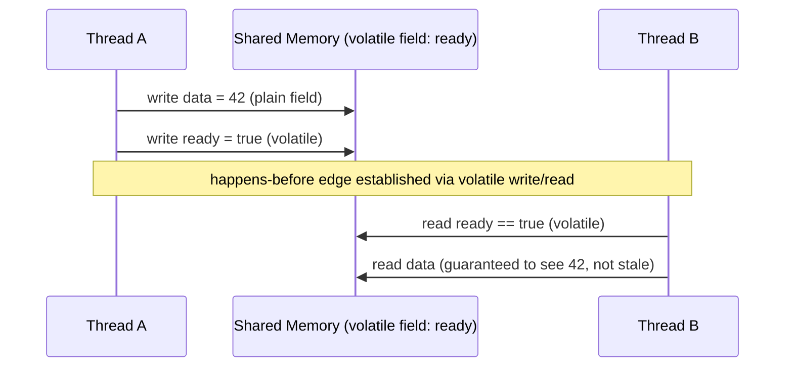

**Decision implications.** Without a `happens-before` edge, the JMM makes
*no* visibility guarantee at all — a plain (non-volatile, non-synchronized)
field write by one thread may simply never become visible to another
thread, not merely "eventually" visible, because the reading thread's core
may be executing entirely from a stale cached copy or a compiler-reordered
instruction stream. This is why "it works on my laptop" concurrency bugs
are so common: on a single-core or lightly loaded machine, visibility
delays that would expose a missing `happens-before` edge rarely manifest,
but the exact same code fails intermittently under real multi-core
production load.

**Common failure mode.** The classic broken pattern is a plain `boolean`
flag used to signal a worker thread to stop (`while (!stopped) { ... }`
with `stopped` set from another thread with no `volatile`, lock, or atomic).
Because there is no `happens-before` edge, the JIT compiler is legally
permitted to hoist the read of `stopped` out of the loop entirely (since,
from that thread's local view, it never changes), producing an infinite
loop that no debugger single-step will ever reproduce, because a debugger
suppresses the very optimization that causes the bug.

**Concrete scenario.** A background cache-refresh thread publishes a newly
built lookup map to a shared field once per minute; request-handling
threads read that field on every request. If the field is a plain reference
(not `volatile`, and not published via a concurrent collection or an
`AtomicReference`), request threads are not guaranteed to ever observe the
new map — they may serve a stale (or, worse, a partially-constructed, still-
being-populated) map indefinitely. The architecturally correct fix is to
publish the reference through an `AtomicReference<Map<K,V>>` (or a
`volatile` field) so that the completed-construction write establishes a
happens-before edge with every subsequent read, guaranteeing readers either
see the fully-built old map or the fully-built new map — never a partial
one.

### 4.5 Garbage Collection Algorithms (G1, ZGC, Shenandoah)

**Definition.** Garbage collection (GC) is the JVM's automatic reclamation
of heap memory occupied by objects no longer reachable from any GC root
(local variables on any thread's stack, static fields, active JNI
references); the *algorithm* chosen determines the trade-off between pause
time, throughput, and memory overhead for a given workload.

**Mechanism — generational hypothesis.** Most JVM collectors (including
G1) are built on the empirical observation that most objects die young: the
heap is divided into a **young generation** (where all objects are
allocated and most die quickly — e.g., a per-request temporary object) and
an **old generation** (objects that survive several young collections are
*promoted* here, on the assumption that if an object has lived this long it
will likely keep living). Young-generation collections ("minor GC") are
fast and frequent because most of that region is typically garbage; old-
generation collections ("major/full GC") are slower and rarer.

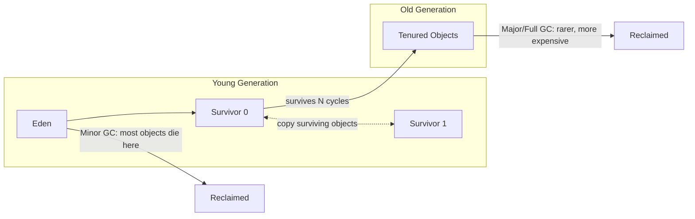

**G1 (Garbage First), the default collector since Java 9.** G1 divides the
heap into many equally-sized *regions* (rather than one contiguous young and
one contiguous old space) and tracks the amount of garbage per region,
prioritizing collection of the regions with the most reclaimable garbage
first (hence "Garbage First") to meet a configurable pause-time *goal*
(`-XX:MaxGCPauseMillis`) rather than a fixed generational schedule. G1 aims
for a balance of throughput and bounded (typically sub-200ms) pause times
and is the correct default for the overwhelming majority of enterprise
workloads.

**ZGC (Z Garbage Collector).** ZGC is a fully concurrent, region-based
collector designed for **sub-millisecond pause times** even on multi-
terabyte heaps, achieved by performing almost all GC work (including object
relocation) concurrently with running application threads, using colored
pointers and load barriers to let the application safely read a reference
to an object that the collector is in the process of moving. The trade-off
is somewhat higher CPU overhead and memory footprint in exchange for pause
times that barely grow with heap size — the right choice when tail-latency
Service Level Agreements (SLAs) are stricter than raw throughput
requirements.

**Shenandoah.** Developed by Red Hat, Shenandoah is architecturally similar
in goal to ZGC (concurrent compaction for low pause times independent of
heap size) but uses a different implementation technique (Brooks forwarding
pointers rather than colored pointers) and is available on OpenJDK
distributions that include it; the practical decision between ZGC and
Shenandoah is usually driven by which is bundled and supported by the
organization's chosen JDK vendor rather than a large behavioral difference.

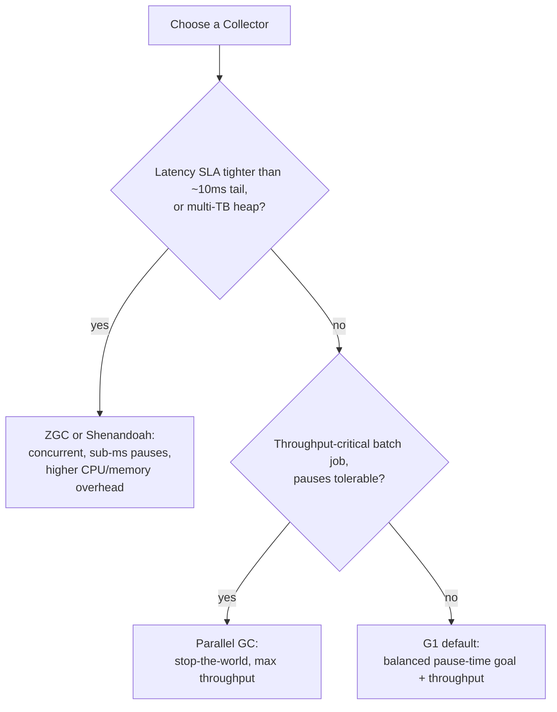

**Decision implications.** GC algorithm choice is a first-class capacity-
planning and SLA decision, not a minor JVM flag: a payments-authorization
service with a 50ms p99 latency budget cannot tolerate G1's occasional
100ms+ pause under heap pressure and should evaluate ZGC; a nightly batch
ETL (Extract, Transform, Load) job that runs for hours with no external
latency SLA should prefer the throughput-oriented Parallel collector over
paying ZGC's concurrent-collection CPU tax for no benefit.

**Common failure mode.** Teams observe a latency spike, blame "GC pauses,"
and increase heap size (`-Xmx`) reflexively — but a *larger* heap without
switching to a concurrent collector typically makes G1's occasional full GC
pause *longer*, not shorter, because there is more live data to trace and
compact. The correct diagnostic step is enabling GC logging
(`-Xlog:gc*`) and confirming whether the pause is a minor GC (usually fine),
a mixed collection (G1's partial old-generation cleanup, usually fine), or
a full GC (a red flag indicating the collector could not keep up with
allocation/promotion rate and had to fall back to a stop-the-world
compaction).

**Concrete scenario.** A high-throughput order-processing service starts
seeing p99 latency spikes of 800ms roughly every 10 minutes in production,
though p50 latency looks fine. GC logs show these spikes align exactly with
G1 full GC events triggered by humongous object allocations (objects larger
than 50% of a G1 region size, which bypass normal young-generation
allocation and go directly to dedicated humongous regions in the old
generation). The root cause is a batching layer that accumulates up to
100,000 order records into a single large `ArrayList` before flushing —
each flush allocates a humongous object. The architectural fix is bounding
batch size (so allocations stay well under the humongous threshold) rather
than tuning GC flags, because no GC algorithm eliminates the structural cost
of repeatedly allocating and discarding very large objects.

### 4.6 JIT Compilation Tiers & Escape Analysis

**Definition.** Just-In-Time (JIT) compilation is the HotSpot execution
engine's strategy of starting every method execution in a simple bytecode
interpreter, then compiling "hot" methods (those executed frequently enough
to cross a threshold) into optimized native machine code at runtime, using
*actual observed profiling data* — a capability an ahead-of-time compiler
lacks because it must compile before the program ever runs.

**Mechanism — tiered compilation.** HotSpot uses two just-in-time
compilers in tandem: **C1 (client compiler)**, which compiles quickly with
light optimization and adds lightweight profiling instrumentation to the
compiled code, and **C2 (server compiler)**, which performs aggressive,
profile-guided optimizations (method inlining, loop unrolling, escape
analysis) but takes much longer to compile. Tiered compilation runs a
method through five progressive tiers — interpreted, then C1 with limited
profiling, then C1 with full profiling, then (once the method is confirmed
genuinely hot and its profile is stable) C2's fully optimized compilation —
so that a method pays compilation cost proportional to how much it is
actually worth optimizing.

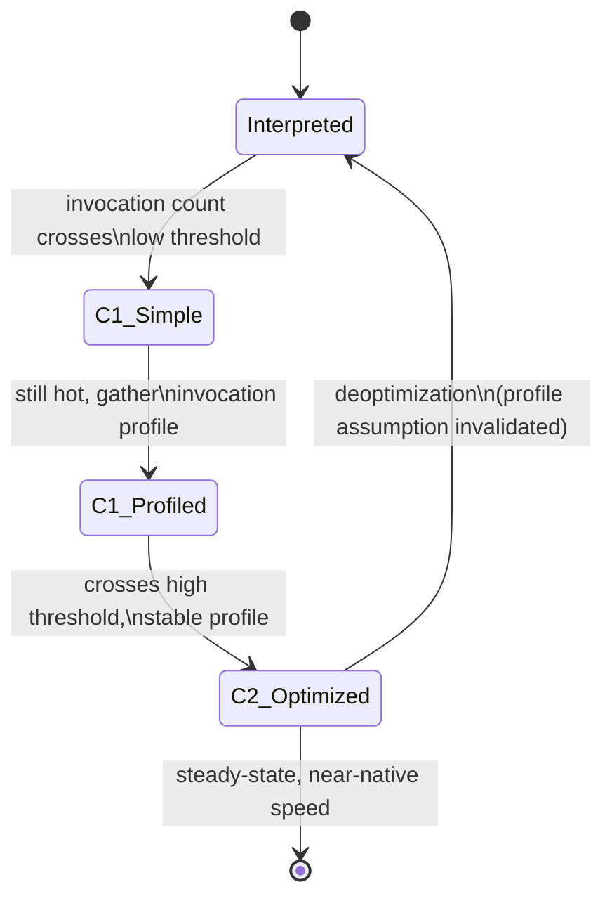

**Escape analysis.** A key C2 optimization: the compiler proves that an
object allocated inside a method never "escapes" that method (is never
stored to a field, passed to another thread, or returned) and can therefore
be allocated on the **stack** (or even decomposed into individual scalar
registers, "scalar replacement") instead of the heap, entirely eliminating
both the allocation cost and the later GC cost for that object. This is why
short-lived helper objects (a small immutable value-holder returned from a
private method and used only locally) are frequently *free* in practice
despite Java having no explicit stack-allocation syntax — the JIT decides
this automatically, but only once the method is hot enough to reach C2 and
only if escape analysis can *prove* non-escape, which reflection, unproven
polymorphic call sites, or storing the reference into a field will all
defeat.

**Decision implications.** Tiered compilation means Java's peak throughput
is a **warmup-dependent** property: a JVM process is measurably slower in
its first seconds-to-minutes of execution than at steady state, because hot
methods have not yet reached C2. This has direct architectural
consequences for short-lived processes — a serverless function invoked
per-request, a batch job that runs for 30 seconds, or a Kubernetes pod that
is aggressively autoscaled up and down — where the JVM may never reach
steady-state performance before the process exits, an argument in favor of
GraalVM native image (Section 4.11) for such workloads.

**Common failure mode.** Benchmarking a JVM application incorrectly by
measuring the first invocation (or the first few seconds) and concluding
"Java is slow" — this measures interpreter/C1 performance, not the C2
steady-state performance the application will actually exhibit under
sustained production load. Valid microbenchmarks must include an explicit
warmup phase (e.g., using the Java Microbenchmark Harness, JMH) before
measuring.

**Concrete scenario.** A team migrates a request-handling method to use a
new polymorphic interface with five implementing classes, expecting no
performance change since "it's just an interface call." Throughput
regresses measurably under load. The cause: C2's inlining and speculative
optimization work best with **monomorphic or bimorphic** call sites (one or
two observed concrete types at a given call site); once a call site
observes more than a couple of distinct implementing types, C2 can no
longer safely inline or speculatively optimize the call and must fall back
to a slower virtual dispatch (a "megamorphic" call site) — an architectural
consequence of interface proliferation at a hot call site that pure
big-O reasoning about the code would never predict.

### 4.7 Concurrency Model: Threads, Virtual Threads (Project Loom), and `java.util.concurrent`

**Definition.** Java's concurrency model provides two distinct unit-of-
execution abstractions as of Java 21: the traditional **platform thread**
(a thin wrapper around one OS-scheduled kernel thread, 1:1 with the
underlying OS thread) and the **virtual thread** (a JVM-managed, lightweight
thread that is *not* permanently pinned to an OS thread, instead being
scheduled M:N onto a small pool of "carrier" platform threads by the JVM
itself).

This section recaps rather than re-derives general threading/concurrency
theory (race conditions, mutual exclusion, the producer-consumer pattern),
which is general computer-science theory covered where relevant elsewhere in
this handbook; what follows is specific to *how the JVM implements and
schedules* concurrent execution.

**Mechanism — platform threads.** Every platform thread reserves a fixed
OS-level stack (commonly 512KB-1MB by default) and is scheduled by the
operating system kernel. Because OS thread creation and context-switching
are relatively expensive and each thread consumes real memory whether
active or blocked, platform threads do not scale to the tens or hundreds of
thousands of concurrent connections a modern I/O-bound service (e.g., an
API gateway holding many slow, long-lived client connections) may need —
this is precisely the problem that historically pushed architects toward
asynchronous/reactive, callback-based programming models (e.g., Netty,
reactive streams) that multiplex many logical operations onto a small,
fixed thread pool at the cost of much harder-to-read, "colored" code
(a synchronous method cannot easily call an asynchronous one and vice
versa).

**Mechanism — virtual threads (Project Loom, finalized Java 21).** A
virtual thread is a JVM-scheduled, heap-allocated continuation: creating one
costs roughly hundreds of bytes rather than a full OS stack allocation, and
millions can coexist in a single JVM process. When a virtual thread executes
a *blocking* operation that the JVM has been taught to recognize (blocking
I/O, `Thread.sleep`, blocking on most `java.util.concurrent` primitives),
the JVM automatically **unmounts** it from its carrier platform thread,
freeing that platform thread to run a different virtual thread, and later
**re-mounts** it (possibly on a different carrier thread) once the blocking
operation completes — giving the *programming model* of synchronous,
thread-per-request code with the *scalability* of an asynchronous
event-loop, without callback-based code coloring.

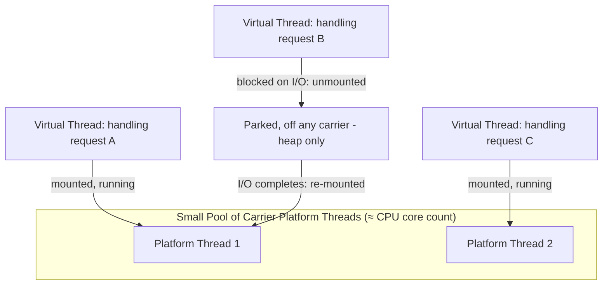

**`java.util.concurrent` at the architecture level.** Beyond raw threads,
`java.util.concurrent` provides the building blocks architects compose
into concurrent systems: the `ExecutorService` abstraction decouples "what
work to run" from "how/where it runs" (a thread-per-task executor, a fixed
thread pool, or — since Java 21 — `Executors.newVirtualThreadPerTaskExecutor()`,
which creates a new virtual thread per submitted task rather than
maintaining a bounded pool, since virtual threads are cheap enough not to
need pooling); `CompletableFuture` composes asynchronous computation
pipelines; and **structured concurrency** (a preview API as of Java 21/22)
enforces that a set of concurrently-forked subtasks share the fatal-error
and cancellation lifecycle of their parent task/scope, so a failure in one
child automatically cancels its siblings rather than leaking an orphaned,
uncancelled thread — directly addressing a well-known architectural failure
mode of ad hoc `ExecutorService` fan-out where a cancelled parent request
leaves child threads running to completion for no purpose.

**Decision implications.** Virtual threads change the calculus for I/O-
bound services specifically — a service that spends most of its per-request
time waiting on a database, another service, or a downstream API is exactly
the profile that benefits from replacing a bounded platform-thread pool
(where concurrency is capped by how many OS threads memory allows, often a
few thousand) with a virtual-thread-per-request model (where concurrency
scales to the number of *concurrent logical requests*, not OS threads).
Virtual threads provide **no** benefit for CPU-bound work — a
computation-heavy task still consumes one CPU core for its duration
regardless of which thread abstraction runs it, and creating more virtual
threads than CPU cores for CPU-bound work does not increase throughput.

**Common failure mode.** **Thread pinning.** A virtual thread that
executes a blocking operation *inside* a `synchronized` block (as opposed
to a `java.util.concurrent.locks.Lock`) cannot be unmounted from its
carrier thread for the duration of that block in JDK versions prior to the
fix in JDK 24 (pinning was a known limitation through JDK 21-23) — the
carrier thread is blocked exactly as if it were a platform thread, defeating
the scalability benefit and potentially exhausting the small carrier pool if
many virtual threads pin simultaneously. Migrating legacy `synchronized`-
heavy code to virtual threads without auditing for this can produce a
production deadlock-like starvation under load that never appeared in
staging with low concurrency.

**Concrete scenario.** A team migrates a Spring Boot REST API from a
bounded platform-thread pool (200 threads) to a virtual-thread-per-request
executor to handle a 20x increase in concurrent slow downstream calls.
Throughput improves dramatically in load testing — until a specific
endpoint that wraps a legacy cache client's `get()` call in a
`synchronized` block (guarding a non-thread-safe in-memory data structure)
starts timing out under peak load. Because each concurrent call to that
endpoint pins its virtual thread's carrier for the duration of the
(occasionally slow, due to a lock-contended cache) synchronized block, and
there are only as many carrier threads as CPU cores, a burst of concurrent
requests to that one endpoint can temporarily exhaust every carrier thread
and stall *all* other virtual threads in the process, not just that
endpoint's callers. The fix is replacing the `synchronized` block with a
`ReentrantLock`, which virtual threads can safely park on without pinning
their carrier.

### 4.8 Java Platform Module System (JPMS)

**Definition.** The Java Platform Module System (JPMS), delivered in Java
9 under Project Jigsaw, is a language- and JVM-level mechanism for grouping
packages into named **modules** with an explicit, declared graph of
dependencies (`requires`) and an explicit, declared set of exported
packages (`exports`) — replacing the classpath's implicit, all-public,
flat visibility model with compiler- and runtime-enforced encapsulation
boundaries between modules.

**Mechanism.** A module is declared by a `module-info.java` file at the
root of a set of packages:

```java
// module-info.java
module com.example.orders {
    requires com.example.catalog;      // depends on another module
    requires transitive java.sql;      // re-exposes java.sql to our consumers
    requires static com.example.testing.support; // compile-time only

    exports com.example.orders.api;    // public API package
    exports com.example.orders.dto to com.example.billing; // qualified export

    uses com.example.orders.spi.PricingStrategy;      // service consumer
    provides com.example.orders.spi.PricingStrategy
        with com.example.orders.internal.DefaultPricingStrategy; // service provider
}
```

At compile time and at run time, the JVM enforces that code in one module
can only access types from packages another module has explicitly
`exports`-ed to it (or exported to everyone) — a package that exists inside
a module but is never exported (e.g., `com.example.orders.internal`) is
**not accessible at all** from outside the module, even via reflection's
`setAccessible(true)`, unless the module additionally `opens` that package.
This is categorically stronger than the classpath's convention of "public
means public to everyone" — JPMS makes internal packages *architecturally*
internal, not just internal by naming convention (e.g., a package named
`internal` that anyone could still `import` on the classpath).

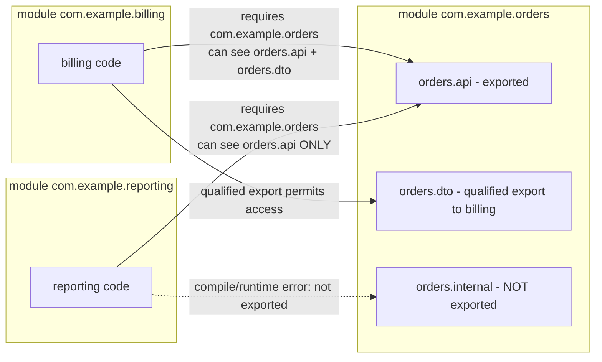

**Decision implications.** JPMS is architecturally significant chiefly for
large, multi-team monoliths and platform/library authors: it lets an
architect enforce module boundaries — the same boundaries a layered or
hexagonal architecture diagram promises on paper — as a hard compiler and
runtime constraint rather than a code-review convention that erodes over
time as `import com.example.other.internal.SomeHelper;` creeps in under
deadline pressure. It is far less commonly adopted, in practice, for
typical Spring Boot microservices, which tend to remain on the classpath
(Section 4.9) because many application frameworks, dependency-injection
proxies, and reflection-heavy libraries in the wider ecosystem historically
had rough edges under the module system's stricter encapsulation, and a
single microservice's internal package boundaries are usually already
small enough that classpath discipline plus code review suffices.

**Common failure mode.** `InaccessibleObjectException` at runtime when a
reflection-heavy library (a JSON serializer, an ORM, a dependency-injection
framework) attempts to reflectively access a non-`public` field or a
non-exported package on the module path — this exact code worked
unmodified on the classpath (where reflection had no such restriction) and
silently changed behavior purely because of *how the JAR was placed*
(module path vs. classpath), not because of any source-code change.

**Concrete scenario.** A team modularizes a large monolith into JPMS
modules to enforce a target layered architecture (a `domain` module must
never depend on an `infrastructure` module). Midway through, an
integration test suite that uses a reflection-based mocking library begins
failing with `InaccessibleObjectException` against a domain module's
package, because that package was never `opens`-ed (only `exports`-ed,
which permits compile-time/normal-call access but not deep reflection).
The architecturally correct fix is an explicit, narrow `opens ... to
mockingLibraryModule;` directive scoped only to the test configuration —
not abandoning the module system, and not blanket-opening the package to
everyone, which would defeat the encapsulation the migration was meant to
enforce.

### 4.9 Build & Dependency Architecture: Maven, Gradle, Classpath vs. Module Path

**Definition.** A Java build tool (Maven or Gradle, overwhelmingly) is
responsible for three architecturally distinct concerns bundled into one
tool: **dependency resolution** (computing a consistent, transitively-
closed set of JAR versions from a declared dependency graph), **compilation
and packaging** (invoking `javac`, running the module system if applicable,
and producing a JAR/WAR/native-image artifact), and **build lifecycle
orchestration** (compile → test → package → verify → deploy, with plugin
hook points at each phase).

**Mechanism — dependency resolution.** Both tools resolve a directed graph
of dependencies, including *transitive* dependencies declared by each
direct dependency, and must reconcile version conflicts when two different
dependencies in that graph require different versions of the same
transitive library ("dependency hell" / the "diamond dependency" problem).
Maven resolves conflicts by "nearest wins" (the version declared closest to
the root project in the dependency tree wins, with declaration order as a
tiebreaker at equal depth); Gradle by default picks the **highest** version
found anywhere in the graph, which is generally safer under the assumption
that library authors maintain backward compatibility, but both are
overridable via explicit version pinning (`<dependencyManagement>` in
Maven, a resolution strategy or version catalog in Gradle).

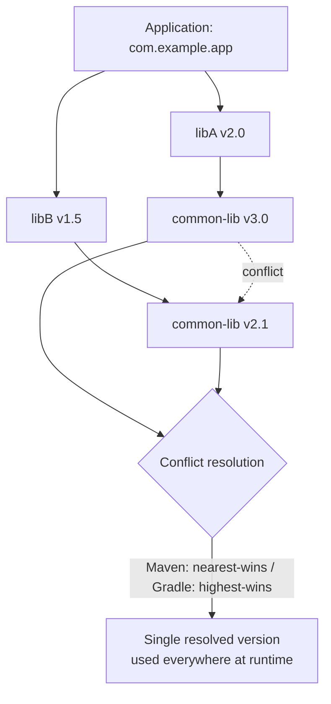

**Mechanism — classpath vs. module path.** At runtime the JVM is launched
with either a `-classpath` (a flat, ordered list of JARs/directories with
no declared inter-JAR dependency graph and no encapsulation — every public
class in every JAR is visible to every other JAR, and duplicate classes
across JARs are resolved silently by classpath order, a frequent source of
"works on my machine" bugs) or a `-module-path` (JPMS-aware, Section 4.8,
where the module graph is validated at startup and duplicate/conflicting
modules cause an explicit, immediate startup failure rather than a silent
runtime pick). Most Spring Boot and enterprise applications today still run
on the classpath even on modern JDKs — the module system exists, but
opting into `-module-path` for the whole application is a deliberate
architectural choice a team makes, not the default.

**Decision implications.** Maven's fixed, convention-driven lifecycle
(the well-known `mvn clean install` phase sequence) trades flexibility for
predictability and is generally preferred for large organizations
standardizing many teams' build behavior; Gradle's Groovy/Kotlin DSL
(Domain-Specific Language) build scripts trade some of that predictability
for expressive, programmable builds (custom tasks, incremental build
caching, better multi-module build performance at scale) and is generally
preferred where build performance or bespoke build logic matters more than
uniformity. Neither choice is "more architectural" than the other; it is an
engineering-velocity versus standardization trade-off scoped per
organization.

**Common failure mode.** A silent classpath duplicate: two transitive
dependencies pull in different versions of the same library (e.g., two
different logging-facade bridges), the build tool's conflict resolution
silently picks one, and the *other* version's classes are still present in
some JAR on the classpath but never loaded — until a code path that
specifically needs a class or method only present in the excluded version
throws `NoSuchMethodError` or `NoClassDefFoundError` at runtime, despite
compiling cleanly, because compilation succeeded against whichever version
happened to be resolved on the compile classpath while a *different* JAR's
copy shadowed it at a different classpath position at runtime in some
deployment environments.

**Concrete scenario.** A service compiles and passes all tests locally, but
throws `NoSuchMethodError` in a specific production Kubernetes deployment
only. Investigation shows a fat/shaded JAR bundling a different version of
a common utility library than the one the local development classpath
resolves, because the production build pipeline runs a slightly different
Maven profile that pulls in an extra dependency shading two conflicting
versions together. The fix is enforcing a single resolved dependency
version across all build profiles via `<dependencyManagement>` and adding
a Maven Enforcer Plugin rule that fails the build on duplicate classes,
turning a runtime production incident into a build-time failure.

### 4.10 Enterprise Frameworks at the Architecture Level: Spring's IoC/DI Container, Spring Boot Auto-Configuration, and Jakarta EE

**Definition.** Inversion of Control (IoC) is the general architectural
principle that a framework, not application code, controls the flow and
wiring of a program; Dependency Injection (DI) is the specific technique
Spring's IoC container uses to implement it — constructing objects
("beans") and supplying ("injecting") their declared dependencies, rather
than each object constructing or looking up its own collaborators.

This section recaps rather than re-derives the general IoC/DI *pattern*
(which is a general software-design-pattern concern); what is specific to
Java architecture here is how Spring's **container** implements it
concretely on top of the JVM's class loading and reflection facilities, and
what Spring Boot's **auto-configuration** adds on top.

**Mechanism — the Spring IoC container bean lifecycle.** The
`ApplicationContext` is Spring's IoC container: it scans configuration
(annotations like `@Component`/`@Service`/`@Repository`, or explicit
`@Configuration` classes with `@Bean` methods) to build a **bean
definition** registry, then instantiates, wires, and manages the lifecycle
of each resulting bean.

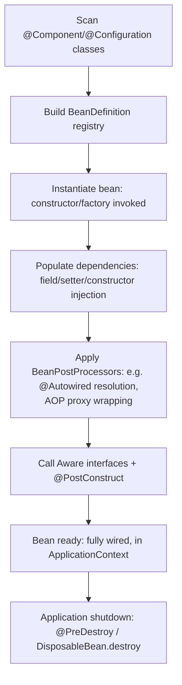

Two architectural properties of this container matter for a Solution
Architect: first, most Spring beans are **singletons by default** (one
instance per `ApplicationContext`, shared across every consumer), so a bean
holding mutable, non-thread-safe state is a concurrency hazard shared
across every request thread unless deliberately scoped `prototype` or made
immutable/thread-safe; second, Spring implements cross-cutting concerns
(transactions via `@Transactional`, security checks, caching via
`@Cacheable`) via runtime **proxies** wrapped around a bean by a
`BeanPostProcessor` — meaning a `@Transactional` method called from
*another method on the same class* (a "self-invocation") bypasses the proxy
entirely and silently runs with **no** transaction, a frequently
misunderstood failure mode that has nothing to do with the transaction
configuration itself and everything to do with how Java method dispatch
works on `this` versus through an external proxy reference.

**Mechanism — Spring Boot auto-configuration.** Spring Boot layers
**convention-over-configuration** on top of the base Spring container:
`@SpringBootApplication` triggers component scanning plus
`@EnableAutoConfiguration`, which evaluates a large set of conditional
configuration classes (each guarded by annotations like
`@ConditionalOnClass`, `@ConditionalOnMissingBean`, or
`@ConditionalOnProperty`) shipped inside every Spring Boot "starter"
dependency, so that merely having a JDBC driver and `spring-boot-starter-
data-jpa` on the classpath is sufficient for Spring Boot to automatically
configure a `DataSource`, an entity manager, and transaction management
with sensible defaults — unless the application explicitly defines its own
bean of that type, in which case the conditional annotation backs off and
lets the application's own bean win.

**Jakarta EE (formerly Java EE).** Jakarta EE is a *specification* suite
(Jakarta Persistence — formerly JPA, Jakarta RESTful Web Services — JAX-RS,
Contexts and Dependency Injection — CDI, Jakarta Enterprise Beans, and
others) standardized by the Eclipse Foundation, implemented by multiple
competing application servers (WildFly, Payara, Open Liberty) and runtimes
(Quarkus, Helidon). Architecturally, the key distinguishing property versus
Spring is **portability of the programming model across vendor
implementations** by contract (a CDI-based application is meant to be
portable across any conforming Jakarta EE server), whereas Spring is a
single de facto standard implementation rather than a multi-vendor
specification — a trade-off between specification-guaranteed portability
(Jakarta EE) and de facto ecosystem dominance, tooling maturity, and a
single, faster-moving reference implementation (Spring).

**Decision implications.** Choosing Spring Boot versus Jakarta EE (on a
server like Quarkus or WildFly) is rarely about raw runtime capability —
both provide dependency injection, web endpoints, persistence, and
transactions — and is usually about ecosystem gravity (Spring's vastly
larger library/starter ecosystem and hiring pool), the organization's
existing operational tooling, and startup-latency requirements (Quarkus and
Micronaut, both compatible with GraalVM native image, specifically target
fast-cold-start, low-memory footprints for serverless and Kubernetes
autoscaling scenarios in a way traditional Spring Boot on the classpath does
not, though Spring has since added its own native-image support via Spring
Native/AOT processing).

**Common failure mode.** Relying on Spring Boot auto-configuration without
understanding *which* conditional configuration actually activated, then
being surprised in production when adding a seemingly-unrelated dependency
JAR silently changes the application's configured behavior (e.g., adding an
in-memory database driver for a test dependency accidentally also becomes
visible on the main classpath in some build misconfigurations, causing
Spring Boot to auto-configure an unintended embedded `DataSource` in a
profile where it shouldn't be present). The Spring Boot Actuator's
`/actuator/conditions` endpoint exists precisely to make these implicit
decisions inspectable.

**Concrete scenario.** A `@Transactional` annotated `OrderService.place()`
method internally calls `this.validate()`, which is also `@Transactional`
and is expected to run in a nested/separate transaction context per its
propagation setting. Because Spring's transaction behavior is implemented
via a dynamic proxy wrapped *around* the `OrderService` bean, and
`this.validate()` is a plain, un-proxied Java method call on the raw
object instance (not a call through the Spring-managed proxy reference),
the `@Transactional` annotation on `validate()` is silently ignored for
that call path — no error, no warning, just transactional behavior that
does not match what the annotation promises. The architecturally correct
fix is either restructuring so cross-cutting-concern-annotated methods are
called from a different bean (going through the proxy), or, if unavoidable,
injecting a self-reference proxy (`@Lazy` self-autowiring or
`AopContext.currentProxy()`), and documenting why.

### 4.11 Packaging & Deployment: JAR/WAR and Native Images via GraalVM

**Definition.** A JAR (Java ARchive) is a ZIP-format container bundling
compiled `.class` files, resources, and a manifest; a WAR (Web application
ARchive) is a JAR variant with a standardized directory structure
(`WEB-INF/classes`, `WEB-INF/lib`) that a Servlet-container application
server can deploy directly. A GraalVM **native image** is a fundamentally
different packaging strategy: instead of bytecode interpreted/JIT-compiled
by a JVM at runtime, the application (and a minimal, statically-analyzed
subset of the JDK it actually uses) is **ahead-of-time (AOT) compiled**
into a single, self-contained native executable with no separate JVM
process required to run it.

**Mechanism.** Traditional deployment ships a "fat"/"executable" JAR
(bundling the application plus all its dependencies, runnable via `java
-jar app.jar`, the standard Spring Boot default) or a WAR deployed into a
shared application server. Native image compilation instead performs a
whole-program **static reachability analysis** at build time — starting
from declared entry points, it determines the complete closure of classes,
methods, and fields that could possibly be reached at runtime, and compiles
only that closure to native machine code, discarding everything else
(including, critically, the JIT compiler, the bytecode interpreter, and
most of the class loading subsystem itself, since no new classes can be
loaded that weren't known about at build time by default).

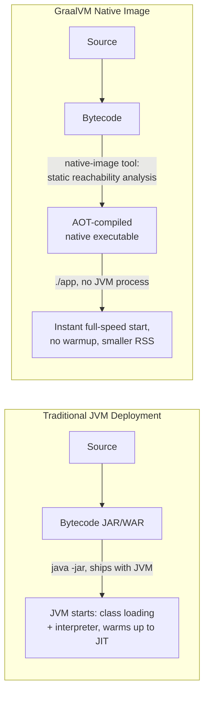

**Decision implications.** Native image trades **flexibility for
startup latency and memory footprint**: because the closed-world assumption
requires knowing every reachable class/method at build time, features that
rely on *runtime* class discovery — arbitrary reflection, dynamic proxies
generated on the fly, classpath scanning, and dynamic class loading —
require explicit build-time configuration (reachability metadata) to work
at all, and anything genuinely dynamic (loading a class whose name is only
known at runtime from user input, for instance) is fundamentally
incompatible with the model. This makes native image an excellent fit for
serverless functions and aggressively autoscaled microservices (where
startup latency and memory-per-instance directly drive cost and
user-facing cold-start latency) and a poor fit for plugin-style
architectures or applications that lean heavily on runtime bytecode
generation.

**Common failure mode.** A Spring Boot application that works perfectly
on the standard JVM fails at native-image build time or, worse, throws a
runtime error only in the native binary (never during the build) because
some dependency uses reflection to access a class the reachability analysis
did not statically detect (e.g., a JSON library reflectively instantiating
a data transfer object it discovers only via a runtime-read configuration
string). The Spring team's response to this is Spring AOT processing
(part of Spring Framework 6 / Spring Boot 3) which generates the necessary
reachability metadata automatically at build time for Spring's own
reflection use, but third-party libraries outside that processing must
ship (or have contributed to) their own GraalVM reachability metadata, or
the application must supply it manually.

**Concrete scenario.** A team compiles a Spring Boot 3 microservice to a
GraalVM native image to cut Kubernetes cold-start time from roughly 4
seconds (JVM class loading + warmup) to under 50 milliseconds, directly
reducing both user-facing latency during scale-up events and the compute
minutes billed during autoscaling. Early in the migration, a
custom `ObjectMapper` module that reflectively registers a set of
subclasses discovered by classpath scanning at startup silently fails to
find any subclasses in the native binary (because the reachability analysis
never observed that dynamic scan path as a static reference) — the fix is
replacing the runtime classpath scan with an explicit, statically-listed
registration, which is both native-image-compatible and, as a side effect,
faster on the traditional JVM too, since it removes a runtime reflection
scan from the startup path entirely.

## 5. Internal Working

Putting Sections 4.1-4.11 together, a single request's journey through a
running JVM-based service touches nearly every subsystem discussed above:
the request arrives on (in modern Java) a virtual thread (4.7); the code
handling it was loaded once at startup by the application class loader
(4.2), verified once (4.3), and by now — assuming the process has been
running long enough to warm up — the hot path methods have been promoted
to C2-compiled native code by the JIT (4.6); objects the request allocates
either die young in the young generation or, if the object provably never
escapes its allocating method, never make it to the heap at all thanks to
escape analysis; any object surviving multiple young collections is
promoted to the old generation, managed by whichever collector (G1, ZGC,
Shenandoah) the operations team selected for the service's latency profile
(4.5); and if the request touches a Spring-managed transactional service
method, it passes through a dynamic proxy installed by the IoC container
(4.10) before reaching application logic.

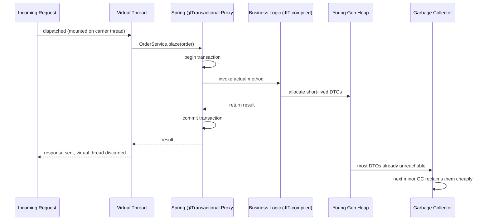

## 6. Design Principles

Java's platform design has consistently optimized for a small set of
enduring principles: **backward binary compatibility** (an old JAR should
keep running on new JVMs without recompilation, which is why deprecated
APIs are rarely removed outright and why the module system's stricter
encapsulation was phased in gradually with escape hatches like `--add-
opens`); **safety by default, opt-in for danger** (bounds-checked arrays,
mandatory bytecode verification, and — since Java 17 — a JDK internals
encapsulation model that requires explicit command-line opt-in to break,
rather than allowing it silently); **profile-guided, adaptive optimization
over static prediction** (the JIT's tiered compilation bets that runtime-
observed behavior beats compile-time guesses, unlike a purely
ahead-of-time-compiled language); and **explicit, composable concurrency
primitives over implicit magic** (`java.util.concurrent`'s executors,
futures, and now virtual threads are designed as building blocks an
architect assembles deliberately, not a hidden runtime scheduler making
unaccountable decisions).

## 7. Architecture Patterns

Java-based systems commonly implement the general architecture patterns
covered elsewhere in this handbook (layered architecture, hexagonal/ports-
and-adapters, microservices) using Java-specific structural conventions:
package-by-layer or package-by-feature module boundaries enforced either by
convention (classpath) or by JPMS (Section 4.8); Spring's `@Component`
stereotypes (`@Repository`, `@Service`, `@Controller`) as a lightweight,
annotation-driven way to mark hexagonal architecture's adapters and use-case
layers without hand-written wiring; and Spring Boot's "fat JAR" packaging
model (Section 4.11) as the dominant unit of independent deployability for
a microservice, one JVM process per service instance, typically one
container per JVM process in Kubernetes.

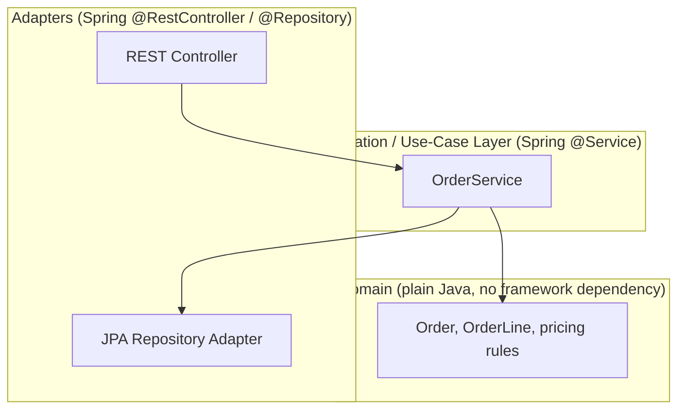

## 8. Production Architecture

A typical production Java microservice runs as one containerized JVM
process per instance, horizontally scaled behind a load balancer, with the
JVM's heap and thread-pool/virtual-thread sizing tuned to the container's
CPU/memory reservation (not the host machine's full resources, a common
misconfiguration when the JVM's automatic ergonomics detect the wrong
resource boundary in older containerized environments without proper
cgroup awareness).

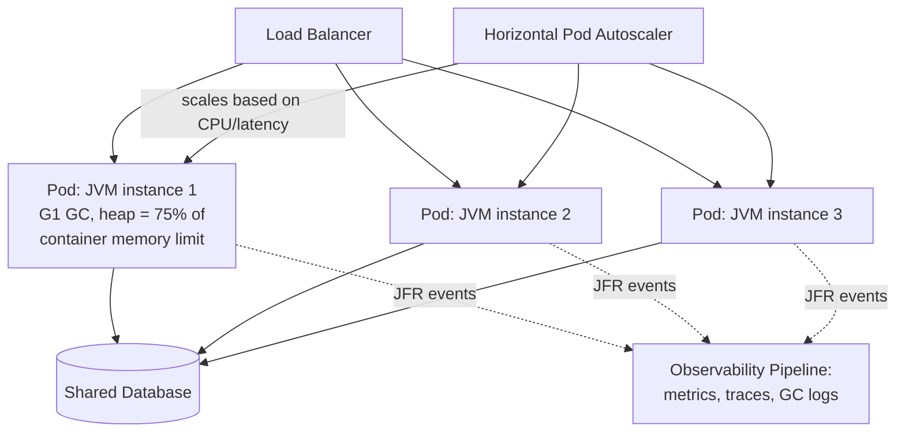

Key production defaults an architect should set deliberately rather than
leave to chance: explicit `-Xmx`/`-Xms` (or, since Java 10, correctly
detected container-aware defaults via `-XX:MaxRAMPercentage`, safer than
guessing a fixed heap size across differently-sized environments); an
explicit GC algorithm choice justified by the service's latency profile
(Section 4.5); GC and Java Flight Recorder (JFR) logging enabled by default
in every environment, not only when debugging an incident, since GC logs
are cheap to collect and invaluable in hindsight; and — for services with a
strict cold-start budget — evaluation of native image packaging
(Section 4.11).

## 9. Implementation

Implementing the architecture described above in a real codebase means:
declaring dependency versions centrally (a Maven `<dependencyManagement>`
Bill of Materials, or a Gradle version catalog) rather than per-module, so
the conflict-resolution failure mode in Section 4.9 cannot silently occur;
keeping domain logic free of framework annotations wherever the hexagonal
boundary (Section 7) demands it; explicitly choosing and documenting a
concurrency model (bounded platform-thread pool vs. virtual-thread-per-task
executor) per service based on its I/O-bound-vs-CPU-bound profile
(Section 4.7); and wiring GC/JFR flags and container resource limits
together as one reviewed, versioned deployment artifact (e.g., a Helm
chart's resource requests/limits alongside the JVM flags baked into the
container entrypoint) rather than as two independently-owned, easily
drifting configurations.

## 10. Complete Code Examples

The following examples are runnable, production-representative Java 21
code illustrating concepts from Section 4. Full compilable sources also
live under [`code/java/`](../code/java/) per the handbook's code
convention.

**Example 1 — Virtual threads for an I/O-bound fan-out (Section 4.7).**
Fetching data from several downstream services concurrently, using a
virtual-thread-per-task executor instead of a bounded platform-thread pool:

```java
import java.time.Duration;
import java.util.List;
import java.util.concurrent.*;

public class DownstreamAggregator {

    private final ExecutorService virtualThreadExecutor =
        Executors.newVirtualThreadPerTaskExecutor();

    public AggregatedResult fetchAll(String orderId) throws InterruptedException {
        // Each downstream call runs on its own cheap virtual thread; blocking
        // I/O inside call() automatically unmounts the virtual thread from
        // its carrier, so thousands of concurrent calls stay lightweight.
        List<Callable<String>> calls = List.of(
            () -> pricingClient.fetchPrice(orderId),
            () -> inventoryClient.fetchStock(orderId),
            () -> shippingClient.fetchEta(orderId)
        );

        List<Future<String>> futures = virtualThreadExecutor.invokeAll(
            calls, Duration.ofSeconds(2).toMillis(), TimeUnit.MILLISECONDS);

        // If any downstream call exceeds the timeout, cancel siblings rather
        // than let them run to completion for a response nobody will use.
        try {
            String price = futures.get(0).get();
            String stock = futures.get(1).get();
            String eta = futures.get(2).get();
            return new AggregatedResult(price, stock, eta);
        } catch (ExecutionException | CancellationException e) {
            futures.forEach(f -> f.cancel(true));
            throw new DownstreamAggregationException("aggregation failed for " + orderId, e);
        }
    }

    // Stand-ins for real HTTP clients, omitted for brevity.
    private final PricingClient pricingClient = new PricingClient();
    private final InventoryClient inventoryClient = new InventoryClient();
    private final ShippingClient shippingClient = new ShippingClient();
}
```

**Example 2 — Correct cross-thread visibility with the JMM (Section 4.4).**
Publishing a periodically rebuilt lookup table safely to reader threads:

```java
import java.util.Map;
import java.util.concurrent.atomic.AtomicReference;

public final class RefreshableLookupCache<K, V> {

    // AtomicReference publication establishes a happens-before edge: any
    // thread that reads current() after a set() is guaranteed to see the
    // fully-constructed map, never a partially-built one and never a stale
    // reference held in a per-core cache.
    private final AtomicReference<Map<K, V>> current;

    public RefreshableLookupCache(Map<K, V> initial) {
        this.current = new AtomicReference<>(Map.copyOf(initial));
    }

    public V get(K key) {
        return current.get().get(key); // never blocks readers
    }

    public void refresh(Map<K, V> rebuilt) {
        // Build the whole map off to the side, then publish it atomically
        // in one write — readers never observe an in-progress rebuild.
        current.set(Map.copyOf(rebuilt));
    }
}
```

**Example 3 — Structured concurrency for correct cancellation propagation
(preview API, Section 4.7).**

```java
import java.util.concurrent.StructuredTaskScope;

public class OrderValidationService {

    public ValidationResult validate(String orderId) throws InterruptedException {
        // ShutdownOnFailure: if either subtask fails, the scope cancels the
        // other automatically rather than leaking an orphaned thread that
        // keeps running after the parent has already given up.
        try (var scope = new StructuredTaskScope.ShutdownOnFailure()) {
            var inventoryCheck = scope.fork(() -> inventoryService.reserve(orderId));
            var fraudCheck = scope.fork(() -> fraudService.score(orderId));

            scope.join();
            scope.throwIfFailed();

            return new ValidationResult(inventoryCheck.get(), fraudCheck.get());
        }
    }

    private final InventoryService inventoryService = new InventoryService();
    private final FraudService fraudService = new FraudService();
}
```

**Example 4 — A custom, isolated ClassLoader for plugin sandboxing
(Section 4.2).**

```java
import java.net.URL;
import java.net.URLClassLoader;

public final class PluginClassLoader extends URLClassLoader {

    public PluginClassLoader(URL[] pluginJars, ClassLoader sharedApiLoader) {
        // Parent is the loader for the shared "plugin-api" JAR only — NOT
        // the full application classloader — so a plugin cannot reach
        // internal application classes, and two plugins loaded by two
        // separate instances of this loader remain mutually isolated even
        // if they bundle colliding versions of the same third-party library.
        super(pluginJars, sharedApiLoader);
    }

    @Override
    protected Class<?> loadClass(String name, boolean resolve) throws ClassNotFoundException {
        // Child-first for plugin-private classes; only defer to the shared
        // API parent for the contractually shared interface package.
        if (name.startsWith("com.example.pluginapi.")) {
            return super.loadClass(name, resolve); // delegate to shared parent
        }
        synchronized (getClassLoadingLock(name)) {
            Class<?> found = findLoadedClass(name);
            if (found == null) {
                try {
                    found = findClass(name); // load from this plugin's own JARs
                } catch (ClassNotFoundException e) {
                    found = super.loadClass(name, resolve); // fall back to parent
                }
            }
            if (resolve) resolveClass(found);
            return found;
        }
    }
}
```

## 11. Performance

Java performance work operates at three distinct levels architects must
diagnose separately: **allocation/GC pressure** (Section 4.5 — measured via
GC logs and allocation profiling, fixed by reducing allocation rate or
choosing a better-matched collector); **JIT warmup and inlining behavior**
(Section 4.6 — measured via JFR's compilation events, fixed by reducing
call-site polymorphism on hot paths or, for short-lived processes, moving
to native image); and **concurrency-model mismatch** (Section 4.7 —
measured via thread-dump analysis showing platform-thread pool exhaustion
under I/O-bound load, fixed by adopting virtual threads where appropriate).
Heap sizing itself is a direct trade-off: a heap sized too small forces
frequent GC cycles even for a well-behaved allocation rate; a heap sized
too large increases the *worst-case* pause duration of a full GC (more live
data to trace and compact) even if such pauses become individually rarer.

## 12. Scalability

Vertical scalability within one JVM process is bounded by how well the
chosen GC algorithm scales with heap size (Section 4.5: ZGC/Shenandoah
scale pause time roughly independent of heap size, unlike naive stop-the-
world collectors) and by how the concurrency model scales with concurrent
connection count (Section 4.7: virtual threads remove the platform-thread-
count ceiling for I/O-bound concurrency). Horizontal scalability — running
more JVM instances behind a load balancer — is where most Java systems
actually get their headroom in practice, and is directly constrained by
per-instance startup latency (Section 4.6/4.11: an autoscaler that needs to
add capacity in under a second cannot wait for a multi-second JVM warmup,
making native image or pre-warmed instance pools a real architectural
lever, not a micro-optimization).

## 13. Security

Java's managed-runtime memory safety (Section 3) eliminates an entire class
of vulnerabilities common in unmanaged languages, but introduces its own
Java-specific attack surface an architect must account for: **untrusted
deserialization** (Java's native object serialization can be abused to
instantiate arbitrary classes with attacker-controlled state during
`readObject()`, a well-documented remote-code-execution vector — mitigated
by avoiding native Java serialization for any externally-facing data format
in favor of JSON/protobuf, and where native serialization is unavoidable, by
using `ObjectInputFilter` allow-lists); **classloader/reflection escapes**
(historically, security-manager sandboxing relied on class loader and
reflection restrictions that have themselves been sources of sandbox-escape
vulnerabilities — the Security Manager mechanism itself is deprecated for
removal as of Java 17+, so architectures that relied on it for untrusted-
code sandboxing must migrate to process-level or container-level isolation
instead); and **dependency supply-chain risk** (the transitive dependency
graph Section 4.9 resolves automatically is also the exact mechanism by
which a compromised or vulnerable transitive library, e.g. the Log4Shell
vulnerability in Log4j 2, reaches production — architected mitigation is a
Software Bill of Materials (SBOM) plus automated dependency vulnerability
scanning wired into the build pipeline, not manual awareness).

## 14. Observability

Java Flight Recorder (JFR), built into the JVM since Java 11 (backported to
8u), is the architecturally significant observability primitive specific
to this platform: a low-overhead (typically under 1-2% in production),
always-on event-recording facility capturing GC pauses, JIT compilation
events, thread state transitions, lock contention, and allocation profiles
directly from inside the JVM, viewable via JDK Mission Control or exported
continuously to an observability pipeline. This is a materially different
capability than external process-level metrics (CPU, memory, request
latency) covered by the general observability chapter — JFR answers *why*
the JVM behaved a certain way (which GC event caused a pause, which method
triggered deoptimization) rather than only *that* it did.

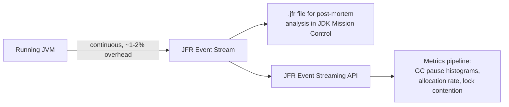

## 15. Failure Scenarios

Beyond the specific failure modes already detailed per concept in Section
4, three composite production failure patterns recur across Java systems:
**thread pool / connection pool exhaustion cascades** (a slow downstream
dependency causes callers to hold platform threads longer than expected,
exhausting a bounded thread pool, which then queues or rejects unrelated
requests — a failure mode virtual threads mitigate for the thread-count
dimension but do not eliminate for a bounded downstream connection pool,
which is a separate resource); **metaspace/classloader leaks** under
frequent hot-redeployment (Section 4.1); and **native memory exhaustion
independent of heap usage** (direct `ByteBuffer`s, JNI-allocated native
memory, or thread stack memory for a runaway platform-thread count can
exhaust container memory even while heap usage looks perfectly healthy in
monitoring, because heap metrics do not capture native memory — diagnosed
via native memory tracking, `-XX:NativeMemoryTracking=summary`).

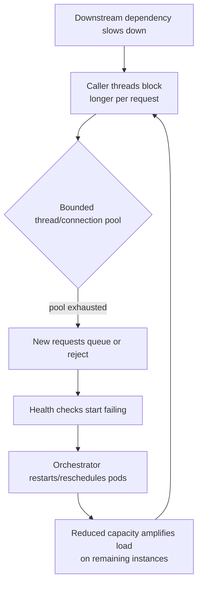

## 16. Testing

Testing a Java architecture spans several distinct concerns: unit tests
(JUnit 5, with Mockito for collaborator isolation) for business logic;
Spring-specific slice tests (`@WebMvcTest`, `@DataJpaTest`) that load only
a relevant subset of the IoC container rather than the full
`ApplicationContext`, keeping test startup fast; concurrency-specific tests
that deliberately exercise multi-threaded interleavings (e.g., using jcstress
for JMM-sensitive code, Section 4.4) rather than trusting that a single-
threaded test passing proves thread safety; and **architecture tests**
(ArchUnit) that assert structural rules as executable tests — for example,
failing the build if any class in a `domain` package imports anything from
an `infrastructure` package, enforcing the layered boundary from Section 7
automatically rather than relying on code review to catch drift.

```java
import com.tngtech.archunit.lang.ArchRule;
import static com.tngtech.archunit.lang.syntax.ArchRuleDefinition.noClasses;

public class LayeringArchitectureTest {
    @ArchTest
    static final ArchRule domainMustNotDependOnInfrastructure =
        noClasses().that().resideInAPackage("..domain..")
            .should().dependOnClassesThat().resideInAPackage("..infrastructure..");
}
```

## 17. Common Mistakes

The most consequential recurring mistakes, cross-referenced to where each
is explained in depth: tuning heap size for a metaspace problem (4.1);
assuming a plain field write is visible cross-thread without a
`happens-before` edge (4.4); scaling heap size to "fix" GC pauses without
checking whether the pauses are minor, mixed, or full (4.5); benchmarking
before JIT warmup completes (4.6); moving `synchronized`-guarded blocking
code onto virtual threads without auditing for carrier-thread pinning
(4.7); letting transitive dependency conflicts resolve silently instead of
failing the build (4.9); and calling a `@Transactional` (or otherwise
proxy-intercepted) method via `this` from within the same class (4.10).

## 18. Best Practices

Pin dependency versions centrally via a Bill of Materials or version
catalog rather than letting transitive resolution decide silently (4.9);
choose a GC algorithm deliberately based on the service's actual latency
SLA, and enable GC/JFR logging by default in every environment, not only
during an incident (4.5, 14); default new I/O-bound services to a virtual-
thread-per-task executor and reserve bounded platform-thread pools for
genuinely CPU-bound workloads (4.7); enforce architectural layering with
ArchUnit tests rather than code-review convention alone (16); and evaluate
native image packaging explicitly for any service whose cold-start latency
or per-instance memory footprint materially affects cost or user-facing
SLAs under autoscaling (4.11, 12).

## 19. Anti-Patterns

**"Tune first, diagnose later"** — changing GC flags or heap size in
response to a performance incident before reading GC logs to confirm which
GC event type is actually occurring (Section 4.5). **God `ApplicationContext`
singletons holding mutable state** — a Spring singleton bean accumulating
mutable, non-thread-safe fields that are silently shared and mutated across
every concurrent request thread (Section 4.10). **Reflection-based
"magic" without reachability awareness** — building a plugin or
serialization system around unconstrained runtime reflection/classpath
scanning that works today on the classpath but silently breaks the moment
the team adopts JPMS (4.8) or GraalVM native image (4.11), because neither
model tolerates fully-open-world runtime discovery by default.

## 20. Trade-off Analysis

| Decision Axis | Choose G1 | Choose ZGC/Shenandoah |
|---|---|---|
| Latency SLA | Tolerant of occasional 50-200ms pauses | Sub-10ms tail latency required |
| Heap size | Small-to-large (few GB to tens of GB) | Very large heaps (tens of GB to TB) with flat pause-time needs |
| CPU headroom | Standard | Requires more spare CPU for concurrent GC work |

| Decision Axis | Classpath + Traditional JVM | GraalVM Native Image |
|---|---|---|
| Startup latency | Seconds (class loading + JIT warmup) | Milliseconds |
| Peak throughput after warmup | Highest (full profile-guided C2 optimization) | Slightly lower peak (less runtime profile data) |
| Runtime reflection/dynamic class loading | Fully supported | Requires build-time reachability metadata; unconstrained dynamic loading unsupported |
| Best fit | Long-lived services, plugin-heavy systems | Serverless functions, aggressively autoscaled microservices |

| Decision Axis | Bounded Platform-Thread Pool | Virtual-Thread-per-Task |
|---|---|---|
| I/O-bound workloads | Concurrency capped by pool size | Scales to concurrent logical request count |
| CPU-bound workloads | No difference in throughput | No difference in throughput (no benefit) |
| Legacy `synchronized` code | No pinning risk | Requires pinning audit (Section 4.7) |

## 21. Comparison Table

| Platform | Memory Safety | Concurrency Model | Startup Latency | Typical Fit |
|---|---|---|---|---|
| Java (JVM) | Managed, GC'd heap | Platform + virtual threads, `java.util.concurrent` | Seconds (JIT), ms (native image) | Large enterprise systems, long-lived services, complex domain logic |
| Go | Managed, GC'd heap | Goroutines (M:N green threads, always-on) | Milliseconds (compiled binary) | Network services, CLIs, infra tooling favoring simplicity |
| Node.js | Managed, GC'd heap (V8) | Single-threaded event loop + async I/O | Milliseconds | I/O-bound APIs, real-time apps, teams prioritizing one language front-to-back |
| Rust | Manual, compiler-enforced (no GC) | OS threads + `async`/await, no runtime GC pauses | Milliseconds | Systems programming, latency-critical/embedded, zero-GC requirements |
| Python (CPython) | Managed, GC'd heap + reference counting | Global Interpreter Lock limits true CPU parallelism | Milliseconds-seconds | Data/ML tooling, scripting, rapid prototyping |

Java's distinguishing position in this table is the combination of a
mature, tunable managed-memory model (a choice of GC algorithms matched to
different latency profiles, Section 4.5) with a concurrency model that, as
of virtual threads, closes much of the gap Go's goroutines previously held
over it for I/O-bound scalability, while retaining the deepest, most
battle-tested enterprise framework ecosystem (Section 4.10) of any platform
in this table.

## 22. Real-World Case Study

A mid-size payments company ran its authorization service as a traditional
Spring Boot application on the classpath, G1 GC, and a 400-thread bounded
platform-thread pool sized to its peak observed concurrent request count.
As transaction volume grew, p99 latency degraded under peak load even
though CPU utilization stayed well under 50% — the classic signature of
**thread-pool-bound, not CPU-bound, saturation**: most request time was
spent waiting on a downstream fraud-scoring service, and once all 400
platform threads were blocked waiting on that dependency, additional
requests queued regardless of spare CPU capacity. The team's first
(incorrect) response was raising the thread pool to 2,000 threads, which
briefly helped but pushed the JVM's committed native thread-stack memory
high enough to cause container out-of-memory kills under bursty traffic,
since each platform thread reserves real memory whether blocked or not.
Migrating the request-handling path to `Executors
.newVirtualThreadPerTaskExecutor()` (Section 4.7) resolved the underlying
mismatch directly: concurrency was no longer capped by a fixed thread-stack
memory budget, virtual threads blocked on downstream I/O unmounted their
carrier threads for other work, and p99 latency returned to its expected
range at the original CPU utilization — with one follow-up fix required, a
single legacy `synchronized`-guarded metrics counter that caused carrier-
thread pinning under peak concurrency (Section 4.7's common failure mode),
found via JFR's virtual thread pinning events and resolved by switching
that lock to `ReentrantLock`.

## 23. Interview Questions

1. Explain the difference between the heap, the metaspace, and per-thread
   stacks — and describe a symptom that would tell you which one is under
   pressure.
2. Why does the Java Memory Model require an explicit `happens-before`
   relationship for cross-thread visibility, and what specific actions
   establish one?
3. Contrast G1, ZGC, and Shenandoah on the pause-time vs. throughput vs.
   memory-overhead trade-off, and describe a workload profile that would
   justify each.
4. What problem do virtual threads solve that a bounded platform-thread
   pool cannot, and what is "carrier thread pinning"?
5. Why does JPMS's `exports`/`opens` distinction matter for a library that
   relies on reflection, and how does that differ from classpath-based
   visibility?
6. Why can calling a `@Transactional` method via `this` inside the same
   class silently produce no transaction at all?
7. What does GraalVM native image's "closed-world assumption" mean, and
   what categories of code does it make architecturally incompatible?
8. Describe how the JIT's tiered compilation and escape analysis together
   explain why a correct microbenchmark must include a warmup phase.

## 24. Hands-on Exercises

1. Enable `-Xlog:gc*` on a small allocation-heavy Java program, force a
   full GC by allocating and discarding large objects, and identify the
   humongous-allocation pattern from Section 4.5 in the resulting log.
2. Write a small program that demonstrates the JMM visibility failure mode
   from Section 4.4 (a non-`volatile` flag read in a busy-wait loop that
   never observes another thread's write once the JIT optimizes it), then
   fix it with `volatile` and confirm the fix under `-server` JIT
   compilation.
3. Convert a bounded `Executors.newFixedThreadPool(n)`-based service to
   `Executors.newVirtualThreadPerTaskExecutor()` and load-test both under a
   simulated slow downstream dependency to observe the throughput
   difference described in Section 22's case study.
4. Build a two-module JPMS project where one module deliberately does not
   export an internal package, and confirm both the compiler and the
   runtime reject access to it from the other module.

## 25. Design Exercises

1. Design the JVM deployment configuration (GC algorithm, heap sizing
   strategy, thread/virtual-thread model) for two contrasting services: a
   sub-50ms p99 payments-authorization API and an overnight batch data
   pipeline with no external latency SLA. Justify each choice against
   Sections 4.5, 4.7, 11, and 12.
2. Design a plugin architecture for a rules engine that must hot-load and
   hot-unload untrusted third-party rule JARs at runtime without leaking
   metaspace (Section 4.1) or producing `ClassCastException`s across plugin
   boundaries (Section 4.2). Specify the class loader hierarchy and the
   shared-API isolation strategy.
3. Evaluate whether a given microservice (specify its I/O-vs-CPU profile,
   autoscaling behavior, and reflection/dynamic-class-loading usage) is a
   good candidate for GraalVM native image migration, using the trade-off
   table in Section 20 as your evaluation framework.

## 26. Architecture Review Questions

- Is the GC algorithm choice for this service explicitly justified against
  its actual latency SLA, or is it left at an unexamined default?
- Does any bean holding mutable state assume single-threaded access despite
  being a Spring singleton shared across all request threads?
- Are transitive dependency versions pinned centrally, with a build-time
  check that fails on duplicate/conflicting classes, or could a silent
  resolution change break production undetected?
- For I/O-bound services, has the team evaluated virtual threads, and if
  legacy `synchronized` blocks remain on hot paths, has carrier-thread
  pinning been audited?
- For services with strict cold-start or per-instance memory budgets, has
  GraalVM native image been evaluated, and if adopted, is reachability
  metadata for all reflection-dependent libraries verified in CI rather
  than discovered in production?
- Are JPMS module boundaries (where adopted) or package-level conventions
  (where not) actually enforced by a build-time check (module system
  compiler errors, or an ArchUnit rule), or only by code-review discipline?

## 27. Summary

Java is best understood by a Solution Architect not as a language but as a
managed execution substrate whose class loading, memory model, garbage
collection, JIT compilation, concurrency model, module system, build
tooling, framework conventions, and packaging strategy together determine a
system's real-world latency, throughput, scalability, and failure modes.
Each of these subsystems embodies a deliberate, historically-motivated
trade-off — portability versus native-code performance, safety versus
flexibility, adaptive runtime optimization versus predictable ahead-of-time
compilation, thread-per-request simplicity versus raw thread cost — and the
platform's recent evolution (virtual threads, native image, stronger module
encapsulation) is a direct, ongoing response to cloud-native economics
rather than an arbitrary feature treadmill. An architect who can reason
about *which* subsystem is responsible for a given production symptom —
metaspace versus heap, a minor versus a full GC, carrier-thread pinning
versus genuine CPU saturation, a classloader mismatch versus a genuine type
error — will make materially better capacity-planning, framework, and
deployment-packaging decisions than one who treats "Java performance" as an
undifferentiated black box to be tuned by trial and error.

## Further Reading

- [HTTP](../05_Networking_and_OS/CH01_HTTP.md) — transport-level concerns
  (TLS, caching headers) a Java web service sits on top of but does not
  itself redefine.
- [REST](../08_API_Architecture/CH01_REST.md) — API design concerns
  orthogonal to the JVM-specific material in this chapter.
- [What is Software Architecture?](../01_Architecture_Mindset/CH01_What_is_Software_Architecture.md) —
  the general architecture vocabulary (components, connectors, quality
  attributes) this chapter applies specifically to the JVM.
- [Architecture Thinking](../01_Architecture_Mindset/CH03_Architecture_Thinking.md) —
  the general trade-off-analysis method (ATAM) underlying Section 20's
  tables.
