# Chapter: Python Architecture

Part: [03 — Software Engineering Foundations](PART_OVERVIEW.md) · Status: Drafted

## 1. Introduction

Python is frequently introduced to engineers as "a scripting language" and
then, years later, discovered to be running a bank's risk engine, a
trillion-request-a-day ad-serving pipeline, or the training loop behind a
frontier AI (Artificial Intelligence) model. Both framings are true, and the
gap between them is exactly what this chapter is about. Python the *language*
(syntax, semantics, the standard library) is a small, well-documented surface
that most engineers pick up in days. Python the **architectural substrate** —
the runtime model that decides how your code actually executes, how memory is
reclaimed, how concurrency behaves under load, how a dependency graph is
resolved before a single line runs, and how a web request physically travels
from a socket to your handler function — is a much larger and much less
commonly taught body of knowledge. A Solution Architect who treats Python as
"just syntax" will make architecture decisions that look reasonable in a code
review and then fail expensively in production: a "just add a thread pool"
fix that silently does nothing under CPU-bound load because of the Global
Interpreter Lock (GIL); a microservice that "should scale linearly" across
CPU cores but doesn't, because it was deployed as a single process; a
dependency upgrade that breaks production because two transitive
dependencies silently required incompatible versions of a third package and
nothing caught it before deploy.

This chapter treats CPython (the reference, C-language implementation of
Python, and the one that runs in the overwhelming majority of production
deployments) as an architectural substrate with its own internal machinery,
its own concurrency physics, its own packaging and dependency-resolution
model, and its own set of deployment trade-offs that a Solution Architect
must reason about explicitly rather than inherit by accident. It does **not**
re-teach general concepts this handbook already owns elsewhere — HTTP
semantics, REST resource modeling, containerization fundamentals, or general
distributed-systems failure modes are recapped and linked, not re-derived.
What this chapter owns, and teaches from first principles, is everything
that is specific to how Python programs actually run: the interpreter loop
and bytecode compilation, reference counting and cyclic garbage collection,
the GIL and CPython 3.13+'s free-threading ("no-GIL") build, the
threading/multiprocessing/asyncio concurrency trichotomy and when each is
architecturally correct, the packaging and dependency-resolution stack
(virtual environments, wheels, pip/Poetry/uv), the gradual typing system as
a static-analysis-driven architecture quality gate, the WSGI (Web Server
Gateway Interface) versus ASGI (Asynchronous Server Gateway Interface) web
protocol split with Django's Model-Template-View (MTV) pattern and FastAPI's
dependency-injection system as its two dominant framework expressions, and
the native-extension performance escape hatches (Cython, PyPy, the C
Application Programming Interface (API)) that let an architecture push
performance-critical code outside the interpreter entirely. By the end of
this chapter, a reader should be able to look at a Python service's design
document and ask the same class of load-bearing question this handbook
trains architects to ask everywhere else: *what, concretely, happens at
runtime, and what does that imply for scaling, memory, and failure modes?*

## 2. Historical Evolution

- **1989-1991 — Origins**: Guido van Rossum began writing Python at Centrum
  Wiskunde & Informatica (CWI) in the Netherlands over the 1989 holiday
  period as a hobby successor to the ABC language, aiming to fix ABC's lack
  of extensibility while keeping its emphasis on readability. Python 0.9.0
  was released publicly in February 1991, already featuring classes,
  exception handling, functions, and the core mutable/immutable built-in
  types (`list`, `dict`, `str`) that define the language today.
- **1994 — Python 1.0**: added functional-programming primitives (`lambda`,
  `map`, `filter`, `reduce`) and formalized the module system, positioning
  Python as a general-purpose language rather than a shell-scripting
  successor.
- **2000 — Python 2.0**: introduced list comprehensions, a cycle-detecting
  garbage collector (Section 4.2), and Unicode string support, plus a
  community-driven Python Enhancement Proposal (PEP) process (PEP 1) that
  remains the language's governance mechanism today. Python 2.0 is also
  the version whose eventual 20-year support tail (Python 2.7 End-Of-Life
  (EOL) was January 2020) shaped a generation of migration projects and is
  why "which Python 2 vs 3 syntax is this" remains a real archaeological
  skill in legacy codebases.
- **2003 — PEP 328 and the wheel of packaging history begins**: `setuptools`
  and `easy_install` emerged to fill the gap left by the standard library's
  minimal `distutils`, starting a two-decade packaging-tool lineage this
  chapter covers in Section 9 (`setuptools` → `pip` (2008) → `wheel` format
  (PEP 427, 2012) → `Pipenv`/`Poetry` (2017-2018) → `uv` (2024)).
  Each successive tool existed to fix a specific, well-documented failure of
  its predecessor — a pattern architects should recognize, because it means
  the *reasons* for switching matter more than the tool names themselves.
- **2008 — Python 3.0**: a deliberately backward-incompatible release that
  fixed long-standing design inconsistencies (unified `str`/`bytes`
  separation, `print()` as a function, true integer division with `//` for
  floor division, iterator-based `dict`/`range`/`map`). The migration from
  Python 2 to 3 took over a decade industry-wide precisely because breaking
  changes at the *language* level ripple through every dependency in an
  organization's stack — a cautionary architectural lesson in the blast
  radius of language-level breaking changes that Section 17 (Common
  Mistakes) returns to.
- **2012 — PEP 3333 (WSGI) had already existed since 2003/2010, and PEP 3156
  introduces `asyncio`'s conceptual predecessor** (Guido van Rossum's
  `Tulip` project), motivated by the rise of long-lived, high-concurrency
  connections (WebSockets, long-polling) that the synchronous WSGI model
  handled poorly (Section 8).
- **2014 — Type hints proposed (PEP 484)**: Guido van Rossum and Jukka
  Lehtosalo (creator of `mypy`) formalized an *optional*, gradual static
  type system for a language whose entire identity had been dynamic typing —
  a deliberate architectural compromise (Section 4.8) explicitly designed
  not to change runtime semantics at all, only to enable tooling.
- **2015 — `asyncio` ships in the standard library (Python 3.4, stabilized
  3.5 with `async`/`await` syntax, PEP 492)**: cements coroutine-based
  concurrency as a first-class, standard-library-supported concurrency
  model alongside threads and processes (Section 4.5-4.7).
- **2017-2018 — Poetry and Pipenv**: both tools attempted to solve Python's
  historical lack of a single, deterministic, lock-file-based dependency
  resolution story (the same problem `npm`/`yarn` and Cargo had already
  solved in their ecosystems years earlier) by combining dependency
  declaration, virtual-environment management, and lock-file generation into
  one tool.
- **2018 — FastAPI released (Sebastián Ramírez)**: combined Python 3.6+ type
  hints, `asyncio`, and the ASGI standard (finalized 2018) into a framework
  whose defining architectural bet — using type hints as the mechanism for
  both request validation *and* dependency injection (Section 4.11) — became
  one of the most-copied API framework designs of the following five years.
- **2021-2022 — PEP 703 discussions begin; PEP 659 (specializing adaptive
  interpreter) ships in 3.11**: CPython's steering council starts seriously
  evaluating removing the GIL after Sam Gross's "nogil" fork demonstrated a
  working free-threaded CPython, while 3.11's adaptive bytecode
  specialization delivers a 10-60% speedup with no code changes required —
  both threads converge in the next milestone.
- **2023-2024 — PEP 703 accepted; Python 3.13 ships free-threading as an
  official (though experimental/opt-in) build variant**: for the first time
  since CPython's creation, a build of the reference interpreter exists
  where the GIL is not a fixed architectural constant — arguably the single
  largest change to Python's concurrency architecture in the language's
  history, covered in depth in Section 4.1.
- **2024 — `uv` (Astral) released**: a Rust-implemented, single-binary
  replacement for `pip`, `pip-tools`, `virtualenv`, and much of Poetry's
  scope, achieving dependency resolution and installation an order of
  magnitude faster than the pure-Python tools it replaces — the current
  frontier of the packaging-tool lineage started in 2003 (Section 9.5).

## 3. Why It Exists

Python's design goals — readability, a "batteries-included" standard
library, and a gentle learning curve — were never in tension with becoming a
serious systems language until Python's actual production usage patterns
outgrew what those goals had optimized for. Understanding *why* Python's
architecture looks the way it does requires separating two different
questions an architect must be able to answer independently: "why does the
*language* look this way" (readability, dynamic typing, duck typing) versus
"why does the *runtime* behave this way" (a single GIL-protected interpreter
process, reference-counted memory, a bytecode-compiled-then-interpreted
execution model). The language design choices were largely made once, early,
and deliberately, by van Rossum and the core developers, to optimize for
programmer productivity and code clarity over raw execution speed — a
trade-off that has aged extremely well for Python's dominant real-world use
cases (orchestration/glue code, web backends bound by I/O and database
latency rather than CPU, and — critically for the current era — the
Python-as-orchestration-layer role it plays around GPU-bound Artificial
Intelligence (AI) and Machine Learning (ML) workloads written in C/C++/CUDA).

The runtime architecture choices, by contrast, exist because of specific
engineering constraints CPython's original implementers faced and had to
resolve one way or another — and every one of those resolutions has a real,
non-obvious architectural consequence a Solution Architect must reason
about. Reference counting exists because it gives deterministic,
low-latency memory reclamation (an object's memory is freed the instant its
last reference disappears) at the cost of needing a supplementary cycle
collector and per-object counter-update overhead on every reference
assignment (Section 4.2). The GIL exists because early CPython's C API
extension model assumed the interpreter's internal data structures (most
critically, each object's reference count) were *not* independently
thread-safe, and a single global lock was the simplest, lowest-overhead way
to guarantee that without redesigning the entire object model to use
fine-grained locking or lock-free structures — a decision that made
single-threaded CPython fast and extension-writing easy, at the direct cost
of true parallel execution of Python bytecode across CPU cores in one
process (Section 4.1). WSGI exists because in 2003 there was no standard
contract between a Python web application and the web server hosting it,
so every framework needed its own server-specific adapter — and ASGI exists,
15 years later, because WSGI's synchronous, one-request-per-thread contract
architecturally cannot express a long-lived WebSocket connection or a
concurrent `await`-based handler (Section 8). Packaging tooling evolved
because Python shipped without an opinionated, deterministic, lock-file-based
dependency resolution story for two decades, while every request for
reproducible builds and every "works on my machine" incident quietly argued
for one. Each of these is a case where an architectural constraint that made
sense for Python's original design context has since become something an
architect must actively design *around* — which is precisely the recurring
theme this chapter returns to in Sections 4 through 22.

## 4. Core Concepts

Python's runtime architecture rests on a small number of load-bearing
mechanisms. This section teaches each one at the depth required to reason
about production consequences: what it is, how it actually works, what
architectural decisions follow from it, how it fails, and a concrete
scenario that makes the failure mode tangible.

### 4.1 The Global Interpreter Lock (GIL) and CPython 3.13+ Free-Threading

**Definition.** The Global Interpreter Lock (GIL) is a single mutex inside
the CPython interpreter that only one operating-system thread may hold at a
time while executing Python bytecode. Any thread that wants to run Python
code — regardless of how many CPU cores are physically available — must
first acquire the GIL. Only one thread inside one CPython process can ever
be executing Python bytecode at any given instant, no matter how many
`threading.Thread` objects that process has created.

**Mechanism.** CPython's `ceval` loop (Section 4.3) checks, at intervals
(historically every N bytecode instructions, now time-based via
`sys.setswitchinterval()`, default 5 milliseconds), whether another thread
is waiting for the GIL, and if so, releases it and lets the operating
system scheduler decide which waiting thread acquires it next. Crucially,
the GIL is released *voluntarily* around blocking I/O operations (file
reads, socket calls, `time.sleep()`) and around calls into C extensions
that explicitly release it (NumPy's heavy array operations do this,
which is why NumPy-heavy multithreaded code can achieve real parallelism
despite the GIL). This means Python threads achieve genuine concurrency
for I/O-bound work — while one thread blocks on a network call with the
GIL released, another thread can acquire the GIL and run — but **not**
parallelism for CPU-bound work, because CPU-bound bytecode execution never
voluntarily releases the GIL until its time slice expires, and only one
thread's slice is running Python bytecode at a time regardless of core
count.

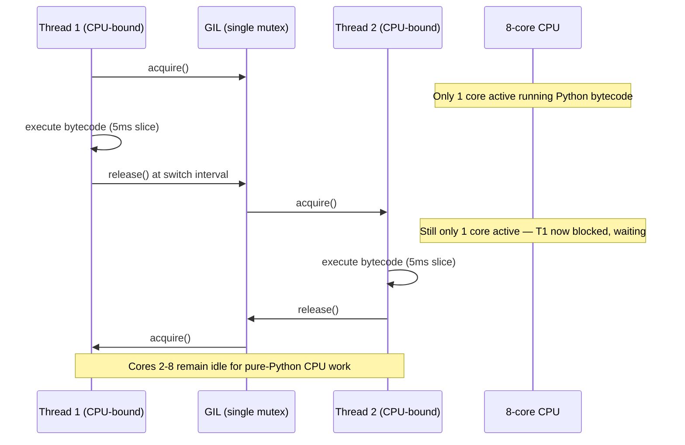

**Decision implications.** The GIL is the single most important fact a
Solution Architect must know before choosing a concurrency model for a
Python service (Section 4.5-4.7 formalizes the decision tree). If a
workload is CPU-bound — image processing, numeric computation in pure
Python, JavaScript Object Notation (JSON) parsing of huge payloads,
cryptographic hashing in pure Python — adding `threading.Thread`s will not
add throughput; it can even *reduce* throughput slightly due to GIL
contention and context-switch overhead. If a workload is I/O-bound —
waiting on database queries, HyperText Transfer Protocol (HTTP) calls to
other services, disk reads — threads (or, more idiomatically today,
`asyncio`) provide real concurrency because the GIL is released during the
wait. This single distinction is why "just use more threads" is
architecturally wrong advice for roughly half of the workloads a Python
service will encounter, and why horizontal, process-based scaling
(Section 12) is the standard answer for CPU-bound Python workloads instead.

**Common failure mode.** Teams observe a multithreaded Python service not
scaling with added cores under load, conclude "Python threading is broken,"
and either abandon threading entirely (over-correcting into unnecessary
multiprocessing complexity even for I/O-bound work) or add more threads
hoping the problem resolves (it doesn't, for CPU-bound work, and GIL
contention can make things slightly worse). The correct diagnosis requires
first classifying the workload as CPU-bound or I/O-bound — a step teams
frequently skip because it requires attention to the GIL rather than an
assumption that "Python threads = normal OS threads = normal parallel
speedup."

**Concrete scenario.** A team builds a Python service that resizes
uploaded images (CPU-bound: pixel manipulation) using a `ThreadPoolExecutor`
with 16 workers, expecting near-linear throughput scaling on a 16-core box.
Load testing shows throughput barely improves over a single-threaded
baseline, and CPU utilization graphs show only ~110% total CPU usage (just
over one core) despite 16 threads running. The fix is not "add more
threads" — it is to switch to `ProcessPoolExecutor` (Section 4.6), which
sidesteps the GIL entirely by using separate OS processes, each with its
own interpreter and its own GIL, achieving genuine multi-core parallelism
at the cost of Inter-Process Communication (IPC) overhead for passing
image data between processes.

**Free-threading (PEP 703, CPython 3.13+).** Starting with CPython 3.13,
an official *free-threaded* build variant (`python3.13t`) exists in which
the GIL can be fully disabled at compile time. This is architecturally
significant, not merely an optimization: it required CPython's core
developers (led by Sam Gross's original "nogil" fork, adopted via PEP 703
in 2023) to replace reference counting's simple increment/decrement
(Section 4.2) with **biased reference counting** (a scheme optimized for
the common case where an object is only ever touched by the thread that
created it, falling back to atomic operations for genuinely shared
objects) and to add per-object locks or lock-free structures to
previously GIL-protected internals like dictionaries. As of the free-
threading build's initial 3.13/3.14 releases, it remains explicitly
labeled experimental: C extensions must be rebuilt against the
free-threaded ABI (Application Binary Interface) to be compatible (many
widely used C-extension-heavy packages, including large parts of the
NumPy/SciPy/pandas ecosystem, needed real engineering work to become
free-threading-safe), and single-threaded performance in the free-threaded
build is measurably slower than the standard GIL build due to the added
locking overhead on every reference count operation. The architectural
takeaway for a Solution Architect **today** (2026) is: free-threading is a
real, shipping capability worth prototyping for genuinely CPU-bound,
pure-Python-heavy, multi-core-parallel workloads, but it is not yet the
default production build, and any decision to adopt it must audit every C
extension dependency for free-threading compatibility first — the standard
GIL-enabled build remains the correct default assumption for production
architecture decisions as of this writing, with process-based scaling
(Section 12) as the proven fallback.

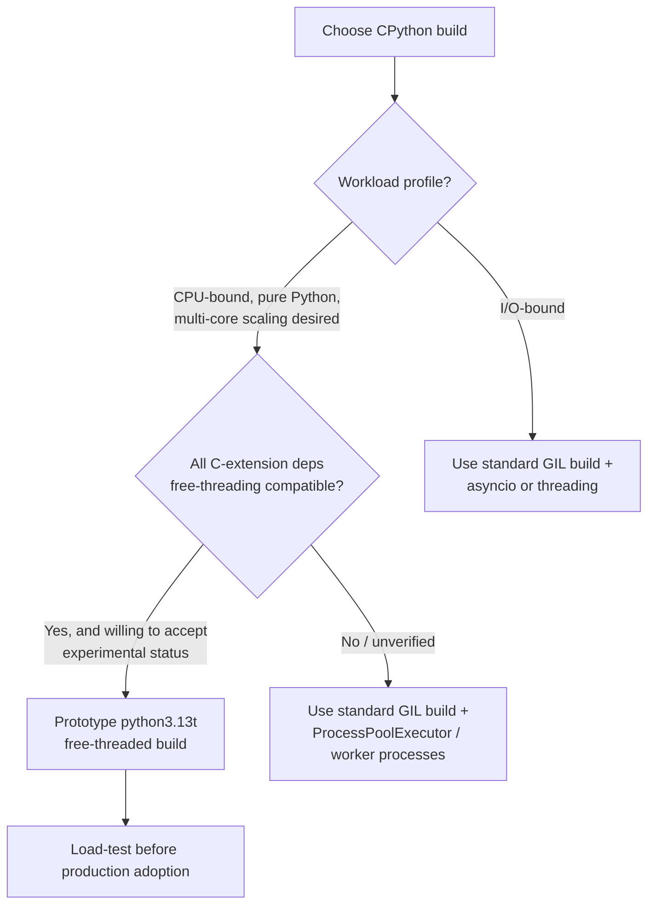

### 4.2 Reference Counting and Cyclic Garbage Collection

**Definition.** Every Python object carries an internal reference count — an
integer tracking how many references (variables, container entries, other
objects' attributes) currently point to it. CPython's primary memory
reclamation mechanism is reference counting: when an object's reference
count reaches zero, CPython deallocates it immediately, synchronously, at
the exact point the last reference disappears. A **secondary**, separate
mechanism — the cyclic garbage collector (`gc` module) — periodically scans
for and reclaims groups of objects that reference each other in a cycle
(so their individual reference counts never reach zero on their own) but
are otherwise unreachable from the running program.

**Mechanism.** Reference counting is implemented as `Py_INCREF`/`Py_DECREF`
macro calls the interpreter inserts around essentially every operation that
creates or destroys a reference: variable assignment, function calls,
appending to a list, and so on. This is why reference counting has a real,
constant per-operation cost baked into ordinary Python execution — it is
not free, even though it is invisible to the programmer. Reference counting
alone cannot reclaim a reference cycle (object A holds a reference to
object B, and B holds a reference back to A; even if nothing else in the
program references either, each still has a reference count of at least 1
from the other). CPython's generational cyclic collector (three
generations: 0, 1, 2, based on the empirical observation that most objects
die young — the "generational hypothesis") periodically walks the object
graph, temporarily zeroes out reference counts contributed by intra-group
references, and reclaims anything left at zero, which by construction must
be an unreachable cycle.

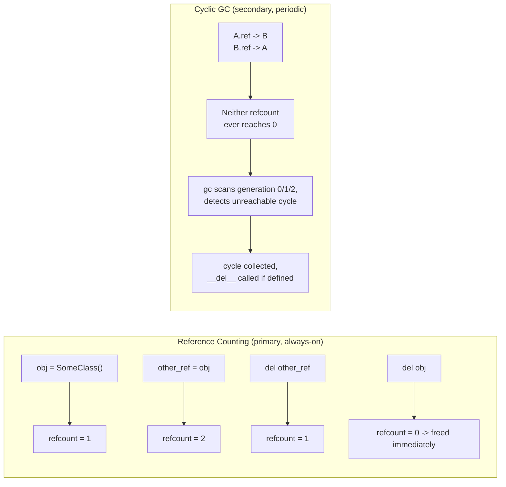

**Decision implications.** Reference counting gives Python **deterministic,
low-latency** deallocation for the vast majority of objects — this is why
Python does not have the unpredictable "stop-the-world" garbage collection
pauses that plague naive tracing-collector-only runtimes under memory
pressure, and why `with open(...)` context managers reliably close file
handles the instant the `with` block exits (the file object's reference
count drops to zero, triggering its `__del__`/`close()` immediately) rather
than "eventually, whenever the collector runs." This matters architecturally
for anything holding scarce resources (file handles, database connections,
sockets) — Python's deterministic destructor timing (via `__del__` or,
better, explicit context managers) is a genuine advantage over
purely-tracing-GC languages for resource-lifetime management, without
needing Java's `try-with-resources` ceremony or a finalizer queue. The
cyclic collector, by contrast, *does* introduce a periodic, tunable pause
(configurable via `gc.set_threshold()` and disable-able via `gc.disable()`
for latency-sensitive request paths that pre-allocate and never form
cycles), and services with strict tail-latency Service Level Objectives
(SLOs) sometimes disable automatic cyclic collection and instead trigger it
manually between request batches or during idle periods.

**Common failure mode.** Reference cycles combined with a defined `__del__`
method used to be genuinely uncollectable prior to Python 3.4 (PEP 442
fixed this) — a subtle historical trap that still surfaces in migration
audits of very old codebases. The more common modern failure mode is a
**reference leak masquerading as a memory leak**: a module-level cache, a
signal/observer registry, or a closure that captures `self` and gets stored
somewhere long-lived (a global event bus, a decorator-generated registry)
keeps accumulating strong references that never drop to zero, so memory
grows unboundedly even though every individual object would otherwise be
collectible — reference counting faithfully keeps every such object alive
because, from its perspective, they genuinely are still reachable.

**Concrete scenario.** A Flask (WSGI) service registers a per-request
logging callback into a module-level list for "flexibility," intending to
pop it at the end of each request, but an early-return code path added
later skips the pop. Under sustained traffic, the module-level list grows
by one closure (each holding a reference to that request's full context
object) per request indefinitely. Reference counting cannot reclaim any of
it — every object is genuinely still reachable from a live global list — so
the service's memory grows monotonically until an out-of-memory kill,
and a memory profiler (`tracemalloc`, `objgraph`) is needed to find the
accumulating list, because this is not a garbage-collection bug at all; it
is an ordinary reachability leak that reference counting is (correctly)
respecting.

### 4.3 Bytecode Compilation and the CPython Evaluation Loop

**Definition.** CPython never executes Python source text directly. Source
is first parsed into an Abstract Syntax Tree (AST), then compiled into
**bytecode** — a compact, stack-machine instruction set specific to CPython
(opcodes like `LOAD_FAST`, `BINARY_ADD`, `CALL`) — which is cached on disk
as `.pyc` files under `__pycache__/` and executed by the **evaluation
loop** (`ceval.c`'s `_PyEval_EvalFrameDefault`), a large C `switch`
statement (in older CPython versions; 3.11+ uses a more optimized,
"computed goto"/direct-threaded dispatch on supporting compilers) that
interprets one bytecode instruction at a time.

**Mechanism.** Each Python function call creates a **frame object** holding
the local variable array, the current bytecode instruction pointer, and a
reference to the enclosing frame (this is what a traceback walks when an
exception propagates). The evaluation loop fetches the instruction at the
frame's instruction pointer, dispatches to the C code implementing that
opcode (e.g., `BINARY_ADD` pops two values off the frame's value stack,
calls the appropriate `__add__`/`__radd__` dance, and pushes the result),
advances the instruction pointer, and repeats. Since Python 3.11
(PEP 659, the "specializing adaptive interpreter"), the evaluator observes
an operation's actual runtime types the first few times it executes and
rewrites ("specializes") that bytecode instruction in place to a faster,
type-specific variant (e.g., a generic `BINARY_ADD` that has only ever seen
two `int`s gets rewritten to a specialized integer-add opcode that skips
the general dispatch machinery) — falling back to the generic path
automatically if a different type shows up later, a technique borrowed
from the inline-caching strategies long used by JavaScript Virtual
Machines (VMs) like V8.

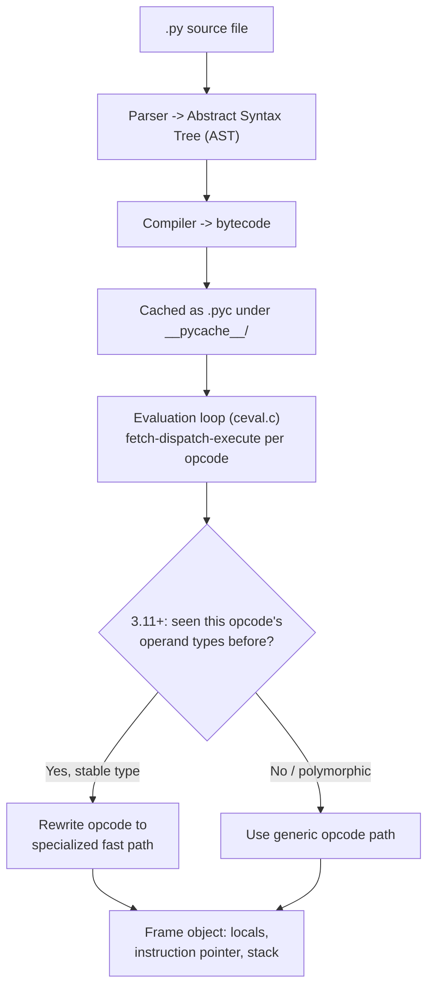

**Decision implications.** Understanding that Python bytecode is
*interpreted*, not compiled to native machine code (unlike PyPy's
Just-In-Time (JIT) approach, Section 4.12), sets correct performance
expectations: pure-Python tight loops carry real per-iteration interpreter
overhead that no amount of algorithmic cleverness inside pure Python
removes, which is precisely why performance-critical numeric code is
written in, or delegated to, C extensions (NumPy, pandas' underlying
C/Cython layers) rather than optimized as pure-Python loops — an
architectural boundary this chapter returns to in Section 4.12 (the C
API). The `.pyc` bytecode cache is also an operational detail architects
should know: it means CPython does not need to re-parse and re-compile
unchanged source on every process start, and deployment tooling that
copies a `__pycache__` mismatched against the actual `.py` source (or runs
with different interpreter versions/optimization flags across a cluster,
since `.pyc` files embed a magic number tied to the exact bytecode
format) can produce confusing "works locally, fails in prod" bytecode
mismatches — CPython detects and silently recompiles on a mismatch, but
mixed-version deployment artifacts are a real, avoidable source of subtle
drift.

**Common failure mode.** Engineers coming from statically compiled languages
sometimes assume Python "compiles once" the same way a Java Archive (JAR)
or a Go binary does, and are surprised that shipping `.pyc` files alone
(without the interpreter and any needed C extensions matching the exact
target platform/Application Binary Interface (ABI)) is not a portable
deployment artifact — bytecode is CPython-version-specific and
platform-independent only in the sense that the *bytecode itself* has no
machine-code dependency, but any compiled C-extension dependencies
(`.so`/`.pyd` files) absolutely are platform- and Application Binary
Interface (ABI)-specific, which is exactly the problem wheels (Section 9.2)
exist to solve.

**Concrete scenario.** A team ships a Docker image built with Python 3.11
containing pre-generated `__pycache__` bytecode as a "startup optimization,"
then later rebuilds the base image with Python 3.12 without regenerating
that cache. CPython correctly detects the bytecode magic-number mismatch
and silently falls back to recompiling from source at every process
start — a wasted-effort caching layer rather than an actual bug, but one
that quietly erased the intended startup-time optimization until someone
diffed cold-start latency and found the recompilation happening on every
container start.

### 4.4 Memory Layout: Object Model, Small-Object Allocator (`pymalloc`), and Interning

**Definition.** Every Python value, including integers and booleans, is a
full heap-allocated **PyObject** — a C struct beginning with a reference
count and a type pointer, with the actual data (an integer's digits, a
string's characters, a list's item pointers) following. CPython's
small-object allocator, `pymalloc`, manages sub-512-byte allocations (the
overwhelming majority of Python object allocations) using its own
pool/arena scheme layered on top of the platform's `malloc`, specifically
to avoid `malloc`'s per-call overhead for the huge volume of small,
short-lived allocations typical Python code generates. **Interning** is a
targeted optimization where CPython caches and reuses a single object for
certain common, immutable values — small integers (−5 to 256, cached at
interpreter startup) and many string literals that look like identifiers —
so that `a = 5; b = 5; a is b` evaluates `True` not because of value
equality but because both names are bound to the literal same cached
object.

**Mechanism.** `pymalloc` divides memory into 256KB **arenas**, each
subdivided into 4KB **pools**, each pool dedicated to a single fixed
allocation-size class (8, 16, 24 ... up to 512 bytes) once in use — this is
a classic size-class allocator design, and it dramatically reduces both
allocation latency and fragmentation for CPython's actual workload shape
(enormous numbers of small, short-lived container/integer/string objects)
compared to calling the general-purpose system allocator per object.
Interning of small integers means `id(5)` returns the same value everywhere
in a single process for the lifetime of that process, and interning of
identifier-shaped string literals (Cyclic Redundancy Check (CRC)-style
name mangling isn't involved here — it's a straightforward string-content
check at compile time) is why comparing short, identifier-like strings with
`is` sometimes "accidentally works" even though `is` is not a substitute for
`==` and should never be used for correctness-dependent string comparison.

**Decision implications.** This layer matters architecturally in two
specific, recurring situations: (1) profiling memory usage of a
Python service and being confused why `sys.getsizeof()` numbers don't add
up to observed process Resident Set Size (RSS) — `pymalloc`'s
arena/pool bookkeeping and fragmentation account for real overhead beyond
the sum of individual object sizes, and arenas are not always returned to
the operating system even after their objects are freed (a long-lived
process that briefly held a huge number of small objects can retain that
memory as unused-but-reserved arena capacity, a known and sometimes
surprising source of "memory doesn't shrink back down" behavior); and (2)
understanding why relying on `is` for value comparison of anything other
than `None`/`True`/`False`/enum sentinels is a latent correctness bug —
interning is an implementation detail, not a language guarantee, and
CPython does not promise to intern strings/integers outside the documented
small-integer cache, so code that "happens to work" due to interning can
silently break on a different CPython build, version, or even a different
code path within the same version.

**Common failure mode.** Comparing user-supplied or dynamically constructed
strings with `is` instead of `==` "because it worked in testing" — it
worked because short literal strings used directly in source code are
often interned, but a string built via concatenation, `.format()`, an
f-string, or read from external input is a distinct object with equal
*value* but not identity, and `is` will silently return `False` for what
the programmer believes are "the same string."

**Concrete scenario.** A caching layer that keys a dictionary by
`if cached_key is incoming_key:` instead of `==` works fine in local testing
(where both keys often happen to be identical interned literals) and fails
intermittently in production once the incoming key arrives from a
network-deserialized payload as a freshly allocated string object with
equal content but different identity — a bug that is genuinely confusing to
debug precisely because it "sometimes" works, since interning is not
universal or reliable.

### 4.5 Threads, the OS, and the GIL's I/O-Bound Sweet Spot

**Definition.** `threading.Thread` in CPython maps directly to a native
operating-system thread (a `pthread` on Linux/macOS, a Windows thread) —
Python threading is not a userspace "green thread" abstraction by default.
Recap: as established in Section 4.1, the GIL means only one such thread
executes Python bytecode at a time, but any thread that is blocked in a
C-level system call (socket read/write, file I/O, `time.sleep()`) has
released the GIL for that duration, letting another thread run.

**Mechanism.** When a thread calls a blocking I/O function implemented in
CPython's C layer (e.g., `socket.recv()`), the C implementation explicitly
releases the GIL before making the underlying blocking system call and
reacquires it after the call returns. This is why a thread pool handling,
say, 200 concurrent slow database queries achieves real concurrency: at
any instant, up to 199 threads can be legitimately blocked in the
kernel's I/O wait state (consuming no GIL, no CPU) while the 200th holds
the GIL doing the small amount of actual Python bytecode work (building
the query, parsing the result) around each I/O call.

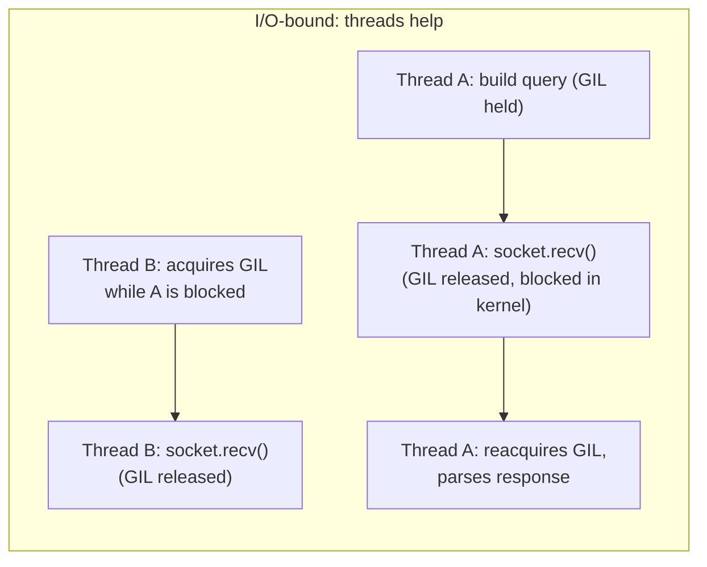

**Decision implications.** Threads remain architecturally correct for
I/O-bound concurrency, especially when integrating with blocking
third-party libraries that have no `asyncio`-native equivalent, or when a
codebase's existing structure is synchronous and a full `asyncio` rewrite
is not justified. Threads also carry real costs a decision must account
for: each OS thread reserves stack memory (typically megabytes of virtual
address space by default, though only a fraction is resident), context
switching between threads has real kernel overhead at high thread counts,
and shared mutable state across threads still requires explicit locking
(`threading.Lock`) for anything beyond what the GIL happens to make
atomic (and relying on "the GIL makes it atomic" for correctness is
fragile — it is an implementation detail, not a documented contract, and
free-threaded builds, Section 4.1, remove this incidental protection
entirely).

**Common failure mode.** Assuming GIL-protected atomicity is a substitute
for explicit locking — e.g., `counter += 1` from multiple threads is
**not** guaranteed atomic (it is a load, add, store sequence of multiple
bytecode operations, and the GIL can be released between any of them at
the interpreter's discretion), a classic race condition that "usually"
doesn't manifest under light load and manifests as silently dropped
increments under real concurrency.

**Concrete scenario.** A metrics-collection library increments a shared
`request_count` dictionary value from multiple worker threads without a
lock, reasoning "Python has the GIL, so this is thread-safe." Under
production load, the metric under-counts by a measurable percentage
compared to a separately verified log-based count, because `dict[key] += 1`
compiles to multiple bytecode operations (`LOAD`, `BINARY_ADD`, `STORE`)
and the GIL can switch threads between them, causing lost updates when two
threads interleave on the same key.

### 4.6 Multiprocessing: Sidestepping the GIL via Separate Interpreters

**Definition.** The `multiprocessing` module (and its higher-level
`concurrent.futures.ProcessPoolExecutor` wrapper) achieves genuine
multi-core parallelism for CPU-bound Python code by spawning **separate
operating-system processes**, each running its own independent CPython
interpreter with its own GIL, its own heap, and no shared memory by
default.

**Mechanism.** Because worker processes do not share memory, arguments and
return values must be **serialized** (by default, via `pickle`) to cross
the process boundary — sent through an OS pipe or a shared-memory-backed
queue and deserialized on the receiving side. On POSIX systems, the default
start method is historically `fork` (the child process is a
copy-on-write duplicate of the parent, inheriting its memory state without
re-running import/initialization code — fast, but unsafe if the parent
held open threads, locks, or file descriptors at fork time, a well-known
source of deadlocks); on Windows, and increasingly by explicit
configuration on POSIX too (Python 3.14 changes the *default* start method
away from `fork` for exactly this safety reason), the `spawn` method
starts a genuinely fresh Python interpreter process that re-imports the
target module from scratch — slower to start, but free of the
fork-after-threading hazard class.

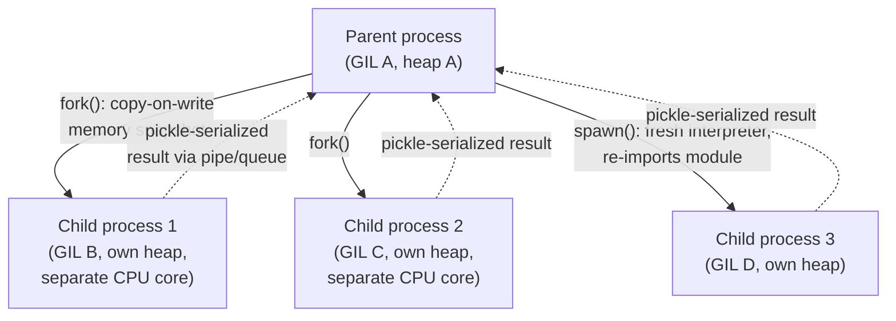

**Decision implications.** `ProcessPoolExecutor` is the standard,
architecturally correct answer for CPU-bound parallelism in a GIL-enabled
CPython build (image/video processing, numeric simulation not already
delegated to a C-extension library, parsing large CPU-heavy payloads).
The trade-off is real: process startup is far more expensive than thread
startup (tens of milliseconds versus microseconds), inter-process data
transfer costs real serialization time and memory copying (making
`multiprocessing` a poor fit for workloads that need to pass large
in/out payloads per task relative to the compute time per task), and
debugging across process boundaries loses the shared-stack convenience of
threads (a traceback in a worker process must be explicitly propagated
back, not simply raised in the caller's frame). `multiprocessing.shared_
memory` and memory-mapped arrays (common in NumPy-heavy pipelines) exist
specifically to reduce the serialization cost for large numeric payloads
by sharing an actual memory segment across processes instead of copying
data through pickling.

**Common failure mode.** Choosing `multiprocessing` for a workload whose
actual per-task compute time is smaller than its serialization/IPC
overhead — the parallelism gained is smaller than the overhead added, and
throughput can be *worse* than a single process, especially for many
small, fast tasks rather than fewer large ones.

**Concrete scenario.** A team parallelizes a per-row data-validation
function over a `ProcessPoolExecutor` with one task per row for a
million-row dataset, expecting an 8x speedup on 8 cores. Because each
validation task's actual computation is a few microseconds but each
task's pickling/dispatch/collection overhead is on the order of a
millisecond, the parallel version runs *slower* than the single-process
version. The architecturally correct fix is chunking — dispatching, say,
10,000 rows per task instead of 1 row per task — so the fixed IPC overhead
is amortized over enough real work per task to be worthwhile.

### 4.7 asyncio: the Single-Threaded Event Loop Model

**Definition.** `asyncio` is Python's standard-library implementation of
**cooperative, single-threaded concurrency**: a single event loop runs on
one OS thread, managing many concurrent logical tasks (coroutines) by
switching between them at explicit `await` suspension points, rather than
via OS-level preemption. Recap: the general concept of an event-driven
reactor/event loop is a well-established pattern outside Python too (e.g.,
Node.js's `libuv` event loop) — this section's contribution is CPython's
specific implementation via coroutine objects, the `async`/`await`
syntax, and the standard-library `asyncio` scheduler.

**Mechanism.** A function defined with `async def` returns a **coroutine
object** when called, rather than executing immediately — the coroutine
only actually runs when scheduled onto the event loop (via `await`,
`asyncio.create_task()`, or `asyncio.run()`). At each `await` point inside
a coroutine, control returns to the event loop, which selects the next
ready task to resume — commonly a task whose awaited I/O operation (a
socket becoming readable, a timer elapsing) has just become ready,
determined via the OS's I/O readiness multiplexing mechanism (`epoll` on
Linux, `kqueue` on macOS/BSD, IOCP on Windows) that the event loop polls
underneath the abstraction. Because only one coroutine's code ever runs at
a genuinely given instant on that one thread, there is **no GIL contention
between coroutines at all** — the entire concurrency model operates within
a single GIL-holding thread, cooperatively yielding at `await` points
rather than being preempted mid-instruction the way OS threads are.

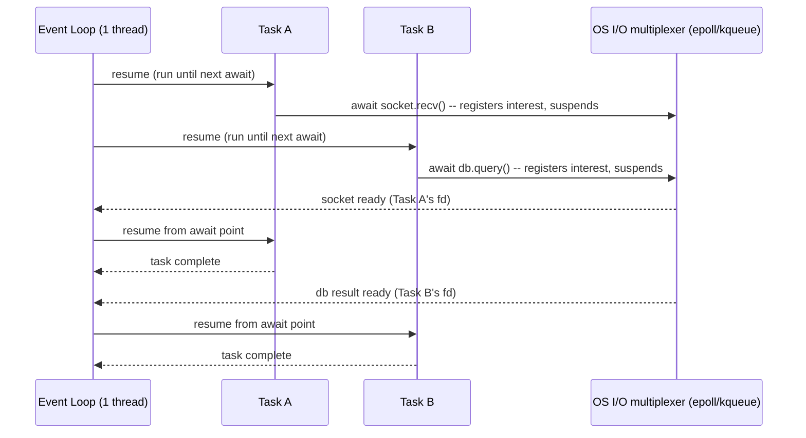

**Decision implications.** `asyncio` achieves extremely high I/O
concurrency (tens of thousands of concurrent connections is routine) with
far lower per-connection overhead than one-OS-thread-per-connection
threading, because a suspended coroutine costs only a small Python object,
not a full OS thread stack — this is precisely the concurrency model ASGI
(Section 8) and FastAPI (Section 4.11) are built around, and why they are
the standard choice for high-concurrency I/O-bound APIs today. The
non-obvious cost is **cooperative scheduling's single hard rule**: any
piece of code that blocks the thread *without* yielding via `await` (a
synchronous, CPU-heavy computation, or worse, a call to a blocking,
non-async-aware library like `requests` or a synchronous database driver)
stalls the **entire event loop** — every other concurrently "running"
coroutine on that loop is frozen for the duration, because there is only
one thread and it is not preemptible by `asyncio` itself. This is a fully
different failure mode from thread starvation and a common source of
mysterious latency spikes in otherwise-correct `asyncio` code.

**Common failure mode.** Calling a synchronous, blocking library function
(a non-async database driver, `time.sleep()` instead of
`asyncio.sleep()`, a CPU-heavy JSON-encoding call) directly inside an
`async def` coroutine — it "works" in the sense that the code runs and
returns a correct result, but it blocks the entire event loop for its
duration, silently stalling every other concurrent request the process was
handling, which is a far worse failure mode under load than an equivalent
mistake in a threaded model would be, precisely because *one* misbehaving
coroutine can degrade *every* concurrent request on that event loop, not
just its own.

**Concrete scenario.** A FastAPI endpoint calls a legacy, synchronous
image-resizing function directly inside an `async def` handler "because it
was quick to wire up." Under low load, response times look fine (only one
request at a time is actually being handled). Under real concurrent load,
p99 latency for *every* endpoint on that process spikes, because each
call to the blocking resize function freezes the single event-loop thread
for its full duration, queuing every other concurrent request behind it —
diagnosed by observing that latency degradation is process-wide and load-
correlated, not endpoint-specific, which is the signature of an
event-loop-blocking bug. The fix is to run the blocking call in a thread
pool via `await loop.run_in_executor(None, blocking_fn, ...)`, releasing
the event loop while the blocking work happens off-thread.

### 4.8 Gradual Typing: Type Hints, `mypy`/`pyright`, and Runtime Semantics

**Definition.** Python's **gradual typing** system (PEP 484 and its many
successors) lets developers annotate variables, function parameters, and
return values with type information (`def total(items: list[Order]) ->
Decimal:`) that is **entirely optional, unenforced at runtime by default,
and ignored by the interpreter's actual execution** — CPython does not
raise an error if a call violates a type hint; type hints exist purely for
external static-analysis tools (`mypy`, `pyright`, `pyre`) and Integrated
Development Environment (IDE) tooling to catch type errors *before*
runtime.

**Mechanism.** Type hints are stored as ordinary Python objects (accessible
via `__annotations__` and, since PEP 563/649's evolution, either eagerly
or lazily evaluated) but carry **zero runtime enforcement** unless a
library explicitly chooses to inspect and validate them (which is exactly
what Pydantic — the validation library underlying FastAPI's request
parsing, Section 4.11 — and dataclass-adjacent libraries do: they read
`__annotations__` at class-definition or call time and perform their own
explicit validation, layering *opt-in* runtime enforcement on top of a
system that is otherwise purely a static-analysis contract). A static
type checker (`mypy`, or Microsoft's `pyright`/its `pylance` IDE
integration) performs a separate, offline analysis pass over the source,
building its own type-inference model of the code and flagging any call
site, assignment, or return value whose inferred type is incompatible with
its declared or inferred annotation — entirely independent of whether the
program is ever actually run.

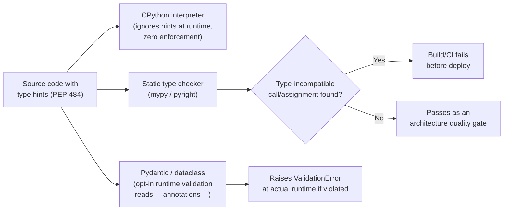

**Decision implications.** Because type hints carry no runtime cost or
enforcement by default, adopting them is a near-zero-risk, incrementally
adoptable architecture-quality investment — a codebase can add hints
module by module without any behavior change, and a Solution Architect
should treat a mandatory `mypy`/`pyright` check in Continuous
Integration (CI) as a legitimate **architecture fitness function** (see
[Architecture Thinking § Architecture Fitness Functions](../01_Architecture_Mindset/CH03_Architecture_Thinking.md))
gating merges the same way a linter or a test-coverage threshold does,
catching an entire class of interface-contract violations (wrong argument
types, `None` passed where a concrete type is expected, mismatched return
types across a refactor) before they reach runtime, at effectively zero
runtime performance cost since the checking happens entirely at build/CI
time, not in the deployed process. The explicit trade-off against a fully
statically typed language (Java, Rust) is that Python's gradual typing is
*advisory* by default: nothing prevents a caller from ignoring a type
error and running the code anyway, and a codebase with inconsistent or
missing hints degrades the checker's guarantees to "as strong as its
weakest annotated module" — architects adopting typing at scale typically
phase enforcement in via `mypy --strict` on new/updated modules while
allowing a legacy `mypy.ini`/`pyproject.toml` per-module exclusion list to
avoid blocking on a full-codebase retrofit.

**Common failure mode.** Treating type hints as if they were runtime
guarantees — writing `def process(order: Order) -> None:` and assuming an
`Order` instance is genuinely guaranteed at that point in production,
when in fact any caller (including one from a dynamically typed, un-type-
checked part of the codebase, or a deserialization boundary that hasn't
gone through Pydantic-style validation) can pass anything at all, and the
function will happily execute until it hits an `AttributeError` deep
inside, because CPython performed zero validation at the call boundary.

**Concrete scenario.** A service passes a raw dictionary (freshly
deserialized from an incoming HyperText Transfer Protocol (HTTP) request
body) directly into an internal function typed as accepting an `Order`
dataclass, on the (false) assumption that the type hint itself performs
validation. The function runs correctly for well-formed requests and
throws an unhandled `AttributeError` in production the first time a caller
sends a malformed payload — the type hint documented the *intended*
contract clearly, which helped the on-call engineer diagnose the bug
quickly, but it never enforced that contract, because enforcement requires
an explicit runtime validation layer (Pydantic's `model_validate()`, or
an equivalent) at the actual trust boundary, not just a hint on the
downstream function signature.

### 4.9 Virtual Environments: Interpreter and Dependency Isolation

**Definition.** A Python **virtual environment** (`venv`, the standard-
library tool, or its predecessors `virtualenv`) is an isolated directory
containing its own `site-packages` directory (where third-party packages
are installed) and a symlink or copy of the Python interpreter binary,
such that packages installed "into" that environment are invisible to any
other environment or to the system-wide Python installation, and vice
versa.

**Mechanism.** When a virtual environment is activated (or, more robustly
and portably, invoked directly via its own interpreter path,
`./venv/bin/python`), Python's import system resolves `sys.path` to
prioritize that environment's `site-packages` over the system
installation's, so `import requests` resolves to the version installed in
*that* environment specifically. This solves what is historically called
**dependency hell**: without isolation, every Python project on a machine
would share one global `site-packages`, and two projects requiring
different, incompatible versions of the same package could not coexist
on the same machine at all.

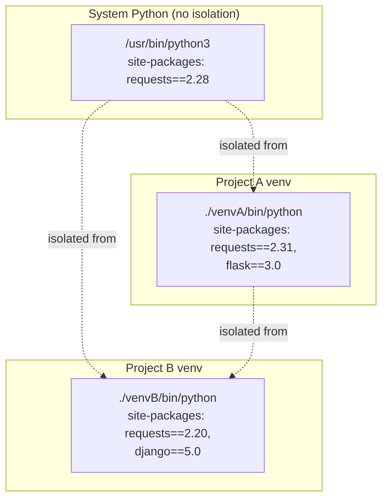

**Decision implications.** Every production Python deployment should treat
"one isolated environment per deployable artifact" as a non-negotiable
baseline — mixing dependencies into a shared system Python (or, worse,
`pip install`-ing directly into a system-managed interpreter that the
operating system itself depends on for its own tooling, which several
Linux distributions now actively guard against via PEP 668's
"externally-managed-environment" marker) is an anti-pattern this chapter
flags explicitly in Section 19. In a containerized deployment
(Section 12), the isolation virtual environments provide is *partially*
redundant with the container image's own isolation boundary — a single-
purpose container image only ever runs one application, so some teams
`pip install` directly into the container's system Python without a
separate `venv` layer, accepting that the container boundary itself is
the isolation mechanism. This is a legitimate simplification specifically
*because* the container already guarantees no other application shares
that filesystem — but it is not a substitute for isolation when running
multiple Python applications on a single shared host or Virtual Machine
(VM), where virtual environments remain required.

**Common failure mode.** Installing packages into the system-wide Python
without any isolation "just to try something quickly," which then silently
becomes a hidden production dependency that no lock file records — a
classic "works on my machine" trap when a colleague or CI runner, with a
clean environment, cannot reproduce the behavior because the dependency
was never actually declared anywhere.

**Concrete scenario.** A developer debugging a production issue locally
runs `pip install some-debug-helper` directly against their globally
active Python instead of inside the project's virtual environment. Months
later, a refactor accidentally imports that helper library in a code path
that ships to production; it works in the original developer's local
testing (because it's still globally installed on their machine) and
fails immediately in CI and in every other environment, because it was
never added to the project's actual dependency declaration.

### 4.10 Packaging Artifacts: Source Distributions, Wheels, and the Build Backend

**Definition.** A Python package can be distributed as a **source
distribution** (`sdist`, a `.tar.gz` containing source code and build
instructions, requiring a build step on the installing machine) or as a
**wheel** (`.whl`, PEP 427, a pre-built, zip-format binary distribution
that `pip` can install by simply unpacking — no build step, no compiler
required on the installing machine).

**Mechanism.** A wheel filename encodes exactly which environment it is
compatible with, e.g.
`numpy-1.26.4-cp311-cp311-manylinux_2_17_x86_64.whl` — Python implementation
and version tag (`cp311` = CPython 3.11), ABI tag, and platform tag
(`manylinux_2_17_x86_64` = a Linux distribution compatible with glibc 2.17+
on x86-64, per the `manylinux` Portable Executable and Linkable Format
(ELF) compatibility standard the Python Packaging Authority (PyPA)
maintains specifically so binary wheels built on one Linux distribution
reliably run on others). When `pip install numpy` runs, `pip` inspects the
installing machine's exact Python version/implementation/platform, and
downloads the one wheel from the Python Package Index (PyPI) that matches
— if no matching pre-built wheel exists, `pip` falls back to downloading
the `sdist` and building from source locally (requiring a C compiler and
any native build dependencies to be present, a common source of
"pip install failed with a compiler error" incidents on minimal container
base images). Both formats are ultimately built by a **build backend**
(`setuptools`, `hatchling`, `flit-core`, `poetry-core`) invoked through the
standardized PEP 517/518 interface, decoupling `pip`/`build` (the frontend)
from whichever backend a given project chooses in its `pyproject.toml`
`[build-system]` table — a deliberate architectural decoupling that ended
the earlier era where `setuptools`' `setup.py` was the only supported
build mechanism and every alternative had to imitate its exact
command-line interface.

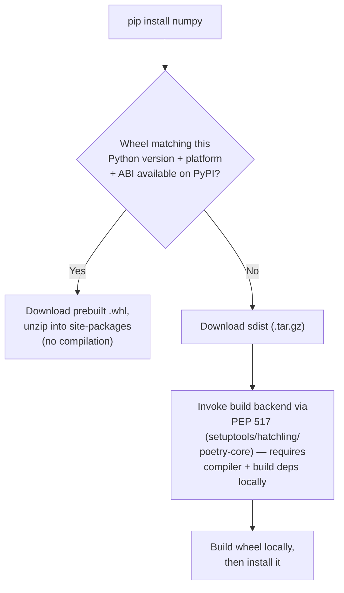

**Decision implications.** Preferring packages that ship pre-built wheels
for your target platform (rather than only an `sdist`) is a real
deployment-speed and reliability decision — a wheel-only install is
fast and has no local compiler dependency, while a from-source build adds
minutes to a deploy pipeline and introduces a whole class of "the CI
runner's base image is missing `gcc`/`libpq-dev`/etc." failures. This is
precisely why production container base images for Python (Section 12)
either use a full build-tool-equipped image for the build stage of a
multi-stage Dockerfile, or, increasingly, standardize on `manylinux`-
compatible slim base images that match the widest set of pre-built wheels
available on PyPI, to minimize from-source builds entirely.

**Common failure mode.** Building a Docker image `FROM python:3.12-slim`
(a genuinely minimal image lacking a C compiler and common native
libraries) and being surprised when `pip install <package-with-no-
prebuilt-wheel-for-this-platform>` fails with a compiler-not-found error —
the fix is either adding the required build toolchain to the image (larger
image, longer build) or, better, verifying the dependency actually ships a
compatible wheel before committing to a minimal base image.

**Concrete scenario.** A team's Continuous Integration and Continuous
Deployment (CI/CD) pipeline builds a container image on an x86-64 runner
and deploys it to Amazon Web Services (AWS) Graviton (ARM64) instances for
cost savings, and a dependency with no ARM64 wheel on PyPI suddenly
requires a from-source compile at image-build time — silently working
(with a slow build) if the build stage has a compiler installed, and
failing outright if it does not, a class of platform-mismatch bug that
only surfaces when the build and deployment target architectures diverge.

### 4.11 Dependency Resolution: pip, Poetry, and uv

**Definition.** **Dependency resolution** is the process of taking a
project's direct dependency declarations (each potentially specifying an
acceptable version range) and computing a single, mutually compatible set
of exact versions for every direct *and transitive* dependency — solving
what is, in the general case, an NP-hard constraint-satisfaction problem
when dependencies' version ranges conflict.

**Mechanism.** Historically, `pip`'s resolver (prior to its 2020 "new
resolver" rewrite) used a simple, non-backtracking, first-match algorithm
that could install a mutually incompatible set of packages without ever
detecting the conflict — a foundational reliability gap that motivated the
entire Poetry/Pipenv generation of tools. Modern `pip` (2020+),
Poetry, and `uv` all implement genuine backtracking resolvers: when a
candidate version choice for one package is later found incompatible with
a constraint introduced by another package, the resolver backtracks and
tries a different candidate version, continuing until either a fully
consistent version set is found or the resolver proves no solution exists
(reporting the specific conflicting constraints, rather than silently
installing something broken). The resolved solution is written to a
**lock file** (`poetry.lock`, `uv.lock`, or `pip`'s less formalized
`requirements.txt` with pinned hashes via `pip-compile`) that records
exact versions (and, for supply-chain integrity, cryptographic hashes) for
every dependency in the graph — the mechanism that makes a build genuinely
**reproducible**: the same lock file installs the identical dependency
tree on any machine, at any later date, regardless of what newer package
versions have since been published.

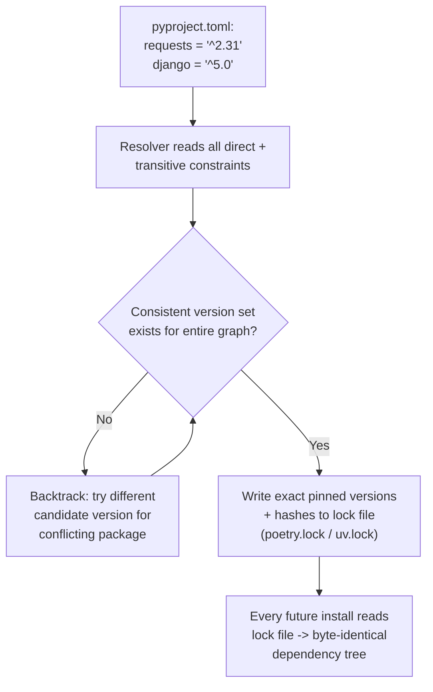

**Decision implications.** A Solution Architect should treat "does this
project have a committed, tool-generated lock file" as a non-negotiable
reproducibility gate for any production Python service — a
`requirements.txt` containing only loose version ranges (`requests>=2.0`)
is not a reproducible build specification; it is a *constraint*
specification that can resolve differently on different days as new
package versions are published, which is precisely the "worked yesterday,
broke today with no code change" failure class lock files exist to
eliminate. `uv` (Astral, 2024) is presently the fastest tool in this
lineage — implemented in Rust, achieving dependency resolution and
installation an order of magnitude faster than pure-Python `pip`/Poetry
for large dependency graphs, and increasingly adopted as a drop-in
`pip`/`venv`/Poetry replacement — but the *architectural property* that
matters (deterministic, hash-pinned, backtracking-resolved lock files) is
shared across `pip-tools`, Poetry, and `uv` equally; tool choice is a
velocity and ergonomics decision layered on top of that shared,
non-negotiable reproducibility requirement.

**Common failure mode.** Committing only a loose `requirements.txt`
(`Flask`, `requests>=2`) without any lock file or pinned hashes, then
experiencing a production incident traced to a transitive dependency's
new major version silently changing behavior on a routine redeploy —
nothing in the deployment pipeline pinned that transitive version, so a
redeploy on a different day resolved a different, incompatible dependency
tree than the one that was actually tested.

**Concrete scenario.** A team's `requirements.txt` pins `django>=4.2` with
no upper bound and no lock file. Django 5.0 is released and immediately
resolved by a routine CI rebuild triggered by an unrelated code change,
introducing a breaking change in Django's Object-Relational Mapping (ORM)
query behavior that was never explicitly tested against. The fix is not
"pin Django exactly forever" (which forgoes security patches) but adopting
a resolver-generated lock file with a deliberate, reviewed upgrade
process, so version changes are an explicit, tested Pull Request (PR)
rather than an incidental side effect of an unrelated rebuild.

### 4.12 Native Extension Boundaries: Cython, PyPy, and the C API

**Definition.** When pure-Python execution speed (Section 4.3's
bytecode-interpretation overhead) is the actual bottleneck, three distinct
architectural escape hatches exist, each drawing the boundary between
"interpreted Python" and "faster execution" in a different place: **Cython**
(a superset of Python that compiles to C, letting a developer add optional
static type declarations to ordinary-looking Python code and compile the
result to a native extension module); **PyPy** (an alternative Python
*implementation* — not a library, but a drop-in replacement for CPython
itself — built around a tracing Just-In-Time (JIT) compiler that observes
hot loops at runtime and compiles them to native machine code
automatically, with no source changes required); and the **C API**
(CPython's public, stable-since-3.x Application Programming Interface
(API) for writing extension modules directly in C or C++, the same
interface CPython's own built-in types and the entire native-extension
ecosystem — NumPy, `lxml`, cryptography libraries — is built on).

**Mechanism.** Cython source (`.pyx` files) is translated to C source code
by the Cython compiler and then compiled by an ordinary C compiler into a
native shared object (`.so`/`.pyd`) that Python imports exactly like any
other module; the performance gain comes specifically from Cython's
optional static type annotations (`cdef int x`), which let the generated C
code skip CPython's normal dynamic-dispatch machinery (type checks,
attribute lookups through the general object protocol) for annotated
variables, at the cost of losing full dynamic-typing flexibility for that
code. PyPy takes the opposite approach: it requires no source changes at
all, because its JIT observes actual bytecode execution at runtime,
identifies "hot" loops (executed many times with stable, predictable
types), and compiles *those specific code paths* to native machine code on
the fly, falling back to interpretation for cold or highly polymorphic
code — the same general strategy modern JavaScript engines use, applied
to Python. The C API is the lowest-level, most manual option: a developer
writes C code that directly manipulates `PyObject` structures (Section
4.4), manages reference counts explicitly (`Py_INCREF`/`Py_DECREF`), and
optionally releases the GIL around a long-running, self-contained
computation (`Py_BEGIN_ALLOW_THREADS`/`Py_END_ALLOW_THREADS`) — exactly the
mechanism that lets NumPy's array operations achieve genuine multi-core
parallelism from ordinary Python threads despite the GIL (Section 4.1),
because the heavy numeric loop runs entirely in C with the GIL released,
only reacquiring it to return the final Python-visible result.

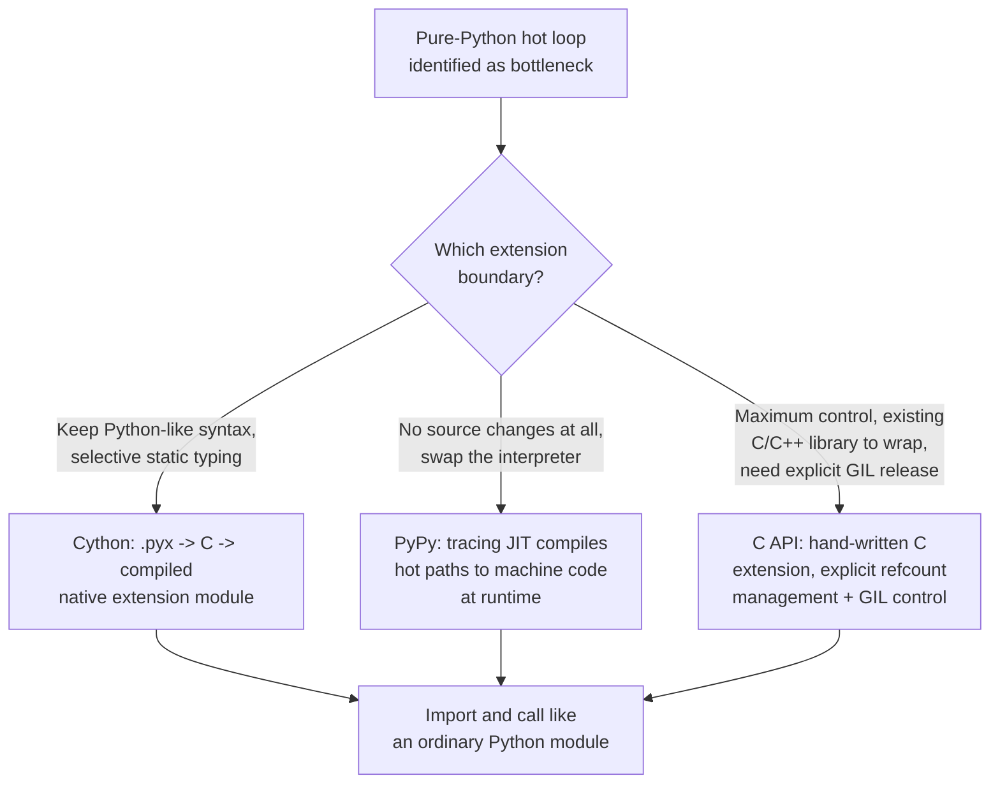

**Decision implications.** These three approaches sit on a genuine
control-versus-effort spectrum a Solution Architect should map explicitly
against a specific hot path rather than choosing by default or fashion:
Cython is the right choice when a specific, identifiable function or inner
loop needs a large, targeted speedup and the team wants to keep the
surrounding code in Python-like syntax with an incremental compilation
step; PyPy is the right choice only when an *entire application* is
CPU-bound in ways a JIT can exploit broadly and, critically, when every C
extension the application depends on has a PyPy-compatible build (PyPy's
C-extension compatibility layer, `cpyext`, has historically been a source
of friction and performance overhead of its own, which is why PyPy has
seen much lower production adoption than CPython despite often
substantial pure-Python speedups — most of the modern Python ecosystem's
heaviest-used packages, including NumPy/pandas/the AI (Artificial
Intelligence) tooling stack, are built against CPython's C API directly,
and PyPy compatibility is not guaranteed); and the C API (or Rust via
`PyO3`, a modern, memory-safer alternative to hand-written C that has seen
rapid adoption for exactly this reason) is the right choice when wrapping
an existing native library, needing genuine GIL-released parallelism from
threads, or building a reusable extension intended for broad ecosystem
consumption the way NumPy is.

**Common failure mode.** Adopting PyPy for an application whose actual
performance-critical path already depends heavily on C-extension-based
libraries (NumPy, pandas, database drivers with C bindings) and finding
little or no overall speedup — because PyPy's JIT advantage applies to
*pure-Python* execution, and a workload that spends most of its time
already inside C-extension code (which runs at native speed under both
CPython and PyPy) has little "interpreted Python" left for PyPy's JIT to
accelerate, while paying real compatibility risk for the C extensions
that remain.

**Concrete scenario.** A team profiles a data-processing service and
finds a specific, pure-Python parsing function consuming 40% of total
request time, with the remaining time split across NumPy vector
operations (already native-speed) and network I/O (already GIL-released
during waits). Switching the entire application to PyPy is evaluated and
rejected, because the NumPy-heavy majority of the workload gains nothing
from PyPy's JIT and the team is not confident every transitive C-extension
dependency is PyPy-compatible; instead, the team rewrites only the
identified parsing function in Cython with static type declarations for
its inner loop variables, achieving a targeted 8x speedup on exactly the
function that needed it, with the rest of the codebase left as ordinary,
readable CPython.

## 5. Internal Working

This section traces, end to end, how a single incoming HyperText Transfer
Protocol (HTTP) request actually travels through a modern Python web
service, tying together the mechanisms taught in Section 4.

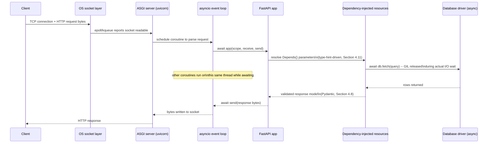

Underneath every `await` in this diagram, the CPython evaluation loop
(Section 4.3) is executing ordinary bytecode for whichever coroutine
currently holds control; underneath every object created along the way
(a Pydantic model instance, a database row tuple, a dictionary), reference
counting (Section 4.2) is tracking liveness; and the entire process is a
single OS process holding one GIL (or running lock-free under a
free-threaded build, Section 4.1) — concurrency here comes entirely from
cooperative scheduling at `await` points, not from multiple threads
executing simultaneously. A CPU-bound step accidentally inserted into this
path (an unguarded synchronous call, Section 4.7's failure mode) would
stall every concurrent request sharing this event loop, which is why
production ASGI deployments (Section 8) run multiple **worker processes**
(each with its own event loop and its own GIL) behind a single external
load balancer or process manager, rather than relying on one process to
absorb all traffic.

## 6. Design Principles

- **Match the concurrency model to the workload, not the other way around**
  (Sections 4.1, 4.5-4.7): classify a workload as CPU-bound or I/O-bound
  first, and let that classification — not familiarity or fashion — decide
  between threads, processes, and `asyncio`.
- **Treat reproducibility as a first-class requirement, not an
  afterthought** (Section 4.10-4.11): a service without a committed lock
  file is not fully specified, in the same sense that a service without an
  Infrastructure-as-Code (IaC) definition is not fully specified.
- **Push type-checking to build time, not runtime, wherever possible**
  (Section 4.8): a `mypy`/`pyright` gate in CI (Continuous Integration)
  catches an entire class of bugs before they cost a production incident,
  at effectively zero runtime cost.
- **Never let a single Python process be the unit of horizontal scale**
  (Section 4.1, Section 12): because of the GIL, meaningful CPU-bound
  throughput scaling in Python is achieved by adding processes (or
  machines), not by adding threads within one process — this is a
  foundational deployment-architecture assumption for the entire language,
  not an edge case.
- **Isolate every deployable unit's dependency graph explicitly**
  (Section 4.9): never let a Python service depend, even implicitly, on
  packages installed outside its own declared, locked environment.

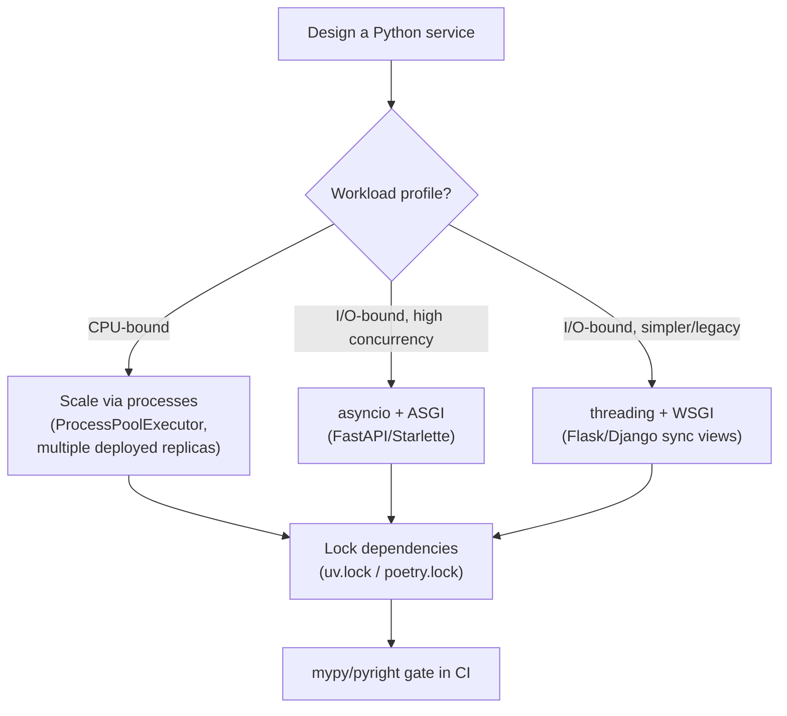

## 7. Architecture Patterns

- **Process-per-core worker model**: run N OS processes (via `gunicorn`
  with multiple workers, or `uvicorn --workers N`), each an independent
  Python interpreter, matched roughly to the host's CPU core count, so the
  GIL's single-core-per-process limitation is compensated for at the
  process-topology level rather than fought inside one process.
- **Sidecar/worker-queue offload for CPU-bound work inside an
  otherwise-async service**: an `asyncio`-based API service accepts
  requests cheaply and hands genuinely CPU-heavy work (report generation,
  image processing) to a separate task queue (Celery, `arq`, or a
  cloud-native queue) backed by its own process pool, keeping the
  request-handling event loop free of blocking work — the pattern
  Section 4.7's failure mode exists specifically to motivate.
- **Extension-boundary offload**: performance-critical inner loops are
  written in C, Rust (via `PyO3`), or Cython (Section 4.12) and exposed as
  an ordinary Python-callable extension module, so the architecture's
  "hot path" runs outside the interpreter's bytecode loop entirely while
  the surrounding orchestration logic stays in plain, readable Python.
- **Dependency-injected request pipeline** (FastAPI's `Depends()` model,
  Section 4.11 recap in Section 8.3): request-scoped resources (database
  sessions, authenticated user context, feature-flag clients) are declared
  as function parameters with type hints and resolved automatically per
  request, rather than threaded manually through every call site.

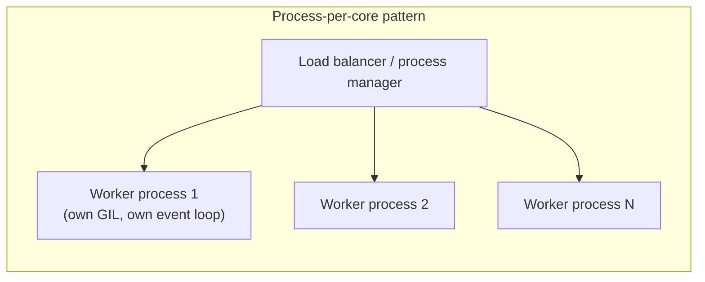

## 8. Production Architecture

Python's two dominant web-serving contracts — WSGI (Web Server Gateway
Interface, PEP 3333) and ASGI (Asynchronous Server Gateway Interface) —
define how a web server process hands an incoming request to application
code, and the difference between them is a direct architectural
consequence of Section 4.5-4.7's concurrency model.

**WSGI** defines a synchronous contract: the server calls a single
`application(environ, start_response)` callable once per request, that
call runs to completion (blocking the calling thread/worker for its
duration), and the response is returned. WSGI has no concept of a
long-lived connection, streaming duplex communication, or an `await`
point — each request occupies one worker (thread or process) for its
entire lifetime. This is architecturally sufficient, and often preferable
for its simplicity, for traditional request/response web applications with
no need for WebSockets or Server-Sent Events (SSE) — Django's traditional
synchronous view stack and Flask both run on WSGI.

**ASGI** defines an asynchronous contract: the server calls
`await application(scope, receive, send)`, where `receive`/`send` are
themselves `async` callables the application can `await` repeatedly over
the life of a single connection — enabling WebSockets, Server-Sent Events,
HTTP/2 server push, and long-polling to be expressed as ordinary
coroutine logic rather than requiring a separate, bolted-on protocol
handler outside the main request-handling stack. FastAPI and Starlette are
ASGI-native; Django added ASGI support (Django 3.1+) precisely so it could
support the same connection types without abandoning its synchronous view
ecosystem, running sync views through an internal thread-pool bridge
while native `async def` views run directly on the event loop.

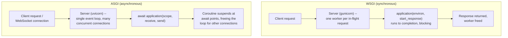

**Django's Model-Template-View (MTV) pattern.** Django's own architectural
pattern — a variation on Model-View-Controller (MVC) that Django's
documentation explicitly names Model-Template-View — separates the data
layer (**Models**: Django's ORM classes, each mapping to a database table),
the presentation layer (**Templates**: Django's own templating language for
rendering Hypertext Markup Language (HTML)), and the request-handling logic
(**Views**: plain Python functions or class-based views that receive a
request, invoke models, and return a response, rendered through a
template) — with Django's URL router acting as the "controller" dispatch
layer in classic MVC terms, which is exactly why Django names its own
pattern MTV rather than MVC: what MVC calls the Controller, Django's
routing/view-dispatch layer already fills, and what MVC calls the View
(the presentation layer), Django names Template instead, to avoid
overloading "View" for two different things in its own codebase.

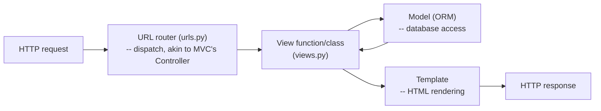

## 9. Implementation

A production Python service's implementation surface, tying together
Sections 4.9-4.11 and Section 8, typically follows this shape: a
`pyproject.toml` declares direct dependencies and build-backend
configuration (PEP 517/518); a committed lock file (`uv.lock` or
`poetry.lock`) pins the exact resolved dependency tree; a Dockerfile
builds a virtual environment (or installs directly into the container's
Python, per Section 4.9's containerized-deployment note) from that lock
file in a dedicated build stage, then copies only the resulting
environment (not the build toolchain) into a slim runtime image; an ASGI
server (`uvicorn`, often supervised by `gunicorn` for process management
and worker recycling) runs N worker processes matched to available CPU
cores; and a `mypy`/`pyright` check plus the test suite (Section 16) gate
every merge in Continuous Integration (CI) before that lock file and image
are ever built for deployment.

## 10. Complete Code Examples

The following examples are runnable, minimal illustrations of the
concurrency-model decision (Section 4.5-4.7), FastAPI's dependency
injection (Section 4.11/Section 8), and Pydantic-based runtime validation
layered on top of gradual typing (Section 4.8). Full versions live under
[code/python/python-architecture-chapter/](../code/python/python-architecture-chapter/).

**Example 1 — CPU-bound work: why threads don't help and processes do**

```python
"""cpu_bound_comparison.py — demonstrates the GIL's effect on CPU-bound work.

Run: python cpu_bound_comparison.py
Expect: threaded version takes roughly the same wall-clock time as a single
thread (no parallel speedup); the process-based version scales with core
count, because each process has its own GIL (Section 4.1, 4.6).
"""
import time
from concurrent.futures import ThreadPoolExecutor, ProcessPoolExecutor


def cpu_bound_task(n: int) -> int:
    """A deliberately pure-Python, CPU-bound computation (no I/O, no C
    extension release of the GIL)."""
    total = 0
    for i in range(n):
        total += i * i
    return total


def run_with_threads(task_count: int, n: int) -> float:
    start = time.perf_counter()
    with ThreadPoolExecutor(max_workers=task_count) as pool:
        list(pool.map(cpu_bound_task, [n] * task_count))
    return time.perf_counter() - start


def run_with_processes(task_count: int, n: int) -> float:
    start = time.perf_counter()
    with ProcessPoolExecutor(max_workers=task_count) as pool:
        list(pool.map(cpu_bound_task, [n] * task_count))
    return time.perf_counter() - start


if __name__ == "__main__":
    TASKS, N = 4, 20_000_000
    thread_time = run_with_threads(TASKS, N)
    process_time = run_with_processes(TASKS, N)
    print(f"Threaded ({TASKS} threads):  {thread_time:.2f}s (GIL-serialized)")
    print(f"Multiprocess ({TASKS} procs): {process_time:.2f}s (parallel)")
```

**Example 2 — asyncio: I/O-bound concurrency and the event-loop-blocking trap**

```python
"""asyncio_pitfall.py — contrasts a correctly async-aware I/O wait with an
event-loop-blocking mistake (Section 4.7).
"""
import asyncio
import time


async def correct_io_wait(name: str, delay: float) -> None:
    """Yields control back to the event loop for the duration of the wait --
    other coroutines can run concurrently."""
    print(f"[{name}] starting await (event loop free during this wait)")
    await asyncio.sleep(delay)
    print(f"[{name}] done")


def blocking_call(name: str, delay: float) -> None:
    """Simulates a legacy, non-async-aware blocking library call."""
    print(f"[{name}] starting BLOCKING call (event loop frozen during this)")
    time.sleep(delay)
    print(f"[{name}] done")


async def wrong_pattern() -> None:
    # Calling a blocking function directly inside a coroutine stalls every
    # other concurrently scheduled task on this event loop.
    await asyncio.gather(
        asyncio.to_thread(blocking_call, "B1", 1),  # still blocking, but
        asyncio.to_thread(blocking_call, "B2", 1),  # offloaded to a thread
    )


async def right_pattern() -> None:
    await asyncio.gather(
        correct_io_wait("A1", 1),
        correct_io_wait("A2", 1),
    )


if __name__ == "__main__":
    print("-- Correct pattern (native async I/O, both run concurrently) --")
    start = time.perf_counter()
    asyncio.run(right_pattern())
    print(f"Elapsed: {time.perf_counter() - start:.2f}s (expect ~1s, not ~2s)\n")

    print("-- Blocking call offloaded via to_thread (still concurrent) --")
    start = time.perf_counter()
    asyncio.run(wrong_pattern())
    print(f"Elapsed: {time.perf_counter() - start:.2f}s (expect ~1s via thread offload)")
```

**Example 3 — FastAPI: type-hint-driven request validation and dependency
injection (Section 4.8, 4.11, Section 8)**

```python
"""fastapi_di_example.py — demonstrates Pydantic-based runtime validation
layered on gradual typing, and FastAPI's dependency-injection system.

Run: uvicorn fastapi_di_example:app --reload
"""
from fastapi import Depends, FastAPI, HTTPException
from pydantic import BaseModel, Field

app = FastAPI()


class OrderCreate(BaseModel):
    """Pydantic reads the type hints below and performs *actual runtime*
    validation at the request boundary -- this is the opt-in enforcement
    layer Section 4.8 describes on top of otherwise-unenforced type hints."""
    sku: str = Field(min_length=1, max_length=64)
    quantity: int = Field(gt=0, le=1000)


class OrderResponse(BaseModel):
    order_id: str
    sku: str
    quantity: int
    total_cents: int


async def get_current_user(x_api_key: str | None = None) -> str:
    """A dependency: FastAPI resolves this automatically per-request based
    on its own type-hinted parameters, before the route handler runs."""
    if x_api_key != "trusted-demo-key":
        raise HTTPException(status_code=401, detail="Invalid API key")
    return "user-123"


async def pricing_service() -> "PricingService":
    """A second dependency, illustrating dependency composition -- FastAPI
    builds a resolution graph from type hints alone (Section 4.11)."""
    return PricingService()


class PricingService:
    _catalog = {"WIDGET-1": 499, "GADGET-9": 1999}

    async def price_for(self, sku: str, quantity: int) -> int:
        if sku not in self._catalog:
            raise HTTPException(status_code=404, detail="Unknown SKU")
        return self._catalog[sku] * quantity


@app.post("/orders", response_model=OrderResponse)
async def create_order(
    order: OrderCreate,
    user_id: str = Depends(get_current_user),
    pricing: PricingService = Depends(pricing_service),
) -> OrderResponse:
    total_cents = await pricing.price_for(order.sku, order.quantity)
    return OrderResponse(
        order_id=f"ord_{user_id}_{order.sku}",
        sku=order.sku,
        quantity=order.quantity,
        total_cents=total_cents,
    )
```

**Example 4 — A reference-cycle memory leak and its fix (Section 4.2, 4.4)**

```python
"""reference_leak_demo.py — demonstrates a reachability leak that reference
counting cannot and should not collect, plus the fix.
"""
import gc
import weakref


class RequestContext:
    def __init__(self, request_id: str) -> None:
        self.request_id = request_id
        self.callbacks: list = []


# BUG: a module-level registry accumulates strong references indefinitely.
_leaky_registry: list[RequestContext] = []


def handle_request_buggy(request_id: str) -> None:
    ctx = RequestContext(request_id)
    ctx.callbacks.append(lambda: print(f"logging {ctx.request_id}"))
    _leaky_registry.append(ctx)  # never popped -- unbounded growth


# FIX: use a weak reference so the registry doesn't itself keep contexts alive.
_safe_registry: "weakref.WeakSet[RequestContext]" = weakref.WeakSet()


def handle_request_fixed(request_id: str) -> None:
    ctx = RequestContext(request_id)
    _safe_registry.add(ctx)
    # ctx is only kept alive by whatever actually still needs it --
    # once the caller's own reference drops, refcounting reclaims it
    # immediately (Section 4.2), and _safe_registry drops the entry too.


if __name__ == "__main__":
    for i in range(1000):
        handle_request_buggy(f"req-{i}")
    print(f"Leaky registry size: {len(_leaky_registry)}  (grows forever)")

    for i in range(1000):
        handle_request_fixed(f"req-{i}")
    gc.collect()
    print(f"Safe registry size after GC: {len(_safe_registry)}  (near 0)")
```

## 11. Performance

Three independent performance levers apply to Python services, and
architects should reason about them separately rather than reaching for
one as a universal fix. First, **algorithmic and interpreter-level
overhead** (Section 4.3): CPython 3.11+'s specializing adaptive
interpreter and 3.13's experimental JIT give meaningful free speedups on
upgrade alone, but pure-Python tight loops still carry real per-iteration
interpreter cost no bytecode optimization fully removes — this is the
level at which "rewrite the hot loop in C/Cython/Rust" (Section 4.12)
becomes the correct lever, not "optimize the Python further." Second,
**concurrency-model fit** (Section 4.1, 4.5-4.7): an I/O-bound service
that is not using `asyncio` or threads at all is leaving essentially free
throughput on the table, while a CPU-bound service relying on threads for
parallelism is chasing a speedup the GIL architecturally prevents. Third,
**process/deployment topology** (Section 12): the number of worker
processes per host, matched to core count, plus horizontal replica count,
is where the majority of a Python service's actual throughput scaling
comes from in practice, not micro-optimization inside any single request
handler.

## 12. Scalability

Because a single CPython process cannot execute Python bytecode on more
than one core simultaneously (Section 4.1), Python services scale
primarily via **horizontal replication**: more worker processes per host
(bounded by core count and memory), more host replicas behind a load
balancer, or, for genuinely CPU-bound background work, a task queue with
many worker processes consuming from it. This is a materially different
default scaling posture than, say, a Java Virtual Machine (JVM) service,
where a single process can meaningfully use many cores via true OS-thread
parallelism — a distinction a Solution Architect sizing a Kubernetes
deployment (see [Kubernetes](../12_Kubernetes/PART_OVERVIEW.md)) must
account for explicitly: Python replica counts should be sized against
*process-level* concurrency limits (workers × cores), not assumed to
auto-scale within a single pod the way a multi-threaded JVM service might.

**Containerization patterns.** Because Python's own process-per-core model
(Section 7's worker-topology pattern) already assumes multiple OS
processes, teams must choose deliberately between two container topologies:
**one worker process per container** (each container runs a single
`uvicorn`/`gunicorn` worker, and horizontal scale comes entirely from the
orchestrator — Kubernetes, Elastic Container Service (ECS) — running more
replica pods/tasks), or **multiple worker processes per container** (a
process manager like `gunicorn` forks N workers inside one container,
and the orchestrator scales by adding more multi-worker containers). The
single-worker-per-container pattern is generally preferred in Kubernetes-
style environments because it lets the orchestrator's own scheduler and
health-check/restart machinery operate at the same granularity as an
actual unit of Python concurrency (one process, one GIL), giving more
precise resource requests/limits (CPU/memory sized to exactly one worker's
needs) and finer-grained autoscaling and failure isolation — a crashed
worker only takes down its own container, not every worker sharing that
container. The multi-worker-per-container pattern reduces per-container
overhead (fewer container-level health checks, shared base-image memory
pages across workers) and is common in simpler, non-Kubernetes deployments
(a single Virtual Machine (VM) or Elastic Compute Cloud (EC2) instance
running `gunicorn` with several workers behind a local reverse proxy), but
makes it harder for an orchestrator to isolate or restart a single failed
worker independently of its siblings.

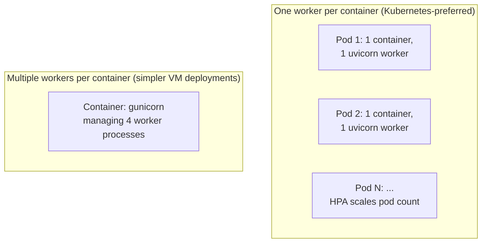

## 13. Security

Python-specific security concerns this chapter owns (general web/API
security — authentication, authorization, injection classes — are owned
by [Security](../15_Security/PART_OVERVIEW.md); recap and link only):
`pickle` deserialization of untrusted data is unsafe by design (`pickle`
can execute arbitrary code during deserialization — never unpickle data
from an untrusted source, including `multiprocessing`'s default
serialization if worker inputs ever originate outside a trusted boundary);
dependency supply-chain integrity depends on lock-file hash pinning
(Section 4.11) to prevent a compromised or typosquatted package version
from being silently substituted; and virtual-environment isolation
(Section 4.9) is itself a security boundary in shared-host deployments,
preventing one application's dependency from being able to shadow or
poison another's.

## 14. Observability

Python-specific observability concerns: `sys.settrace`/`sys.monitoring`
(PEP 669, Python 3.12+, a low-overhead successor to `sys.settrace`
designed explicitly to make production-safe profiling and tracing
instrumentation feasible) underlies most Python Application Performance
Monitoring (APM) agents' method-level tracing; GIL-contention metrics
(time threads spend waiting for the GIL) are a Python-specific signal
worth emitting explicitly, since generic CPU-utilization metrics alone can
mask a GIL-bound service that looks "idle" on a multi-core host while
still being fully saturated on the one core the GIL allows; and per-worker-
process memory (Section 4.2/4.4) should be tracked per replica, not
aggregated across a host's worker pool, since one leaking worker process
among several healthy ones is invisible in an averaged metric.

## 15. Failure Scenarios

- **Event-loop starvation** (Section 4.7): one blocking call inside an
  `async def` handler degrades every concurrent request on that process,
  producing a signature of process-wide, load-correlated latency spikes.
- **GIL contention masquerading as "CPU is fine"**: a CPU-bound
  multithreaded service shows low aggregate CPU utilization on a
  multi-core host (because only one core is ever actually active for
  Python bytecode) while still being fully saturated and unable to absorb
  more load — a metric-interpretation trap specific to the GIL.
- **Fork-after-threading deadlock** (Section 4.6): calling
  `multiprocessing.Process()`/`fork()` from a process that already has
  background threads running can deadlock the child process if a fork
  happens while another thread holds a lock the child never gets to
  release — a known hazard `spawn` (and Python 3.14's changed default)
  exists to avoid.
- **Reference-cycle-driven memory growth** (Section 4.2, 4.4): unbounded
  growth from an accidental long-lived reachability chain, not an actual
  garbage-collector defect.
- **Silent dependency drift** (Section 4.11): an unpinned transitive
  dependency resolving differently on a routine rebuild, changing runtime
  behavior with no corresponding code change.

## 16. Testing

Python-specific testing concerns beyond general test-strategy content
(owned elsewhere in this handbook): `pytest-asyncio` (or `anyio`'s test
plugin) is required to correctly test `async def` code, since a plain
synchronous test runner cannot drive an event loop; concurrency bugs
(Section 4.5, 4.7's race conditions and event-loop-blocking) are
notoriously load-dependent and often invisible in single-request unit
tests, requiring dedicated concurrency/load tests that deliberately
exercise many simultaneous requests; and `mypy`/`pyright` in CI
(Section 4.8) functions as a genuine test layer catching type-contract
violations before runtime tests even execute, and should be treated as a
required, not optional, pipeline gate.

## 17. Common Mistakes

- Assuming `threading` gives CPU-bound parallelism (Section 4.1, 4.5).
- Calling a blocking library function inside `async def` code
  (Section 4.7).
- Comparing values with `is` instead of `==`, relying on interning
  accidentally holding (Section 4.4).
- Shipping a `requirements.txt` with no lock file/pinned hashes
  (Section 4.11).
- Installing dependencies into a shared system Python instead of an
  isolated environment (Section 4.9).
- Treating type hints as runtime-enforced guarantees with no validation
  layer at actual trust boundaries (Section 4.8).
- Using `multiprocessing` for many tiny tasks whose IPC overhead exceeds
  their actual compute time (Section 4.6).

## 18. Best Practices

- Classify every service's dominant workload (CPU-bound vs I/O-bound)
  explicitly during design, and choose the concurrency model from that
  classification (Section 4.5-4.7).
- Commit a resolver-generated lock file for every deployable Python
  artifact, and gate dependency upgrades through a reviewed Pull Request
  (PR), never an incidental side effect of an unrelated rebuild
  (Section 4.11).
- Require `mypy --strict` or `pyright` (basic or strict mode) in CI for
  all new and actively maintained modules (Section 4.8).
- Validate all external input at trust boundaries with Pydantic (or
  equivalent), never relying on type hints alone (Section 4.8, 4.11).
- Size Kubernetes/container replica counts against process × core
  concurrency limits explicitly, not assumed auto-parallelism within one
  pod (Section 12).

## 19. Anti-Patterns

- **"Just add more threads"** applied uncritically to a CPU-bound Python
  workload (Section 4.1) — the single most common Python-specific
  architecture anti-pattern this chapter addresses.
- **Global mutable module-level state used as an ad hoc cache without a
  bounded eviction policy** (Section 4.2/4.4's reachability-leak pattern).
- **Unpinned, lock-file-free dependency management** in any deployable
  artifact (Section 4.11).
- **`pickle`-based deserialization of any externally sourced data**
  (Section 13).
- **A single monolithic Python process expected to scale CPU-bound work
  purely via internal concurrency primitives**, ignoring the GIL's
  process-level scaling implication (Section 12).

## 20. Trade-off Analysis

| Decision | Benefit | Cost |
|---|---|---|
| `asyncio`/ASGI vs threading/WSGI | Far higher I/O concurrency per process, lower per-connection memory | Requires the entire call chain to be async-aware; one blocking call stalls the whole event loop |
| `multiprocessing` vs `threading` for CPU-bound work | Genuine multi-core parallelism | Process startup + IPC serialization overhead; no shared memory by default |
| Free-threaded (`no-GIL`) CPython 3.13+ | True in-process multi-core parallelism for pure-Python code | Experimental status; requires every C-extension dependency to be free-threading compatible; single-threaded overhead increase |
| `mypy`/`pyright` strict typing gate | Catches interface-contract bugs before runtime, at zero runtime cost | Upfront annotation effort; partial-adoption codebases have inconsistent guarantees |
| Cython/C-extension for hot paths | Near-native performance for the specific hot function | Build complexity, loses pure-Python portability/readability for that module |

## 21. Comparison Table

| Concurrency model | Parallelism for CPU-bound work | Concurrency for I/O-bound work | Per-unit overhead | Typical fit |
|---|---|---|---|---|
| `threading` | No (GIL-limited) | Yes | Low-medium (OS thread stack) | I/O-bound work using blocking libraries |
| `multiprocessing` | Yes | Yes (but costly) | High (process + IPC) | CPU-bound, coarse-grained tasks |
| `asyncio` | No | Yes (highest concurrency) | Very low (coroutine object) | High-concurrency I/O-bound services (APIs, gateways) |
| Free-threaded CPython (3.13t) | Yes (experimental) | Yes | Higher single-thread overhead | Pure-Python CPU-bound parallel workloads, once ecosystem-compatible |

| Web protocol | Connection model | Best fit |
|---|---|---|
| WSGI | Synchronous, one worker per in-flight request | Traditional request/response apps, simpler mental model |
| ASGI | Asynchronous, many concurrent connections per worker | WebSockets/SSE, high-concurrency APIs, FastAPI/Starlette |

## 22. Real-World Case Study

A mid-sized e-commerce platform migrated its order-processing API from a
synchronous Flask/WSGI service (Section 8) to FastAPI/ASGI specifically
because its checkout flow needed to hold a WebSocket connection open for
live payment-status updates — a connection type WSGI's synchronous,
one-worker-per-request model could not express without a separate,
bolted-on protocol handler outside the main framework. The migration
surfaced exactly the failure mode Section 4.7 describes: a legacy,
synchronous fraud-scoring call (a blocking Hypertext Transfer Protocol
(HTTP) request to a third-party vendor) had been ported directly into an
`async def` route handler during the rewrite, and load testing showed
p99 latency across *every* endpoint spike whenever fraud scoring ran,
even for requests with no relationship to checkout — the signature of an
event-loop-blocking bug. The team's diagnosis path (Section 15) was to
observe that the latency spikes were process-wide and load-correlated
rather than endpoint-specific, trace it to the fraud-scoring call via
profiling, and fix it by wrapping the legacy call in
`asyncio.to_thread()`, moving it off the event loop while an async-native
replacement was scheduled separately. Separately, the platform's nightly
batch job that re-priced its entire catalog (a genuinely CPU-bound,
pure-Python computation, Section 4.1) had originally been implemented
with a thread pool "for speed," showed no measurable speedup over a
single thread in production, and was re-implemented with
`ProcessPoolExecutor` chunked into batches of 5,000 products per task
(Section 4.6's chunking lesson), achieving near-linear scaling with the
host's core count. Both fixes reduced to the same underlying architectural
principle this chapter teaches throughout: match the concurrency
mechanism to whether the actual workload is CPU-bound or I/O-bound, and
never assume "add more threads" is a universal answer.

## 23. Interview Questions

1. Why doesn't adding more `threading.Thread`s improve throughput for a
   CPU-bound Python workload, and what is the architecturally correct
   fix?
2. What does the GIL actually protect, and why does releasing it around
   blocking I/O calls (but not around CPU-bound bytecode execution) matter
   for concurrency design?
3. Explain the difference between reference counting and cyclic garbage
   collection in CPython, and describe a scenario where reference
   counting alone cannot reclaim memory.
4. Why does calling a synchronous, blocking function directly inside an
   `async def` coroutine cause a worse failure mode than an equivalent
   mistake in a threaded model?
5. What problem do lock files (`poetry.lock`, `uv.lock`) solve that a
   loose `requirements.txt` with version ranges does not?
6. Are Python type hints enforced at runtime? If not, what enforces them,
   and where does that enforcement actually happen in a typical FastAPI
   request?
7. What is CPython 3.13's free-threading build, and what must be true of
   a codebase's dependencies before adopting it in production?
8. When would you choose ASGI over WSGI for a new service, and what
   architectural capability does ASGI provide that WSGI structurally
   cannot?

## 24. Hands-on Exercises

Run Example 1 (Section 10) and measure the wall-clock difference between
the threaded and multiprocess versions on your own machine; vary the
`task_count` and core count available and observe how the multiprocess
version's scaling changes as `task_count` exceeds available cores. Then
run Example 2 and deliberately reintroduce a direct (non-offloaded)
blocking `time.sleep()` call inside an `async def` coroutine gathered
alongside other coroutines, and measure how total elapsed time changes —
confirming the event-loop-stall failure mode from Section 4.7 directly.

## 25. Design Exercises

Design the concurrency and deployment architecture for a service that
must: accept up to 5,000 concurrent long-lived WebSocket connections for
live notifications, run a nightly CPU-bound recommendation-model scoring
job over 10 million users, and expose a synchronous internal
administrative Create, Read, Update, Delete (CRUD) API used by fewer than
20 internal staff. Evaluation criteria: correctly identifies that these
are three distinct workload profiles requiring three distinct concurrency
choices (ASGI/`asyncio` for the WebSocket service, `multiprocessing`/a
worker-process fleet for the nightly batch job, and a simple WSGI or even
low-concurrency ASGI service for the low-traffic admin API), rather than
forcing all three onto one uniform architecture.

## 26. Architecture Review Questions

- Has the team classified this service's dominant workload as CPU-bound
  or I/O-bound, and does the chosen concurrency model match that
  classification?
- Is there a committed, resolver-generated lock file for this deployable
  artifact, and is dependency upgrade an explicit, reviewed process?
- Is `mypy`/`pyright` a required (not advisory) Continuous Integration
  (CI) gate?
- If this service uses `asyncio`, has every call chain reachable from an
  `async def` handler been audited for blocking calls?
- Is horizontal replica/worker-process count sized against actual
  process × core concurrency limits, not an assumption of internal
  auto-parallelism?

## 27. Summary

Python's language design and its runtime architecture are two different
things, and conflating them is the single most common source of
architecture mistakes in Python systems. The runtime's defining
characteristics — a GIL-serialized (or, as of CPython 3.13+,
experimentally free-threaded) single interpreter per process, deterministic
reference-counted memory reclamation backed by a periodic cyclic
collector, a bytecode-interpreted evaluation loop, and a concurrency
trichotomy of threads (I/O-bound concurrency), processes (CPU-bound
parallelism), and `asyncio` (high-concurrency I/O-bound cooperative
scheduling) — each carry direct, non-optional architectural
consequences for how a Solution Architect must design scaling,
deployment topology, and failure handling. Layered on top of that runtime,
Python's packaging and dependency-resolution stack (virtual environments,
wheels, and resolver-generated lock files) is what makes a deployment
reproducible at all, and its gradual typing system is what lets a
dynamically typed language still support a genuine, build-time
architecture quality gate. Getting Python architecture right is
overwhelmingly about respecting these runtime physics explicitly — matching
concurrency model to workload, scaling horizontally across processes
rather than assuming in-process parallelism, and treating dependency
reproducibility and static typing as load-bearing engineering discipline —
rather than about knowing more of the language's syntax.

**Further reading**: [What is Software Architecture?](../01_Architecture_Mindset/CH01_What_is_Software_Architecture.md) ·
[HTTP](../05_Networking_and_OS/CH01_HTTP.md) ·
[REST](../08_API_Architecture/CH01_REST.md) ·
[Kubernetes](../12_Kubernetes/PART_OVERVIEW.md) ·
[Performance Engineering](../19_Performance_Engineering/PART_OVERVIEW.md)
