# Chapter: Node.js Architecture

Part: [03 — Software Engineering Foundations](PART_OVERVIEW.md) · Status: Drafted

## 1. Introduction

Node.js is a runtime that executes JavaScript outside a browser by embedding
Google's V8 JavaScript engine together with libuv, a C library that provides
an event loop and asynchronous Input/Output (I/O) primitives across
operating systems. For a Solution Architect, Node.js is not "JavaScript on
the server" in a trivial sense — it is a specific concurrency model (single
JavaScript thread, non-blocking I/O, a background thread pool for the
handful of operations that cannot be non-blocking) that has deep
consequences for how you size services, where you place CPU-bound work, and
how you scale across cores and machines. This chapter treats Node.js as an
architectural substrate: the event loop and its phases, the V8 engine's
compilation and memory model, the `worker_threads` and `cluster` modules for
using more than one core, the module system (CommonJS vs. ECMAScript Modules
(ESM)) and package management (npm, pnpm, Yarn, and the `node_modules`
resolution algorithm), and streams as Node's backpressure-aware data-pipeline
abstraction. Web frameworks (Express, Fastify, NestJS) and HTTP semantics are
intentionally out of scope here — see
[HTTP](../05_Networking_and_OS/CH01_HTTP.md) and
[REST](../08_API_Architecture/CH01_REST.md) for those. This chapter is about
the runtime underneath any Node.js-based service.

## 2. Historical Evolution

Node.js was created by Ryan Dahl in 2009, motivated by the observation that
most web servers of the era (Apache with thread-per-request, or early
evented servers with awkward callback APIs) either wasted memory on blocked
threads waiting for I/O or made asynchronous programming painful. Dahl paired
V8 — already fast because Google had heavily invested in Just-In-Time (JIT)
compiling JavaScript for Chrome — with libev (later libuv, written to add
Windows support via I/O Completion Ports) to get an event-driven,
non-blocking I/O runtime with a syntax (JavaScript) that most web developers
already knew. Early Node (2009-2011) established the callback-based
asynchronous style and the CommonJS module system (borrowed from the
server-side JavaScript community, predating a native module system in the
language). The npm package registry (2010) turned Node into an ecosystem,
not just a runtime — a decision that shaped its architecture as much as any
technical choice, because the `node_modules` resolution algorithm and
package management trade-offs discussed later in this chapter exist largely
*because* npm optimized for ease of publishing over discipline in dependency
graphs. A 2014-2015 governance fork (io.js) pushed faster adoption of newer
V8 releases and ECMAScript features, and the two projects re-merged under
the Node.js Foundation, establishing the Long-Term Support (LTS) release
cadence still used today. Promises landed natively in Node 4 (2015),
`async`/`await` in Node 8 (2017) — both of which sit on top of the same
underlying event loop and microtask queue mechanics explained in Section 4,
they only change the syntax for scheduling callbacks. `worker_threads`
arrived experimentally in Node 10 (2018) and stabilized in Node 12,
finally giving Node.js a supported way to run genuinely parallel JavaScript
on multiple cores within one process. Native ESM support landed in Node 12
or so behind flags and stabilized around Node 14-16, introducing the dual
module system tension covered in Section 4.7.

## 3. Why It Exists

Before Node.js, most production web stacks used a thread-per-request (or
process-per-request) model: each incoming request was handed a dedicated OS
thread that blocked on every I/O call (database query, filesystem read,
downstream HTTP request) until it completed. That model is easy to reason
about but wastes resources under I/O-heavy, high-concurrency workloads — a
thread blocked waiting on a database still holds its full stack memory (often
1 MB or more) and still costs the OS scheduler a context switch on every
wake-up. Node.js exists to solve exactly that inefficiency for the workload
shape most web services actually have: mostly waiting on I/O (network calls,
disk, database round-trips), not computing. By running application code on a
single JavaScript thread and delegating I/O to the OS's asynchronous
facilities (via libuv), Node.js can hold tens of thousands of concurrent
connections in flight using a small, roughly constant amount of memory per
connection, because a "waiting" request in Node.js is just a callback sitting
in a queue, not a blocked OS thread. The trade-off — and it is the central
architectural trade-off of this entire chapter — is that Node.js pays for
that efficiency by having exactly one thread available to run your
JavaScript. If your workload is CPU-bound rather than I/O-bound, that single
thread becomes the bottleneck, and naive Node.js usage will serialize work
that a thread-per-request model would have run in parallel across cores.
Sections 4 and 20 return to this trade-off in detail.

## 4. Core Concepts

### 4.1 The Single-Threaded, Non-Blocking I/O Model

**Definition.** Node.js executes all your JavaScript — every callback, every
`async` function body, every line of application code — on one operating
system thread, called the *main thread* or *event loop thread*. Node.js
achieves concurrency not by running your code on multiple threads, but by
never letting your code block that one thread on I/O: every I/O
operation (network read, file read, DNS lookup, database driver call) is
started and then control returns immediately to the event loop, with a
callback registered to run later when the result is ready.

**Mechanism.** When your code calls `fs.readFile(path, callback)`, Node.js
does not read the file synchronously. It asks libuv to start the read (using
the OS's asynchronous file I/O facilities, or libuv's own thread pool where
the OS doesn't provide true async file I/O — see Section 4.2), and returns
control to your code immediately. Your `callback` is stored and only invoked
later, when the event loop reaches the phase where completed I/O callbacks
are processed (see Section 4.3). Between issuing the request and the
callback firing, the single JavaScript thread is free to handle other
requests — accept new connections, run other callbacks, start other I/O.

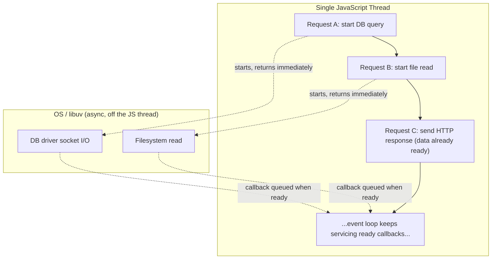

**Decision implications.** Because there is only one JavaScript thread, the
throughput of a Node.js process for I/O-bound work scales with how many
concurrent I/O operations are *in flight*, not with how much CPU you throw at
it — a single Node.js process can comfortably hold thousands of concurrent
open connections waiting on I/O, something that would require thousands of
OS threads (and thus gigabytes of stack memory) in a thread-per-request
model. This is why Node.js is a strong default for API gateways, Backend-for-
Frontend (BFF) layers, real-time messaging (WebSocket fan-out), and any
service that is mostly "wait for the database/downstream service, then
forward the result" — I/O-bound work. It is a poor default for anything that
spends meaningful wall-clock time computing on the JavaScript thread itself:
image resizing, cryptographic hashing at scale, large JSON parsing/
serialization, complex synchronous data transforms.

**Failure mode.** Any synchronous, CPU-bound operation you run on the main
thread blocks the *entire process* — not just the request that triggered it.
While the event loop thread is busy computing, it cannot accept new
connections, cannot process other requests' I/O completions, and cannot run
any other JavaScript, because there is nowhere else for that work to go. A
single expensive `JSON.parse` on a 50 MB payload, a synchronous regular
expression with catastrophic backtracking, or a tight computational loop
will stall every other in-flight request in that process for the duration —
this is the single most common Node.js production incident pattern, and it
is invisible in code review because the code "looks fine" in isolation; the
damage only shows up under concurrent load.

**Scenario.** A payments service handles thousands of requests per second,
each of which validates a request, calls a downstream fraud-scoring API, and
writes to a database — all I/O-bound, so Node.js handles it well with low
memory overhead per connection. A developer adds a synchronous PDF-receipt
generation step directly in the request handler, done on the main thread. Under
low load it looks fine in testing (single request, no contention). Under
production load, every PDF generation (even if it takes only 200ms) blocks
every other concurrent request for those 200ms, and P99 latency for
*unrelated* requests spikes even though those requests never touch PDF
generation — because they are all waiting behind the single blocked thread.
The fix (Section 4.5/Section 6) is to move CPU-bound work off the main
thread entirely.

### 4.2 libuv and the Event Loop Phases

**Definition.** libuv is the C library Node.js embeds to provide the event
loop, asynchronous file-system operations, DNS resolution, timers, and a
background thread pool. "The event loop" is not a single queue — it is a
fixed sequence of ordered phases that libuv cycles through repeatedly for
the life of the process, each phase responsible for a specific category of
callback.

**Mechanism.** Each full cycle of the event loop, in order, is:

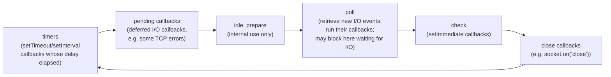

- **timers**: executes callbacks scheduled by `setTimeout`/`setInterval`
  whose threshold has elapsed. Note this does *not* mean "exactly at 100ms"
  — it means "not before 100ms"; the actual fire time depends on what else is
  running when the loop reaches this phase.
- **pending callbacks**: executes I/O callbacks deferred from the previous
  loop iteration by the OS (a small, mostly-internal category — e.g. certain
  TCP error callbacks like `ECONNREFUSED`).
- **idle, prepare**: internal-only bookkeeping phases, not used by
  application code.
- **poll**: the workhorse phase. Retrieves new I/O events from the OS and
  runs their callbacks (this is where most of your `fs`, network, and
  database-driver callbacks actually execute). If there are no timers due
  and no `setImmediate` queued, poll will *block* here, waiting for new I/O
  — this is what lets an idle Node.js process consume near-zero CPU instead
  of busy-looping.
- **check**: runs `setImmediate` callbacks, specifically *after* the poll
  phase completes for this iteration — this ordering is why `setImmediate`
  is commonly used inside I/O callbacks to defer work until "right after I/O
  finishes, before the next full loop iteration."
- **close callbacks**: runs close-event handlers, e.g. `socket.on('close',
  ...)`.

**Decision implications.** Understanding phase ordering matters when you
need deterministic sequencing of setup/teardown code, or when diagnosing why
a `setTimeout(fn, 0)` and a `setImmediate(fn)` scheduled from the same
synchronous context can fire in either order (their relative order is
actually non-deterministic at the top level, but deterministic — check
always follows poll — from *inside* an I/O callback). This is a common
interview and debugging question, and the concrete rule to remember is:
`setImmediate` inside an I/O callback always fires before any `setTimeout`
scheduled in that same callback, because check comes right after poll in the
same iteration, while the timer has to wait for the next timers phase.

**Failure mode.** A common misconception is that the event loop is "a single
queue" or "the microtask queue" — it is not. Microtasks (Promise callbacks,
`process.nextTick`) are not a loop phase at all; they run in a separate
queue drained *between every phase transition* (see Section 4.3), which
means an unbounded chain of promise callbacks that keep scheduling more
promise callbacks can starve the entire event loop — timers never fire, I/O
callbacks never run — because Node.js keeps draining the microtask queue
before it will move to the next phase. This is a real, reproducible Node.js
starvation bug pattern distinct from the CPU-blocking failure mode in
Section 4.1.

**Scenario.** A caching layer schedules cache-eviction sweeps with
`setInterval`. Under normal load, sweeps run every 60 seconds as expected.
Under a traffic spike, a hot code path recursively chains
`Promise.resolve().then(...)` for request batching without ever yielding
back to the event loop. The eviction `setInterval` callback — a timers-phase
callback — stops firing until the promise chain finally resolves, because
the timers phase never gets a turn while the microtask queue keeps refilling
itself. Memory grows because eviction silently stalls, and the on-call
engineer initially suspects a leak in the cache code itself, when the actual
cause is microtask starvation elsewhep re in the request-batching logic.

### 4.3 Microtasks vs. Macrotasks (Promises, `process.nextTick`, and Callback Ordering)

**Definition.** Node.js has two distinct callback-scheduling layers: the
*macrotask* queues that make up the event loop phases in Section 4.2
(timers, I/O callbacks, `setImmediate`, close callbacks), and the *microtask*
queue, which holds resolved-Promise `.then`/`.catch`/`.finally` callbacks and
`async`/`await` continuations. Node.js additionally has `process.nextTick`,
whose queue has even higher priority than the Promise microtask queue.

**Mechanism.** After every single callback Node.js runs — not just after
every phase, after *every individual callback* — it fully drains the
`process.nextTick` queue, then fully drains the Promise microtask queue,
before it runs the next callback or transitions phases. This means
microtasks are interleaved far more finely than macrotasks: if callback A
schedules ten microtasks, all ten run before callback B (the next macrotask)
gets a chance, even if B was already sitting in a phase's queue.

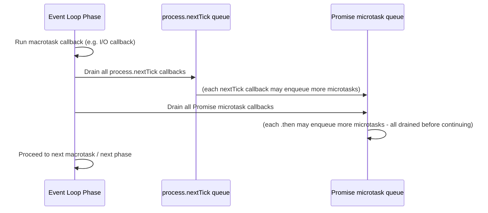

**Decision implications.** This ordering is why `async`/`await` code
"pauses" a function at each `await` without blocking the event loop thread —
the remainder of the function is scheduled as a microtask continuation, so
other macrotasks (other requests' I/O) still get serviced in between
`await`s of *different* requests, even though within one request the
`await`ed steps run in program order. Architecturally, this is what makes
`async`/`await` safe to use pervasively in Node.js services without
sacrificing concurrency — each `await` is a yield point back to the event
loop, not a real thread block.

**Failure mode.** Because microtasks are drained completely before any
macrotask runs, code that recursively schedules more microtasks
(`process.nextTick` recursion is the classic case, but unbounded `.then`
chaining does it too) can starve the event loop indefinitely — no timers, no
I/O callbacks, no `setImmediate` ever run, and the process appears "hung"
while still burning CPU. This is distinct from, and often confused with, the
synchronous CPU-blocking failure mode in Section 4.1: that one blocks by
never returning control to the loop at all; this one *does* return control
to the loop's microtask drain, but that drain never terminates.

**Scenario.** A recursive polling utility written as
`function poll() { doWork(); process.nextTick(poll); }` (rather than
`setImmediate(poll)` or `setTimeout(poll, 0)`) will look correct in a unit
test with few iterations, then hang the process in production once `doWork`
is called enough times that the `nextTick` queue never empties relative to
new items being added — no I/O, no other requests, nothing else in the
process runs again.

### 4.4 The V8 Engine: JIT Compilation, Hidden Classes, and Garbage Collection

**Definition.** V8 is Google's open-source JavaScript engine (also used in
Chrome) that Node.js embeds to parse and execute your JavaScript. V8's
performance characteristics — not just "JavaScript is fast or slow" but
*which specific code shapes are fast* — directly affect how you should write
performance-sensitive Node.js code, because V8 uses adaptive, tiered
compilation rather than compiling everything the same way upfront.

**Mechanism — compilation tiers.** V8 first parses your JavaScript and runs
it through Ignition, a bytecode interpreter, so execution can start
immediately without an expensive upfront compile pass. While running,
V8's profiler watches which functions are "hot" (called frequently with
stable argument/shape patterns) and recompiles just those functions with
TurboFan, V8's optimizing JIT compiler, producing highly optimized machine
code specialized for the observed types. If a hot function is later called
with a shape TurboFan didn't optimize for (see hidden classes below),
V8 *deoptimizes* it back to the interpreter and has to re-warm it.

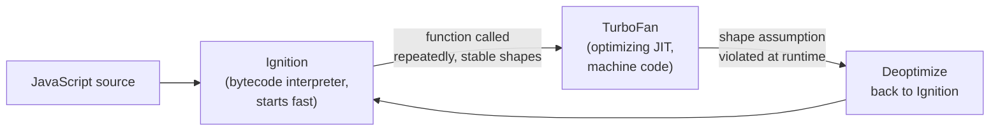

**Mechanism — hidden classes.** JavaScript objects don't have static,
compiler-known layouts the way a Java or C# class does, but V8 needs
predictable memory layouts to make property access fast. V8 solves this by
assigning every object a *hidden class* (also called a "shape" or "map")
based on the set and order of properties it has been assigned so far. Two
objects created the same way, with properties added in the same order,
share a hidden class, so V8 can compile property access on them (`obj.x`)
into a fast, fixed-offset memory read instead of a dictionary lookup. If you
add properties to objects in different orders, or add/delete properties
after construction, V8 has to create additional hidden classes (or fall back
to dictionary-mode objects), which prevents this optimization.

**Mechanism — garbage collection generations.** V8's heap is split into a
young generation (new space, small, for freshly allocated objects) and an
old generation (old space, for objects that survive multiple collections).
Most objects in a typical Node.js service are short-lived (a per-request
buffer, a temporary array), so V8 optimizes for that: the young generation
is collected frequently with Scavenge, a fast copying collector, while
objects that survive a couple of Scavenge cycles get *promoted* to the old
generation, which is collected far less often using Mark-Sweep-Compact, a
more thorough (and more expensive per-run) collector.

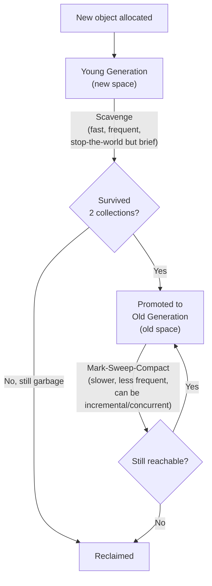

**Decision implications.** Practical, decision-relevant consequences: (1)
construct objects of the same "type" the same way every time (same
constructor, same property assignment order) so V8 can share hidden classes
across instances and keep property access fast; (2) avoid adding/deleting
properties on long-lived objects after construction — prefer initializing
all fields (even to `null`/`undefined`) upfront; (3) large numbers of
short-lived allocations (e.g. allocating a new object per iteration inside a
hot loop) pressure the young-generation collector — pooling or reusing
buffers can materially reduce Garbage Collection (GC) pause frequency in
high-throughput services; (4) old-generation Mark-Sweep-Compact pauses,
while partially concurrent/incremental in modern V8, are still the primary
source of visible GC-related latency spikes, so a service with a large,
long-lived heap (large in-memory caches, big object graphs) will see
different tail-latency behavior than a service that keeps most objects
short-lived and stateless.

**Failure mode.** A common anti-pattern is polymorphic hot functions —
functions called with objects that don't share a hidden class (e.g. a
generic `logEvent(obj)` called with wildly different-shaped event objects
across call sites) — which prevents TurboFan from specializing the function
and can leave it permanently in a slower, "megamorphic" execution mode, or
cause repeated deoptimization/reoptimization cycles under load.

**Scenario.** A high-throughput event-ingestion service builds event objects
by starting from `{}` and conditionally adding fields (`if (hasUserId) e.userId
= ...`), so the shape of `e` differs depending on which fields were present
in the input. Under load, the hot serialization function that walks and
writes these objects never gets a stable hidden class to optimize against,
staying in the slower interpreted/megamorphic path indefinitely. Rewriting
the constructor to always assign all fields (defaulting absent ones to
`null`) in the same order restores a single hidden class and measurably
reduces CPU time per event under profiling.

### 4.5 `worker_threads`: True Parallelism Within a Process

**Definition.** `worker_threads` is Node's built-in module for running
JavaScript on additional OS threads within the same process, each with its
own V8 isolate, its own event loop, and its own memory heap — genuine
parallel execution, not just concurrency. This is Node's answer to
Section 4.1's CPU-bound failure mode: instead of avoiding CPU-bound work, you
move it off the main thread entirely.

**Mechanism.** A worker thread is a fully separate JavaScript execution
context; it does not share memory with the main thread by default. Data is
exchanged either by structured-clone message passing (`worker.postMessage`,
which serializes and copies the data — safe but has a copy cost for large
payloads) or, when zero-copy sharing is needed, via a `SharedArrayBuffer`
plus `Atomics` for coordinated concurrent access to the same underlying
memory.

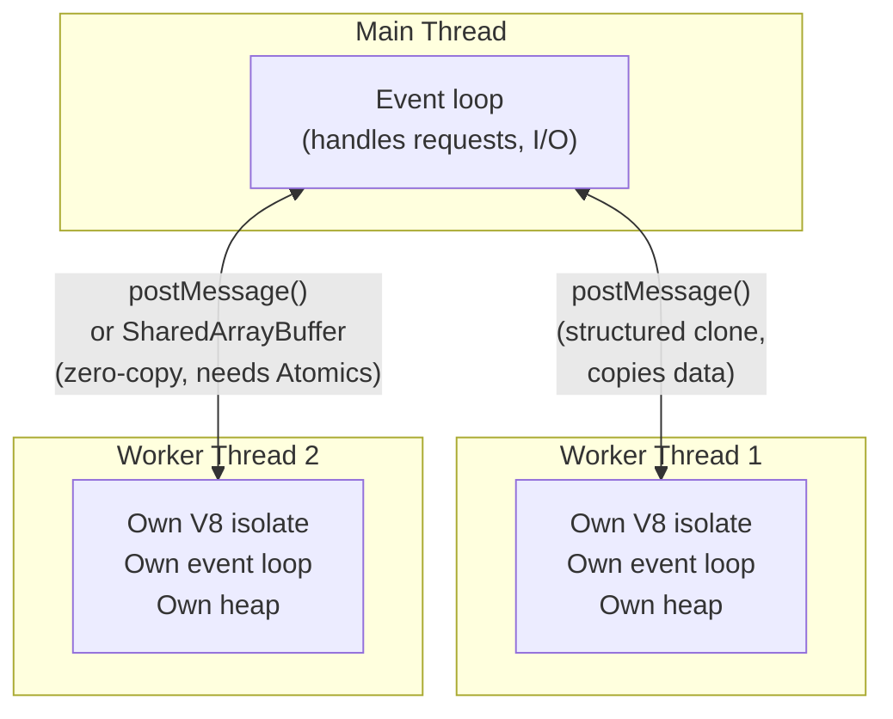

**Decision implications.** Route genuinely CPU-bound work — image/video
processing, cryptographic key derivation at scale, large synchronous parsing
or compression, complex numeric computation — to a pool of worker threads,
keeping the main thread free to keep servicing I/O-bound request handling.
A common production pattern is a fixed-size worker pool (created once at
startup, reused across requests, avoiding the cost of spinning up a new
worker per request) with a task queue in front of it. `worker_threads` is
the right tool when the parallel work needs to share process-level state
efficiently (via `SharedArrayBuffer`) or when you want lower per-unit
overhead than a separate OS process; it is the wrong tool when you actually
want independent failure domains (a crash in a worker thread can, depending
on how it happens, still affect isolate stability) — for that, `cluster` or
separate processes (Section 4.6) are more appropriate.

**Failure mode.** Treating `worker_threads` as a free lunch: spawning a new
worker per incoming request rather than reusing a pool. Worker startup
(creating a new V8 isolate) is not free — order of a few milliseconds to tens
of milliseconds depending on the platform — so per-request worker creation
under load causes the worker-creation overhead itself to dominate and can
be *slower* than doing the work on the main thread for small tasks.

**Scenario.** An image-processing service resizes user-uploaded images
synchronously in the request handler (CPU-bound: decode, resize, re-encode).
Under concurrent uploads, every resize blocks every other in-flight request
(Section 4.1's failure mode). Moving the resize into a fixed pool of four
worker threads (matched to available CPU cores) sized at startup, with
requests queued and dispatched to whichever worker is free, keeps the main
thread free to accept new uploads and serve unrelated requests while resizes
run genuinely in parallel across cores.

### 4.6 The `cluster` Module: Scaling Across Cores at the Process Level

**Definition.** The `cluster` module lets a Node.js application fork
multiple child processes (workers), each running its own instance of the
application with its own V8 isolate and event loop, coordinated by a primary
process that can distribute incoming connections across them. Unlike
`worker_threads`, cluster workers are full OS processes, not threads within
one process.

**Mechanism.** The primary process listens on the server port (or, on
platforms with `SO_REUSEPORT` support, each worker listens independently and
the OS kernel distributes connections) and either round-robins accepted
connections to workers or lets the OS load-balance directly. Each worker is
an independent Node.js process with no shared memory — communication between
primary and workers happens via message passing (`process.send`/
`worker.on('message')`), the same structured-clone serialization model as
`worker_threads`' `postMessage`.

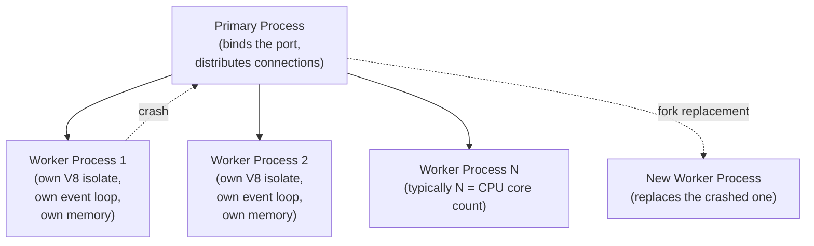

**Decision implications.** `cluster` is the traditional way to use every
core of a single machine for a Node.js service without touching application
code: fork one worker per core, and the primary process load-balances across
them. Because each worker is a full process, a crash in one worker (an
unhandled exception, an out-of-memory condition) does not take down the
others — the primary can detect the exit and fork a replacement, giving
you process-level fault isolation that `worker_threads` does not provide as
cleanly. The cost is memory: each worker has its own full V8 heap and its
own copy of loaded modules, so N workers use roughly N times the base memory
footprint of one worker, unlike threads which share less duplicated
baseline state per unit but share failure domains. In containerized/
Kubernetes deployments, many teams now prefer running one Node.js process
per container (relying on the orchestrator to run multiple container
replicas instead of `cluster` forking within one container) because it
gives the same core-scaling and fault-isolation properties while making
resource limits, scheduling, and per-instance observability visible to the
orchestrator rather than hidden inside a single process tree — see
Section 12 for this trade-off in more depth.

**Failure mode.** In-memory state kept in one worker (an in-process cache,
an in-memory rate limiter, WebSocket connection registries) is invisible to
the other workers, because workers do not share memory. A "sticky session"
or "seen this request before" check that works fine in local development
(one process) silently becomes inconsistent under `cluster` in production,
because roughly 1/N of requests land on a worker that never saw the earlier
state.

**Scenario.** A service implements a simple in-memory token-bucket rate
limiter as a module-level `Map`. It works correctly in development (single
process). Deployed behind `cluster` with 4 workers, the same client's
requests get load-balanced across all 4 workers roughly evenly, so each
worker's independent rate limiter only sees roughly a quarter of that
client's traffic — the effective rate limit is quadrupled without anyone
changing the configured limit. The fix is externalizing rate-limit state to
a shared store (e.g. Redis) that all workers/processes query, not keeping
it in per-process memory.

### 4.7 Module Systems: CommonJS vs. ECMAScript Modules and the Dual-Package Hazard

**Definition.** Node.js supports two distinct module systems with different
loading semantics: CommonJS (CJS), Node's original `require()`/
`module.exports` system, and ECMAScript Modules (ESM), the standardized
`import`/`export` syntax now native to the JavaScript language itself. They
are not just syntactic variants of each other — they have materially
different loading mechanics.

**Mechanism.** CommonJS module resolution is synchronous: `require()` reads,
compiles, and executes the target module's code immediately, in place,
before returning. This is why CommonJS naturally supports patterns like
conditionally `require`-ing a module inside an `if` branch. ESM resolution
is asynchronous and happens in two passes: the module graph is first fully
parsed to statically determine all `import`/`export` bindings (this is what
lets tools statically analyze and tree-shake ESM code — the imports are
knowable without executing anything), and only then are module bodies
executed, in dependency order, with **live bindings** — an imported name
in ESM is a reference to the exporting module's current value, not a
one-time copy taken at import time the way a destructured CommonJS
`require()` result is.

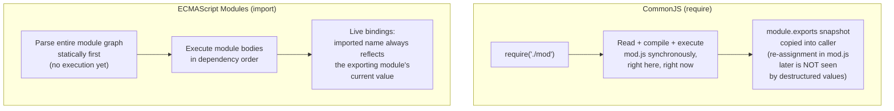

**Decision implications — the dual-package hazard.** Because npm packages
can ship both a CommonJS and an ESM entry point (via the `exports` field's
`require`/`import` conditions in `package.json`), a single logical package
can be loaded *twice*, as two separate module instances, if part of your
dependency graph reaches it via `require()` and another part reaches it via
`import`. This matters architecturally whenever a package relies on
module-level singleton state (a connection pool, a registry, a cache): if
both the CJS and ESM copies get loaded, you silently end up with two
independent singletons instead of one, because Node treats them as entirely
separate module instances with separate module-level state, even though
your source code "looks like" it's using one shared library.

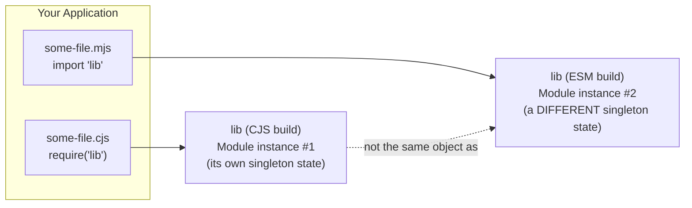

**Failure mode.** A dependency-injection container, a metrics registry, or a
database connection pool published as a dual CJS/ESM package can be
instantiated twice inside the same running process without any error being
thrown — code that registers something on one instance and expects to read
it back from "the same" library elsewhere silently sees it missing, because
it's reading from the *other* module instance. This is notoriously difficult
to debug because there is no exception, no warning, and the bug only
manifests when both loading paths are actually exercised (e.g. one direct
dependency using ESM and one transitive dependency using CJS, of the same
underlying package).

**Scenario.** A team migrates part of a codebase to ESM incrementally.
Their metrics library is required by legacy CJS files (`require('metrics-lib')`)
and also imported by newly migrated ESM files (`import 'metrics-lib'`).
Under the dual-package hazard, two separate metrics registries silently
exist; dashboards built from the ESM-side registry are missing all counters
incremented from CJS code paths, with no error anywhere — the fix is
ensuring the package's `package.json` `exports` map is configured so both
conditions resolve to the same underlying implementation, or migrating the
whole dependency graph to one module system consistently for
singleton-holding packages.

### 4.8 Package Management Architecture: npm, pnpm, Yarn, and `node_modules` Resolution

**Definition.** Package managers (npm, Yarn, pnpm) install the dependency
graph declared in `package.json` into (or referenced from) a `node_modules`
directory, and lockfiles (`package-lock.json`, `yarn.lock`, `pnpm-lock.yaml`)
pin the exact resolved versions of every transitive dependency so installs
are reproducible across machines and CI (Continuous Integration) runs.

**Mechanism — the `node_modules` resolution algorithm.** When code calls
`require('some-lib')` (or a bare-specifier `import`), Node.js resolves the
module by walking *up* the directory tree from the requiring file, checking
`<dir>/node_modules/some-lib` at each level, until it either finds the
package or reaches the filesystem root (at which point resolution fails).

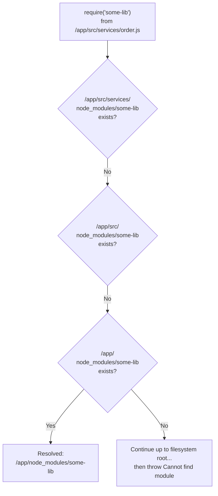

This upward-walking algorithm is what makes *nested* `node_modules`
directories possible: if two packages need different, incompatible versions
of the same dependency, npm/Yarn's classic (non-flat) resolution can nest a
second copy inside the dependent package's own `node_modules`, and the
algorithm above finds the nearest one first.

**Decision implications — flat vs. nested vs. content-addressable stores.**
Classic npm (v3+) and Yarn "classic" flatten the dependency tree as much as
possible into a single top-level `node_modules` to save disk space and
resolution time, only nesting when versions genuinely conflict. This
flattening, however, allows **phantom dependencies** — code can
`require()` a package that was never declared in its own `package.json`,
simply because some *other* dependency happened to hoist it to the shared
top-level `node_modules` — which works until that other dependency is
removed or changes its own dependencies, silently breaking your code with no
`package.json` change on your side. pnpm takes a different, stricter
architecture: it stores every package version once in a global
content-addressable store on disk, and each project's `node_modules` is
built from **symlinks** into that store, structured so a package can only
resolve dependencies it actually declared — this eliminates phantom
dependencies by construction and saves significant disk space across
projects sharing dependency versions, at the cost of occasional
compatibility issues with tools that assume a flat, real (non-symlinked)
`node_modules` layout.

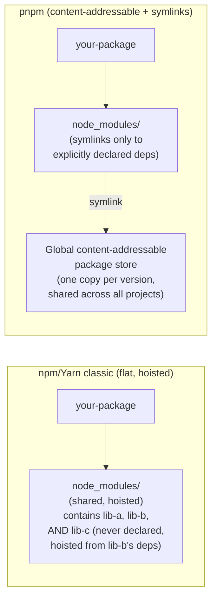

**Failure mode.** Relying on a phantom dependency (something that resolves
today only because of hoisting, not because it's declared) means an
unrelated dependency upgrade elsewhere in the tree can silently remove it,
breaking your build or runtime with an error that looks unrelated to any
change you made. Lockfile drift — committing `package.json` changes without
regenerating/committing the lockfile, or letting CI install with a different
resolution than what a developer tested locally — is the other common
failure mode: it produces "works on my machine" bugs where CI or production
resolves a different, non-tested version of a transitive dependency.

**Scenario.** A service works locally and in CI for months. A transitive
dependency bump (unrelated to the team's own code) removes its own
dependency on a logging utility that the team's code had been quietly
`require()`-ing without declaring it in `package.json` — it had only ever
resolved because npm's flat hoisting happened to place it at the shared top
level. The next `npm install` after that transitive change fails at runtime
with `Cannot find module`, with no diff in the team's own source, and the
root cause (an undeclared phantom dependency) is only found by inspecting
the lockfile diff.

### 4.9 Streams and Backpressure

**Definition.** Streams are Node's abstraction for processing data
incrementally — in chunks — rather than loading an entire payload into
memory at once. Node has four stream types: Readable (a data source, e.g. a
file read or an HTTP request body), Writable (a data sink, e.g. a file write
or an HTTP response), Duplex (both, e.g. a TCP socket), and Transform (a
Duplex stream that modifies data as it passes through, e.g. gzip
compression). Backpressure is the mechanism that keeps a fast data source
from overwhelming a slower consumer's memory by pausing production until the
consumer catches up.

**Mechanism.** Every Writable stream has an internal buffer with a
configurable `highWaterMark` (a size threshold, not a hard limit). When you
call `writable.write(chunk)`, it returns `true` if the internal buffer is
still under `highWaterMark` (safe to keep writing immediately) or `false` if
the buffer is now at or above that threshold. When `write()` returns
`false`, well-behaved producer code must stop writing and wait for the
Writable to emit a `'drain'` event before writing more — that pause is
backpressure in action. `readable.pipe(writable)` implements this protocol
for you automatically: it pauses reading from the source whenever the
destination signals it's full, and resumes once drained.

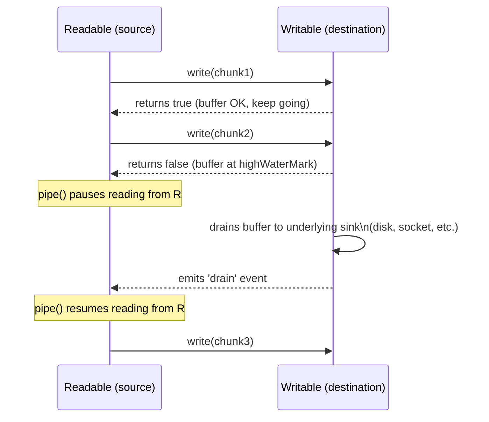

**Decision implications.** Always use `.pipe()` (or the `pipeline()` utility
from `node:stream`, which additionally handles error propagation and cleanup
correctly across the whole chain) rather than manually forwarding data with
`readable.on('data', chunk => writable.write(chunk))`, because the manual
version does not respect backpressure — it ignores `write()`'s return value
and keeps pumping data regardless of whether the destination can keep up.
Streams are the right architectural choice whenever data is large relative
to available memory, or arrives incrementally over time (an uploaded file,
a downstream HTTP response you're proxying, a database result cursor) —
using streams end-to-end lets a Node.js process handle payloads far larger
than its own memory, because at any instant only a bounded chunk is held in
memory.

**Failure mode.** Manually piping data without honoring backpressure (or
reading an entire request/response body into a `Buffer`/string with
`concat`-style accumulation instead of streaming it through) causes memory
usage to grow unbounded relative to input size — a slow downstream consumer
(a slow disk, a rate-limited API, a slow network peer) combined with a fast,
backpressure-ignorant producer will accumulate the entire un-drained payload
in process memory, which for large or numerous concurrent transfers can
exhaust available memory and crash the process.

**Scenario.** A service proxies large file uploads from clients to
cloud object storage. An initial implementation buffers the entire upload
into memory (`Buffer.concat` on `'data'` events) before forwarding it to the
storage Software Development Kit (SDK) client, because it was the simplest
code to write. Under a handful of concurrent multi-hundred-megabyte uploads,
process memory spikes and the process is killed by the container
orchestrator's memory limit. Rewriting the handler to `pipeline(request,
storageClient.uploadStream(), callback)` keeps memory bounded to a small,
constant multiple of the configured `highWaterMark` regardless of file size
or concurrent upload count, because backpressure now naturally throttles how
fast the request body is read relative to how fast storage can accept it.

### 4.10 Microservices-Friendliness: The Lightweight Process Model

**Definition.** A "lightweight process model" here means the actual
resource cost (memory footprint, startup time) of running one more
independent Node.js process is comparatively small next to many other
server runtimes with heavier baseline runtime/Virtual Machine (VM) overhead
— a property that matters directly for microservices architectures where you
deliberately run many small, independently deployable services rather than
one large monolith.

**Mechanism.** A Node.js process's baseline memory footprint is dominated by
the V8 heap and loaded module code, not by a large pre-allocated
runtime/VM the way some managed-runtime platforms are; a minimal Node.js
process can start and begin serving requests in tens of milliseconds to a
few hundred milliseconds depending on how much module-loading work happens
at startup (this is also why `require()`'s synchronous, eager-execution
model in Section 4.7 directly affects service cold-start time — every
`require()` at the top of your entry file runs before the process can start
handling anything).

**Decision implications.** This makes Node.js a natural fit for
microservices, serverless functions, and horizontally-scaled deployments
where you want to run many small, independently scalable instances rather
than fewer large ones — the per-instance overhead is low enough that
scaling out (more instances) is frequently cheaper and simpler than scaling
up (bigger instances) for I/O-bound Node.js services. Combined with
`cluster` (Section 4.6) or an orchestrator running multiple container
replicas, this gives a two-level scaling story: scale processes/containers
across machines for fault isolation and horizontal capacity, and (optionally)
`worker_threads` within a process for CPU-bound work that needs to stay
close to the data it's processing.

**Failure mode.** Assuming "lightweight" means "free" — spinning up many
Node.js processes without considering that each still carries its own base
V8 heap, its own copy of loaded dependency code, and its own connection pool
to shared downstream resources (a database, for instance). A microservices
deployment with a large number of small Node.js services, each opening its
own database connection pool sized for peak load, can collectively exhaust
the database's maximum connection limit even though no single service looks
misconfigured in isolation.

**Scenario.** A team decomposes a monolith into 30 small Node.js
microservices, each with a database connection pool of 10 connections sized
"just in case." At 30 services × 10 connections × N instances-per-service
for redundancy, the aggregate connection count exceeds the database's
configured connection limit under normal (not even peak) load, causing
intermittent connection-refused errors that are hard to attribute to any
single service because every service's own pool usage looks reasonable in
isolation — the fix requires either a connection pooler in front of the
database (e.g. PgBouncer for PostgreSQL) or coordinated, deliberately
smaller per-service pool sizing informed by the aggregate service count.

## 5. Internal Working

Tracing a single incoming HTTP request end to end through the runtime ties
Sections 4.1-4.3 together concretely. Assume a simple handler: read a file,
then query a database, then respond.

```mermaid
sequenceDiagram
    participant OS as OS Network Stack
    participant Loop as Event Loop (poll phase)
    participant JS as JS Callback (your handler)
    participant Pool as libuv Thread Pool
    participant DB as DB Driver (async socket I/O)

    OS->>Loop: New connection / data ready
    Loop->>JS: Invoke request handler
    JS->>Pool: fs.readFile(path, cb)\n(no true async FS syscall\non this OS, so libuv\nuses its thread pool)
    JS->>DB: db.query(sql, cb)\n(driver uses async sockets,\nno thread pool needed)
    Note over JS,Loop: JS handler returns immediately;\nmain thread free for other requests
    Pool-->>Loop: File read complete, callback queued
    DB-->>Loop: Query result ready, callback queued
    Loop->>JS: Run fs callback (poll phase)
    Loop->>JS: Run db callback (poll phase)
    JS->>OS: res.end(responseBody)
```

A subtlety worth calling out explicitly: not all async I/O in Node.js is
"truly" non-blocking at the OS level. Network sockets have genuine
asynchronous OS primitives (epoll on Linux, kqueue on macOS/BSD, I/O
Completion Ports on Windows) that libuv uses directly — no extra thread
needed. Filesystem operations on several platforms, DNS lookups
(`dns.lookup`, specifically), and some crypto operations (`crypto.pbkdf2`,
for example) do **not** have equivalently convenient async OS primitives
that libuv can use directly, so libuv instead runs them on a small internal
thread pool (default size 4, configurable via the `UV_THREADPOOL_SIZE`
environment variable) and reports completion back to the event loop the
same way network I/O does. This means the thread pool — not the single
JavaScript thread — is the actual concurrency bottleneck for filesystem-heavy
or `dns.lookup`-heavy workloads: with the default pool size of 4, a burst of
20 concurrent file reads queues 16 of them behind the first 4, even though
none of that queuing is visible in your JavaScript code, and even though the
single JavaScript thread itself is completely idle while waiting. Diagnosing
this class of slowdown requires knowing the thread pool exists at all — a
symptom of "requests seem to queue in groups of 4" with low reported CPU
usage is close to a fingerprint for thread-pool contention specifically.

## 6. Design Principles

- **Never block the event loop thread.** Any CPU-bound or long synchronous
  operation belongs in a worker thread (Section 4.5), a separate process, or
  a queued background job — not inline in a request handler.
- **Stream, don't buffer, for large or unbounded payloads.** Design data
  paths (uploads, downloads, proxying, transforms) around Node's stream
  abstraction (Section 4.9) from the start rather than retrofitting it after
  a memory incident.
- **Treat process-local state as non-authoritative under `cluster`/multiple
  instances.** Any state that must be consistent across requests belongs in
  a shared external store (Redis, a database), not a module-level variable,
  the moment you run more than one process or instance.
- **Pin your dependency graph.** Always commit the lockfile, and prefer a
  package manager (pnpm) or configuration that reduces phantom-dependency
  risk if your project has a large, deep dependency tree.
- **Pick one module system per singleton-holding dependency's load path.**
  Where a package holds module-level singleton state, be deliberate about
  whether your codebase reaches it via CommonJS or ESM consistently, to
  avoid the dual-package hazard (Section 4.7).

## 7. Architecture Patterns

- **Worker pool pattern**: a fixed-size pool of `worker_threads` created at
  startup, fed by an in-process task queue, used for CPU-bound work
  (Section 4.5) without paying per-task worker-creation overhead.
- **Cluster/multi-process fan-out**: one primary process per machine (or
  relying on an orchestrator's replica count) forking/running N worker
  processes matched to CPU core count, for both throughput and fault
  isolation (Section 4.6).
- **Pipeline/stream composition**: chaining Transform streams
  (`source.pipe(parse).pipe(validate).pipe(transform).pipe(sink)`) to build
  composable, backpressure-aware data pipelines instead of monolithic
  buffer-everything functions.
- **Sidecar/offload pattern**: routing genuinely heavy CPU-bound work (video
  transcoding, large-scale machine learning inference) to a separate service
  or language runtime entirely, using Node.js purely as the I/O-bound
  orchestration layer in front of it — recognizing when `worker_threads`
  isn't enough and the work belongs outside the Node.js process altogether.

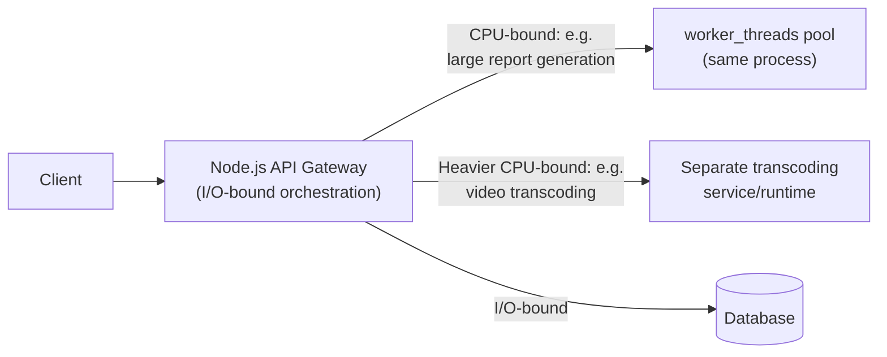

## 8. Production Architecture

A representative production topology: a container orchestrator (e.g.
Kubernetes) runs multiple replicas of a stateless Node.js service (each
replica a single Node.js process, no `cluster` forking inside the
container, relying on the orchestrator for horizontal scaling and fault
isolation instead), behind a load balancer, with an external shared store
(Redis) for any cross-instance state (rate limiting, session/cache data),
and a message queue for anything that should be processed asynchronously
outside the request/response cycle rather than inline.

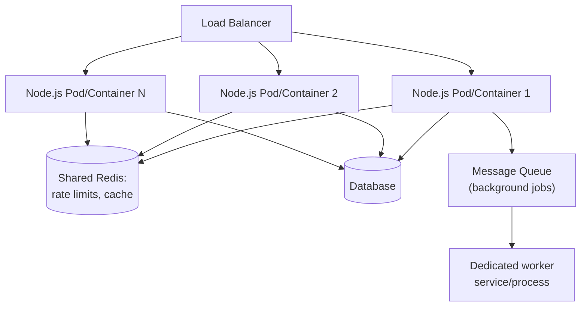

## 9. Implementation

Implementation checklist derived from Sections 4-8: use `pipeline()` (not
manual `.pipe()` chains) for stream error handling; size `worker_threads`
pools to available CPU cores, not to request concurrency; externalize any
state that must survive across processes/instances; commit and enforce
lockfiles in CI; and set `UV_THREADPOOL_SIZE` deliberately (with
measurement, not guessing) for filesystem- or DNS-lookup-heavy services
where the default pool of 4 is a bottleneck.

## 10. Complete Code Examples

**Example 1 — Event loop phase ordering (demonstrates Sections 4.2-4.3):**

```javascript
// event-loop-order.js
const fs = require('node:fs');

console.log('1: synchronous, top-level');

setTimeout(() => console.log('5: setTimeout (timers phase)'), 0);
setImmediate(() => console.log('6: setImmediate (check phase)'));

fs.readFile(__filename, () => {
  console.log('4: fs.readFile callback (poll phase)');
  // Inside an I/O callback, setImmediate is guaranteed to run
  // before a 0ms setTimeout, because 'check' follows 'poll'
  // in the same loop iteration, while the timer waits for the
  // NEXT iteration's 'timers' phase.
  setTimeout(() => console.log('8: nested setTimeout'), 0);
  setImmediate(() => console.log('7: nested setImmediate - fires first'));
});

Promise.resolve().then(() => console.log('3: microtask (Promise.then)'));
process.nextTick(() => console.log('2: process.nextTick (highest priority)'));
```

**Example 2 — `worker_threads` pool for CPU-bound work (Section 4.5):**

```javascript
// worker-pool.js — main thread
const { Worker } = require('node:worker_threads');
const os = require('node:os');

class WorkerPool {
  constructor(workerFile, poolSize = os.availableParallelism()) {
    this.taskQueue = [];
    this.freeWorkers = [];
    this.workers = Array.from({ length: poolSize }, () => {
      const worker = new Worker(workerFile);
      worker.on('message', (result) => this._onWorkerFree(worker, result));
      this.freeWorkers.push(worker);
      return worker;
    });
  }

  runTask(payload) {
    return new Promise((resolve) => {
      this.taskQueue.push({ payload, resolve });
      this._dispatch();
    });
  }

  _dispatch() {
    if (this.taskQueue.length === 0 || this.freeWorkers.length === 0) return;
    const worker = this.freeWorkers.pop();
    const { payload, resolve } = this.taskQueue.shift();
    worker.__pendingResolve = resolve;
    worker.postMessage(payload);
  }

  _onWorkerFree(worker, result) {
    worker.__pendingResolve(result);
    this.freeWorkers.push(worker);
    this._dispatch(); // service any queued work immediately
  }
}

module.exports = { WorkerPool };
```

```javascript
// cpu-worker.js — runs inside each worker thread
const { parentPort } = require('node:worker_threads');

function computeExpensiveHash(input) {
  // Placeholder for real CPU-bound work (e.g. image resize, hashing).
  let acc = 0;
  for (let i = 0; i < input.iterations; i++) acc = (acc + i * 31) % 1_000_000_007;
  return acc;
}

parentPort.on('message', (payload) => {
  const result = computeExpensiveHash(payload);
  parentPort.postMessage(result);
});
```

**Example 3 — `cluster` module scaling across cores (Section 4.6):**

```javascript
// cluster-server.js
const cluster = require('node:cluster');
const http = require('node:http');
const os = require('node:os');

if (cluster.isPrimary) {
  const coreCount = os.availableParallelism();
  console.log(`Primary ${process.pid}: forking ${coreCount} workers`);

  for (let i = 0; i < coreCount; i++) cluster.fork();

  // Fault isolation: replace a worker if it dies unexpectedly.
  cluster.on('exit', (worker, code, signal) => {
    console.error(`Worker ${worker.process.pid} died (${signal || code}); forking replacement`);
    cluster.fork();
  });
} else {
  // Each worker is an independent process with its own event loop.
  http.createServer((req, res) => {
    res.end(`Handled by worker ${process.pid}\n`);
  }).listen(3000);
}
```

**Example 4 — Streams with backpressure via `pipeline()` (Section 4.9):**

```javascript
// stream-pipeline.js
const { pipeline } = require('node:stream/promises');
const { createReadStream, createWriteStream } = require('node:fs');
const { createGzip } = require('node:zlib');

async function compressLargeFile(sourcePath, destPath) {
  // pipeline() wires backpressure across every stage automatically:
  // if the write stream (destination) is slower than the read+gzip
  // stages, upstream reading is paused until the destination drains —
  // memory usage stays bounded regardless of source file size.
  await pipeline(
    createReadStream(sourcePath),
    createGzip(),
    createWriteStream(destPath)
  );
  console.log(`Compressed ${sourcePath} -> ${destPath} with bounded memory use`);
}

module.exports = { compressLargeFile };
```

**Example 5 — CommonJS/ESM interop and the dual-package hazard (Section 4.7), in TypeScript:**

```typescript
// metrics-registry.mts (ESM entry point of a shared library)
const counters = new Map<string, number>();

export function increment(name: string): void {
  counters.set(name, (counters.get(name) ?? 0) + 1);
}

export function snapshot(): Record<string, number> {
  return Object.fromEntries(counters);
}
```

```javascript
// metrics-registry.cjs — a SEPARATE module instance if this file
// (rather than a shared implementation) backs the CJS "require" condition
// in package.json's "exports" map. If a codebase reaches this same
// logical library via BOTH require('metrics-registry') and
// import 'metrics-registry', each resolves to a DIFFERENT module
// instance with its own `counters` Map — the dual-package hazard.
// The fix: have the CJS entry point re-export the ESM implementation
// (or vice versa) instead of maintaining two independent copies,
// so there is exactly one `counters` Map no matter which syntax
// a given file in the dependency graph uses to reach it.
module.exports = require('./dist/metrics-registry.cjs.js');
```

## 11. Performance

Profile before optimizing: use `node --prof` plus `node --prof-process` (or
the V8 Inspector's CPU profiler) to find genuinely hot functions rather than
guessing. For hot paths, favor monomorphic call shapes (Section 4.4) and
avoid unnecessary object allocation inside tight loops. For I/O-heavy
services, most "performance" work is actually about avoiding unnecessary
serialization/parsing overhead (e.g. streaming JSON parsing for very large
payloads) and avoiding accidental synchronous calls (`fs.readFileSync` in a
request path) rather than micro-optimizing JavaScript itself.

## 12. Scalability

Two independent scaling axes apply to Node.js services: horizontal
(more processes/containers/instances, via `cluster` or an orchestrator's
replica count — Section 4.6) for I/O-bound throughput and fault isolation,
and worker-thread parallelism (Section 4.5) *within* a process for
CPU-bound work that benefits from staying close to shared in-process data.
Most Node.js services should scale primarily via the first axis; reach for
the second only once profiling actually shows CPU-bound contention on the
main thread.

## 13. Security

Validate and bound all externally-controlled input sizes before parsing —
an attacker-controlled, deeply nested JSON payload or a pathological regular
expression input can trigger the CPU-blocking failure mode (Section 4.1) as
a denial-of-service vector specific to Node's single-threaded model (a
"ReDoS," Regular Expression Denial of Service, attack is disproportionately
effective against Node.js precisely because it can stall the entire
process, not just one request/thread). Keep the lockfile-pinned dependency
tree (Section 4.8) audited (`npm audit`/equivalent) since a compromised or
vulnerable transitive dependency executes with the same privileges as your
own code — there is no process-level sandboxing between your code and a
`require()`d dependency by default.

## 14. Observability

Because a blocked event loop degrades *every* concurrent request
simultaneously rather than failing one request in isolation, event-loop-lag
monitoring (measuring the delta between a scheduled and actual `setImmediate`/
timer fire time) is a Node.js-specific health signal worth alerting on
directly, distinct from generic Central Processing Unit (CPU)/memory
metrics — sustained event-loop lag is a leading indicator of the CPU-blocking
failure mode before it shows up as elevated request latency broadly.

## 15. Failure Scenarios

- **Main-thread CPU blocking** (Section 4.1): one expensive synchronous
  operation stalls every concurrent request in the process.
- **Microtask starvation** (Section 4.3): unbounded recursive
  `process.nextTick`/Promise chaining prevents the event loop from ever
  reaching the next macrotask phase.
- **libuv thread-pool exhaustion** (Section 5): a burst of filesystem/DNS
  operations beyond `UV_THREADPOOL_SIZE` queues invisibly, with the main
  thread appearing idle while requests queue.
- **Process-local state divergence under `cluster`** (Section 4.6):
  in-memory caches/rate limiters/registries silently diverge across
  workers.
- **Dual-package hazard** (Section 4.7): a singleton-holding dependency
  loaded via both CommonJS and ESM paths silently becomes two independent
  instances.
- **Unbounded memory growth from backpressure-ignorant data handling**
  (Section 4.9): a fast producer overwhelming a slow consumer without
  honoring `write()`'s backpressure signal.

## 16. Testing

Load-test with realistic concurrency, not just correctness-check single
requests — many of this chapter's failure modes (event loop blocking,
thread-pool exhaustion, `cluster` state divergence) are invisible under a
single-request test and only appear under concurrent load. Test
worker-thread task dispatch and pooling logic (Section 4.5) with induced
worker failures, not just the happy path, to confirm the pool recovers
rather than silently shrinking. For stream pipelines (Section 4.9), test
with a deliberately slow consumer to confirm backpressure actually bounds
memory rather than just testing correctness on small inputs.

## 17. Common Mistakes

- Doing CPU-bound work (parsing huge payloads, image processing,
  synchronous cryptography) directly in a request handler instead of a
  worker thread.
- Manually forwarding stream data with `.on('data', ...)` instead of
  `.pipe()`/`pipeline()`, silently defeating backpressure.
- Keeping rate limiters, caches, or session data in module-level memory
  under a multi-process (`cluster` or multi-replica) deployment.
- Not committing (or not enforcing in CI) the lockfile, leading to
  non-reproducible installs.
- Assuming `setTimeout(fn, 0)` and `setImmediate(fn)` have a fixed relative
  order at the top level (Section 4.2) — their order there is
  non-deterministic; only inside an I/O callback is the ordering guaranteed.
- Creating a new `worker_threads` Worker per request instead of reusing a
  pool.

## 18. Best Practices

- Keep the request-handling path on the main thread strictly I/O-bound;
  route anything CPU-bound to a worker pool or a separate service.
- Use `pipeline()` for every multi-stage stream chain.
- Externalize cross-instance state to Redis or a database from day one in
  any service expected to run more than one instance.
- Pin and audit the dependency tree; prefer pnpm or equivalent
  phantom-dependency protection for large dependency graphs.
- Monitor event-loop lag as a first-class Node.js health metric.

## 19. Anti-Patterns

- **"God require" at startup**: eagerly `require()`-ing a large,
  rarely-needed dependency graph at process start, inflating cold-start
  time for every instance (Section 4.10), when lazy/dynamic `import()` at
  point of use would suffice.
- **Synchronous file/crypto calls in request handlers** (`readFileSync`,
  `execSync`, synchronous `crypto` variants) — reintroducing the exact
  blocking behavior Node.js exists to avoid (Section 3).
- **One worker thread per request**: paying full worker-creation overhead
  per request instead of pooling (Section 4.5).
- **Mixing CJS and ESM access paths to a singleton-holding dependency**
  without verifying they resolve to one instance (Section 4.7).

## 20. Trade-off Analysis

Node.js's central trade-off is concurrency-for-I/O versus parallelism-for-
CPU: excellent at holding many concurrent I/O-bound operations in flight
cheaply, comparatively poor (without deliberately opting into
`worker_threads`/`cluster`) at parallel CPU-bound computation, because there
is exactly one JavaScript thread by default. A second trade-off is
ecosystem breadth versus dependency-graph discipline: npm's low-friction
publishing model produced the largest package ecosystem of any language
runtime, at the cost of the phantom-dependency and dual-package-hazard risks
detailed in Sections 4.7-4.8 that more tightly-curated ecosystems avoid by
construction.

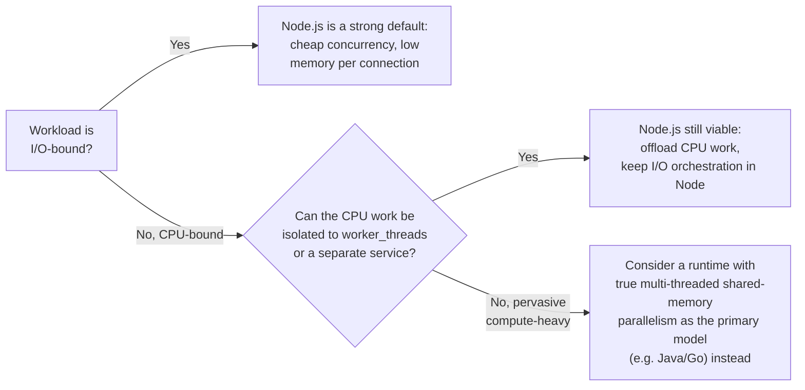

## 21. Comparison Table

| Dimension | Node.js | Thread-per-request runtime (e.g. traditional Java servlet model) |
|---|---|---|
| Concurrency model | Single JS thread + event loop; async I/O via libuv | One OS thread per in-flight request |
| Memory per idle connection | Low (a callback/closure, no full thread stack) | Higher (thread stack, typically ~1MB+) |
| CPU-bound work | Blocks the whole process unless offloaded (`worker_threads`) | Naturally parallel across threads/cores |
| Scaling across cores | Explicit: `cluster`/multiple processes, or `worker_threads` | Often implicit via the thread pool/JVM (Java Virtual Machine) |
| Ecosystem/package management | npm/pnpm/Yarn; large ecosystem, phantom-dependency risk | Typically more curated central repositories (e.g. Maven Central) |
| Module system | CommonJS + ESM, dual-package hazard possible | Single, JVM-native module/classpath model |
| Best-fit workload | I/O-bound services, API gateways, real-time messaging | Mixed I/O/CPU workloads, CPU-heavy enterprise systems |

## 22. Real-World Case Study

A mid-size e-commerce platform migrated its API gateway and BFF layer from a
thread-per-request Java stack to Node.js specifically to reduce memory
footprint under high connection concurrency during flash sales (thousands of
concurrent, mostly-idle client connections waiting on downstream service
calls). The migration succeeded for the gateway/BFF tier — memory per
instance dropped substantially, and the same hardware handled several times
the concurrent connections. The team initially kept a synchronous
order-receipt PDF generation step (inherited from the old codebase) inline
in the Node.js request handler; under the very first flash-sale load test,
P99 latency for completely unrelated endpoints (product search, cart
updates) spiked in lockstep with receipt-generation volume — the exact
Section 4.1 failure mode. The fix was moving PDF generation into a
dedicated `worker_threads` pool sized to available cores, after which
unrelated-endpoint latency stopped correlating with receipt volume. The team
also discovered, during the same load test, that their in-memory per-worker
rate limiter (Section 4.6's failure mode) was under-throttling by roughly
4x once deployed behind `cluster` with four workers, and moved rate-limit
state to a shared Redis instance.

## 23. Interview Questions

1. Walk through the event loop's phases in order and explain where a
   `fs.readFile` callback versus a `setImmediate` versus a `setTimeout(fn, 0)`
   callback each get executed relative to each other, and why.
2. Why does a single CPU-bound synchronous operation in a Node.js request
   handler affect *other, unrelated* requests, and how would you fix it?
3. Explain the difference between `worker_threads` and `cluster` — when
   would you choose one over the other?
4. What is the dual-package hazard, and how does a package's
   `package.json` `exports` field configuration prevent or cause it?
5. Explain what a phantom dependency is and how pnpm's architecture
   prevents it structurally.
6. Why does `readable.pipe(writable)` matter for memory usage compared to
   manually forwarding `'data'` events?
7. Describe V8's hidden classes and why polymorphic object shapes hurt
   performance on a hot function.
8. What is the libuv thread pool, which operations use it by default, and
   how would you diagnose that it's the bottleneck rather than the
   JavaScript thread itself?

## 24. Hands-on Exercises

1. Build the event-loop-order script from Section 10, Example 1; predict
   the output order on paper first, then run it and reconcile any
   mismatches against Sections 4.2-4.3.
2. Implement a small worker-thread pool (Section 10, Example 2) and load it
   with a genuinely CPU-bound task; measure request latency for unrelated
   concurrent requests with and without the pool.
3. Write a script that reads a large file (or generate one) through a
   `pipeline()` with a deliberately slow `Writable` (throttled with a
   `setTimeout` inside `_write`) and observe memory usage staying bounded;
   then repeat with manual `.on('data', ...)` forwarding and observe memory
   growth.

## 25. Design Exercises

1. Design the process/instance topology (processes per machine, `cluster`
   vs. orchestrator replicas, worker-thread pool sizing) for a service that
   is 90% I/O-bound (proxying to downstream APIs) and 10% CPU-bound
   (report generation on demand). Justify each sizing decision against
   Sections 4.5, 4.6, and 4.10.
2. Design how you would eliminate a suspected dual-package hazard in a
   shared internal library used by both legacy CommonJS services and new
   ESM services, without forcing an all-at-once migration of every
   consumer.

## 26. Architecture Review Questions

1. Does any request-handling code path perform synchronous, CPU-bound work
   directly on the main thread? If so, is it bounded and small, or does it
   need to move to a worker pool?
2. Is any application state assumed to be consistent across requests kept
   only in process-local memory, and does the deployment run more than one
   process/instance?
3. Is the lockfile committed and enforced in CI (`npm ci`/equivalent) so
   that installs are reproducible?
4. For any shared internal package with module-level singleton state, is
   its `package.json` `exports` configuration verified to avoid the
   dual-package hazard?
5. Are large or unbounded payloads (uploads, downloads, large query
   results) handled via streams, or buffered fully into memory?

## 27. Summary

Node.js is best understood architecturally as a specific bet: one
JavaScript thread, non-blocking I/O via libuv's event loop and small thread
pool, and V8's adaptively-JIT-compiled execution — a combination that makes
it excellent for I/O-bound, high-connection-concurrency workloads and
comparatively poor, without deliberate offloading, at CPU-bound work.
`worker_threads` and `cluster` are the two supported ways to add genuine
parallelism (within a process and across processes, respectively), each with
different memory and fault-isolation trade-offs. The module system
(CommonJS vs. ESM) and package-management architecture (`node_modules`
resolution, lockfiles, phantom dependencies, the dual-package hazard) are
Node.js-specific structural concerns that have no close analogue in some
other runtimes and are frequent, hard-to-diagnose sources of production
incidents when ignored. Streams and backpressure are Node's answer to
processing data larger than available memory safely. A Solution Architect
evaluating Node.js for a given service should start from the workload's
I/O-bound-versus-CPU-bound shape (Section 20) — that single question
predicts most of whether Node.js will be a strong or a poor architectural
fit.
