# Chapter 4: Go Architecture

## 1. Introduction

Go (also called Golang) is a statically typed, compiled programming language
designed at Google and released publicly in 2009. For a Solution Architect,
Go is not "just another language option" — it is a deliberately narrow set of
architectural bets: cheap concurrency at massive scale, a runtime that stays
out of the operator's way, a compiler that produces a single dependency-free
binary, and a language grammar small enough that an engineer can hold the
entire specification in their head. Those bets are why Go became the
implementation language of Kubernetes, Docker, Terraform, Prometheus, etcd,
and a large share of the cloud-native infrastructure ecosystem that
architects design against every day.

This chapter treats Go as an **architectural substrate** — the runtime and
language-level decisions that shape what kinds of systems are easy, hard, or
dangerous to build in it — rather than as a syntax tutorial. You will not
find a chapter on `for` loop syntax here. You will find first-principles
coverage of:

- The goroutine scheduler's M:N threading model (M operating-system threads
  multiplexing N goroutines), `GOMAXPROCS`, and the work-stealing scheduler
  that makes millions of concurrent goroutines a mundane operational fact
  rather than a heroic engineering feat.
- Channels and the Communicating Sequential Processes (CSP) concurrency model
  — "share memory by communicating" — contrasted with the shared-memory,
  lock-based concurrency model that dominates Java and C++.
- The garbage collector (GC): a concurrent tricolor mark-and-sweep collector
  engineered around a low-latency design goal (sub-millisecond stop-the-world
  pauses) rather than maximum throughput.
- The module system (`go.mod`, Semantic Import Versioning (SIV)) and the
  historical `GOPATH` model it replaced.
- The compilation model: static binaries, trivial cross-compilation, and the
  absence of a required runtime dependency (no Java Virtual Machine (JVM), no
  Node.js runtime, no Python interpreter to install on the target host).
- Interfaces and structural typing: implicit interface satisfaction and
  composition over inheritance as Go's answer to polymorphism.
- Error handling architecture: explicit error return values instead of
  exceptions, and the error-wrapping chain introduced in Go 1.13.
- The standard library's architecture philosophy, using `net/http` as the
  canonical example of "batteries included, production-grade by default."
- The architectural trade-offs that explain why Go dominates cloud-native
  infrastructure tooling and where it is the wrong tool.

By the end of this chapter you should be able to explain, from first
principles, why a Kubernetes controller, a Docker daemon, or a Terraform
provider is written in Go rather than Java, Python, Rust, or Node.js — and be
able to make that same category of decision for your own systems.

> **Scope boundary**: HTTP semantics (methods, status codes, idempotency) are
> owned by [HTTP](../05_Networking_and_OS/CH01_HTTP.md) and REST-specific API
> design is owned by [REST](../08_API_Architecture/CH01_REST.md). This
> chapter recaps `net/http` only as an illustration of Go's standard library
> philosophy, not as a re-teaching of HTTP or REST itself.

## 2. Historical Evolution

Go's design decisions only make sense in the context of the problem Google
was actually experiencing in the mid-2000s, so a chronological walk matters
more here than in most language chapters.

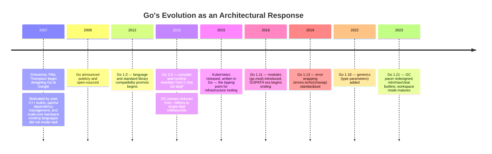

**The problem Go was built to solve.** By 2004-2006, Google's internal C++
codebase had reached a scale where a full rebuild of a large service could
take tens of minutes, header-file dependency graphs were unmanageable, and
engineers routinely fought data races in hand-rolled thread pools. Java and
Python were used elsewhere at Google, but neither addressed the two
constraints Google cared about most for infrastructure software: (1) startup
time and memory footprint at the scale of thousands of processes per
datacenter, and (2) making correct concurrent code the *default* path rather
than something bolted on with `synchronized` blocks or a Global Interpreter
Lock (GIL). Go's designers — all three with deep Unix, Plan 9, and compiler
background — decided that the fix was not a smarter build system bolted onto
C++, but a new, smaller language with concurrency as a first-class primitive,
a single static binary as the deployment artifact, and a compiler fast enough
that "compile time" stopped being a meaningful complaint.

**Why this history matters architecturally.** Every one of Go's headline
runtime features — goroutines, channels, the GC's latency focus, static
linking — traces directly back to "we run enormous fleets of small services
and cannot tolerate slow builds, heavyweight runtimes, or GC pauses that
violate Service Level Objectives (SLOs)." When Kubernetes, Docker, and
Terraform were built a few years later by engineers who had lived through the
same operational pain (multi-service, container-native, latency-sensitive
control planes), Go was the language that already matched their constraints.
That is not a coincidence you should read as "Go is fashionable" — it is a
direct causal chain from a specific class of infrastructure problem to a
specific set of language and runtime decisions.

## 3. Why It Exists

Go exists to answer a narrower question than "how do we make programming
easier" — it answers **"how do we make correct, observable, fast-to-build,
fast-to-deploy concurrent network services the path of least resistance for
a large engineering organization?"** Four design pressures shaped every
subsequent decision:

1. **Concurrency must be cheap and safe by default.** A network service that
   handles thousands of simultaneous connections needs a concurrency unit
   far cheaper than an operating system (OS) thread (which costs roughly 1-8
   Megabytes (MB) of stack space and expensive context switches). Go's answer
   is the goroutine: a user-space, growable-stack execution unit that starts
   at about 2 Kilobytes (KB) and is multiplexed onto a small number of OS
   threads by the runtime scheduler (Section 4.1).
2. **Deployment must not depend on a pre-installed runtime.** Distributing a
   JVM, a Python interpreter, or a Node.js runtime alongside every deployed
   artifact multiplies operational surface area — version mismatches, patching
   overhead, container image bloat. Go's compiler produces a single static
   binary with no external runtime dependency (Section 4.7).
3. **Compilation and dependency management must scale to a huge codebase
   without becoming a bottleneck.** Go's package-level compilation model, its
   explicit import graph (no implicit macro expansion, no circular imports),
   and later the module system (Section 4.6) exist to keep build times linear
   in the size of the code that actually changed.
4. **The language must be small enough that any engineer can read any other
   engineer's code without ramp-up.** Go deliberately omits features many
   contemporaries consider mandatory — classical inheritance, exceptions,
   operator overloading, and (until Go 1.18) generics — trading expressive
   power for a codebase-wide readability guarantee that scales to thousands of
   contributors.

The decision tree below summarizes the trade-off Go's designers made
explicitly: optimizing for operational simplicity and organizational scale
over raw expressive power or peak micro-benchmark performance.

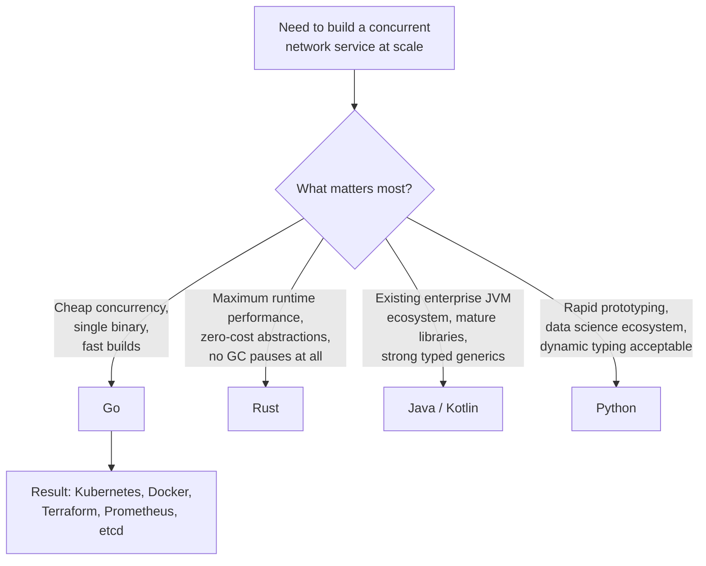

## 4. Core Concepts

This section teaches the Go-specific concepts an architect must reason about
directly: definition, mechanism, decision implications, common failure mode,
and a concrete scenario for each. General distributed-systems concepts (CAP
theorem, consensus, idempotency) and HTTP/REST semantics are owned elsewhere
per the Concept Ownership Rule and are only referenced, not retaught.

### 4.1 Goroutines and the M:N Threading Model

**Definition.** A goroutine is a function executing concurrently with other
goroutines in the same address space, scheduled by the Go runtime rather than
the OS kernel. Goroutines are Go's only concurrency primitive at the language
level — there is no separate "thread" type exposed to application code.

**Mechanism.** Goroutines are multiplexed onto a much smaller number of OS
threads using an **M:N scheduling model**: M goroutines run on N OS threads,
where N is typically bounded by `GOMAXPROCS` (Section 4.2), not by the number
of goroutines. A goroutine starts with a tiny (2 KB) growable stack — the
runtime detects stack-overflow conditions during function prologues and
copies the stack to a larger allocation as needed, so a goroutine can begin
cheap and grow to megabytes only if it actually needs to. Because the Go
runtime — not the kernel — decides when a goroutine yields the processor, it
can perform **cooperative-with-preemption-hints scheduling**: goroutines
yield at function calls, channel operations, and (since Go 1.14)
asynchronously via signal-based preemption, so even a tight CPU-bound loop
without function calls can no longer permanently starve the scheduler.

**Decision implications.** Because goroutines are cheap (you can run
hundreds of thousands to low millions of them on a single mid-size machine),
architects can model each unit of work — an inbound HTTP request, a
per-connection read loop, a background timer — as "just spawn a goroutine"
without the OS-thread-per-connection cost that made the C10K problem (the
difficulty of serving 10,000 concurrent connections) a serious engineering
challenge in thread-per-connection architectures. This changes the default
architecture of a Go network service: instead of an event loop with
callbacks (Node.js) or a fixed-size worker-thread pool (many Java servers
pre-`java.util.concurrent`), the idiomatic Go server spawns one goroutine per
request and lets the scheduler handle the multiplexing.

**Common failure mode: goroutine leaks.** A goroutine that blocks forever —
waiting on a channel nobody will ever send to, or an unbounded `for` loop
reading from a channel that is never closed — is never garbage collected,
because the Go garbage collector reclaims memory, not goroutines; a leaked
goroutine holding a live reference is, by definition, reachable. Under
sustained load this manifests as slowly climbing memory and goroutine counts
until the process is Out-Of-Memory (OOM) killed. See Section 15 for
diagnosis technique.

**Concrete scenario.** A Representational State Transfer (REST) API server
spawns a goroutine per incoming request via `net/http`'s default per-request
goroutine model (Section 4.11). Under 50,000 requests/second with a 100ms
average handler latency, roughly 5,000 goroutines are alive at any instant —
each costing a few KB of stack, not a few MB of OS-thread memory. The same
workload modeled as one OS thread per request in a runtime without
lightweight concurrency would require thousands of OS threads, each
consuming megabytes of stack and incurring kernel-level context-switch
overhead, well before hitting the same request rate.

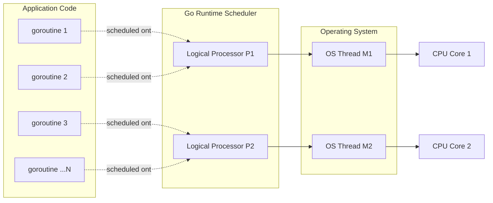

### 4.2 GOMAXPROCS and the G-M-P Scheduler Model

**Definition.** `GOMAXPROCS` is the runtime setting that bounds the number of
OS threads that may execute Go code (not blocked in a system call)
simultaneously. Internally the scheduler is described by the **G-M-P model**:
**G**oroutines (units of work), **M**achine threads (OS threads that actually
run code), and **P**rocessors (logical scheduling contexts — think
"permission slots" — whose count equals `GOMAXPROCS`).

**Mechanism.** Each **P** owns a local run queue of runnable goroutines. An
**M** must be attached to a **P** to execute Go code; without a **P**, an
**M** can only block in a system call. This design exists specifically to
avoid the lock contention that a single global run queue would create under
high goroutine counts: most scheduling decisions only touch a **P**'s local
queue, requiring no cross-thread synchronization. `GOMAXPROCS` defaults to
`runtime.NumCPU()` — the number of logical CPUs visible to the process — so a
Go program automatically parallelizes across all available cores without
manual thread-pool sizing. When an **M** is about to block on a system call
(e.g. a blocking file read), the runtime detaches the **P** from it and hands
that **P** to another idle or newly created **M**, so blocking system calls
do not stall the other goroutines scheduled on that **P**.

**Decision implications.** Because `GOMAXPROCS` directly bounds
parallelism, architects tuning Go services in containerized environments must
set it explicitly rather than trust the default in some cases: prior to Go
1.5's runtime awareness and especially prior to `GOMAXPROCS`-aware container
CPU-quota handling (fully solved by the `automaxprocs` pattern many
organizations still apply, or Go 1.21's improved container-aware default),
`runtime.NumCPU()` could report the *host's* full core count inside a
container throttled to, say, 2 CPU cores by a Kubernetes `resources.limits`
Central Processing Unit (CPU) quota — causing the scheduler to run far more
OS threads than the cgroup allows, leading to CPU throttling and increased
tail latency from context-switch thrash rather than true parallel execution.

**Common failure mode.** Setting `GOMAXPROCS` too high relative to actual
available cores (or a CPU-quota-limited container) causes excessive context
switching without added throughput; setting it to 1 in a workload that is
genuinely CPU-parallel (not I/O-bound) forfeits multi-core throughput
entirely. Both are silent — the program still runs correctly, just at the
wrong point on the latency/throughput curve.

**Concrete scenario.** A Go microservice is deployed in Kubernetes with a CPU
limit of `2` (2 vCPUs) but runs on a node with 64 logical CPUs. Without
container-aware `GOMAXPROCS` tuning, `runtime.NumCPU()` may return 64, the
scheduler creates far more OS threads than the cgroup quota allows to run
concurrently, and the Linux Completely Fair Scheduler (CFS) throttles the
container — visible as CPU throttling metrics and elevated p99 latency even
though average CPU utilization looks low. The fix is to set `GOMAXPROCS`
explicitly (or use a container-CPU-aware runtime library) to match the actual
quota, typically `2` in this example.

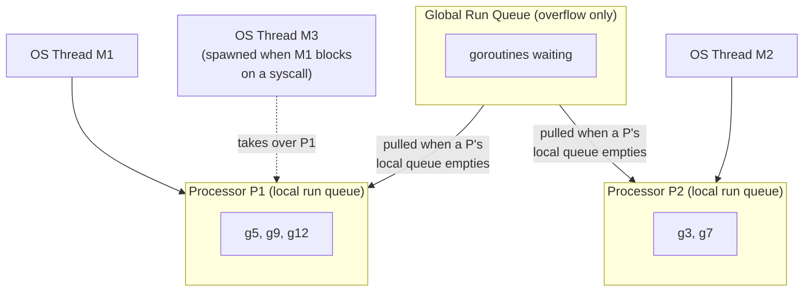

### 4.3 The Work-Stealing Scheduler

**Definition.** Work stealing is the load-balancing algorithm the Go
scheduler uses to keep every **P** busy: when a **P**'s local run queue is
empty, it "steals" half of the runnable goroutines from another, busier
**P**'s local queue rather than sitting idle.

**Mechanism.** Each **P** first checks its own local run queue. If empty, it
checks the global run queue (populated when a local queue overflows its fixed
capacity, or when goroutines are created from outside any **P**'s context,
such as during garbage collection). If the global queue is also empty, the
idle **P** picks a *random* other **P** and steals roughly half of its
runnable goroutines. Randomized victim selection, rather than always stealing
from the busiest, avoids contention hot-spots that a deterministic strategy
would create at scale.

**Decision implications.** Work stealing is what makes Go's concurrency model
scale without manual load balancing: an architect does not need to
hand-partition work across worker goroutines by CPU core — spawning
goroutines from a single dispatching goroutine and letting the scheduler
redistribute them is both simpler to write and, in practice, better balanced
than a manually sharded worker-pool-per-core design, because the scheduler
reacts to real-time imbalance rather than a static partition computed at
startup.

**Common failure mode.** Work stealing balances *goroutines*, not
*fairness of underlying resource access*. If one goroutine holds a mutex for
a long critical section, stealing other unrelated goroutines onto idle
**P**s does not unblock goroutines waiting on that same mutex — architects
who mistake "the scheduler will sort out contention" for "my lock strategy
doesn't matter" still hit convoy effects and priority-inversion-like
slowdowns under heavy lock contention (see Section 15).

**Concrete scenario.** A batch job launches 10,000 goroutines, each parsing
one file from a large batch, from a single dispatcher loop with no explicit
sharding. Even though all 10,000 goroutines are created from the same **P**
initially, the work-stealing scheduler distributes them across all
`GOMAXPROCS` processors within microseconds as idle **P**s steal from the
dispatcher's overloaded queue, achieving near-linear multi-core speedup
without the architect writing any load-balancing code.

### 4.4 Channels and the CSP Concurrency Model

**Definition.** A channel is a typed, thread-safe conduit through which
goroutines send and receive values. Channels implement Communicating
Sequential Processes (CSP), a concurrency model formalized by Tony Hoare in
1978 in which independent processes coordinate exclusively by passing
messages over defined channels, rather than by directly reading and writing
shared, mutable memory protected by locks.

**Mechanism.** An unbuffered channel (`make(chan T)`) synchronizes sender and
receiver: a send blocks until a corresponding receive is ready, and vice
versa — this is a rendezvous, not a mailbox. A buffered channel
(`make(chan T, n)`) decouples sender and receiver up to `n` outstanding
values; a send only blocks once the buffer is full, and a receive only
blocks once the buffer is empty. Closing a channel (`close(ch)`) signals "no
more values will ever be sent," letting receivers detect completion via the
two-value receive form (`v, ok := <-ch`) or via `range` over the channel,
which terminates automatically when the channel is closed and drained.

**Decision implications: CSP vs shared-memory concurrency.** Go's proverb
"Do not communicate by sharing memory; instead, share memory by
communicating" describes a genuine architectural choice, not just a style
preference. In the shared-memory model (Java's `synchronized`,
`java.util.concurrent` locks, C++ `std::mutex`), correctness depends on every
piece of code that touches a shared variable correctly acquiring the right
lock — a property the compiler cannot verify, and one that erodes as a
codebase grows and new contributors touch shared state without full context.
In the CSP model, ownership of a piece of data is transferred by sending it
over a channel: only one goroutine holds a reference to a given piece of
mutable state at a time by convention, so there is no lock to forget. This
does not make Go's model race-free by construction (nothing stops you from
also sharing memory across goroutines without a channel or mutex, and the
race detector, Section 16, exists precisely because of that), but it makes
the *idiomatic* path safer than the idiomatic path in a shared-memory-first
language.

**Common failure mode: deadlock via unbuffered channel misuse.** Sending on
an unbuffered channel from the only goroutine that could also receive from it
(e.g. sending and receiving in the same goroutine, or in a program whose only
other goroutine has already exited) blocks forever; the Go runtime detects
the *global* case ("all goroutines are asleep - deadlock!") and panics the
whole process, but a *partial* deadlock (some goroutines deadlocked while
others remain runnable) is not detected automatically and manifests as a
slow, silent goroutine leak instead.

**Concrete scenario.** A fan-out worker pool sends results back to a single
unbuffered results channel. If the caller reads only the first result and
then returns without draining the rest, every worker goroutine that finishes
after the first result blocks forever trying to send on a channel nobody is
reading — a goroutine leak that will not crash the process, only slowly
consume memory. The fix (shown in Section 10) is either a sufficiently
buffered channel, a `context.Context` cancellation signal the workers select
on, or draining the channel fully.

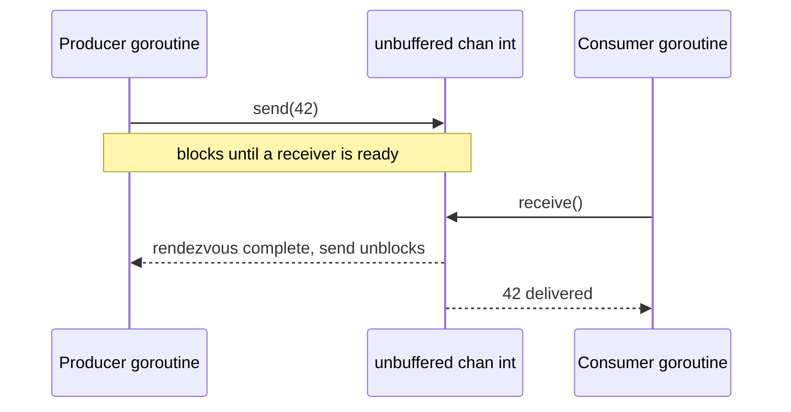

### 4.5 The `select` Statement

**Definition.** `select` lets a goroutine wait on multiple channel operations
simultaneously, proceeding with whichever case becomes ready first — Go's
equivalent of a Unix `select(2)`/`poll(2)` system call, but over channels
instead of file descriptors.

**Mechanism.** If multiple cases are simultaneously ready, `select` chooses
one **pseudo-randomly**, deliberately, to prevent programs from silently
depending on case-evaluation order. A `default` case makes the whole `select`
non-blocking: if no other case is immediately ready, `default` runs instead
of waiting.

**Decision implications.** `select` is the mechanism that makes
**cancellation propagation** possible without polling: a goroutine performing
work can simultaneously wait on "do I have a result to send?" and "has the
caller cancelled via `ctx.Done()`?", reacting to whichever happens first.
This is the idiomatic replacement for the "check a shared boolean flag in a
loop" cancellation pattern common in other languages, and it composes: any
number of cancellation sources (a timeout, a parent cancellation, an
explicit cancel call) all funnel through the same `<-ctx.Done()` channel.

**Common failure mode.** Forgetting a `default` case when a non-blocking
check was intended turns a `select` into a blocking wait, silently changing
the concurrency behavior of the surrounding function; conversely, adding an
unwanted `default` to what should be a blocking, event-driven `select` turns
it into a busy-poll loop that burns CPU.

**Concrete scenario.** An HTTP handler starts a slow downstream call in a
goroutine and uses `select` to race the result channel against
`r.Context().Done()` (the request's cancellation context, populated by
`net/http` when the client disconnects). If the client disconnects before
the downstream call finishes, the handler returns immediately via the
`ctx.Done()` case instead of holding the goroutine — and the server's
resources — until the slow call eventually finishes on its own.

### 4.6 The Garbage Collector: Concurrent Tricolor Mark-and-Sweep

**Definition.** Go's garbage collector (GC) automatically reclaims memory for
objects no longer reachable from any goroutine's roots (stack variables,
globals, registers). It uses a **concurrent, tricolor, mark-and-sweep**
algorithm, explicitly engineered around a **low-latency design goal**
(sub-millisecond stop-the-world pauses) rather than maximum throughput or
minimum total memory use.

**Mechanism.** Every object is conceptually colored **white** (not yet
visited, presumed garbage), **gray** (visited, but its references not yet
scanned), or **black** (visited and fully scanned — definitely reachable).
The collector starts by marking roots gray, then repeatedly picks a gray
object, scans its references (coloring anything newly discovered gray, and
recoloring the object itself black), until no gray objects remain — anything
still white at that point is garbage and gets swept. Crucially, this marking
work happens **concurrently** with the application's "mutator" goroutines
still running and allocating — the invariant that makes this safe (the
tricolor invariant: no black object may point directly to a white object
without a gray object in between) is enforced via a **write barrier**: a
small piece of code the compiler inserts around every pointer write during
the marking phase, which shades the referenced object gray if it would
otherwise violate the invariant. There are only two true
stop-the-world (STW) pauses per GC cycle — one brief pause to start marking
(turn on write barriers, scan initial roots) and one brief pause to finish
it — both targeted at sub-millisecond duration; everything else, including
the bulk of marking and all of sweeping, runs concurrently with normal
program execution, using roughly 25% of `GOMAXPROCS` worth of CPU dedicated
to background marking assist.

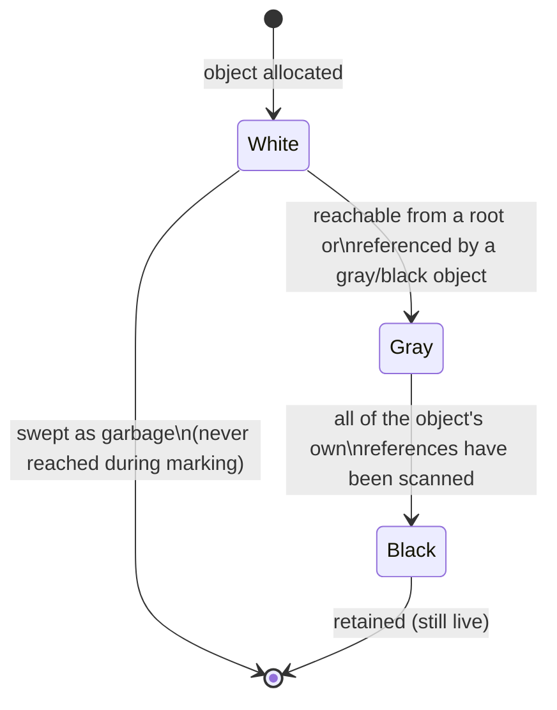

**Decision implications.** The GC's explicit prioritization of **latency
over throughput** is a direct architectural consequence of Go's target
domain: network servers with request-level Service Level Agreements (SLAs)
care far more about "no request ever waits 200ms for a GC pause" than about
"total CPU spent on GC across the whole process lifetime." This is the
opposite prioritization from, say, a batch analytics JVM tuned with
throughput-collector flags. The tunable architects actually touch is `GOGC`
(the percentage of heap growth, relative to live heap size after the last
collection, that triggers the next GC cycle — default `100`, meaning "collect
again once the heap has doubled") and, since Go 1.19, `GOMEMLIMIT` (a soft
memory cap the runtime uses to collect more aggressively as it approaches the
limit, useful in memory-constrained containers where doubling the heap risks
an OOM kill before `GOGC`'s ratio-based trigger would fire).

**Common failure mode.** Assuming the GC will keep total memory bounded with
no configuration: `GOGC=100`'s default ratio-based trigger means peak memory
scales with the *live heap size*, not a fixed cap — a service whose live heap
grows over time (e.g. an in-memory cache with no eviction) will see its
memory footprint grow correspondingly, and in a container with a hard memory
limit, can be OOM-killed well before `GOGC` would have triggered a collection,
because `GOGC` has no awareness of the container's actual memory ceiling
unless `GOMEMLIMIT` is also set.

**Concrete scenario.** A Go service running in a container with a 512
Megabyte (MB) memory limit holds a growing in-memory Least Recently Used
(LRU) cache with no size bound. Live heap grows from 50MB to 300MB over an
hour; with `GOGC=100` the next collection trigger is at 600MB — past the
container's 512MB limit — so the container is OOM-killed before the
GC's own ratio-based trigger ever fires. Setting `GOMEMLIMIT=450MiB`
(leaving headroom below the hard limit) makes the collector run more
aggressively as it approaches that soft limit, trading some extra CPU for
avoiding the OOM kill — a genuine latency/memory/CPU trade-off the architect
must make explicitly, not something the runtime can infer on its own.

### 4.7 The Module System: `go.mod`, Semantic Import Versioning, and the GOPATH History

**Definition.** A Go module is the unit of dependency versioning and
distribution: a tree of Go packages described by a `go.mod` file declaring
the module's own import path, its minimum Go language version, and the
specific versions of every dependency module it requires.

**Historical mechanism (GOPATH era, pre-2018).** Before modules (introduced
experimentally in Go 1.11, default in Go 1.13), all Go source had to live
inside a single global workspace rooted at `$GOPATH/src`, with import paths
mapping directly to filesystem paths inside that workspace. Dependency
versioning was not part of the toolchain at all — teams either vendored
dependency source trees directly into their repository (the `vendor/`
directory convention) or relied on third-party tools (`dep`, `glide`,
`godep`) layered on top, with no standardized lockfile format across the
ecosystem. This worked passably for a single monorepo (which is exactly
Google's internal model) but was a persistent pain point for the broader
open-source Go ecosystem, where different projects needed different, mutually
incompatible versions of the same dependency simultaneously — something
`GOPATH`'s single-global-workspace model could not express at all.

**Current mechanism (modules).** `go.mod` declares direct and (transitively,
recorded in `go.sum` for integrity verification) indirect dependency
versions using **Minimal Version Selection (MVS)**: given a build's full set
of required module versions across the dependency graph, Go selects, for
each module, the *minimum* version that satisfies every requirement in the
graph — not the latest available version (a deliberate contrast with npm's
typical "install latest compatible" resolution, chosen for maximally
reproducible builds). **Semantic Import Versioning (SIV)** extends this to
major-version compatibility: Go treats a major-version bump (`v2`, `v3`, ...)
as a *different import path* (e.g. `example.com/mymodule/v2`), on the
principle that a major version, by semantic versioning convention, may break
the Application Programming Interface (API) contract — so the toolchain
allows both `v1` and `v2` of the same module to coexist in a single build's
dependency graph without conflict, because they are, from the import
resolver's perspective, simply different packages.

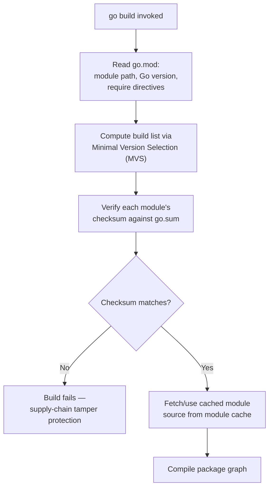

**Decision implications.** MVS's "minimum satisfying version, not latest"
policy trades a small amount of missed-bugfix currency for strong build
reproducibility: two builds of the same `go.mod`/`go.sum` pair, run months
apart, resolve to the exact same dependency versions without a separate
lockfile-vs-manifest reconciliation step (unlike ecosystems where the
manifest expresses ranges and a separate lockfile pins exact versions). For
architects, this means `go.sum` is both a reproducibility guarantee and a
supply-chain security control (Section 13) — any tampering with a dependency's
published source changes its hash and fails the build.

**Common failure mode.** Bumping a dependency to a new major version without
updating the import path (forgetting the `/v2` suffix convention) causes Go
to treat it as an entirely separate, incompatible module rather than an
upgrade — a frequent source of confusion for teams new to SIV who expect
major-version bumps to behave like they do in npm or Maven.

**Concrete scenario.** A platform team maintains an internal Go module used
by 40 services. They need to make a breaking API change. Rather than forcing
all 40 services to upgrade atomically, they publish the breaking change as
`v2` (with import path suffix `/v2`), allowing services to migrate on their
own schedule while both `v1` and `v2` remain independently resolvable and
even simultaneously importable within the same build graph if one service
transitively depends on both through different paths.

### 4.8 Compilation Model: Static Binaries and Cross-Compilation

**Definition.** The Go toolchain compiles a program and (by default) all of
its dependencies into a single, statically linked, architecture- and
OS-specific executable with no required external runtime — no JVM, no
interpreter, no dynamically linked language runtime that must be present on
the target host.

**Mechanism.** The Go compiler and linker embed the garbage collector, the
scheduler, and the entire portion of the standard library actually used
directly into the output binary. Cross-compilation is controlled by two
environment variables read at build time: `GOOS` (target operating system,
e.g. `linux`, `darwin`, `windows`) and `GOARCH` (target CPU architecture,
e.g. `amd64`, `arm64`). Because the compiler and standard library ship
prebuilt for every supported `GOOS`/`GOARCH` pair, building a Linux Advanced
RISC Machine (ARM) 64-bit binary from a Windows x86-64 development machine is
a single command (`GOOS=linux GOARCH=arm64 go build`) requiring no target
toolchain, emulator, or Docker container — a stark contrast to
cross-compiling C/C++ (which needs a target-specific toolchain) or shipping
a Java Archive (JAR) (which needs a JVM matched to the target's architecture
already installed).

**Decision implications.** A dependency-free static binary radically
simplifies the deployment architecture: container images can be built
`FROM scratch` or `FROM distroless` (a minimal base image with no shell, no
package manager, and no OS userland beyond what the binary itself needs),
shrinking image size from hundreds of MB (a typical JVM base image) to
single-digit MB, and eliminating an entire category of "works on my machine
because I have runtime version X installed" failure. This is a first-order
reason infrastructure tooling (which must run identically across arbitrary
customer environments, architectures, and minimal container bases) gravitates
to Go.

**Common failure mode: Cgo breaks static linking.** If a Go program imports
a package that uses `cgo` (calling into C code, common for certain database
drivers or DNS resolution paths on some platforms), the resulting binary may
dynamically link against the target's C library (`glibc`) unless
`CGO_ENABLED=0` is set explicitly, silently reintroducing the exact runtime
dependency (a compatible `glibc` on the target host) that static linking was
supposed to eliminate — a common surprise when a `FROM scratch` container
image fails at runtime with "no such file or directory" despite the binary
existing, because the *dynamic linker itself* is missing.

**Concrete scenario.** A Command-Line Interface (CLI) tool needs to ship
prebuilt binaries for Linux, macOS, and Windows, on both x86-64 and ARM64,
for a GitHub release. A single build matrix of `GOOS`/`GOARCH` combinations,
run in Continuous Integration (CI) with `CGO_ENABLED=0`, produces all six
statically linked binaries without needing six separate build environments —
the exact workflow Terraform, `kubectl`, and most Go-based CLIs use for
release automation.

### 4.9 Interfaces and Structural Typing

**Definition.** A Go interface type defines a method set; any concrete type
that implements every method in that set satisfies the interface
**implicitly** — there is no `implements` keyword, and the concrete type
need not even be aware the interface exists at the point it is defined.

**Mechanism.** Interface satisfaction is checked structurally (by the shape
of the method set) rather than nominally (by an explicit declaration of
intent, as in Java's `implements Foo` or C#'s `: IFoo`). At compile time, Go
verifies that a value assigned to an interface variable actually has all the
required methods; at runtime, an interface value is represented internally
as a two-word pair — a pointer to type information (used for method
dispatch and for type assertions/`type switch`) and a pointer to the
underlying concrete data.

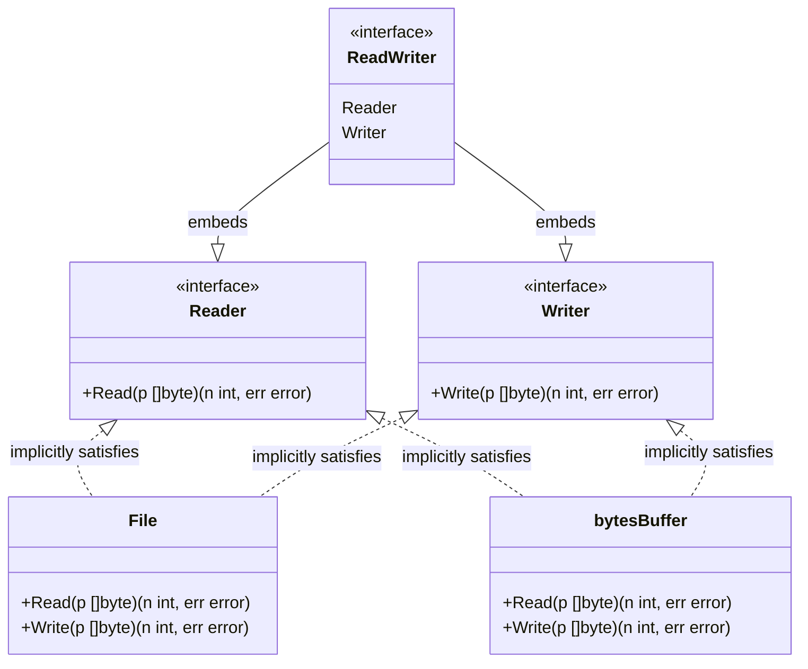

**Decision implications.** Implicit satisfaction inverts the usual
dependency direction for polymorphism: a consuming package can define the
*narrowest* interface it needs (famously, Go's standard library `io.Reader`
is a single method, `Read([]byte) (int, error)`) without the producing
package needing to know about, import, or declare conformance to that
interface ahead of time. This is what enables the common Go idiom "accept
interfaces, return concrete types" — a function should take the smallest
interface that describes what it actually needs (maximizing the set of
callable-with types), while returning a concrete type (maximizing the
information available to the caller). It is also what makes retrofitting a
new abstraction over existing, unmodified third-party types possible: you can
define a new interface today that an already-compiled dependency's type
happens to satisfy, with zero changes to that dependency.

**Composition over inheritance.** Go has no class inheritance at all — a
struct can only **embed** another type (struct or interface), which promotes
the embedded type's fields and methods to the outer type's method set, but
this is explicit delegation, not subtype polymorphism: an embedded `Base`
does not make `Derived` assignable wherever `Base` is expected unless
`Derived` is separately checked against an interface `Base` also satisfies.
This is a deliberate rejection of deep inheritance hierarchies — Go's
designers consider multi-level inheritance a frequent source of fragile,
hard-to-reason-about coupling (the classic "fragile base class" problem), and
push architects toward **composing** small, focused types instead.

**Common failure mode.** A nil pointer of a concrete type assigned to an
interface variable produces a *non-nil interface value* (because the
interface's type-pointer half is non-nil, even though the data-pointer half
is nil) — a canonical Go gotcha where `err != nil` evaluates true even though
the underlying concrete error pointer is nil, because `err`'s static type is
an interface, and interface-nil-ness requires *both* halves to be nil.

**Concrete scenario.** A logging library defines its own minimal
`Logger` interface with a single `Log(msg string)` method. Any existing
type in any dependency — the standard library's `log.Logger`, a
third-party structured logger, or a hand-rolled test double — can be passed
wherever the library expects a `Logger`, as long as it happens to have a
compatible `Log` method, with zero coordination between the library author
and the type's original author.

### 4.10 Error Handling Architecture: Explicit Returns vs Exceptions

**Definition.** Go represents failure as an ordinary return value of the
built-in `error` interface type (`type error interface { Error() string }`),
returned alongside a function's normal result(s), rather than as an
out-of-band control-flow mechanism like a thrown exception.

**Mechanism.** By convention (not compiler-enforced), a function that can
fail returns `(result T, err error)`, and callers check `if err != nil`
immediately after every call that can fail. There is no automatic
propagation — an unchecked error is simply a discarded value, and the
compiler will not warn about it (a real cost, discussed below). Go 1.13
formalized **error wrapping**: `fmt.Errorf("doing X: %w", err)` wraps an
underlying error while preserving it for programmatic inspection via
`errors.Is` (identity/sentinel comparison, following the wrap chain) and
`errors.As` (type-based extraction, also following the wrap chain), replacing
the earlier convention of losing the original error's type information once
it was formatted into a string.

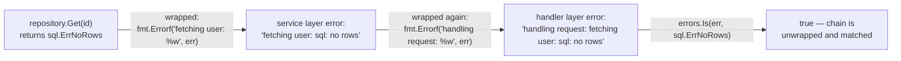

**Decision implications: why this is an architectural choice, not just
style.** Exceptions create an implicit, invisible control-flow path: any line
of code that calls into code that might throw can transfer control away
without any local syntactic marker (unless the language forces checked
exceptions, as Java attempted, which its own ecosystem largely abandoned as
too rigid). Go's designers judged that trade-off unacceptable at the scale of
a large codebase read by many engineers: with explicit error returns, every
possible failure exit point is visible in the source at the call site, forcing
(if not compiling-enforcing) the author to decide what to do with it —
propagate wrapped, log, retry, or explicitly ignore with `_ = err` (visible
in code review as a deliberate choice). The cost is verbosity — the
ubiquitous `if err != nil { return err }` pattern — which Go's designers
accepted as a worthwhile trade for eliminating invisible control flow.
`panic`/`recover` exist in Go but are reserved by convention for truly
unrecoverable programmer errors (e.g. array-index-out-of-bounds, nil
dereference) or intentionally unwinding within a single package's private
implementation, never as a general error-handling mechanism across package
boundaries.

**Common failure mode.** Ignoring a returned error (`result, _ := risky()`)
compiles cleanly with no warning, silently discarding failure information;
this is the most common Go code-review defect, and static analysis tools
(`errcheck`, `go vet` in later versions) exist specifically to catch it
because the compiler will not.

**Concrete scenario.** A payment-processing service calls a downstream
gateway, wraps any failure with context at each layer
(`fmt.Errorf("charging card: %w", err)`), and at the top-level HTTP handler
uses `errors.Is(err, gateway.ErrInsufficientFunds)` to decide whether to
return Hypertext Transfer Protocol (HTTP) 402 Payment Required versus a
generic 500 for an unexpected failure — the wrapping chain lets the handler
make that routing decision without the gateway package and the HTTP handler
package needing to share anything beyond the sentinel error value.

### 4.11 Standard Library Architecture Philosophy: `net/http` as a Production-Grade Default

**Definition.** Go's standard library follows a "batteries included, and the
batteries are production-grade" philosophy: core infrastructure packages
(`net/http`, `crypto/tls`, `encoding/json`, `context`) are designed to be
used directly in production services, not merely as a minimal starting point
that gets replaced by a third-party framework as soon as a project becomes
serious.

**Mechanism.** `net/http`'s `Server` type implements a complete, concurrent,
keep-alive-aware HTTP/1.1 (and, transparently, HTTP/2 over Transport Layer
Security (TLS)) server with sane defaults for header size limits, per-request
goroutine dispatch, and graceful shutdown (`Server.Shutdown(ctx)`, which stops
accepting new connections and waits for in-flight requests to complete or for
the passed `context.Context` to be cancelled). Contrast this with Node.js,
where the built-in `http` module is intentionally low-level and most
production services build on a framework (Express, Fastify) layered on top;
or Python, where `http.server` is explicitly documented as unsuitable for
production and real services use Flask/FastAPI with a separate Web Server
Gateway Interface (WSGI)/Asynchronous Server Gateway Interface (ASGI) server
(Gunicorn, Uvicorn) in front.

**Decision implications.** Because `net/http` is already production-grade,
many Go services genuinely need zero web framework — routing, middleware
composition, and request/response handling can all be expressed with
standard-library types plus a thin routing layer (either the enhanced
pattern-matching `http.ServeMux` introduced in Go 1.22, or a small
third-party router). This is a meaningfully different default architecture
from ecosystems where a framework is assumed as table stakes, and it reduces
both dependency surface area (Section 13, supply-chain risk) and the
learning curve for a new contributor, who only needs to understand the
standard library, not a framework's additional abstraction layer on top of
it.

**Common failure mode.** Assuming the standard library's defaults are
sufficient for every production concern without verification — for example,
`http.Server` has no default request timeout, so a client that opens a
connection and sends data arbitrarily slowly (a Slowloris-style resource
exhaustion pattern) can hold a goroutine and connection open indefinitely
unless `ReadTimeout`, `WriteTimeout`, and `ReadHeaderTimeout` are configured
explicitly (Section 13).

**Concrete scenario.** A small internal tools team builds an internal
Application Programming Interface (API) service using only `net/http` and
the standard library's `encoding/json`, with a single third-party dependency
for structured logging. The resulting `go.mod` has 3 direct dependencies
total, in contrast to an equivalent Node.js/Express service that would
typically pull in dozens of transitive packages for routing, body-parsing,
and middleware composition — directly reducing the supply-chain attack
surface (Section 13) the team must audit.

## 5. Internal Working

This section goes one level deeper into the two runtime subsystems every
architect eventually has to reason about under production incident
conditions: the scheduler's full state machine, and the GC's phase timeline.

**Goroutine state machine.** A goroutine transitions between three primary
states as the scheduler manages it: `_Grunnable` (ready to run, waiting for a
**P**), `_Grunning` (actively executing on some **M**), and `_Gwaiting`
(blocked — on a channel operation, a mutex, a system call via the
network poller, or a timer). A fourth state, `_Gsyscall`, marks a goroutine
that has entered a blocking OS system call directly (as opposed to a
network I/O operation, which Go's runtime intercepts via an integrated
**network poller** built on `epoll`/`kqueue`/IOCP so that network I/O never
actually blocks an OS thread — this is what lets a single **M** service
thousands of concurrent, mostly-idle network connections instead of needing
one **M** per blocked connection).

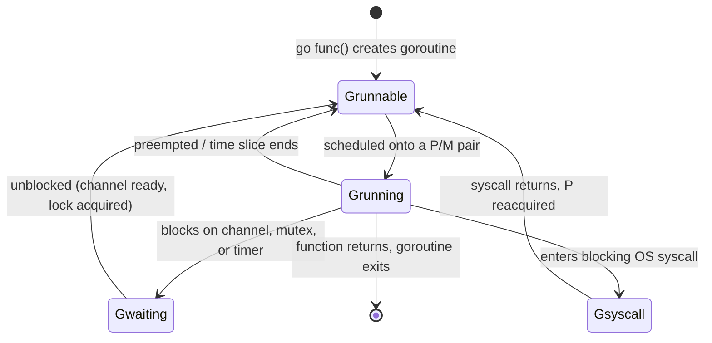

**GC cycle timeline.** A full GC cycle interleaves two brief STW pauses with
a much longer concurrent phase:

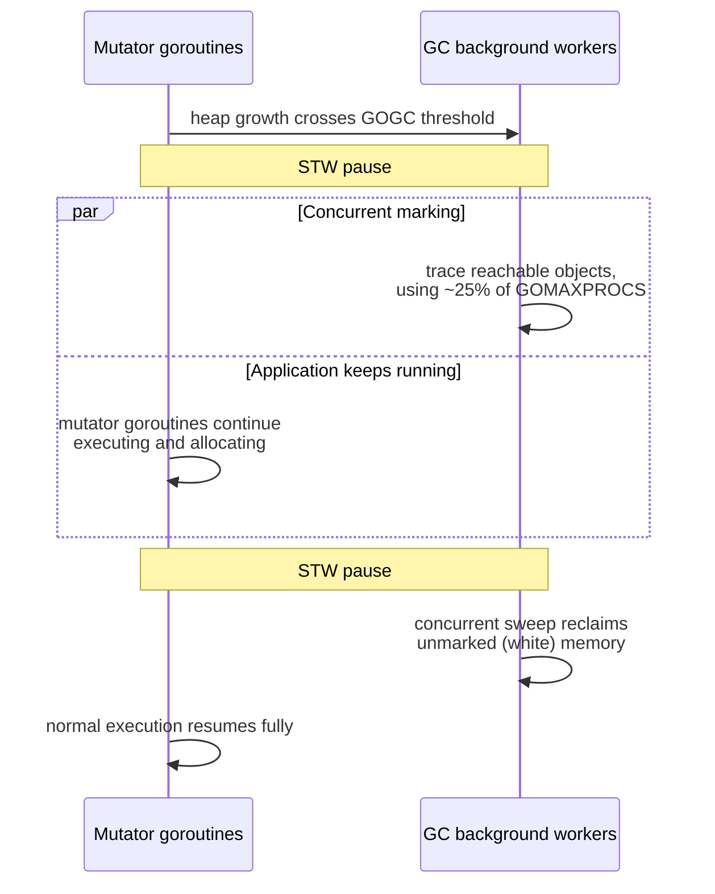

The architectural payoff of this design is that a Go service's GC-induced
latency impact on any single request is bounded by two very short STW pauses
per cycle rather than one long stop-the-world pause proportional to live heap
size — the trade Go's designers made explicitly in favor of latency-sensitive
network services over raw throughput-maximizing batch workloads.

## 6. Design Principles

Go's language and standard library design is governed by a small set of
consistently applied principles, which explain *why* the language looks the
way it does rather than simply *what* it looks like:

- **Simplicity over expressiveness.** Go deliberately omits features many
  contemporaries treat as essential (generics were absent for its first nine
  years; there is still no operator overloading, no implicit type coercion,
  no exceptions). Every omission is a bet that the resulting constraint
  produces more uniform, more reviewable code across a large team than the
  expressive power would have been worth.
- **Composition over inheritance**, covered in Section 4.9 — small,
  independently useful types and interfaces assembled by embedding, not deep
  class hierarchies.
- **Explicitness over magic.** Errors are explicit return values (Section
  4.10); dependencies are explicit in `go.mod` (Section 4.7, no implicit
  transitive version resolution surprises with MVS); there is no reflection-
  heavy dependency injection framework baked into the standard library — most
  idiomatic Go code wires dependencies together explicitly in a `main`
  function or a small `wire`-style code-generation step, not via a runtime DI
  container.
- **Orthogonality of concurrency primitives.** Goroutines, channels, and
  `select` are three small, independently understandable primitives that
  compose into arbitrarily complex concurrency patterns (Section 7), rather
  than a single large "concurrency framework" API surface.
- **Tooling as a first-class language feature.** `gofmt` (a single canonical
  code formatter with no configuration options, eliminating an entire class
  of code-review bikeshedding), `go vet` (static analysis for common
  correctness mistakes), and the race detector (Section 16) are shipped with
  the toolchain itself, not left to community convention — because Go's
  designers consider consistent tooling part of "the language," not an
  optional add-on.

## 7. Architecture Patterns

Go's concurrency primitives compose into a small set of recurring patterns
that function as the language's idiomatic building blocks for concurrent
architecture — analogous to how object-oriented design patterns compose
classes and interfaces.

**Worker pool.** A fixed number of long-lived worker goroutines pull tasks
from a shared channel, bounding concurrency to a known, tunable number
regardless of how many tasks are submitted — the pattern used whenever
unbounded goroutine creation (one per task) would risk overwhelming a
downstream resource (a database connection pool, a rate-limited external
API).

**Fan-out / fan-in pipeline.** A single input channel is *fanned out* to
multiple worker goroutines processing items in parallel, whose individual
output channels are then *fanned in* to a single merged output channel — the
standard shape for "parallelize an expensive per-item transformation, then
recombine the results in whatever order they complete."

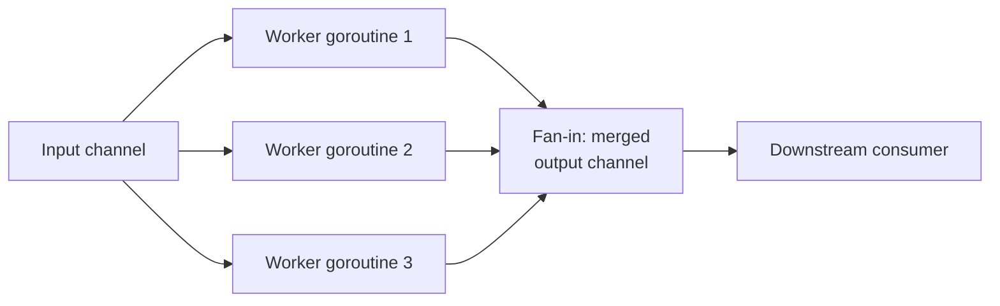

**Context-propagated cancellation.** A `context.Context` value is threaded
as the first parameter through every function in a call chain that might
block or take meaningfully long, carrying a cancellation signal (and
optionally a deadline, and request-scoped values) so that cancelling the
top-level context — a client disconnect, a timeout, an explicit
`cancel()` call — propagates automatically to every downstream goroutine
selecting on `ctx.Done()`, without each layer needing custom cancellation
plumbing.

**Pipeline stages connected by typed channels.** Multi-stage data processing
(read → parse → validate → transform → write) is expressed as a chain of
goroutines, each stage reading from the previous stage's output channel and
writing to its own output channel — each stage independently concurrent, and
back-pressure naturally propagates backward through the pipeline because a
slow downstream stage's full channel blocks the upstream stage's send.

**Sync primitives for shared state that genuinely must be shared.** Not every
piece of state fits the message-passing model cleanly — a simple counter or
a small read-mostly cache is often better protected by `sync.Mutex` or
`sync.RWMutex` directly than by routing every read through a channel and a
dedicated owning goroutine. Go's standard library treats `sync.Mutex` as a
first-class, idiomatic tool, not a fallback to be avoided at all costs — the
CSP proverb is a *default*, not a dogma.

## 8. Production Architecture

A production Go service's typical architecture reflects the concepts above
directly. A common shape for a cloud-native Go microservice:

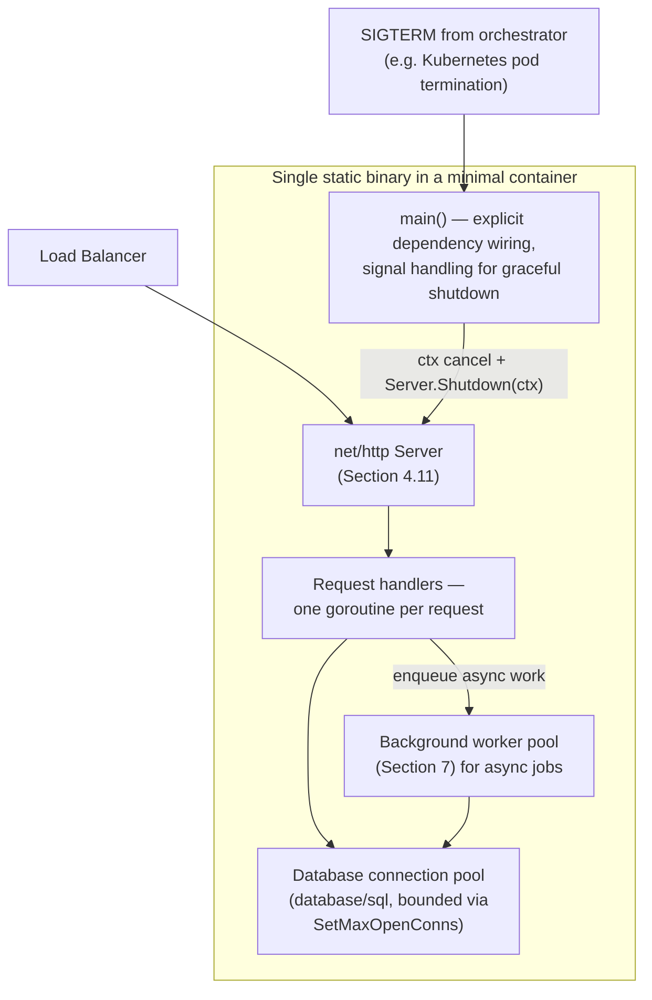

Kubernetes' own controller architecture is a canonical real-world instance of
these same patterns at a larger scale: each controller runs a **reconcile
loop** — a goroutine (or worker pool of goroutines) that watches for changes
to a resource type via a channel-fed informer cache, and reconciles observed
state against desired state, using `context.Context` for cancellation on
shutdown and worker-pool patterns to bound reconciliation concurrency per
resource kind.

## 9. Implementation

A minimal, idiomatic module layout for a Go service:

```
myservice/
├── go.mod                 # module path, Go version, dependencies
├── go.sum                 # dependency checksums
├── cmd/
│   └── myservice/
│       └── main.go        # composition root: wiring, flag/env parsing
├── internal/               # not importable by other modules (Go-enforced)
│   ├── handler/            # HTTP handlers
│   ├── service/             # business logic
│   └── repository/         # data access
└── pkg/                    # code intended to be imported by other modules
```

The `internal/` directory name is enforced by the Go toolchain itself (not
just a convention): any package under a path segment named `internal/` can
only be imported by code rooted at or above that `internal/` directory's
parent — a compiler-enforced encapsulation boundary at the module level, used
architecturally to expose a small public `pkg/` surface while keeping
implementation packages genuinely private to the module.

```go
// go.mod
module example.com/myservice

go 1.22

require (
    github.com/go-chi/chi/v5 v5.0.12
    github.com/jackc/pgx/v5 v5.5.4
)
```

## 10. Complete Code Examples

The following examples are runnable, production-representative Go and are
also available under [code/go](../code/go/) for direct execution.

**Example 1 — Bounded worker pool with graceful cancellation.** Demonstrates
Section 4.1 (goroutines), 4.4 (channels), and 4.5 (`select`) composed
together, and avoids the goroutine-leak failure mode from Section 4.4 by
draining results and honoring context cancellation.

```go
package workerpool

import (
	"context"
	"fmt"
	"sync"
)

// Task is a unit of work submitted to the pool.
type Task struct {
	ID      int
	Payload string
}

// Result is the outcome of processing one Task.
type Result struct {
	TaskID int
	Output string
	Err    error
}

// Run starts numWorkers goroutines that consume tasks from the tasks
// channel and send results on the returned channel. It stops early if
// ctx is cancelled, and always closes the results channel exactly once
// all workers have exited, so callers can safely range over it.
func Run(ctx context.Context, tasks <-chan Task, numWorkers int) <-chan Result {
	results := make(chan Result)
	var wg sync.WaitGroup
	wg.Add(numWorkers)

	for w := 0; w < numWorkers; w++ {
		go func(workerID int) {
			defer wg.Done()
			for {
				select {
				case task, ok := <-tasks:
					if !ok {
						return // tasks channel closed: no more work
					}
					out, err := process(task)
					select {
					case results <- Result{TaskID: task.ID, Output: out, Err: err}:
					case <-ctx.Done():
						return // caller stopped listening; exit without leaking
					}
				case <-ctx.Done():
					return // cooperative cancellation
				}
			}
		}(w)
	}

	go func() {
		wg.Wait()
		close(results) // safe: only closed after every worker has exited
	}()

	return results
}

func process(t Task) (string, error) {
	if t.Payload == "" {
		return "", fmt.Errorf("processing task %d: %w", t.ID, ErrEmptyPayload)
	}
	return "processed:" + t.Payload, nil
}

var ErrEmptyPayload = fmt.Errorf("empty payload")
```

**Example 2 — Fan-out/fan-in pipeline.** Demonstrates Section 7's pipeline
pattern with independent, parallel stages.

```go
package pipeline

import "sync"

// FanOutFanIn parallelizes fn across items using numWorkers goroutines
// and returns results in completion order (not input order).
func FanOutFanIn[T any, R any](items []T, numWorkers int, fn func(T) R) []R {
	in := make(chan T)
	out := make(chan R)

	go func() {
		defer close(in)
		for _, item := range items {
			in <- item
		}
	}()

	var wg sync.WaitGroup
	wg.Add(numWorkers)
	for i := 0; i < numWorkers; i++ {
		go func() {
			defer wg.Done()
			for item := range in {
				out <- fn(item)
			}
		}()
	}

	go func() {
		wg.Wait()
		close(out)
	}()

	results := make([]R, 0, len(items))
	for r := range out {
		results = append(results, r)
	}
	return results
}
```

**Example 3 — Error wrapping chain with sentinel and custom error types.**
Demonstrates Section 4.10's `errors.Is`/`errors.As` mechanics.

```go
package orders

import (
	"errors"
	"fmt"
)

var ErrInsufficientStock = errors.New("insufficient stock")

// InvalidQuantityError is a structured error carrying extra context,
// extractable via errors.As by any caller that needs the fields.
type InvalidQuantityError struct {
	Requested int
	Available int
}

func (e *InvalidQuantityError) Error() string {
	return fmt.Sprintf("requested %d exceeds available %d", e.Requested, e.Available)
}

func Reserve(sku string, qty, available int) error {
	if qty > available {
		return fmt.Errorf("reserving sku %s: %w",
			sku, &InvalidQuantityError{Requested: qty, Available: available})
	}
	if available == 0 {
		return fmt.Errorf("reserving sku %s: %w", sku, ErrInsufficientStock)
	}
	return nil
}

// handleReserveError shows how a caller distinguishes error categories
// through the wrap chain without the lower layer knowing about HTTP.
func handleReserveError(err error) string {
	var qtyErr *InvalidQuantityError
	switch {
	case errors.As(err, &qtyErr):
		return fmt.Sprintf("400 Bad Request: %d exceeds %d", qtyErr.Requested, qtyErr.Available)
	case errors.Is(err, ErrInsufficientStock):
		return "409 Conflict: out of stock"
	default:
		return "500 Internal Server Error"
	}
}
```

**Example 4 — `net/http` server with graceful shutdown.** Demonstrates
Section 4.11's production-grade standard library default plus explicit
timeout configuration to avoid the Slowloris failure mode from Section 4.11.

```go
package main

import (
	"context"
	"errors"
	"log"
	"net/http"
	"os"
	"os/signal"
	"syscall"
	"time"
)

func main() {
	mux := http.NewServeMux()
	mux.HandleFunc("GET /healthz", func(w http.ResponseWriter, r *http.Request) {
		w.WriteHeader(http.StatusOK)
	})

	srv := &http.Server{
		Addr:              ":8080",
		Handler:           mux,
		ReadHeaderTimeout: 5 * time.Second, // mitigates Slowloris (Section 4.11)
		ReadTimeout:       10 * time.Second,
		WriteTimeout:      10 * time.Second,
		IdleTimeout:       120 * time.Second,
	}

	go func() {
		if err := srv.ListenAndServe(); err != nil && !errors.Is(err, http.ErrServerClosed) {
			log.Fatalf("server error: %v", err)
		}
	}()

	// Wait for SIGTERM (sent by Kubernetes on pod termination) or SIGINT.
	stop := make(chan os.Signal, 1)
	signal.Notify(stop, syscall.SIGTERM, syscall.SIGINT)
	<-stop

	ctx, cancel := context.WithTimeout(context.Background(), 15*time.Second)
	defer cancel()
	if err := srv.Shutdown(ctx); err != nil {
		log.Printf("graceful shutdown failed: %v", err)
	}
}
```

**Example 5 — Structural interface satisfaction for a pluggable storage
backend.** Demonstrates Section 4.9: two unrelated concrete types satisfying
the same interface with zero coordination between them.

```go
package storage

import "context"

// Store is the narrow interface application code depends on.
type Store interface {
	Get(ctx context.Context, key string) ([]byte, error)
	Put(ctx context.Context, key string, value []byte) error
}

// InMemoryStore and S3Store both satisfy Store implicitly — neither
// declares "implements Store" anywhere in its own source.
type InMemoryStore struct{ data map[string][]byte }

func (s *InMemoryStore) Get(_ context.Context, key string) ([]byte, error) {
	v, ok := s.data[key]
	if !ok {
		return nil, ErrNotFound
	}
	return v, nil
}

func (s *InMemoryStore) Put(_ context.Context, key string, value []byte) error {
	if s.data == nil {
		s.data = make(map[string][]byte)
	}
	s.data[key] = value
	return nil
}

var ErrNotFound = errNotFound{}

type errNotFound struct{}

func (errNotFound) Error() string { return "key not found" }
```

## 11. Performance

Go's performance model rests on three levers architects tune directly:

- **Escape analysis.** The compiler determines, per variable, whether it can
  be safely stack-allocated (cheap, no GC involvement, freed automatically
  when the function returns) or must "escape" to the heap (e.g. because a
  pointer to it is returned, or captured by a closure that outlives the
  function). `go build -gcflags="-m"` prints these decisions; architects
  optimizing a hot path look here first, because reducing heap escapes
  reduces GC pressure directly.
- **`GOGC` and `GOMEMLIMIT`** (Section 4.6): the primary levers for the
  latency/memory/CPU trade-off the GC exposes.
- **Benchmarking via `testing.B`.** The standard library's benchmarking
  harness (`go test -bench=. -benchmem`) reports allocations-per-operation
  alongside timing, making allocation-driven GC pressure visible directly in
  the same tool used for correctness tests — architects should treat
  `-benchmem`'s allocation count as a first-class regression metric, not just
  wall-clock time.

## 12. Scalability

Go services scale along two largely independent axes that map directly to
Sections 4.1-4.3: **vertical scalability** (more goroutines per process,
bounded by `GOMAXPROCS` and available memory — a single Go process routinely
handles tens of thousands of concurrent goroutines on commodity hardware) and
**horizontal scalability** (more process replicas, each independently
scheduling its own goroutines — the standard Kubernetes `Deployment` +
`HorizontalPodAutoscaler` model). Because a Go process's memory and
concurrency footprint per unit of work is small relative to, say, a
JVM-based service, horizontal autoscaling reacts faster (new replicas reach
steady-state throughput sooner, since there is no JVM warm-up/Just-In-Time
(JIT) compilation ramp-up curve to wait through) — a genuine architectural
advantage for workloads with spiky traffic.

**Backpressure.** Bounded channels (Section 4.4) are the primary mechanism
for expressing backpressure inside a single process: a worker pool fed by a
channel of capacity `N` naturally applies backpressure to its producer once
`N` outstanding tasks are queued, without any separate rate-limiting
component — the channel's fixed capacity *is* the backpressure mechanism.

## 13. Security

- **Supply-chain integrity via `go.sum`** (Section 4.7): every dependency's
  content hash is verified on every build; combined with `GOPROXY` and
  `GONOSUMCHECK`/`GOSUMDB` settings, organizations can pin to an internal,
  audited module proxy rather than trusting the public module ecosystem
  directly for every build.
- **Memory safety.** Go is memory-safe by default (bounds-checked slice
  access, no manual pointer arithmetic, no use-after-free in safe code) —
  eliminating an entire class of vulnerability (buffer overflows,
  use-after-free) common in C/C++ infrastructure tooling, one more reason Go
  displaced C/C++ for infrastructure daemons that process untrusted input
  (e.g. container image layers, Terraform provider responses).
- **`net/http` hardening is opt-in, not default** (Section 4.11): request
  timeouts (`ReadHeaderTimeout` especially, to mitigate Slowloris-style
  attacks), maximum header/body sizes (`http.MaxBytesReader`), and TLS
  minimum version (`tls.Config.MinVersion`) must all be configured explicitly
  — architects should treat "did we configure `net/http` server timeouts and
  TLS minimums" as a mandatory production-readiness checklist item, not an
  assumed default.
- **`gosec`/`govulncheck`.** `govulncheck` (an official Go tool) cross-
  references a project's actual call graph against the Go vulnerability
  database, reporting only vulnerabilities in dependency code paths that are
  *actually reachable* from the project's own code — a meaningfully more
  precise signal than a naive "any known Common Vulnerabilities and Exposures
  (CVE) in any dependency" scan, which over-reports on unreachable code.

## 14. Observability

- **`net/http/pprof`**: importing this package for its side effect registers
  live profiling endpoints (CPU, heap, goroutine, block, mutex profiles) on
  an HTTP server, letting an architect capture a live production CPU or heap
  profile with a single `go tool pprof` command against a running process —
  no restart, no separate profiling agent to install.
- **`runtime/trace`**: captures a detailed, scheduler-level execution trace
  (goroutine scheduling, GC events, syscalls) visualized with `go tool trace`
  — the tool of choice for diagnosing scheduling-level anomalies (e.g.
  unexpected goroutine starvation) that a CPU profile alone would not reveal.
- **`expvar`**: a minimal standard-library package exposing arbitrary
  process metrics (counters, gauges) as Javascript Object Notation (JSON)
  over HTTP, often used as the seed for a Prometheus metrics endpoint via a
  small adapter, or directly for lightweight internal tooling.
- **Runtime metrics** (`runtime.ReadMemStats`, `runtime/metrics`): goroutine
  count, heap size, and GC pause histograms are typically exported to
  Prometheus and alerted on directly — a sustained upward trend in goroutine
  count with no corresponding increase in traffic is the standard signature
  of the goroutine-leak failure mode from Section 4.1/4.4.

## 15. Failure Scenarios

**Goroutine leaks.** Diagnosed via a sustained increase in
`runtime.NumGoroutine()` (exported as a metric) with no bound, or directly
via a live `/debug/pprof/goroutine?debug=2` dump, which prints every
goroutine's full stack trace — architects look for many goroutines parked at
the exact same line of code (e.g. blocked on the same channel send) as the
signature of a leak, versus a healthy service where goroutine stacks are
diverse and reflect genuinely varied, actively progressing work.

**Deadlock.** A *global* deadlock (every goroutine blocked, none runnable) is
detected by the Go runtime itself, which panics with `fatal error: all
goroutines are asleep - deadlock!` and a full stack dump — this is one of the
few classes of concurrency bug Go detects and crashes on automatically rather
than hanging silently forever, precisely because the runtime can see, at that
instant, that literally no goroutine anywhere in the process is runnable. A
*partial* deadlock (a subset of goroutines stuck while others remain
runnable, e.g. two request-handling goroutines deadlocked on each other's
locks while the rest of the server keeps serving other requests fine) is
**not** detected automatically — it manifests only as specific requests
timing out or hanging, discoverable via the same goroutine-dump technique
above.

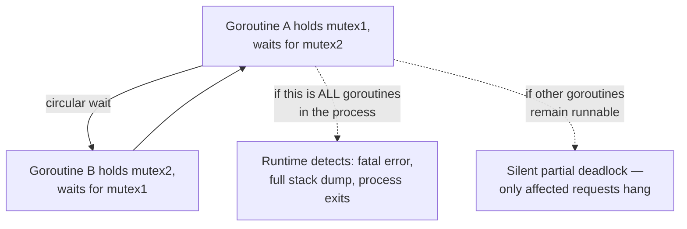

**Panic propagation.** An unrecovered `panic` unwinds the current goroutine's
call stack, running deferred functions along the way, and if it reaches the
top of that goroutine's stack without being caught by a `recover()` inside a
`defer`, it crashes the **entire process** — not just that one goroutine.
This is a critical architectural fact: a panic in *any* goroutine, including
one spawned deep inside a request handler, takes down the whole server
unless that goroutine's call chain includes a recovering `defer` — which is
why production HTTP frameworks and the pattern of "always recover at the top
of a spawned goroutine" are treated as mandatory, not optional, hardening.

## 16. Testing

Go's `testing` package is standard-library-native (no third-party test
framework required for baseline unit testing), and idiomatic Go strongly
favors **table-driven tests**: a single test function iterating over a slice
of input/expected-output structs, keeping the actual assertion logic
identical across cases while making it trivial to add a new case as one more
struct literal.

```go
func TestReserve(t *testing.T) {
	cases := []struct {
		name      string
		qty       int
		available int
		wantErr   error
	}{
		{"exact match succeeds", 5, 5, nil},
		{"insufficient stock", 1, 0, ErrInsufficientStock},
	}
	for _, tc := range cases {
		t.Run(tc.name, func(t *testing.T) {
			err := Reserve("sku-1", tc.qty, tc.available)
			if tc.wantErr != nil && !errors.Is(err, tc.wantErr) {
				t.Fatalf("got %v, want %v", err, tc.wantErr)
			}
		})
	}
}
```

**The race detector** (`go test -race`) is a distinctive Go testing tool:
instrumenting every memory access and synchronization event at compile time,
it detects data races (unsynchronized concurrent access to the same memory
location, where at least one access is a write) at runtime with high
precision, even if the race did not happen to cause an observably wrong
result in that particular test run. Because CSP-style channel-based code
still permits accidentally sharing memory outside a channel, running the
full test suite with `-race` in CI is considered close to mandatory for any
Go codebase with meaningful concurrency, and is the single most effective
tool for catching the concurrency bugs Sections 4.4 and 15 describe before
they reach production.

## 17. Common Mistakes

- **Loop variable capture in a closure spawned as a goroutine** (fixed
  language-level in Go 1.22, but still a live concern in any codebase
  targeting an earlier Go version, and a frequent interview/code-review
  topic): prior to Go 1.22, a `for i, v := range items { go func() { use(v) }() }`
  captured the *same* loop variable across all iterations, so every
  goroutine could observe whichever value `v` held when it actually ran, not
  the value at the time `go func()` was called — the standard fix was to
  pass `v` as an explicit parameter (`go func(v T) { use(v) }(v)`).
- **Nil map writes panic; nil map reads do not.** A `map[string]int` zero
  value is `nil`; reading from a nil map returns the zero value harmlessly,
  but writing to one panics — a common source of confusion for engineers new
  to Go's zero-value semantics.
- **Forgetting to `defer resp.Body.Close()`** after an HTTP client request
  leaks the underlying connection (and, at scale, exhausts the client's
  connection pool), because Go's `net/http` client will not reuse a
  connection until its body is fully read and closed.
- **Comparing errors with `==` instead of `errors.Is`** breaks once an error
  is wrapped (Section 4.10), since the wrapped error is a distinct value from
  the sentinel it wraps.
- **Ignoring the second return value from a map lookup** (`v :=
  m[key]` instead of `v, ok := m[key]`) makes a missing key indistinguishable
  from a present key whose value happens to equal the zero value.

## 18. Best Practices

- Accept interfaces, return concrete types (Section 4.9).
- Always recover from panics at the top of any goroutine you spawn yourself,
  to avoid the whole-process-crash failure mode in Section 15.
- Thread `context.Context` as the first parameter through any call chain that
  can block, and always honor `ctx.Done()` in long-running loops and
  `select` statements.
- Run `go vet`, `staticcheck` (a widely adopted third-party linter), and
  `go test -race` in CI on every change.
- Configure explicit timeouts on every `net/http.Server` and
  `net/http.Client` (Sections 4.11, 13) rather than relying on unconfigured
  defaults.
- Keep goroutine lifetimes explicit and bounded: for every `go func(){...}()`
  you write, be able to state in one sentence what event ends that
  goroutine's life.

## 19. Anti-Patterns

- **Spawning unbounded goroutines per unit of untrusted input** (e.g. one
  goroutine per item in an attacker-controlled batch size) without a worker
  pool or semaphore bound — a straightforward resource-exhaustion Denial of
  Service (DoS) vector.
- **Using channels for everything, including simple mutual exclusion** where
  a plain `sync.Mutex` would be simpler and faster — CSP is a default, not a
  dogma (Section 7).
- **Swallowing errors silently** (`_ = err` without a deliberate, documented
  reason) purely to satisfy a linter, rather than genuinely handling or
  propagating the failure.
- **Using `panic`/`recover` as general-purpose exception handling** across
  package boundaries, reintroducing the invisible-control-flow problem
  explicit error returns were designed to avoid (Section 4.10).
- **Global mutable state protected by a single package-level mutex** used as
  a substitute for proper dependency injection, which reintroduces hidden
  coupling and makes unit testing require careful, error-prone global-state
  reset between tests.

## 20. Trade-off Analysis

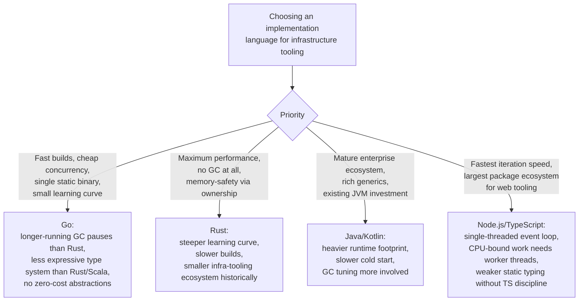

Go's core trade-off, stated plainly: it sacrifices some raw performance
ceiling (relative to Rust or hand-tuned C++) and some type-system
expressiveness (relative to Rust, Scala, or even modern Java/Kotlin) in
exchange for operational simplicity (single static binary, fast builds, low
memory footprint, predictable low-latency GC) and organizational scalability
(a small language surface that keeps a large, distributed contributor base's
code mutually readable). That trade is close to ideal for network
infrastructure services and control-plane software; it is a worse trade for
numerically intensive computing, systems requiring true zero-GC determinism
(hard real-time), or teams that specifically need Rust's compile-time memory-
and-concurrency-safety guarantees beyond what Go's race detector catches at
runtime.

## 21. Comparison Table

| Dimension | Go | Java | Node.js | Rust |
|---|---|---|---|---|
| Concurrency model | Goroutines + channels (CSP), M:N scheduler | OS threads + `java.util.concurrent`, or virtual threads (Project Loom) | Single-threaded event loop + libuv; worker threads for CPU-bound work | OS threads + `async`/`await`; no runtime GC, ownership-checked at compile time |
| Memory management | Concurrent tricolor mark-and-sweep GC, latency-focused | Generational GC (several collector choices), throughput or latency tunable | V8 generational GC | No GC; compile-time ownership/borrow checking |
| Deployment artifact | Single static binary, no runtime dependency | JAR/WAR + JVM required on target | Source/bundle + Node.js runtime required | Single static (or near-static) binary |
| Error handling | Explicit `error` return values, `errors.Is`/`As` wrapping | Checked + unchecked exceptions | Exceptions + Promise rejection | `Result<T, E>` return type, no exceptions |
| Polymorphism | Implicit structural interfaces, composition via embedding | Nominal interfaces (`implements`), class inheritance | Duck typing (untyped) or structural (TypeScript) | Traits, no inheritance |
| Typical infra use case | Kubernetes, Docker, Terraform, Prometheus, etcd | Enterprise backends, Spring ecosystem | Web tooling, Application Programming Interface (API) gateways, developer tooling | Systems programming, performance-critical infra (e.g. some data-plane proxies) |
| Build/cross-compile | Single command, no target toolchain (`GOOS`/`GOARCH`) | Same JAR runs anywhere a matching JVM exists | Same source runs anywhere a matching Node.js runtime exists | Requires target-specific toolchain/cross linker |

## 22. Real-World Case Study

**Why Kubernetes, Docker, and Terraform are all written in Go.** All three
projects share the same underlying requirement profile: they are
long-running or frequently-invoked control-plane/tooling processes that must
(1) start near-instantly with no runtime installation step on an arbitrary
target host, (2) manage large numbers of concurrent, independent watch/
reconcile loops (one per Kubernetes resource kind, one per Docker container,
one per Terraform resource in a plan graph) without the operator hand-tuning
a thread pool, and (3) ship as a single artifact that a systems engineer with
no language-specific runtime installed can simply execute.

- **Kubernetes' controller-manager** runs dozens of independent controllers,
  each with its own reconcile loop (Section 8), all multiplexed by the
  Go scheduler (Section 4.1-4.3) onto whatever CPU quota the control plane
  is actually allocated — with `client-go`'s informer/cache layer built
  directly on goroutines and channels (Section 4.4) to fan out resource
  change events to every registered controller without each one polling the
  API server independently.
- **Docker (`dockerd`)** manages potentially hundreds of concurrent container
  lifecycles — each container's I/O streaming, health checks, and log
  collection modeled as independent goroutines — while shipping as a single
  binary that must run identically across every Linux distribution a
  customer might deploy on, which directly motivated static linking
  (Section 4.8) over a dynamically linked alternative that would need to
  match each distribution's library versions.
- **Terraform** parses a resource dependency graph and applies changes to
  potentially hundreds of cloud resources with bounded parallelism
  (Terraform's `-parallelism` flag maps directly onto a worker-pool pattern,
  Section 7, over the dependency graph's ready-to-apply resource nodes),
  while distributing a single cross-platform binary (Section 4.8) that
  operators fetch and run with zero installation dependencies beyond the
  binary itself.

The common thread: none of these three products needed Go's concurrency
model in the abstract — they needed it because their actual operating
constraint (manage many independent, long-lived units of concurrent work,
deploy as a single dependency-free artifact across arbitrary customer
environments) is exactly the constraint Go's designers built the language
around from Section 2's history.

## 23. Interview Questions

1. Explain the M:N threading model and why goroutines are cheaper than OS
   threads. What specifically makes a goroutine's stack cheap to grow?
2. Walk through what happens when a **P**'s local run queue is empty. What is
   work stealing, and why is victim selection randomized?
3. What is the CSP concurrency model, and how do channels implement it
   differently from a shared-memory, lock-based model? What does "share
   memory by communicating" mean concretely?
4. Describe the tricolor mark-and-sweep algorithm and the role of the write
   barrier. Why does Go's GC prioritize latency over throughput, and what
   does that trade off against?
5. What problem did Go modules solve that `GOPATH` could not? What is
   Minimal Version Selection, and why does it select the minimum rather than
   the latest satisfying version?
6. Why does Go use implicit, structural interface satisfaction instead of an
   explicit `implements` keyword? What does "accept interfaces, return
   concrete types" mean and why is it good advice?
7. Why did Go's designers choose explicit error return values over
   exceptions? What is the primary cost of that choice, and how does
   `errors.Is`/`errors.As` address the pre-1.13 loss-of-context problem?
8. Diagnose this scenario: a service's goroutine count keeps climbing under
   sustained load with no corresponding traffic increase. What is your
   diagnostic process, and what is the most likely root cause?
9. Why do Kubernetes, Docker, and Terraform all happen to be written in Go?
   What specific constraints do they share that Go's design directly
   addresses?
10. When would you deliberately choose Rust or Java over Go for a new
    infrastructure service, and why?

## 24. Hands-on Exercises

1. Implement the worker-pool pattern from Section 10, Example 1, but add a
   per-task timeout using `context.WithTimeout` per task rather than one
   shared context for the whole pool. Verify with `-race` that your
   implementation is race-free.
2. Deliberately introduce the pre-Go-1.22 loop-variable-capture bug (Section
   17) in a small program, observe the incorrect output, then fix it and
   explain why the fix works.
3. Use `net/http/pprof` (Section 14) to capture a heap profile of a small
   program that intentionally leaks memory via an ever-growing package-level
   slice, and identify the leak from the profile alone.
4. Cross-compile a small CLI tool for `linux/arm64`, `darwin/amd64`, and
   `windows/amd64` from a single development machine using `GOOS`/`GOARCH`
   (Section 4.8), and verify each binary's target platform with `file`.
5. Write a table-driven test suite (Section 16) for the error-wrapping
   example in Section 10, Example 3, covering both the sentinel-error and
   structured-error-type cases with `errors.Is` and `errors.As`.

## 25. Design Exercises

1. Design a Go-based background job processor that must (a) bound
   concurrency to protect a downstream database, (b) support graceful
   shutdown that lets in-flight jobs finish, and (c) surface a metric for
   queue depth. Sketch the goroutine/channel architecture and identify which
   Section 7 pattern(s) you are combining.
2. A team's existing Go service suffers periodic latency spikes correlated
   with GC activity. Propose a diagnostic plan (which tools, in what order)
   and at least two concrete remediation options with their trade-offs
   (Section 11, Section 4.6).
3. You are asked to justify, to a skeptical Java-background architecture
   review board, why a new internal control-plane service should be written
   in Go rather than Java. Draft the trade-off argument using Section 20/21,
   anticipating the strongest counter-argument the board is likely to raise.
4. Design the module boundary (`internal/` vs `pkg/`, Section 9) for a
   multi-team Go monorepo where three teams share some code but each team
   also needs private implementation packages other teams should not import.

## 26. Architecture Review Questions

- Is `GOMAXPROCS` explicitly set (or container-CPU-aware) to match the actual
  CPU quota available to this process, rather than relying on the
  host-wide default?
- Are `net/http.Server` timeouts (`ReadHeaderTimeout`, `ReadTimeout`,
  `WriteTimeout`, `IdleTimeout`) explicitly configured, and is TLS minimum
  version pinned?
- Is every goroutine spawned by this service's own code traceable to a clear
  termination condition (context cancellation, channel close, or bounded
  loop)? Is there a recovering `defer` at the top of every independently
  spawned goroutine?
- Is `GOGC`/`GOMEMLIMIT` tuned relative to the container's actual memory
  limit, or left at defaults that assume unconstrained host memory?
- Does CI run `go vet`, a linter (e.g. `staticcheck`), and `go test -race` on
  every change?
- Is `go.sum` verified in CI, and is the module proxy (`GOPROXY`) pointed at
  an organization-controlled, audited proxy rather than the public default
  for anything security-sensitive?
- For any package using `cgo`, is `CGO_ENABLED=0` deliberately chosen, or has
  static linking been silently broken (Section 4.8)?

## 27. Summary

Go is best understood not as a general-purpose language competing purely on
expressiveness, but as a coherent set of architectural bets about how
concurrent, network-facing infrastructure software should be built and
operated: goroutines and the M:N scheduler make cheap, massively concurrent
execution the default; channels and CSP make "share memory by communicating"
the idiomatic (though not exclusive) concurrency discipline; the garbage
collector explicitly trades throughput for sub-millisecond latency because
Go's target workloads are request-latency-sensitive; the module system
solved a real, historically painful dependency-versioning gap left by
`GOPATH`; the compiler's static, cross-compilable binaries eliminate an
entire category of runtime-dependency deployment risk; implicit structural
interfaces and composition-over-inheritance keep polymorphism decoupled and
retrofittable; explicit error returns trade verbosity for visible control
flow; and the standard library's "production-grade by default" philosophy
(epitomized by `net/http`) reduces dependency surface area for an enormous
share of real services. Every one of these decisions traces back to the
specific organizational and operational pressure Google faced building
infrastructure software at extreme scale — and that same pressure profile is
exactly what Kubernetes, Docker, Terraform, Prometheus, and etcd share, which
is why Go, rather than Java, Python, Node.js, or Rust, became the default
implementation language for the cloud-native infrastructure ecosystem. An
architect's job is not to treat this as received wisdom but to recognize
when a system under design shares that same pressure profile — and to
recognize, just as clearly, the cases (numerically intensive workloads, hard
real-time determinism, teams requiring compile-time memory-safety guarantees
beyond a runtime race detector) where a different language's trade-offs are
the better fit.
