# Chapter: Rust Architecture

Part: [03 — Software Engineering Foundations](PART_OVERVIEW.md) · Status: Drafted

## 1. Introduction

Rust is a systems programming language whose entire design center is a single
architectural bet: memory safety and data-race freedom can be *proven at
compile time*, without a Garbage Collector (GC) and without giving up C/C++-level
performance. For a Solution Architect, Rust is not "yet another language
option" next to Java or Go — it is a different *architectural substrate*. The
compiler itself enforces invariants (no use-after-free, no data races, no null
dereferences) that in other stacks are enforced by runtime checks, code
review discipline, static analyzers, or production incidents. This chapter
treats Rust as an architectural material: what guarantees it gives you, what
it costs you (compile time, learning curve, expressiveness friction), and when
those trade-offs are worth making — for systems programming, WebAssembly
(Wasm, a portable binary instruction format that runs in browsers and other
sandboxed hosts) targets, and performance-critical or safety-critical
services.

Rust deliberately overlaps with C, C++, Go, and (for the CPU/memory profile
it targets) parts of the Java/Java Virtual Machine (JVM) space. This chapter
does not re-teach general concurrency theory, general type-system theory, or
general distributed-systems architecture already owned by other parts of this
handbook — it focuses on what is genuinely new when Rust is the implementation
substrate: **ownership and borrowing as an architecture, not just a
language feature**.

## 2. Historical Evolution

- **2006 — Graydon Hoare's side project.** Rust began as a personal project at
  Mozilla, motivated by frustration with crash-prone C++ code in Firefox
  components, especially memory-safety bugs (use-after-free, double-free,
  buffer overflows) that kept surfacing as security advisories.
- **2010 — Mozilla sponsorship.** Mozilla formally backed the project; early
  Rust had a garbage collector and green threads (M:N scheduling), both later
  removed in pursuit of a "no runtime, pay only for what you use" philosophy.
- **2015 — Rust 1.0.** The ownership/borrowing model, traits, and the module
  system stabilized. Mozilla shipped the Servo browser engine (a Rust-based
  parallel rendering engine) as a proof point, and Firefox's Quantum project
  began replacing performance-critical C++ subsystems (e.g. the CSS style
  system, `stylo`) with Rust components.
- **2018 Edition.** Introduced non-lexical lifetimes (smarter borrow-checker
  reasoning that reduced false-positive borrow errors), the module system
  simplification, and `async`/`await` groundwork.
- **2021 Edition.** Refined closures' disjoint field capture, added
  `IntoIterator` for arrays, and continued the "editions" mechanism — a way to
  evolve language ergonomics without breaking backward compatibility, since
  all editions still compile against one shared compiler and can be mixed
  within a dependency graph.
- **2019-2021 — Industry adoption inflection.** AWS (Firecracker microVM,
  Lambda's execution substrate), Microsoft (Windows kernel components,
  Azure IoT Edge), Google (Android platform components, the Fuchsia OS
  networking stack), Discord, Dropbox, and Cloudflare adopted Rust for
  performance- and safety-critical services, publishing widely cited
  engineering blog posts on eliminating classes of production incidents.
- **2021 — Rust Foundation founded.** Governance moved from a
  Mozilla-controlled project to an independent foundation (AWS, Microsoft,
  Google, Huawei, Mozilla as founding members), signaling Rust's shift from
  "one vendor's systems language" to industry-standard infrastructure
  language.
- **2022-2024 — Linux kernel and Android.** The Linux kernel accepted Rust as
  a second implementation language for select driver code; Android's
  platform team reported Rust components shipping with zero memory-safety
  vulnerabilities in production, a load-bearing data point for Rust's core
  safety claim.

## 3. Why It Exists

Rust exists to close a long-standing trade-off gap: **C and C++ give you
control over memory layout and zero runtime overhead but leave memory safety
and thread safety to programmer discipline; managed languages (Java, Go, C#)
give you memory/thread safety through a runtime (GC, bounds checks, a
scheduler) at the cost of unpredictable pause times, higher memory footprint,
and a mandatory runtime you cannot strip out of the binary.** Decades of
CVEs (Common Vulnerabilities and Exposures) in C/C++ codebases — Microsoft
and Google security teams have both published data attributing roughly
65-70% of high-severity security bugs in their C/C++ codebases to memory
safety — showed that "just be more careful" does not scale across large
teams and long-lived codebases. Rust's answer is to move the safety checks
from *runtime* (GC, bounds checks that can still be bypassed by dangling
pointers) to *compile time*, via a type system rich enough to track
ownership of memory as a first-class property, so that an entire category of
bugs cannot compile at all rather than being caught by tests, sanitizers, or
production monitoring.

## 4. Core Concepts

### 4.1 Ownership: memory management without a garbage collector

**Definition.** Every value in Rust has exactly one *owner* — a variable
binding responsible for that value. When the owner goes out of scope, Rust
inserts a compiler-generated call to `drop` that deterministically frees the
value's resources (memory, file handles, sockets, locks). There is no garbage
collector deciding *when* to reclaim memory at runtime; the compiler decides
*at compile time*, from static scope analysis, exactly where each `drop` call
goes.

**Mechanism.** When a value is assigned to a new variable, passed by value
into a function, or returned by value, ownership *moves* — the old binding is
statically invalidated and the compiler refuses to compile any subsequent use
of it. This is fundamentally different from a shallow copy: after `let b = a;`
for a heap-backed type, `a` is not a duplicate reference to the same data
that both `a` and `b` can use — the compiler treats `a` as dead, eliminating
the class of bugs where two owners both believe they're responsible for
freeing the same memory (double-free) or where one owner frees memory the
other still reads (use-after-free).

```mermaid
flowchart LR
    A["let s1 = String::from(\"hi\")<br/>s1 owns heap data"] -->|"let s2 = s1;<br/>(move)"| B["s2 owns heap data<br/>s1 is now invalid"]
    B -->|"s2 goes out of scope"| C["drop(s2) called<br/>heap memory freed"]
    A -.->|"attempt to use s1 after move"| X["compile error:<br/>value borrowed after move"]
    style X fill:#f66,stroke:#900,color:#fff
```

**Decision implications.** Ownership means a Rust architecture never needs a
GC pause budget, never needs to reason about "will this object get collected
before or after that one," and produces deterministic destruction order —
which matters for RAII-style (Resource Acquisition Is Initialization)
resource management: releasing a database connection, unlocking a mutex, or
closing a file handle happens at a precise, predictable point rather than
"eventually, when the collector runs." This is why Rust is chosen for
latency-sensitive services (no GC pause tail latency) and for resource-
constrained embedded targets (no GC runtime to fit into a memory budget).

**Common failure mode.** Teams coming from garbage-collected languages fight
the "move" semantics reflexively — trying to keep using a variable after
passing it into a function, then reaching for `.clone()` everywhere to make
the compiler happy. This defeats much of Rust's performance advantage
(clones are real heap allocations and copies) and is usually a sign the
architecture needs *borrowing* (Section 4.2) instead of ownership transfer.

**Concrete scenario.** A connection-pool checkout function that takes a
`Connection` by value and never gives it back models "this call permanently
consumes the connection" — which is wrong for a pool. Modeling it as
"borrow the connection for the duration of the call" (a reference, not a
move) correctly expresses the intended lifetime and lets the pool reclaim the
connection when the borrow ends.

### 4.2 Borrowing and the borrow checker

**Definition.** A *borrow* is a reference to a value that does not take
ownership. Rust has two kinds: shared references (`&T`, any number
simultaneously, read-only) and mutable references (`&mut T`, exactly one at a
time, exclusive read-write). The *borrow checker* is the compiler pass that
statically proves every borrow obeys these rules for its entire lifetime,
before generating any machine code.

**Mechanism.** The borrow checker's core invariant is **"aliasing XOR
mutability"**: at any point in the program, a piece of data may have either
multiple readers or exactly one writer, never both. This is enforced purely
through static analysis of the control-flow graph — no runtime reference
counting, no runtime lock, no runtime check unless you explicitly opt into
one (Section 4.2's `RefCell`/`Mutex` escape hatches, covered under
concurrency in Section 4.5).

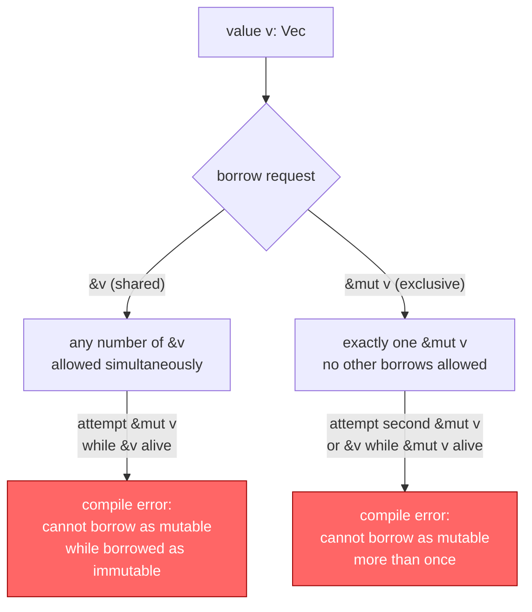

**Decision implications.** This rule is precisely the definition of a data
race (two or more accesses to the same memory, at least one a write, with no
synchronization) generalized to single-threaded code too — which is why the
same rule eliminates both "iterator invalidation" bugs (mutating a
collection while iterating it) and multithreaded data races with one
mechanism. An architect can rely on "if it compiles, it has no data races"
as a load-bearing guarantee for concurrent service design, not just a
best-effort static-analysis hint.

**Common failure mode.** New Rust codebases often over-design around
"fighting the borrow checker" by reaching for `Rc<RefCell<T>>` (reference
counting plus interior mutability with a *runtime*-checked borrow rule)
everywhere, effectively opting back into a form of manual, panic-on-violation
memory management. This is a valid escape hatch for genuinely graph-shaped
data (trees with parent pointers, caches with shared ownership) but becomes
an anti-pattern when used as a blanket workaround for not restructuring
ownership — Section 19 covers this as an explicit anti-pattern.

**Concrete scenario.** A function that both reads a shared configuration
struct and appends to a shared log inside the same call, where both are
fields of one larger struct borrowed `&mut self`, will not compile if it
tries to hold a `&self.config` read alongside a `&mut self.log` write taken
through the same top-level borrow — this is the well-known "disjoint field
borrows through a single mutable reference" friction point, resolved either
by splitting the borrow at the field level or restructuring the struct so
the two concerns are borrowed independently.

### 4.3 Lifetimes: naming how long a borrow is valid

**Definition.** A *lifetime* is a compile-time-only annotation
(`'a`, `'static`, etc.) that names the region of code for which a reference
is guaranteed valid. Lifetimes carry no runtime representation — they are
erased entirely after compilation; they exist solely so the borrow checker
can verify that a returned or stored reference never outlives the data it
points to.

**Mechanism.** Most lifetimes are inferred automatically ("lifetime
elision"); explicit annotations are required only when the compiler cannot
determine, from a function signature alone, how the lifetime of an input
relates to the lifetime of an output — for example, a function returning a
reference derived from one of several reference parameters.

```rust
// The lifetime 'a says: the returned reference lives at least as long
// as the SHORTER of `x` and `y`'s lifetimes — the compiler enforces
// this at every call site, rejecting any use of the result after
// either input goes out of scope.
fn longest<'a>(x: &'a str, y: &'a str) -> &'a str {
    if x.len() >= y.len() { x } else { y }
}

fn dangling_example() {
    let result;
    let s1 = String::from("long string");
    {
        let s2 = String::from("short");
        result = longest(s1.as_str(), s2.as_str());
        println!("Longest: {result}"); // OK: s2 still alive here
    }
    // println!("{result}"); // Would NOT compile: s2 dropped, `result`
    // may reference freed memory — the borrow checker rejects this
    // use, turning a would-be use-after-free into a compile error.
}
```

**Decision implications.** Lifetimes let an architecture express "this
returned value is a *view* into data owned elsewhere, valid only while that
owner is alive" as a type-checked contract, rather than a comment or a
runtime `assert`. APIs that return borrowed data (a parser returning `&str`
slices into the original input instead of allocating new `String`s) avoid
copies entirely while still being provably safe — this is the mechanism
behind Rust's "zero-copy parsing" architecture pattern used heavily in
high-throughput services (e.g. `serde` deserializers, HTTP header parsers).

**Common failure mode.** Overusing explicit lifetime parameters on structs
(`struct Parser<'a> { input: &'a str }`) when an owned `String` would be
simpler propagates lifetime complexity through an entire API surface,
forcing every caller to reason about borrow scopes. The heuristic: borrow
when the data is read once and discarded within a tight scope; own
(`String`, `Vec<T>`) when the value needs to outlive the current borrow
scope or cross an API/thread boundary.

**Concrete scenario.** A configuration-loading library that parses a TOML
file into structs holding `&'a str` fields tied to the original file buffer
is extremely fast (no string allocation) but becomes awkward the moment a
caller wants to store the parsed config in a `'static` cache — the lifetime
constraint correctly forces the architectural question "does this need to
outlive the input buffer?" before a bug ships, rather than after.

### 4.4 Traits, generics, and zero-cost abstractions

**Definition.** A *trait* is Rust's mechanism for shared behavior across
types — conceptually similar to a Java/Go interface, but with a critical
architectural difference: traits can be implemented for types you don't own
(e.g. adding a trait to the standard library's `Vec<T>`), and generic code
written against a trait bound (`fn process<T: Serialize>(item: T)`) is
*monomorphized* at compile time (Section 4.6) rather than dispatched through
a runtime vtable by default.

**Mechanism.** Rust offers two dispatch strategies and makes the architect
choose explicitly:

- **Static dispatch** (`fn f<T: Trait>(x: T)` or `impl Trait` parameters) —
  the compiler generates a fully specialized copy of the function per
  concrete type used, inlines across the call, and leaves zero runtime
  indirection. This is what "zero-cost abstraction" means precisely: the
  abstraction (writing one generic function) costs nothing at runtime
  compared to hand-writing a separate function per type.
- **Dynamic dispatch** (`fn f(x: &dyn Trait)` or `Box<dyn Trait>`) —
  a vtable pointer is stored alongside the value, and calls go through one
  indirection at runtime, exactly like a Java interface call or a C++
  virtual method. This is used when you need a heterogeneous collection
  (`Vec<Box<dyn Shape>>` holding circles and squares in one list) or when
  monomorphization would blow up binary size unacceptably (Section 4.6).

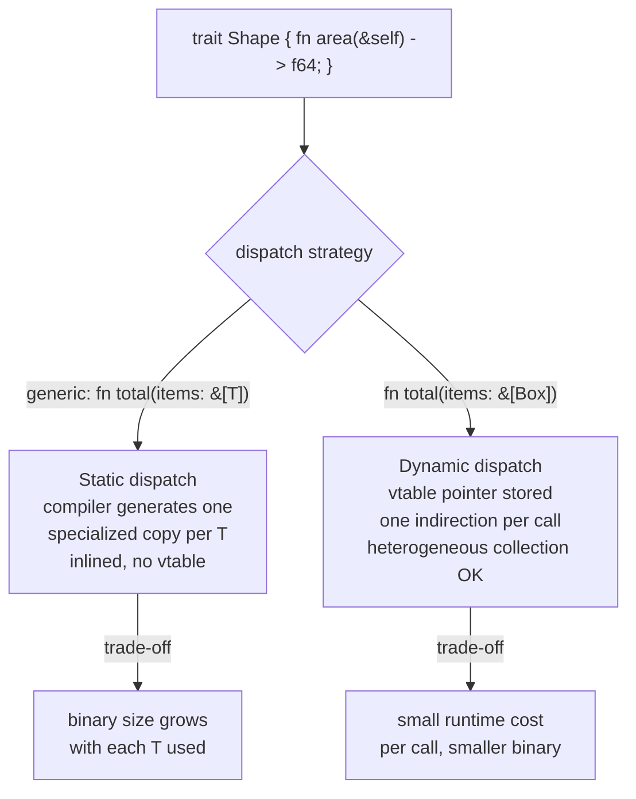

**Decision implications.** This is an explicit, visible architectural choice
in Rust that other languages hide: Java always dynamically dispatches
interface calls (the JIT may devirtualize in hot paths, but that's an
optimizer heuristic, not a language guarantee); Go always dynamically
dispatches interface method calls. Rust forces the architect to decide, per
call site, whether the flexibility of runtime polymorphism is worth the
indirection — which matters in hot loops (parsers, codecs, numeric kernels)
where static dispatch lets the compiler inline and vectorize across an
abstraction boundary that would otherwise block those optimizations.

**Common failure mode.** Defaulting to `Box<dyn Trait>` everywhere "to keep
things simple" imports a permanent, small per-call overhead and forecloses
inlining/vectorization across trait boundaries in code paths where that
matters (e.g. a per-request serialization hot path). Conversely, defaulting
to generics everywhere for a plugin-style architecture (loading a list of
heterogeneous handlers) either doesn't compile (you cannot have a
`Vec<T: Handler>` with varying concrete `T`s) or produces exploding compile
times and binary size from unnecessary monomorphization.

**Concrete scenario.** An HTTP middleware pipeline that must hold an
ordered `Vec` of arbitrary middleware types configured at runtime
(from a config file, not known at compile time) architecturally requires
`Vec<Box<dyn Middleware>>` — generics cannot express "a list of different
concrete types decided at runtime," making dynamic dispatch the *correct*
choice here, not a fallback.

### 4.5 Fearless concurrency: `Send`, `Sync`, and data-race elimination

**Definition.** Rust's marker traits `Send` (a type is safe to *move* to
another thread) and `Sync` (a type is safe to *share by reference* across
threads, i.e. `&T` is `Send`) let the same ownership/borrowing rules that
prevent single-threaded aliasing bugs (Section 4.2) extend automatically to
prevent multithreaded data races — with zero additional runtime mechanism.
The Rust team calls this "fearless concurrency": the compiler, not
discipline or a data-race detector run in CI, is what rejects a data race.

**Mechanism.** `Send`/`Sync` are auto-derived: a type is automatically
`Send`/`Sync` if all its fields are. Types that are deliberately *not*
`Sync` (e.g. `Rc<T>`, a non-atomic reference-counted pointer) cannot be
shared across threads — the compiler rejects the program at the point
where a thread boundary is crossed, not at runtime under load. To share
mutable state across threads safely, you reach for `Arc<Mutex<T>>` (atomic
reference counting for shared ownership, plus a mutex for exclusive access)
or channel-based message passing (`std::sync::mpsc`, or `tokio::sync::mpsc`
for async code) — both enforce the same aliasing-XOR-mutability rule, just
with the "compile-time single owner" replaced by "runtime-checked exclusive
access," which is exactly the trade-off the type system makes visible and
opt-in rather than default and implicit.

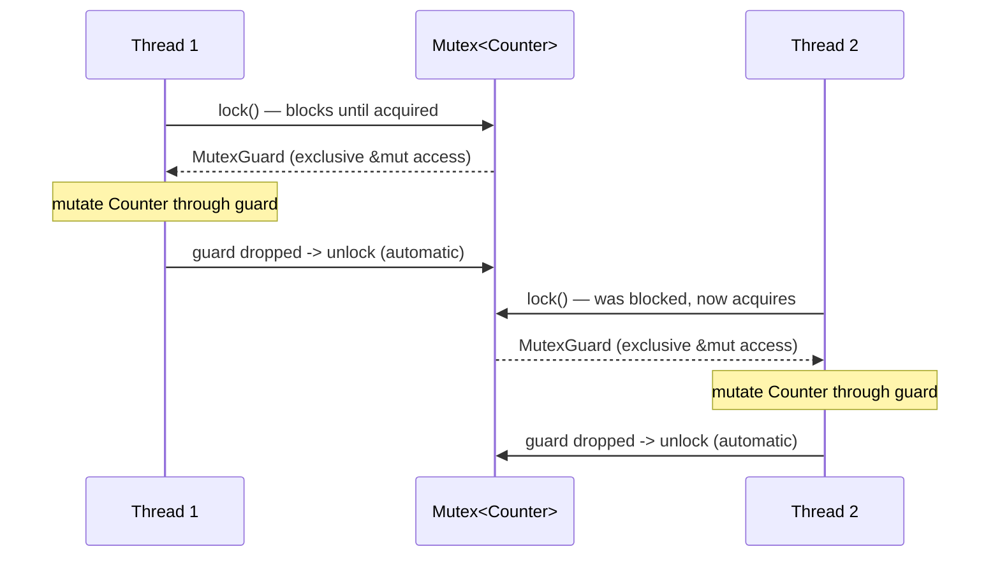

```rust
use std::sync::{Arc, Mutex};
use std::thread;

fn concurrent_counter_demo() {
    // Arc: atomically reference-counted, shared ownership across threads.
    // Mutex: runtime-checked exclusive access, replacing the compile-time
    // single-owner rule with a lock, since multiple threads truly need
    // to mutate the same Counter.
    let counter = Arc::new(Mutex::new(0_u64));
    let mut handles = Vec::new();

    for _ in 0..8 {
        let counter = Arc::clone(&counter); // bump refcount, share ownership
        handles.push(thread::spawn(move || {
            let mut guard = counter.lock().expect("mutex poisoned");
            *guard += 1;
            // guard dropped here -> lock released automatically (RAII)
        }));
    }

    for handle in handles {
        handle.join().expect("thread panicked");
    }

    // Safe to read now: all spawned threads have joined, so this is the
    // sole owner again. The compiler would reject reading `counter`
    // through anything other than the lock while threads might still
    // be running — there's no way to "forget" to synchronize.
    println!("Final count: {}", *counter.lock().unwrap());
}
```

**Decision implications.** This is Rust's single most cited reason for
adoption in infrastructure teams: a class of bugs that in C++/Go/Java
requires runtime tools (ThreadSanitizer, Go's race detector, careful code
review) to *probabilistically* catch is instead a deterministic compile
failure in Rust, for the ownership-based subset of concurrency bugs.
It does not eliminate all concurrency bugs — deadlocks, livelocks, and
logical race conditions (two correctly-synchronized operations happening in
an unintended order) are still possible and are the architect's
responsibility (Section 15).

**Common failure mode.** Treating "fearless concurrency" as "concurrency
bugs are impossible" rather than "data races are impossible." A service
using two separate `Mutex`es locked in inconsistent order across two code
paths can still deadlock — Rust's guarantee is narrower and more precise
than marketing shorthand suggests, and architects must still design lock
ordering discipline or prefer message-passing architectures to sidestep
the question entirely.

**Concrete scenario.** A shared, mutable connection-pool statistics counter
updated by every request-handling thread is the canonical `Arc<Mutex<T>>`
case above. A pipeline where stage A produces work items consumed by stage
B, with no shared mutable state, is architecturally better served by an
`mpsc` (multi-producer, single-consumer) channel, which sidesteps locking
entirely and maps naturally onto a "queue between stages" system-design
pattern already familiar to architects from message-queue based systems.

### 4.6 Compilation model: LLVM, monomorphization, and static binaries

**Definition.** The Rust compiler (`rustc`) lowers Rust's Mid-level
Intermediate Representation (MIR) to LLVM Intermediate Representation (IR),
handing optimization and native code generation to LLVM (Low-Level Virtual
Machine, a mature, widely used compiler backend also used by Clang/C++ and
Swift). *Monomorphization* is the process of generating one fully
specialized copy of every generic function/struct for each concrete type it
is used with, before handing code to LLVM — the opposite of type erasure
used by Java generics or Go's (pre-1.18) interface-based generics.

**Mechanism.** For `fn max<T: Ord>(a: T, b: T) -> T` called with both `i32`
and `String` in a program, the compiler emits two separate machine-code
functions (`max::<i32>` and `max::<String>`), each fully optimized and
inlinable as if hand-written for that exact type — there is no runtime type
check, no boxing, no vtable lookup for the generic dispatch itself. By
default, Rust binaries statically link the Rust standard library and all
dependencies into a single executable with no required Rust runtime
installed on the target machine — unlike a JVM `.jar` (needs a JVM) or a
Node.js application (needs a Node runtime).

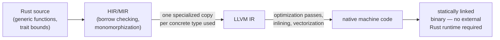

**Decision implications.** Monomorphization is why generic Rust code has no
inherent runtime performance penalty versus hand-specialized code (unlike
Java's type-erased generics, which always box primitives and dispatch
through a shared implementation) — but it directly trades off against
**compile time and binary size**, since every distinct type instantiation of
every generic function is separately compiled and optimized. Static linking
by default means Rust services deploy as a single self-contained binary,
which is a major operational simplification for containerized deployment
(a `FROM scratch` or `distroless` container image with just the binary,
no interpreter/runtime layer to patch or version-match) and for
Wasm/embedded targets with no operating system to provide a runtime at all.

**Common failure mode.** Large codebases with heavy generic use (common in
Rust web frameworks and async code, where every `async fn` and combinator
chain is itself a distinct generic type) can suffer multi-minute release
builds and bloated binaries if monomorphization isn't managed — mitigated
by dynamic dispatch at deliberate boundaries (Section 4.4), splitting
crates to parallelize compilation, and `codegen-units`/Link-Time
Optimization (LTO) tuning as an explicit release-profile trade-off between
build time and runtime performance.

**Concrete scenario.** A Rust command-line interface (CLI) tool intended for
distribution to end users benefits enormously from static linking (a curl
one-liner installer that drops in a single binary with no runtime
dependency to pre-install), which is a common reason product teams choose
Rust for developer-tooling CLIs (e.g. `ripgrep`, `fd`) over a JVM- or
Node.js-based tool that requires the user to have a compatible runtime
installed.

### 4.7 The module and crate system: Cargo, crates.io, and workspaces

**Definition.** A *crate* is Rust's unit of compilation and distribution
(roughly analogous to a Java Archive/JAR or an npm package) — either a
binary crate (produces an executable) or a library crate (produces a
reusable `.rlib`). Cargo is Rust's official build tool and package manager;
crates.io is the corresponding public package registry. A *workspace* is a
Cargo construct for managing multiple related crates (e.g. an API server
crate, a shared domain-model crate, and a client-library crate) under one
top-level dependency lock and shared build cache.

**Mechanism.** Cargo resolves a dependency graph using semantic
versioning against a `Cargo.toml` manifest, produces a fully pinned
`Cargo.lock` for reproducible builds, and — inside a workspace — lets
member crates depend on each other by path while sharing one `target/`
build directory and one resolved dependency graph, avoiding the "two crates
in the same binary pull in incompatible versions of a shared dependency"
class of problem that plagues less strict ecosystems.

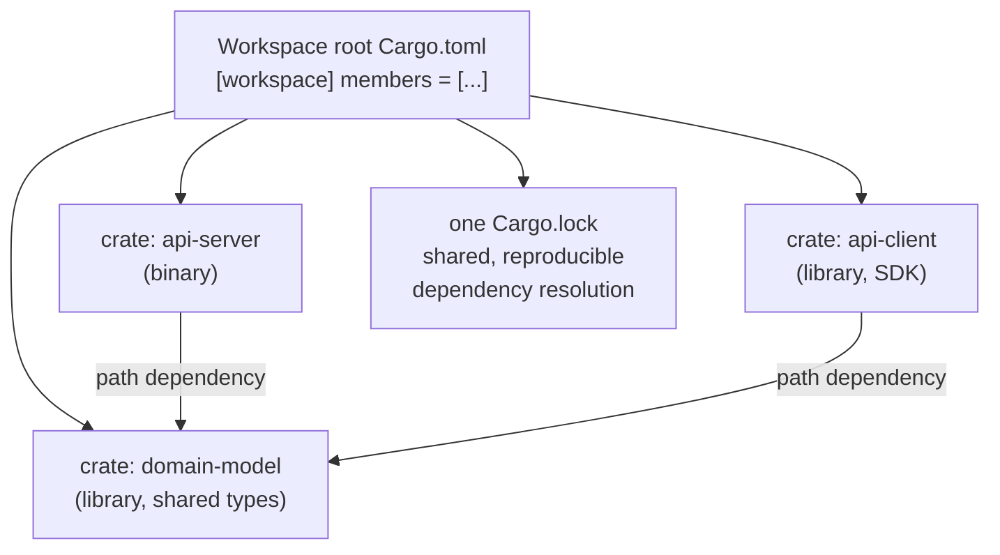

**Decision implications.** Workspaces are the idiomatic Rust equivalent of a
monorepo-with-shared-build-graph pattern: an architect splitting a service
into an API layer, a domain crate, and a client SDK crate gets compiler-
enforced module boundaries (a downstream crate cannot reach into a
dependency's private items) plus independent versioning if published to
crates.io separately, while still sharing one lockfile during internal
development. This is a stronger boundary than a single crate split into
Java-style packages, because crate boundaries are also **compilation
units** — changing one crate does not force recompiling unrelated crates
in the workspace, which materially affects incremental build time on large
codebases.

**Common failure mode.** Putting all code in one giant crate ("the
monolith crate") forces full-crate recompilation on almost every change and
prevents expressing "this internal module must never be used outside this
crate" as a hard boundary (Rust's `pub(crate)` visibility only works within
crate boundaries) — teams that hit multi-minute incremental build times
often trace it back to crate-boundary decisions made (or skipped) early on.

**Concrete scenario.** A team publishing an open-source Rust client library
alongside an internal, closed-source server implementation structures this
as a workspace: `server` (private, depends on `domain`), `domain` (private
or public, no I/O), and `client-sdk` (published to crates.io, depends only
on `domain`'s public types) — mirroring the same "core domain, adapters at
the edges" boundary architects already apply in Hexagonal/Clean
Architecture, expressed here through crate boundaries rather than package
namespaces alone.

### 4.8 Error handling architecture: `Result`, `Option`, and the `?` operator

**Definition.** Rust has no exceptions for recoverable errors. Instead,
fallible operations return `Result<T, E>` (either `Ok(T)` or `Err(E)`), and
operations that may be absent return `Option<T>` (either `Some(T)` or
`None`) — both are ordinary enum types the compiler forces you to handle
(via pattern matching, `?`, or an explicit `.unwrap()`/`.expect()` that
documents "I am asserting this cannot fail here"). `panic!` exists
separately, for *unrecoverable* programmer errors (invariant violations,
not expected failure modes).

**Mechanism.** The `?` operator, placed after an expression of type
`Result<T, E>` inside a function that itself returns a compatible
`Result`, either unwraps `Ok(T)` to `T` and continues, or returns early
with `Err` converted (via the `From` trait) into the enclosing function's
error type — replacing the try/catch control-flow reshaping of exceptions
with a value that flows through the type system and must be explicitly
propagated or handled at every call site.

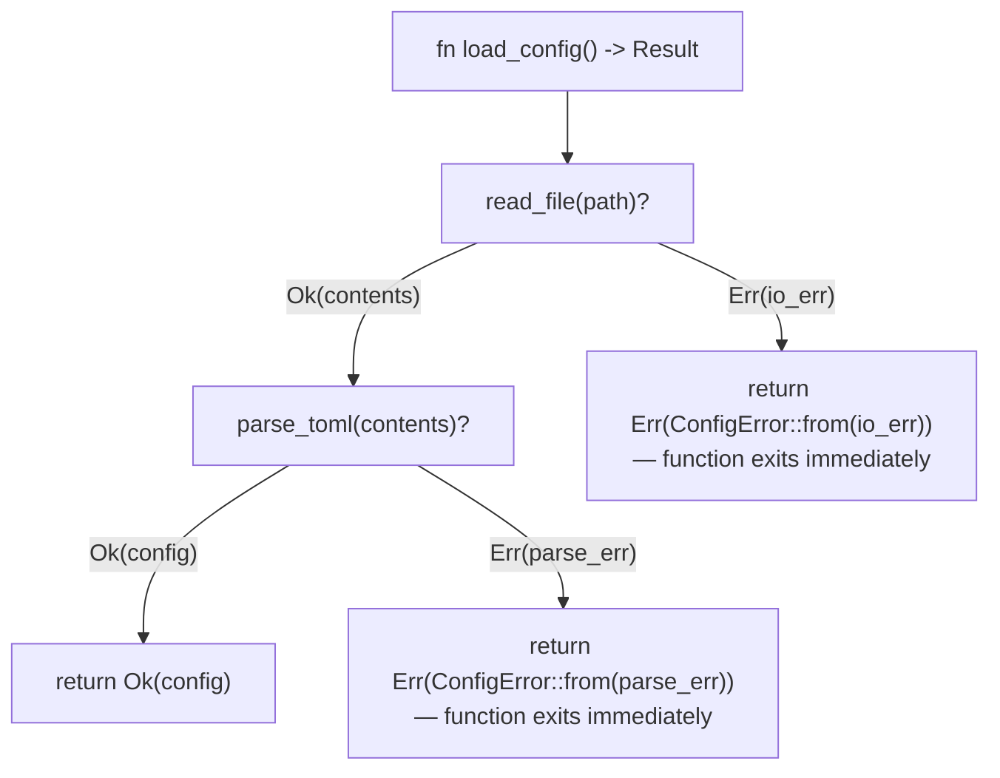

```rust
use std::fmt;

#[derive(Debug)]
enum ConfigError {
    Io(std::io::Error),
    Parse(String),
}

impl fmt::Display for ConfigError {
    fn fmt(&self, f: &mut fmt::Formatter<'_>) -> fmt::Result {
        match self {
            ConfigError::Io(e) => write!(f, "I/O error: {e}"),
            ConfigError::Parse(msg) => write!(f, "parse error: {msg}"),
        }
    }
}

// `From` lets `?` auto-convert a std::io::Error into our ConfigError.
impl From<std::io::Error> for ConfigError {
    fn from(e: std::io::Error) -> Self {
        ConfigError::Io(e)
    }
}

struct Config {
    max_connections: u32,
}

fn parse_config(raw: &str) -> Result<Config, ConfigError> {
    let value: u32 = raw
        .trim()
        .parse()
        .map_err(|_| ConfigError::Parse(format!("invalid integer: {raw}")))?;
    Ok(Config { max_connections: value })
}

// The function signature IS the error contract: every caller sees,
// at compile time, that this can fail and with which error type —
// there is no hidden control-flow path like an unchecked exception.
fn load_config(path: &str) -> Result<Config, ConfigError> {
    let raw = std::fs::read_to_string(path)?; // propagates io::Error -> ConfigError
    parse_config(&raw)
}
```

**Decision implications.** Because the error type is part of the function
signature, callers cannot accidentally ignore a fallible call the way an
unchecked exception can silently propagate past several stack frames in
Java — the compiler emits a warning (or, with `#[must_use]`, can be
escalated to enforce) if a `Result` is dropped without being examined. This
makes error handling an explicit, reviewable part of an Application
Programming Interface's (API's) contract, at the cost of every fallible
call site needing an explicit decision: propagate with `?`, handle
locally, or assert-and-panic.

**Common failure mode.** Overusing `.unwrap()`/`.expect()` in application
code (as opposed to tests or genuinely-impossible-to-fail invariants)
reintroduces exactly the runtime-crash risk Rust otherwise eliminates —
turning a `Result`-based recoverable-error architecture back into "crash the
process on any unexpected input," which is a common criticism of prototype
Rust code that graduates to production without an error-handling pass.
Library authors also sometimes design overly granular error enums that
leak internal implementation detail (e.g. a database-specific error variant
in a public API's error type), coupling callers to internals that should be
abstracted (mitigated by the `std::error::Error` trait object pattern or
crates like `thiserror`/`anyhow` for structured vs. ad-hoc error handling).

**Concrete scenario.** An HTTP handler that calls three fallible steps
(parse request, query database, serialize response) chains `?` through
all three, converts each into one handler-level error enum via `From`
implementations, and maps that enum to HTTP status codes at exactly one
place (the handler's error-to-response boundary) — centralizing the
"internal failure to external status code" policy instead of scattering
`try/catch`-equivalent logic across every layer.

### 4.9 The `unsafe` boundary and Foreign Function Interface (FFI)

**Definition.** `unsafe` is a keyword that unlocks five specific additional
capabilities the compiler cannot otherwise verify are safe: dereferencing
raw pointers, calling an `unsafe fn` (including FFI calls into non-Rust
code), mutating a `static mut` variable, implementing an `unsafe trait`,
and accessing union fields. Everywhere else, Rust's full safety guarantees
apply automatically; `unsafe` does not disable the borrow checker generally
— it only permits these five specific operations within the marked block,
and the programmer takes on the proof obligation the compiler would
otherwise enforce.

**Mechanism.** `unsafe` is Rust's deliberate, explicit escape hatch for the
irreducible cases where the type system cannot express a genuinely safe
operation — most commonly Foreign Function Interface (FFI) calls into C
libraries, direct hardware/memory-mapped I/O in embedded contexts, and
performance-critical data structures (e.g. some lock-free concurrent
structures) that require constructs the borrow checker cannot statically
verify even though the *design* is sound. Idiomatic Rust confines `unsafe`
to small, carefully audited blocks wrapped in a safe public API, so callers
of that API get all the normal compile-time guarantees even though a
verified-by-hand `unsafe` block sits underneath.

```mermaid
flowchart TD
    Safe1["Safe Rust caller code<br/>(normal borrow-checked calls)"] --> Wrapper["Safe public wrapper function<br/>fn safe_api(...) -> Result<T, E>"]
    Wrapper --> UnsafeBlock["unsafe { ... }<br/>— raw pointer deref,<br/>FFI call, etc."]
    UnsafeBlock --> FFI["extern \"C\" fn from<br/>a C library (libpq, zlib, ...)"]
    Wrapper -.->|"proof obligation:<br/>author manually verifies<br/>invariants the compiler can't"| Note["invariants documented<br/>in a // SAFETY: comment"]
    style UnsafeBlock fill:#fc6,stroke:#a60
```

```rust
// FFI declaration: bind to a C function `abs` from libc.
extern "C" {
    fn abs(input: i32) -> i32;
}

fn safe_abs(input: i32) -> i32 {
    // SAFETY: `abs` from libc has no preconditions beyond a valid i32,
    // has no side effects, and cannot violate memory safety for any
    // input value — this is the manual proof the compiler cannot do
    // automatically for an `extern "C"` call.
    unsafe { abs(input) }
}
```

**Decision implications.** `unsafe` is a scoping and auditing tool, not a
performance switch — code inside `unsafe` blocks is not faster by default;
it simply permits operations the compiler would otherwise reject. The
architectural discipline is to minimize and isolate `unsafe` surface area
(often audited with tools like `cargo geiger`, which counts `unsafe` usage
per dependency) so that a security review can focus effort precisely on
the small fraction of a codebase where memory-safety guarantees are
manually asserted rather than compiler-proven, rather than treating the
entire codebase as equally trust-sensitive.

**Common failure mode.** Reaching for `unsafe` to "make the borrow checker
error go away" without actually verifying the safety invariant is the most
dangerous Rust anti-pattern — it reintroduces exactly the memory-safety
bug classes Rust exists to eliminate, but now hidden behind a false sense
of security ("it's Rust, it must be safe") that a Java/Go/C# codebase
never offers in the first place. Every `unsafe` block should carry a
`// SAFETY:` comment stating precisely which invariant is being manually
guaranteed and why it holds.

**Concrete scenario.** A Rust service embedding an existing, battle-tested
C image-processing library (rather than rewriting it) wraps every
`extern "C"` call in a small, carefully audited `unsafe` module exposing a
safe `fn resize(image: &Image, dims: Dims) -> Result<Image, ImageError>`
API to the rest of the codebase — isolating the FFI risk to one reviewed
module while the remaining 99% of the codebase enjoys full compiler-
enforced safety, a common architecture for Rust services that need to
reuse mature C/C++ libraries instead of rewriting them from scratch.

### 4.10 Async/await and the executor model

**Definition.** `async fn` in Rust compiles to a state machine implementing
the `Future` trait — a value representing "a computation that will
eventually produce a result," which does *nothing* until it is polled by an
executor (a runtime that drives futures to completion). Unlike languages
with a built-in async runtime (Node.js's event loop, Go's goroutine
scheduler), the Rust standard library defines only the `Future` trait
itself; the executor is a separate library choice — Tokio being the
dominant one for networked services.

**Mechanism.** Calling an `async fn` does not run its body; it constructs a
`Future` value. An executor (e.g. Tokio's multi-threaded scheduler) polls
that future repeatedly; each `.await` point is where the future may return
`Poll::Pending` (registering a wake-up callback with the I/O reactor, e.g.
"wake me when this socket is readable") instead of blocking an OS thread.
This lets a single OS thread multiplex thousands of concurrent, mostly-idle
network connections — the same architectural goal as Node.js's event loop
or Go's goroutines, but with Rust's ownership rules extended to guarantee
that a future's captured state cannot be aliased incorrectly across
`.await` suspension points, and with zero garbage collector needed to
manage the (typically) many concurrently in-flight futures.

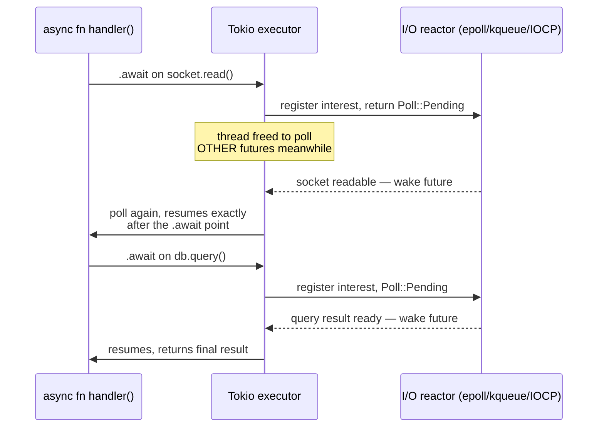

```rust
use tokio::time::{sleep, Duration};

// `async fn` desugars to a state machine implementing Future; nothing
// runs until this Future is awaited (or spawned) on an executor.
async fn fetch_user(id: u64) -> Result<String, String> {
    // Simulates an async I/O call — yields control back to the executor
    // instead of blocking the OS thread while "waiting."
    sleep(Duration::from_millis(50)).await;
    if id == 0 {
        return Err("invalid id".to_string());
    }
    Ok(format!("user-{id}"))
}

#[tokio::main]
async fn main() {
    // tokio::join! runs both futures concurrently on the executor,
    // interleaving their .await suspension points on a small thread pool
    // instead of requiring one OS thread per in-flight request.
    let (a, b) = tokio::join!(fetch_user(1), fetch_user(2));
    println!("{:?} {:?}", a, b);
}
```

**Decision implications.** Choosing async/await over OS threads is a
concurrency-model architecture decision with real trade-offs: async
futures are extremely lightweight (bytes, not a full OS thread stack) and
scale to very high connection counts (the C10K-and-beyond problem), but
introduce "function coloring" (an `async fn` can only be awaited from
another `async fn` or a runtime entry point, splitting a codebase into
sync and async call graphs that don't mix without adapters) and require
choosing and configuring an executor (Tokio's multi-threaded work-stealing
scheduler being the default choice for most networked services, since the
standard library ships none).

**Common failure mode.** Calling a CPU-bound or blocking synchronous
operation (e.g. blocking file I/O, a CPU-heavy computation, or an FFI call
into a blocking C library) directly inside an `async fn` starves the
executor's worker thread — because that thread cannot poll any *other*
future while blocked, other requests on the same worker stall. The fix is
`tokio::task::spawn_blocking` to move blocking work onto a dedicated
blocking-thread pool, keeping the async worker threads free to keep
polling.

**Concrete scenario.** A Rust API gateway handling tens of thousands of
concurrent, mostly-idle WebSocket connections is an archetypal case for
async/Tokio: each connection's future consumes only its captured state
(bytes) while idle, letting a handful of OS threads service tens of
thousands of connections — a workload where a thread-per-connection model
(as in classic blocking-I/O Java servlet containers) would exhaust OS
thread/memory limits long before Rust's async model does.

### 4.11 Architectural trade-offs: when Rust vs. Go/C++/Java

**Definition.** Choosing Rust as an implementation substrate is an
architecture decision with the same shape as any other language/runtime
choice: weigh guaranteed properties (memory safety without a GC, data-race
freedom, static binaries, predictable latency) against costs (steeper
learning curve, longer compile times, smaller hiring pool, more upfront
design effort around ownership) versus the alternatives already familiar
to most architecture teams.

**Mechanism/comparison heuristic.**

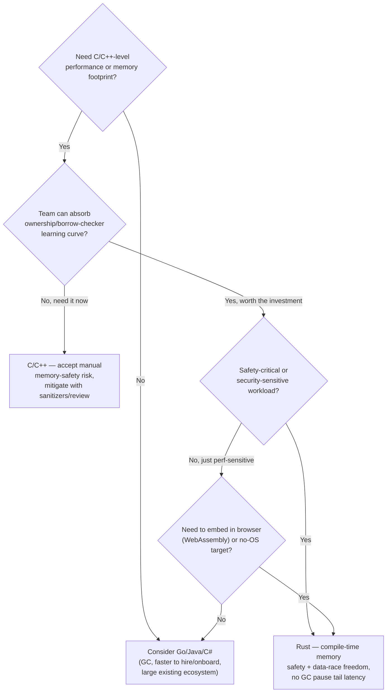

**Decision implications.** Rust is the right substrate when the workload
needs C/C++-adjacent performance and memory control *and* the cost of a
production memory-safety or data-race bug is high (security boundary,
kernel/driver code, financial/safety-critical logic) *and* the team can
invest in the ownership learning curve — this describes proxies/gateways
(e.g. Cloudflare's edge proxy components), embedded/IoT firmware, browser
engines and Wasm modules, and CLI tooling distributed as static binaries.
Go remains the stronger default for typical CRUD (Create, Read, Update,
Delete) microservices where GC pause times in the low milliseconds are an
acceptable trade-off for radically faster onboarding, simpler concurrency
primitives (goroutines/channels without an ownership model to learn), and
a larger immediately-productive hiring pool. Java/JVM remains competitive
where an existing enterprise ecosystem (Spring, mature Application
Performance Monitoring (APM) tooling, large existing codebase) outweighs
Rust's runtime-safety advantages. C++ is chosen over Rust mainly where an
existing multi-decade C++ codebase, toolchain, or platform Application
Programming Interface (API) surface (e.g. game engines, some
Software Development Kits (SDKs)) makes a full rewrite uneconomical, not
because C++ offers something Rust architecturally cannot.

**Common failure mode.** Choosing Rust primarily because it is "faster" in
a generic sense, for a workload that is I/O-bound rather than CPU-bound
(most typical web services), captures little of Rust's actual advantage
(the bottleneck is network/database latency, not language runtime
overhead) while paying the full cost of the steeper learning curve and
slower initial development velocity — a classic case of choosing a tool
for its reputation rather than for the specific architectural property
the workload actually needs.

**Concrete scenario.** A team building a WebAssembly module that runs
client-side image/video codec logic in a browser has essentially no
alternative to Rust/C/C++ (managed-language runtimes with a GC are a poor
fit for the Wasm sandbox's size and startup-time constraints), making this
one of the clearest "Rust is the only reasonable industrial choice" cases
in the current landscape, distinct from CRUD services where Rust is one
reasonable choice among several.

## 5. Internal Working

At the lowest level, ownership is a compile-time-only construct with zero
runtime footprint: there is no ownership "tag" stored in memory alongside a
value. The compiler's borrow checker operates on the Mid-level Intermediate
Representation (MIR), building a control-flow graph and computing, for every
reference, the precise region of code ("region-based" or "non-lexical"
lifetime) over which it may be used, then checking that no two conflicting
borrows have overlapping regions. Once this analysis proves the program
correct, all ownership/lifetime information is erased — the generated
machine code is indistinguishable, in terms of runtime instructions, from
equivalent hand-written C that a programmer got right by hand.

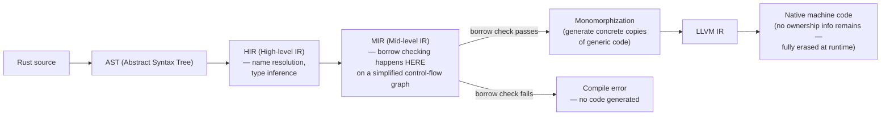

Heap allocation, when it happens (`Box`, `Vec`, `String`, `Rc`/`Arc`), uses
the same global allocator as a C program (by default, the system
allocator; swappable via the `#[global_allocator]` attribute for
specialized workloads, e.g. `jemalloc` for allocation-heavy services). The
difference from C is entirely in *when and how reliably* `free`-equivalent
calls are inserted: the compiler statically proves exactly one `drop` call
per owned value, inserted at the precise point where that value's scope
ends — including every early-return branch, every `?` propagation, and
every panic-unwind path (unless a panic strategy of `abort` is chosen,
skipping unwinding entirely for smaller binaries and slightly different
failure semantics).

## 6. Design Principles

- **Explicit over implicit.** Ownership transfer, mutability, and unsafe
  operations are always visible in the source (`mut`, `&mut`, `unsafe`,
  `.clone()`) rather than inferred silently — a deliberate rejection of
  "convenient but hides cost" defaults.
- **Zero-cost abstractions.** A high-level abstraction (an iterator chain,
  a generic function, an `async` state machine) must compile to code no
  slower than the hand-written equivalent, or the abstraction is considered
  a design failure, not an acceptable trade-off.
- **Fail at compile time, not at runtime.** Wherever a class of bug can be
  statically proven absent (aliasing, null dereference via `Option`,
  exhaustive `match` on enums), Rust chooses the compile-time check over a
  runtime check or a runtime crash.
- **No hidden control flow.** No exceptions, no implicit garbage collection
  pauses, no hidden allocations behind operator overloading that a reader
  wouldn't expect — a function's signature (`Result`, `Option`, ownership
  of parameters) is meant to be a complete contract.

## 7. Architecture Patterns

Rust services commonly adopt a layered architecture that mirrors Hexagonal/
Clean Architecture, using crate boundaries (Section 4.7) to enforce the
dependency direction the pattern requires:

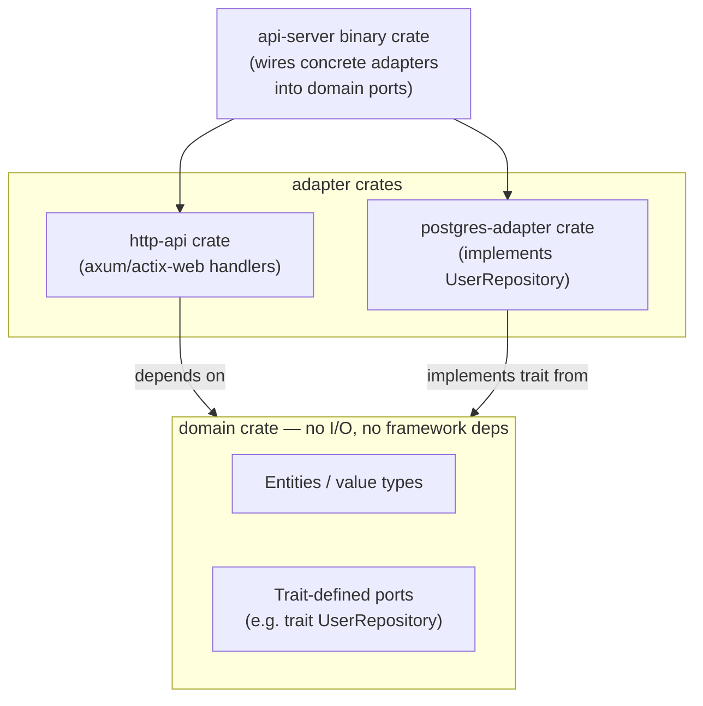

Because traits can be implemented for types across crate boundaries (as
long as either the trait or the type is locally defined — the "orphan
rule"), the domain crate can define a port (`trait UserRepository`) with
zero dependency on the database adapter, and the adapter crate implements
it — the compiler enforces the dependency-inversion direction the pattern
requires, rather than relying on team discipline alone.

## 8. Production Architecture

A typical production Rust web service composes: an async HTTP
framework (Axum or Actix-web) running on Tokio's multi-threaded executor,
a connection-pooled async database client (e.g. `sqlx` or `tokio-postgres`),
structured logging/tracing via the `tracing` crate, and a statically linked
release binary deployed in a minimal container image.

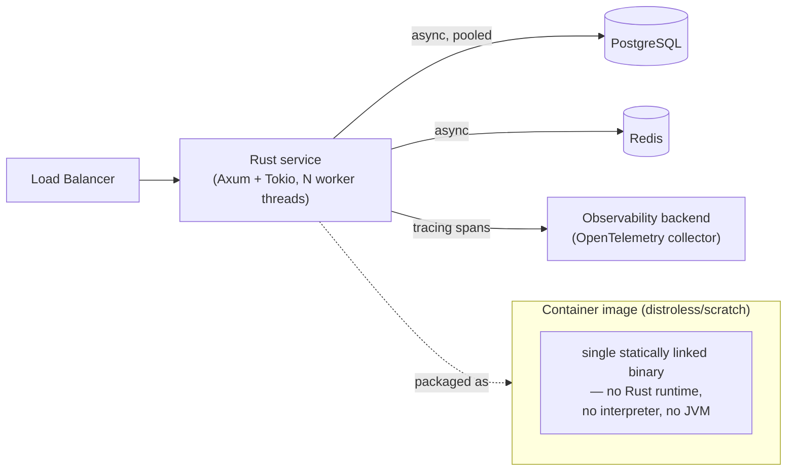

The statically linked binary and lack of a required runtime materially
shrink both the container image (often tens of megabytes instead of
hundreds) and the attack surface (no interpreter/runtime CVEs to patch
independently of the application).

## 9. Implementation

A minimal but realistic layered slice: a domain trait (`UserRepository`),
an in-memory adapter (for tests), and a Postgres-backed adapter, wired
together at a single composition point (`main`), consistent with Section 7's
pattern.

```rust
use async_trait::async_trait;

#[derive(Debug, Clone)]
struct User {
    id: u64,
    email: String,
}

// Domain-owned port: no I/O crate dependency here at all.
#[async_trait]
trait UserRepository: Send + Sync {
    async fn find_by_id(&self, id: u64) -> Result<Option<User>, String>;
}

// Adapter 1: in-memory, used in unit tests — no database required.
struct InMemoryUserRepository {
    users: Vec<User>,
}

#[async_trait]
impl UserRepository for InMemoryUserRepository {
    async fn find_by_id(&self, id: u64) -> Result<Option<User>, String> {
        Ok(self.users.iter().find(|u| u.id == id).cloned())
    }
}

// Composition root: the only place that knows which concrete adapter
// implements the domain port — mirrors dependency inversion at the
// crate-boundary level described in Section 7.
async fn get_user_handler(repo: &dyn UserRepository, id: u64) -> Result<String, String> {
    match repo.find_by_id(id).await? {
        Some(user) => Ok(format!("{} <{}>", user.id, user.email)),
        None => Err(format!("user {id} not found")),
    }
}
```

## 10. Complete Code Examples

See runnable, expanded versions of this chapter's examples under
[`code/rust/`](../code/rust/), covering: ownership/borrowing/lifetimes,
trait-based static vs. dynamic dispatch, `Arc<Mutex<T>>` concurrency,
`Result`/`?`-based error handling, and an `unsafe`/FFI wrapper — each
directly runnable via `cargo run --example <name>`.

## 11. Performance

Rust's performance profile is defined by three properties working together:
no GC pause tail latency (predictable p99 latency under load, a frequent
deciding factor for Rust adoption in latency-sensitive proxies/gateways),
zero-cost abstractions (generic/iterator-heavy code compiles to the same
machine code as hand-optimized loops), and control over memory layout
(`#[repr(C)]`, stack allocation by default for non-heap types, no forced
object-header overhead per value the way JVM objects carry). Benchmarks
comparing Rust to Go/Java on CPU-bound workloads typically show Rust
matching or beating C++ and outperforming GC'd languages by a wide margin
on both throughput and tail latency; the gap narrows substantially for
I/O-bound workloads where network/database latency dominates regardless of
language.

## 12. Scalability

Horizontally, Rust services scale like any stateless service behind a load
balancer — nothing language-specific changes that story. Vertically, the
async/Tokio model (Section 4.10) lets a single instance handle very high
concurrent-connection counts on modest hardware, since each in-flight
request's state is a small heap-allocated future rather than a full OS
thread stack (typically megabytes per thread), directly raising the
practical connections-per-instance ceiling compared to a thread-per-request
architecture.

## 13. Security

Memory safety (Section 4.1-4.2) removes an entire CVE category (buffer
overflows, use-after-free, double-free) that historically accounts for the
majority of high-severity vulnerabilities in C/C++ codebases handling
untrusted input (parsers, codecs, network protocol implementations) — this
is Rust's primary security architecture argument, not a secondary benefit.
It does **not** remove logic vulnerabilities (authorization bugs, injection
via string-built queries, insecure deserialization of untrusted data) —
these remain the architect's responsibility exactly as in any other
language, and `unsafe`/FFI boundaries (Section 4.9) reintroduce the full
C-level risk surface locally, which is why minimizing and auditing
`unsafe` usage is itself a security control, not just a style preference.

## 14. Observability

The `tracing` crate is the de facto standard for structured, async-aware
instrumentation in Rust services — it understands `async fn` suspension
points (a naive log statement inside an `async fn` can't express "this
span was entered, suspended for 40ms waiting on I/O, then resumed," but a
`tracing` span can), exports via OpenTelemetry to standard observability
backends, and integrates with Tokio's executor to expose per-task
scheduling metrics (poll counts, time-to-first-poll) that are otherwise
invisible from outside the async runtime.

## 15. Failure Scenarios

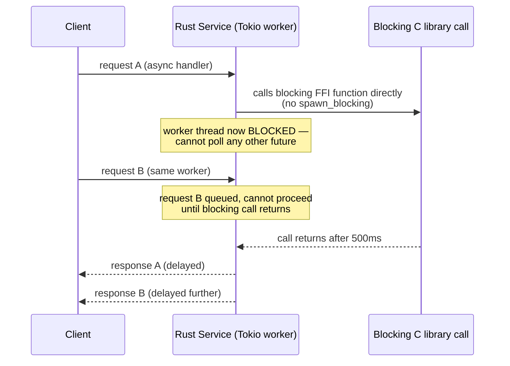

Two Rust-specific production failure patterns dominate incident postmortems:
(1) a blocking call inside an `async fn` starving a Tokio worker thread
(Section 4.10's common failure mode, shown above) — the fix is
`spawn_blocking` or moving the blocking library off the async hot path
entirely; and (2) a poisoned `Mutex` (a thread panicked while holding the
lock, and by default every subsequent `.lock()` call returns `Err` rather
than silently proceeding with possibly-corrupted state) causing a cascading
`unwrap()`-triggered panic across unrelated request handlers that happen to
share the same lock — the architectural fix is either recovering explicitly
from a poisoned lock (`.lock().unwrap_or_else(|poisoned| poisoned.into_inner())`
where the invariant allows it) or redesigning the shared state to avoid a
single choke-point lock across unrelated concerns.

## 16. Testing

Rust ships a test harness in the standard toolchain (`#[test]` functions,
`cargo test`), with `#[tokio::test]` for async tests and built-in support
for doc-tests (code examples inside `///` documentation comments are
compiled and run as tests, guaranteeing documentation never silently goes
stale relative to the actual API). Property-based testing (`proptest`,
`quickcheck`) is idiomatic for exercising ownership/parsing-heavy code
against generated inputs, and `cargo miri` runs the test suite under an
interpreter that additionally catches certain classes of undefined
behavior inside `unsafe` blocks that the borrow checker alone cannot,
making it a standard CI gate for any crate with non-trivial `unsafe` code.

## 17. Common Mistakes

- Reaching for `.clone()` reflexively to silence borrow-checker errors
  instead of restructuring ownership (Section 4.1's failure mode).
- Blanket `Rc<RefCell<T>>` usage as a substitute for proper ownership
  design rather than a deliberate choice for genuinely shared/graph data
  (Section 4.2).
- Blocking inside `async fn` without `spawn_blocking` (Section 4.10/15).
- Treating `unsafe` as a "make it compile" workaround instead of a proof
  obligation with a documented `// SAFETY:` invariant (Section 4.9).
- Choosing dynamic dispatch (`Box<dyn Trait>`) or static dispatch
  (generics) without considering the actual call-site trade-off
  (Section 4.4), defaulting to whichever compiled first.
- Adopting Rust for an I/O-bound CRUD service purely for its performance
  reputation, absorbing the learning-curve cost without a matching
  architectural payoff (Section 4.11).

## 18. Best Practices

- Prefer borrowing (`&T`/`&mut T`) over cloning by default; reach for
  `.clone()` deliberately and document why when ownership genuinely must
  duplicate.
- Keep `unsafe` blocks small, isolated in dedicated modules, and each
  carrying a `// SAFETY:` comment stating the manually verified invariant.
- Use `spawn_blocking` for any call that is not `.await`-friendly inside
  async handlers.
- Structure multi-crate services as a Cargo workspace with a dependency-
  free domain crate and adapter crates depending on it (Section 7).
- Run `cargo clippy` (the standard Rust linter) and `cargo audit`
  (dependency vulnerability scanning against the RustSec advisory
  database) as required CI gates, alongside `cargo test` and `cargo miri`
  for `unsafe`-containing crates.

## 19. Anti-Patterns

- **"Clone-and-hope" architecture**: cloning data structures pervasively to
  avoid engaging with the borrow checker, silently reintroducing the
  allocation/copy overhead Rust exists to avoid, while gaining none of the
  ergonomic simplicity a garbage-collected language would have offered
  honestly from the start.
- **`unsafe` as a compiler-silencer**: wrapping any code that "won't
  compile otherwise" in `unsafe` without verifying the actual invariant,
  producing memory-unsafe Rust that is arguably worse than equivalent C,
  since it carries Rust's "this must be safe" reputation without the
  substance.
- **Generic-everything APIs**: making every function generic over a trait
  bound "for flexibility" when only one concrete type is ever used in
  practice, paying monomorphization compile-time/binary-size cost for
  zero realized benefit.

## 20. Trade-off Analysis

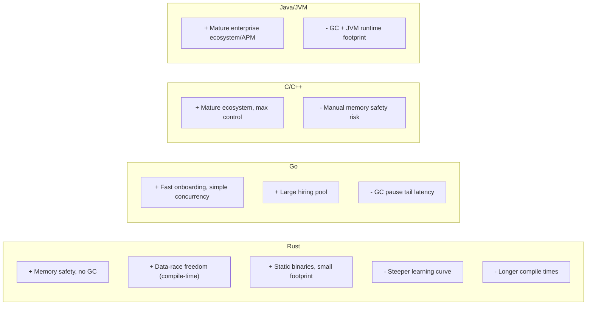

## 21. Comparison Table

| Dimension | Rust | Go | C/C++ | Java/JVM |
|---|---|---|---|---|
| Memory management | Ownership, compile-time, no GC | GC (concurrent, low-latency) | Manual (or smart pointers in C++) | GC (multiple collector strategies) |
| Data-race safety | Compile-time guarantee (Send/Sync) | Runtime race detector (opt-in tool) | None built-in (sanitizers as add-on tools) | Runtime-only (happens-before via JMM) |
| Runtime/dependency | None (static binary) | Small runtime, static-ish binary | None | Requires JVM |
| Generics | Monomorphized, zero-cost | Generics since 1.18, some overhead | Templates (C++), zero-cost | Type-erased, boxing for primitives |
| Typical use case | Systems, embedded, Wasm, perf-critical services | CRUD microservices, cloud tooling | OS/kernels, game engines, legacy systems | Enterprise backends, large existing ecosystems |
| Learning curve | Steep (ownership model) | Shallow | Moderate-to-steep (manual safety) | Moderate |

## 22. Real-World Case Study

Discord migrated its "Read States" service (tracking per-user, per-channel
read/unread message positions — a very high read/write-volume, latency-
sensitive service) from Go to Rust after observing that Go's garbage
collector produced periodic latency spikes under load that a tuning pass
could not fully eliminate. Discord's public engineering write-up attributes
the switch specifically to Rust's lack of a GC-driven pause, not to raw
throughput alone — the service's p99 latency became flat and predictable
under load in a way Go's GC-paused profile could not guarantee, directly
illustrating this chapter's Section 4.1/4.11 argument: Rust is chosen when
predictable tail latency is itself an architecturally significant
requirement, not merely when "faster" in an average-case sense would
suffice.

## 23. Interview Questions

1. Explain move semantics: what happens to a variable after its value is
   moved, and why does the compiler forbid using it afterward?
2. What invariant does the borrow checker enforce, and how does that same
   invariant eliminate both single-threaded iterator-invalidation bugs and
   multithreaded data races?
3. When would you choose `Box<dyn Trait>` over a generic `<T: Trait>`
   parameter, and what does each cost/gain at compile time and runtime?
4. Why does Rust have no exceptions for recoverable errors, and what does
   the `?` operator actually do at the type level?
5. What does `unsafe` unlock, and what does it *not* disable? What proof
   obligation does the programmer take on inside an `unsafe` block?
6. Why does calling a blocking function inside an `async fn` on Tokio cause
   problems, and how do you fix it?
7. Contrast Rust's `Send`/`Sync` marker traits with Go's approach to
   concurrency safety (or lack of a compile-time equivalent).
8. When is Rust the wrong choice for a service, even though it would be
   technically faster than the incumbent language?

## 24. Hands-on Exercises

1. Write a function that takes ownership of a `Vec<String>`, and a second
   version that borrows it instead — observe which call sites the
   compiler rejects for each, and explain why in terms of Section 4.1/4.2.
2. Implement a trait with both a generic (static-dispatch) and
   `Box<dyn Trait>` (dynamic-dispatch) call site for the same trait;
   inspect the compiled binary size difference for a handful of
   implementing types.
3. Build a small Tokio-based service with two endpoints, one of which
   incorrectly calls a blocking `std::thread::sleep` inside an `async fn`;
   load-test it and observe the latency degradation versus a
   `tokio::time::sleep`/`spawn_blocking`-corrected version.
4. Wrap a small C library function via `extern "C"` in a safe Rust
   function, documenting the `// SAFETY:` invariant explicitly.

## 25. Design Exercises

1. Design a Cargo workspace layout for a service with a public client SDK,
   a private domain crate, and a private HTTP+database adapter crate;
   justify each crate boundary in terms of the dependency-inversion
   pattern from Section 7.
2. Given a workload description (either "high concurrent WebSocket
   connection count, I/O-bound" or "CPU-bound video transcoding"), decide
   between async/Tokio and OS-thread-per-task, and justify the choice
   using Section 4.10/4.11's decision criteria.
3. Design the error-type hierarchy for a service with three internal
   fallible subsystems (database, cache, external API client), showing
   how each subsystem's error converts into one handler-level error enum
   via `From` implementations (Section 4.8).

## 26. Architecture Review Questions

- Does this service's `unsafe` surface area have a documented `// SAFETY:`
  invariant for every block, and has it been audited (e.g. via
  `cargo geiger`/`cargo miri`)?
- Are there any blocking calls reachable from an `async fn` without
  `spawn_blocking`, and has this been load-tested under concurrent load?
- Is the crate/workspace boundary structure enforcing the intended
  dependency-inversion direction, or can adapter-crate types leak into the
  domain crate?
- Does the error-type design centralize the "internal failure to external
  response" mapping at one boundary, or is it scattered across layers?
- Was Rust chosen for a property this workload actually needs (memory
  safety under untrusted input, tail-latency predictability, static-binary
  deployment, Wasm/embedded target), or primarily for its performance
  reputation on an I/O-bound workload that would not materially benefit?

## 27. Summary

Rust's architectural contribution is moving memory safety and data-race
freedom from a runtime/discipline problem to a compile-time-proven property,
via ownership, borrowing, and lifetimes (Sections 4.1-4.3) — with zero-cost
trait-based abstractions (4.4), compile-time-checked concurrency (4.5), a
monomorphizing LLVM-backed compiler producing static binaries (4.6), a
crate/workspace system that enforces module boundaries at the compilation-
unit level (4.7), a value-based (not exception-based) error-handling
architecture (4.8), an explicit and auditable `unsafe`/FFI escape hatch
(4.9), and an executor-driven async model for high-concurrency I/O (4.10)
layered on top. None of this makes Rust universally the "best" language —
Section 4.11's decision framework and Section 21's comparison table are the
chapter's core architectural takeaway: choose Rust specifically when the
workload's architecturally significant requirements are memory safety under
untrusted input, predictable tail latency without GC pauses, static-binary
deployment, or a no-runtime target like WebAssembly or embedded firmware —
and choose Go, Java, or C++ when those specific properties are not what the
system actually needs.
