# Chapter: HTML

Part: [04 — Frontend Architecture](PART_OVERVIEW.md) · Status: Drafted

## 1. Introduction

HTML (HyperText Markup Language) is the substrate every browser-based
application is ultimately built on. A Solution Architect who treats HTML as
"just markup" — something designers and junior front-end engineers worry
about — will consistently mis-diagnose performance, accessibility, and
resiliency problems that actually originate in how a browser parses HTML,
builds the DOM (Document Object Model), and schedules rendering work. This
chapter treats HTML as an *architectural substrate*: a specification-defined
parsing algorithm with deterministic error recovery, a tree data structure
(the DOM) that becomes the shared runtime model every JavaScript framework
mutates, and an entry point into the browser's rendering pipeline that
determines how quickly a page becomes visible and interactive.

This chapter is the owning chapter for the DOM as a tree data structure, the
HTML parsing algorithm (tokenization, tree construction, and error recovery),
the critical rendering path from HTML to pixels, resource-loading
architecture (preload/prefetch/preconnect, script loading strategies), Web
Components (Custom Elements, Shadow DOM, HTML `<template>`), the Constraint
Validation API, and the architectural trade-offs between Server-Side
Rendering (SSR) and Client-Side Rendering (CSR) as they relate to HTML
delivery. General accessibility principles — Web Content Accessibility
Guidelines (WCAG), the accessibility-by-design mindset, focus management,
and assistive technology testing strategy — are owned by
[Accessibility](../02_Design_Thinking_and_Product_Management/CH11_Accessibility.md);
this chapter recaps that ownership where relevant and focuses specifically
on the DOM/parsing mechanics that produce the accessibility tree in the
first place. HTTP (HyperText Transfer Protocol) methods, status codes, and
caching headers are owned by [HTTP](../05_Networking_and_OS/CH01_HTTP.md);
this chapter recaps only the parts of HTTP that shape resource-loading
architecture.

## 2. Historical Evolution

- **HTML (1991, Tim Berners-Lee)** — a small set of tags borrowed from SGML
  (Standard Generalized Markup Language) conventions, designed to link
  physics papers at CERN (European Organization for Nuclear Research).
  There was no formal grammar; browsers guessed at malformed markup from day
  one, which is the direct ancestor of today's standardized error-recovery
  algorithm.
- **HTML 2.0 (1995, IETF RFC 1866)** — the first attempt at a real
  specification: forms, basic tags, and a defined (if incomplete) grammar.
- **HTML 3.2 / HTML 4.01 (1997–1999, W3C)** — tables, frames, scripting
  hooks, and the beginning of a presentation/structure split (though `<font>`
  and `align` attributes still mixed style into markup).
- **XHTML 1.0/1.1 (2000–2001)** — an attempt to redefine HTML as a strict
  XML (Extensible Markup Language) application: well-formedness required,
  parse errors meant the page didn't render at all ("draconian error
  handling"). This is architecturally important because it is the road
  *not* taken — the ecosystem overwhelmingly rejected "fail the whole page
  on one malformed tag" as too fragile for the open web, where millions of
  pages were already imperfect.
- **WHATWG (Web Hypertext Application Technology Working Group) formed
  (2004)** — Apple, Mozilla, and Opera broke from the W3C's XHTML-only
  direction and started a "Living Standard" that codified how real browsers
  already recovered from malformed markup, rather than mandating strict
  well-formedness.
- **HTML5 (2008 draft, 2014 W3C Recommendation, ongoing WHATWG Living
  Standard)** — for the first time, a complete, deterministic, testable
  parsing algorithm (tokenization + tree construction state machines) that
  every conformant browser must implement identically, byte-for-byte
  including error paths. HTML5 also introduced semantic sectioning elements
  (`<article>`, `<section>`, `<nav>`, `<aside>`), the Canvas and drag-and-drop
  APIs, native form validation (the Constraint Validation API), and the
  `<template>` element that later became foundational to Web Components.
- **Web Components standardization (2011–2018)** — Custom Elements, Shadow
  DOM, and HTML Imports (later dropped in favor of ECMAScript modules) were
  proposed as a framework-agnostic component model built directly on
  browser-native HTML/DOM primitives, rather than requiring a JavaScript
  framework runtime.
- **The "Living Standard" model (ongoing)** — unlike versioned specs (HTML
  4.01, XHTML 1.1), the WHATWG HTML spec has no version number; it is
  continuously updated, and browser vendors implement against the current
  text. This is itself an architectural decision: it optimizes for
  interoperability over stability of a fixed reference point, and it is why
  "HTML5" is now more a marketing label than a version an architect can pin.

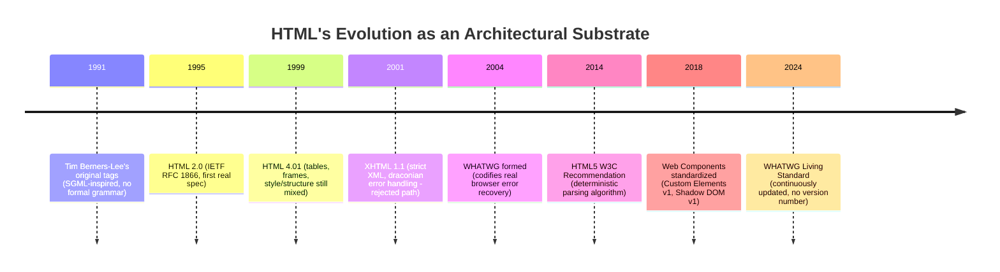

## 3. Why It Exists

HTML exists to solve a narrower problem than people often assume: it is not
a general-purpose UI (User Interface) toolkit, it is a **fault-tolerant,
declarative document format for hypertext** that a browser can parse
incrementally, streaming, without ever fully validating the document before
starting to render it. Three architectural properties fall directly out of
that goal:

1. **Incremental, streaming parseability** — a browser must be able to start
   building a DOM and rendering content before the full HTML response has
   even arrived over the network, because early documents were served over
   slow modem links. This forces the parsing algorithm to be a state machine
   that can pause mid-tag-name and resume when more bytes arrive, rather
   than a batch parser that requires the whole document up front.
2. **Deterministic error recovery instead of hard failure** — because HTML
   documents are frequently hand-written, generated by imperfect templating
   systems, or concatenated from multiple sources, any parser that rejected
   malformed markup outright (as XHTML did) would break a large fraction of
   the existing web. HTML5 standardized *exactly* how every browser must
   recover from a missing closing tag, mismatched nesting, or a stray
   character, so that "tag soup" renders identically everywhere instead of
   being an implementation-defined guessing game.
3. **A structural/semantic document model, not a pixel-level one** — HTML
   describes what content *is* (a heading, a list, a form field), and
   delegates *how it looks* to CSS (Cascading Style Sheets, owned by the
   sibling CSS chapter) and *how it behaves* to JavaScript. This separation
   is what makes an HTML document usable by a screen reader, a search engine
   crawler, and a stylesheet-less browser simultaneously — none of which
   have access to the visual rendering a sighted user sees.

For a Solution Architect, the practical consequence is that HTML decisions
are never purely cosmetic: how markup is structured determines parse cost,
DOM size, accessibility tree shape, SEO (Search Engine Optimization)
crawlability, and how much JavaScript is required to reach an interactive
state.

## 4. Core Concepts

### 4.1 The DOM (Document Object Model) as a Tree Data Structure

The DOM is the in-memory, language-agnostic tree representation of an HTML
(or XML) document that a browser builds from parsed markup, and which every
subsequent API — CSS selector matching, `document.querySelector`, a
JavaScript framework's virtual DOM diffing, an accessibility tree — reads
from or mutates. Understanding it as a specific *data structure*, not just
"the page," is what lets an architect reason about performance and memory
cost.

**Mechanism.** Structurally, the DOM is a tree of `Node` objects. The
concrete node types that matter architecturally are:

- **`Document`** — the root of the tree; exactly one per browsing context.
- **`Element`** — a tag instance (`<div>`, `<p>`, `<custom-widget>`), which
  additionally carries an `attributes` map (a `NamedNodeMap`) and, for
  elements with `id`/`class`, contributes entries to internal lookup
  structures the browser maintains for fast CSS matching.
- **`Text`** — a run of character data between tags; whitespace-only text
  nodes are still real nodes and contribute to tree size.
- **`Comment`** — retained in the DOM (unlike some template languages that
  strip comments), which matters for DOM-size and traversal cost even though
  comments are invisible.
- **`DocumentFragment`** — a lightweight, parentless container used to build
  or move sub-trees without triggering a reflow for every individual
  insertion; this is the mechanism behind efficient batched DOM writes.

Every node exposes a small, uniform interface —
`parentNode`/`childNodes`/`firstChild`/`nextSibling` — which is why generic
tree algorithms (depth-first traversal, `TreeWalker`, `NodeIterator`) work
identically regardless of what the tree actually represents.

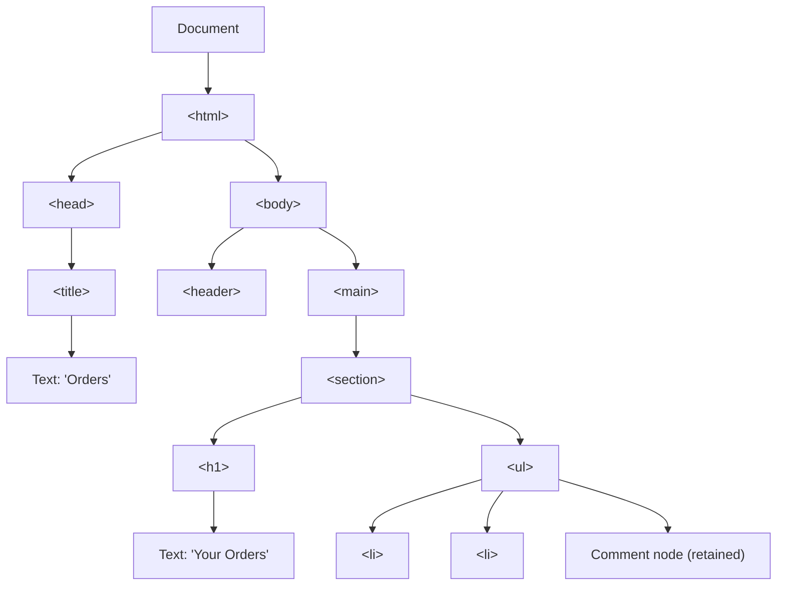

**Decision implications.** DOM node count is not a free abstraction — every
additional node increases: (a) parse/construction time, (b) memory
footprint (each `Element` node in a modern browser engine is on the order of
several hundred bytes to a few kilobytes once style/layout objects attach to
it), (c) CSS selector-matching cost for any rule whose selector could match
that node, and (d) the size of the accessibility tree a screen reader must
walk. A common real-world failure mode is a data grid or infinite-scroll
feed that renders every row as full DOM markup: at a few thousand rows this
routinely produces 50,000+ DOM nodes, and layout/style recalculation cost
scales with tree size, not just visible-row count. The architectural fix —
DOM virtualization/windowing, rendering only the visible row range and a
small overscan buffer — is a direct, practical consequence of treating the
DOM as a real tree data structure with real traversal costs, not a static
"the page is what it is" assumption.

**Failure mode.** Detached DOM subtrees (nodes removed from the tree via
`removeChild`/replacing `innerHTML`, but still referenced by a JavaScript
closure, event listener, or cache) are a classic memory-leak pattern: the
node is gone from the visible tree, but the garbage collector cannot reclaim
it because a live JavaScript reference still exists. This is functionally
identical to a dangling-reference leak in any other language runtime, just
expressed through DOM APIs instead of raw pointers.

### 4.2 HTML Tokenization: The First Parsing Stage

The WHATWG HTML parsing algorithm has two cooperating stages: **tokenization**
and **tree construction**. Tokenization is a finite state machine that
consumes the raw input character stream and emits a sequence of tokens
(`StartTag`, `EndTag`, `Character`, `Comment`, `DOCTYPE`, `EOF`). It has
around 80 named states in the spec (`Data state`, `Tag open state`,
`Attribute name state`, `Script data state`, and so on), and it is
*context-sensitive* — for example, encountering `<` inside a `<script>`
element's text content behaves completely differently than encountering `<`
in the `Data state`, because the tokenizer switches into `Script data state`
where markup characters are treated as literal text until it sees a
matching `</script>` sequence. This is precisely why you can write
`if (x < 1)` inside an inline `<script>` block without escaping `<`, but
cannot write literal `<` inside ordinary HTML text without it being
misinterpreted as the start of a tag.

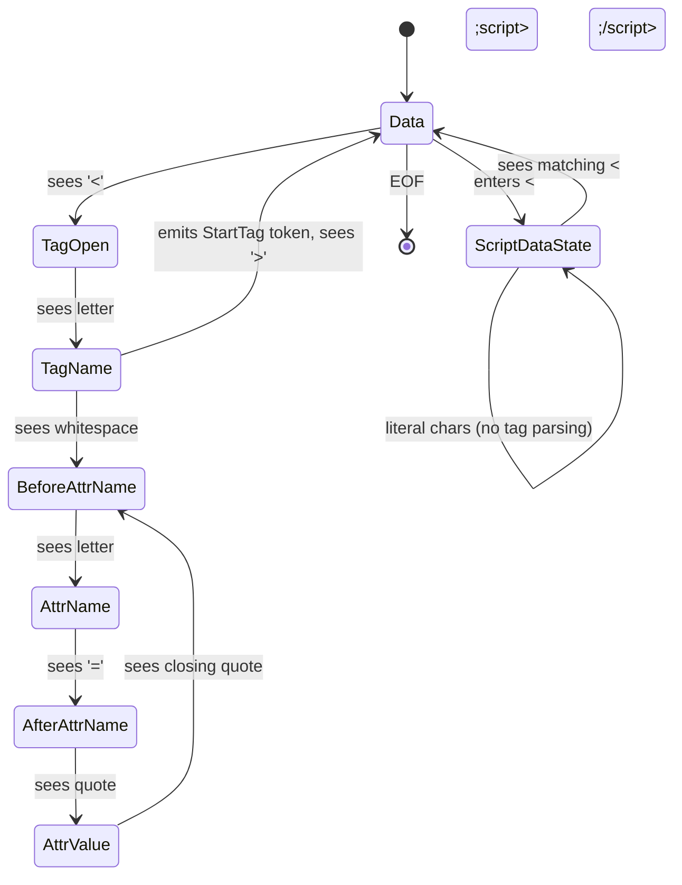

**Mechanism detail worth internalizing:** the tokenizer does not know
anything about tree structure or nesting rules — it has no concept of
"a `<p>` cannot contain another `<p>`." That rule-enforcement job belongs
entirely to the second stage, tree construction. This separation of
concerns (lexical analysis vs. grammar/structure enforcement) is the same
pattern used in traditional compiler front-ends, and it's why HTML parsing
bugs are usually traceable to one stage or the other in isolation.

### 4.3 Tree Construction: Insertion Modes and the Stack of Open Elements

Tree construction consumes the token stream from the tokenizer and builds
the DOM. It maintains two critical pieces of state:

- **The stack of open elements** — tracks which elements are currently "open"
  (started but not yet closed), used to validate/repair nesting.
- **The current insertion mode** — one of ~23 named modes
  (`"before html"`, `"in head"`, `"in body"`, `"in table"`, `"in select"`,
  and so on) that determines how the next token is interpreted. The
  insertion mode is what makes HTML parsing *context-sensitive at the tree
  level*: a `<td>` start tag is handled completely differently depending on
  whether the current insertion mode is `"in table"` versus `"in body"`.

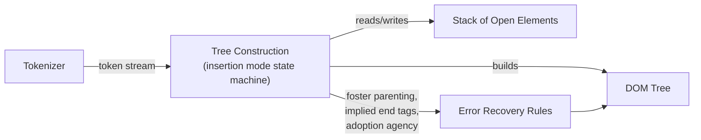

Two concrete tree-construction rules every architect should recognize
because they explain "weird" real-world markup behavior:

- **Implied end tags** — certain elements automatically close when a
  disallowed child token appears. Example: `<p>one<p>two</p>` produces two
  *sibling* `<p>` elements ("one" and "two"), not a nested `<p>` inside a
  `<p>`, because the spec's tree-construction rules say a `<p>` start tag
  while a `<p>` is open must first implicitly close the open `<p>`.
- **Foster parenting** — content that appears where table syntax does not
  allow it (for example, raw text directly inside `<table>` but outside any
  `<td>`) is not dropped; the spec relocates ("foster parents") it to just
  before the table in the DOM. This is why a stray `<div>` accidentally
  placed inside a `<table>` but outside a cell doesn't disappear — it
  silently moves in the DOM tree relative to where it was written in source,
  a frequent source of "the DOM doesn't match my markup" confusion when
  debugging with dev tools.

### 4.4 Error Recovery and "Tag Soup" Handling

The single most misunderstood architectural property of HTML is that
**error recovery is specified, not implementation-defined**. Two independent,
spec-conformant browser engines parsing the exact same malformed markup must
produce the *same* DOM tree, byte for byte. This is achieved through a large
catalogue of explicit "parse error" recovery rules in the WHATWG spec — the
spec text literally says "this is a parse error" and then specifies the
exact recovery action, rather than leaving it undefined behavior.

The canonical example of deep tree-construction error recovery is the
**adoption agency algorithm**, which handles improperly nested formatting
elements such as:

```html
<b>bold <i>bold italic</b> italic</i>
```

Naively, `</b>` closes before `<i>` in the markup, which is invalid nesting.
The adoption agency algorithm does not fail; it walks the stack of open
elements and the "list of active formatting elements," and reconstructs a
well-nested tree that reproduces the *visual* effect as if the tags had been
properly nested, effectively cloning the `<i>` element across the
implied boundary:

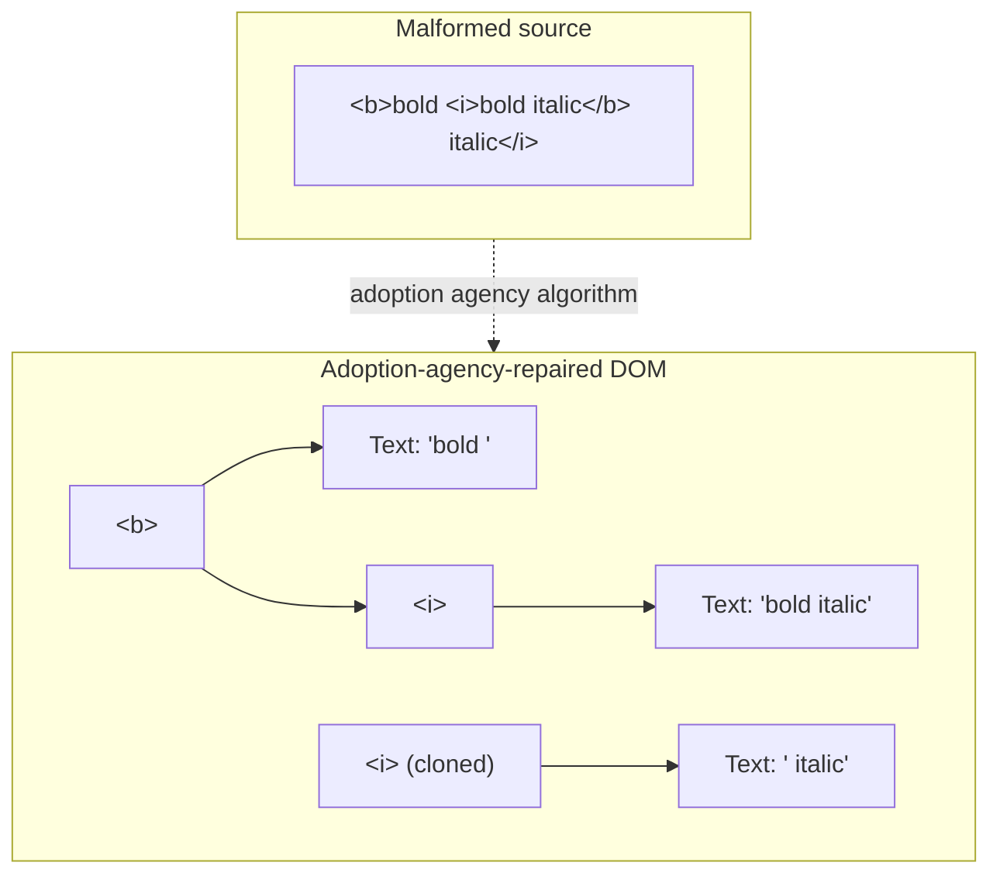

**Decision implications for architects.** (1) Never rely on "the browser
will figure it out" as a substitute for validating templating output —
error recovery guarantees *consistency*, not that the resulting DOM matches
your intent; a missing closing tag can silently relocate large sections of
a page. (2) Server-rendered HTML generated by string concatenation (rather
than a proper templating/serialization library that tracks open tags) is
the highest-risk source of tag-soup bugs in production, because template
interpolation can accidentally inject a stray `<` or omit a closing tag
under specific data conditions that don't show up in casual testing. (3)
Tools like the W3C/WHATWG HTML validator or `eslint-plugin-html`-style
linting in a build pipeline are the correct control — catching malformed
markup at build/CI (Continuous Integration) time rather than depending on
runtime error recovery to "make it work."

### 4.5 Semantic HTML and Its Architectural Implications

"Semantic HTML" means choosing elements that describe *what content is*
(`<nav>`, `<article>`, `<button>`, `<time>`) rather than *how it should look*
(a `<div>` styled to resemble a button). This is not a stylistic preference —
it has three concrete, measurable architectural consequences:

1. **Accessibility tree generation.** Every element has an implicit ARIA
   (Accessible Rich Internet Applications) role baked into the HTML
   specification's "Implicit ARIA semantics" table — `<button>` implicitly
   has `role="button"`, `<nav>` implicitly has `role="navigation"`, a
   `<h1>`-`<h6>` implicitly reports a heading level. The browser's rendering
   engine uses these implicit roles, together with computed name/state, to
   build the accessibility tree — a parallel tree consumed by assistive
   technologies (screen readers, switch devices, voice control). Full
   ownership of the assistive-technology consumption model (how a screen
   reader announces a role, name, and state; the DOM → accessibility tree →
   assistive-output pipeline as an interaction model) belongs to
   [Accessibility](../02_Design_Thinking_and_Product_Management/CH11_Accessibility.md);
   this chapter's scope is the DOM-side mechanics only: a `<div onclick=...>`
   styled as a button has **no implicit role, no implicit keyboard
   focusability, and no implicit keyboard-activation behavior** — all three
   have to be manually re-implemented with `role="button"`, `tabindex="0"`,
   and a `keydown` handler, which is strictly more code and strictly more
   ways to get it wrong than using `<button>` in the first place.
2. **SEO (Search Engine Optimization) crawlability.** Search engine crawlers
   use heading hierarchy (`<h1>`-`<h6>`), landmark elements (`<nav>`,
   `<main>`, `<article>`), and structured metadata to determine a page's
   topic and content hierarchy independent of visual layout. A page built
   entirely from generically-styled `<div>`s provides none of this signal.
3. **Progressive enhancement.** Because semantic elements carry built-in
   *behavior* (a `<form>` submits, an `<a href>` navigates, an `<input
   required>` blocks submission), a page built from semantic HTML remains
   functional even if CSS fails to load or JavaScript throws an exception
   before attaching event handlers. A page built from non-semantic `<div>`
   soup with JavaScript-attached click handlers becomes completely
   non-functional the instant that JavaScript fails — there is no
   fallback behavior baked into a `<div>`.

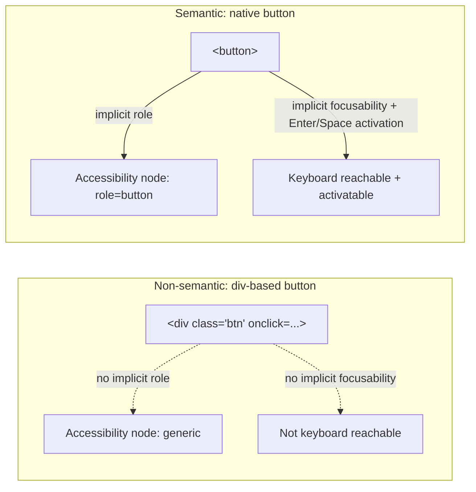

**Failure mode.** "Div-itis" — building entire interfaces from `<div>` and
`<span>` styled to *look* like semantic elements — is the single most common
architectural anti-pattern this section addresses. It quietly moves cost
from "write one extra attribute" to "reimplement focus management, keyboard
activation, and screen-reader labeling by hand, and get all three subtly
wrong under edge cases (nested focusable elements, disabled state, RTL
(Right-to-Left) text direction)."

### 4.6 The Critical Rendering Path

The critical rendering path is the sequence of steps a browser performs
between receiving HTML bytes and painting pixels to the screen. This is the
mechanical core of why HTML/resource-loading order matters for performance,
and it directly determines metrics like First Contentful Paint (FCP) and
Largest Contentful Paint (LCP).

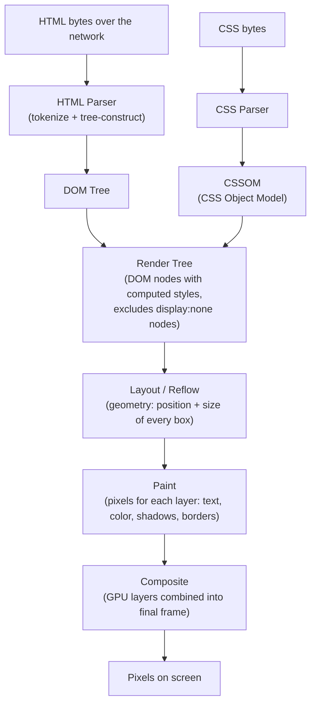

**Mechanism, stage by stage:**

- **DOM construction** blocks on any `<script>` without `async`/`defer`
  encountered mid-document, because the parser cannot know whether that
  script will call `document.write()` and inject more markup — so it must
  pause tree construction, fetch (if external), execute the script
  synchronously, and only then resume parsing. This is the single biggest
  architectural reason parser-blocking scripts historically had to be
  placed at the end of `<body>`, and why `async`/`defer` (Section 4.9)
  exist.
- **CSSOM construction** is render-blocking in the opposite direction:
  the browser cannot safely compute any element's final style — and
  therefore cannot build the render tree — until it has parsed the *entire*
  CSSOM, because a later-loaded stylesheet rule can override an
  earlier one (cascade). This is why a `<link rel="stylesheet">` in `<head>`
  blocks first paint until it (and any `@import`ed sheets) finish
  downloading and parsing.
- **Render tree** is DOM ∩ computed-CSSOM-styles, but with `display: none`
  subtrees entirely excluded (they contribute zero geometry — unlike
  `visibility: hidden`, which is included in layout but invisible).
- **Layout (reflow)** computes the exact pixel geometry (box position/size)
  for every render-tree node; this is $O(n)$ in tree size in the best case
  but can cascade — a single style/geometry change on a widely-shared
  ancestor can force recomputation of a large subtree.
- **Paint** rasterizes each visual layer (text, backgrounds, borders,
  shadows) into bitmaps.
- **Composite** combines painted layers (often GPU-accelerated layers for
  `transform`/`opacity` animations) into the final displayed frame without
  re-running layout/paint — which is exactly why animating `transform` and
  `opacity` is cheap, while animating `width`/`top`/`left` is expensive: the
  former only touches the composite stage, the latter forces layout and
  paint to re-run every frame.

**Decision implications.** Every render-blocking resource in `<head>`
(stylesheets, and synchronous non-deferred scripts) directly delays FCP.
The practical architecture pattern this motivates is: inline
above-the-fold critical CSS directly in `<head>` (no network round trip),
load the remainder of the stylesheet asynchronously (e.g.
`<link rel="stylesheet" media="print" onload="this.media='all'">` or the
`rel="preload"` + `onload` swap pattern), and defer/async every
non-essential script.

### 4.7 Resource Loading Architecture: Hints and Priorities

Modern HTML gives the browser explicit hints about which resources matter
and when, letting an architect shape network scheduling instead of leaving
it entirely to browser heuristics.

| Hint | What it does | When to use |
|---|---|---|
| `<link rel="preconnect" href="...">` | Performs DNS lookup + TCP (Transmission Control Protocol) handshake + TLS negotiation early, before the resource request itself | A cross-origin resource you know you'll need soon (e.g. a CDN or API origin), but whose exact URL isn't known yet |
| `<link rel="dns-prefetch" href="...">` | DNS resolution only (cheaper, lower-fidelity fallback for browsers/situations where a full preconnect isn't warranted) | Many third-party origins where a full preconnect for each would be wasteful |
| `<link rel="preload" as="script">` | Forces high-priority, immediate fetch of a specific resource the browser wouldn't otherwise discover early (e.g. a font referenced only inside CSS, or a script needed right after hydration) | A specific known resource on the critical path that the browser's normal discovery order would fetch too late |
| `<link rel="prefetch" href="...">` | Low-priority fetch, cached for a likely *future* navigation (not this page) | Resources for the next page in a predictable user flow (e.g. checkout step 2) |
| `<link rel="modulepreload" href="...">` | Like `preload`, specialized for ECMAScript modules, additionally pre-parsing the module graph | Module-based JavaScript bundles with entry points known ahead of execution |

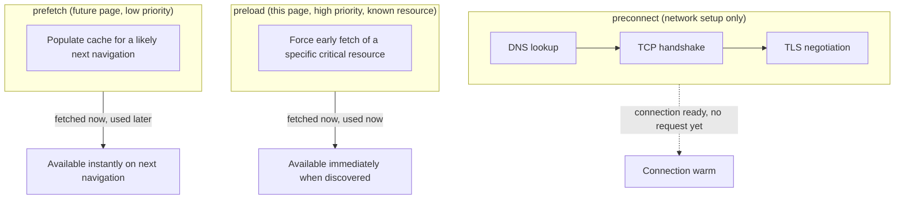

**Failure mode.** Over-using `preload` is a common anti-pattern: preload
forces the browser to fetch a resource at high priority *whether or not it
ends up being used within a few seconds* — a "preload not used" browser
console warning is a direct signal of wasted bandwidth competing with truly
critical resources. Preload is a scalpel for one or two known critical-path
resources, not a blanket policy.

### 4.8 Script Loading Strategies: Parser-Blocking, `async`, and `defer`

How a `<script>` tag is loaded materially changes both when DOM
construction can proceed and when the script executes relative to other
scripts — this is a frequent source of production bugs when engineers
assume `async` and `defer` are interchangeable.

```mermaid
gantt
    dateFormat X
    axisFormat %s
    title Script loading timelines (relative time units)
    section Parser-blocking (no attribute)
    HTML parsing paused           :active, pb1, 0, 2
    Fetch script                  :pb2, 2, 4
    Execute script (parser still paused) :crit, pb3, 4, 5
    HTML parsing resumes          :pb4, 5, 8
    section async
    HTML parsing continues        :a1, 0, 6
    Fetch script (parallel)       :a2, 0, 3
    Execute (pauses parsing at fetch completion, out of order) :crit, a3, 3, 4
    HTML parsing resumes          :a4, 4, 8
    section defer
    HTML parsing continues uninterrupted :d1, 0, 8
    Fetch script (parallel)       :d2, 0, 3
    Execute after DOM fully parsed, in document order :crit, d3, 8, 9
```

- **No attribute (parser-blocking)** — the parser stops, fetches (if not
  already cached), executes synchronously, then resumes. Guarantees
  execution order matches document order, but is maximally blocking.
- **`async`** — fetched in parallel with parsing (non-blocking fetch), but
  execution *interrupts* parsing the instant the fetch completes, and
  execution order across multiple `async` scripts is **not** guaranteed to
  match document order (whichever finishes downloading first executes
  first). Appropriate for independent scripts with no ordering dependency
  on each other or on DOM state (e.g. analytics beacons).
  ***
- **`defer`** — fetched in parallel, but execution is deferred until *after*
  the document has been fully parsed (DOM construction complete, before
  `DOMContentLoaded` fires), and multiple `defer` scripts execute in strict
  document order. This is the correct default for scripts that need a
  complete DOM and/or depend on execution order relative to each other
  (most application bootstrap code).
- **`type="module"`** — ECMAScript modules are deferred by default (behave
  like `defer` without needing the attribute), execute once per module
  specifier (deduplicated even if referenced from multiple `<script>` tags),
  and run in strict mode automatically.

**Decision implications.** A common production bug: two `async` scripts
where script B's top-level code assumes script A has already run (e.g. B
reads a global that A sets) — this works in local development (A happens
to finish first due to cache warmth) and fails intermittently in production
under different network conditions, because `async` explicitly does not
guarantee order. The fix is either `defer` (if order matters, but neither
blocks DOM construction) or an explicit dependency/module-graph
relationship instead of an implicit global-variable handshake.

### 4.9 Web Components: A Framework-Agnostic Component Architecture

Web Components are a set of native browser APIs — **Custom Elements**,
**Shadow DOM**, and the **`<template>` element** — that together let an
architect define a reusable, encapsulated UI component using only
browser-native HTML/DOM/JavaScript, without depending on a JavaScript
framework runtime (React, Angular, etc.) to define or render it. This
matters architecturally because a Web Component works identically whether
consumed from a React app, an Angular app, a plain server-rendered page, or
another Web Component — it is a genuine interoperability boundary at the
DOM level, not a framework-specific one.

**Custom Elements** let you register a new tag name backed by a JavaScript
class extending `HTMLElement`, with defined lifecycle callbacks:

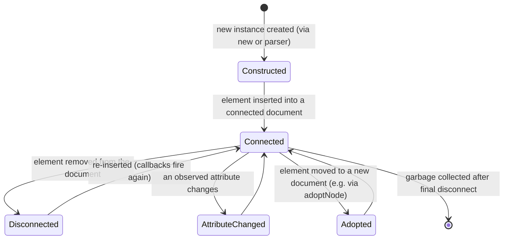

- `constructor()` — element created; per spec, must not touch attributes or
  children yet (they may not exist), only set up internal state.
- `connectedCallback()` — fires every time the element is inserted into a
  document that has a browsing context; this is where you typically attach
  a Shadow DOM, render initial content, and add event listeners.
- `disconnectedCallback()` — fires on removal; the correct place to release
  resources (timers, subscriptions, observers) to avoid the detached-subtree
  memory-leak pattern described in Section 4.1.
- `attributeChangedCallback(name, oldValue, newValue)` — fires only for
  attributes explicitly listed in the static `observedAttributes` getter,
  letting the component react to markup-level configuration changes.
- `adoptedCallback()` — rarely used; fires when an element is moved into a
  different `Document` via `document.adoptNode()`.

**Shadow DOM** attaches a separate, encapsulated DOM subtree to a host
element, with two enforced boundaries: **style encapsulation** (CSS rules
inside a shadow root do not leak out, and page-level CSS selectors do not
reach in — with the exception of inherited properties like `font-family`
and CSS custom properties, which pierce the boundary by design) and **DOM
encapsulation** (`document.querySelector` from outside cannot see inside a
*closed* shadow root, and even an *open* shadow root's internals are
excluded from the light-DOM tree by default).

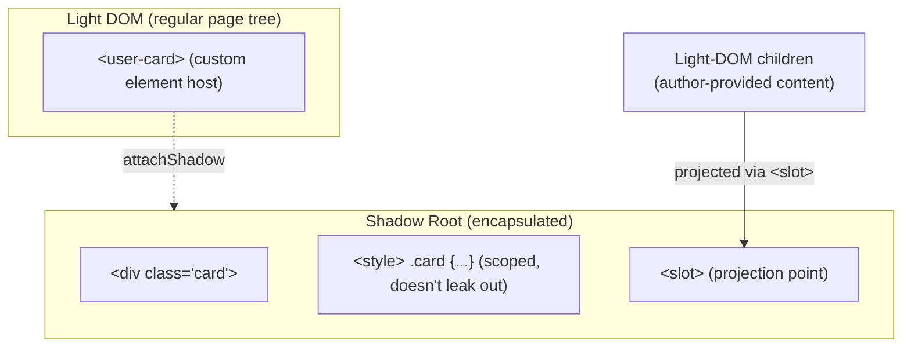

The `<slot>` element is the projection mechanism: light-DOM children
authored inside the custom element's tags (e.g.
`<user-card><span slot="name">Ada</span></user-card>`) are rendered at the
matching `<slot name="name">` position inside the shadow tree, without
actually being *moved* in the DOM — this is "flattened tree" composition,
distinct from actual DOM reparenting.

The `<template>` element declares inert, unrendered, unexecuted markup —
its content is parsed (so it benefits from the same parsing algorithm as
the rest of the document) but its `<script>`s don't run and its ``s
don't fetch until the template's content is cloned into the live DOM via
`.content.cloneNode(true)`. This is the standard mechanism for defining a
Custom Element's internal markup once and stamping it out efficiently per
instance.

**Decision implications.** Web Components are the right choice when a
component must be consumed across framework boundaries (a design system
shared by teams on React, Angular, and legacy jQuery pages) or must survive
a framework migration. They are the wrong choice when a team is
single-framework and wants framework-idiomatic state management (React
hooks, Angular dependency injection) — Shadow DOM's style isolation also
means framework-level CSS-in-JS or global design tokens need explicit
bridging (CSS custom properties are the standard bridge, since they pierce
shadow boundaries).

### 4.10 Forms and the Constraint Validation API

HTML forms have a native, declarative validation model — the Constraint
Validation API — that lets a browser block submission and surface
accessible error messaging *before* any JavaScript runs, which is
architecturally significant for progressive enhancement and for reducing
client-side validation code an application must write and maintain.

**Mechanism.** Validation attributes (`required`, `pattern`, `min`, `max`,
`minlength`, `maxlength`, `type="email"`, `step`) are evaluated by the
browser against the `ValidityState` interface, exposed per input as
`input.validity`, with named boolean flags: `valueMissing`, `typeMismatch`,
`patternMismatch`, `tooShort`, `tooLong`, `rangeUnderflow`,
`rangeOverflow`, `stepMismatch`, and a catch-all `customError`. An element's
overall validity is `input.validity.valid`, and `input.checkValidity()`
triggers a synchronous check (firing an `invalid` event if it fails,
without blocking submission itself), while `form.reportValidity()` performs
the check *and* shows the browser's native validation UI (the little
tooltip bubble) and focuses the first invalid field — this is exactly what
happens automatically when a `<form>` with no `novalidate` attribute is
submitted.

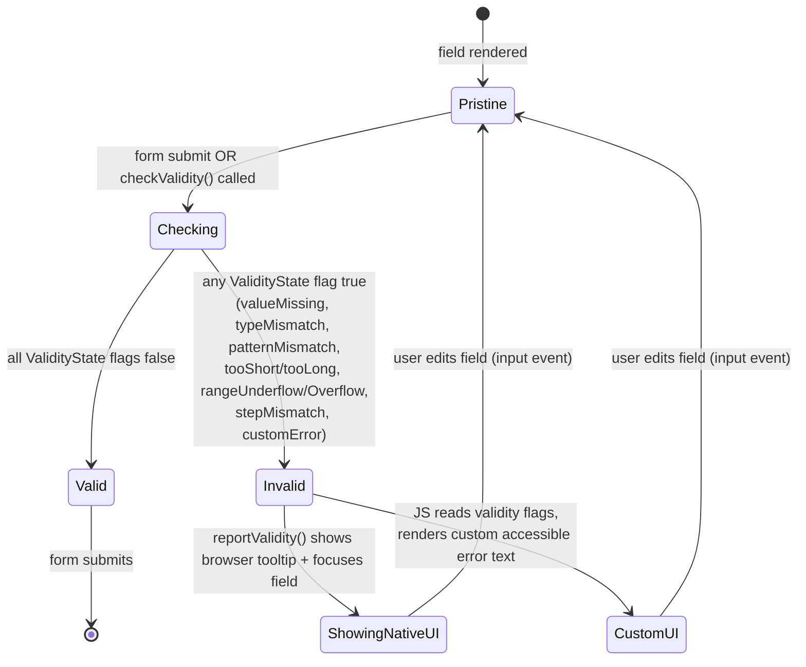

`setCustomValidity(message)` lets JavaScript inject an application-specific
validation rule (e.g. "username already taken," discovered via an async
API call) into the *same* native validity/reporting pipeline — setting any
non-empty string marks the field invalid with `customError: true`; setting
an empty string clears it. This is the correct extension point for
business-rule validation that HTML's static attributes cannot express,
without abandoning the native validation UI/accessibility behavior
entirely.

**Decision implications.** Client-side Constraint Validation API checks are
strictly a UX (User Experience) optimization — they run in the user's
browser and can be trivially bypassed (disabled JavaScript, direct HTTP
requests, a modified DevTools session). **Server-side validation of every
field is mandatory regardless of client-side validation**, both for
correctness and for security (an unvalidated server endpoint is an
injection/data-integrity risk irrespective of what the browser enforced).
The architectural pattern this motivates is duplicating the *constraint
definitions* (not the code) on both sides — for example, deriving both the
HTML `pattern`/`required` attributes and the server-side schema validation
(e.g. a JSON Schema or a Zod/Pydantic model) from a single shared schema
definition, so the two layers cannot silently drift apart.

### 4.11 SSR vs. CSR: HTML's Role in Rendering Architecture Decisions

Where HTML is generated — on the server before the network response
(Server-Side Rendering, SSR), entirely in the browser after a mostly-empty
HTML shell loads (Client-Side Rendering, CSR), at build time and served as
static files (Static Site Generation, SSG), or a hybrid mix per-route/per-
component (islands architecture, React Server Components, incremental
static regeneration) — is one of the highest-leverage architecture
decisions a Solution Architect makes for a web application, because it
determines what the browser's HTML parser and critical rendering path
(Section 4.6) actually have to work with on first load.

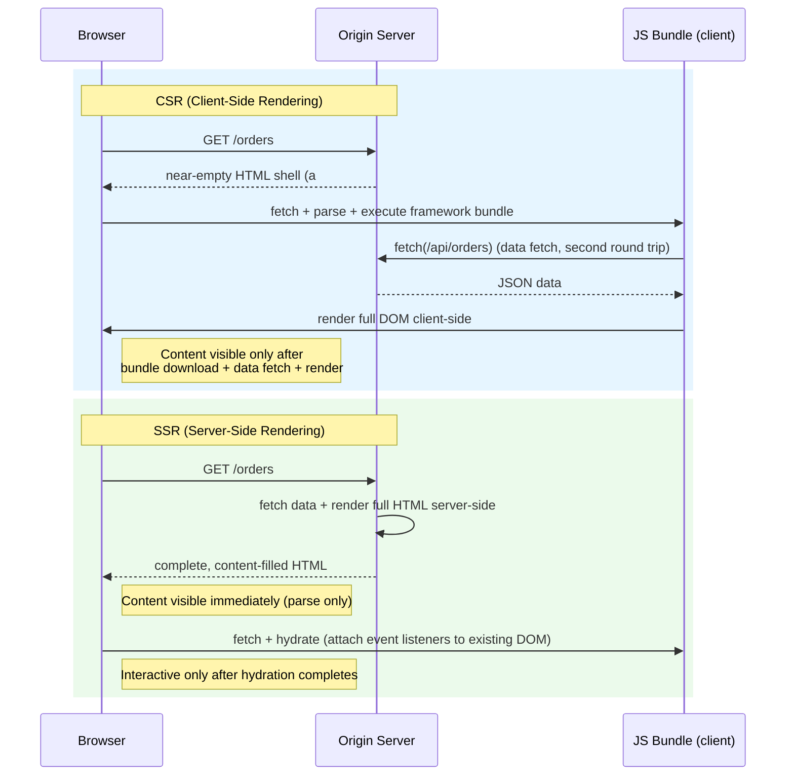

**Mechanism and trade-offs:**

- **CSR** ships a minimal HTML document (often a single `<div id="root">`),
  meaning the browser's HTML parser finishes almost instantly, but the page
  is *visually empty* until a JavaScript bundle downloads, parses,
  executes, and typically performs its own data fetch — first meaningful
  content is gated behind at least two sequential network round trips (JS
  bundle, then API data) plus script execution time. CSR pages are also
  the hardest for search-engine crawlers and pre-HTML-execution tooling to
  index correctly unless the crawler executes JavaScript.
- **SSR** performs data-fetching and full HTML rendering on the server for
  every request, so the browser receives content-complete HTML — the
  critical rendering path's DOM-construction stage produces a fully
  populated tree immediately, giving fast FCP/LCP. The cost shifts to
  **hydration**: the client must still download the same (or a targeted
  subset of the) JavaScript and re-attach event listeners/component state
  to the server-rendered DOM, and a mismatch between server-rendered markup
  and what the client would have rendered (a "hydration mismatch") is a
  distinct new failure class SSR introduces (Section 15).
- **SSG (Static Site Generation)** does the same rendering work as SSR but
  at *build time* rather than per-request, trading request-time freshness
  for the ability to serve pre-rendered HTML from a CDN edge with no origin
  compute per request — the right choice when content changes
  infrequently relative to traffic volume.
- **Hybrid/islands architecture** (used by frameworks like Astro, and
  partially by React Server Components) renders most of the page as static
  or server-rendered HTML, and ships JavaScript only for specific
  interactive "islands," rather than hydrating the entire page — this
  directly reduces the total JavaScript payload gating interactivity,
  addressing hydration's main cost without abandoning the fast-FCP benefit
  of server-rendered HTML.

**Decision implications.** This is fundamentally a trade-off between
*time-to-first-content* and *server compute/operational complexity*: CSR
minimizes server compute (often just serving static files from a CDN) at
the cost of client-perceived load time and SEO friction; SSR maximizes
initial content speed and crawlability at the cost of per-request server
compute, additional infrastructure (a Node.js or equivalent rendering
runtime at the origin, not just static file serving), and hydration-related
failure modes. A content-heavy, SEO-critical marketing site or e-commerce
product page strongly favors SSR/SSG; a highly interactive internal
dashboard behind authentication (where SEO is irrelevant and users tolerate
a brief loading state in exchange for a simpler deployment) can reasonably
choose CSR.

## 5. Internal Working

This section traces one concrete request end-to-end through every mechanism
introduced in Section 4, to make the causal chain from "bytes on the wire"
to "pixels + accessible, interactive UI" explicit.

```mermaid
sequenceDiagram
    participant Net as Network
    participant Tok as Tokenizer
    participant TC as Tree Construction
    participant DOM as DOM Tree
    participant CSSOM as CSSOM
    participant RT as Render Tree
    participant LO as Layout
    participant PT as Paint
    participant CO as Composite
    participant AX as Accessibility Tree
    participant JS as JS Engine

    Net->>Tok: HTML bytes (streamed, chunked)
    Tok->>TC: token stream (StartTag/EndTag/Character/...)
    TC->>DOM: incremental node insertion
    Note over TC,DOM: Parser-blocking &lt;script&gt; (no async/defer)<br/>pauses TC until script executes
    TC->>JS: execute inline/blocking script synchronously
    JS->>DOM: may mutate DOM directly (document.write, appendChild)
    Net->>CSSOM: CSS bytes (parsed in parallel)
    DOM->>RT: combine with CSSOM once both are ready
    CSSOM->>RT: computed styles
    RT->>LO: compute geometry (position, size) for every box
    LO->>PT: rasterize pixels per layer
    PT->>CO: composite layers (GPU where applicable)
    DOM->>AX: derive accessibility tree (implicit ARIA roles + computed name/state)
    Net->>JS: deferred/module scripts fetched in parallel, executed after DOM complete
    JS->>DOM: hydration - attach event listeners, framework takes over
```

**Key internal-working details:**

- **Streaming and speculative parsing.** Because HTML arrives over the
  network in chunks, the browser's "preload scanner" runs ahead of the main
  tokenizer/tree-construction pipeline, scanning raw bytes for resource
  references (``, `<link rel=stylesheet>`, `<script src>`) *before*
  those tags are actually reached by tree construction, so it can kick off
  network fetches for discovered resources early — this is why a
  parser-blocking script mid-document still doesn't necessarily delay
  *fetching* of later resources, only their *execution*/DOM-insertion
  timing.
- **`document.write()` as a parser-integration hazard.** A synchronous
  script calling `document.write()` injects new tokens directly into the
  tokenizer's input stream at the exact point of execution — this is the
  one remaining case where a script can literally alter the token stream
  the parser is consuming, which is precisely why `document.write()` from
  an externally-loaded (especially `async`) script is disallowed/ignored by
  modern browsers: the timing guarantee it depends on (script executes
  exactly at its document position, synchronously) is incompatible with
  asynchronous fetch.
- **Reflow/repaint scheduling.** Layout and paint are not re-run on every
  single DOM/style mutation; the browser batches mutations within a
  JavaScript task and performs a single reflow/repaint pass before the next
  frame is presented (typically synchronized to `requestAnimationFrame`).
  Reading certain layout-dependent properties from JavaScript
  (`offsetHeight`, `getBoundingClientRect()`) immediately after a DOM
  write forces a **synchronous layout ("layout thrashing")** — the browser
  must flush pending layout work early to answer the query accurately,
  which, if done in a loop (write, read, write, read...), causes layout to
  run once per iteration instead of once per frame.
- **Accessibility tree derivation timing.** The accessibility tree is
  derived from the DOM + computed styles (an element with `display: none`
  or `aria-hidden="true"` is excluded) and is recomputed incrementally as
  the DOM changes — it is not a one-time snapshot, which is why dynamically
  inserted content (e.g. a client-rendered modal) is announced by screen
  readers if inserted correctly, and silently invisible to them if inserted
  in a way that never triggers the accessibility tree update (e.g. content
  mutated inside a `display:none` container that's later revealed without a
  qualifying mutation the browser's accessibility computation observes).

## 6. Design Principles

- **Structure before style before behavior.** Author HTML that is
  meaningful and functional with no CSS and no JavaScript at all first,
  then layer presentation and interactivity on top — this is the practical
  operationalization of progressive enhancement, and it is a design
  discipline, not an accident of "we happened to build it that way."
- **Minimize DOM depth and node count for what must render, not what could
  render.** Every additional wrapper `<div>` is a real cost (Section 4.1);
  prefer CSS layout primitives (Flexbox, Grid) over extra wrapper elements
  purely for layout purposes.
- **Choose the most specific semantic element available**, and only fall
  back to a generic element + explicit ARIA role when no semantic element
  fits (recap: full ARIA authoring guidance is owned by
  [Accessibility](../02_Design_Thinking_and_Product_Management/CH11_Accessibility.md)).
- **Treat validation attributes as documentation of business rules**, kept
  in lockstep with server-side validation rather than as a separate,
  divergent client-only concern.
- **Render where the constraint is tightest.** Choose SSR/SSG when
  time-to-first-content or crawlability is the binding constraint; choose
  CSR when operational simplicity and post-authentication interactivity
  dominate; default to measuring, not assuming, which constraint actually
  binds for a given route.

## 7. Architecture Patterns

- **Critical CSS inlining + async stylesheet swap** — inline the minimum
  CSS needed for above-the-fold content directly in `<head>`, defer the
  full stylesheet via the `preload` + `onload` media-swap pattern
  (Section 4.7), eliminating the full-CSSOM render-block for non-critical
  styles.
- **Resource-hint waterfall shaping** — combine `preconnect` for known
  cross-origin hosts, `preload` for one or two known critical-path assets,
  and `prefetch` for the next likely navigation, to actively shape network
  scheduling rather than relying on discovery order alone.
- **Islands architecture** (Section 4.11) — server-render the page shell,
  hydrate only interactive islands, minimizing JavaScript execution gating
  interactivity.
- **Web Components as a cross-framework design-system boundary** — expose a
  shared component library as Custom Elements so React, Angular, and
  legacy pages can consume the same implementation without a shared
  framework runtime dependency.
- **Schema-driven form validation** — derive both HTML constraint
  attributes and server-side validation from one shared schema definition
  (Section 4.10), eliminating client/server validation drift.

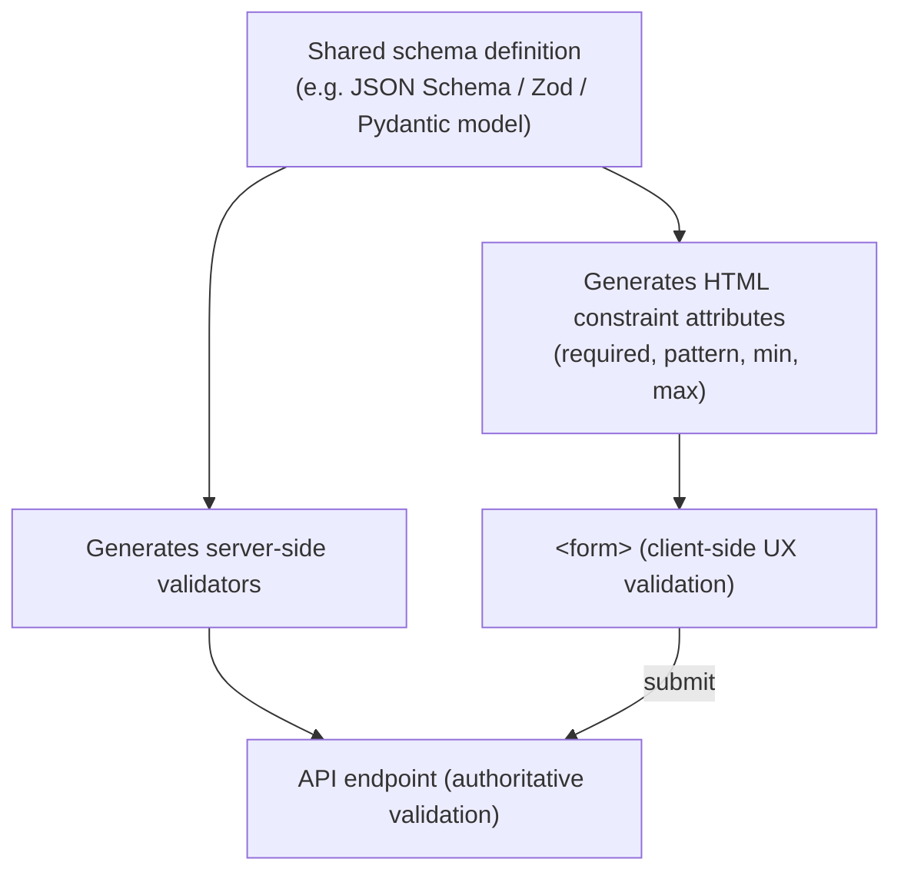

## 8. Production Architecture

A production HTML-delivery architecture typically layers: an edge CDN
serving cacheable static HTML/SSG output where possible, an SSR rendering
tier (Node.js/Deno/similar) for dynamic routes that performs data fetching
and HTML generation per request (or per cache-invalidation event for
Incremental Static Regeneration), a build pipeline that lints/validates
generated markup and produces critical-CSS extraction, and client-delivered
JavaScript bundles split so that hydration-critical code loads first and
non-critical (below-the-fold, rarely-interacted) component code loads
lazily. Observability at this layer (Section 14) centers on Core Web Vitals
(LCP, INP — Interaction to Next Paint, CLS — Cumulative Layout Shift)
measured from real users (Real User Monitoring), not just synthetic lab
tests, because network conditions and device capability vary far more in
production than in a CI (Continuous Integration) benchmark environment.

## 9. Implementation

Concrete implementation guidance for each Section 4 concept:

- **DOM size control**: implement virtualization/windowing (e.g.
  `react-window`, Angular CDK's `cdk-virtual-scroll-viewport`, or a hand-
  rolled `IntersectionObserver`-driven approach) for any list/grid rendering
  more than a few hundred rows.
- **Parsing/validation in CI**: run an HTML validator (e.g. `html-validate`
  or the W3C Nu validator) against generated markup as a build step, not
  only manual QA (Quality Assurance).
- **Resource hints**: audit `preload` usage with browser DevTools' "unused
  preload" warnings on every release; treat any warning as a defect.
- **Script loading**: default every non-inline script to `defer` (or
  `type="module"`, which is deferred by default) unless there is a specific
  documented reason for `async` or parser-blocking.
- **Web Components**: register Custom Elements through a small internal
  wrapper utility that enforces consistent lifecycle patterns (attaching
  Shadow DOM in `connectedCallback`, cleaning up observers in
  `disconnectedCallback`) across a team, rather than leaving each
  component author to reinvent lifecycle discipline.
- **Forms**: centralize a `setCustomValidity` helper that maps a shared
  validation-schema error back onto the corresponding field, so custom
  business-rule errors participate in the same native
  `reportValidity()`/accessible-announcement pipeline as built-in
  constraints.

## 10. Complete Code Examples

### 10.1 A Framework-Agnostic Web Component (Custom Element + Shadow DOM + `<template>`)

```html
<!-- user-card.html: demonstrates Custom Elements, Shadow DOM, <template>, and slotting -->
<template id="user-card-template">
  <style>
    /* Scoped to this shadow root only - never leaks to the host page */
    .card { border: 1px solid #d0d0d0; border-radius: 8px; padding: 1rem; }
    .name { font-weight: 600; }
  </style>
  <div class="card">
    <div class="name"><slot name="name">Unknown user</slot></div>
    <div class="role"><slot name="role">No role set</slot></div>
  </div>
</template>

<script>
  class UserCard extends HTMLElement {
    static get observedAttributes() {
      return ['highlighted'];
    }

    constructor() {
      super();
      const template = document.getElementById('user-card-template');
      const shadowRoot = this.attachShadow({ mode: 'open' });
      shadowRoot.appendChild(template.content.cloneNode(true));
    }

    connectedCallback() {
      // Safe to read attributes/children here; not guaranteed in constructor().
      this._resizeObserver = new ResizeObserver(() => this._onResize());
      this._resizeObserver.observe(this);
    }

    disconnectedCallback() {
      // Prevents a detached-subtree leak (Section 4.1): the observer would
      // otherwise keep a live reference to a removed element indefinitely.
      this._resizeObserver?.disconnect();
    }

    attributeChangedCallback(name, oldValue, newValue) {
      if (name === 'highlighted') {
        this.shadowRoot.querySelector('.card')
          .classList.toggle('highlighted', newValue !== null);
      }
    }

    _onResize() {
      /* layout-aware behavior would go here */
    }
  }

  customElements.define('user-card', UserCard);
</script>

<!-- Usage - works identically inside a React, Angular, or plain HTML page -->
<user-card highlighted>
  <span slot="name">Ada Lovelace</span>
  <span slot="role">Solution Architect</span>
</user-card>
```

### 10.2 Constraint Validation API with a Custom Async Business Rule

```html
<form id="signup-form" novalidate>
  <label for="username">Username</label>
  <input
    id="username"
    name="username"
    required
    minlength="3"
    maxlength="20"
    pattern="[a-zA-Z0-9_]+"
    aria-describedby="username-error"
  />
  <span id="username-error" role="alert"></span>
  <button type="submit">Create account</button>
</form>

<script>
  const form = document.getElementById('signup-form');
  const usernameInput = document.getElementById('username');
  const errorEl = document.getElementById('username-error');

  function renderValidity(input, messageEl) {
    // Map native ValidityState flags to accessible, human-readable text -
    // the same pipeline drives both built-in and custom (setCustomValidity) errors.
    if (input.validity.valid) {
      messageEl.textContent = '';
      return;
    }
    if (input.validity.valueMissing) messageEl.textContent = 'Username is required.';
    else if (input.validity.tooShort) messageEl.textContent = 'Username is too short.';
    else if (input.validity.patternMismatch) messageEl.textContent = 'Only letters, numbers, and underscores allowed.';
    else if (input.validity.customError) messageEl.textContent = input.validationMessage;
  }

  let debounceHandle;
  usernameInput.addEventListener('input', () => {
    clearTimeout(debounceHandle);
    usernameInput.setCustomValidity(''); // clear any prior async error immediately
    debounceHandle = setTimeout(async () => {
      if (!usernameInput.validity.valid) {
        renderValidity(usernameInput, errorEl);
        return;
      }
      const available = await checkUsernameAvailable(usernameInput.value);
      if (!available) {
        // Injects a business-rule error into the SAME native validity pipeline
        // as required/pattern/minlength - reportValidity() will surface it identically.
        usernameInput.setCustomValidity('That username is already taken.');
      }
      renderValidity(usernameInput, errorEl);
    }, 300);
  });

  form.addEventListener('submit', (event) => {
    if (!form.checkValidity()) {
      event.preventDefault();
      form.reportValidity(); // native tooltip + focuses first invalid field
    }
    // Server-side validation of every field is still mandatory (Section 4.10) -
    // this only improves client UX, it is never the security boundary.
  });

  async function checkUsernameAvailable(username) {
    const response = await fetch(`/api/usernames/${encodeURIComponent(username)}/availability`);
    const data = await response.json();
    return data.available;
  }
</script>
```

### 10.3 Resource-Loading Hints and Script Strategy in `<head>`

```html
<head>
  <meta charset="utf-8" />
  <title>Orders</title>

  <!-- Warm the connection to a known cross-origin API host before we need it -->
  <link rel="preconnect" href="https://api.example.com" crossorigin />

  <!-- Critical, above-the-fold CSS inlined directly - zero network round trip -->
  <style>
    body { margin: 0; font-family: system-ui, sans-serif; }
    header { padding: 1rem; background: #1a1a2e; color: white; }
  </style>

  <!-- Non-critical stylesheet loaded without blocking first paint -->
  <link
    rel="preload"
    as="style"
    href="/styles/full.css"
    onload="this.onload=null;this.rel='stylesheet'"
  />
  <noscript><link rel="stylesheet" href="/styles/full.css" /></noscript>

  <!-- A specific known critical-path script - fetched at high priority -->
  <link rel="preload" as="script" href="/js/bootstrap.js" />

  <!-- Application bootstrap: needs a complete DOM, order matters -->
  <script src="/js/bootstrap.js" defer></script>

  <!-- Independent analytics beacon: no ordering dependency on anything else -->
  <script src="https://analytics.example.com/beacon.js" async></script>

  <!-- Likely next navigation in a predictable flow -->
  <link rel="prefetch" href="/js/checkout.js" />
</head>
```

### 10.4 Minimal SSR with Hydration (Node.js) — Avoiding a Hydration Mismatch

```javascript
// server.js - minimal SSR endpoint (framework-agnostic illustration)
import http from 'node:http';

function renderOrdersHtml(orders) {
  // Server and client MUST render identical markup for identical data,
  // or the client's hydration step will detect a mismatch (Section 15).
  const items = orders
    .map((o) => `<li data-order-id="${o.id}">${o.label}</li>`)
    .join('');
  return `<!doctype html>
<html lang="en">
  <head><meta charset="utf-8" /><title>Orders</title></head>
  <body>
    <main id="app">
      <h1>Your Orders</h1>
      <ul id="order-list">${items}</ul>
    </main>
    <script src="/client.js" defer></script>
  </body>
</html>`;
}

http
  .createServer(async (req, res) => {
    if (req.url === '/orders') {
      const orders = await fetchOrdersFromDatabase(); // same data source client would use
      res.writeHead(200, { 'Content-Type': 'text/html' });
      res.end(renderOrdersHtml(orders));
      return;
    }
    res.writeHead(404);
    res.end();
  })
  .listen(3000);

async function fetchOrdersFromDatabase() {
  return [
    { id: 1, label: 'Order #1001' },
    { id: 2, label: 'Order #1002' },
  ];
}
```

```javascript
// client.js - hydration: attach behavior to EXISTING server-rendered DOM,
// never re-create it, to avoid discarding the fast server-rendered paint.
document.addEventListener('DOMContentLoaded', () => {
  const list = document.getElementById('order-list');
  list.querySelectorAll('li').forEach((li) => {
    li.addEventListener('click', () => {
      const orderId = li.dataset.orderId;
      window.location.href = `/orders/${orderId}`;
    });
  });
});
```

## 11. Performance

HTML-level performance decisions map directly onto Core Web Vitals: FCP and
LCP are dominated by render-blocking resources and DOM/CSSOM construction
time (Section 4.6); INP (Interaction to Next Paint) is dominated by main-
thread JavaScript execution time competing with input handling, including
hydration cost on SSR pages; CLS (Cumulative Layout Shift) is dominated by
late-arriving content (images without explicit `width`/`height`, web fonts
swapping in, injected banners) that shifts already-laid-out geometry.
Reducing DOM node count (Section 4.1) directly reduces style-recalculation
and layout cost for every subsequent mutation, not just initial render.
Preferring `transform`/`opacity` for animation (Section 4.6) keeps expensive
work confined to the composite stage. Minimizing render-blocking CSS/script
(Sections 4.6–4.8) is the single highest-leverage lever for FCP/LCP on a
typical content page.

## 12. Scalability

"Scalability" for HTML architecture is less about traffic volume (that's an
infrastructure/CDN concern) and more about **DOM scalability** and **team
scalability**. DOM scalability: virtualization (Section 4.1) is the
mechanism that keeps a UI responsive as data volume grows, independent of
backend throughput. Team scalability: Web Components (Section 4.9) let
multiple teams on different framework stacks share a single component
implementation without coordinating a shared framework version/runtime
upgrade — a real organizational scaling benefit distinct from raw request
throughput.

## 13. Security

- **HTML injection / stored and reflected Cross-Site Scripting (XSS)** —
  any user-controlled string inserted into HTML via `innerHTML`,
  `document.write()`, or unescaped server-side template interpolation
  allows an attacker to inject arbitrary markup/script. The tree-
  construction error-recovery rules (Section 4.4) do not protect against
  this — a well-formed, spec-conformant `<script>` tag injected via
  unsanitized user input executes exactly as intended by the parser, which
  is the whole problem. Mitigation: always use `textContent` (not
  `innerHTML`) for untrusted string insertion, rely on a templating engine's
  auto-escaping, and set a Content-Security-Policy (CSP) header restricting
  script sources as defense in depth.
- **Shadow DOM as a partial security boundary, not a real sandbox** — Shadow
  DOM's `mode: 'closed'` hides internals from casual `querySelector` access
  from the light DOM, but it is not a security sandbox (unlike an
  `<iframe>` with a distinct origin); a closed shadow root's internals are
  still reachable through other means (e.g. if the component itself exposes
  a reference). Do not rely on Shadow DOM to hide secrets or enforce trust
  boundaries between mutually distrusting code — use an `<iframe>` with
  appropriate `sandbox` attributes for that.
- **Form autofill and `autocomplete` attributes for sensitive fields** —
  explicitly set `autocomplete="new-password"` / `"off"` where appropriate
  to avoid credential-manager-related data exposure on shared devices.
- **`target="_blank"` without `rel="noopener"`** — a classic HTML-level
  vulnerability: a linked page opened via `target="_blank"` without
  `rel="noopener"` gets a live `window.opener` reference back to the
  original page, enabling "tab-nabbing" (the opened page navigates the
  opener to a phishing page). Always pair `target="_blank"` with
  `rel="noopener noreferrer"`.

## 14. Observability

Instrument Core Web Vitals (LCP, INP, CLS) via the `PerformanceObserver` API
and report them to Real User Monitoring (RUM) tooling, segmented by
route/rendering-strategy (SSR vs. CSR) so regressions can be attributed to
the correct architectural layer. Track hydration-mismatch warnings (browser
console errors emitted by frameworks like React/Vue when SSR output doesn't
match client render output) as a first-class production alert, not just a
development-time nuisance — they indicate either a real
rendering-non-determinism bug or a security-relevant data-inconsistency
issue between server and client render paths. Track "preload not used"
warnings (Section 4.7) as a recurring lint/CI signal.

## 15. Failure Scenarios

- **Render-blocking resource cascade** — a synchronous, parser-blocking
  `<script>` placed in `<head>` that itself is slow to fetch (e.g. a
  third-party tag manager on a slow CDN) delays DOM construction for the
  entire document behind it, delaying FCP for content that has nothing to
  do with that script.

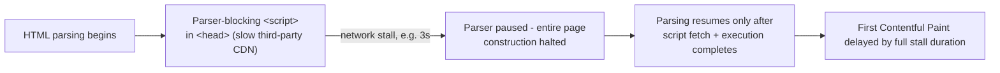

- **Hydration mismatch** — server-rendered HTML and the client's initial
  render output differ (e.g. a server-side date formatted in UTC vs. a
  client formatting in local timezone, or conditional content depending on
  `window` object state unavailable during SSR) — the framework detects the
  mismatch during hydration and either re-renders the affected subtree
  client-side (visible flash/layout shift) or, in stricter frameworks,
  throws and aborts hydration entirely, leaving the page inert.
- **Detached DOM subtree memory leak** (Section 4.1) — a long-running
  Single-Page Application (SPA) that never releases event listeners/
  observers on removed nodes accumulates memory over a session, eventually
  degrading performance or crashing the tab.
- **Tag-soup-induced content relocation** — a template bug that omits a
  closing tag causes the adoption agency algorithm or foster-parenting
  rules (Section 4.4) to relocate subsequent content in the DOM in a way
  that visually breaks the page, even though no error was ever thrown.
- **Custom Element upgrade race** — markup referencing a custom tag
  (`<user-card>`) that is parsed *before* `customElements.define()` has
  executed renders as an unstyled, behavior-less generic `HTMLElement`
  ("Flash of Undefined Custom Elements") until the definition script loads
  and the browser "upgrades" already-parsed instances — mitigated with the
  `:defined` CSS pseudo-class to hide/placeholder undefined elements.

## 16. Testing

- **Parser/markup validation**: run automated HTML validation (Section 9)
  in CI against server-rendered/generated output for every route.
- **Visual regression testing**: snapshot rendered pages to catch
  unintended layout shifts introduced by DOM-structure or CSS changes.
- **Hydration parity testing**: for SSR applications, assert server-rendered
  HTML and client-rendered HTML are byte-identical for a fixed data
  fixture, specifically to catch the hydration-mismatch failure mode before
  it reaches production.
- **Accessibility tree assertions**: automated checks (e.g. via
  `axe-core`) asserting expected ARIA roles/names are actually produced by
  the DOM structure — full accessibility test-strategy depth (manual
  assistive-technology testing, WCAG conformance auditing) is owned by
  [Accessibility](../02_Design_Thinking_and_Product_Management/CH11_Accessibility.md).
- **Constraint Validation API unit tests**: verify `ValidityState` flags and
  `setCustomValidity` behavior directly, independent of any framework's
  form library, since these are native browser APIs.

## 17. Common Mistakes

- Using `<div onclick>` instead of `<button>`, silently losing keyboard
  focusability/activation and the implicit accessibility role (Section 4.5).
- Using `async` where execution order matters, assuming it behaves like
  `defer` (Section 4.8).
- Relying on client-side Constraint Validation API checks as the only
  validation layer, with no server-side enforcement (Section 4.10).
- Over-using `preload`, causing "resource preloaded but not used"
  console warnings and wasted bandwidth competing with genuinely critical
  resources (Section 4.7).
- Treating Shadow DOM as a security sandbox rather than a styling/DOM
  encapsulation mechanism (Section 13).
- Building large lists/grids as full, non-virtualized DOM markup, causing
  DOM-size-driven layout/style-recalculation slowdowns (Section 4.1).
- Forgetting `rel="noopener"` on `target="_blank"` links (Section 13).

## 18. Best Practices

- Default every application script to `defer` or `type="module"`.
- Author markup semantically first; verify it is usable with CSS and
  JavaScript both disabled before adding either layer.
- Derive HTML validation attributes and server-side validation from one
  shared schema definition.
- Virtualize any list/grid beyond roughly a few hundred DOM nodes.
- Use resource hints surgically (one or two `preconnect`/`preload` targets
  per page, not a blanket policy).
- Choose SSR/SSG/CSR per-route based on the actual binding constraint
  (crawlability/time-to-content vs. operational simplicity), not a single
  organization-wide default applied everywhere.

## 19. Anti-Patterns

- **Div-itis** (Section 4.5) — rebuilding native semantic/behavioral
  elements from generic `<div>`s plus hand-rolled ARIA and JavaScript.
- **Preload-everything** — treating `preload` as a general performance
  lever rather than a scalpel for a small number of known critical
  resources.
- **Hydrate-everything** — server-rendering a page but then hydrating 100%
  of it with a full framework runtime even for entirely static content,
  paying the full JavaScript-download-and-execution cost for zero
  interactivity gain (the problem islands architecture, Section 4.11,
  directly solves).
- **Client-only validation** — treating the Constraint Validation API as a
  substitute for, rather than a complement to, server-side validation.

## 20. Trade-off Analysis

| Decision | Optimizes for | Costs |
|---|---|---|
| SSR | Fast FCP/LCP, crawlability | Per-request server compute, hydration-mismatch risk |
| CSR | Operational simplicity (static hosting) | Slower first content, weaker default SEO |
| SSG | Fast FCP/LCP + no per-request compute | Content freshness lag (mitigated by ISR) |
| Islands / partial hydration | Minimal JS execution cost, fast interactivity | More complex build tooling, per-component boundary decisions |
| Web Components | Framework-agnostic reuse | Loses some framework-idiomatic ergonomics (state management, CSS-in-JS integration) |
| `async` scripts | Non-blocking fetch, simplest mental model for independent scripts | No execution-order guarantee |
| `defer` scripts | Non-blocking fetch + guaranteed document order | Execution delayed until DOM fully parsed (rarely a real cost) |

## 21. Comparison Table

| Approach | DOM at first paint | JS required before interactive | Typical use case |
|---|---|---|---|
| Pure SSR (no hydration) | Fully populated | None | Read-only content, marketing pages |
| SSR + full hydration | Fully populated | Full framework bundle | Content-heavy but interactive apps (e-commerce) |
| SSR/SSG + islands | Fully populated | Only per-island bundles | Mixed static/interactive pages |
| CSR (SPA) | Near-empty shell | Full framework bundle + data fetch | Authenticated dashboards, internal tools |
| Web Components (any host) | Depends on host page | Custom Element definitions only | Cross-framework shared component libraries |

## 22. Real-World Case Study

A mid-size e-commerce company's product listing pages were originally built
as a pure CSR SPA: an empty HTML shell, a ~400KB JavaScript bundle, and a
client-side data fetch to render product cards. Real User Monitoring showed
a median LCP of 4.1 seconds on mid-tier mobile devices, and organic search
traffic to product pages was declining relative to competitors — crawler
logs showed the search engine's renderer sometimes indexed the page before
the client-side fetch completed, capturing an empty product grid. The team
migrated product listing routes to SSR (data-fetched and HTML-rendered per
request at the origin, using the pattern in Section 10.4), added
`preconnect` for the API host and `preload` for the hydration bundle,
converted the largest below-the-fold sections (recommendation carousels,
reviews) to lazily-hydrated islands rather than hydrating the entire page
eagerly, and switched all non-critical scripts to `defer`. Median LCP
dropped to 1.6 seconds, hydration-related JavaScript execution on the main
thread dropped by roughly 60% (only the above-the-fold add-to-cart
component hydrated eagerly), and organic crawl coverage of product pages
measurably improved within the following indexing cycle. The one
regression encountered during rollout was a hydration mismatch on prices
formatted with a currency library that produced different output
server-side (Node.js ICU data) versus client-side (older mobile browser ICU
data) — resolved by formatting currency once on the server and passing the
pre-formatted string to the client instead of re-formatting client-side.

## 23. Interview Questions

1. Explain the difference between the HTML tokenizer and tree construction
   stages, and give a concrete example where their separation of concerns
   matters (e.g. `<script>` content parsing).
2. What does the adoption agency algorithm do, and why does HTML5 specify
   deterministic error recovery instead of rejecting malformed markup?
3. Walk through the critical rendering path from HTML bytes to a composited
   frame, and identify every stage that can be render-blocking.
4. What is the practical difference between `async` and `defer`, and when
   would using the wrong one cause an intermittent, hard-to-reproduce bug?
5. Explain Shadow DOM's style/DOM encapsulation boundary, and identify one
   thing that intentionally still pierces it.
6. Why is client-side Constraint Validation API validation never sufficient
   on its own? What's the correct architecture to avoid drift between
   client and server validation rules?
7. Compare SSR, CSR, SSG, and islands architecture along the specific axes
   of time-to-first-content, server compute cost, and JavaScript payload
   required for interactivity.
8. What causes a hydration mismatch, and what are two concrete production
   patterns that reliably trigger one?
9. Why does a `<div onclick>` styled as a button lose more than just visual
   affordance, mechanically speaking, compared to a `<button>`?
10. What is DOM virtualization, and what specific DOM-tree cost does it
    address that simply "rendering fewer visible rows" via CSS
    `overflow: hidden` does not?

## 24. Hands-on Exercises

1. Build the Web Component in Section 10.1 from scratch, then add a second
   slot and a `disabled` observed attribute that toggles a `disabled` CSS
   class inside the shadow root.
2. Take a page with a single parser-blocking `<script>` in `<head>` fetched
   from a deliberately throttled endpoint; measure FCP with browser DevTools
   before and after switching the script to `defer`.
3. Intentionally introduce a hydration mismatch (e.g. render `Date.now()`
   differently server-side vs. client-side) in a small SSR app, observe the
   resulting console warning/behavior, then fix it using the server-
   formats-once pattern from Section 22.
4. Extend the form in Section 10.2 with a second async-validated field, and
   verify with a screen reader (or the accessibility tree inspector in
   DevTools) that the custom error is announced correctly.

## 25. Design Exercises

1. **Rendering-strategy selection**: given three routes — a public
   marketing homepage, a logged-in analytics dashboard, and a product
   detail page indexed by search engines — justify a rendering strategy
   (SSR/CSR/SSG/islands) for each, citing the specific binding constraint
   for that route.
2. **DOM-scale audit**: given a data grid rendering 5,000 rows as full DOM
   markup with visible layout jank, design a virtualization approach,
   specifying what state must be tracked (scroll offset, visible range,
   overscan buffer) and how it interacts with accessibility (keyboard
   navigation across virtualized rows).
3. **Resource-hint plan**: given a page that depends on a third-party
   authentication widget (cross-origin), a web font, and a hydration
   bundle, design the specific set of `preconnect`/`preload`/`prefetch`
   hints you would add, and justify why each one is warranted rather than
   blanket-applied.

## 26. Architecture Review Questions

- Does this page/route's chosen rendering strategy (SSR/CSR/SSG/islands)
  match its actual binding constraint (crawlability, time-to-content,
  operational simplicity), or was it inherited from an unrelated default?
- Are validation rules defined once and shared between client HTML
  attributes and server-side enforcement, or do they risk drifting apart?
- Is every `preload` hint backed by evidence (DevTools "unused preload"
  audit) that the resource is actually consumed shortly after load?
- Are non-critical scripts consistently `defer`/`module`, with `async`
  reserved for genuinely order-independent scripts?
- Is DOM size bounded (virtualization, pagination) for every
  list/grid whose size is not fixed and small?
- Does the team have an automated check (CI validator, hydration-parity
  test) that would catch a tag-soup or hydration-mismatch regression before
  production?

## 27. Summary

HTML is not passive markup consumed by "real" rendering logic elsewhere —
it is a specification-defined parsing algorithm with deterministic error
recovery, the source of the DOM tree that every subsequent browser API and
JavaScript framework operates on, and the entry point into the critical
rendering path that determines how quickly a page becomes visible and
interactive. This chapter established: the DOM as a real tree data
structure with real traversal/memory costs (Section 4.1); tokenization and
tree construction as two cooperating, context-sensitive parsing stages
(Sections 4.2–4.3); HTML's standardized, deterministic error recovery,
including the adoption agency algorithm (Section 4.4); semantic HTML's
concrete architectural payoff for accessibility-tree generation, SEO, and
progressive enhancement (Section 4.5); the critical rendering path from
HTML bytes to composited pixels (Section 4.6); resource-loading hints and
script-loading strategies as explicit levers over browser network/
execution scheduling (Sections 4.7–4.8); Web Components as a framework-
agnostic component architecture built on Custom Elements, Shadow DOM, and
`<template>` (Section 4.9); the Constraint Validation API as a native,
accessible validation pipeline that must be paired with (never replace)
server-side enforcement (Section 4.10); and the SSR/CSR/SSG/islands
rendering-strategy decision, evaluated against the specific constraint each
route actually faces rather than a one-size-fits-all default
(Section 4.11). Every one of these mechanisms recurs directly in the
sibling CSS and JavaScript chapters, and in every framework-specific
chapter (Angular, React, Next.js) later in this part — those chapters will
recap and link back here for DOM/parsing/rendering-pipeline mechanics
rather than re-deriving them.

## Further Reading

- [Accessibility](../02_Design_Thinking_and_Product_Management/CH11_Accessibility.md) —
  WCAG, ARIA authoring, focus management, and assistive-technology testing
  strategy (owns general accessibility principles; this chapter owns only
  the DOM/parsing-side mechanics that produce the accessibility tree).
- [HTTP](../05_Networking_and_OS/CH01_HTTP.md) — HTTP methods, status codes,
  and caching headers referenced by resource-loading architecture here.
- CSS chapter (Part 04, not yet drafted) — the CSSOM, cascade, and layout
  algorithms referenced in the critical rendering path (Section 4.6).
- JavaScript chapter (Part 04, not yet drafted) — the JavaScript engine
  execution model referenced in script-loading strategy (Section 4.8) and
  hydration (Section 4.11).
