# Chapter: JavaScript

Part: [04 — Frontend Architecture](PART_OVERVIEW.md) · Status: Drafted

## 1. Introduction

JavaScript is the only programming language that ships to every web browser
on Earth, and that single fact makes it an architectural substrate rather
than "just a scripting language." A Solution Architect designing anything
that runs in a browser — a Single Page Application (SPA), a marketing site
with interactive widgets, a design system's component library, a
Business-to-Consumer (B2C) checkout flow — is implicitly making decisions
about JavaScript's execution model whether or not that decision is written
down anywhere. This chapter treats JavaScript as an architecture-level
concern in its own right, distinct from any framework built on top of it
(React, Angular, and Next.js each get their own chapters later in this Part)
and distinct from Node.js, which runs the same language on the server with a
completely different runtime underneath it.

That last distinction matters enough to state plainly up front: this chapter
is about the **language** and the **browser** as JavaScript's execution
environment — prototypal inheritance and closures as the language's
architectural primitives, the module systems that evolved to organize
JavaScript at scale, the browser's specific event loop and task-scheduling
model, the browser's memory-management and security sandboxing model, Web
Workers as the browser's answer to parallelism, and build/bundling
architecture for shipping JavaScript efficiently to a browser. It
deliberately does **not** re-teach V8's internals, libuv's event loop
phases, or Node.js's `worker_threads`/`cluster` modules — those are fully
owned by [Node.js Architecture](../03_Software_Engineering_Foundations/CH03_Nodejs.md)
in Part 03, and this chapter recaps and links to that material rather than
duplicating it. What you get here is the half of "JavaScript architecture"
that chapter deliberately left out: everything that only exists because the
code is running inside a browser tab, sandboxed, sharing a thread with
rendering, subject to a document's lifecycle, and shipped over a network to
a device you don't control.

## 2. Historical Evolution

JavaScript was created by Brendan Eich at Netscape in ten days in May 1995,
originally under the name Mocha, then LiveScript, then renamed JavaScript as
a marketing move to ride Java's popularity — a naming decision that has
caused two decades of confusion, because the two languages are unrelated
beyond superficial C-family syntax. The language was standardized as
ECMAScript in 1997 by Ecma International (a European standards body whose
full name, European Computer Manufacturers Association, it dropped from its
own branding in 1994, but the "ECMA" initialism stuck to the language
specification's name) under Technical Committee 39 (TC39), the working
group that still governs the language's evolution today. The first
standardized version, ECMAScript 1, shipped in 1997; ECMAScript 3 (1999)
became the de facto baseline for a decade of browser compatibility work,
because ECMAScript 4 — an ambitious redesign adding classes, modules, and a
type system — collapsed under its own scope in the mid-2000s and was
abandoned in 2008, teaching TC39 a lesson about incremental, backward-
compatible evolution that still shapes how the language committee operates.

The 2005-2009 period is when JavaScript's *architectural* importance
emerged, not just its ubiquity. Asynchronous JavaScript and XML (Ajax) —
popularized by Google's use of `XMLHttpRequest` in Gmail (2004) and Google
Maps (2005) — proved a browser could update part of a page without a full
reload, which turned JavaScript from a page-decoration tool ("DHTML" form
validation, image rollovers) into the engine of an entire application
architecture. jQuery (2006) papered over years of inconsistent Document
Object Model (DOM) Application Programming Interfaces (APIs) across
Internet Explorer, Firefox, and Safari, and became the default way most
production JavaScript was written for the better part of a decade — an
important historical data point, because it shows the language's own
standard library was, for a long time, too thin and too inconsistently
implemented to build on directly.

ECMAScript 5 (2009) added strict mode, `Object.create`, and `JSON` parsing
natively, quietly formalizing patterns the community had already converged
on. Then ECMAScript 2015 (also called ES6 or ES2015) was the language's
single largest release: `class` syntax (sugar over the prototypal model this
chapter teaches in Section 4.1), arrow functions, `let`/`const` block
scoping, native Promises, native modules (`import`/`export`), template
literals, destructuring, and generators all shipped in one specification.
TC39 then moved to an annual release cadence (ES2016 onward, one smaller
release per year instead of one enormous release every several years),
which is why the language now evolves in small, quickly-adopted increments —
`async`/`await` (ES2017), `Promise.allSettled`/optional chaining/nullish
coalescing (ES2020), and top-level `await` (ES2022) are all products of that
cadence. In parallel, the browser side of the story evolved independently:
`requestAnimationFrame` (2011-2012) gave scripts a rendering-synchronized
scheduling primitive, Web Workers (standardized 2009-2012 as part of the
Hypertext Markup Language 5 (HTML5) effort) gave the browser its first real
concurrency primitive, and native ECMAScript Modules (ESM) support in
browsers (`<script type="module">`, 2017-2018 across Chrome/Firefox/Safari)
finally gave the browser a module system the language itself defines,
ending a decade of competing community-invented systems (CommonJS, AMD,
UMD) covered in depth in Section 4.3.

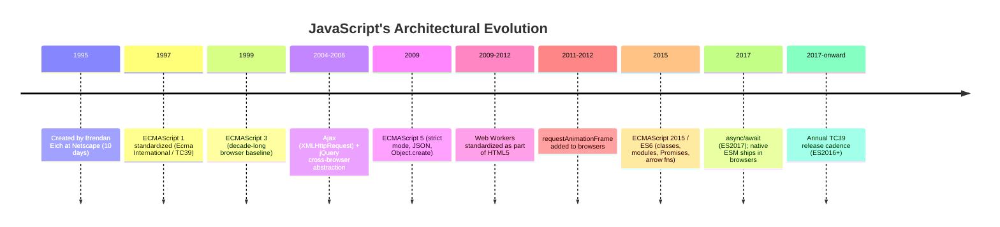

## 3. Why It Exists

JavaScript exists because the web needed a language that could run
*inside* a document the moment it loaded, with no compile step, no
installation, and no way for a hostile page to damage the visitor's
computer — three constraints that no existing language of 1995 satisfied
simultaneously. Java applets required a plugin and a Java Virtual Machine;
native code was a nonstarter for obvious security reasons; and the web's own
markup language, HTML, had no notion of behavior at all, only structure and
presentation. Netscape needed "a language for the ninety-five percent of
programmers who are not full-time programmers" (in Eich's own framing at
the time) that non-technical page authors could sprinkle into a `<script>`
tag, and needed it to ship in weeks, not years — hence the language's
famous ten-day creation timeline and its resulting mix of both genuinely
good ideas (first-class functions, prototypal inheritance, dynamic typing
for rapid iteration) and well-documented rough edges (type coercion
surprises, `this` binding rules that still confuse newcomers today).

The deeper architectural reason JavaScript persists — rather than being
replaced by something more principled, as many predicted in the 2000s and
2010s — is that it solved a distribution problem no other language design
has matched since: **write once, and every browser on every operating
system runs it immediately, with no build step required for the simplest
case, and full backward compatibility guaranteed by browser vendors for
decades.** A Solution Architect should read that guarantee as an
architectural constraint, not a footnote: code shipped to a browser in 2010
using ES5 syntax still runs in every browser today, because breaking that
guarantee would break the web itself. This is why JavaScript's standard
library grows by strict addition, never by removal, and it is why every
architectural decision layered on top of the language — module systems,
transpilation, bundling — exists specifically to manage the tension between
"the language must never break old code" and "developers want to write in
the newest, most productive syntax available." Section 4 teaches the
language mechanisms this tension produced; Section 12 (Bundling
Architecture) and Section 8 (Production Architecture) teach the build-time
tooling that resolves it in practice.

## 4. Core Concepts

### 4.1 Prototypal Inheritance vs. Classical Inheritance

**Definition.** JavaScript is a *prototype-based* language: every object
carries an internal, hidden reference (historically exposed as `__proto__`,
now accessed properly via `Object.getPrototypeOf()`) to another object,
called its **prototype**. When you read a property from an object and that
object doesn't have the property itself, the JavaScript engine walks up the
chain of prototypes — the **prototype chain** — looking at each one in turn
until it finds the property or runs out of prototypes (arriving at `null`).
This is fundamentally different from *classical* inheritance (Java, C#,
Python's default model), where a class is a static blueprint that
instances are stamped from, and inheritance is a relationship between
classes decided once at compile time or class-definition time.

**Mechanism.** Every plain object created with an object literal (`{}`)
gets `Object.prototype` as its prototype automatically. Every function has
a `.prototype` property (a plain object) that becomes the prototype of any
object created by calling that function with `new`. Property lookup walks
the chain; property *writes* (`obj.x = 1`) never walk the chain — they
always create or update an *own* property directly on the object you wrote
to, which is a common source of confusion for developers arriving from
classical languages, where "inheriting a field" usually implies a shared
storage location.

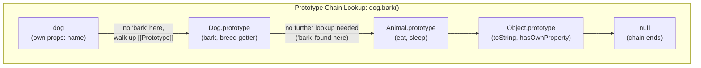

```javascript
// Prototypal inheritance without class sugar — the mechanism underneath.
const animalProto = {
  eat() { return `${this.name} is eating.`; },
};

const dogProto = Object.create(animalProto); // dogProto.[[Prototype]] = animalProto
dogProto.bark = function bark() { return `${this.name} says woof.`; };

const rex = Object.create(dogProto);         // rex.[[Prototype]] = dogProto
rex.name = "Rex";

rex.bark(); // "Rex says woof."  -> found on dogProto
rex.eat();  // "Rex is eating."  -> found on animalProto (via dogProto)
rex.hasOwnProperty("name"); // true -> found on Object.prototype

// The `class` keyword (ES2015+) is syntactic sugar over exactly this chain:
class Animal {
  constructor(name) { this.name = name; }
  eat() { return `${this.name} is eating.`; }
}
class Dog extends Animal {
  bark() { return `${this.name} says woof.`; }
}
// Dog.prototype's [[Prototype]] is Animal.prototype — same chain as above,
// class syntax just gives it a familiar-looking, checkable declaration form.
```

**Decision implications.** Because `class` is sugar over the prototype
chain, not a separate mechanism, architects should not treat "JavaScript now
has real classes" as equivalent to Java or C# classes: there is no true
private state without additional mechanisms (see the `#private` fields and
`WeakMap` pattern in Section 4.6 and Section 10), method resolution is
always dynamic (an object's prototype can be swapped at runtime via
`Object.setPrototypeOf`, though doing so is a de-optimization — see the
Node.js chapter's coverage of V8 hidden classes for why), and composition
via `Object.assign`/mixins is often a better fit for JavaScript's grain than
deep inheritance hierarchies, because the language was never designed
around single-rooted class trees the way Java was. Favor shallow
prototype/class hierarchies (one level of `extends`, if any) and prefer
composition (small, focused objects combined via function composition or
mixins) for anything beyond a simple is-a relationship — deep inheritance
chains are exactly as fragile in JavaScript as in any other language, and
the dynamic nature of the prototype chain makes debugging a five-level-deep
override chain measurably harder than in a statically-typed language with
compiler-verified overrides.

**Failure mode.** The most common production bug rooted in this model is
accidental prototype pollution: mutating a built-in prototype
(`Array.prototype.customMethod = ...`) or a shared prototype object affects
*every* instance across the entire application, including third-party
library code that also uses that type — a bug class serious enough that it
has its own security classification ("prototype pollution vulnerabilities")
when an attacker can inject arbitrary keys into `Object.prototype` via
unsanitized JSON merging, discussed further in Section 13 (Security).

**Scenario.** A team building a shared component library adds a convenience
method directly onto `Array.prototype` to simplify internal code
(`Array.prototype.last = function() { return this[this.length - 1]; }`).
Months later, a `for...in` loop elsewhere in the same page (written by a
different team, using a different bundler output on the same page) starts
iterating over `"last"` as an enumerable property alongside actual array
indices, silently corrupting a serialization routine that assumed
`for...in` on an array only yields numeric indices. The fix is architectural
discipline, not a clever patch: never modify built-in prototypes in shared,
multi-team browser code; use free functions or explicitly-owned utility
classes instead.

### 4.2 Closures and Lexical Scoping as an Architecture-Enabling Mechanism

**Definition.** A **closure** is a function bundled together with references
to the variables from the scope in which it was defined, such that the
function can continue to read and write those variables even after the
outer function that created that scope has finished executing and would
otherwise have had its local variables discarded. **Lexical scoping** is the
rule that determines *which* variables a function can see: a function's
visible variables are determined by where it is *written* in the source
code (its nesting inside other functions/blocks), not by where or how it is
*called* — this is what makes closures predictable and analyzable by
reading the code alone, rather than requiring you to trace every call site.

**Mechanism.** When the JavaScript engine encounters a function definition,
it doesn't just remember the function's code — it also captures a reference
to the **scope chain** in effect at that point (an ordered list of variable
environments: the function's own local scope, its enclosing function's
scope, that function's enclosing scope, and so on up to the global scope).
As long as *any* live reference to that inner function exists anywhere in
the program, the JavaScript engine's garbage collector cannot reclaim the
variables in that captured scope chain, even though the outer function
itself has already returned — this is precisely what makes closures useful
(state genuinely persists) and precisely what makes them a memory-leak risk
if misused (state persists for longer than intended; see Section 4.6).

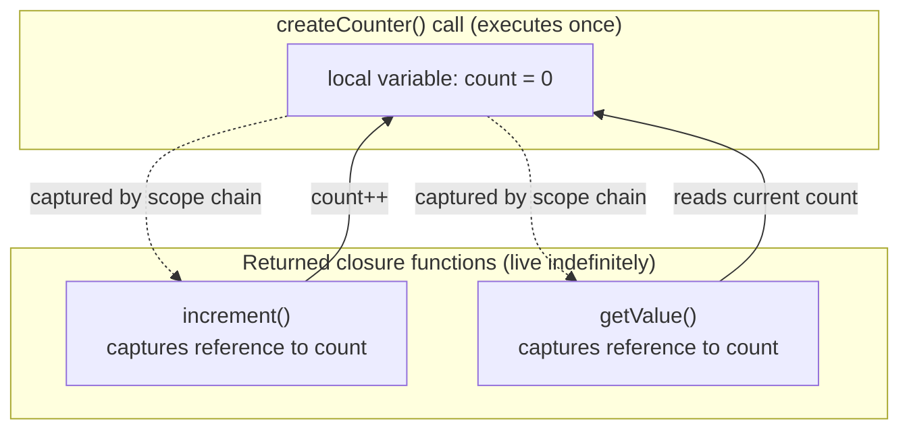

```javascript
// Closures as an encapsulation mechanism — this IS the module pattern
// underlying private state before native #private class fields existed.
function createCounter(initial = 0) {
  let count = initial;               // private to this call, not accessible externally
  return {
    increment() { count += 1; return count; },
    decrement() { count -= 1; return count; },
    getValue()  { return count; },
  };
}

const a = createCounter();
const b = createCounter(100);
a.increment(); a.increment();
b.decrement();
console.log(a.getValue()); // 2   -- a's `count` is a distinct closure from b's
console.log(b.getValue()); // 99  -- there is no shared or accessible `count` variable
```

**Decision implications.** Closures are the architectural mechanism behind
the **module pattern** (encapsulated private state and public methods,
predating both ES2015 modules and `#private` class fields), memoization
caches, event-handler factories that need per-instance state, and the
core mechanism that makes React's Hooks (`useState`, `useEffect`) work at
all — each Hook call closes over the component's render-scoped variables.
Understanding closures is not optional trivia for a frontend architect: it
directly explains *why* stale-closure bugs happen in React (an event
handler captured a variable's value from a specific render and never sees
updates from later renders unless the dependency array is correct) and why
IIFE (Immediately Invoked Function Expression) patterns were the standard
way to avoid polluting the global scope before block-scoped `let`/`const`
and native modules existed.

**Failure mode.** Closures that capture large objects (a full DOM subtree
reference, a large array, an entire application state object) inside a
long-lived callback — an event listener that is never removed, a
`setInterval` that never gets cleared, a cache keyed by closures instead of
serializable keys — keep that captured data alive for the lifetime of
whatever holds a reference to the closure itself, which is the single most
common source of browser memory leaks in long-running SPAs. Section 4.6
covers this failure mode and its mitigations (`WeakMap`, explicit listener
cleanup) in depth.

**Scenario.** A dashboard page attaches a `resize` event listener inside a
component's setup function, and that listener's callback closes over a
reference to the component's full initial dataset for use in a recalculation
routine. The component is later removed from the page (a route change in an
SPA), but the listener was attached to `window`, not to the component's own
DOM node, and was never explicitly removed. Every time the user navigates to
that route again, a new listener is added, each holding its own closure over
a full copy of that dataset — the `window`-level listener list, and the
memory behind it, grows without bound for the life of the browser tab.

### 4.3 The Module System Battle: Script Globals, CommonJS, AMD/UMD, and ESM

**Definition.** A **module system** is the mechanism a language or platform
uses to split code across files while controlling what each file exposes to
others and what it keeps private. JavaScript went through four distinct eras
of module systems, each solving the previous era's limitations, and
understanding all four — including the two that "lost" — matters
architecturally because a great deal of the JavaScript ecosystem's tooling
complexity (bundler configuration, "dual package hazard," `.mjs`/`.cjs`
file extensions) exists specifically to bridge between them.

**Mechanism — the four eras.**

1. **Global-script era (1995-2009).** Every `<script>` tag on a page shared
   one global scope (`window` in the browser). "Modules" were an informal
   convention: wrap a file's contents in an IIFE
   (`(function() { ... })()`) so its internal variables didn't leak into
   the shared global scope, and manually attach the one or two things you
   wanted to expose onto a shared namespace object (`window.MyApp = {...}`).
   There was no dependency declaration at all — script tag *order* in the
   Hypertext Markup Language (HTML) document was the only dependency
   mechanism, which made large multi-file browser applications extremely
   fragile to reorder.

2. **CommonJS (2009-onward, server-first).** Designed for server-side
   JavaScript (and adopted as Node.js's original module system — see
   [Node.js Architecture § CommonJS vs. ESM Loading Semantics](../03_Software_Engineering_Foundations/CH03_Nodejs.md)
   for the full mechanism, including its synchronous, eager `require()`
   resolution and the `node_modules` resolution algorithm), CommonJS gave
   every file its own private scope automatically and let it declare
   dependencies explicitly with `require('./other-file')`, exporting via
   `module.exports`. This chapter recaps only what's relevant to the browser:
   CommonJS's `require()` is synchronous by design, which is a natural fit
   for a filesystem-backed server runtime but a poor fit for the browser,
   where "loading a module" means a network request — this mismatch is
   exactly why CommonJS was never adopted natively by browsers and had to
   be bundled (see Section 4.10/Section 12) into browser-runnable output.

3. **AMD and UMD (2009-2015, browser-first competitors).** Asynchronous
   Module Definition (AMD) was designed specifically for the browser's
   constraint that CommonJS ignored: modules must be fetched over the
   network, so resolution has to be asynchronous. AMD modules declare their
   dependencies as an array of string paths, and a loader library
   (RequireJS was the dominant implementation) fetches each dependency via
   a `<script>` tag, then invokes the module's factory function once all
   dependencies have loaded. Universal Module Definition (UMD) was not a
   third genuinely different system — it was a defensive wrapper pattern
   that detected which environment a script was running in at runtime
   (checking for AMD's `define`, then CommonJS's `module.exports`, then
   falling back to a plain global) so the same published library file could
   work unmodified in either environment, at the cost of a verbose
   boilerplate wrapper at the top of every file using it.

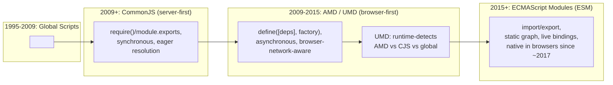

4. **ECMAScript Modules (2015 spec, browser-native ~2017-2018).** ESM is
   the language's *own* module system — `import`/`export` syntax defined by
   TC39, not a community convention layered on top of the language. Its
   defining architectural properties, contrasted with CommonJS: the module
   dependency graph is **static** (every `import`/`export` must appear at
   the top level, with a literal string specifier — no `import` inside an
   `if` block with a computed path), which lets a bundler or the browser's
   own module loader analyze the entire dependency graph *before* running
   any code, enabling both dead-code elimination (tree-shaking — Section
   4.10) and true parallel fetching of independent modules. Its exports are
   also **live bindings**, not copied values: if module A exports a mutable
   variable and module B imports it, B always sees A's current value, even
   after A's own code reassigns it later — a subtle but important semantic
   difference from CommonJS, where `require()` returns a snapshot of
   `module.exports` at require-time.

**Decision implications.** For any new browser code today, ESM is the
correct default with no serious competing argument — every evergreen
browser supports `<script type="module">` natively, every major bundler
treats ESM as its primary input format, and tree-shaking (a meaningful
production bundle-size win) only works reliably on ESM's static graph. The
practical architecture decision that remains is how far back you need to
support older browsers or specific enterprise/embedded WebView
environments, which determines whether you transpile/bundle for a
CommonJS-compatible or UMD-compatible fallback output alongside your native
ESM build — a build-tooling decision covered in Section 8 and Section 12,
not a language-choice decision.

**Failure mode — the "dual package hazard."** When a single package is
published in both a CommonJS build and an ESM build (common for
libraries that must support both old and new consumers), and a project ends
up loading *both* builds of the same package simultaneously (one dependency
imports the ESM build, another `require()`s the CommonJS build), the
JavaScript runtime treats them as two entirely separate module instances
with two separate copies of any module-level state — a singleton pattern,
a shared cache, a class whose `instanceof` checks are expected to work
across the app, all silently break because "the same package" is actually
loaded twice. This is the browser/build-tooling-side twin of the exact
dual-package hazard the Node.js chapter documents for the server side —
same root cause (two coexisting module systems), different trigger
mechanism (bundler resolution order instead of Node's resolution
algorithm).

**Scenario.** A design-system component library ships both a CommonJS and
an ESM build (standard practice for wide compatibility). An application
imports the library via ESM in its main bundle, but a legacy third-party
analytics script — bundled separately, years ago, targeting CommonJS —
pulls in the same library's CommonJS build as a transitive dependency. The
library uses a module-level `WeakMap` (Section 4.6) to track component
instance state privately. Because the two builds are two separate module
instances, they hold two separate `WeakMap`s, and a component instantiated
by the analytics script's copy of the library silently fails a runtime check
in the main application's copy that expects to find that instance's private
state — the two "same" library instances simply don't share any state,
because they are not actually the same module.

### 4.4 The Browser Event Loop (Distinct from Node.js/libuv)

**Definition.** Just like Node.js, a browser tab runs JavaScript on a
single thread and uses an event loop to interleave running your code with
handling other work — but the browser's event loop is a genuinely different
implementation solving a genuinely different problem, because a browser tab
also has to *render pixels to the screen* on the same thread that runs your
JavaScript, something a headless Node.js process never has to do. **Do not
assume the phase model from Node.js's libuv (timers, pending callbacks,
poll, check, close — see
[Node.js Architecture § Event Loop Phases](../03_Software_Engineering_Foundations/CH03_Nodejs.md)
for that model in full) applies to the browser — it does not.** The browser
specification (the HTML Living Standard's "event loop" section) defines its
own model built around **task queues** and **microtasks**, with rendering
as an explicit, interleaved step.

**Mechanism.** At the highest level, a browser's main thread repeats this
loop for the life of the tab: pull one task off a task queue and run it to
completion; then fully drain the microtask queue; then, if it is an
appropriate time (roughly, once per display refresh interval, though the
browser has latitude here), perform a render step; then go back and pull
the next task.

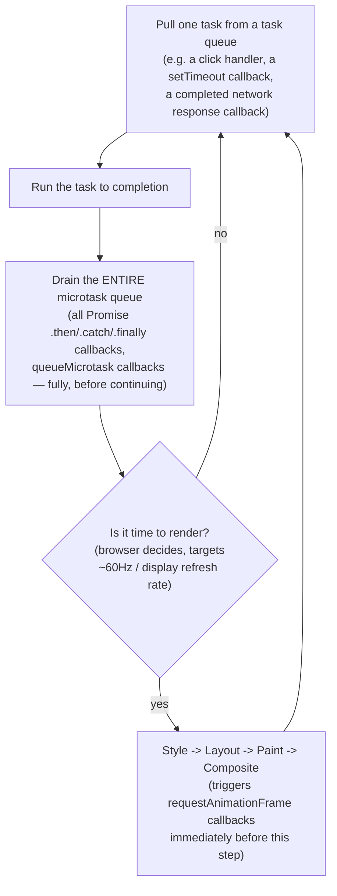

Several distinctions from Node.js are architecturally important:

- **Task queues, not phases.** The browser has multiple task queues (called
  "task sources" in the spec — one for user-interaction events, one for
  networking callbacks, one for timers, and others), and the browser is
  free to prioritize between them (for example, deprioritizing a
  background tab's timer queue), whereas Node.js's phases run in a fixed,
  literal order every single iteration.
- **Microtasks fully drain before rendering, every single time.** This is
  the browser-specific rule most likely to bite an architect: if a task's
  microtask queue keeps growing (a promise chain that recursively
  schedules more promise work), the browser cannot render a single frame
  until that microtask queue is empty — this is a *visible* failure mode in
  the browser (the page appears frozen, unresponsive to input, dropping
  frames) in a way the equivalent Node.js microtask-starvation bug is not,
  because Node.js has no frames to drop.
- **Rendering is an explicit, interleaved pipeline step**, not something
  that happens "whenever the OS feels like it." A long-running synchronous
  task (an expensive computation, a large synchronous DOM mutation loop)
  blocks the render step entirely for its duration — the browser cannot
  paint, cannot respond to scrolling or clicks, and after roughly 50ms of
  continuous main-thread work, most browsers' developer tools will flag it
  as a "long task," a real, standardized performance signal
  (the `PerformanceObserver` Long Tasks API) with no Node.js equivalent.

**Decision implications.** Any work that must happen *before the user sees
the next frame* — reading layout-dependent values, applying a visual
transition, responding to a gesture — belongs in a rendering-aware
scheduling primitive (`requestAnimationFrame`, Section 4.5), not a plain
`setTimeout(fn, 0)`, because `setTimeout` gives you no guarantee about
where in the task/microtask/render cycle your callback lands relative to
the next paint. Conversely, expensive computational work that does *not*
need to touch the DOM should be broken into smaller chunks yielded back to
the event loop (or moved to a Web Worker — Section 4.9) specifically so it
does not starve the render step and produce visible jank.

**Failure mode.** The same "one thread does everything" trade-off from the
Node.js chapter's Section 4.1 applies here with a browser-specific
consequence: a CPU-bound JavaScript task on the main thread doesn't just
delay other callbacks (as in Node.js) — it visibly freezes the User
Interface (UI). Scrolling stutters or stops entirely, buttons don't
respond, `:hover` states don't update, and text selection input drops,
because none of those are handled by a separate thread in a typical
non-worker page.

**Scenario.** A product page renders a large, client-side-filtered data
table. A user types in a search box, and each keystroke's `input` event
handler synchronously filters and re-renders several thousand rows. Each
keystroke's handler takes 180ms of main-thread time — far over the ~16.7ms
budget for a 60Hz frame — so the page visibly stutters on every keystroke,
even though the network is uninvolved and the code "works correctly." The
architectural fix (debouncing the filter, virtualizing the rendered rows,
or moving the filtering computation itself to a Web Worker) is a scheduling
decision, not a correctness fix — the code was never wrong, only unaware of
the render-budget constraint the browser event loop imposes.

### 4.5 `requestAnimationFrame` and `requestIdleCallback` Scheduling

**Definition.** `requestAnimationFrame` (commonly abbreviated rAF) schedules
a callback to run immediately before the browser's next render step, giving
your code a guaranteed "last chance to touch the DOM or read layout" slot
synchronized with the display's actual refresh rate. `requestIdleCallback`
(rIC) is the inverse: it schedules a callback to run only when the browser
has genuinely idle main-thread time left over *after* handling higher-
priority work (input, rendering) within a frame, explicitly deprioritizing
the callback below anything user-visible.

**Mechanism.** rAF callbacks are queued and, per the event loop diagram in
Section 4.4, run as part of the render step, before style/layout/paint —
this is what makes rAF the correct primitive for JavaScript-driven
animations (updating an element's position frame-by-frame) and for reading
layout values immediately before a visual change, because the browser
guarantees your callback runs at a consistent point relative to painting,
which plain `setTimeout` does not. rIC, by contrast, receives a deadline
object (`IdleDeadline`, with a `timeRemaining()` method) so the callback can
check how much idle time is actually left and voluntarily stop working
before that runs out, re-scheduling itself for the next idle period if it
has more to do.

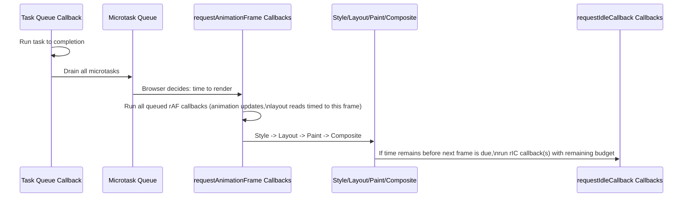

**Decision implications.** Use rAF for anything that must be visually
synchronized: custom animations, scroll-linked effects, canvas/WebGL
render loops, and any DOM read immediately followed by a DOM write that
must avoid "layout thrashing" (interleaved reads and writes forcing the
browser to recalculate layout multiple times per frame instead of once).
Use rIC for genuinely low-priority background work with no user-visible
deadline: analytics batching, prefetching data the user probably won't need
immediately, non-critical logging flush, or progressive enhancement work
that can wait. Never use rIC for anything the user is waiting on — its
entire contract is "run this only if nothing more important needs the main
thread," and browsers may delay or defer rIC callbacks indefinitely
(for example, in a backgrounded tab), which is a feature of the API, not a
bug to work around.

**Failure mode.** A common mistake is using `setTimeout(fn, 16)` as a
homemade approximation of rAF ("roughly 60 times a second"). This does not
actually synchronize with the display's refresh cycle or the browser's
render step — it can fire slightly before or after a frame is painted,
causing visible tearing/jitter in animations that rAF, by running exactly
once per render step at the right point in the pipeline, does not exhibit.

### 4.6 Memory Management Architecture in the Browser: Closures, Leaks, `WeakMap`, and `WeakRef`

**Definition.** The browser's JavaScript engine — the same engine family
(V8 in Chrome/Edge, SpiderMonkey in Firefox, JavaScriptCore in Safari) whose
generational garbage-collection mechanics are covered for V8 specifically in
[Node.js Architecture § V8 Garbage Collection](../03_Software_Engineering_Foundations/CH03_Nodejs.md) —
automatically reclaims memory for objects that have become **unreachable**:
no live reference chain exists from a root (the global object, currently-
executing function scopes, or anything those transitively reference) to the
object. "Memory management" in a browser architecture context is therefore
not about manual allocation/deallocation — it is about *architecting your
code so unreachability actually happens when you expect it to*, because the
browser's garbage collector is only ever as effective as the reference
graph your code creates.

**Mechanism — why closures leak.** Section 4.2 already established that a
closure keeps its entire captured scope chain alive for as long as any
reference to the closure itself is reachable. In a browser specifically,
the most common way a closure's lifetime extends far beyond intent is via
**event listeners and detached DOM nodes**: if you attach a listener to a
long-lived target (`window`, `document`, or any element that survives page
navigation in an SPA) and that listener's callback closes over a large
object or a reference to a DOM subtree, removing the DOM subtree from the
document does *not* make it eligible for garbage collection — the listener
(and, through it, the closure, and through the closure, everything it
captured) still holds a live reference to it.

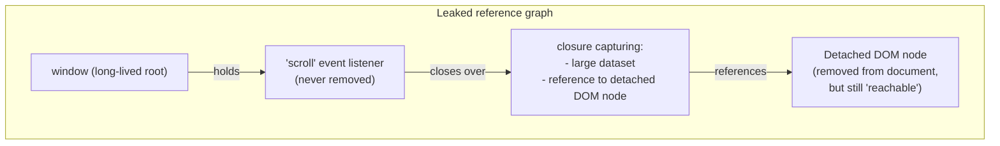

**Mechanism — `WeakMap`/`WeakSet`/`WeakRef` as the architectural fix.** A
`WeakMap` holds its keys **weakly**: an entry in a `WeakMap` does not, by
itself, keep its key object alive — if the only remaining reference to a
key is the `WeakMap` entry itself, the garbage collector is free to
collect that key (and its corresponding value is then also removed), unlike
a regular `Map`, whose keys are held strongly and will keep the referenced
object alive indefinitely. This makes `WeakMap` the correct primitive for
associating metadata with an object *without* controlling or extending that
object's lifetime — for example, storing a DOM node's private component
state, a cache keyed by object identity, or (as the ES2022-standardized
`#private` class field mechanism actually uses internally in some engine
implementations) simulating private instance data. `WeakRef` (ES2021) goes
further, giving you a holdable reference to an object that does not itself
prevent collection, with a `.deref()` method that returns the object if it
is still alive or `undefined` if it has already been collected —
`FinalizationRegistry` (also ES2021) complements this by letting you
register a cleanup callback to run *after* an object has been collected,
useful for releasing an associated non-JavaScript resource (e.g. closing a
handle held by a WebAssembly module) once the JavaScript wrapper object is
gone.

```javascript
// WeakMap for private, non-leaking, per-instance metadata keyed by DOM node identity.
const componentState = new WeakMap();

function mountWidget(domNode, initialData) {
  componentState.set(domNode, { data: initialData, renderCount: 0 });
  domNode.addEventListener("click", () => {
    const state = componentState.get(domNode);
    state.renderCount += 1;
    render(domNode, state);
  });
}

// When domNode is removed from the document and no other code references it,
// V8/SpiderMonkey/JavaScriptCore can collect BOTH the node and its
// componentState entry together — a regular Map would keep the node's
// state (and, if the state referenced the node back, the node itself)
// alive forever, because a Map's keys are strong references.
```

**Decision implications.** Design any per-object metadata association (a
cache, a private-state store, an event-listener registry pattern) around
`WeakMap`/`WeakSet` by default when the association's lifetime should be
*tied to* the referenced object's own lifetime, rather than independently
managed. Reserve `WeakRef`/`FinalizationRegistry` for advanced, narrowly-
scoped cases (bridging to non-garbage-collected resources, building your own
caching layer with GC-aware eviction) — the ECMAScript specification itself
explicitly discourages relying on `FinalizationRegistry` for anything
correctness-critical, because the timing of when (or even whether, before
tab close) a finalizer runs is intentionally left unspecified.

**Failure mode.** The most expensive version of this failure mode in
production SPAs is the "detached DOM tree" memory leak: browser DevTools'
memory profiler shows a heap snapshot with detached DOM subtrees still
retained, traceable back through a chain of closures to an event listener
that was never cleaned up on component teardown — a pattern serious enough
that most component-based frameworks (React, Angular, Vue) build explicit
teardown lifecycle hooks (`useEffect`'s cleanup function, Angular's
`ngOnDestroy`, Vue's `onUnmounted`) specifically to force developers to
address it.

**Scenario.** A long-running internal dashboard SPA is reported as slowing
down and eventually crashing the tab after several hours of continuous use
by an operations team that never refreshes the page. A heap snapshot
comparison across two points in time (DevTools' "allocation comparison"
view) shows a steadily growing count of detached DOM nodes, each retained by
a chart-library instance's internal event-listener closures that were never
released when charts were destroyed and recreated on every dashboard-filter
change. The fix is not a "leak patch" — it is calling the chart library's
documented `.destroy()` method (which removes its own listeners) inside the
component framework's teardown hook, restoring the intended
closure-lifetime-tied-to-listener-lifetime invariant.

### 4.7 Asynchronous Programming Architecture: Callbacks to Promises to `async`/`await`

**Definition.** JavaScript's asynchronous programming model has gone
through three architecturally distinct generations for expressing "do this,
and when it finishes, do that" without blocking the single main thread —
each generation solving a real limitation of the one before it, and each
still present in production code today, because none of the older styles
were ever removed from the language (per the backward-compatibility
constraint from Section 3).

**Mechanism — Generation 1: callbacks.** The original pattern: pass a
function to be invoked later with the result (or an error). This is simple
for one asynchronous step but composes badly: chaining several dependent
asynchronous steps nests callbacks inside callbacks, producing the
colloquially-named "callback hell" or "pyramid of doom," and — more
seriously from an architecture standpoint — callback-based Application
Programming Interfaces (APIs) have no standardized error-handling
convention (some libraries use "error-first" callbacks, some throw, some
pass a second failure callback), so error propagation across an
asynchronous chain has to be manually wired at every single step.

```javascript
// Generation 1: nested callbacks — each step depends on the previous one's result.
getUser(userId, (err, user) => {
  if (err) return handleError(err);
  getOrders(user.id, (err, orders) => {
    if (err) return handleError(err);
    getOrderDetails(orders[0].id, (err, details) => {
      if (err) return handleError(err);
      render(details); // four levels deep, and this is a SHORT example
    });
  });
});
```

**Mechanism — Generation 2: Promises (ES2015).** A `Promise` is an object
representing a value that will exist (or an error that will occur) at some
point in the future, with exactly three states — pending, fulfilled, or
rejected — and a **standardized** way to chain follow-up work (`.then`) and
propagate errors (`.catch`) through that chain automatically, without
manual error-forwarding at every step. Promises also fixed a subtler
callback-era bug class: a well-behaved Promise's `.then` callback is always
invoked asynchronously (queued as a microtask — Section 4.4), even if the
Promise was already resolved synchronously, whereas hand-written callback
APIs sometimes invoked their callback synchronously and sometimes
asynchronously depending on an internal fast path, a "sometimes sync,
sometimes async" inconsistency (called a "release Zalgo" problem in the
Node.js community) that produced genuinely hard-to-reproduce bugs.

```javascript
// Generation 2: Promise chaining — flattens nesting, unifies error handling.
getUser(userId)
  .then(user => getOrders(user.id))
  .then(orders => getOrderDetails(orders[0].id))
  .then(details => render(details))
  .catch(handleError); // ONE error handler for the entire chain
```

**Mechanism — Generation 3: `async`/`await` (ES2017).** Syntactic sugar over
Promises — an `async function` always returns a Promise, and `await`
suspends that function's execution (without blocking the main thread; other
tasks and microtasks continue to run) until the awaited Promise settles,
then resumes with either the resolved value or a thrown error. Critically,
`async`/`await` did **not** introduce a new concurrency primitive — it is
the exact same Promise/microtask mechanism from Generation 2, wearing
syntax that reads top-to-bottom like synchronous code, which is why
`try`/`catch` (ordinary synchronous-looking error handling) works naturally
across asynchronous steps for the first time.

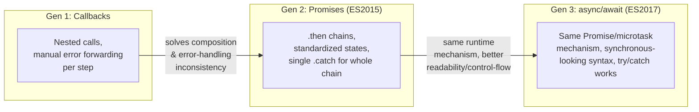

```javascript
// Generation 3: async/await — same microtask mechanism, linear readability.
async function loadOrderDetails(userId) {
  try {
    const user = await getUser(userId);
    const orders = await getOrders(user.id);
    const details = await getOrderDetails(orders[0].id);
    render(details);
  } catch (err) {
    handleError(err); // ordinary try/catch, spanning multiple awaited steps
  }
}
```

**Decision implications.** All three generations remain relevant to an
architect, but for different reasons: callbacks are still the correct
pattern for genuinely **repeated** events (a `click` listener fires many
times; a Promise only ever settles once, so it is the wrong abstraction for
recurring events — this is a real architectural distinction, not a stylistic
one). Promises are the correct low-level primitive to build new
asynchronous APIs around (and the only one with standardized combinators —
`Promise.all` for concurrent independent work, `Promise.race` for
first-to-settle, `Promise.allSettled` for "wait for everything, success or
failure," `Promise.any` for first-success). `async`/`await` is the correct
default *syntax* for consuming those Promises in application code, because
it minimizes composition bugs and makes control flow (conditionals, loops,
try/catch around a sequence of asynchronous steps) read the same way
synchronous code does.

**Failure mode.** A frequent architectural mistake is writing `await` where
`Promise.all` was intended — sequentially `await`-ing three independent
network calls when they could have run concurrently — which silently
triples a critical-path latency without producing any error or visible bug,
only a slower application. Another common mistake is forgetting that an
`async` function's thrown error becomes a *rejected Promise*, not a
synchronous exception at the call site — calling an `async` function
without `await`ing or `.catch`ing it can produce an "unhandled Promise
rejection," a class of bug invisible in a normal code read-through and only
surfaced by the browser's `unhandledrejection` event (Section 14,
Observability) or a linter rule enforcing it.

**Scenario.** A checkout page sequentially `await`s a shipping-rate lookup,
a tax calculation, and a fraud-score check — three independent calls to
three independent backend services with no data dependency between them —
adding up their latencies (300ms + 250ms + 400ms = 950ms) on the user's
critical path. Rewriting the three calls as
`const [shipping, tax, fraud] = await Promise.all([...])` runs them
concurrently, reducing the critical-path latency to the *slowest* single
call (400ms) instead of their sum — a pure architecture-level fix requiring
no backend change at all.

### 4.8 The Browser's JavaScript Execution Sandbox and Security Model

**Definition.** A browser runs JavaScript from many different, mutually
untrusting sources (your own site, third-party ads, embedded iframes, browser
extensions) inside the same process space, and relies on a layered sandbox
model — rather than a single mechanism — to prevent one origin's script
from reading or tampering with another's data. The two foundational layers
an architect must understand are the **Same-Origin Policy (SOP)**, a
browser-enforced rule restricting what a script running on origin A is
allowed to read from origin B, and **process/site isolation**, the browser
engine's own internal architecture (not something web content controls)
that runs different sites in genuinely separate operating-system processes
specifically to make cross-origin data leakage require an actual security
bug in the browser itself, not just a scripting mistake.

**Mechanism.** An **origin** is defined as the triple (scheme, host, port)
— `https://example.com:443` and `http://example.com:80` are different
origins despite the same hostname, because the scheme and port differ. The
SOP's default rule: a script running on origin A can freely read the
Document Object Model (DOM), cookies (subject to further rules), and
`localStorage`/`sessionStorage` of pages on origin A, but cannot read any of
those things from a page on a different origin, even if both pages are open
in adjacent tabs or one is embedded in an `<iframe>` on the other's page.
This is a read-restriction on script-level access, not a network-level
block — a page can still *request* a cross-origin resource
(`` has always worked, for instance),
but a script cannot read the *response body* of a cross-origin
`fetch()`/`XMLHttpRequest` call unless the responding server explicitly
opts in via Cross-Origin Resource Sharing (CORS) response headers, which is
the mechanism (not a chapter-owned concept — see this chapter's Section 4.8
scope note below) servers use to selectively relax the SOP's default deny.

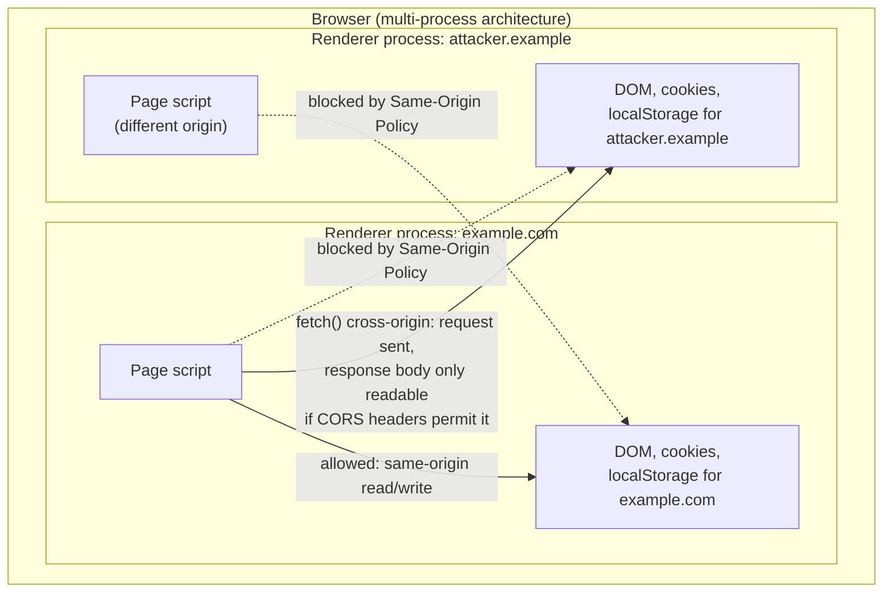

Beyond the SOP, modern browsers additionally isolate different sites into
separate OS-level processes (Chrome's "Site Isolation," shipped in response
to the Spectre speculative-execution disclosure in 2018, is the best-known
implementation) — this is architecturally significant because it means
even a *browser engine bug* that would otherwise let script from one origin
read another origin's memory within the same process is contained by the
OS's own process-boundary memory protection, an additional defense-in-depth
layer beneath the SOP that web content itself has no control over and does
not need to configure.

**Decision implications.** Content Security Policy (CSP) is the primary
architectural lever an application controls to further restrict what
JavaScript running on its own origin is allowed to do — a response header
declaring, for example, that scripts may only load from specific trusted
sources, that inline `<script>` blocks are disallowed entirely, or that a
page cannot be embedded in an `<iframe>` on another origin
(`frame-ancestors`) — and it is the single highest-leverage architectural
control against Cross-Site Scripting (XSS), because even if an attacker
successfully injects a malicious `<script>` tag into a page (via an
unsanitized user input rendered into the DOM), a correctly-configured CSP
can prevent that injected script from executing or from exfiltrating data
to an attacker-controlled origin. Section 13 (Security) covers XSS, CSP
construction, and Subresource Integrity (SRI) for third-party script
loading in operational depth; this section establishes only the underlying
sandbox model those controls sit on top of.

**Failure mode.** A common architectural mistake is treating client-side
JavaScript as a trust boundary at all — any logic, validation, or secret
embedded in JavaScript shipped to the browser is fully visible and
modifiable by the end user (via browser DevTools, at minimum), because the
sandbox protects *other origins'* data from your script, not *your own
script's source code and logic* from the user running it. Client-side
validation, feature flags, and pricing logic must always be re-enforced
server-side; the browser sandbox was never designed to hide your code from
its own user, only to isolate different origins' scripts and data from each
other.

**Scenario.** A Software-as-a-Service (SaaS) product's frontend performs a
client-side check gating access to a premium feature based on a boolean
flag returned in an API response, with no corresponding server-side
enforcement on the feature's actual API endpoints. A technically curious
free-tier user opens DevTools, finds the flag in the network response, and
either patches the running page's JavaScript directly or simply calls the
premium feature's API endpoint directly with a tool like `curl`, bypassing
the UI (and its client-side check) entirely — the sandbox correctly
prevented other *origins* from tampering with the page, but it was never
designed to prevent the page's own legitimate user from inspecting or
bypassing its own client-side logic.

### 4.9 Web Workers and Architectural Parallelism Options in the Browser

**Definition.** A **Web Worker** is the browser's mechanism for running
JavaScript on a genuinely separate operating-system thread, with its own
independent event loop, its own independent memory heap, and no direct
access to the DOM at all — the browser's answer to the same "one thread
does everything" constraint from Section 4.4, structurally analogous to
(but a different concrete mechanism from) Node.js's `worker_threads`,
covered in
[Node.js Architecture § worker_threads Architecture](../03_Software_Engineering_Foundations/CH03_Nodejs.md).
There are three worker variants an architect should distinguish: **Dedicated
Workers** (one worker, owned by exactly one page), **Shared Workers** (one
worker instance shared across multiple tabs/pages of the same origin), and
**Service Workers** (a special-purpose worker that sits as a programmable
network proxy between a page and the network, primarily used for offline
caching and push notifications — a large enough topic that this chapter
treats it only as a named parallelism variant, not in full architectural
depth).

**Mechanism.** A worker is instantiated from the main thread with
`new Worker('script-url.js')` and communicates with the main thread
exclusively through asynchronous message passing (`postMessage`/`onmessage`)
— there is no shared mutable memory by default, and no way to directly call
a function or read a variable across the thread boundary. Data passed via
`postMessage` is copied using the **structured clone algorithm** (a
browser-native serialization mechanism that can handle far more data
shapes than `JSON.stringify` — including `Map`, `Set`, `Date`, and typed
arrays — but still cannot clone functions, DOM nodes, or class instances
with prototype methods), unless the data is passed as a **Transferable**
object (most commonly an `ArrayBuffer`), in which case ownership of the
underlying memory is *transferred* to the worker instead of copied — the
original thread's reference becomes unusable (its `byteLength` becomes 0)
immediately after the transfer, which is a deliberate design trade-off:
zero-copy transfer performance in exchange for the sending side losing
access entirely.

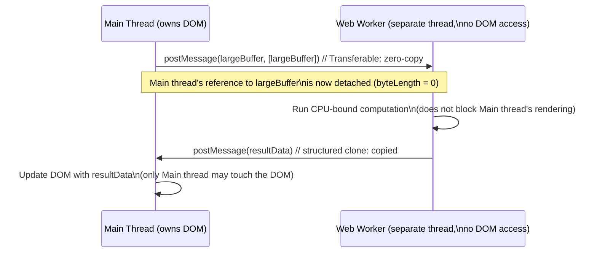

**Decision implications.** Move genuinely CPU-bound work — large data
transformations, image/video processing, complex client-side search or
filtering over large datasets, cryptographic operations, parsing very large
files — off the main thread and into a Web Worker specifically to keep the
main thread free to service input and rendering (Section 4.4's render
budget). This is a strict architectural win for responsiveness, but it is
not free: message-passing overhead (serialization cost for non-Transferable
data), the loss of direct DOM access from the worker (any DOM update must be
relayed back through `postMessage` to the main thread), and added code
complexity (a worker is effectively a separate build artifact/module graph)
are real costs that should be weighed against the actual computation cost
being offloaded — moving a 2ms computation into a worker adds more overhead
(message round-trip) than it saves.

**Failure mode.** A common mistake is assuming workers give you shared-
memory concurrency by default, then being surprised that a worker cannot
read or mutate a variable back on the main thread directly — everything
must be explicitly message-passed, and forgetting this leads to either
compile-time errors (in TypeScript) or silent `undefined` values (in plain
JavaScript) when code mistakenly references a main-thread variable from
inside worker code. `SharedArrayBuffer` (paired with `Atomics` for safe
concurrent access) is the narrow exception — a genuinely shared memory
region multiple threads can read/write directly — but it requires specific
cross-origin isolation headers (`Cross-Origin-Opener-Policy`,
`Cross-Origin-Embedder-Policy`) to be enabled at all, a direct consequence
of the 2018 Spectre disclosure mentioned in Section 4.8, because
`SharedArrayBuffer`'s precise timing characteristics were shown to enable
speculative-execution side-channel attacks unless the page is isolated
strongly enough that co-located hostile content cannot share its process.

```javascript
// main.js — offload a CPU-bound computation without blocking rendering.
const worker = new Worker("heavy-compute.worker.js");

worker.postMessage({ command: "process", payload: largeTypedArray.buffer },
                    [largeTypedArray.buffer]); // Transferable: zero-copy handoff

worker.onmessage = (event) => {
  renderResults(event.data.result); // only the main thread touches the DOM
};

worker.onerror = (event) => {
  reportWorkerFailure(event.message); // workers can fail independently of the main thread
};
```

**Scenario.** A photo-editing web application applies a client-side image
filter (a per-pixel convolution) directly on the main thread for a
high-resolution image, freezing the page's UI for several seconds — no
scrolling, no button response, no visual feedback that work is even
happening, because the main thread is entirely consumed by the
computation. Moving the same pixel-processing loop into a Dedicated Worker,
transferring the image's pixel buffer as a Transferable `ArrayBuffer`, lets
the main thread remain free to render a progress indicator and respond to a
"cancel" button click while the worker computes — the total computation
time is unchanged, but the perceived responsiveness (and the ability to
even offer a cancel action) is entirely different.

### 4.10 Build and Bundling Architecture: ES Modules, Tree-Shaking, and Code-Splitting

**Definition.** Bundling is the build-time process of taking a browser
application's ESM dependency graph (Section 4.3) — typically hundreds or
thousands of individual module files, each requiring its own network
request if loaded unbundled — and transforming it into a smaller number of
optimized output files intended for production delivery, using three
distinct, complementary architectural techniques: **bundling** (combining
modules to reduce request count), **tree-shaking** (removing code that
static analysis proves is never used), and **code-splitting** (deliberately
*not* combining everything into one file, so unused-at-first-load code can
be fetched lazily instead).

**Mechanism — bundling.** A bundler (Webpack, Rollup, esbuild, Vite's
production build via Rollup) starts from one or more entry-point files,
statically walks the `import`/`export` graph (only possible because ESM's
graph is static — Section 4.3's key architectural property), and emits
output files containing the concatenated, dependency-ordered code. This
solves the network-request-count problem that plagued unbundled ESM
delivery for years: fetching a thousand individual small files, even over
Hypertext Transfer Protocol/2 (HTTP/2) with its improved multiplexing, still
incurs real per-request overhead (server round-trip, header overhead,
resource-priority contention) that a handful of larger, cache-friendly
bundles avoid.

**Mechanism — tree-shaking.** Because ESM's `import`/`export` graph is
statically analyzable, a bundler can prove — without ever running the
code — that a given exported function, class, or constant is never
referenced by anything reachable from the entry point, and safely omit it
from the output entirely. This is precisely why ESM's static-graph property
(as opposed to CommonJS's dynamic, runtime-evaluated `require()` calls,
whose targets can in principle be computed at runtime and therefore cannot
always be proven unused ahead of time) is a hard *architectural*
prerequisite for tree-shaking, not merely a nice-to-have — a library
published only in CommonJS cannot be tree-shaken by a downstream bundler no
matter how well-factored its internal code is, which is a real, practical
reason ESM-first library publishing is now the ecosystem default.

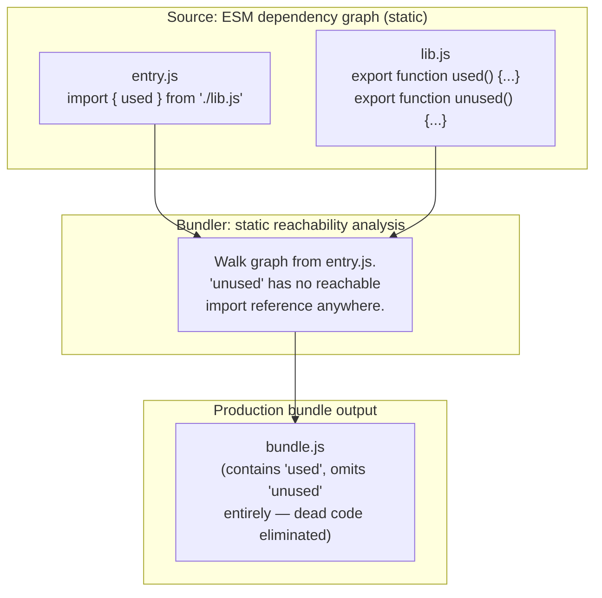

**Mechanism — code-splitting.** The inverse discipline: instead of
bundling everything an application could ever need into one file loaded on
first visit, a bundler splits the graph at deliberate boundaries — usually
at route boundaries (a Single Page Application's checkout flow doesn't need
to be in the same bundle as its landing page) or at explicit dynamic
`import()` call sites — producing multiple smaller bundles, most of which
are fetched lazily, on demand, only when the user's navigation or
interaction actually requires that code. This directly trades initial-load
bundle size (and therefore Time To Interactive (TTI) and Largest
Contentful Paint (LCP), two of the Core Web Vitals metrics covered further
in Section 11) against a small additional network round-trip cost paid
later, only by users who actually reach that part of the application.

```javascript
// Dynamic import() as an explicit code-splitting boundary — the bundler
// emits `checkout-flow-chunk.js` as a SEPARATE file, fetched only when reached.
button.addEventListener("click", async () => {
  const { openCheckout } = await import("./checkout-flow.js");
  openCheckout(); // checkout-flow.js's code was never downloaded until this click
});
```

**Decision implications.** Architect bundle boundaries around actual user
navigation and interaction patterns, not around source-file organization —
splitting at every route is a reasonable, low-risk default, while splitting
too aggressively (a separate chunk for every small component) reintroduces
the many-small-requests overhead bundling exists to solve in the first
place, so most production bundler configurations tune a minimum chunk-size
threshold to avoid over-splitting. Publishing a library only as CommonJS
actively harms every downstream consumer's bundle size (no tree-shaking
possible), which is why the `"sideEffects": false` field in `package.json`
(an explicit declaration that a package's modules have no
import-time side effects beyond their own exports) and ESM-first publishing
are now treated as basic library-authoring hygiene, not advanced
optimization.

**Failure mode.** A package that performs a side effect at module-load time
(mutating a global, registering something with a singleton registry) but is
not correctly marked as having side effects will either be *incorrectly*
tree-shaken away (if a bundler assumes it's side-effect-free) — a silent
production bug where code that "should" run on import simply never runs in
the bundled output — or, more commonly, forces a bundler to conservatively
retain code it otherwise could have proven unused, silently bloating every
downstream consumer's bundle. Section 17 (Common Mistakes) returns to this
failure mode with a concrete before/after bundle-size example.

## 5. Internal Working

This section traces what actually happens between a browser receiving
JavaScript source text and that code executing, focusing on the parts
distinct from — or a necessary recap of — the engine internals already
owned in depth by the Node.js chapter.

**Parsing and compilation pipeline.** Every major browser engine (V8,
SpiderMonkey, JavaScriptCore) follows the same general shape: source text is
tokenized and parsed into an Abstract Syntax Tree (AST), the engine performs
a fast initial parse pass that only fully parses top-level code and
*pre-parses* (validates syntax without building a full AST for) function
bodies not yet needed, then lazily fully parses and compiles a function
body the first time it actually runs — a deliberate architectural choice
trading a small amount of duplicate work (a function is technically parsed
twice: pre-parse, then full parse on first call) for a large win on typical
pages, where most defined functions (especially in a large bundled
application) are never actually called during a given page visit. The
Just-In-Time (JIT) tiered-compilation model that turns hot, frequently-
executed functions into optimized machine code (V8's Ignition/TurboFan
pipeline, and the hidden-classes mechanism that makes property access fast
for shape-stable objects) is owned in full architectural depth by
[Node.js Architecture § V8 JIT Compilation Tiers and V8 Hidden Classes](../03_Software_Engineering_Foundations/CH03_Nodejs.md) —
the mechanism is identical in the browser (same V8 engine in Chromium-based
browsers; SpiderMonkey and JavaScriptCore use conceptually analogous
tiered pipelines), so this chapter recaps rather than re-derives it.

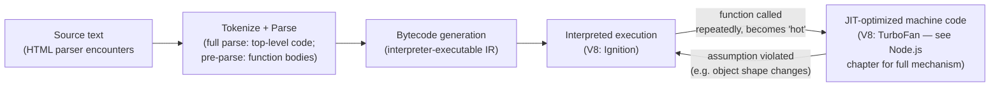

**Script loading and the parser-blocking default.** A plain
`<script src="...">` tag, encountered by the HTML parser without any
attribute modifying its behavior, is **parser-blocking** by default: the
browser must fetch, parse, and execute that script before it can continue
parsing the rest of the HTML document — a deliberate original design
decision (a script might use `document.write()` to inject more markup,
so the parser genuinely cannot safely skip ahead) that became an
architectural liability once scripts grew large and networked delivery
became the common case. The `async` attribute lets the script fetch in
parallel with HTML parsing and execute as soon as it's ready (interrupting
parsing at that point, in whatever order multiple `async` scripts happen to
finish downloading — no ordering guarantee). The `defer` attribute lets the
script fetch in parallel *and* guarantees execution only after HTML parsing
completes, in the original document order relative to other `defer`
scripts — this is why `defer` (or, equivalently, `<script type="module">`,
which is deferred by default per the ESM specification) is the correct
default for nearly all production script loading, reserving parser-blocking
plain `<script>` only for the rare case where a script must run and
potentially `document.write()` before the rest of the page parses.

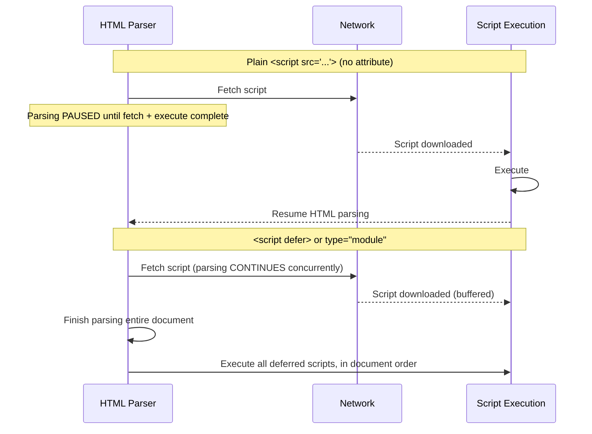

## 6. Design Principles

- **Prefer composition over deep inheritance.** Section 4.1 already
  established that JavaScript's dynamic prototype chain makes deep,
  multi-level `class extends` hierarchies harder to reason about than in a
  statically-checked classical-inheritance language; favor small, composed
  objects and mixins for shared behavior.
- **Treat the main thread's render budget as a hard architectural
  constraint, not a performance nice-to-have.** Every design decision about
  where computation runs (main thread vs. Web Worker), how DOM updates are
  batched, and how event handlers are scheduled should be made with the
  ~16.7ms per-frame budget (Section 4.4) explicitly in mind.
- **Encapsulate state deliberately, using the mechanism that matches the
  state's intended lifetime** — closures (Section 4.2) for state scoped to
  a function call's lifetime, `WeakMap`-backed private state (Section 4.6)
  for state that should live and die with an object it's associated with,
  and module-level state (Section 4.3) only for genuinely singleton,
  application-lifetime data.
- **Default to ESM, and design for tree-shakeability.** Publish and author
  code assuming a bundler's static analysis will be run against it (Section
  4.10); avoid unnecessary module-level side effects, and declare
  `"sideEffects": false` when a package genuinely has none.
- **Never trust the browser sandbox to protect your own logic from your own
  users.** Section 4.8 already established this, but it is worth stating as
  a standing design principle: any architecture that relies on
  client-side-only enforcement of a security- or business-critical rule is
  fundamentally unsound.

## 7. Architecture Patterns

**Module pattern (closure-based encapsulation).** Predates ES2015 classes
and modules; still relevant for encapsulating private state in contexts
where a full module boundary is unnecessary (Section 4.2's `createCounter`
example is the canonical form). **Revealing module pattern** is a common
refinement: define all internal functions privately, then return an object
literal that explicitly maps public names to the internal functions you
intend to expose, making the public surface area readable in one place at
the bottom of the module rather than scattered across `export` statements.

**Observer/pub-sub pattern for decoupled event handling.** Because
JavaScript's native event system (`addEventListener`) only works for DOM
events, application-level cross-component communication commonly uses a
hand-rolled or library-provided publish/subscribe mechanism — a central
event emitter that decouples the component raising an event from the
components reacting to it, which is architecturally important in
component-tree UIs where direct parent-to-arbitrary-descendant
communication would otherwise require prop-drilling or tight coupling.

**Facade pattern over browser storage/networking APIs.** Wrapping
`localStorage`/`sessionStorage`/`fetch`/`IndexedDB` behind an
application-specific interface is a common and valuable pattern
specifically because those browser APIs have quota limits, availability
differences across browsers/private-browsing modes, and synchronous-vs-
asynchronous inconsistencies (`localStorage` is synchronous and can block
the main thread on large reads/writes; `IndexedDB` is asynchronous) that
are better isolated behind one facade than scattered through application
code.

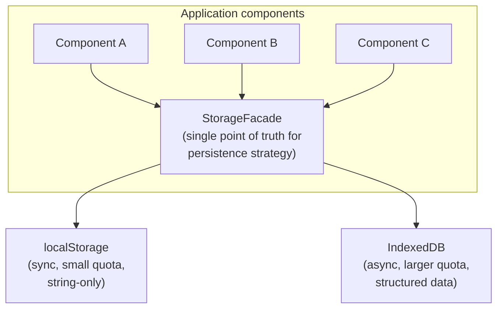

## 8. Production Architecture

A production browser-JavaScript delivery pipeline typically looks like:
source code (ESM, often authored in TypeScript — see the upcoming
TypeScript chapter in this Part) is transpiled to a target syntax level
appropriate for the supported browser matrix, bundled with tree-shaking and
code-splitting (Section 4.10), content-hashed for cache-busting (each
bundle's filename includes a hash of its contents, so a Content Delivery
Network (CDN) can cache it indefinitely without ever serving stale code
after a deploy), and served from a CDN edge location close to the user, with
a Service Worker (Section 4.9) optionally providing an offline-capable
caching layer on top. Source maps — a mapping from the transformed,
minified production code back to the original authored source — are
generated alongside the production bundle and typically uploaded to an
error-tracking service rather than served publicly, so stack traces from
production errors (Section 14, Observability) can be de-minified for
debugging without exposing original source structure to end users.

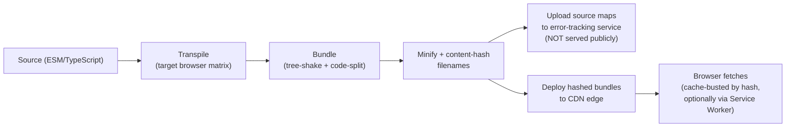

## 9. Implementation

Implementing a production-grade browser JavaScript codebase means making
explicit, documented choices at each of the layers taught in Section 4:
which module format to author in (ESM, unconditionally, for any new code),
how private state is encapsulated per component (closures for transient
state, `WeakMap` for object-lifetime-scoped state), where the line is drawn
for offloading work to a Web Worker (a documented computation-time
threshold, not an ad hoc judgment call per feature), and which bundler
configuration enforces tree-shaking and code-splitting boundaries by
default rather than by developer discipline alone (lint rules and bundle-
size budgets enforced in Continuous Integration (CI), covered further in
Section 16).

## 10. Complete Code Examples

**Example 1 — Private state via closures vs. `#private` class fields vs.
`WeakMap` (three encapsulation mechanisms, contrasted).**

```javascript
// (a) Closure-based module pattern — no `this`, no class syntax at all.
function createBankAccount(initialBalance) {
  let balance = initialBalance; // truly private: no external reference exists
  return {
    deposit(amount) { balance += amount; return balance; },
    withdraw(amount) {
      if (amount > balance) throw new Error("Insufficient funds");
      balance -= amount;
      return balance;
    },
    getBalance() { return balance; },
  };
}

// (b) ES2022 `#private` class fields — private at the LANGUAGE level,
// enforced by the engine itself (a syntax error to access `#balance`
// from outside the class, not just a convention).
class BankAccount {
  #balance;
  constructor(initialBalance) { this.#balance = initialBalance; }
  deposit(amount) { this.#balance += amount; return this.#balance; }
  withdraw(amount) {
    if (amount > this.#balance) throw new Error("Insufficient funds");
    this.#balance -= amount;
    return this.#balance;
  }
  getBalance() { return this.#balance; }
}

// (c) WeakMap-backed private state — useful specifically when state must
// be associated with an EXTERNALLY-CREATED object (e.g. a DOM node) whose
// class you do not own and cannot add #private fields to.
const nodeState = new WeakMap();
function attachDraggable(domNode) {
  nodeState.set(domNode, { dragging: false, startX: 0 });
  domNode.addEventListener("pointerdown", (e) => {
    const state = nodeState.get(domNode);
    state.dragging = true;
    state.startX = e.clientX;
  });
  // state is released automatically if domNode is later garbage collected —
  // no explicit cleanup call required, unlike a plain Map keyed by domNode.
}
```

**Example 2 — Promise-based retry with exponential backoff (production
async architecture pattern built from Section 4.7's primitives).**

```javascript
/**
 * Retries an async operation with exponential backoff and jitter.
 * Demonstrates: Promise composition, async/await, AbortController-based
 * cancellation — all browser/language-level primitives, no framework.
 */
async function retryWithBackoff(operation, {
  maxAttempts = 5,
  baseDelayMs = 200,
  maxDelayMs = 5000,
  signal,
} = {}) {
  let lastError;
  for (let attempt = 1; attempt <= maxAttempts; attempt += 1) {
    if (signal?.aborted) throw new DOMException("Aborted", "AbortError");
    try {
      return await operation(signal);
    } catch (err) {
      lastError = err;
      if (attempt === maxAttempts) break;
      const backoff = Math.min(baseDelayMs * 2 ** (attempt - 1), maxDelayMs);
      const jitter = Math.random() * backoff * 0.2;
      await sleep(backoff + jitter, signal);
    }
  }
  throw lastError;
}

function sleep(ms, signal) {
  return new Promise((resolve, reject) => {
    const timer = setTimeout(resolve, ms);
    signal?.addEventListener("abort", () => {
      clearTimeout(timer);
      reject(new DOMException("Aborted", "AbortError"));
    }, { once: true });
  });
}

// Usage: a fetch that retries transient failures, cancellable by the caller.
const controller = new AbortController();
retryWithBackoff(
  (signal) => fetch("/api/orders", { signal }).then(r => {
    if (!r.ok) throw new Error(`HTTP ${r.status}`);
    return r.json();
  }),
  { signal: controller.signal },
).then(renderOrders).catch(reportError);
```

**Example 3 — Web Worker offloading a CPU-bound computation with a
Transferable `ArrayBuffer` (Section 4.9's parallelism pattern, in full).**

```javascript
// main.js
const worker = new Worker(new URL("./histogram.worker.js", import.meta.url),
                           { type: "module" }); // ESM inside a worker, too

function computeHistogram(pixelBuffer) {
  return new Promise((resolve, reject) => {
    const onMessage = (e) => {
      worker.removeEventListener("message", onMessage);
      resolve(e.data.histogram);
    };
    worker.addEventListener("message", onMessage, { once: true });
    worker.addEventListener("error", reject, { once: true });
    // Transfer ownership of pixelBuffer — zero-copy, main thread loses access.
    worker.postMessage({ pixelBuffer }, [pixelBuffer]);
  });
}

// histogram.worker.js
self.onmessage = (event) => {
  const { pixelBuffer } = event.data;
  const pixels = new Uint8ClampedArray(pixelBuffer);
  const histogram = new Uint32Array(256);
  for (let i = 0; i < pixels.length; i += 4) {
    histogram[pixels[i]] += 1; // red channel, as an example workload
  }
  self.postMessage({ histogram }, [histogram.buffer]); // transfer result back
};
```

**Example 4 — Dynamic `import()` code-splitting with a loading/error
boundary (Section 4.10's build-architecture pattern, applied).**

```javascript
async function loadAndOpenCheckout(container) {
  container.innerHTML = "<p>Loading checkout…</p>";
  try {
    // Bundler emits this as a SEPARATE chunk, fetched only on this call.
    const { CheckoutFlow } = await import("./checkout/CheckoutFlow.js");
    container.innerHTML = "";
    new CheckoutFlow(container).mount();
  } catch (err) {
    container.innerHTML = "<p>Couldn't load checkout. Please retry.</p>";
    reportError(err);
  }
}

document.getElementById("checkout-button")
  .addEventListener("click", (e) => loadAndOpenCheckout(e.target.parentElement));
```

## 11. Performance

Browser JavaScript performance is measured against the Core Web Vitals
metric family: Largest Contentful Paint (LCP, how quickly the main content
becomes visible), Interaction to Next Paint (INP, replacing the older First
Input Delay (FID) metric as of 2024, measuring responsiveness to user
interaction throughout the page's lifetime, not just the first interaction),
and Cumulative Layout Shift (CLS, measuring unexpected visual movement).
JavaScript architecture decisions from Section 4 map directly onto these
metrics: bundle size and code-splitting (Section 4.10) drive Time To
Interactive (TTI) and therefore LCP/INP; main-thread-blocking synchronous
work (Section 4.4, Section 4.9) drives INP directly, because a long task
running when the user clicks or types delays the browser's ability to
process that input; and closures/`WeakMap` discipline (Section 4.2, Section
4.6) prevents the kind of unbounded memory growth that eventually degrades
performance across a long-lived session even when initial-load metrics look
fine.

## 12. Scalability

"Scalability" for browser JavaScript is architecturally different from
backend scalability — there is no horizontal scaling of a browser tab; the
scaling dimension is *how much JavaScript, and how much main-thread work,
a single device's single tab can absorb* as an application's feature surface
grows over years of development by many teams. The two dominant scaling
levers are code-splitting (Section 4.10, ensuring a growing application's
total code size doesn't linearly increase what every user must download on
first visit) and Web Workers (Section 4.9, ensuring a growing amount of
computational work doesn't linearly increase main-thread contention). A
secondary but increasingly common lever, covered fully in the Micro
Frontends chapter later in this Part, is architecturally partitioning a
large application into independently deployable pieces — a scaling
strategy for the *organization* building the frontend as much as for the
runtime performance of the frontend itself.

## 13. Security

Beyond the sandboxing model taught in Section 4.8, three concrete,
JavaScript-architecture-relevant security controls deserve explicit
architectural ownership: **Content Security Policy (CSP)**, a response
header restricting which script sources may execute and disallowing inline
scripts by default in a strict configuration, is the primary defense-in-
depth control against Cross-Site Scripting (XSS) even when an injection
vulnerability exists elsewhere in the application. **Subresource Integrity
(SRI)** lets a page specify a cryptographic hash alongside a third-party
script tag (`<script src="..." integrity="sha384-...">`), so the browser
refuses to execute that script if the fetched content doesn't match the
expected hash — a direct defense against a compromised third-party
Content Delivery Network (CDN) or dependency serving tampered code.
**Trusted Types** (a newer browser API) lets an application enforce, at the
browser level, that only vetted, sanitized values can be assigned to
DOM-injection sinks (`innerHTML` and similar), closing off an entire class
of DOM-based XSS at the platform level rather than relying solely on
developer discipline to always sanitize user input before rendering it.

## 14. Observability

Client-side JavaScript observability has no equivalent to a backend's
centralized log aggregation by default — errors happen on end users'
devices, in browsers and network conditions the team cannot directly
inspect — which is why production frontend architectures universally
include an error-tracking Software Development Kit (SDK) (Sentry,
Datadog RUM, and similar) that listens for the browser's global
`window.onerror` and `window.onunhandledrejection` events (the latter
catching exactly the "forgot to `.catch()` an async function" failure mode
from Section 4.7), attaches the de-minified stack trace via the
production-uploaded source map (Section 8), and reports it centrally. Real
User Monitoring (RUM) extends this to performance data — capturing actual
Core Web Vitals measurements (Section 11) from real user sessions via the
browser's `PerformanceObserver` API, rather than relying solely on
synthetic lab testing, because real device/network variability routinely
produces performance profiles synthetic testing under-represents.

## 15. Failure Scenarios

- **Unhandled Promise rejection silently swallowed.** An `async` function
  is called without `await` or `.catch`, its rejection is never observed by
  application code, and the failure is invisible unless
  `window.onunhandledrejection` is monitored (Section 14).
- **Main-thread starvation from unbounded microtask recursion.** A
  self-scheduling `Promise.resolve().then()` chain (Section 4.4's failure
  mode) prevents rendering entirely, appearing to users as a fully frozen
  tab with no crash and no console error.
- **Detached DOM memory leak accumulating across a long-lived SPA
  session**, eventually degrading performance or crashing the tab (Section
  4.6's scenario), often undetected until a customer support report of "the
  page gets slow after a while."
- **Cross-origin data leakage via a misconfigured CORS or CSP policy**,
  either too permissive (an overly broad `Access-Control-Allow-Origin: *`
  on an endpoint returning sensitive data) or too restrictive (blocking a
  legitimate integration and producing a confusing, silent network failure
  that only appears in the browser console, not in any server-side log).

## 16. Testing

Testing browser JavaScript architecture spans three layers: **unit tests**
for pure language-level logic (closures, module exports, prototype/class
behavior) using a Node.js-hosted test runner (Vitest, Jest) against the same
source modules that ship to the browser; **component/integration tests**
using a browser-like DOM environment (jsdom, or a real headless browser via
Playwright/Testing Library) to verify event handling, rendering output, and
async data-loading flows; and **end-to-end tests** running against a real
browser engine (Playwright, Cypress) to verify the full pipeline from
Section 8's production architecture actually works end-to-end, including
bundling, code-splitting boundaries actually resolving correctly at
runtime, and Web Worker message-passing behaving correctly outside a
mocked test environment. Bundle-size regression testing — failing a
Continuous Integration (CI) build if a Pull Request (PR) increases a
tracked bundle's size beyond a configured budget — is a testing practice
specific to this chapter's Section 4.10/Section 12 concerns, catching
tree-shaking regressions (an accidentally-introduced side effect that
defeats dead-code elimination) before they reach production.

## 17. Common Mistakes

- **Modifying built-in prototypes** (`Array.prototype`, `Object.prototype`)
  in shared application code (Section 4.1's failure mode).
- **Attaching long-lived event listeners without a corresponding removal**,
  the single most common source of the memory leaks in Section 4.6.
- **Sequentially `await`-ing independent async operations** instead of
  using `Promise.all`, silently inflating critical-path latency (Section
  4.7's scenario).
- **Treating client-side checks as security enforcement** rather than
  a UX convenience layered on top of mandatory server-side enforcement
  (Section 4.8's failure mode).
- **Publishing a library only in CommonJS**, permanently denying every
  downstream consumer's bundler the ability to tree-shake it (Section
  4.10).
- **Using `setTimeout` as an approximation of `requestAnimationFrame`**,
  producing visible animation jitter because it is not synchronized with
  the browser's actual render step (Section 4.5).

## 18. Best Practices

- Default to ESM for all new code, and verify third-party dependencies ship
  an ESM build (or at least declare `"sideEffects": false` accurately) before
  adopting them, to protect the application's tree-shaking effectiveness.
- Encapsulate state using the mechanism matching its intended lifetime:
  closures for call-scoped state, `#private` class fields for
  language-enforced instance privacy, `WeakMap` for state tied to an
  externally-owned object's lifetime.
- Establish an explicit, documented threshold (e.g. "computation expected
  to exceed 50ms") for when work must move to a Web Worker, rather than
  leaving that judgment ad hoc per feature team.
- Enforce a Content Security Policy and Subresource Integrity on all
  third-party script inclusion as a standing architectural control, not an
  incident-response afterthought.
- Set and enforce bundle-size budgets in Continuous Integration, and audit
  code-splitting boundaries against real navigation analytics, not
  assumptions about where users are expected to go.

## 19. Anti-Patterns

- **"God module"**: a single, enormous module exporting dozens of unrelated
  functions, defeating tree-shaking in practice (a bundler can prove
  individual *exports* unused, but poor internal factoring inside one giant
  module often creates unintended coupling that keeps most of it reachable
  anyway) and making the module's public surface impossible to reason
  about.
- **Callback-based APIs for genuinely one-shot async operations**, when a
  Promise-returning API would let callers use the full Promise/`async`-
  `await` combinator toolkit (Section 4.7) instead of hand-rolling
  callback aggregation.
- **Using a Web Worker for trivially cheap computations**, where the
  message-passing and serialization overhead exceeds the computation being
  offloaded, producing a net performance loss dressed up as an
  "architectural improvement."
- **Global mutable state accessed directly across unrelated modules**
  (a JavaScript-specific variant of the general anti-pattern), relying on
  script-load order rather than explicit `import` dependency declarations
  — a direct throwback to the pre-2009 global-script era from Section 4.3
  that ESM's explicit dependency graph exists specifically to eliminate.

## 20. Trade-off Analysis

| Decision | Option A | Option B | Trade-off |
|---|---|---|---|
| Encapsulation mechanism | Closures | `#private` class fields | Closures work in any function-based code with no class needed; `#private` fields are language-enforced (a true syntax error to violate) and integrate naturally with `class`-based code, but require a class in the first place |
| Offloading computation | Main thread | Web Worker | Main thread has zero message-passing overhead and direct DOM access; Web Worker frees the render budget but adds serialization cost and architectural complexity |
| Module publishing format | CommonJS only | ESM (with optional CJS fallback) | CommonJS maximizes compatibility with very old tooling; ESM enables tree-shaking and is the modern default, at the cost of needing a fallback build for legacy consumers |
| Bundle strategy | One large bundle | Aggressive code-splitting | One bundle minimizes request count and simplifies caching; aggressive splitting minimizes initial-load size but risks request-count/overhead regressions if split too finely |
| Async style for library APIs | Callback-based | Promise-based | Callbacks suit repeated/streaming events naturally; Promises suit one-shot operations and compose with `async`/`await` and combinators (`Promise.all`, etc.) |

## 21. Comparison Table

| Module System | Resolution Timing | Static Analyzable | Native Browser Support | Tree-Shakeable |
|---|---|---|---|---|
| Global scripts (pre-2009) | N/A (load order only) | No | Yes (always) | No |
| CommonJS | Synchronous, at require-time | No (dynamic) | No (requires bundling) | No |
| AMD | Asynchronous, declared upfront | Partially | No (requires a loader library) | Limited |
| UMD | Runtime environment detection | No | Indirectly (wraps another format) | No |
| ECMAScript Modules (ESM) | Static, resolved before execution | Yes | Yes (since ~2017-2018) | Yes |

## 22. Real-World Case Study

A mid-size e-commerce company's product listing page shipped a single 2.4
Megabyte (MB) JavaScript bundle containing the entire application —
checkout, account management, admin tooling accidentally included via a
shared utility import, and every third-party integration — loaded in full
on every page view regardless of which page the visitor actually landed on.
Core Web Vitals reporting showed a consistently poor LCP on mobile
connections, and product analytics showed a measurable correlation between
slower page loads and cart abandonment on exactly the pages driving the
most revenue. The architecture team applied three of this chapter's
concepts in sequence: first, route-based code-splitting (Section 4.10) so
the checkout and account-management code was no longer downloaded on the
product listing page at all; second, an audit of the shared "utils" module
that was accidentally pulling in admin-only code as a side effect of a
single, unrelated helper function importing from the admin module (Section
4.10's tree-shaking failure mode) — split into a genuinely shared utility
module and an admin-only module with no cross-import; and third, moving an
expensive client-side product-image color-analysis feature (used for a
"shop by color" filter) into a Web Worker (Section 4.9), because it had
been running synchronously on the main thread and was independently
contributing to a poor Interaction to Next Paint (INP) score on the same
page. The combined result was a bundle-size reduction from 2.4MB to roughly
340 Kilobytes (KB) for the initial product-listing route, and a
measurable, tracked improvement in both LCP and INP on the company's own
Real User Monitoring (RUM) dashboard within the following release cycle.

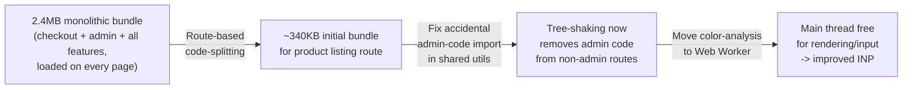

## 23. Interview Questions

1. Explain the difference between prototypal and classical inheritance, and
   what `class` syntax actually compiles down to in JavaScript.
2. What is a closure, and why can it cause a memory leak in a
   long-running Single Page Application?
3. Walk through why the browser's event loop is different from Node.js's
   libuv-based event loop, specifically around rendering and microtasks.
4. When would you choose `requestIdleCallback` over
   `requestAnimationFrame`, and why would using the wrong one produce a
   visible bug?
5. What is the "dual package hazard," and how does ESM's static module
   graph relate to tree-shaking?
6. Why doesn't a `WeakMap` prevent its keys from being garbage collected,
   and when is that the correct behavior to want?
7. Explain the architectural difference between callbacks, Promises, and
   `async`/`await` — are they three different concurrency mechanisms, or
   one mechanism with three syntaxes?
8. What does the Same-Origin Policy actually restrict, and what does it
   explicitly not protect against?
9. What problem do Web Workers solve that `async`/`await` does not, and
   why can't a worker directly manipulate the DOM?
10. What is the architectural prerequisite that makes tree-shaking possible
    for ESM but not CommonJS?

## 24. Hands-on Exercises

1. Build the closure-based `createBankAccount` example from Section 10,
   then reimplement it with `#private` class fields, and write a test that
   proves external code cannot read the private balance in either version.
2. Reproduce the microtask-starvation failure mode from Section 4.4 (a
   self-scheduling `Promise.resolve().then()` recursion) in a browser tab,
   observe the frozen UI, and fix it by yielding control back to the event
   loop periodically.
3. Take a small script performing a CPU-bound loop (e.g. computing prime
   numbers up to a large bound) and move it into a Web Worker using
   Example 3's pattern from Section 10; measure main-thread responsiveness
   before and after using the browser's Long Tasks API.
4. Configure a bundler (Rollup or esbuild) on a small multi-file ESM
   project, introduce a deliberately-unused exported function, and confirm
   it is removed from the production output; then convert the project to
   CommonJS and observe that the same function is no longer eliminated.

## 25. Design Exercises

1. Design the module boundary and encapsulation strategy for a client-side
   shopping-cart feature that must persist across page reloads, survive a
   Service Worker update, and prevent any other script on the page (e.g. a
   third-party analytics tag) from reading or mutating cart contents
   directly.
2. Design a code-splitting strategy for a ten-route SPA where three routes
   (checkout, account settings, admin) are used by fewer than 10% of
   sessions, and justify your chunk boundaries against Section 4.10's
   over-splitting trade-off.
3. Design the message-passing contract (message shapes, error handling,
   cancellation) between a main thread and a Web Worker performing
   incremental, cancellable client-side search-indexing over a large
   dataset.

## 26. Architecture Review Questions

1. Does this codebase modify any built-in prototype anywhere, and if so, is
   that justified and documented, or is it an accidental Section 4.1
   failure mode?
2. Are all event listeners attached to long-lived targets (`window`,
   `document`) paired with an explicit removal in the corresponding
   component teardown path?
3. Is any independent async work being unnecessarily serialized with
   sequential `await` calls that could run concurrently via `Promise.all`?
4. Is there a documented, enforced bundle-size budget in Continuous
   Integration, and does the current production bundle for the primary
   landing route meet it?
5. Is any client-side-only check currently the *sole* enforcement of a
   security- or billing-relevant rule, with no corresponding server-side
   check?
6. Is CPU-bound work on the main thread measured against a documented
   threshold, with anything over that threshold routed to a Web Worker?

## 27. Summary

JavaScript's architectural weight comes from constraints most languages
never face simultaneously: it must never break decades of existing code, it
must run safely inside a sandbox shared with hostile content from other
origins, and — uniquely among mainstream languages — it shares its single
execution thread with the very rendering pipeline that paints pixels to the
user's screen. This chapter taught the language- and browser-level
mechanisms that follow from those constraints: prototypal inheritance and
closures as the primitives every higher-level pattern (modules, classes,
private state, `WeakMap`-based memory-safe association) is built from; the
module-system battle (global scripts, CommonJS, AMD/UMD, and finally
native ESM) that shaped how JavaScript code is organized and, downstream,
how efficiently it can be bundled and tree-shaken; the browser's own
event-loop model — task queues, microtasks, and an explicit render step —
that is genuinely distinct from the Node.js/libuv model owned by
[Node.js Architecture](../03_Software_Engineering_Foundations/CH03_Nodejs.md);
the evolution of asynchronous programming from callbacks through Promises
to `async`/`await`, one underlying mechanism wearing three different
syntaxes; the browser's sandboxing and security model, and its hard limit
(it protects origins from each other, never your code from your own user);
Web Workers as the browser's parallelism primitive; and build/bundling
architecture as the layer that turns a large, modular ESM codebase into an
efficiently-delivered production artifact. Every one of these mechanisms
is something a Solution Architect is implicitly deciding — correctly or
not — the moment any JavaScript ships to a browser, which is why this
chapter treated them as first-class architecture, not implementation
trivia to be left entirely to individual contributors.

## Further Reading

- [Node.js Architecture](../03_Software_Engineering_Foundations/CH03_Nodejs.md) —
  V8 internals, libuv's event loop phases, `worker_threads`/`cluster`, and
  server-side CommonJS/ESM resolution semantics this chapter deliberately
  did not re-teach.
- [HTTP](../05_Networking_and_OS/CH01_HTTP.md) — the network layer beneath
  every `fetch()`/`XMLHttpRequest` call and CORS/caching-header semantics.
- [REST](../08_API_Architecture/CH01_REST.md) — the API design conventions
  most browser JavaScript is written to consume.
- TypeScript, Angular, React, and Next.js chapters (this Part) — frameworks
  and tooling built on top of the language-and-browser architecture taught
  here.
