# Chapter: TypeScript

Part: [04 — Frontend Architecture](PART_OVERVIEW.md) · Status: Drafted

## 1. Introduction

Every few years a new framework claims to be "the architecture," and every
few years a Solution Architect discovers that the framework was really just
arranging a much older, much more consequential decision: what does the
*type system* underneath all of this actually guarantee, and at what point
in the pipeline does it stop guaranteeing it? TypeScript is Microsoft's
answer to that question for the JavaScript ecosystem, and it is one of the
few technology choices in modern frontend architecture that changes almost
nothing about runtime behavior while changing almost everything about how
safely a codebase can grow past the size one engineer can hold in their
head.

This chapter treats TypeScript the way this handbook treats every language
in Part 03 (Java, Python, Node.js, Go, Rust): not as syntax to memorize, but
as an **architectural substrate** with its own compiler pipeline, its own
type-system mechanics, its own build-tooling trade-offs, and its own
specific failure modes that a Solution Architect must reason about
explicitly. TypeScript's defining architectural property, and the one every
other decision in this chapter traces back to, is **type erasure**: every
type annotation, interface, generic parameter, and utility type that a
TypeScript program contains is deleted before the program ever runs. The
compiled output is plain JavaScript with zero runtime trace of the type
system that produced it. This is fundamentally different from what a
Solution Architect might expect from experience with Java or C# (Common
language runtime-based languages with runtime-enforced nominal type systems
and reflection), and it is also fundamentally different from Python's
**gradual typing** model (optional, external-tool-enforced type hints — see
[Python Architecture, Section 4.8](../03_Software_Engineering_Foundations/CH02_Python_Architecture.md#48-gradual-typing-type-hints-mypypyright-and-runtime-semantics)
for the full first-principles treatment of that model; this chapter does not
re-teach it). TypeScript's type system lives entirely in a separate
dimension from JavaScript's runtime — it is a discipline enforced only at
compile time, by a tool that then gets out of the way completely.

This chapter does **not** re-teach JavaScript's own language fundamentals
(the event loop, prototypal inheritance, closures, `this` binding,
`undefined`/`null` semantics, asynchronous execution) — those are owned by
[JavaScript](CH03_JavaScript.md) and this chapter recaps and links to them
only where TypeScript's type system interacts with them directly. What this
chapter owns and teaches from first principles is everything specific to
TypeScript itself: its structural type system, its type-inference engine,
its compiler and erasure model, its advanced type-system features (generics,
discriminated unions, mapped and conditional types, utility types), its
declaration-file architecture for typing untyped JavaScript, its role as a
contract-first design tool in large codebases, its strictness configuration
as a governance lever, and the build-tooling architecture that separates
type-checking from transpilation.

A Solution Architect who treats TypeScript as "JavaScript with some type
annotations sprinkled on top" will make the same category of expensive
mistake as one who treats Python as "just syntax": shipping a
"fully-typed" codebase that still throws `TypeError` in production because
a boundary (an API response, a third-party library, a JSON payload) was
never actually checked at runtime; choosing `any` at a dozen call sites to
make the compiler stop complaining, silently deleting the entire value
proposition of the type system at exactly the places where it mattered
most; or discovering, mid-migration, that a `strict: false` configuration
had been quietly disabling the compiler's most important safety checks
since the project was scaffolded. This chapter exists to make those
decisions deliberate.

## 2. Historical Evolution

TypeScript did not appear because JavaScript lacked features — it appeared
because JavaScript, as it scaled from browser scripting language to the
substrate of entire enterprise applications, lacked a way to describe and
statically verify the *shape* of the data flowing through a program before
that program ran.

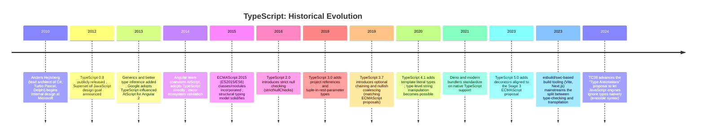

**Why Microsoft built it (2010-2012).** By 2010, Microsoft's own internal
teams and its largest enterprise customers were building browser
applications with hundreds of thousands of lines of JavaScript. JavaScript's
runtime flexibility — a function can be called with any number of
arguments of any type, an object can gain or lose properties at any time,
`this` is rebound depending on call-site — is a productivity asset at small
scale and a liability at large scale: refactoring tools cannot reliably
rename a property across a codebase they cannot statically resolve, an IDE
(Integrated Development Environment) cannot offer trustworthy autocomplete
without knowing what shape an object has, and a reviewer cannot tell from a
function signature what it expects without reading its entire body. Anders
Hejlsberg, who had already built exactly this kind of large-scale tooling
value into C# and its Visual Studio integration, led a team that asked a
narrower and more disciplined question than "how do we fix JavaScript": *how
do we add a static type system on top of JavaScript without changing
JavaScript's runtime semantics at all* — so that any valid JavaScript
program is trivially portable into TypeScript, and any TypeScript program
compiles down to ordinary JavaScript that runs unmodified in any JavaScript
engine.

**The "superset" design constraint, and why it produced a structural type
system.** This design goal — TypeScript must be a strict syntactic and
semantic superset of JavaScript — is the single decision that shapes
everything else in this chapter. JavaScript objects are duck-typed at
runtime: code that calls `.quack()` on a value works as long as that value
has a `quack` method, regardless of what constructor built it, what its
declared "type" is, or whether it inherits from a `Duck` class at all. A
type system layered onto an already-duck-typed runtime has two honest
choices: invent a nominal (name-based) type system that requires explicit
declarations of intent everywhere (as Java and C# do), which would force
every existing JavaScript object literal, callback, and ad-hoc data
structure to be retrofitted with formal type declarations before the
compiler would accept it; or build a **structural** type system that
formalizes JavaScript's existing duck-typing discipline — "if it has the
shape I need, it satisfies the type I need" — without requiring any
explicit declaration of intent. TypeScript chose the second option, and
Section 4.1 covers exactly why that is architecturally different from (and
not merely a stylistic variant of) Java's or C#'s nominal typing.

**Ecosystem validation and the strictness ratchet (2014-2020).** Angular's
adoption of TypeScript in 2014 (abandoning its own competing AtScript
effort) was the ecosystem's first large validation that a major framework
would bet its own architecture on TypeScript rather than plain JavaScript
with JSDoc annotations. What followed over the next six years was not
feature creep but a steady *strictness ratchet*: `strictNullChecks` (2016)
closed the single most common source of runtime crashes in dynamically
typed languages (calling a method on `null`/`undefined`); later strict flags
closed narrower gaps (implicit `any`, unchecked function types, uninitialized
class properties). Section 4.8 covers this ratchet as a governance
mechanism a Solution Architect can use deliberately, not just a
version-history footnote.

**The build-tooling fork (2020-present).** For its first decade, `tsc` (the
TypeScript Compiler) was the only way to both type-check and transpile a
TypeScript program. As frontend build performance became its own
architectural concern (Section 4.9 covers this in depth), a second
generation of tools written in faster host languages (Go's `esbuild`,
Rust's `swc`) emerged that transpile TypeScript to JavaScript at
orders-of-magnitude higher throughput than `tsc` — by doing *no type
checking at all*. This split — type-checking as a separate, slower,
optional gate versus transpilation as a fast, type-blind syntax
transformation — is now the dominant production build architecture, and a
Solution Architect who does not understand *why* the split exists will
misconfigure a build pipeline in a way that silently ships type errors to
production.

## 3. Why It Exists

TypeScript exists to solve a problem that only appears at scale: JavaScript
provides no mechanism for a tool to verify, before a program runs, that the
data flowing through it has the shape the code assumes it has. Three
concrete architectural pressures make this an urgent problem rather than a
nice-to-have.

**Pressure 1 — refactoring safety at scale.** In a codebase with a hundred
files, renaming a property on a shared data object requires either trusting
a codebase-wide text search (which cannot distinguish `user.name` on a
`User` object from `product.name` on a `Product` object) or trusting a tool
that actually understands which values have which shape. A structural type
system gives an IDE and a compiler exactly that understanding, turning
"rename this property" from a risky manual search-and-replace into a
provably-complete, compiler-verified operation.

**Pressure 2 — self-documenting contracts at team scale.** A function
signature like `function createOrder(input)` tells a second engineer
nothing about what `input` must contain. A signature like
`function createOrder(input: CreateOrderRequest): Promise<Order>` is
executable documentation: the interface itself is the contract, checked by
the compiler on every call site, and it does not rot the way a comment does
because the compiler fails the build the moment the code and the
declared contract diverge.

**Pressure 3 — catching an entire class of runtime bugs before deploy.**
Empirical studies (notably a widely cited 2017 UC San Diego/Facebook study
led by Zheng Gao et al. analyzing bug-fix commits in open-source JavaScript
projects) found that a substantial fraction of JavaScript production bugs
— confusing `undefined` with an empty value, passing the wrong shape of
object, calling a function with too few or the wrong-typed arguments — are
exactly the class of error a static structural type checker catches at
compile time, before the code ever reaches a user.

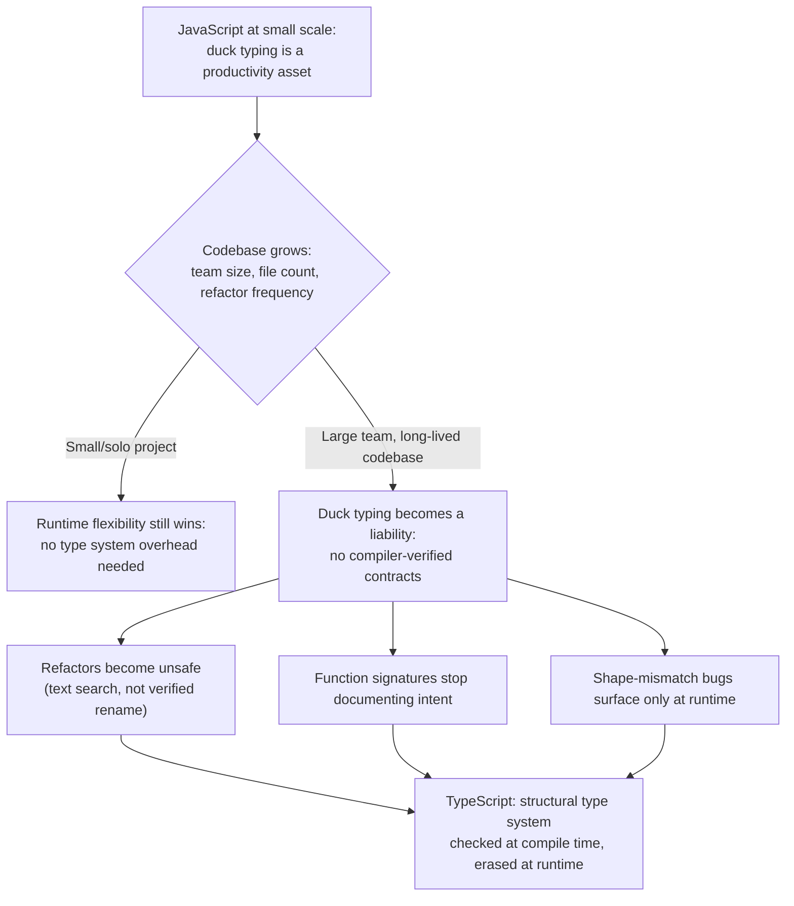

**Why not just add runtime type checks everywhere instead?** This is the
alternative TypeScript deliberately rejected as its default mechanism, and
understanding why clarifies the erasure model in Section 4.3. Runtime type
checks (validating a JSON payload's shape with a library like Zod or io-ts)
cost CPU (Central Processing Unit) cycles on every execution and only ever
detect a violation *after* the offending code path has already been
reached in production. A compile-time structural type system catches the
same class of error during development, at zero runtime cost, for the
subset of the program the compiler can actually see the shape of — which is
most of a well-typed codebase's internal logic. The two are not
competitors; Section 4.7 and Section 13 cover exactly where the boundary
sits and why both are needed together (compile-time checking for internal
code, runtime validation for external/untrusted boundaries like network
responses).

## 4. Core Concepts

This section is the conceptual backbone of the chapter — every subsection
below is taught to first-principles depth: definition, mechanism, decision
implications, common failure modes, and a concrete scenario, per the
handbook's Core Concepts quality bar.

### 4.1 Structural Typing: Duck Typing Formalized

**Definition.** TypeScript's type system is **structural**: two types are
considered compatible if they have the same *shape* — the same set of
required members with compatible types — regardless of their declared
names, their inheritance hierarchy, or whether one was ever declared with
the intent of matching the other. This stands in direct contrast to a
**nominal** type system (Java, C#, and — with the *exception* that
TypeScript itself intentionally departs from it, discussed below — most
class-based OOP (Object-Oriented Programming) languages), where two types
are compatible only if one is declared to explicitly extend or implement
the other, regardless of whether their shapes happen to match.

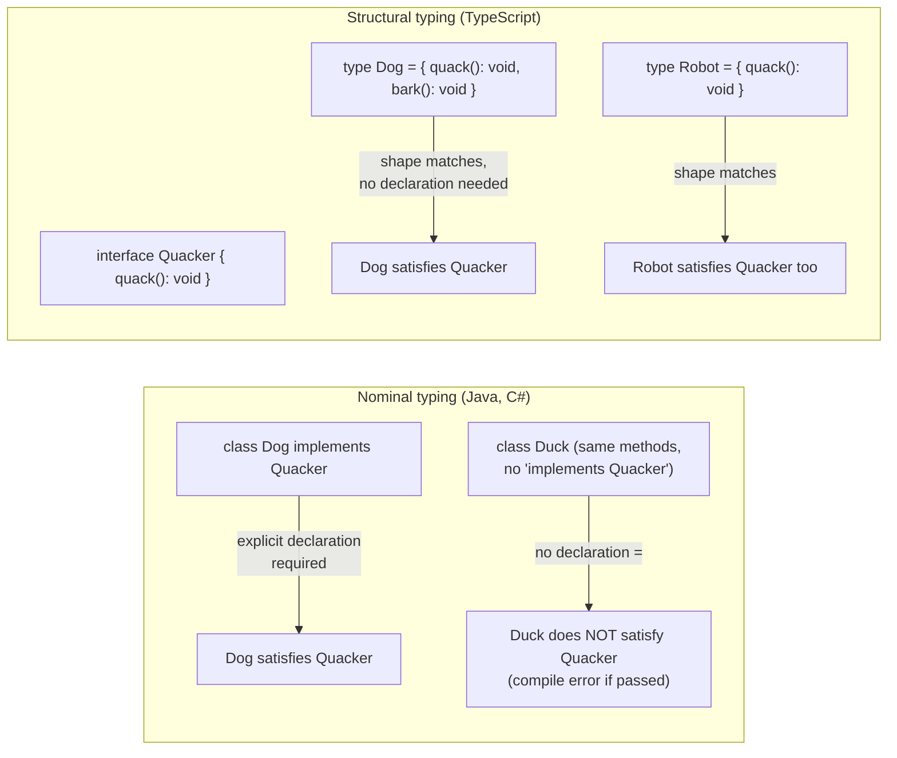

**Mechanism.** When TypeScript checks whether a value of type `A` can be
assigned where a type `B` is expected, it does not look up a declared
inheritance relationship between `A` and `B` at all. Instead it performs
**structural compatibility checking**: it walks the required members of
`B`, and for each one, checks that `A` has a member of the same name whose
type is itself structurally compatible (recursively, for nested object
types). If every required member of `B` is satisfied by `A`, the assignment
is allowed — even if `A` and `B` were declared in completely unrelated
files, by completely unrelated authors, with no textual relationship
between them at all.

```ts
interface Point2D {
  x: number;
  y: number;
}

// Point3D was never declared as "extends Point2D" or "implements Point2D" —
// but it satisfies Point2D structurally: it has a compatible x and y.
interface Point3D {
  x: number;
  y: number;
  z: number;
}

function distanceFromOrigin(p: Point2D): number {
  return Math.sqrt(p.x ** 2 + p.y ** 2);
}

const p3d: Point3D = { x: 3, y: 4, z: 10 };
distanceFromOrigin(p3d); // OK — Point3D has every member Point2D requires
```

**Excess property checks — the one deliberate exception.** If structural
compatibility were unconditional, the compiler would silently accept typos
in object literals (`{ nam: "Ada" }` for a type expecting `{ name: string }`
would pass, because — absent any check — an *extra* property `nam` alongside
a *missing* `name` doesn't violate "has every required member" the way
you'd assume, and separately a literal with `name` plus an accidental
`extra` field would also pass). TypeScript closes this specific gap with
**excess property checking**, which applies only to object *literals*
assigned directly (not to variables of a compatible type assigned
indirectly): an object literal may not have properties the target type does
not declare, checked purely syntactically at the assignment site.

```ts
interface UserProfile {
  name: string;
  age: number;
}

function greet(user: UserProfile) { /* ... */ }

greet({ name: "Ada", age: 30, roll: 1 });
// Error: Object literal may only specify known properties,
// and 'roll' does not exist in type 'UserProfile'.

const existing = { name: "Ada", age: 30, roll: 1 };
greet(existing); // OK — not a literal at the call site, structural check only
```

**Decision implications.** Structural typing is what makes TypeScript
practical to layer onto an already-duck-typed JavaScript ecosystem: any
object literal, any function's plain-object parameter, any third-party
library's return value can participate in the type system the instant it
has a compatible shape, without retrofitting inheritance declarations.
Architecturally, this means TypeScript interfaces should be designed around
**capability** ("what shape does this consumer need") rather than around a
class hierarchy — a `Logger` interface that only requires a `log(msg:
string): void` method is satisfied by the console, a file writer, a remote
logging client, or a test double, with zero coupling between them beyond
the shared shape. This is structural typing doing, at the type-system
level, exactly what dependency inversion and interface segregation do at
the design level — Section 6 covers this connection explicitly.

**Common failure mode — accidental structural compatibility.** Because
compatibility is shape-based, two semantically unrelated types with the
same shape are freely interchangeable, and the compiler will not warn you.

```ts
interface UserId { value: string; }
interface OrderId { value: string; }

function fetchUser(id: UserId) { /* ... */ }

const orderId: OrderId = { value: "order-123" };
fetchUser(orderId); // Compiles! Same shape, completely different meaning.
```

This is the exact failure mode that motivates **branded (nominal-emulation)
types** — covered as a concrete pattern in Section 4.6 — where an
architecture needs nominal-style guarantees (an `OrderId` must never be
usable where a `UserId` is expected) despite TypeScript's structural
default.

**Concrete scenario.** A payments team defines a `PaymentMethod` interface
with `{ chargeAmount(cents: number): Promise<ChargeResult> }`. Three
completely independent modules — a Stripe adapter, a PayPal adapter, and an
in-memory test double — each define their own class that happens to expose
a compatible `chargeAmount` method, with no shared base class and no
explicit `implements PaymentMethod` declaration anywhere. All three are
usable everywhere a `PaymentMethod` is expected, because TypeScript checks
the shape, not the declared genealogy — this is the practical payoff of
structural typing at architecture scale: independently developed modules
compose freely as long as their contracts match.

### 4.2 Type Inference and Its Architectural Implications

**Definition.** **Type inference** is the compiler's ability to determine a
value's type from context — an initializer expression, a function's return
statements, a generic call site's arguments — without an explicit type
annotation written by the programmer. TypeScript's inference engine is
**bidirectional**: it infers types *forward* from an expression's structure
(a literal `42` is inferred as `number`) and it infers types *backward*
from **contextual typing**, where the expected type at a position flows
"down" into an expression to resolve what would otherwise be ambiguous (an
untyped arrow function passed as an event handler is contextually typed by
the handler's expected signature).

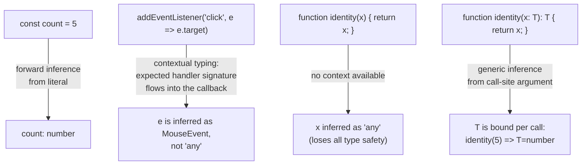

**Mechanism.** For a `const`/`let` declaration with an initializer,
TypeScript infers the **widened** type of the initializer expression by
default (a string literal `"pending"` widens to `string`, not the literal
type `"pending"`, unless the variable is `const` and the context calls for
literal narrowing — see `as const` below). For function return values
without an explicit return-type annotation, TypeScript infers the union of
every `return` statement's inferred type. For generic functions, TypeScript
performs **type argument inference**: it examines the arguments actually
passed at a call site and solves for the generic type parameter that makes
every parameter's declared type compatible with the argument actually
supplied, without the caller ever writing `identity<number>(5)` explicitly.

**`as const` and literal narrowing.** By default, inference widens literals
to their general type for mutable bindings, because a `let` binding might
be reassigned to any value of that general type later. The `as const`
assertion tells the compiler to infer the *narrowest* possible literal type
instead, treating the value as deeply read-only:

```ts
let status = "pending";          // inferred as string (widened)
const status2 = "pending";       // inferred as "pending" (const, no reassignment possible)
const config = { mode: "dark" }; // config.mode inferred as string, NOT "dark" — object properties widen even on const
const config2 = { mode: "dark" } as const; // config2.mode inferred as the literal type "dark"
```

**Decision implications — how much annotation is enough.** This is one of
the most consequential *stylistic-but-architectural* decisions a team makes
with TypeScript, because both extremes have a real cost:

- **Annotating every variable** (`const x: number = 5`) adds no safety the
  inference engine wasn't already providing and adds maintenance friction —
  if the initializer's type changes, the redundant annotation must be
  updated in two places or it becomes actively misleading.
- **Annotating nothing** relies entirely on inference propagating correctly
  through every layer, and inference has a real edge: an unannotated
  function parameter with no contextual type information (a function passed
  as a value with no expected-shape context, or a bare function declaration
  with no call-site context available yet) infers as `any` by default,
  silently deleting type safety at exactly the point the compiler needed
  the most help.

The architecturally sound default, and the one this handbook recommends, is:
**always annotate a function's public parameters and return type (the
contract boundary), and let inference fill in everything internal to the
function body** (local variables, intermediate expressions). This gives
every caller a stable, explicit contract to code against while avoiding
redundant internal annotations that add churn without adding safety.

```ts
// Boundary: explicit. Internals: inferred.
function calculateDiscount(price: number, tier: "gold" | "silver" | "bronze"): number {
  const rate = tier === "gold" ? 0.2 : tier === "silver" ? 0.1 : 0.05; // inferred: number
  const discount = price * rate;                                       // inferred: number
  return price - discount;
}
```

**Common failure mode — implicit `any` at unannotated boundaries.**
Without `noImplicitAny` (Section 4.8), a function parameter with no
annotation and no inferable context silently becomes `any`, and `any`
propagates through every expression that touches it, silently disabling
type checking downstream of the leak — often far from where the leak
actually originated, making the root cause hard to trace.

**Concrete scenario.** A team migrating a JavaScript codebase to TypeScript
enables the compiler with default (non-strict) settings and sees "zero
errors" on the first run — not because the codebase is well-typed, but
because every unannotated parameter silently inferred as `any`, and `any`
never produces an error. Section 4.8 and Section 16 cover exactly how
`noImplicitAny` converts this false confidence into an honest, actionable
error count.

### 4.3 The Compiler Architecture and Type Erasure

**Definition.** **Type erasure** is TypeScript's foundational architectural
guarantee: every type-only construct in a TypeScript program — type
annotations, interfaces, type aliases, generic type parameters, and (with
the single class-decorator/property-accessor exception noted below) all
compile-time-only syntax — is completely removed by the compiler before
JavaScript is emitted. The compiled output contains **zero runtime
representation** of the type system: no runtime type-checking, no runtime
type-tags, no performance cost, and — critically — no runtime *enforcement*
of anything the type system promised.

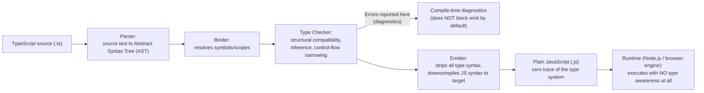

**Mechanism.** The TypeScript Compiler (`tsc`) pipeline has four
conceptual stages: (1) the **parser** produces an Abstract Syntax Tree
(AST) from the source text, including type-only nodes; (2) the **binder**
walks the AST to resolve every identifier to its declaring symbol and build
scope information; (3) the **type checker** walks the bound AST performing
structural compatibility checks, inference, generic-instantiation
resolution, and control-flow-based type narrowing, emitting a diagnostic
for every incompatibility found; (4) the **emitter** produces JavaScript
output by walking the same AST and *skipping every type-only node
entirely* — interfaces, type aliases, type annotations, and generic type
parameters are never emitted, because there is nothing in JavaScript's
grammar that could represent them, and JavaScript engines have no runtime
concept of a static type to check against. Critically, **type-checking and
emitting are two separate, decoupled phases**: by default, `tsc` emits
JavaScript output even when the type checker reports errors (this is
governed by the `noEmitOnError` flag, off by default), because Anders
Hejlsberg's team deliberately chose to treat type errors as *warnings about
program correctness*, not as syntax errors that must block compilation —
useful for iterative development, dangerous if a build pipeline doesn't
explicitly gate deploys on a clean type-check (Section 13).

**Decision implications — the "compile-time-only, zero runtime cost"
trade-off.** Type erasure means a Solution Architect gets a static type
system at genuinely zero runtime performance cost (no shape validation, no
runtime dispatch based on declared types, no memory overhead for type
metadata) — but it also means the type system provides **zero protection
at runtime boundaries**. A value cast with `as SomeType` performs *no*
runtime check at all; it is purely a compile-time instruction telling the
type checker "trust me, treat this value as this type from here on," and
if the value's actual runtime shape doesn't match, the program will crash
(or silently misbehave) at the exact moment the mismatch is used, with no
compiler-level warning that this could happen.

```ts
// This "just works" at compile time. It is a lie the compiler believes.
const apiResponse = JSON.parse(rawText) as { id: number; name: string };
apiResponse.name.toUpperCase(); // crashes at runtime if `name` isn't actually a string
```

This is precisely the boundary problem introduced in Section 3, and it is
why declaration files (Section 4.7) and runtime validation libraries exist
as a *complement* to, not a replacement for, TypeScript's compile-time
checking — see Section 13 for the concrete architecture pattern (validate
at the boundary once, trust the type system for everything after).

**The one exception — `enum` and legacy experimental decorators.**
TypeScript's `enum` construct is the one mainstream feature that is *not*
purely erased: a numeric or string `enum` compiles to an actual runtime
object (unless declared `const enum`, which is fully erased and inlined at
call sites). This is a deliberate, narrow departure from the erasure
principle, made because enums need a runtime-iterable value set (for
example, to validate an incoming string against all valid member values);
it is also why many style guides prefer plain union-of-string-literal types
(`type Status = "pending" | "active" | "closed"`, fully erased, zero
runtime cost) over `enum` for cases that don't need runtime iteration.

**Common failure mode — assuming a type annotation is a runtime
guarantee.** Because there is no runtime enforcement, a type annotation on
a function parameter documents an *expectation*, not a *guard*. Calling a
"typed" function from plain JavaScript (a common situation in a
mixed-language codebase, or when data crosses a network boundary) bypasses
the type system entirely — there is no code left at runtime to reject a
malformed call.

**Concrete scenario.** A team builds an internal HTTP API where the
response type is declared as `interface OrderResponse { total: number }`
on the client. The backend team, without coordination, changes `total`
from a `number` to a `string` (to preserve currency precision). The
TypeScript client code compiles without a single error — the interface
declaration was never validated against the actual server response, because
type erasure means there is no runtime check tying the declared interface
to the bytes that actually arrive over the wire. The bug (`total.toFixed(2)`
throwing `total.toFixed is not a function`) surfaces only in production,
for the exact reason Section 3's "why not runtime checks" discussion
predicted: the type system checked the code path, not the data.

### 4.4 Generics as an Architectural Tool

**Definition.** **Generics** let a type, interface, function, or class be
parameterized over one or more type variables, so that a single declaration
can be reused across many concrete types while preserving full,
call-site-specific type safety — the exact opposite trade-off of `any`,
which also "works with anything" but by discarding type safety rather than
preserving it per use.

**Mechanism.** A generic declaration introduces one or more type parameters
(conventionally named `T`, `U`, `K`, `V`) inside angle brackets. At each use
site, TypeScript either infers the concrete type argument from context
(Section 4.2) or accepts an explicit type argument, and then substitutes
that concrete type everywhere the type parameter appears in the
declaration — checking the *substituted*, concrete-typed version at that
call site, not a type-erased "works with anything" version.

```ts
// A generic repository contract: works for ANY entity shape,
// but each concrete usage is fully, independently type-checked.
interface Repository<T, IdType = string> {
  findById(id: IdType): Promise<T | undefined>;
  save(entity: T): Promise<T>;
  delete(id: IdType): Promise<void>;
}

interface User {
  id: string;
  email: string;
}

class InMemoryUserRepository implements Repository<User> {
  private store = new Map<string, User>();

  async findById(id: string): Promise<User | undefined> {
    return this.store.get(id);
  }

  async save(entity: User): Promise<User> {
    this.store.set(entity.id, entity);
    return entity;
  }

  async delete(id: string): Promise<void> {
    this.store.delete(id);
  }
}

const repo: Repository<User> = new InMemoryUserRepository();
const user = await repo.findById("u-1"); // typed as User | undefined, NOT `any`
```

**Generic constraints (`extends`).** An unconstrained generic parameter
`T` can be *anything*, which means the compiler can only assume the most
generic possible operations are valid on it (essentially none). A
**constraint** narrows what `T` is allowed to be, which is what unlocks
useful operations inside the generic body while still accepting any type
that satisfies the constraint structurally.

```ts
interface HasId {
  id: string;
}

// Without `extends HasId`, `entity.id` would be a compile error —
// the compiler cannot assume an unconstrained T has an `id` property at all.
function upsert<T extends HasId>(collection: T[], entity: T): T[] {
  const index = collection.findIndex(item => item.id === entity.id);
  if (index === -1) return [...collection, entity];
  const copy = [...collection];
  copy[index] = entity;
  return copy;
}
```

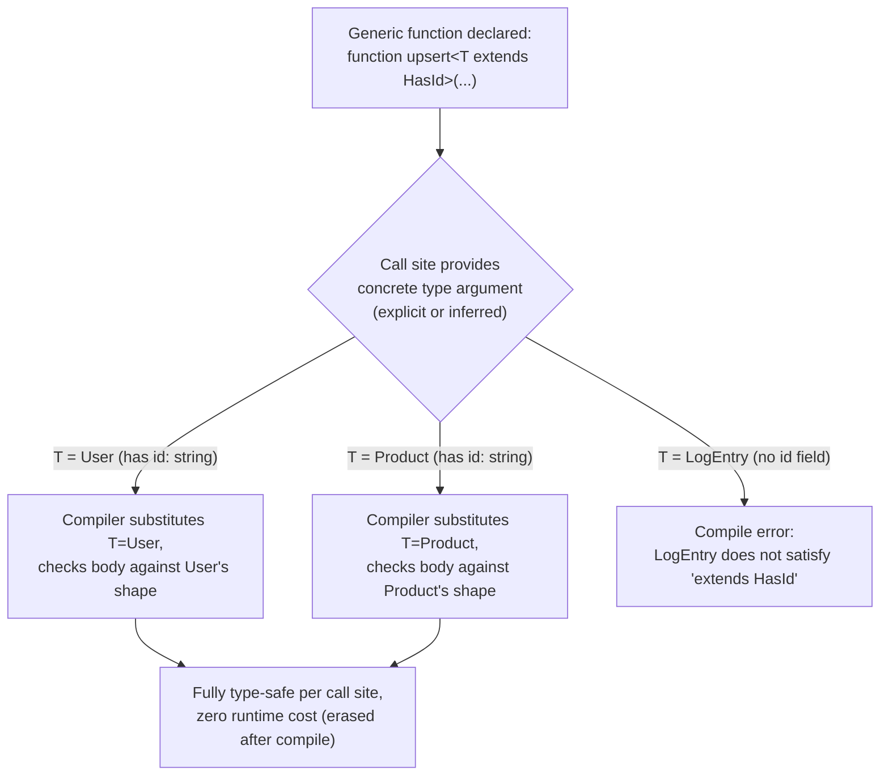

**Decision implications.** Generics are the primary tool for writing
**reusable, type-safe infrastructure code** — repositories, HTTP client
wrappers, state containers, validation pipelines — without falling back to
`any` (which trades safety for reuse) or hand-duplicating the same logic
per concrete type (which trades maintainability for safety). The
architectural heuristic: reach for a generic whenever a piece of logic is
*structurally* identical across types and only the *concrete shape*
changes per use — a repository pattern, a cache wrapper, an event-emitter
contract, a paginated-response envelope.

**Common failure mode — over-genericizing simple code.** Generics add real
cognitive overhead; a function that will only ever operate on one concrete
type does not need a type parameter, and adding one anyway ("just in case")
makes the signature harder to read for no architectural benefit. The
heuristic above (reuse across *actually different* concrete types) should
gate the decision, not "generics are more sophisticated."

**Concrete scenario.** A platform team builds one generic
`PaginatedResponse<T>` envelope (`{ items: T[]; page: number; totalPages:
number }`) used by twelve different API endpoints returning twelve
different entity shapes. Without generics, this would require either
twelve near-duplicate interfaces (`PaginatedUsers`, `PaginatedOrders`, ...)
or a single untyped `{ items: any[] }` envelope that silently loses type
safety on every consumer. The generic version gives every consumer a fully
typed `items: User[]` or `items: Order[]` for free, from one declaration.

### 4.5 Discriminated Unions for Exhaustive State Modeling

**Definition.** A **discriminated union** (also called a "tagged union" or
"algebraic data type" in the broader type-theory literature) is a union of
object types that share a common, literal-typed property (the
**discriminant** or **tag**) whose value differs per member of the union.
TypeScript's control-flow analysis uses the discriminant to **narrow** the
union to exactly one member type inside a conditional branch, and its
`never` type lets the compiler *prove*, at compile time, that every member
of the union has been handled — turning "did I forget a case" from a
runtime question into a compile-time one.

**Mechanism.** Each member of the union declares the same property name
with a distinct literal type. When code checks that property (typically
via a `switch` or `if`), TypeScript's control-flow analyzer narrows the
union's type within that branch to only the member(s) whose literal
discriminant value matches, making every other property on that member
safely accessible without a manual cast.

```ts
type RequestState<T> =
  | { status: "idle" }
  | { status: "loading" }
  | { status: "success"; data: T }
  | { status: "error"; error: Error };

function render<T>(state: RequestState<T>): string {
  switch (state.status) {
    case "idle":
      return "Not started";
    case "loading":
      return "Loading…";
    case "success":
      return `Loaded: ${JSON.stringify(state.data)}`; // state.data is safely accessible here — narrowed
    case "error":
      return `Failed: ${state.error.message}`;        // state.error is safely accessible here — narrowed
    default:
      // Exhaustiveness check: if a new member is ever added to RequestState
      // and this switch isn't updated, `state` here is NOT `never`,
      // and the assignment below fails to compile — a compile-time guarantee
      // that no state was silently left unhandled.
      const _exhaustive: never = state;
      return _exhaustive;
  }
}
```

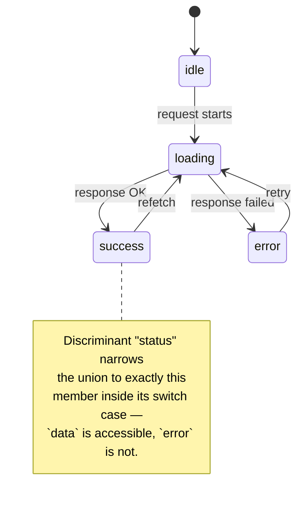

**Decision implications — the exhaustiveness-check pattern as a fitness
function.** The `never`-typed `default` branch above is not decorative — it
is a deliberate architectural pattern: it converts "every code path that
switches on this state must handle every possible state" from a code-review
convention (easily missed) into a compiler-enforced invariant. Any time a
new member is added to the union (a new `"cancelled"` status, for example),
every exhaustive switch across the entire codebase that handles this union
immediately fails to compile until it is updated — the compiler finds every
call site that needs updating, with no manual audit required.

**Common failure mode — non-exhaustive unions modeled as loose booleans.**
The classic alternative to a discriminated union is a set of independent
boolean/optional flags (`{ isLoading: boolean; data？: T; error?: Error }`),
which allows **impossible states to be representable** — `isLoading: true`
and `error: someError` set simultaneously is a state the type system does
nothing to prevent, even though it is semantically meaningless. A
discriminated union makes that impossible state *unrepresentable*: there is
no member of the union where both `data` and `error` coexist, so the
compiler itself rules it out.

**Concrete scenario.** A frontend team models an async data-fetching hook's
result as `{ isLoading: boolean; data?: User; error?: string }` and ships a
bug where a stale `error` from a previous failed request is still rendered
alongside a successful `data` payload from a retry, because nothing
prevented both from being set at once. Refactoring the hook's return type
to a discriminated union (`{ status: "idle" | "loading" | "success" |
"error"; ...tag-specific fields }`) makes that exact bug a compile error the
moment it's introduced, because a "success" member of the union has no
`error` field to accidentally read.

### 4.6 Mapped Types, Conditional Types, and Utility Types

**Definition.** TypeScript's type system is itself a small, pure,
compile-time-only functional programming language operating over types
instead of values. **Mapped types** transform an existing type by iterating
over its keys and producing a new type with a modified version of each
property. **Conditional types** perform type-level branching (`T extends U
? X : Y`), including with **infer**, which extracts a sub-type out of a
larger type mid-condition. TypeScript's built-in **utility types**
(`Partial`, `Required`, `Pick`, `Omit`, `Record`, `ReturnType`, and dozens
more) are themselves ordinary mapped/conditional types shipped in the
standard library, not special compiler syntax — a Solution Architect who
understands the mechanism can read (and write) any of them.

```ts
// A from-scratch reimplementation of the built-in Partial<T> utility type,
// to show it's just a mapped type, not compiler magic.
type MyPartial<T> = {
  [K in keyof T]?: T[K];
};

// A from-scratch reimplementation of Pick<T, K>.
type MyPick<T, K extends keyof T> = {
  [P in K]: T[P];
};

// A conditional type using `infer` to extract a Promise's resolved value type.
type Unwrap<T> = T extends Promise<infer U> ? U : T;

type A = Unwrap<Promise<string>>; // A = string
type B = Unwrap<number>;          // B = number (falls through the `: T` branch)
```

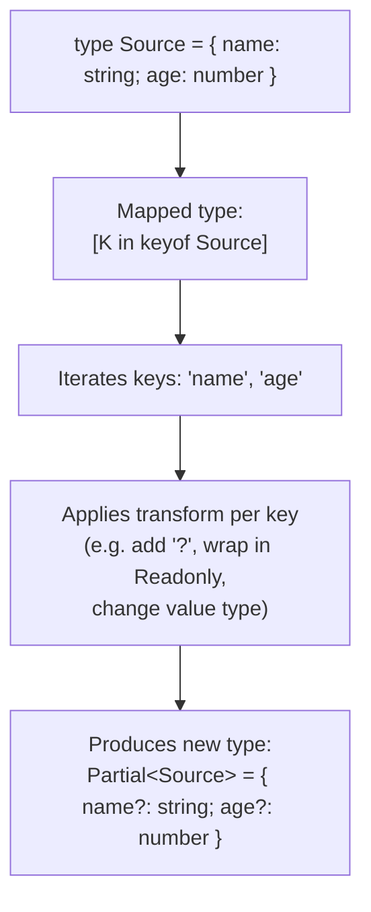

**Branded types — using the type system to emulate nominal typing.**
Section 4.1 flagged that structural typing allows accidental compatibility
between semantically distinct types with the same shape (`UserId` vs.
`OrderId`). The standard architectural fix is a **branded type**: an
intersection of the real type with a unique, otherwise-unused "brand"
property that exists only at the type level (erased at runtime, so it adds
zero runtime cost) and makes two structurally identical types
type-incompatible on purpose.

```ts
type Brand<T, B extends string> = T & { readonly __brand: B };

type UserId = Brand<string, "UserId">;
type OrderId = Brand<string, "OrderId">;

function asUserId(value: string): UserId {
  return value as UserId; // the one deliberate cast, at the single boundary constructor
}

function fetchUser(id: UserId) { /* ... */ }

const rawOrderId = "order-123";
fetchUser(rawOrderId);           // Error: string is not assignable to UserId
fetchUser(asUserId(rawOrderId)); // Error: this is semantically wrong, but now
                                  // the mistake is visible in the code as an
                                  // explicit, searchable `asUserId(...)` call
                                  // rather than a silent structural coincidence.
```

**Decision implications.** Mapped and conditional types let an architecture
express **derived** types instead of manually duplicating them — a
`CreateUserInput` type derived from `Omit<User, "id" | "createdAt">` stays
automatically in sync with `User` as fields are added or removed, instead
of silently drifting out of sync the way a hand-written duplicate
inevitably would. This is the type-system equivalent of "don't repeat
yourself" applied to data-shape declarations.

**Common failure mode — unreadable type-level metaprogramming.** Because
the type system is Turing-complete-adjacent (deeply recursive conditional
types can express surprisingly complex logic), it is possible to write
type-level code that is nearly impossible for a teammate to read, debug, or
safely modify — a `type` declaration that spans 40 lines of nested
conditional/mapped/infer logic is a code smell in exactly the way a 40-line
nested ternary expression would be in ordinary code. The architectural
guideline: prefer the built-in utility types and simple, one-level mapped
types; reserve custom conditional-type metaprogramming for library-boundary
code (a shared internal SDK, a form-validation framework) where the
complexity is paid once by a small team and the simplicity is delivered to
every consumer.

**Concrete scenario.** A team building an internal form library defines
`type FormErrors<T> = { [K in keyof T]?: string }` once, and every form in
the application derives its error-shape type automatically from its
existing data-shape type, instead of maintaining a hand-written,
independently-drifting `UserFormErrors`, `OrderFormErrors`, and so on for
every form in the codebase.

### 4.7 Declaration Files and Typing Untyped JavaScript

**Definition.** A **declaration file** (`.d.ts`) contains only *type*
information — interfaces, type aliases, ambient variable/function/module
declarations — with no runtime implementation at all. Declaration files are
how TypeScript describes the shape of code that itself has no type
information: plain JavaScript libraries, global browser Application
Programming Interfaces (APIs), and compiled output's public contract
(every `tsc`-compiled `.ts` file can emit a matching `.d.ts` describing its
public shape for consumers, via the `declaration` compiler option).

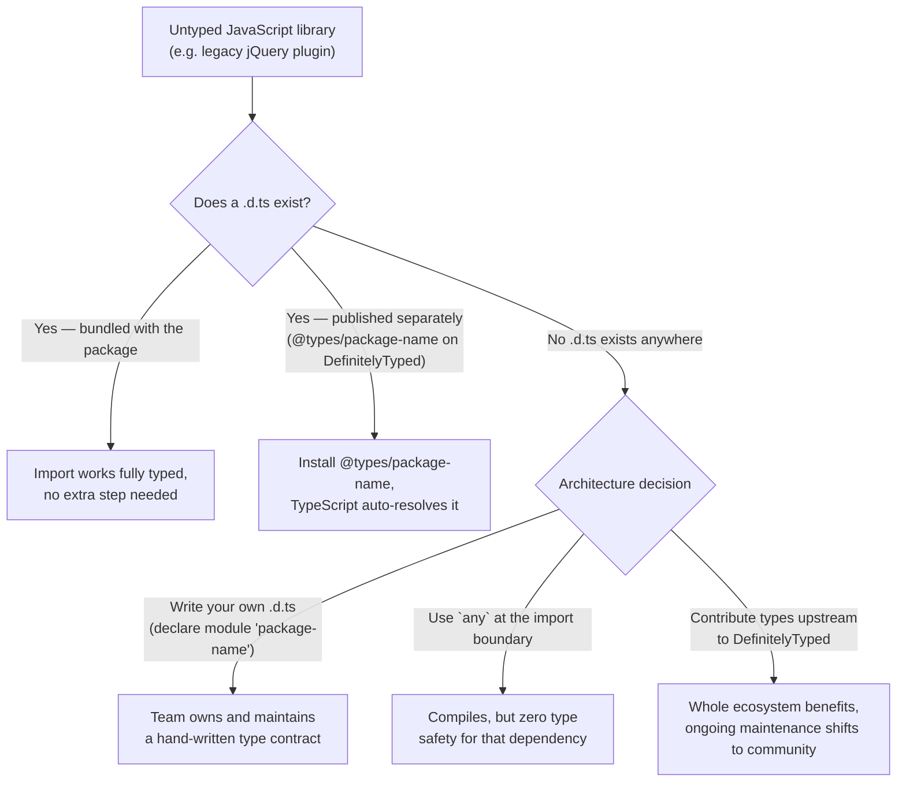

**Mechanism — `declare` and ambient contexts.** A declaration file uses the
`declare` keyword to describe something that exists at runtime but has no
corresponding implementation *in this file* — the implementation lives
elsewhere (a `.js` file, a global script tag, a compiled binary). This is
an **ambient declaration**: it tells the type checker "trust that this
exists with this shape," with the same "the compiler cannot verify this
against reality" caveat discussed in Section 4.3's erasure model.

```ts
// analytics-lib.d.ts — hand-written declaration file for an untyped legacy library
declare module "legacy-analytics-lib" {
  export interface TrackOptions {
    userId: string;
    revenue?: number;
  }

  export function track(eventName: string, options: TrackOptions): void;
  export function identify(userId: string, traits: Record<string, unknown>): void;
}
```

```ts
// consuming file — now fully typed, even though the library itself has no types
import { track } from "legacy-analytics-lib";

track("checkout_completed", { userId: "u-1", revenue: 49.99 }); // fully checked
track("checkout_completed", { userId: "u-1", revenu: 49.99 });  // Error: typo caught
```

**DefinitelyTyped and `@types` packages.** For the large majority of
popular untyped JavaScript libraries, the community-maintained
DefinitelyTyped repository publishes matching `@types/<package-name>`
packages that TypeScript automatically resolves alongside the library's own
package — this is the reason a Solution Architect evaluating a new
JavaScript dependency should check for `@types` availability (or bundled
types, indicated by a `types`/`typings` field in the library's own
`package.json`) as part of the dependency-adoption decision, not as an
afterthought once integration work has already begun.

**Decision implications.** Declaration files are the architectural seam
between TypeScript's compile-time-only world and the much larger universe
of plain JavaScript code that predates it or will never adopt it. This
seam is exactly where type erasure's "the compiler trusts you" property
(Section 4.3) is most exposed: a hand-written `.d.ts` that describes a
shape the underlying JavaScript does not actually honor produces a
confident, fully type-checked compile that is nonetheless wrong, and the
mismatch surfaces only at runtime — reinforcing why runtime boundary
validation (Section 13) matters most exactly at these ambient-declaration
seams.

**Common failure mode — stale or hand-maintained `.d.ts` drift.** A
hand-written declaration file for an internal library that is *also*
actively changing (not a stable third-party dependency) tends to drift out
of sync with the actual implementation, because nothing forces the two to
stay consistent — this is why, for internal code, generating declaration
files directly from the TypeScript source (via `tsc --declaration`) is
strongly preferred over hand-maintaining a parallel `.d.ts`, since the
generated version is derived from, and therefore can never drift from, the
actual implementation's real type signatures.

**Concrete scenario.** A frontend team adopts a small, unmaintained
charting library with no bundled types and no `@types` package on
DefinitelyTyped. Rather than importing it with `any` everywhere it's used
(silently disabling type safety at every call site across the codebase),
the team writes one focused internal `charting-lib.d.ts` covering only the
handful of functions actually used, checked into the repository alongside
the rest of the codebase — a fifteen-minute, one-time investment that
converts every future call site into a fully type-checked one.

### 4.8 Strictness Configuration as an Architecture Governance Lever

**Definition.** TypeScript's `tsconfig.json` **strict mode flags** are not
merely style preferences — they are individually toggleable
compiler-enforced invariants, each closing one specific, historically real
category of runtime bug. Collectively, they function as compile-time
**fitness functions** (see
[What is Software Architecture?, Section 9-10](../01_Architecture_Mindset/CH01_What_is_Software_Architecture.md)
for this handbook's general treatment of fitness functions as an
architecture-governance mechanism) — automated, objective, continuously
re-evaluated checks that a codebase's declared type discipline is actually
being upheld, not just aspired to.

```mermaid
flowchart TD
    A["`strict: true`\n(master switch)"] --> B["strictNullChecks:\nnull/undefined must be\nexplicitly included in a type\nto be assignable"]
    A --> C["noImplicitAny:\nevery value must have\nan inferable or declared type\n(no silent 'any' fallback)"]
    A --> D["strictFunctionTypes:\nfunction parameter types checked\ncontravariantly, not bivariantly"]
    A --> E["strictPropertyInitialization:\nclass properties must be\ninitialized or explicitly optional"]
    A --> F["strictBindCallApply:\n.bind/.call/.apply checked\nagainst the real function signature"]
    A --> G["alwaysStrict / useUnknownInCatchVariables\n/ noImplicitThis / ...more flags"]
    B --> H["Fewer 'Cannot read property\nof undefined' runtime crashes"]
    C --> I["No silent type-safety holes\nfrom unannotated boundaries"]
```

**Mechanism — why these are flags, not defaults.** Every strict flag was
introduced in a specific TypeScript release (Section 2), and TypeScript's
backward-compatibility promise means enabling a stricter check by default
would break every existing codebase compiled under looser rules. `strict:
true` is therefore an explicit opt-in umbrella flag (available since
TypeScript 2.3) that enables the full current set of strict checks at once,
with newer releases adding more checks under the same umbrella as they're
introduced — meaning a project's *actual* strictness quietly increases
every time it upgrades TypeScript, unless individual flags are explicitly
disabled to opt back out.

**`strictNullChecks` in depth — the single highest-value flag.** Without
it, `null` and `undefined` are treated as valid values of *every* type,
meaning `let name: string = null` compiles without complaint and any string
operation on `name` can crash at runtime with no compile-time warning at
all. With it enabled, `null`/`undefined` must be explicitly included in a
type's definition (`string | null`) to be assignable, and the compiler
forces every consumer to handle (narrow away) the `null`/`undefined` case
before performing an operation that would crash on it.

```ts
// tsconfig.json: "strictNullChecks": false (or strict: false)
function greet(name: string) {
  return name.toUpperCase();
}
greet(null); // compiles! crashes at runtime: Cannot read properties of null

// tsconfig.json: "strictNullChecks": true
function greetStrict(name: string | null) {
  if (name === null) return "Hello, stranger";
  return name.toUpperCase(); // safe: name is narrowed to `string` here
}
```

**Decision implications — strictness as a phased governance rollout.** For
a greenfield project, enabling `strict: true` from day one costs nothing
(there is no legacy code to reconcile) and should always be the default. For
a large existing codebase migrating from loose or plain JavaScript, turning
on full strict mode in one step typically produces thousands of errors at
once — an unmanageable, all-or-nothing gate that teams tend to abandon
rather than clear. The architecturally sound rollout pattern is
**incremental strictness**: enable one flag at a time, starting with
`strictNullChecks` (highest bug-prevention value) and `noImplicitAny`
(closes the false-confidence gap from Section 4.2), fix the errors surfaced
by that one flag across the codebase, commit, then enable the next flag —
turning an unmanageable one-shot migration into a tracked, incremental
backlog with a visible completion percentage.

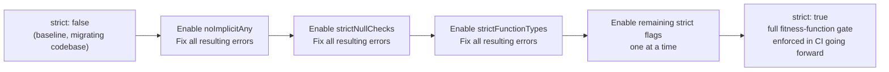

**Common failure mode — `strict: false` inherited silently from
scaffolding.** Many project scaffolding tools historically defaulted to
`strict: false` (or omitted strict flags entirely) for lower initial error
counts during onboarding. A team that never revisits its generated
`tsconfig.json` inherits this weaker configuration permanently, believing
it has "TypeScript's safety" when it has, in practice, opted out of most of
the checks that provide that safety — the single most common false sense
of security this chapter warns against.

**Concrete scenario.** A Continuous Integration (CI) pipeline runs `tsc
--noEmit` (type-check only, no output) as a required merge gate, with
`strict: true` in `tsconfig.json`. A pull request that introduces a
function accepting `user: User | null` but forgetting to null-check before
calling `user.email` fails this gate immediately, before a human reviewer
even opens the diff — this is the fitness-function pattern in its most
direct form: an architectural invariant ("never dereference a possibly-null
value without a check") enforced automatically, continuously, on every
change, rather than relying on a reviewer to catch it by inspection.

### 4.9 Build and Tooling Architecture: `tsc` vs. Transpilation-Only Tools

**Definition.** TypeScript's build pipeline has architecturally split into
two distinct categories of tool with an important trade-off between them:
**type-checking compilers** (`tsc` itself, and IDE language services built
on the same engine) that perform full structural type analysis, and
**transpilation-only tools** (`esbuild`, written in Go; `swc`, written in
Rust; Babel's TypeScript preset) that strip TypeScript syntax and downlevel
modern JavaScript syntax *without performing any type checking at all*.

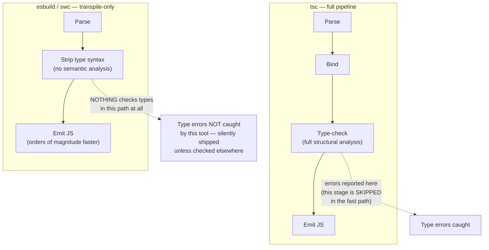

**Mechanism — why transpile-only tools are so much faster.** Full type
checking requires building a complete symbol table across the entire
program (including every imported module and its dependencies,
transitively), performing structural compatibility analysis, and resolving
generic instantiations — inherently whole-program, cross-file work. Syntax
transpilation, by contrast, is a **single-file, syntax-only** operation: it
needs to recognize "this is a type annotation, delete it" and "this is
modern JS syntax the target runtime doesn't support, downlevel it," neither
of which requires understanding what any file *other than the one being
processed* contains. This is precisely why `esbuild` (Go, compiled,
highly parallel single-file processing) and `swc` (Rust, similarly
parallel) can transpile a large codebase in a small fraction of the time
`tsc`'s type-checking pass takes — they are doing categorically less work,
not just doing the same work faster.

**Decision implications — the production build architecture pattern.**
Because transpile-only tools produce no type-safety guarantee at all, the
standard, architecturally sound production pattern (used by Vite, Next.js,
and most modern frontend toolchains) is to **separate the two concerns
entirely**: use a fast transpile-only tool (`esbuild`/`swc`) for the actual
build output that ships to users or gets bundled, and run `tsc --noEmit`
(type-check only, produce no output) as an independent, parallel step —
typically in the editor in real time (via the TypeScript Language Service)
and as a required Continuous Integration gate before merge/deploy. This
gives a team both fast iterative builds *and* a hard type-safety gate,
without either objective compromising the other.

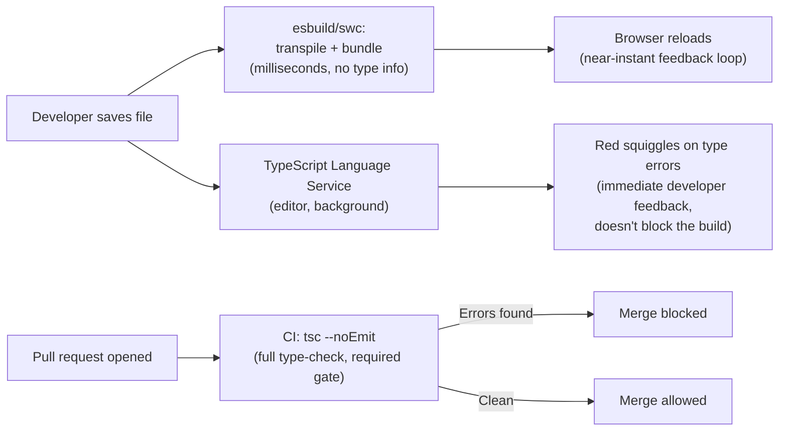

**Common failure mode — believing a fast build "already type-checks."** A
team that migrates its build pipeline to `esbuild`/`swc` for speed, without
also wiring up a separate `tsc --noEmit` gate in CI, can ship type errors to
production indefinitely — the build will "succeed" every time, because the
tool doing the building was never checking types in the first place. This
is the single most common and most consequential TypeScript build-pipeline
misconfiguration in modern frontend architecture, precisely because the
failure is silent: everything appears to work until the specific code path
with the type error actually executes in production.

**Concrete scenario.** A team migrates from Webpack+`ts-loader` (which used
`tsc`'s full type-checking pipeline for every build) to Vite (which uses
`esbuild` for dev/build by default) purely to fix slow rebuild times. Local
development gets dramatically faster, and the team is satisfied — until a
production incident traces back to a type error (`undefined` passed where a
`string` was required) that would have been caught instantly by `tsc`, but
was silently transpiled and shipped because nothing in the new pipeline was
actually checking types anymore. The fix is not to revert the build tool,
but to add the missing `tsc --noEmit` CI gate that should have accompanied
the migration from the start.

### 4.10 Interface-Driven, Contract-First Architecture

**Definition.** In a TypeScript codebase at scale, an `interface` (or a
`type` alias for an object shape) functions as an **executable
architectural contract**: a compiler-enforced boundary between a module's
consumers and its implementation, checked on every call site, that fails
the build the instant an implementation drifts from what it promised. This
is the type-system-level realization of dependency inversion (depend on
abstractions, not concretions) discussed generally in
[What is Software Architecture?](../01_Architecture_Mindset/CH01_What_is_Software_Architecture.md) —
TypeScript's structural typing (Section 4.1) makes this pattern
particularly lightweight, since any implementation with a compatible shape
satisfies the contract with no explicit `implements` declaration required.

**Mechanism.** A contract-first workflow defines the interface a module
exposes *before* writing its implementation (or independently of any single
implementation), and every consumer — including test doubles — codes
against that interface rather than a concrete class. Because TypeScript
checks structural compatibility, a production implementation, an in-memory
test double, and a future alternative implementation (a different caching
strategy, a different backing store) are all freely interchangeable as long
as each satisfies the shared interface.

```ts
interface NotificationSender {
  send(to: string, message: string): Promise<void>;
}

class EmailSender implements NotificationSender {
  async send(to: string, message: string): Promise<void> {
    /* real SMTP (Simple Mail Transfer Protocol) client call */
  }
}

class InMemoryTestSender implements NotificationSender {
  public sent: Array<{ to: string; message: string }> = [];
  async send(to: string, message: string): Promise<void> {
    this.sent.push({ to, message });
  }
}

// Business logic depends only on the interface — never on a concrete sender.
class OrderService {
  constructor(private readonly notifier: NotificationSender) {}

  async completeOrder(userEmail: string): Promise<void> {
    // ... order logic ...
    await this.notifier.send(userEmail, "Your order has shipped!");
  }
}
```

**Decision implications.** This pattern is what makes dependency injection,
test-doubling, and swap-in-place architecture changes (replacing a Redis
cache implementation with an in-memory one, or a real payment gateway with
a sandbox) low-risk in a TypeScript codebase — the compiler itself
verifies every substitution is shape-compatible, closing the exact gap a
dynamically-typed JavaScript codebase would leave open (a substitution that
"looks fine" but is missing a method used only on one rarely-hit code
path, discovered only when that path runs).

**Common failure mode — leaking implementation details into the shared
interface.** An interface that exposes a concrete implementation's internal
detail (a `NotificationSender` interface with an `smtpConnectionPool`
property, for example) defeats the purpose of the abstraction — every
alternative implementation is now forced to fake that detail rather than
being free to implement the contract however it needs to.

**Concrete scenario.** A team building a multi-tenant SaaS (Software as a
Service) platform defines a `TenantConfigStore` interface once, backed in
production by a database-query implementation and in every unit test by an
in-memory implementation seeded with fixture data — the entire business
logic layer is tested with zero database dependency, and swapping the
production backing store (say, moving from PostgreSQL to a managed
key-value store) requires writing one new class satisfying the existing
interface, with zero changes to any consumer.

### 4.11 The TypeScript Language Service and Editor Tooling Architecture

**Definition.** The **TypeScript Language Service** is the same
type-checking engine used by `tsc`, exposed instead through a long-lived,
incremental, query-based API that editors (Visual Studio Code, and any
editor implementing the Language Server Protocol) use to power real-time
autocomplete, inline error squiggles, go-to-definition, find-all-references,
and automated refactors (like safe rename-across-files) — all of it powered
by the exact same structural type analysis described in Section 4.3, just
invoked incrementally and interactively rather than as a single batch
compile.

**Mechanism.** Unlike a one-shot `tsc` invocation, the Language Service
maintains a persistent, in-memory representation of the program and its
type information across edits, re-analyzing only the parts of the program
affected by each keystroke (incremental type-checking) rather than
re-running the full pipeline from scratch on every change — this is what
makes real-time IDE feedback practical on codebases with hundreds of
thousands of lines, where a full `tsc` run might take tens of seconds.

**Decision implications.** Because the Language Service and `tsc` share the
same underlying type-checking engine, editor feedback and CI's `tsc
--noEmit` gate are *guaranteed to agree* — a Solution Architect does not
need to worry about "it worked in my editor but failed in CI" for type
errors specifically (build-tool configuration mismatches between an
editor's `tsconfig.json` resolution and CI's are the actual common source
of that class of surprise, not a difference in the type checker itself).
This shared-engine property is also what makes TypeScript's refactoring
tools (safe rename, "extract to interface," automatic import management)
trustworthy at scale: the tool performing the refactor has the same
whole-program understanding of every reference as the compiler that will
ultimately verify the result.

**Common failure mode — divergent `tsconfig.json` resolution between
editor and CI.** A monorepo with multiple `tsconfig.json` files (one per
package, extending a shared base config) can produce a situation where the
editor resolves a different effective configuration than the CI pipeline's
invocation does (different working directory, different `--project` flag),
producing exactly the "green in my editor, red in CI" experience that looks
like a Language-Service/`tsc` inconsistency but is actually a configuration
resolution mismatch.

**Concrete scenario.** A large engineering organization standardizes on
one shared base `tsconfig.base.json` extended by every package's own
`tsconfig.json`, and requires every CI pipeline to invoke `tsc --noEmit
--project <package>/tsconfig.json` explicitly (rather than relying on
directory-inference defaults) specifically to guarantee the CI-resolved
configuration always matches what each engineer's editor resolves locally.

## 5. Internal Working

This section traces the concrete, step-by-step lifecycle of a TypeScript
program from source text to running JavaScript, tying together the
compiler-architecture concepts from Section 4.3, 4.9, and 4.11 into one
end-to-end pipeline view.

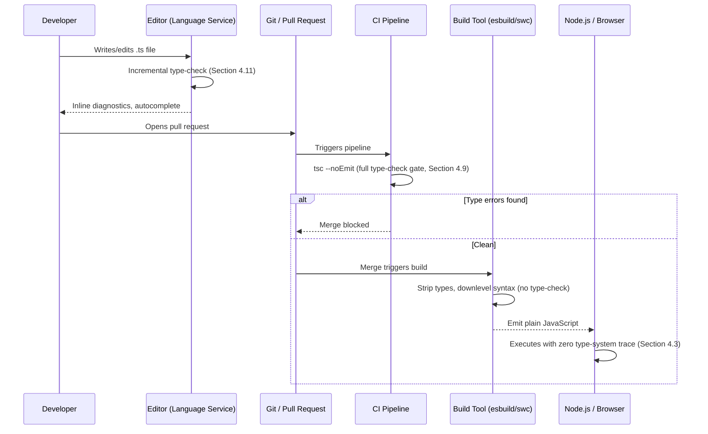

**Step 1 — parsing and the AST.** The compiler's scanner tokenizes source
text and the parser produces an AST that includes both runtime nodes
(function bodies, expressions) and type-only nodes (interface declarations,
type annotations, generic parameter lists) in the same tree.

**Step 2 — binding.** The binder walks the AST once, resolving every
identifier reference to the symbol that declared it and constructing the
scope chain needed for both type checking and later JavaScript-emission
correctness (so that, for example, a variable shadowing another of the same
name in a nested scope resolves unambiguously).

**Step 3 — type checking (on demand, not eagerly for the whole
program).** The type checker is a **lazy, on-demand** system: rather than
eagerly computing every type in the program up front, it computes a node's
type only when something else requests it (an assignment compatibility
check, a hover request from the Language Service, an explicit request from
the emitter) and caches the result — this laziness is precisely what makes
the incremental, keystroke-level responsiveness described in Section 4.11
tractable on very large codebases.

**Step 4 — control-flow-based narrowing.** As part of type checking, the
compiler builds a **control-flow graph** for each function and propagates
type narrowing along it — this is the mechanism underlying discriminated
union exhaustiveness (Section 4.5), `typeof`/`instanceof` guards, and
`strictNullChecks`'s null-elimination narrowing. A type is not a single
static fact about a variable; it is a fact that can change at each point
along a function's control flow, and the checker tracks this precisely.

**Step 5 — emission (or not).** If invoked as `tsc` with default settings,
the emitter walks the same AST, skips every type-only node, and downlevels
JavaScript syntax unsupported by the configured `target` (an `async`
function might be downleveled to generator-based state-machine code for an
older target, for example) — entirely independent of whether the type
checker reported errors, unless `noEmitOnError` is set. If invoked as
`tsc --noEmit` (the CI-gate pattern from Section 4.9), this step is skipped
entirely; only diagnostics are reported.

## 6. Design Principles

- **Structural typing over nominal ceremony.** Design interfaces around
  the minimal capability a consumer actually needs (Section 4.1's
  `NotificationSender` example), not around a rigid class hierarchy —
  TypeScript rewards this with free interchangeability wherever the shape
  matches.
- **Annotate the boundary, infer the interior** (Section 4.2). Every
  exported function, class constructor, and public interface should have
  explicit types; internal local variables should not.
- **Make illegal states unrepresentable** (Section 4.5). Prefer
  discriminated unions over independent optional/boolean flags whenever a
  value has mutually exclusive variants.
- **Validate once, at the boundary; trust the type system everywhere
  after** (Sections 4.3, 4.7, and 13). Runtime validation belongs at
  network/file/user-input boundaries, not sprinkled through internal logic
  the type system already governs.
- **Treat `any` as an escape hatch requiring justification, not a
  default.** Every `any` in a codebase is a hole in the fitness function
  described in Section 4.8; prefer `unknown` (which requires narrowing
  before use) when a value's type is genuinely not known yet.
- **Ratchet strictness deliberately** (Section 4.8), rather than inheriting
  whatever a scaffolding tool happened to default to.

```mermaid
flowchart TD
    A["Design Principle"] --> B["Structural capability > nominal hierarchy"]
    A --> C["Explicit boundary, inferred interior"]
    A --> D["Illegal states unrepresentable\n(discriminated unions)"]
    A --> E["Validate at the boundary,\ntrust the type system after"]
    A --> F["`any` requires justification\n(prefer `unknown`)"]
    A --> G["Deliberate strictness ratchet"]
```

## 7. Architecture Patterns

**Contract-first modules (Section 4.10).** Every cross-module dependency
in a large TypeScript codebase should be expressed as an interface defined
in a shared, dependency-free location, with production and test
implementations both depending on that interface rather than on each other.

**Branded-type identifiers (Section 4.6).** Any codebase with more than one
identifier type sharing the same primitive representation (`string` IDs
for users, orders, tenants, sessions) should brand each one distinctly to
convert Section 4.1's accidental-compatibility failure mode into a
compile-time-caught mistake.

**Result/Either-style error modeling (a discriminated-union application of
Section 4.5).** Rather than throwing exceptions for expected, recoverable
failure modes (validation failure, not-found), model the outcome as a
discriminated union return type:

```ts
type Result<T, E> =
  | { ok: true; value: T }
  | { ok: false; error: E };

function parsePositiveInt(input: string): Result<number, string> {
  const n = Number(input);
  if (!Number.isInteger(n) || n <= 0) {
    return { ok: false, error: `"${input}" is not a positive integer` };
  }
  return { ok: true, value: n };
}

const result = parsePositiveInt("42");
if (result.ok) {
  console.log(result.value); // narrowed to number
} else {
  console.error(result.error); // narrowed to string
}
```

This pattern forces every call site to explicitly handle both outcomes
(the compiler will not let you access `.value` without first narrowing on
`.ok`), unlike an exception, which a caller can silently forget to catch.

**Schema-derived types at runtime boundaries (Section 4.3/4.7 boundary
pattern).** For any data crossing an untyped boundary (an HTTP API
response, a form submission, a message-queue payload), define the shape
once as a runtime validation schema (using a library such as Zod) and
*derive* the TypeScript type from that schema, rather than maintaining a
separate, independently-drifting `interface` — this guarantees the
compile-time type and the runtime check can never disagree, because one is
generated from the other.

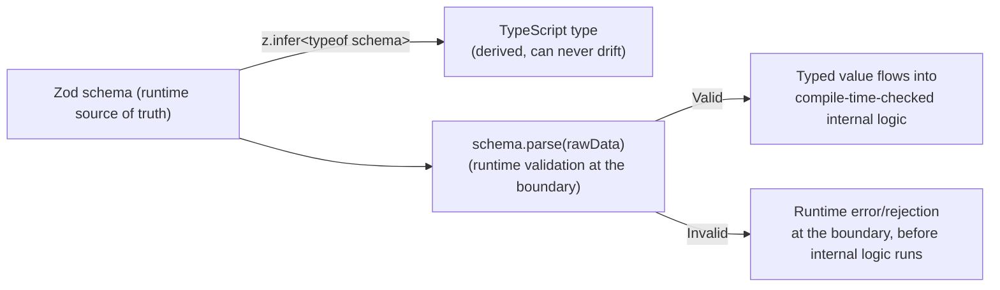

## 8. Production Architecture

A production TypeScript frontend/backend build typically layers the
concepts above into a concrete pipeline:

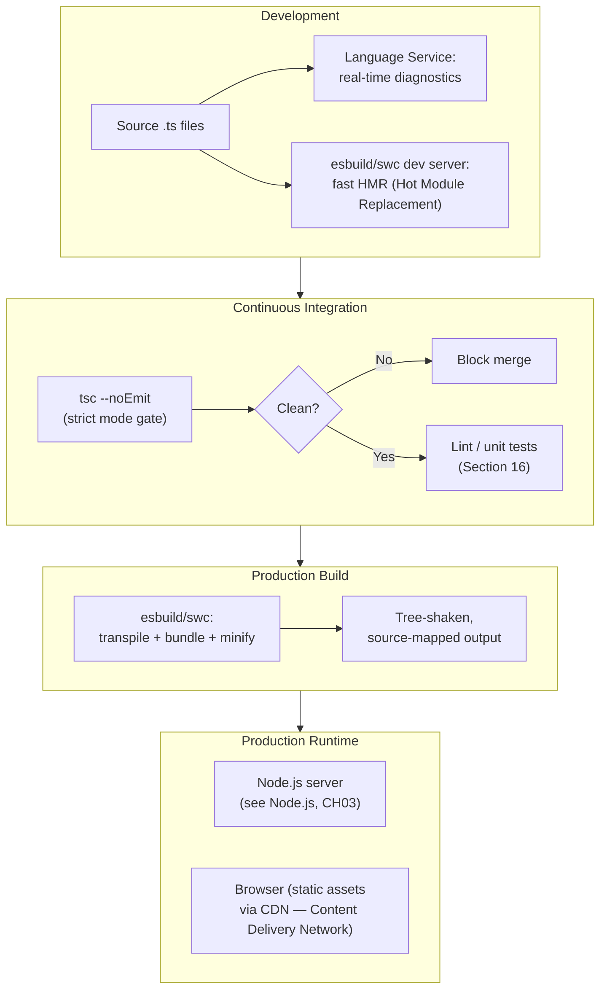

Backend TypeScript services compiled to JavaScript run on Node.js exactly
as any other JavaScript program does — Node's own event-loop, module
resolution, and concurrency architecture are owned by
[Node.js, Part 03](../03_Software_Engineering_Foundations/CH03_Nodejs.md)
and are entirely unaffected by whether the source that produced the
running JavaScript was TypeScript or plain JavaScript, precisely because of
type erasure (Section 4.3) — TypeScript has zero runtime footprint of its
own to interact with Node's runtime model.

## 9. Implementation

A minimal, production-shaped `tsconfig.json` for a Node.js backend service,
annotated to show which flags map to which Section 4.8 concept:

```jsonc
{
  "compilerOptions": {
    "target": "ES2022",              // downlevel boundary for emitted JS
    "module": "NodeNext",             // matches Node.js's module resolution
    "strict": true,                   // umbrella: enables all strict checks (4.8)
    "noUncheckedIndexedAccess": true, // arr[i] includes `| undefined` in its type
    "noImplicitOverride": true,       // class overrides must say `override`
    "exactOptionalPropertyTypes": true, // `{ x?: number }` disallows `{ x: undefined }`
    "esModuleInterop": true,          // CommonJS/ESM interop (see Node.js, CH03)
    "declaration": true,              // emit .d.ts for downstream consumers (4.7)
    "sourceMap": true,                // map compiled JS back to original .ts
    "noEmitOnError": true,            // do NOT ship JS if type errors exist (4.3)
    "skipLibCheck": true              // don't re-check third-party .d.ts files
  },
  "include": ["src/**/*.ts"]
}
```

`noEmitOnError: true` here is a deliberate deviation from `tsc`'s
historical default (Section 4.3) — an explicit architecture decision that
a build must never produce runtime output when the type checker found a
contract violation, closing the "type errors are just warnings" gap for
this specific project's build pipeline.

## 10. Complete Code Examples

**Example 1 — a fully worked, contract-first module** combining generics
(4.4), discriminated unions (4.5), branded types (4.6), and interface-driven
design (4.10) into one cohesive feature: an order-processing service with
an in-memory test double.

```ts
// domain.ts
type Brand<T, B extends string> = T & { readonly __brand: B };
export type OrderId = Brand<string, "OrderId">;
export type CustomerId = Brand<string, "CustomerId">;

export function asOrderId(v: string): OrderId {
  return v as OrderId;
}
export function asCustomerId(v: string): CustomerId {
  return v as CustomerId;
}

export interface Order {
  id: OrderId;
  customerId: CustomerId;
  totalCents: number;
}

export type OrderResult =
  | { ok: true; order: Order }
  | { ok: false; reason: "not_found" | "invalid_amount" };

export interface OrderRepository {
  findById(id: OrderId): Promise<Order | undefined>;
  save(order: Order): Promise<Order>;
}

export class OrderService {
  constructor(private readonly repo: OrderRepository) {}

  async createOrder(customerId: CustomerId, totalCents: number): Promise<OrderResult> {
    if (totalCents <= 0) {
      return { ok: false, reason: "invalid_amount" };
    }
    const order: Order = {
      id: asOrderId(crypto.randomUUID()),
      customerId,
      totalCents,
    };
    const saved = await this.repo.save(order);
    return { ok: true, order: saved };
  }

  async getOrder(id: OrderId): Promise<OrderResult> {
    const found = await this.repo.findById(id);
    if (!found) return { ok: false, reason: "not_found" };
    return { ok: true, order: found };
  }
}

// in-memory-repo.ts
export class InMemoryOrderRepository implements OrderRepository {
  private store = new Map<string, Order>();

  async findById(id: OrderId): Promise<Order | undefined> {
    return this.store.get(id);
  }

  async save(order: Order): Promise<Order> {
    this.store.set(order.id, order);
    return order;
  }
}

// usage
const service = new OrderService(new InMemoryOrderRepository());
const result = await service.createOrder(asCustomerId("cust-1"), 4999);
if (result.ok) {
  console.log(`Order ${result.order.id} created for ${result.order.totalCents} cents`);
} else {
  console.error(`Order creation failed: ${result.reason}`);
}
```

**Example 2 — a generic, reusable event emitter** demonstrating generic
constraints (4.4) and mapped types (4.6) together:

```ts
type EventMap = Record<string, unknown[]>;

class TypedEventEmitter<TEvents extends EventMap> {
  private listeners: { [K in keyof TEvents]?: Array<(...args: TEvents[K]) => void> } = {};

  on<K extends keyof TEvents>(event: K, listener: (...args: TEvents[K]) => void): void {
    (this.listeners[event] ??= []).push(listener);
  }

  emit<K extends keyof TEvents>(event: K, ...args: TEvents[K]): void {
    this.listeners[event]?.forEach(listener => listener(...args));
  }
}

interface AppEvents extends EventMap {
  "order:created": [orderId: string, totalCents: number];
  "user:signedUp": [userId: string];
}

const emitter = new TypedEventEmitter<AppEvents>();
emitter.on("order:created", (orderId, totalCents) => {
  console.log(`Order ${orderId}: ${totalCents} cents`); // fully typed, no `any`
});
emitter.emit("order:created", "ord-1", 4999); // argument shapes checked per event name
```

**Example 3 — declaration file for an untyped legacy dependency** (full
version of Section 4.7's pattern), paired with a Zod-derived runtime
boundary validator (Section 7's schema-derived-types pattern):

```ts
// types/legacy-metrics-lib.d.ts
declare module "legacy-metrics-lib" {
  export function record(metric: string, value: number, tags?: Record<string, string>): void;
}

// api-boundary.ts
import { z } from "zod";

const OrderResponseSchema = z.object({
  id: z.string(),
  totalCents: z.number().int().nonnegative(),
  status: z.enum(["pending", "shipped", "delivered"]),
});

// Derived, not hand-duplicated — can never drift from the runtime check.
type OrderResponse = z.infer<typeof OrderResponseSchema>;

async function fetchOrder(id: string): Promise<OrderResponse> {
  const res = await fetch(`/api/orders/${id}`);
  const raw = await res.json();
  return OrderResponseSchema.parse(raw); // throws if the shape doesn't match — caught once, here
}
```

## 11. Performance

TypeScript itself has two distinct performance surfaces, and conflating
them is a common architecture mistake: **compiler/type-checking
performance** (how long `tsc` or the Language Service takes to analyze a
codebase) and **runtime performance** (the performance of the emitted
JavaScript, which — per Section 4.3's erasure guarantee — is identical to
hand-written JavaScript of the same logic, since no type-system artifact
survives into the output).

**Type-checking performance levers.** Large codebases slow down `tsc`
primarily through: deeply nested conditional/mapped types (Section 4.6)
that force the checker to perform many recursive instantiations; overly
broad `include` globs that pull unrelated files into a single program's
type-checking graph; and disabling **project references**
(`composite`/`references` in `tsconfig.json`), which let `tsc` incrementally
type-check and cache each sub-project independently instead of re-analyzing
an entire monorepo on every change.

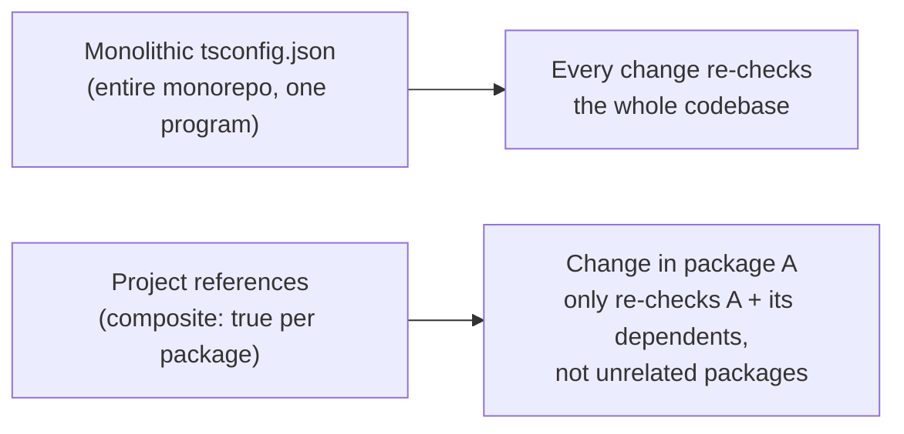

**Runtime performance.** Because types are erased, there is no meaningful
"TypeScript performance tax" at runtime — the performance profile of a
TypeScript service is entirely a function of the JavaScript patterns it
uses (owned by [JavaScript](CH03_JavaScript.md) and
[Node.js](../03_Software_Engineering_Foundations/CH03_Nodejs.md)), not of
its type annotations. The one caveat: `enum` (Section 4.3's noted
exception to erasure) does produce a small runtime object and a marginally
larger bundle than an equivalent erased string-literal union, which is why
performance-sensitive, bundle-size-conscious frontend code often prefers
literal unions or `const enum` over ordinary `enum`.

## 12. Scalability

TypeScript's scalability story is primarily about **codebase** scalability,
not runtime request-handling scalability (which is inherited entirely from
the runtime the emitted JavaScript executes on — Node.js on the backend,
per [Node.js, Part 03](../03_Software_Engineering_Foundations/CH03_Nodejs.md),
or the browser engine on the frontend). As a codebase scales in file count
and team size, the architectural levers that keep TypeScript's own tooling
scalable are: project references and incremental builds (Section 11);
strict mode enabled from the start rather than retrofitted (Section 4.8);
and consistent, monorepo-wide interface-first module boundaries
(Section 4.10) so that a change inside one package cannot silently break an
unrelated package's assumptions without the compiler catching it at the
shared interface.

## 13. Security

**The compile-time/runtime boundary is the primary TypeScript-specific
security concern.** Because type erasure (Section 4.3) provides zero
runtime enforcement, a type annotation must never be treated as a security
control — an attacker-controlled HTTP request body typed as `interface
LoginRequest { username: string; password: string }` is not thereby
guaranteed, at runtime, to actually be an object with exactly those two
string fields; it is only guaranteed to be treated *as if* it were, by code
that trusts the annotation. The architecturally correct control is runtime
schema validation (Zod, io-ts, or a JSON-schema validator) at every
untrusted boundary — network input, deserialized storage, third-party
webhook payloads — exactly the pattern from Section 7's schema-derived-type
diagram, applied here as a security boundary rather than merely a
correctness one.

```ts
// INSECURE: type annotation alone provides zero runtime guarantee.
app.post("/login", (req: Request<{}, {}, LoginRequest>, res) => {
  authenticate(req.body.username, req.body.password); // req.body could be anything at runtime
});

// SECURE: runtime-validated, and the derived type keeps compile-time checks accurate too.
const LoginRequestSchema = z.object({
  username: z.string().min(1).max(256),
  password: z.string().min(1),
});
app.post("/login", (req, res) => {
  const parsed = LoginRequestSchema.safeParse(req.body);
  if (!parsed.success) return res.status(400).json({ error: "Invalid request" });
  authenticate(parsed.data.username, parsed.data.password);
});
```

**`any` as a security-relevant erosion.** Every `any` in a codebase is a
place where the compiler stops verifying that untrusted data is handled
according to its declared shape before reaching a sensitive operation
(a database query, a shell command, an authorization check) — `noImplicitAny`
(Section 4.8) is therefore not only a correctness fitness function but a
security one, and a codebase-wide audit for explicit `any` usage (via
`grep`/the `no-explicit-any` ESLint rule) is a legitimate architecture
review activity, not just a style nitpick.

**Declaration file trust boundary.** A hand-written or third-party `.d.ts`
(Section 4.7) that misdescribes a library's actual runtime behavior can
create a false sense of safety around a security-sensitive dependency (a
crypto library, an authentication SDK) — a Solution Architect evaluating a
security-critical dependency should verify its declared types against its
actual documented runtime contract, not assume the presence of types
implies verified correctness.

## 14. Observability

TypeScript's own compiler surfaces two categories of signal worth wiring
into observability tooling at the process/organization level, distinct
from runtime application observability (owned by
[Part 14 — Observability](../14_Observability/PART_OVERVIEW.md)): **type
error counts as a leading indicator** (a CI dashboard tracking `tsc
--noEmit` error counts over time surfaces codebase health trends —
particularly useful during an incremental-strictness rollout, Section 4.8,
where the metric is literally "errors remaining before this flag can be
enabled") and **build/type-check duration as a developer-experience metric**
(Section 11's project-references discipline directly affects this, and
regressions in either metric are an early warning that a
codebase-scalability lever needs attention before it becomes a
team-wide productivity problem).

## 15. Failure Scenarios

**Failure 1 — silent `any` propagation from an untyped dependency.** A
library with no declaration file (Section 4.7) imported without an
accompanying `.d.ts` resolves every one of its exports as `any`, and that
`any` silently flows into every piece of application code that touches it,
disabling type safety across an arbitrarily large downstream surface with
no compiler warning at the point where the safety was actually lost.

**Failure 2 — a stale hand-written `.d.ts` masking a real API change.** An
internal library's hand-maintained declaration file is not regenerated
after the library's actual implementation changes its function signature;
every consumer continues to compile cleanly against the stale, incorrect
contract until the mismatch is exercised at runtime — this is why Section
4.7 recommends generated, not hand-maintained, declaration files for
actively-changing internal code.

**Failure 3 — a build pipeline that transpiles but never type-checks**
(Section 4.9's central failure mode). A team migrates to a fast
transpile-only build tool without adding a separate `tsc --noEmit` CI gate,
and every type error compiles "successfully" (because nothing in the
pipeline was ever checking types) straight through to production.

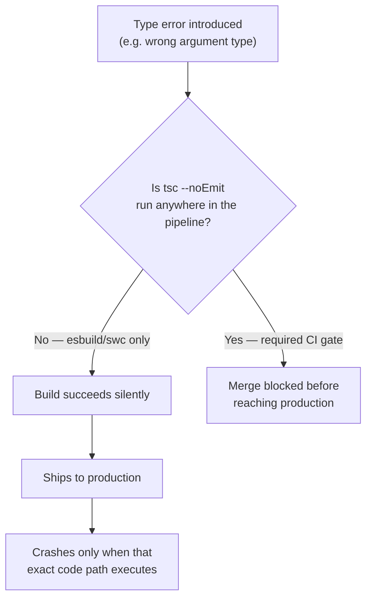

**Failure 4 — `as` casts masking a genuine runtime mismatch.** A type
assertion (`as SomeType`) at a network or `JSON.parse` boundary (Section
4.3) tells the compiler to stop checking, not to make the value actually
match — if the underlying data's real shape ever changes (a backend
contract change, an unexpected `null` field), the mismatch surfaces as a
runtime crash at the first place the mismatched field is actually used,
often far from the original cast.

## 16. Testing

**Type-checking as a test-suite-adjacent gate.** `tsc --noEmit` should run
as an independent, required CI step alongside (not instead of) the unit and
integration test suite (Section 4.9's CI diagram) — a clean type-check
proves internal contract consistency; it does not prove the *logic* inside
those contracts is correct, which is what the test suite is for.

**Testing with interface-driven design (Section 4.10).** Because
production code should depend on interfaces rather than concrete
implementations, unit tests can substitute lightweight in-memory test
doubles (as in Example 1's `InMemoryOrderRepository`) with the compiler
itself verifying the test double is shape-compatible with the interface
the production code actually depends on — eliminating an entire category of
"the mock doesn't actually match the real dependency's shape" test bugs
that plague dynamically-typed test suites.

**Testing exhaustiveness (Section 4.5).** A test suite for a discriminated
union should include one test case per union member, and the `never`-typed
exhaustiveness check in production code (not the test) is what guarantees a
newly added member cannot be silently left unhandled by *any* switch
statement across the codebase — the test suite verifies each handled case's
*behavior*; the compiler verifies *completeness*.

**Type-level testing.** For libraries or shared internal SDKs with complex
generic/conditional type logic (Section 4.6), tools like `tsd` or
`expect-type` let a team write assertions about *types themselves*
(`expectTypeOf<Unwrap<Promise<string>>>().toEqualTypeOf<string>()`),
catching regressions in type-level logic the same way ordinary unit tests
catch regressions in runtime logic.

## 17. Common Mistakes

- **Reaching for `any` to silence an error instead of understanding it.**
  `any` disables checking for every downstream expression that touches the
  value, often far beyond the original error site (Section 15, Failure 1).
- **Confusing a type assertion (`as`) with a runtime check.** `as` performs
  zero validation (Section 4.3); use a type guard, a discriminated-union
  narrowing, or runtime schema validation (Section 13) instead when the
  actual shape is not already guaranteed by the type system.
- **Modeling mutually exclusive states as independent optional fields**
  instead of a discriminated union (Section 4.5), allowing impossible
  states to be representable.
- **Hand-writing/maintaining a `.d.ts` for actively-changing internal
  code** instead of generating it from source (Section 4.7).
- **Shipping with `strict: false`** inherited silently from scaffolding
  defaults, believing the codebase has TypeScript's safety guarantees when
  most of the checks that provide them are disabled (Section 4.8).
- **Assuming a fast transpile-only build tool also type-checks** (Section
  4.9), leaving no gate in the pipeline that actually catches type errors
  before production.
- **Over-genericizing** code that will only ever operate on one concrete
  type, adding cognitive overhead with no reuse benefit (Section 4.4).
- **Writing 40-line nested conditional/mapped types** for logic that could
  be expressed with a built-in utility type or a simpler, one-level mapped
  type (Section 4.6).

## 18. Best Practices

- Annotate every exported function's parameters and return type explicitly;
  let inference handle everything internal to a function body (Section
  4.2).
- Enable `strict: true` from day one on any greenfield project; roll out
  strictness incrementally, flag by flag, on any migrating codebase
  (Section 4.8).
- Prefer discriminated unions over independent optional/boolean flags for
  any value with mutually exclusive states (Section 4.5).
- Brand primitive-typed identifiers that share a representation but differ
  in meaning (Section 4.6).
- Validate every untrusted boundary at runtime with a schema library, and
  derive the TypeScript type from that schema rather than maintaining both
  independently (Sections 4.7, 7, 13).
- Separate type-checking (`tsc --noEmit`, a required CI gate) from
  transpilation (a fast build tool) rather than assuming one covers the
  other (Section 4.9).
- Prefer `unknown` over `any` at any boundary where the type is genuinely
  not yet known, forcing an explicit narrowing step before use.
- Generate declaration files from source for actively-changing internal
  libraries rather than hand-maintaining a parallel `.d.ts` (Section 4.7).

## 19. Anti-Patterns

- **"Typed but not really"** — a codebase with widespread `any`, frequent
  `as` casts at internal (non-boundary) call sites, and `strict: false`,
  giving the appearance of type safety with almost none of the actual
  guarantee.
- **Interface bloat** — a single interface accumulating every method any
  consumer has ever needed, defeating interface segregation and forcing
  every implementation (including test doubles) to satisfy methods it does
  not conceptually need.
- **Type-level over-engineering** — deeply nested conditional/mapped types
  built for a hypothetical future flexibility need that never materializes,
  imposing a permanent readability tax on every contributor.
- **Declaration file drift** — a hand-maintained `.d.ts` for internal code
  that silently diverges from the implementation it describes (Section
  4.7, Section 15 Failure 2).
- **Build-without-a-gate** — a fast transpile-only pipeline with no
  independent `tsc --noEmit` CI step, silently shipping type errors
  (Section 4.9, Section 15 Failure 3).

## 20. Trade-off Analysis

| Decision | Benefit | Cost |
|---|---|---|
| `strict: true` from day one | Closes most historically-real bug classes at compile time (4.8) | More upfront annotation discipline required |
| Structural typing (default, unavoidable) | Free interchangeability of independently-developed compatible shapes (4.1) | Accidental compatibility between semantically unrelated types unless branded (4.6) |
| Branded types for identifiers | Compile-time-caught ID-confusion bugs, zero runtime cost | Extra ceremony (constructor functions) at every identifier-creation site |
| Discriminated unions over flags | Impossible states become unrepresentable (4.5) | Slightly more verbose construction than a flat object literal |
| Separate type-check + fast transpile pipeline | Fast iterative builds AND a hard type-safety gate (4.9) | Two tools to configure and keep in agreement, not one |
| Runtime schema validation at boundaries | Closes the erasure gap exactly where untrusted data enters (4.3, 13) | Extra runtime cost and a schema to maintain, paid once per boundary |
| Generated vs. hand-written `.d.ts` | Generated version can never drift from the real implementation (4.7) | Requires the source itself to be TypeScript, not applicable to third-party JS |

## 21. Comparison Table

| Property | TypeScript | Java / C# | Python (gradual typing) |
|---|---|---|---|
| Type system category | Structural | Nominal | Structural (via `Protocol`) or nominal (via classes), optional |
| Enforced at runtime? | No — fully erased (4.3) | Yes — Common Language Runtime/Java Virtual Machine-enforced | No — annotations are advisory only |
| Who checks types | `tsc` / Language Service, at compile time | The runtime itself, continuously | External tool (`mypy`/`pyright`) in CI, not the interpreter — see [Python Architecture, Section 4.8](../03_Software_Engineering_Foundations/CH02_Python_Architecture.md#48-gradual-typing-type-hints-mypypyright-and-runtime-semantics) |
| Cost of adding types later | Incremental, flag-by-flag strictness rollout possible (4.8) | Not applicable — types are mandatory from the start | Incremental, module-by-module `mypy`/`pyright` adoption, same spirit as TypeScript's rollout |
| Generic type erasure | Full erasure, zero runtime trace | Java erases at runtime too (with some reification exceptions); C# reifies generics at runtime | Not applicable — Python generics (`TypeVar`) are purely a static-analysis-tool concept |

## 22. Real-World Case Study

**Airbnb's incremental TypeScript migration.** Airbnb's engineering
organization publicly documented migrating a large, multi-million-line
JavaScript React codebase to TypeScript incrementally rather than as a
single rewrite — files were converted module by module, with `strict`
flags (Section 4.8) enabled progressively across the codebase rather than
all at once, and the team explicitly tracked and published metrics on how
many production bugs (retrospectively categorized by root cause) would
have been caught by TypeScript's structural type checker had it been in
place at the time — finding that a substantial share of production
incidents traced back to exactly the category of error (`undefined`/`null`
dereferences, wrong-shape objects passed across module boundaries) that
`strictNullChecks` and structural interface checking are designed to catch
at compile time. The architectural lesson generalizes directly to Section
4.8's incremental-strictness pattern: large-codebase type-system adoption
is a phased governance rollout, not an all-or-nothing rewrite, and the
value is measurable in retrospectively-classified prevented-bug counts, not
just developer sentiment.

## 23. Interview Questions

1. Explain structural typing and how it differs from nominal typing. Why
   did TypeScript choose structural typing given its "superset of
   JavaScript" design constraint? (Section 4.1, Section 2)
2. What is type erasure, and what specific architectural trade-off does it
   create at runtime boundaries? (Section 4.3)
3. Walk through how TypeScript's type inference decides the type of an
   unannotated function parameter with no call-site context. What does it
   infer, and why is that risky? (Section 4.2)
4. Design a discriminated union for a payment-processing state machine with
   at least four states, and show how the `never`-typed exhaustiveness
   check works. (Section 4.5)
5. What is a branded type, and what specific structural-typing failure mode
   does it solve? (Section 4.6, 4.1)
6. Explain the architectural difference between `tsc` and an esbuild/swc
   based build pipeline. Why can the fast pipeline silently ship type
   errors? (Section 4.9)
7. What is the purpose of a `.d.ts` file, and what risk does a hand-written
   one for actively-changing internal code introduce? (Section 4.7)
8. Why should `strict: true` be rolled out flag-by-flag on a large existing
   codebase rather than enabled all at once? (Section 4.8)
9. Given a JSON API response cast with `as SomeInterface`, explain exactly
   what runtime guarantee that cast does and does not provide. (Section
   4.3, Section 13)
10. Compare TypeScript's type-system enforcement model to Python's gradual
    typing model. What do they have in common, and where do they diverge?
    (Section 21)

## 24. Hands-on Exercises

1. Take an existing small JavaScript module with at least three functions
   and convert it to TypeScript with `strict: true` enabled from the
   start. Annotate every exported function's boundary; let inference
   handle the rest (Section 4.2).
2. Model a UI component's loading state as a discriminated union with at
   least `idle`, `loading`, `success`, and `error` members, and write an
   exhaustive `switch` with a `never`-typed default branch (Section 4.5).
3. Write a from-scratch reimplementation of the built-in `Omit<T, K>`
   utility type using a mapped type, without looking at TypeScript's own
   standard-library source first, then compare (Section 4.6).
4. Find (or install) a small untyped JavaScript library with no `@types`
   package, and write a focused `.d.ts` declaration file covering only the
   functions your code actually calls (Section 4.7).
5. Take a `tsconfig.json` with `strict: false`, enable each strict flag one
   at a time, and record how many new errors each individual flag surfaces
   on the same codebase (Section 4.8).

## 25. Design Exercises

1. Design the type-level contract (interfaces, discriminated unions,
   branded identifier types) for a multi-tenant subscription-billing
   system, ensuring a `TenantId` can never be accidentally passed where a
   `SubscriptionId` is expected.
2. Design an incremental strictness-adoption plan for a 200,000-line
   JavaScript codebase being migrated to TypeScript over two quarters,
   specifying the order in which strict flags are enabled and why (Section
   4.8).
3. Design a build-pipeline architecture for a monorepo with ten packages
   that guarantees no type error can ever reach production, while keeping
   local developer iteration under one second per change (Sections 4.9,
   11).
4. Design a runtime-boundary validation strategy (Section 13) for a
   service that ingests webhook payloads from three different third-party
   providers, each with a different (and occasionally changing) payload
   shape.

## 26. Architecture Review Questions

- Is `strict: true` enabled, and if not, which specific flags are disabled
  and why — is that a deliberate, documented decision or an inherited
  default? (Section 4.8)
- Is there a required CI gate that runs `tsc --noEmit` independently of the
  build/bundling tool, or does the team assume the build tool also
  type-checks? (Section 4.9, Section 15 Failure 3)
- Are there `.d.ts` files hand-maintained for internal (not third-party)
  code, and if so, is there a mechanism preventing them from drifting from
  the actual implementation? (Section 4.7)
- Where does untrusted data (network responses, user input, message-queue
  payloads) enter the system, and is it validated at runtime at that exact
  boundary, or only trusted via a type annotation? (Sections 4.3, 13)
- Are identifiers that share a primitive representation (multiple `string`
  IDs) branded to prevent accidental cross-assignment? (Section 4.6)
- Are state-shaped values (loading/success/error, and similar) modeled as
  discriminated unions, or as independent optional/boolean flags that allow
  impossible states? (Section 4.5)
- How many explicit `any` usages exist in the codebase, and is there a
  linter rule tracking or gating new ones? (Sections 4.8, 13, 17)

## 27. Summary

TypeScript's entire architectural value proposition rests on one property:
a structural, compile-time-only type system, layered onto JavaScript
without changing JavaScript's runtime semantics at all, and completely
erased before any code executes. Every concept in this chapter follows from
that property. Structural typing (Section 4.1) is what makes the layering
possible without retrofitting JavaScript's existing duck-typed ecosystem.
Type inference (Section 4.2) is what makes the system usable without
annotating every expression by hand, at the cost of a real "how much
annotation is enough" architectural judgment call. Type erasure (Section
4.3) is what makes the system free at runtime, and simultaneously what
makes runtime-boundary validation a mandatory complement rather than an
optional nicety. Generics, discriminated unions, and mapped/conditional
types (Sections 4.4-4.6) are the advanced vocabulary a Solution Architect
uses to make illegal states unrepresentable and infrastructure code
reusable without `any`. Declaration files (Section 4.7) are the seam
between TypeScript's world and the much larger universe of plain
JavaScript. Strictness configuration (Section 4.8) is a governance lever —
a set of compiler-enforced fitness functions that can and should be rolled
out deliberately, not inherited by accident. And the split between
type-checking and transpilation-only build tools (Section 4.9) is the
single most consequential, most commonly misconfigured piece of modern
TypeScript build architecture, because its failure mode — a build that
"succeeds" while silently shipping type errors — is invisible until the
exact code path it should have caught executes in production. A Solution
Architect who internalizes these nine ideas has everything needed to use
TypeScript as what it actually is: not a stylistic preference, but a
zero-runtime-cost architectural governance tool for keeping a large,
multi-author codebase's contracts honest.

## Further Reading

- [JavaScript](CH03_JavaScript.md) — language fundamentals TypeScript is
  built on top of (event loop, closures, prototypal inheritance), not
  re-taught in this chapter.
- [Python Architecture, Section 4.8](../03_Software_Engineering_Foundations/CH02_Python_Architecture.md#48-gradual-typing-type-hints-mypypyright-and-runtime-semantics) —
  Python's gradual typing model, for contrast with TypeScript's compile-time
  erasure model (Section 21 comparison table).
- [Node.js](../03_Software_Engineering_Foundations/CH03_Nodejs.md) — the
  runtime backend TypeScript compiles down to for server-side code; owns
  the event loop, module resolution, and concurrency model.
- [What is Software Architecture?](../01_Architecture_Mindset/CH01_What_is_Software_Architecture.md) —
  general treatment of architecture fitness functions, referenced in
  Section 4.8's strictness-as-governance framing.
- [REST](../08_API_Architecture/CH01_REST.md) — resource/contract modeling
  at the API boundary, relevant to Section 7's schema-derived-type pattern
  when TypeScript is used to type a REST client.
