# Chapter: Angular

Part: [04 — Frontend Architecture](PART_OVERVIEW.md) · Status: Drafted

## 1. Introduction

Most frontend "frameworks" are, on close inspection, a rendering library
plus a marketing decision to call it a framework. Angular is one of the few
that actually earns the word: it ships a component model, a dependency
injection (DI) system, a change-detection engine, a reactive-programming
library, a router, a compiler, a testing harness, a command-line build
tool, and a set of forms and Hypertext Transfer Protocol (HTTP) client
abstractions, all designed by one team to interlock, and all expected to be
used together. Where React (covered in [React](CH06_React.md)) hands a
Solution Architect a rendering primitive and leaves every other
architectural decision — state management, routing, dependency wiring,
HTTP handling — to be assembled from the ecosystem, Angular makes almost
all of those decisions for you and calls the result "the framework." This
chapter is about what that means architecturally: what Angular guarantees,
what it forecloses, and what a Solution Architect gains and gives up by
choosing an opinionated, batteries-included framework over a compositional
library.

Angular's defining architectural property is that **the framework's
own boundaries are enforced by tooling, not convention**. A Java Architecture
DI container ([Java Architecture](../03_Software_Engineering_Foundations/CH01_Java_Architecture.md#dependency-injection))
or a Spring `ApplicationContext` wires objects together at runtime from
reflection metadata; Angular wires component trees together through a
compiler (Ivy) that runs Ahead-of-Time (AOT), a hierarchical injector tree
that mirrors the component tree exactly, and — in modern Angular — a
change-detection system built on Signals that tracks reads and writes at
the language level rather than re-checking the entire tree on a timer. Every
one of those mechanisms exists because Angular made an early, deliberate bet
that large engineering organizations building long-lived, multi-team
applications need a framework that constrains *how* state, structure, and
side effects are wired together, not just a way to render a view.

This chapter does **not** re-teach JavaScript or TypeScript language
fundamentals — closures, the event loop, prototypal inheritance, generics,
structural typing, discriminated unions, and decorators are all owned by
[JavaScript](CH03_JavaScript.md) and [TypeScript](CH04_TypeScript.md) and
are recapped only where Angular's own architecture depends on them directly
(for example, TypeScript decorators as the mechanism behind `@Component` and
`@Injectable`). What this chapter owns and teaches from first principles is
everything specific to Angular's framework architecture: the
component/module system (NgModules historically, standalone components in
modern Angular), the hierarchical dependency injection system and its token
model, the two generations of change detection (Zone.js-based dirty
checking, and Signals-based fine-grained reactivity), the Reactive
Extensions for JavaScript (RxJS) reactive-programming architecture for
asynchronous state and HTTP, the Ivy compiler architecture (AOT compilation
and tree-shakable providers), the routing architecture (lazy-loaded feature
modules and route guards), and Angular's "framework as architecture"
philosophy contrasted with React's "library" philosophy (React's own
internals — the virtual DOM, reconciliation, hooks — are owned by
[React](CH06_React.md) and are not re-taught here).

A Solution Architect who treats Angular as "just another way to write
components" will make a predictable set of expensive mistakes: designing a
module boundary around folder structure instead of the injector tree it
actually creates; assuming `ChangeDetectorRef.detectChanges()` calls are
free when they silently walk a subtree on every invocation; mixing Signals
and Zone.js-triggered change detection without understanding which one is
actually driving a given re-render; or building a route-guard security
model that only prevents *rendering* a view, mistaking it for a substitute
for server-side authorization. This chapter exists to make Angular's
architectural decisions — and their consequences — explicit.

## 2. Historical Evolution

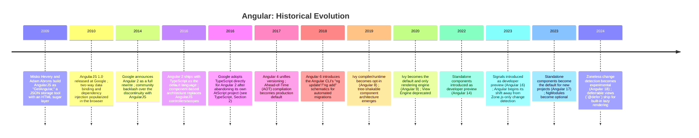

**From AngularJS to a rewrite (2009-2016).** AngularJS began at Google as a
side project to let non-programmers build simple web forms from
declarative Hypertext Markup Language (HTML) attributes, with two-way data
binding (a change in the view updates the model, and vice versa,
automatically) as its headline feature. AngularJS's `$scope`-based dirty
checking and its `$injector` were genuinely novel in 2010: no mainstream
browser framework had shipped dependency injection or two-way binding as
first-class citizens before. But AngularJS's architecture accumulated
serious weight as applications scaled: `$scope` inheritance chains became
difficult to reason about, "digest cycle" dirty-checking cost grew
quadratically with the number of watched bindings, and there was no
compile-time type system to catch structural mistakes before they reached
production. By 2014, the Angular team concluded that these were not bugs to
patch but architectural mistakes to abandon, and announced a from-scratch
rewrite — Angular 2 — that broke backward compatibility completely. This
was deeply controversial (a large AngularJS 1.x codebase had no upgrade
path other than a rewrite), but it produced the architecture this chapter
teaches: components instead of controllers/scopes, TypeScript instead of
plain JavaScript, a hierarchical injector instead of a single global
`$injector`, and a compiler-driven rendering pipeline instead of runtime
string-template parsing.

**Why TypeScript, and why AOT compilation.** Angular 2's team needed two
things AngularJS never had: a way to catch structural errors (a mistyped
property binding, a missing provider) before a user hit them in production,
and a way to eliminate the cost of parsing templates as strings at
runtime. TypeScript's structural type system (see
[TypeScript, Section 4.1](CH04_TypeScript.md#41-structural-typing-duck-typing-formalized))
solved the first problem: templates could be type-checked against
component classes. A dedicated compiler — first View Engine, later
Ivy — solved the second: Angular templates are compiled to plain JavaScript
instruction calls before the application ships, not parsed as strings in
the browser at runtime. This is why Angular has always defaulted to AOT
compilation in production builds, well before other frameworks in this
handbook's coverage treated a compiler as core framework architecture
rather than an optional build step.

**Ivy, standalone components, and Signals (2019-2024).** The View Engine
compiler (2016-2019) compiled each Angular module as an indivisible
compilation unit, which meant tree-shaking (removing unused code from a
production bundle) could not reach inside a module's internals. Ivy,
Angular's second-generation compiler and runtime, restructured compilation
so that each *component* — not each module — emits self-contained
instruction code, which finally made components and their providers
individually tree-shakable. Ivy's more granular compilation model made two
later architectural shifts possible: standalone components (2022-2023),
which let a component declare its own dependencies directly and made
NgModules optional rather than mandatory, and Signals (2023-2024), a
fine-grained reactivity primitive that lets Angular's change-detection
system update only the parts of the deep component tree that actually
depend on a changed value, instead of Zone.js's coarser "something happened
somewhere, re-check everything" model. Both changes exist because Ivy made
component-level (rather than module-level or application-level) granularity
possible throughout the framework.

## 3. Why It Exists

Angular exists to answer a question that a compositional library like React
deliberately leaves open: *when hundreds of engineers across dozens of
teams build one large, long-lived application, who decides how components
talk to services, how services are wired together, how routes are
protected, and how asynchronous data flows through the system?* Angular's
answer is that the framework decides, once, for everyone, and enforces the
decision through the compiler and the injector — not through a style guide
that individual teams can silently drift away from.

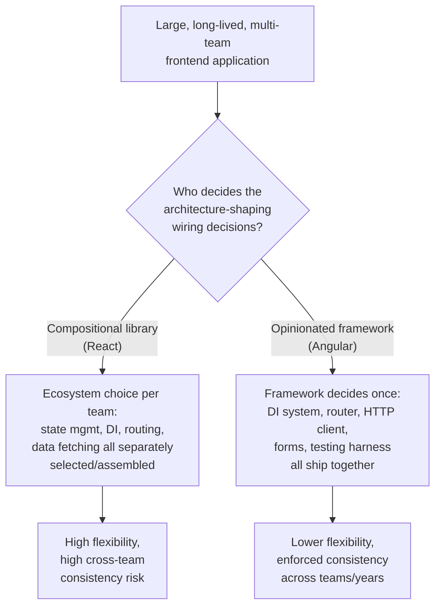

Three forces explain why Angular committed to this trade-off rather than
the alternative:

**Google-scale internal consistency.** Angular was built inside, and
continues to be maintained largely for, Google's own internal monorepo,
where thousands of engineers across hundreds of applications need to be
productive in an unfamiliar codebase within days, not weeks. A framework
that lets every team choose its own dependency-injection pattern, state
library, and routing convention optimizes for each individual team's local
preference at the direct expense of an engineer's ability to move between
teams. Angular's opinionated defaults — one DI system, one router, one HTTP
client, one testing pattern — are a deliberate trade of local flexibility
for organization-wide consistency.

**Long-lived enterprise applications need enforceable structure, not just
recommended structure.** A style guide that says "always inject services
through the constructor, never instantiate them directly" is only as strong
as code review discipline. Angular's DI system does not offer constructor
injection as a *recommendation* — the compiler and runtime are structured
so that there is no other supported way to obtain a service instance inside
a component in idiomatic Angular code (short of the escape hatch,
`Injector.get()`, which exists precisely because it should be visible and
rare). Making the "correct" architecture the *only* well-supported
architecture is a deliberate response to the observation that
architecture-by-convention decays under multi-year, multi-team pressure.

**A single team owns the seams, so the seams are guaranteed to fit.**
Because the Angular team builds the DI system, the router, the HTTP client,
the forms module, and the compiler together, they can guarantee that route
guards can inject services, that HTTP interceptors compose predictably with
the injector hierarchy, and that the compiler understands every construct
the runtime needs. A compositional approach where a router, a state
library, and a DI container are each built by a different open-source
maintainer with no shared release cadence cannot make that guarantee — every
seam between them is a compatibility question the *application team* has
to answer and re-answer on every upgrade. Angular's bet is that removing
that integration burden is worth the cost of accepting the framework's own
opinions about how those pieces should work.

## 4. Core Concepts

### 4.1 "Framework as Architecture" vs. "Library" Philosophy

The single most consequential architectural distinction between Angular and
React is not a technical feature — it is a philosophy about where
architectural decisions are made and by whom.

**Definition.** A *library* (React's own framing of itself) provides a
focused primitive — in React's case, a way to describe a user interface
(UI) as a function of state and re-render it efficiently — and deliberately
leaves every other architectural decision (dependency wiring, routing,
HTTP handling, form state) to be chosen from an ecosystem of independent,
separately maintained packages. A *framework* (Angular's own framing of
itself) provides an integrated, opinionated answer to nearly all of those
decisions out of the box, and expects application code to be written *within*
the shape the framework defines rather than composed *around* a rendering
primitive.

**Mechanism.** This distinction is not just marketing language; it shows up
concretely in what each approach ships in its default installation and what
it enforces at compile time. Angular's Angular CLI-scaffolded application
ships a router, an HTTP client, a forms module, a DI container, a testing
harness, and a compiler that type-checks templates — all from one team,
versioned and released together, upgraded together via `ng update`
schematics. A React application scaffolded via a build tool such as Vite
ships only the rendering library; a Solution Architect (or a team, often
inconsistently across an organization) must separately choose a router
(react-router, TanStack Router), a data-fetching/caching layer (TanStack
Query, SWR, Apollo), and a state-management approach (Context, Redux,
Zustand, Jotai) — each with its own release cadence, its own compatibility
matrix against the others, and its own idioms that a new engineer must
learn on top of React itself.

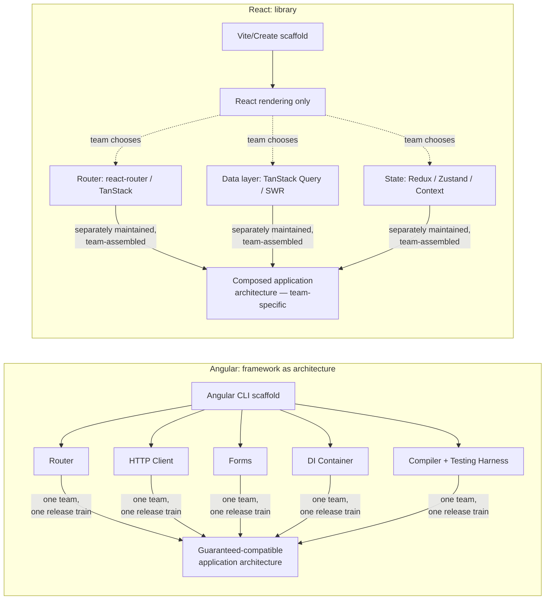

**Decision implications.** Choose Angular when an organization needs
enforced cross-team consistency over multiple years and many teams, is
willing to accept the framework's specific opinions (RxJS for
asynchronicity, its own DI model, its own router) in exchange for not
having to make or govern those decisions independently, and values a single
upgrade path (`ng update`) over picking best-of-breed packages per concern.
Choose React (see [React](CH06_React.md)) when an organization needs
maximum flexibility to select or replace individual pieces (a different
state library, a different data-fetching strategy) as needs evolve, is
willing to own the integration and governance burden of keeping those
pieces compatible, or is building smaller/shorter-lived applications where
enforced organization-wide consistency matters less than developer choice.

**Common failure mode.** Treating this as a purely technical choice rather
than an organizational one. A team that adopts Angular but then routes
around its opinions everywhere (avoiding the built-in HTTP client's
interceptor pipeline in favor of a hand-rolled `fetch` wrapper, avoiding DI
in favor of module-level singletons) pays Angular's learning-curve and
bundle-size cost without collecting the consistency benefit that justified
the cost. Symmetrically, a team that adopts React but re-invents Angular's
opinionated structure by hand (a bespoke DI container, a bespoke module
system) pays a large, unbudgeted engineering cost building — and
maintaining — infrastructure a framework choice would have provided for
free.

**Scenario.** A bank with 40 frontend engineers spread across 12 teams,
building a single online-banking platform expected to live for a decade,
chooses Angular specifically so that an engineer transferring from the
"payments" team to the "accounts" team can be productive within days: the
DI pattern, the routing convention, and the HTTP interceptor pipeline are
identical across both teams because the framework — not a style guide —
enforces them.

### 4.2 Component and Module Architecture: NgModules to Standalone Components

**Definition.** An Angular **component** is a TypeScript class decorated
with `@Component`, pairing a template (HTML with Angular-specific binding
syntax) with the class's properties and methods, plus metadata describing
its own dependencies. Historically, every component had to be declared
inside exactly one **NgModule** (`@NgModule`) — a compilation and
dependency-injection boundary that declared which components belonged to
it, which other modules it imported, and which services it provided. Since
Angular 14 (developer preview) and Angular 17 (default), a component can be
**standalone**: it declares its own imports directly and needs no
enclosing NgModule at all.

**Mechanism — why NgModules existed in the first place.** Before Ivy
(pre-2019), Angular's View Engine compiler treated an NgModule as the unit
of compilation: it needed to see an entire module's declarations up front
to generate the metadata that wired components, directives, and pipes
together and to resolve dependency injection providers. This meant every
component *had* to belong to a module, whether or not that module boundary
reflected anything meaningful about the application's architecture — a
single, tiny, reusable button component still needed to live inside some
NgModule, be exported from it, and be imported by every other module that
wanted to use it.

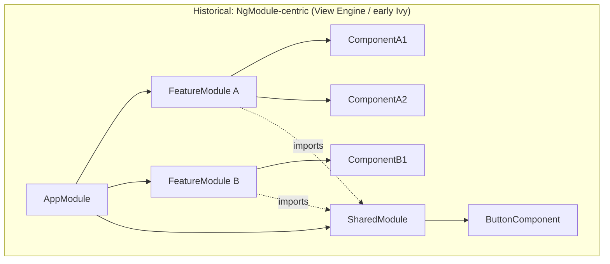

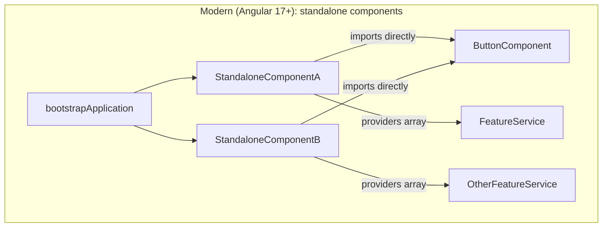

Ivy's per-component compilation model (Section 2) removed the technical
reason NgModules had to be mandatory: because Ivy generates self-contained
instruction code per component rather than per module, a component can
declare `imports: [CommonModule, ButtonComponent, ...]` directly in its own
`@Component` decorator and the compiler has everything it needs without
consulting an enclosing module at all. `bootstrapApplication()` replaces
`platformBrowserDynamic().bootstrapModule(AppModule)` as the application
entry point, and routes, providers, and HTTP configuration move to
top-level `ApplicationConfig` objects instead of living inside `AppModule`.

**Decision implications.** For new Angular applications (Angular 17+), the
default and recommended architecture is now standalone components
throughout, because it removes an entire category of "why won't this
component render — did I forget to declare/export/import it in the right
module" debugging session, and because it lets a component's own file be
the single source of truth for what it depends on. NgModules remain fully
supported (Angular has not deprecated them) and are still the pragmatic
choice for large, pre-existing codebases where a full migration is not
immediately justified, and for the small number of cases — some
third-party libraries still expect an `NgModule`-shaped API, and some teams
use `NgModule`s deliberately as a lazy-loading unit boundary distinct from
the routing boundary (Section 4.8) — where an explicit module still
communicates architectural intent that a flat list of standalone imports
does not.

**Common failure mode.** Migrating a large NgModule-based codebase to
standalone components mechanically (via the Angular CLI's `ng generate
@angular/core:standalone` schematic) without also reconsidering the
module boundaries that had accumulated as *de facto* feature boundaries.
An NgModule was often doing double duty as both a compilation unit and a
meaningful architectural seam (e.g., "everything under `orders/` is one
bounded context"); removing the NgModule can silently erase the second
purpose if the team does not deliberately re-establish that boundary through
folder structure, lint rules, or a documented convention.

**Scenario.** A five-year-old Angular application with 40 NgModules
migrates new features to standalone components immediately (lower
onboarding friction, smaller migration surface per feature) while leaving
its stable, rarely-touched legacy modules as NgModules — both patterns
coexist in the same application, because Angular's compiler supports
standalone components importing NgModule-declared components and vice
versa.

### 4.3 Dependency Injection: Hierarchical Injectors, Providers, and Tokens

**Definition.** Angular's dependency injection (DI) system resolves a
class's declared dependencies — its constructor parameters — by consulting
a tree of **injectors** that mirrors the component tree, rather than a
single flat, global container. Each injector holds a set of **providers**,
each of which maps a **DI token** (most often a class itself, but also
plain objects, strings, or `InjectionToken` instances for non-class values)
to instructions for producing a value: a class to instantiate, an existing
value to reuse, a factory function to call, or an alias to another token.

Backend DI containers such as Spring's `ApplicationContext` (see
[Java Architecture, Section 4](../03_Software_Engineering_Foundations/CH01_Java_Architecture.md#dependency-injection))
resolve dependencies from one process-wide, mostly flat container built at
application startup. Angular's DI system is architecturally different in
one crucial respect: it is **hierarchical and request/component-scoped**,
which means the *same token* can legitimately resolve to *different
instances* depending on where in the component tree the request originates
— a property that has no direct analogue in a typical single-process
backend container and that a Solution Architect coming from backend DI
must reason about explicitly rather than assume away.

**Mechanism — the injector tree.** Angular constructs one injector per
`NgModule` and, separately, one injector per component instance (because
every component can declare its own `providers` array). When a component
asks for a dependency, Angular walks *up* the injector tree — starting at
the requesting component's own injector, then its parent component's
injector, and so on up to the root/module injector — and returns the value
from the *first* injector that has a provider for that token. This walk
stops at the first match; it does not merge or aggregate providers from
multiple levels.

```mermaid
flowchart TD
    Root[Root/EnvironmentInjector\n(providedIn: 'root' services)] --> Module[NgModule Injector\n(module-level providers)]
    Module --> AppC[AppComponent Injector]
    AppC --> FeatureC[FeatureComponent Injector\n(providers: [FeatureService])]
    FeatureC --> ChildC1[ChildComponentA Injector]
    FeatureC --> ChildC2[ChildComponentB Injector]
    ChildC1 -.request FeatureService.-> FeatureC
    ChildC1 -.request LoggerService\n not found locally,\nwalk up.-> AppC
    AppC -.not found, walk up.-> Root
```

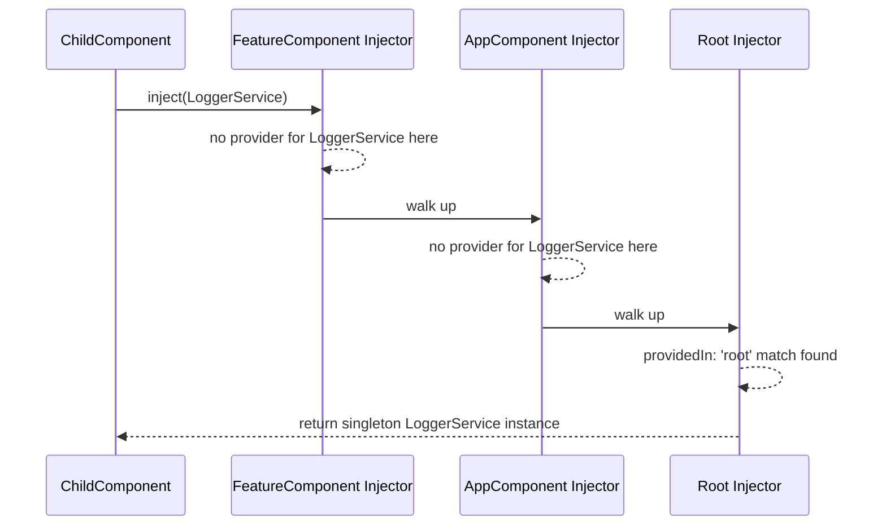

Because a component can declare its own `providers` array, a `FeatureService`
provided at `FeatureComponent` creates a *new instance* for every
`FeatureComponent` in the tree, while a `LoggerService` registered with
`providedIn: 'root'` (a tree-shakable provider registered directly on the
service itself, resolved lazily at the root injector the first time it is
requested) is a true application-wide singleton. This is the mechanism
behind two of Angular's most important architectural patterns: scoping a
service's lifetime to a feature/route (so that navigating away and back
creates a fresh instance, clearing any accumulated state) versus scoping it
to the whole application (so that state — an authentication session, a
websocket connection — survives across the entire application's lifetime).

**DI tokens beyond classes.** Not every dependency is a class. Configuration
values, primitives, and third-party library objects have no class to serve
as a lookup key, so Angular provides `InjectionToken<T>` — an opaque,
type-parameterized token created explicitly for this purpose:

```ts
// app-config.token.ts
export interface AppConfig {
  apiBaseUrl: string;
  featureFlags: Record<string, boolean>;
}

export const APP_CONFIG = new InjectionToken<AppConfig>('APP_CONFIG');

// bootstrap
bootstrapApplication(AppComponent, {
  providers: [
    { provide: APP_CONFIG, useValue: { apiBaseUrl: 'https://api.example.com', featureFlags: {} } },
  ],
});

// consuming component/service
@Injectable({ providedIn: 'root' })
export class OrdersService {
  private readonly config = inject(APP_CONFIG);
  constructor(private readonly http: HttpClient) {}

  listOrders() {
    return this.http.get(`${this.config.apiBaseUrl}/orders`);
  }
}
```

`inject()`, the function-based injection API introduced alongside standalone
components, is functionally equivalent to constructor injection but usable
outside a constructor context (inside a field initializer, a factory
function, or a route guard function) — a direct consequence of standalone
components and functional route guards needing DI access in places a class
constructor does not naturally reach.

**Decision implications.** Use `providedIn: 'root'` (a tree-shakable
provider) for true application-wide singletons — this is also what makes
the service eligible for tree-shaking (Section 4.7) if no code path ever
injects it. Provide a service at a specific component (or route) when its
lifetime should match that component/route's lifetime — a common pattern
for a "wizard" or "checkout flow" service that should reset every time a
user re-enters the flow. Use `InjectionToken` for configuration values,
environment-specific constants, or anything that has no natural class
identity, rather than smuggling configuration through a class with a single
static property (which defeats DI's testability benefit — a token-based
provider can be trivially swapped in a test with `TestBed.overrideProvider`).

**Common failure mode.** Assuming a `providedIn: 'root'` service behaves
like a route-scoped one, or vice versa. A common production bug: a
`ShoppingCartService` is provided at the root injector for convenience, so
its state silently survives across a user logging out and a different user
logging in on the same browser tab/session — data leaking across identities
because the developer assumed (incorrectly) that navigating to a login
screen would reset the service.

**Scenario.** A checkout module provides a `CheckoutStateService` in the
route's own providers array (scoped to the route, not `root`), so every
time a user starts a new checkout flow the service is instantiated fresh
with empty state, while a `TelemetryService` is provided at `root` so a
single buffered queue of analytics events survives the whole session
regardless of which route the user is on.

### 4.4 Change Detection Architecture (Historical): Zone.js and Dirty Checking

**Definition.** Change detection is the mechanism Angular uses to decide
*when* to re-render a component's view after some piece of application
state may have changed. Historically (and still by default unless a
project explicitly opts into zoneless mode), Angular relies on **Zone.js**,
a monkey-patching library that wraps every asynchronous browser Application
Programming Interface (API) — `setTimeout`, Promise resolution, DOM event
listeners, `fetch`/`XMLHttpRequest` completion — so that Angular is notified
whenever *any* asynchronous operation completes anywhere in the
application, without the application code having to call anything
explicitly.

**Mechanism.** Zone.js creates an Angular-specific "zone" (`NgZone`) that
patches the global asynchronous APIs before the application starts. Every
time a patched API's callback fires — a click handler runs, an HTTP request
resolves, a timer fires — `NgZone` emits a signal, and Angular's default
change-detection strategy responds by walking the *entire component tree*
from the root downward, checking every component's template bindings for
whether their bound values have changed since the last check, and
re-rendering any that have. This is called **dirty checking**: rather than
being told precisely which value changed, Angular re-derives "what changed"
by re-evaluating every binding and comparing it to its previous value.

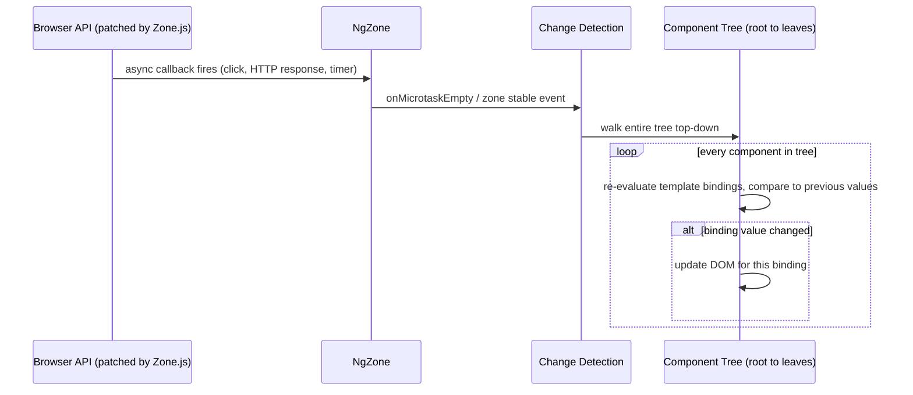

**Decision implications.** Zone.js's default strategy (`ChangeDetectionStrategy.Default`)
is simple to reason about — "anything happened, so re-check everything" —
and correct by construction: no path exists for Angular to miss a change,
because it does not try to be selective about which components could
plausibly have changed. The cost is that the entire tree is walked on
*every* asynchronous event, even ones with no bearing on 99% of a large
application's components. `ChangeDetectionStrategy.OnPush` (Section 11) is
the historical, opt-in mitigation: a component marked `OnPush` is skipped
during the tree walk unless one of its `@Input()` bindings changed by
reference, an event originated from inside the component itself, or it was
explicitly marked dirty via `ChangeDetectorRef.markForCheck()`.

**Common failure mode.** Mutating an object or array in place (for example,
`this.items.push(newItem)`) on a component using `OnPush` and expecting the
view to update. `OnPush` compares `@Input()` values by reference, not deep
equality; mutating the same array reference in place produces no reference
change, so Angular correctly (from its own rules) concludes nothing changed
and skips re-rendering — a defining, widely-shared Angular debugging
experience for engineers new to `OnPush`.

**Scenario.** A dashboard with 200 independently-updating widgets on
`ChangeDetectionStrategy.Default` becomes visibly laggy on every keystroke
in an unrelated search box, because every keystroke's `keyup` event fires
Zone.js's stability signal, which triggers a full 200-widget tree walk even
though only the search box's own state changed.

### 4.5 Change Detection Architecture (Modern): Signals and Fine-Grained Reactivity

**Definition.** A **Signal** (`signal()`, introduced in Angular 16-17) is a
wrapper around a value that tracks *which parts of the application read it*
and can notify exactly those readers — and only those readers — when the
value changes. This is the architectural opposite of Zone.js's dirty
checking: instead of re-checking everything and discovering what changed,
Signals *know* precisely what changed and precisely who depends on it,
because that dependency graph is built automatically as code reads signal
values.

**Mechanism.** A signal is created with `signal(initialValue)` and read by
calling it as a function (`count()`), which is what lets Angular's Signal
implementation detect the read and record a dependency edge. A `computed()`
signal derives a new value from other signals and is automatically
recalculated — and, crucially, automatically knows its own set of
dependencies — whenever any of its source signals change. An `effect()`
runs a side effect (for example, writing to `localStorage`, or calling
`console.log`) whenever any signal it reads changes, without requiring a
subscription to be manually created or torn down.

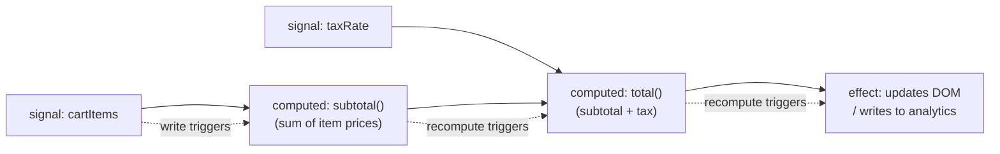

```ts
import { signal, computed, effect } from '@angular/core';

const cartItems = signal<{ price: number }[]>([]);
const taxRate = signal(0.08);

const subtotal = computed(() =>
  cartItems().reduce((sum, item) => sum + item.price, 0)
);
const total = computed(() => subtotal() * (1 + taxRate()));

effect(() => {
  console.log(`Cart total: ${total().toFixed(2)}`); // re-runs only when subtotal or taxRate actually changes
});

cartItems.update(items => [...items, { price: 19.99 }]); // triggers subtotal -> total -> effect, nothing else
```

Because Angular's rendering engine (Ivy) can, when a component's template
reads a signal directly, know *exactly* which DOM bindings depend on that
signal, a signal-driven component's re-render can, in principle, update
only the specific DOM nodes bound to that signal — not the whole component,
and certainly not the whole tree — without needing Zone.js to tell it "something,
somewhere, happened." This is what makes **zoneless change detection**
(experimental as of Angular 18) possible at all: once enough of an
application's reactive state flows through signals rather than
plain mutable class fields checked by dirty checking, Zone.js's
"re-check everything" fallback becomes unnecessary, and Angular can remove
it — and its bundle-size and runtime cost — entirely.

**Decision implications.** Signals are additive, not a breaking change:
existing Zone.js-based, dirty-checking Angular applications continue to
work unmodified, and Signals can be adopted incrementally, component by
component. New Angular code (17+) should prefer signals for local component
state and `computed()` for derived state over plain class fields, both for
the performance benefit and because it makes a component's reactive
dependencies explicit and self-documenting rather than implicit in whatever
happens to trigger Zone.js. RxJS (Section 4.6) remains the correct choice
for genuinely asynchronous, multi-step, cancellable, or time-based streams
(HTTP calls, WebSocket messages, debounced user input); Signals model
*synchronous, current-value* state, not asynchronous event streams — the
two are complementary (Angular ships `toSignal()`/`toObservable()`
interop functions specifically to bridge them), not competing replacements
for each other.

**Common failure mode.** Treating a signal as if it were an Observable (or
vice versa) and expecting operators like `.pipe(debounceTime(300))` to work
directly on a signal, or expecting a signal's `computed()` to handle
asynchronous work — `computed()` callbacks must be synchronous and pure;
asynchronous derivation belongs in an `effect()` writing to another signal,
or in RxJS.

**Scenario.** A product-listing component migrates its `filterText` and
`sortOrder` state from plain class fields with manual
`ChangeDetectorRef.markForCheck()` calls to signals, and its `filteredItems`
from a hand-written method called from `ngOnChanges` to a `computed()` — the
component now re-renders only the specific list items whose filter/sort
inclusion actually changed, and the developer deletes several
`markForCheck()` calls that existed purely to work around `OnPush`'s
reference-equality limitation (Section 4.4).

### 4.6 The RxJS-Based Reactive Architecture for Async State and HTTP

**Definition.** RxJS (Reactive Extensions for JavaScript) is a library for
composing asynchronous and event-based programs using **Observables** — a
type representing a stream of values delivered over time, which can be
transformed, combined, and composed using declarative **operators** (`map`,
`filter`, `debounceTime`, `switchMap`, `catchError`, and dozens more) in a
`.pipe()` chain, rather than nested callbacks or manually-chained Promises.
Angular's `HttpClient`, its `Router` events, and its reactive forms all
expose their asynchronous surfaces as Observables, making RxJS a load-bearing
part of Angular's architecture rather than an optional add-on.

**Mechanism.** An Observable does nothing until it is **subscribed to** —
this is the single most important mechanical fact about RxJS, and the
source of most beginner confusion: creating an Observable (for example,
`this.http.get('/api/orders')`) does not send the HTTP request; only
calling `.subscribe()` (or piping it through `async` in a template, which
subscribes and unsubscribes automatically) triggers execution. Operators
compose new Observables out of existing ones without mutating the
original — `switchMap`, in particular, is central to Angular's idiomatic
HTTP architecture because it automatically cancels a previous inner
Observable (an in-flight HTTP request) when a new value arrives on the
source Observable, which is exactly the behavior wanted for a type-ahead
search box: if the user types a new character before the previous
request's response arrives, the previous request's result should be
discarded, not raced against the new one.

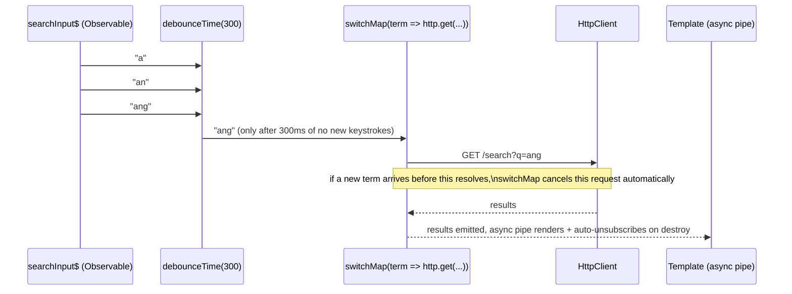

```ts
import { Component, inject } from '@angular/core';
import { FormControl, ReactiveFormsModule } from '@angular/forms';
import { HttpClient } from '@angular/common/http';
import { debounceTime, distinctUntilChanged, switchMap, catchError } from 'rxjs/operators';
import { of } from 'rxjs';
import { CommonModule } from '@angular/common';

interface SearchResult { id: string; name: string; }

@Component({
  selector: 'app-search',
  standalone: true,
  imports: [ReactiveFormsModule, CommonModule],
  template: `
    <input [formControl]="searchControl" placeholder="Search..." />
    <ul>
      <li *ngFor="let result of results$ | async">{{ result.name }}</li>
    </ul>
  `,
})
export class SearchComponent {
  private readonly http = inject(HttpClient);
  searchControl = new FormControl('', { nonNullable: true });

  results$ = this.searchControl.valueChanges.pipe(
    debounceTime(300),
    distinctUntilChanged(),
    switchMap(term =>
      this.http.get<SearchResult[]>(`/api/search?q=${encodeURIComponent(term)}`).pipe(
        catchError(() => of<SearchResult[]>([])) // fail closed to an empty result set, never let the stream die
      )
    ),
  );
}
```

`HttpClient` also exposes an **interceptor** pipeline — functions (or,
historically, injectable classes) that sit in front of every outgoing
request and every incoming response, composed through the same DI system
covered in Section 4.3. This is Angular's architectural answer to
cross-cutting HTTP concerns: attaching an authentication header, retrying
on a specific status code, or centralizing error-to-notification mapping
happens once, in one interceptor, rather than being duplicated at every
call site.

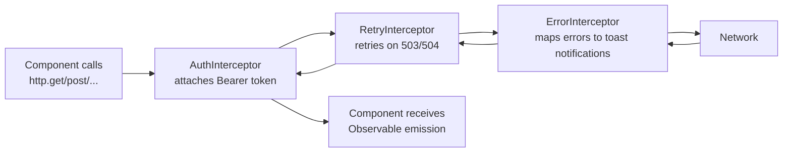

**Decision implications.** Prefer the `async` pipe in templates
(`*ngIf="data$ | async as data"`) over manual `.subscribe()` calls in
component code whenever the value is only needed for rendering — the
`async` pipe subscribes on component creation and unsubscribes
automatically on destruction, eliminating an entire category of memory
leak (Section 15). Reserve manual `.subscribe()` for cases with genuine
side effects outside of rendering (navigating after a save completes,
showing a toast). Use `switchMap` for "cancel the previous, only the latest
matters" scenarios (search, navigation-triggered data loading);
`mergeMap` when concurrent, non-cancelling execution is correct (parallel,
independent uploads); `concatMap` when strict in-order execution matters
more than throughput (sequential form submissions that must not race).

**Common failure mode.** Manually subscribing to an Observable inside
`ngOnInit` and never unsubscribing in `ngOnDestroy` — because an Observable
subscription is a live resource, not a fire-and-forget callback, a
component that is destroyed (the user navigates away) while still
subscribed to a long-lived stream (a WebSocket, a polling interval) keeps
that subscription — and everything it references, including the destroyed
component instance itself in some cases — alive in memory indefinitely.

**Scenario.** A live order-status-tracking component subscribes to a
WebSocket-backed Observable manually (because it needs to trigger a
non-rendering side effect — playing a notification sound — on each
message) and is careful to store the subscription and call
`.unsubscribe()` in `ngOnDestroy`, while every purely-rendering data stream
elsewhere in the same component uses the `async` pipe and needs no manual
cleanup at all.

### 4.7 Compiler Architecture: Ivy, AOT Compilation, and Tree-Shakable Providers

**Definition.** Ivy is Angular's compiler and runtime, replacing the older
View Engine starting with Angular 9 (2020). Ivy compiles Angular templates
into plain TypeScript/JavaScript instruction calls at build time — not
runtime — a process called **Ahead-of-Time (AOT) compilation**, and
structures that output so that unused code (an entire component, a
provider no code path ever injects) can be removed from the final bundle
by a bundler's tree-shaking pass.

**Mechanism.** Before Ivy, Angular's template compiler ran either at
runtime in the browser (Just-in-Time, or JIT, compilation — the historical
development-mode default) or ahead of time as a separate build step whose
output was one large, interlinked "compilation unit" per NgModule, meaning
a bundler could not safely remove any single component's code without
risking breaking another component in the same module that depended on
shared, module-scoped generated code. Ivy restructures this entirely:
each component compiles to a self-contained set of instructions (a
"component definition," `ɵcmp`) that a bundler can analyze and remove in
isolation if nothing imports it — the same reasoning a bundler applies to
any unused ECMAScript Module (ESM) export (see
[JavaScript, Build/Bundling Architecture](CH03_JavaScript.md)).

```mermaid
flowchart LR
    subgraph Build["Build time (ng build)"]
        TS[TypeScript template + component class] --> IvyC[Ivy Compiler]
        IvyC --> Instr["Component definition\n(ɵcmp instructions)"]
    end
    Instr --> Bundler[Bundler / tree-shaker\n(esbuild, used by Angular CLI\nsince Angular 17)]
    Bundler -->|"unused component/provider\nnever referenced"| Removed[Removed from\nproduction bundle]
    Bundler -->|referenced| Shipped[Shipped to browser\nas plain JS, no template\nparsing at runtime]
```

AOT compilation matters architecturally for two independent reasons: first,
because template errors (a typo'd property name, a type mismatch between a
template binding and a component's declared property type) are caught by
the compiler at build time rather than surfacing as a runtime error a user
encounters, catching an entire category of production incident before
deployment; second, because the browser never needs to parse and interpret
a template string at runtime, which removes both a runtime performance cost
and a content-security surface (JIT template compilation historically
required `unsafe-eval`-adjacent capabilities that AOT does not).
Tree-shakable providers (`providedIn: 'root'`, Section 4.3) depend directly
on this same per-component/per-service compilation granularity: a service
that declares its own provider configuration on itself, rather than in a
module's `providers` array, can be omitted from the bundle entirely if
static analysis proves nothing injects it — a module-level `providers`
array, by contrast, historically forced every listed provider into the
bundle whether or not anything actually used it.

**Decision implications.** Modern Angular projects (Angular CLI-scaffolded,
17+) use AOT by default for every build, including local development
(`ng serve` uses Ivy's incremental compilation for fast rebuilds without
falling back to full runtime JIT compilation). A Solution Architect
evaluating third-party Angular libraries should check whether they still
ship View-Engine-era metadata (`ngcc`, the Angular Compatibility Compiler,
was a stop-gap tool for this transition, now largely retired) — a library
that has not been rebuilt against Ivy for years is a maintenance-risk
signal.

**Common failure mode.** Assuming a service is being tree-shaken out of the
bundle because it is unused, when in fact it is still referenced somewhere
transitively (a barrel `index.ts` re-export, a dynamic `import()` the
bundler cannot statically prove is unreachable) — bundle-size regressions
in Angular applications are frequently traced to a barrel file's blanket
re-exports defeating tree-shaking analysis, the same failure mode
documented for ESM tree-shaking generally (see
[JavaScript, Build/Bundling Architecture](CH03_JavaScript.md)).

**Scenario.** A Solution Architect investigating an unexpectedly large
production bundle runs `ng build --stats-json` and inspects the output with
a bundle analyzer, discovering that an entire admin-only feature module's
components are being shipped to every user because a shared barrel file
re-exports them alongside genuinely common components — the fix is
splitting the barrel file so tree-shaking (and, separately, lazy-loaded
routing, Section 4.8) can actually exclude the admin feature from the
default bundle.

### 4.8 Routing Architecture: Lazy-Loaded Feature Modules and Route Guards

**Definition.** Angular's `Router` maps Uniform Resource Locator (URL)
paths to components, and — architecturally more significantly — to code
that does not need to be downloaded by the browser at all until a user
actually navigates to that path. **Lazy loading** is the pattern of
splitting an application's route configuration so that a feature's code
(historically an entire NgModule; in standalone-component Angular, a
`loadComponent`/`loadChildren` function returning a dynamic `import()`) is
fetched only when its route is first activated. **Route guards** are
functions (or, historically, injectable classes implementing a guard
interface) that the router consults before activating, deactivating, or
loading a route, and that can allow, deny, or redirect navigation based on
arbitrary logic — most commonly, checking authentication/authorization
state.

**Mechanism.** Every route in Angular's route configuration is an object
that pairs a path with either a component reference (eagerly loaded — its
code is part of the initial bundle) or a `loadComponent`/`loadChildren`
function (lazily loaded — its code lives in a separate bundle chunk that
the bundler emits and the router's own code fetches on demand, using the
same dynamic-`import()` mechanism JavaScript's module system provides
natively, see [JavaScript, Build/Bundling Architecture](CH03_JavaScript.md)).
Guards are plain functions (in modern Angular) that receive the route
being navigated to and return `true`/`false`/a `UrlTree` (a redirect
instruction), synchronously or as an Observable/Promise for asynchronous
checks (for example, calling a backend token-validation endpoint before
allowing navigation).

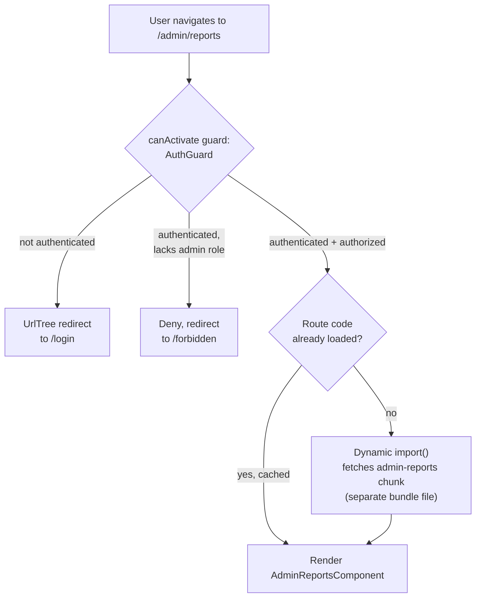

```ts
// admin.routes.ts
import { Routes } from '@angular/router';
import { authGuard } from './auth.guard';
import { adminRoleGuard } from './admin-role.guard';

export const ADMIN_ROUTES: Routes = [
  {
    path: 'admin',
    canActivate: [authGuard],
    canActivateChild: [adminRoleGuard],
    loadChildren: () => import('./admin-reports.routes').then(m => m.ADMIN_REPORTS_ROUTES),
  },
];

// auth.guard.ts — functional guard, uses inject() (Section 4.3) outside a constructor
import { inject } from '@angular/core';
import { CanActivateFn, Router } from '@angular/router';
import { AuthService } from './auth.service';

export const authGuard: CanActivateFn = (route, state) => {
  const auth = inject(AuthService);
  const router = inject(Router);
  if (auth.isAuthenticated()) {
    return true;
  }
  return router.createUrlTree(['/login'], { queryParams: { returnUrl: state.url } });
};
```

**Decision implications.** Structure route configuration around feature
boundaries that should also be *code-splitting* boundaries — an admin
section, a reporting section, or an infrequently-used settings section are
natural lazy-loading candidates because most users never visit them in a
given session, so shipping their code eagerly wastes bandwidth for the
common case. Route guards are the correct place to enforce *navigation*
policy (don't render this view, don't fetch this route's code) but are
never a substitute for server-side authorization — a `canActivate` guard
can prevent a component from rendering in the browser, but it cannot
prevent a request forged directly against a backend API that skips the
Angular application entirely; the backend must independently enforce the
same authorization rule (see
[REST, Section 13 Security](../08_API_Architecture/CH01_REST.md) for the
server-side authorization architecture this must pair with).

**Common failure mode.** Treating a route guard as a security boundary on
its own. A `canActivate` guard that hides an "Admin" menu item and blocks
client-side navigation to `/admin` provides a legitimate user-experience
benefit (a non-admin user never sees a confusing "forbidden" screen after
clicking through) but provides zero actual security if the backend
endpoints the admin screen calls do not independently check the caller's
authorization — an attacker who crafts the underlying HTTP request directly
bypasses the guard entirely, because the guard's code never runs outside
the Angular application.

**Scenario.** An e-commerce application lazily loads its `checkout`,
`account-settings`, and `admin` route trees separately from the always-loaded
`product-browsing` and `cart` routes, cutting the initial bundle a typical
anonymous shopper downloads by more than half, while a `canActivate` guard
on `/admin` redirects unauthenticated users to `/login` and the backend's
authorization middleware independently rejects any unauthorized API call
those routes would otherwise make, regardless of whether the guard ran.

## 5. Internal Working

Angular's runtime behavior from application startup to a rendered,
interactive page follows a fixed sequence that ties together every concept
from Section 4.

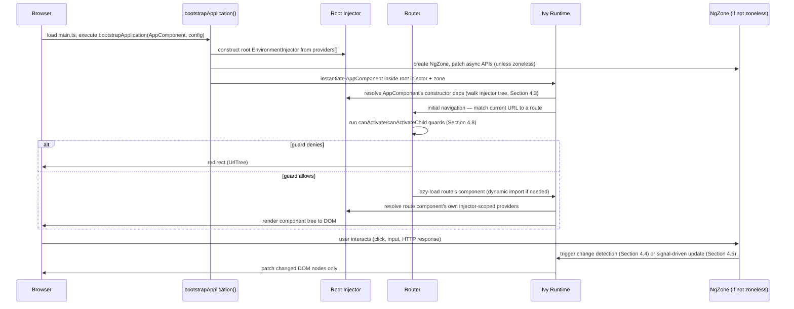

Each stage is a direct architectural consequence of a Section 4 concept:
the injector must be fully constructed before any component can be
instantiated (Section 4.3); the router's guards run before any lazily
loaded code is even fetched, so an unauthorized user never downloads code
they cannot use (Section 4.8); and the final "user interacts" loop is
exactly the Zone.js dirty-checking cycle (Section 4.4) or the Signals
fine-grained update path (Section 4.5), depending on the application's
change-detection configuration.

## 6. Design Principles

Angular's own internal design consistently favors a small number of
recurring principles that a Solution Architect should recognize when
evaluating whether a piece of application code is "idiomatic Angular" or is
fighting the framework.

- **Compile-time verification over runtime flexibility.** Template type
  checking, AOT compilation, and strict standalone-component imports all
  trade some runtime dynamism (a template string could, in principle, be
  built and interpreted at runtime) for catching mistakes before
  deployment.
- **Explicit dependency declaration over implicit global state.**
  Constructor/`inject()`-based DI, and standalone components' own `imports`
  arrays, make a unit's dependencies visible at its declaration site rather
  than requiring a reader to trace global singletons or ambient context.
- **Composability through small, pipeable operators (RxJS) rather than
  monolithic async utilities.** `.pipe(debounceTime(...), switchMap(...))`
  composes exactly the behavior a given call site needs, rather than
  Angular shipping one opinionated "smart fetch" function that tries to
  anticipate every use case.
- **One clear seam per cross-cutting concern.** HTTP interceptors for
  request/response cross-cutting logic, route guards for navigation
  policy, and DI providers for swappable implementations each have exactly
  one framework-sanctioned extension point, rather than several competing
  ways to achieve the same thing.

## 7. Architecture Patterns

**Smart (container) vs. dumb (presentational) components.** A widely-used
Angular application-layer pattern: "smart" components inject services, own
state (increasingly as signals), and pass data down to "dumb" components
via `@Input()` bindings and receive events back via `@Output()` bindings —
dumb components have no DI dependencies of their own and are trivially
reusable and testable in isolation.

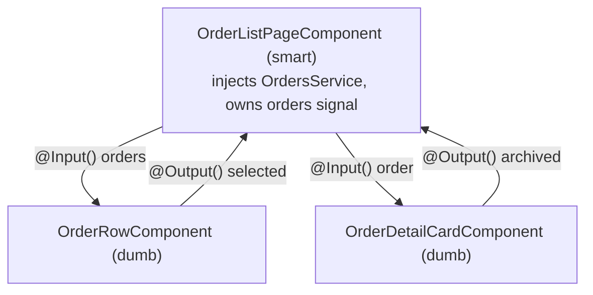

**Facade services.** A service that wraps several lower-level services
(HTTP calls, state signals, RxJS streams) behind one simplified interface
that components depend on, isolating components from a feature's internal
wiring details and giving the team one seam to change the internal
implementation (swap RxJS state management for signals, or vice versa)
without touching component code.

**Feature-based (not layer-based) folder architecture.** Organizing code
by feature (`orders/`, `checkout/`, `admin/`) rather than by technical
layer (`components/`, `services/`, `models/`) so that a lazy-loaded route
(Section 4.8) and its NgModule/standalone-component boundary (Section 4.2)
align with a single folder a team can own end-to-end — this is the
Angular-specific instance of the general coupling/cohesion principle
already owned by
[What is Software Architecture?, Section 4](../01_Architecture_Mindset/CH01_What_is_Software_Architecture.md).

**State management beyond component-local signals.** For state shared
across many unrelated components (an authenticated user's profile, a
shopping cart), teams either build their own signal-based store (a
service exposing readonly signals plus methods that call `.set()`/`.update()`
internally) or adopt a dedicated library (NgRx, a Redux-inspired
store built specifically for Angular's DI and RxJS conventions, or the
lighter-weight NgRx SignalStore). The choice is a scale/complexity
trade-off: a hand-rolled signal service is enough for most features;
NgRx's explicit action/reducer/effect separation pays for itself mainly in
large applications with complex, cross-feature state interactions and a
need for time-travel debugging or strict unidirectional data flow
discipline.

## 8. Production Architecture

A production Angular deployment typically looks like:

```mermaid
flowchart LR
    Dev[ng build --configuration production] --> Bundler[esbuild-based\nAngular CLI build]
    Bundler --> Chunks["Bundle chunks:\nmain, polyfills,\nlazy-loaded feature chunks"]
    Chunks --> CDN[Content Delivery Network\n(CDN) — static hosting]
    CDN --> Browser[Browser fetches\nmain chunk + route chunks\non demand]
    Browser --> API[Backend REST/GraphQL API\n— HttpClient + interceptors]
```

Angular applications are static assets after the build step — there is no
Angular-specific server process required at runtime unless the team
additionally adopts Server-Side Rendering (SSR) via Angular Universal, which
runs the same component tree once on the server to produce initial HTML
for faster first paint and better search-engine indexing, then
"hydrates" (attaches Angular's runtime behavior to the server-rendered
DOM) on the client rather than re-rendering from scratch.

## 9. Implementation

A minimal, idiomatic modern (standalone, signals-based) Angular feature
combines Sections 4.2, 4.3, and 4.5:

```ts
// orders.service.ts
import { Injectable, inject, signal, computed } from '@angular/core';
import { HttpClient } from '@angular/common/http';
import { firstValueFrom } from 'rxjs';

export interface Order { id: string; totalCents: number; status: 'pending' | 'shipped'; }

@Injectable({ providedIn: 'root' })
export class OrdersService {
  private readonly http = inject(HttpClient);
  private readonly _orders = signal<Order[]>([]);

  readonly orders = this._orders.asReadonly();
  readonly pendingCount = computed(() =>
    this._orders().filter(o => o.status === 'pending').length
  );

  async loadOrders(): Promise<void> {
    const orders = await firstValueFrom(this.http.get<Order[]>('/api/orders'));
    this._orders.set(orders);
  }
}
```

```ts
// order-list.component.ts
import { Component, inject, OnInit } from '@angular/core';
import { CommonModule } from '@angular/common';
import { OrdersService } from './orders.service';

@Component({
  selector: 'app-order-list',
  standalone: true,
  imports: [CommonModule],
  template: `
    <p>Pending orders: {{ orders.pendingCount() }}</p>
    <ul>
      <li *ngFor="let order of orders.orders()">{{ order.id }} — {{ order.status }}</li>
    </ul>
  `,
})
export class OrderListComponent implements OnInit {
  protected readonly orders = inject(OrdersService);
  async ngOnInit() { await this.orders.loadOrders(); }
}
```

## 10. Complete Code Examples

**Example — a route-scoped checkout flow** combining lazy loading, a
functional guard, DI token-based configuration, and a signal-based
feature service scoped to the route (not `root`), so its state resets
every time a user re-enters the flow (Section 4.3's scenario made
concrete):

```ts
// checkout.routes.ts
import { Routes } from '@angular/router';
import { CheckoutStateService } from './checkout-state.service';
import { authGuard } from '../auth/auth.guard';

export const CHECKOUT_ROUTES: Routes = [
  {
    path: 'checkout',
    canActivate: [authGuard],
    providers: [CheckoutStateService], // route-scoped: fresh instance per flow entry
    loadComponent: () => import('./checkout-page.component').then(m => m.CheckoutPageComponent),
  },
];

// checkout-state.service.ts
import { Injectable, signal, computed } from '@angular/core';

export interface CartLine { sku: string; qty: number; priceCents: number; }

@Injectable() // no providedIn: 'root' — deliberately scoped by the route's providers array
export class CheckoutStateService {
  private readonly _lines = signal<CartLine[]>([]);
  readonly lines = this._lines.asReadonly();
  readonly totalCents = computed(() =>
    this._lines().reduce((sum, l) => sum + l.qty * l.priceCents, 0)
  );

  addLine(line: CartLine) {
    this._lines.update(lines => [...lines, line]);
  }
}
```

## 11. Performance

Angular-specific performance levers, in priority order for a large
application: adopt `ChangeDetectionStrategy.OnPush` (Section 4.4) on
components that receive their data via `@Input()` and treat those inputs
as immutable (replace, never mutate, array/object references); migrate hot,
frequently-updating state to Signals (Section 4.5) so re-renders are
scoped to the exact bindings that changed rather than a whole `OnPush`
subtree; use `trackBy` functions with `*ngFor` so the renderer can match
existing DOM nodes to updated list items by a stable identity instead of
re-creating the entire list on every emission; lazy-load every route that
is not needed on first paint (Section 4.8); and use Angular's built-in
`@defer` block (deferrable views, 2024) to lazily load and render
below-the-fold or rarely-needed template sections without a separate route.

## 12. Scalability

Angular's scalability story is primarily an *organizational* one, not a
runtime one: the DI hierarchy and lazy-loaded route architecture (Sections
4.3, 4.8) let a codebase scale to dozens of teams and hundreds of routes
because each team's feature is a bundle-isolated, injector-isolated unit
that can be developed, tested, and deployed largely independently, and the
Angular CLI's schematics-based `ng update` mechanism lets a large
organization upgrade a shared framework version across many teams on a
predictable, tooling-assisted cadence rather than each team independently
tracking ecosystem compatibility, as a compositional-library approach
requires (Section 4.1).

## 13. Security

Angular sanitizes all interpolated and property-bound template values
against Cross-Site Scripting (XSS) by default — a value bound via `{{ }}`
interpolation or a property binding is HTML-escaped automatically, and
values that must render as raw HTML/URLs/styles must be explicitly passed
through `DomSanitizer`, making an unsafe HTML injection a deliberate,
visible opt-out rather than an easy-to-miss default. HTTP interceptors
(Section 4.6) are the idiomatic place to attach Cross-Site Request Forgery
(CSRF) tokens and authentication headers uniformly. As established in
Section 4.8, route guards are a user-experience and code-splitting control,
never a substitute for server-side authorization — every route guard
decision in this chapter's examples assumes an independently enforced
backend authorization check for the same resource.

## 14. Observability

Angular applications typically export three kinds of telemetry: RxJS-based
HTTP interceptors that log/trace outgoing requests and their latency
(pairing naturally with an interceptor already sitting on every request,
Section 4.6); Angular Router events (`NavigationStart`, `NavigationEnd`,
and error events) subscribed to for route-level performance and error
tracking; and `ErrorHandler` — a DI-provided, overridable class Angular
calls for every otherwise-uncaught exception in the application, the
natural integration point for a frontend error-monitoring service.

## 15. Failure Scenarios

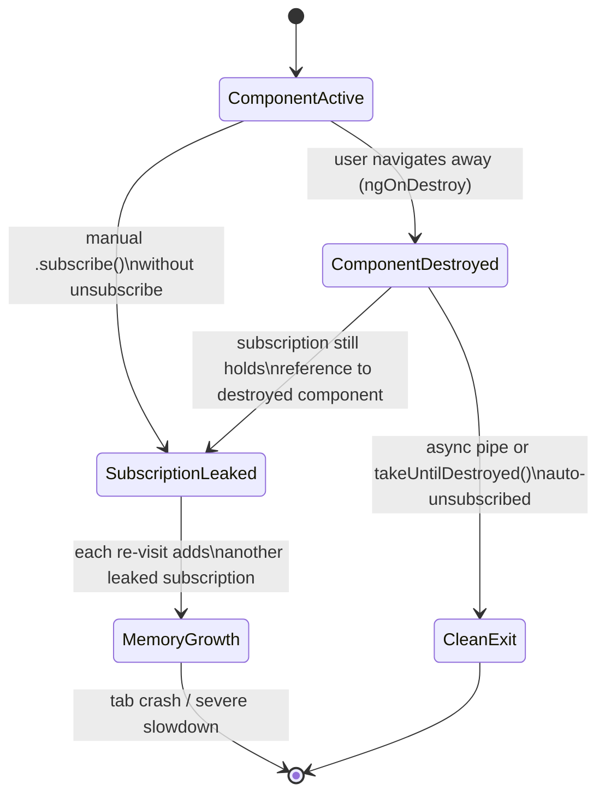

The most common Angular-specific production failure mode is exactly the
one diagrammed above (Section 4.6's common failure mode, at scale): a
component subscribed manually to a long-lived Observable without cleanup
accumulates one leaked subscription — and the component instance, and
everything it references — per navigation, degrading a long-running
single-page session over hours of use. Angular's `takeUntilDestroyed()`
operator (paired with `DestroyRef`) exists specifically to make this
cleanup a one-line, DI-integrated addition to a `.pipe()` chain instead of
a hand-managed subscription variable and an `ngOnDestroy` override.

## 16. Testing

Angular ships `TestBed`, a DI-aware test harness that constructs a
component (or service) inside its own miniature injector, letting a test
override any provider — replacing a real `HttpClient`-backed service with
an in-memory test double (the same DI-driven substitutability from
[TypeScript, Section 4.10](CH04_TypeScript.md#410-interface-driven-contract-first-architecture),
applied through Angular's own injector rather than plain constructor
substitution). `HttpClientTestingModule`/`provideHttpClientTesting()`
intercepts and asserts on outgoing HTTP calls without a real network. The
Angular Testing Library (built on top of TestBed) is the increasingly
preferred layer for component tests because it queries the rendered DOM
the way a user would (by visible text/role) rather than by internal
component-instance state, reducing test brittleness against refactors that
do not change user-visible behavior.

## 17. Common Mistakes

- Mutating an `@Input()`-bound array/object in place on an `OnPush`
  component and expecting a re-render (Section 4.4).
- Manually subscribing to Observables without unsubscribing, leaking
  memory across navigations (Sections 4.6, 15).
- Treating a `canActivate` route guard as sufficient authorization on its
  own, with no matching backend enforcement (Section 4.8).
- Providing a service at `root` when its state should be scoped to a
  feature/route, causing state to leak across unrelated user sessions
  (Section 4.3).
- Re-exporting an entire feature module through a barrel `index.ts`,
  silently defeating tree-shaking and bloating the initial bundle
  (Section 4.7).

## 18. Best Practices

- Default new code to standalone components, `inject()`, and Signals for
  local/derived state; reserve NgModules for legacy code and libraries that
  still require them.
- Scope a service's `providedIn`/provider location deliberately based on
  its intended lifetime (`root` for true singletons, component/route
  providers for scoped state) rather than defaulting to `root` out of
  convenience.
- Push cross-cutting HTTP concerns (auth headers, retries, error mapping)
  into interceptors rather than duplicating logic at call sites.
- Lazy-load every route not required for first paint, and periodically
  audit bundle composition with a bundle analyzer (Section 4.7).
- Prefer the `async` pipe or `takeUntilDestroyed()` over manually-managed
  subscriptions.

## 19. Anti-Patterns

- **God services** — a single injectable service accumulating unrelated
  responsibilities (auth, cart, notifications, feature flags) because it
  is convenient to inject once, defeating the single-responsibility
  benefit DI is meant to provide.
- **Guard-as-security** — relying on `canActivate` alone with no backend
  authorization enforcement (Section 4.8).
- **Manual change-detection whack-a-mole** — sprinkling
  `ChangeDetectorRef.detectChanges()`/`markForCheck()` calls throughout a
  codebase to work around `OnPush` reference-equality surprises, instead of
  fixing the underlying mutation-in-place pattern or migrating to Signals.
- **RxJS operator soup** — chaining a dozen operators in a single
  `.pipe()` for a simple case where a plain signal/`computed()` would be
  clearer and cheaper.

## 20. Trade-off Analysis

| Decision | Choosing Angular's default | Trading away |
|---|---|---|
| Framework vs. library | Enforced, consistent architecture across teams/years | Flexibility to swap individual pieces (router, state library) |
| Zone.js (default) vs. zoneless/Signals | Simplicity, guaranteed correctness, no missed updates | Coarser-grained re-renders, larger runtime footprint |
| RxJS for HTTP/async | Powerful composition (cancellation, retry, combination) | Steeper learning curve than plain `async`/`await` |
| NgModules vs. standalone components | (Standalone) simpler mental model, better tree-shaking | (NgModules) explicit architectural grouping some large legacy codebases still rely on |
| AOT compilation always-on | Compile-time error catching, no runtime template parsing | Slightly longer build times than a pure JIT/dev-only path |

## 21. Comparison Table

| Dimension | Angular | React | Next.js |
|---|---|---|---|
| Category | Opinionated framework | Rendering library | Framework built on React |
| DI system | Built-in, hierarchical (Section 4.3) | None built-in (community solutions/Context) | Inherits React's model |
| State/async primitive | Signals + RxJS (built-in) | Hooks + ecosystem choice (Redux, TanStack Query, etc.) | Same as React, plus server components |
| Routing | Built-in `Router`, lazy-loaded feature routes | Ecosystem choice (react-router, etc.) | Built-in file-system-based router |
| Compilation | Ivy AOT by default | JSX transform only; no framework-level AOT template compiler | Built on React's model, adds server/client boundary compilation |
| Rendering model | Client-side by default; SSR via Angular Universal | Client-side by default; SSR via frameworks (Next.js) | SSR/SSG/streaming as first-class, default-on features |

(React's own internals are taught in [React](CH06_React.md); Next.js's
server-rendering architecture is taught in [Next.js](CH07_Nextjs.md) — this
row exists only to position Angular relative to them, not to re-teach
either.)

## 22. Real-World Case Study

A mid-size logistics company runs a single Angular application serving
warehouse-floor staff (a high-frequency, keyboard-driven data-entry
interface), back-office administrators (a reporting/configuration
interface), and external customers (a package-tracking interface) from one
codebase, split into three lazily-loaded route trees (Section 4.8) so each
audience downloads only its own feature's code.

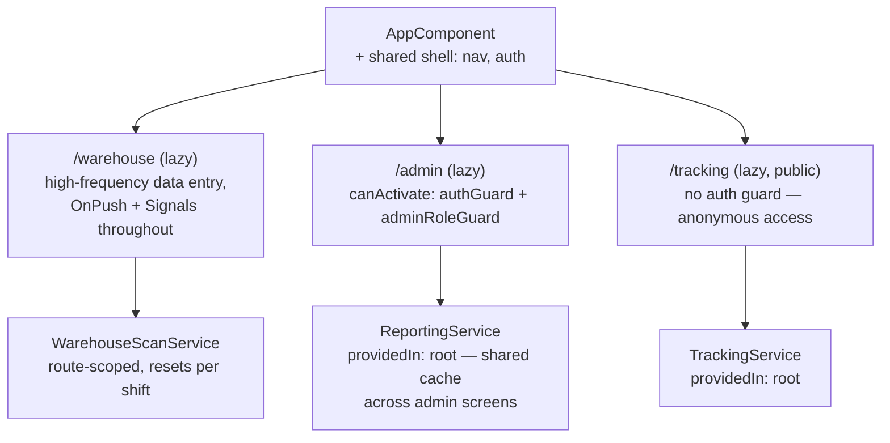

The warehouse route tree uses `OnPush` and Signals aggressively because its
users interact dozens of times per minute via barcode scanners, where even
a Zone.js dirty-check pause across the whole tree is noticeable; the
admin route tree provides a `ReportingService` at `root` because switching
between report screens should reuse already-fetched, cached data; and the
public tracking route intentionally carries no `canActivate` guard, because
package tracking is deliberately unauthenticated — a case where the
*absence* of a guard is the correct, deliberate security decision, not an
oversight.

## 23. Interview Questions

1. What does it mean architecturally that Angular's dependency injection
   is hierarchical, and how does that differ from a typical backend DI
   container?
2. Explain the difference between Zone.js-based change detection and
   Signals-based change detection. What problem does each solve, and what
   does each cost?
3. Why did Ivy's compilation model make standalone components and
   tree-shakable providers possible, when View Engine's model did not?
4. Why is a route guard insufficient as a security control on its own, and
   what must always accompany it?
5. When would you choose `switchMap` over `mergeMap` or `concatMap` for an
   HTTP call triggered by user input, and why?
6. What causes an Angular memory leak related to RxJS subscriptions, and
   what are the two idiomatic ways to avoid it?
7. Why does Angular default to escaping/sanitizing template bindings, and
   when is bypassing that sanitization a legitimate, deliberate choice?

## 24. Hands-on Exercises

1. Build a standalone, signal-based counter component with a `computed()`
   derived value and an `effect()` that logs every change; verify with
   Angular DevTools that only the relevant DOM node updates.
2. Convert a manually-subscribed HTTP call in a component to use the
   `async` pipe, and confirm (via a memory profile or a leak-detection
   test) that navigating away and back no longer accumulates subscriptions.
3. Add a functional `canActivate` guard to a lazy-loaded route, and write a
   unit test using `TestBed` that overrides the injected `AuthService` to
   assert both the "allowed" and "redirected" paths.

## 25. Design Exercises

1. Design the injector-scoping strategy (which services are `root`, which
   are feature/route-scoped) for a multi-tenant Software-as-a-Service (SaaS)
   application where switching tenants must guarantee zero state leakage
   between tenants within the same browser session.
2. Design the route/lazy-loading boundaries for an application with a
   large, rarely-used admin section and a small, always-used core
   workflow, optimizing for the smallest possible initial bundle for the
   common case.

## 26. Architecture Review Questions

- Does every `providedIn: 'root'` service in this codebase genuinely need
  application-wide singleton lifetime, or does any of them actually need
  to be scoped to a feature/route?
- Are all route guards paired with an equivalent, independently enforced
  backend authorization check for the same resource?
- Are there any manually-managed RxJS subscriptions that could be replaced
  by the `async` pipe or `takeUntilDestroyed()`?
- Is bundle composition audited regularly enough to catch a barrel-file
  regression that defeats tree-shaking (Section 4.7)?
- For components on the application's hottest interaction paths, has
  `OnPush`/Signals adoption been evaluated, or is the team still relying
  on Zone.js's default, whole-tree dirty checking everywhere?

## 27. Summary

Angular is what a Solution Architect gets when a single team decides, up
front, how dependency injection, change detection, asynchronous state, and
routing should work in a large, long-lived, multi-team frontend
application — and then enforces those decisions through a compiler and a
runtime rather than a style guide. Its hierarchical DI system and its
component-tree-mirroring injector tree (Section 4.3), its two generations
of change detection — Zone.js's coarse, guaranteed-correct dirty checking
(Section 4.4) and Signals' fine-grained, dependency-tracked reactivity
(Section 4.5) — its RxJS-based reactive architecture for asynchronous state
and HTTP (Section 4.6), its Ivy compiler's AOT compilation and
tree-shakable providers (Section 4.7), and its lazy-loaded, guard-protected
routing architecture (Section 4.8) are not independent features bolted
together; they are one coherent, opinionated answer to the question every
compositional library leaves open. The trade-off is real and worth naming
plainly: an organization adopting Angular is choosing enforced consistency
and an integrated toolchain over the flexibility to assemble a bespoke
combination of best-of-breed packages — a decision this chapter has framed
throughout as an organizational one first, and a technical one second.

## Further Reading

- [JavaScript](CH03_JavaScript.md) — the browser runtime model, event loop,
  and module/bundling architecture Angular builds on.
- [TypeScript](CH04_TypeScript.md) — the structural type system, decorators,
  and generics Angular's component/DI Application Programming Interfaces
  (APIs) are built from.
- [React](CH06_React.md) — the compositional-library alternative this
  chapter contrasts against in Section 4.1.
- [Next.js](CH07_Nextjs.md) — a framework built atop React that answers
  some of the same "framework vs. library" questions from a different
  starting point.
- [Java Architecture, Dependency Injection](../03_Software_Engineering_Foundations/CH01_Java_Architecture.md#dependency-injection) —
  backend DI container patterns (Spring), contrasted with Angular's
  hierarchical, component-scoped model in Section 4.3.
- [REST, Section 13 Security](../08_API_Architecture/CH01_REST.md) — the
  server-side authorization enforcement that must always pair with a
  frontend route guard (Section 4.8).
