# Chapter: React

## 1. Introduction

React is a JavaScript library — deliberately not a framework — for building
user interfaces out of composable, declarative components. It was open-sourced
by Facebook (now Meta) in 2013 and has since become the dominant substrate on
top of which most of the modern frontend ecosystem is built: Next.js, Remix,
React Native, and dozens of state-management, routing, and data-fetching
libraries all assume React's component model as their foundation.

For a Solution Architect, React matters less as "a library for building UI"
and more as an **architectural substrate**: a set of primitives — components,
the Virtual DOM (a lightweight in-memory representation of the actual browser
Document Object Model (DOM)), Hooks, and a unidirectional data flow — on top of
which the rest of the frontend architecture (routing, state management, data
fetching, server rendering) is a series of *decisions your team makes*, not
decisions React makes for you. This is the single most important architectural
fact about React, and it is also its most common source of both flexibility
and chaos: two React codebases can look almost unrelated to each other because
React prescribes a rendering model, not an application architecture.

This chapter teaches React as that substrate. We cover:

- The **Virtual DOM and reconciliation** — why React doesn't touch the real DOM
  directly on every state change, how the diffing algorithm decides what
  changed, why `key` props exist and what breaks without them, and the
  **fiber architecture** that made rendering interruptible.
- The **component model and unidirectional data flow** — props down, events
  up, and why this constraint (not a limitation, a design choice) makes large
  UIs tractable to reason about.
- **Hooks architecture** — `useState`, `useEffect`, `useMemo`, `useCallback` as
  a closure-based state model that replaced class lifecycle methods, and the
  **Rules of Hooks**, which are not arbitrary style preferences but a direct
  consequence of *how* Hooks are implemented internally.
- **State management architecture** — local state, the Context API, and
  external stores (Redux, Zustand, and similar) as a decision spectrum, with
  the criteria for choosing a point on that spectrum, not exhaustive teaching
  of any one library.
- **Rendering architecture** — the render phase vs. the commit phase, and how
  concurrent rendering, Suspense, and transitions change what "rendering" even
  means in modern React.
- **React Server Components (RSC)** — a genuinely new client/server component
  boundary, architecturally distinct from traditional server-side rendering
  (SSR).
- React's **"unopinionated core + community architecture" philosophy**,
  contrasted with Angular's batteries-included model (see
  [Angular](CH05_Angular.md) for Angular's internals — this chapter does not
  re-teach them).

This chapter assumes working fluency in JavaScript and TypeScript language
fundamentals — closures, the prototype chain, the event loop, generics,
structural typing, discriminated unions — all owned and taught in
[JavaScript](CH03_JavaScript.md) and [TypeScript](CH04_TypeScript.md). Where
React's architecture depends on one of those mechanisms (and it depends on
closures constantly), this chapter recaps the relevant fact in one or two
sentences and links back rather than re-deriving it.

## 2. Historical Evolution

React's history is best understood as a sequence of responses to specific
architectural pain points, each one reshaping how the library is used in
production:

- **2011-2013 — Internal origins and open-source release.** Facebook engineer
  Jordan Walke built "FaxJS," an early prototype applying ideas from
  functional programming (rendering UI as a pure function of data) to the
  DOM. It shipped internally on the Facebook Ads product, then on
  Instagram.com, before being open-sourced in May 2013. The reaction was
  polarizing — JSX (embedding markup-like syntax inside JavaScript) was
  widely mocked at release as "against the separation of concerns" — but the
  underlying idea (declarative UI driven by a Virtual DOM diff) proved durable.
- **2013-2015 — The Virtual DOM era and Flux.** Early React only solved
  rendering; it had no opinion on application-wide state. Facebook responded
  with **Flux**, an architectural pattern (unidirectional data flow through
  a dispatcher and stores) rather than a library, which directly seeded Redux
  a year later.
- **2015 — React Native.** React's component model was extracted from the DOM
  entirely, proving that "React" was really a reconciliation algorithm plus a
  component abstraction that could target any renderer (DOM, native mobile
  views, terminal output, and later PDF and 3D-scene renderers).
2015 also brought the shift from `React.createClass` to ES6 `class` components
  as the idiomatic component definition, aligning with the broader JavaScript
  ecosystem's adoption of ES6 classes.
- **2016 — Fiber (React 16).** React's original reconciler (colloquially
  "Stack") walked the component tree synchronously and recursively, which
  meant a large enough tree update would block the main thread long enough to
  drop animation frames or delay user input. React 16 shipped a complete
  reconciler rewrite — the **fiber architecture** — restructuring reconciliation
  as an interruptible, resumable unit-of-work list instead of a recursive call
  stack. This is discussed in depth in Section 4.
- **2018-2019 — Context API stabilization and Hooks (React 16.8).** Class
  components required verbose lifecycle methods (`componentDidMount`,
  `componentDidUpdate`, `componentWillUnmount`) to express what were
  conceptually the same piece of logic (e.g., "subscribe on mount, unsubscribe
  on unmount") split across three places. Hooks — `useState`, `useEffect`, and
  others — let function components hold state and side effects while keeping
  related logic co-located. This is arguably React's single biggest
  architectural pivot since its release and is the focus of Section 4.4-4.6.
- **2020-2022 — Concurrent Mode research and Suspense.** React's team spent
  several years validating "concurrent rendering" — the ability to prepare
  multiple versions of the UI and interrupt low-priority renders for
  high-priority ones (like user input) — culminating in a stable concurrent
  renderer in **React 18** (2022), along with `useTransition`, `useDeferredValue`,
  and full Suspense support for data fetching, not just code-splitting.
- **2023-present — React Server Components.** React 18/19 formalized RSC: a
  new component type that renders exclusively on the server, never ships its
  JavaScript to the client, and can be interleaved with ordinary Client
  Components. This is architecturally distinct from SSR (which renders
  *all* components once on the server, then re-executes/hydrates the *same*
  components on the client) and is covered in depth in Section 4.11. RSC is
  the foundational primitive behind the Next.js App Router (see
  [Next.js](CH07_Nextjs.md), a separate chapter — this chapter teaches the RSC
  model itself, framework-agnostically).

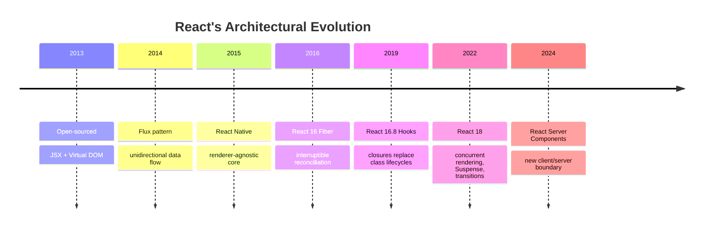

## 3. Why It Exists

React exists to solve a problem that predates it: **keeping a rendered UI in
sync with changing application state, at scale, without the developer manually
tracking every mutation.** Before React, the dominant pattern (jQuery-style
direct DOM manipulation, or two-way-binding frameworks) required either
imperative "find this element, update its text" code scattered across the
codebase, or a two-way data-binding system that made it hard to trace *why* a
value changed, because any part of the UI could write back into the model.

React's answer was to make UI a **pure function of state**: `UI = f(state)`.
Instead of mutating the DOM in place, a component re-describes its entire
desired output every time its state changes, and React's reconciliation
algorithm computes the minimal set of real DOM mutations needed to get there.
This buys three architectural properties that are otherwise hard to get
simultaneously:

1. **Predictability.** Given the same props and state, a component always
   produces the same output — there is no hidden mutable path by which the UI
   can drift from the data that describes it.
2. **Composability.** Because components are just functions (or classes) that
   return a description of UI, they compose the same way ordinary functions
   do: nesting, passing data as arguments (props), and returning values
   (elements).
3. **Testability.** A pure "state in, UI description out" function can be
   tested without a browser, a DOM, or a running application — a foundational
   reason component-level unit testing became practical for frontend code.

The alternative architectures React was responding to — and which remain valid
choices for other contexts — are:

- **Imperative DOM manipulation** (jQuery-style): simple for small pages,
  intractable once dozens of UI regions can each affect each other's state.
- **Two-way data binding** (early Angular, Knockout): convenient for forms,
  but the implicit bidirectional sync makes large applications hard to reason
  about, because state can change from *either* direction without an explicit
  code path.
- **Template-compiled frameworks with fine-grained reactivity** (Svelte,
  SolidJS, Vue's reactivity system): skip the Virtual DOM entirely by
  compiling templates into code that directly updates only the DOM nodes a
  specific piece of state touches. This is a legitimate, often faster,
  alternative — React's bet is that a general-purpose diffing algorithm
  running in JavaScript, combined with scheduling, is flexible enough to
  match compiled fine-grained reactivity in the cases that matter, while
  staying a plain library callable from anywhere (not requiring a compiler
  step to work at all, though one is used for JSX transformation).

React exists, specifically, because Facebook's UI complexity (a News Feed with
many interdependent, frequently updating widgets) made ad hoc DOM mutation
unsustainable, and a declarative, component-based, diffed-update model proved
to scale where the imperative alternative did not.

## 4. Core Concepts

### 4.1 Components as the Unit of Architecture

A React **component** is a function (or, historically, a class) that accepts
an input — **props** — and returns a description of UI, expressed as a tree of
**React elements**. An element is not a DOM node; it is a lightweight,
immutable plain JavaScript object describing what should be rendered (a type,
props, and children), created either via `React.createElement()` calls or,
more commonly, JSX syntax that compiles down to those calls.

```jsx
// JSX
const greeting = <h1 className="title">Hello, {name}</h1>;

// Compiles to (roughly):
const greeting = React.createElement(
  "h1",
  { className: "title" },
  "Hello, ",
  name
);
```

This distinction — **element vs. component vs. DOM node** — is foundational
and frequently conflated by newcomers:

| Concept | What it is | Lifetime |
|---|---|---|
| Element | A plain object describing "render this type, with these props/children" | Recreated on every render, cheap to allocate/discard |
| Component | A function/class *definition* that produces elements | Defined once, invoked many times |
| Fiber | React's internal, mutable unit of work tracking a component instance across renders (Section 4.7) | Persists across renders, holds state, hooks, effects |
| DOM node | The real browser DOM object | Persists across renders unless replaced |

Components compose by nesting: a parent component's returned element tree can
include other components as elements, and React recursively renders the whole
tree. This composition is the architectural reason React scales to large
UIs — a 10,000-line application is, structurally, thousands of small pure
functions each responsible for a bounded piece of the tree, not one large
program with global mutable UI state.

### 4.2 Unidirectional Data Flow

React enforces (as a convention backed by the type system and idiomatic
patterns, not a hard runtime restriction) that data flows in one direction:

- **Props flow down** — a parent passes data to a child as props; a child
  cannot reach up and mutate its parent's state directly.
- **Events flow up** — a child communicates outward by invoking a callback
  function the parent passed to it as a prop (e.g., `onSave`, `onChange`);
  the parent decides how to respond, typically by updating its own state,
  which then flows back down as new props.

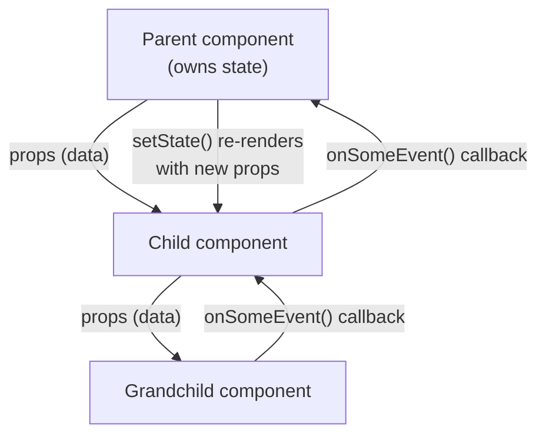

This is a deliberate architectural constraint, not an incidental limitation.
Its payoff is traceability: given a bug where the UI shows an unexpected
value, an engineer can trace the *single* path a value took — which
`useState` call owns it, which components it was passed through as props —
rather than searching for any of N places in the codebase that might have
written to a shared mutable value. The cost is that state needed by two
distant components must be "lifted" to their nearest common ancestor (or
moved into a shared store — Section 4.9), which can produce **prop drilling**
(passing a prop through several intermediate components that don't use it
themselves, only to hand it further down) in naively structured trees. Context
API and external stores exist specifically to relieve this cost without
abandoning the one-directional flow itself (data still flows down from
whichever component or store owns it — Context and stores do not reintroduce
two-way binding).

### 4.3 The Virtual DOM

The real browser DOM is expensive to query and mutate: each mutation can
trigger style recalculation, layout (reflow), and paint — the browser's
rendering pipeline. If a component's naive re-render strategy were "tear down
and rebuild every DOM node on every state change," performance would be
unusable for any UI beyond a toy example.

The **Virtual DOM (VDOM)** is React's solution: a plain-JavaScript, in-memory
tree of the element objects described in Section 4.1. On every render, React
builds a *new* Virtual DOM tree describing the desired UI, then compares
(**diffs**) it against the previous tree, and computes the minimal set of real
DOM operations required to reconcile the difference. Because comparing
JavaScript objects in memory is orders of magnitude cheaper than touching the
real DOM, this trade — spend CPU time diffing in memory to save expensive DOM
mutations — is almost always a net win, and it is the reason React needs no
input from the developer about *which* DOM nodes changed; the developer only
describes the desired end state.

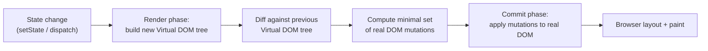

It is important to be precise about what the Virtual DOM is *not*: it is not
a performance optimization that makes React faster than direct DOM
manipulation in every case (a hand-tuned imperative update of a single known
node is always cheaper) — it is an architectural device that lets developers
write declarative "describe the end state" code while still getting close to
optimal DOM update batching, without manually tracking what changed.

### 4.4 Reconciliation: The Diffing Algorithm and Keys

**Reconciliation** is the algorithm that compares two Virtual DOM trees and
decides what changed. A fully general tree-diff algorithm is
$O(n^3)$ in the number of nodes $n$, which is infeasible for UI trees with
thousands of nodes updating on every keystroke. React's reconciler uses two
heuristics to reduce this to $O(n)$:

1. **Different element types produce different trees.** If a `<div>` is
   replaced by a `<span>` (or a custom component is replaced by a different
   component) at the same position, React does not attempt to diff their
   children at all — it tears down the old subtree (unmounting it, including
   running cleanup effects) and builds an entirely new one. This heuristic
   trades some missed optimization opportunities (a `<div>`→`<span>` swap
   that kept 90% of the same children *could* theoretically be diffed more
   cleverly) for a dramatic reduction in algorithmic complexity.
2. **Keys hint at element identity across renders for lists.** When rendering
   a list of children (via `.map()`, for example), React needs to know which
   child in the new list corresponds to which child in the old list, so it
   can update in place rather than destroy-and-recreate. Without a `key`
   prop, React falls back to matching by array index, which silently
   misattributes identity whenever items are reordered, inserted, or removed
   from anywhere but the end of the list — this is the single most common
   real-world React bug (input state, focus, animation state, or the
   `useState` inside a list item all remaining stuck to the wrong data after
   a reorder).

```jsx
// WRONG: index as key — breaks identity on reorder/insert/remove
{todos.map((todo, index) => (
  <TodoItem key={index} todo={todo} />
))}

// RIGHT: stable, unique identity per item
{todos.map((todo) => (
  <TodoItem key={todo.id} todo={todo} />
))}
```

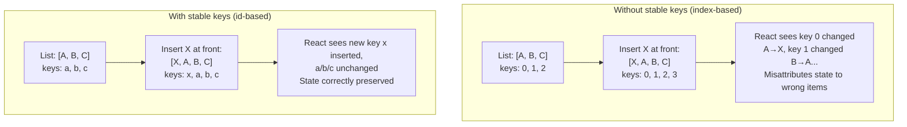

The failure mode this heuristic causes — and the reason `key` is not
optional cosmetic advice — is that a component's local state (a `useState`
call inside a list item, an uncontrolled `<input>`'s cursor position, a CSS
transition mid-flight) lives on the **fiber** (Section 4.7) associated with a
given position/key in the tree, not on the data value itself. If keys are
wrong, React can reuse the wrong fiber for the wrong data, and the UI will
show stale state attached to the wrong row.

### 4.5 Hooks as a Closure-Based State Model

Before React 16.8, only class components could hold state and run
side-effectful logic (via lifecycle methods like `componentDidMount`). This
had two structural problems: logically related code (e.g., "subscribe to an
event on mount, unsubscribe on unmount") was split across two different
lifecycle methods, and reusing stateful logic across components required
patterns (higher-order components, render props) that added extra nesting
layers to the component tree ("wrapper hell").

**Hooks** solve both problems by letting function components hold state
without becoming classes, using ordinary JavaScript closures (see
[JavaScript — Closures and Lexical Scoping](CH03_JavaScript.md#closures) for
the underlying language mechanism, recapped only briefly here). The core
insight: React keeps a persistent array of "hook state" attached to a
component's fiber, and each Hook call in the component body reads/writes one
slot in that array, in call order.

```jsx
function Counter() {
  const [count, setCount] = useState(0); // slot 0
  const [name, setName] = useState("");  // slot 1

  useEffect(() => {                       // slot 2 (effect)
    document.title = `${name}: ${count}`;
  }, [name, count]);

  return (
    <button onClick={() => setCount(count + 1)}>
      {name}: {count}
    </button>
  );
}
```

- **`useState`** returns a `[value, setter]` pair. Calling the setter does not
  mutate `count` in place — it schedules a re-render with a new value stored
  in that hook's slot. This is why `count` inside a given render's closure is
  always the value it was *at the time that function ran* — a critical and
  frequently misunderstood point, discussed further as the "stale closure"
  failure mode in Section 17.
- **`useEffect`** registers a function to run *after* the commit phase
  (Section 5), optionally cleaning up before the next effect run or on
  unmount. It replaces the split `componentDidMount` /
  `componentDidUpdate` / `componentWillUnmount` trio with one co-located piece
  of logic, parameterized by a **dependency array** that tells React when the
  effect needs to re-run.
- **`useMemo`** memoizes an expensive *computed value* across renders, only
  recomputing when its dependency array changes — an architectural tool for
  avoiding redundant work, not a correctness mechanism (removing it changes
  performance, not behavior, assuming the computation is pure).
- **`useCallback`** memoizes a *function reference* itself across renders,
  which matters specifically because a new function is created on every
  render by default, and passing a "new" function as a prop to a memoized
  child (`React.memo`, Section 6) defeats that child's memoization unless the
  function reference is stable.

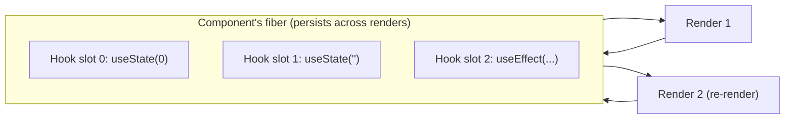

### 4.6 The Rules of Hooks (and Why They Are Architectural, Not Stylistic)

React enforces two rules for Hooks, checked at build time by the
`eslint-plugin-react-hooks` lint rule:

1. **Only call Hooks at the top level** — never inside loops, conditions, or
   nested functions.
2. **Only call Hooks from React function components or custom Hooks** — never
   from plain JavaScript functions.

These are not stylistic conventions; they are a direct consequence of *how*
Hooks are implemented (Section 4.5): React identifies each Hook's state slot
by **call order**, not by name or an explicit key. If a Hook call is placed
inside a conditional and that condition's truth value changes between two
renders, the *n*-th Hook call in render 2 no longer refers to the same
logical Hook as the *n*-th call in render 1 — React has no way to detect this
mismatch except by the state appearing corrupted (a `useState` returning a
value that belongs to a different variable, or an effect's cleanup running
with stale dependencies).

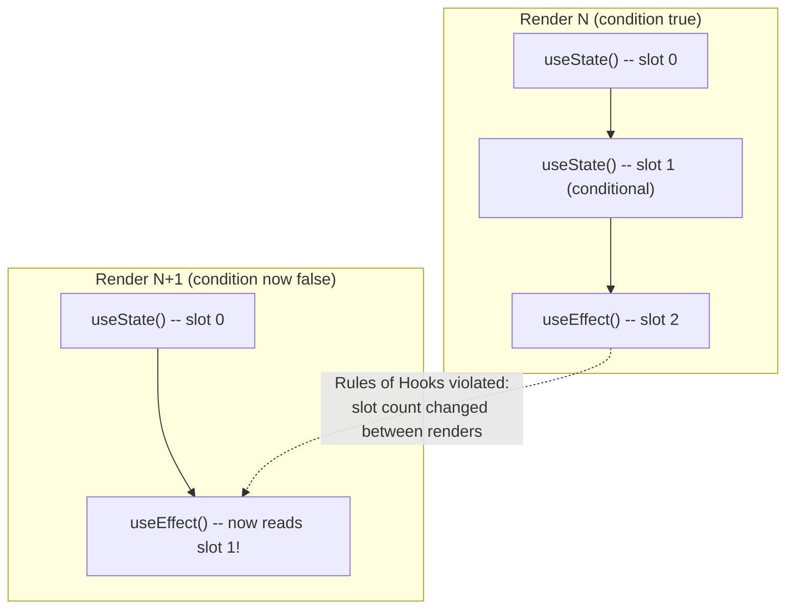

```jsx
// WRONG: conditional Hook call shifts every subsequent slot index
function Bad({ isLoggedIn }) {
  if (isLoggedIn) {
    const [user, setUser] = useState(null); // sometimes slot 0, sometimes doesn't exist
  }
  const [theme, setTheme] = useState("light"); // slot shifts depending on isLoggedIn!
}

// RIGHT: unconditional Hook call, condition applied to the value/logic instead
function Good({ isLoggedIn }) {
  const [user, setUser] = useState(null); // always slot 0
  const [theme, setTheme] = useState("light"); // always slot 1
  const displayUser = isLoggedIn ? user : null;
}
```

**Custom Hooks** — ordinary functions whose name starts with `use` and which
call other Hooks internally — are React's mechanism for extracting and
reusing stateful logic (e.g., `useFetch(url)`, `useLocalStorage(key)`) without
a wrapper component. Because a custom Hook is "just a function that calls
Hooks," each call site gets its own independent state (its own slots on the
calling component's fiber) — this is the architectural reason custom Hooks
replaced higher-order components and render props as React's preferred reuse
mechanism: no extra component nesting, no prop-name collisions, and locally
scoped state per usage.

### 4.7 The Fiber Architecture: Interruptible Rendering

React's original reconciler (pre-16) walked the component tree recursively:
rendering a parent called into rendering its children synchronously, all the
way down, with no way to pause partway through. For a sufficiently large
tree, this recursive walk could occupy the main thread long enough to miss a
frame deadline (browsers target roughly 16.6ms per frame for 60fps), causing
visibly janky input handling or animation.

**Fiber** is a from-scratch reimplementation of the reconciler as an
explicit, linked-list-like data structure — one **fiber node** per component
instance/DOM element — instead of a recursive call stack. Each fiber holds:
the component type, its current props/state, pointers to its child, sibling,
and return (parent) fiber, and a pointer to its "alternate" fiber (the
previous render's version of the same node, used for diffing).

Because the tree walk is now an explicit loop over a linked structure instead
of the JavaScript call stack, React can **pause after any fiber**, yield
control back to the browser to handle a higher-priority task (like a
keystroke), and **resume** later exactly where it left off — this is what
"interruptible rendering" means concretely. This is the mechanical
foundation that makes concurrent rendering, Suspense, and transitions
(Section 5) possible at all; none of them would be implementable on the old
recursive-stack reconciler.

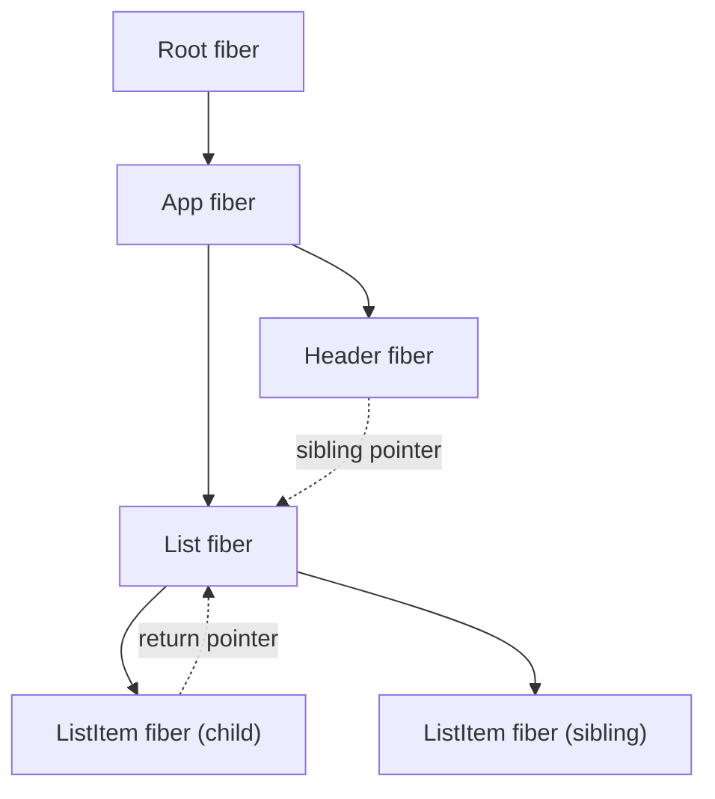

Two fiber trees exist simultaneously during a render: the **current** tree
(reflecting what's on screen) and the **work-in-progress** tree (being built
for the next render). When the work-in-progress tree is complete, React swaps
which tree is "current" — a technique called **double buffering**, directly
analogous to double-buffered graphics rendering, ensuring the screen never
shows a partially updated tree.

### 4.8 State Management Architecture: Local State, Context, and External Stores

State management in React is a spectrum, not a single mechanism, and the
architectural skill is choosing the *right point* on that spectrum for a
given piece of state — not defaulting to the most powerful tool everywhere.

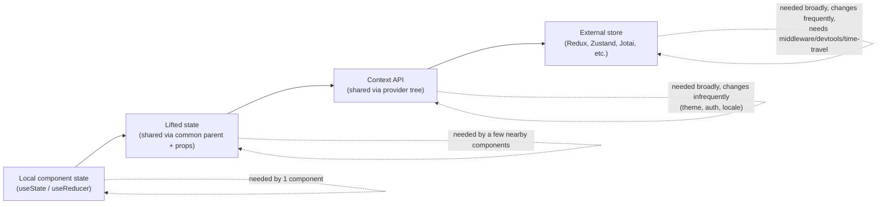

- **Local state** (`useState`/`useReducer` scoped to one component) is the
  default and should remain the default until a concrete need to share state
  emerges. Most component state (an input's current text, whether a dropdown
  is open) never needs to leave the component that owns it.
- **Lifted state** moves state up to the nearest common ancestor of the
  components that need it, passed back down as props (Section 4.2). This is
  the correct first move when two sibling components need to share state —
  it requires no new library or API, only restructuring where the
  `useState` call lives.
- **Context API** (`createContext`/`useContext`) solves prop drilling for
  state that many components across different branches of the tree need, by
  letting a `Provider` make a value available to any descendant that reads it
  via `useContext`, without passing it through every intermediate component's
  props. Context's architectural trade-off: **any** component consuming a
  context re-renders whenever that context's value changes, with no built-in
  mechanism to subscribe to only part of the value — this makes Context
  well-suited to state that changes infrequently (theme, authenticated user,
  locale) and poorly suited to state that changes on every keystroke or
  frame (that would re-render every consumer on every change).
- **External stores** (Redux, Zustand, Jotai, Recoil, MobX, and similar) exist
  because Context does not provide: selective re-rendering (subscribing to a
  slice of state without re-rendering on unrelated changes), middleware
  (logging, persistence, undo/redo), time-travel debugging, or a state shape
  that lives outside the React tree entirely (useful when non-React code, or
  code executing outside any component, needs to read/write the same state).
  The trade-off is added indirection, a learning curve, and (for some stores)
  boilerplate — justified when the scale or cross-cutting nature of shared
  state outgrows what Context and prop-lifting can cleanly express.

The **architectural decision criteria** (not a library-by-library feature
comparison — that is implementation detail, not architecture) are:

1. **Scope**: how many components, and how far apart in the tree, need this
   state?
2. **Update frequency**: does this state change on every keystroke/frame, or
   rarely (once per session, once per navigation)?
3. **Origin**: does this state need to be read or written from outside React
   (a WebSocket handler, a non-React module, a test harness)?
4. **Tooling need**: does the team need time-travel debugging, persistence, or
   middleware-based side-effect handling (sagas, listeners)?

A common anti-pattern this criteria set prevents: reaching for Redux (or any
external store) for state that is genuinely local to one component subtree,
which adds indirection and boilerplate with no corresponding architectural
benefit (see Section 19, Anti-Patterns).

### 4.9 The Render Phase vs. the Commit Phase

React splits every update into two distinct phases, and understanding this
split explains several rules that otherwise seem arbitrary:

1. **Render phase**: React calls component functions to determine what the UI
   *should* look like — building the work-in-progress fiber tree (Section
   4.7) and computing the diff against the current tree. This phase **must be
   pure** — no side effects, no DOM mutation — because in concurrent rendering
   (Section 5) React may start, pause, discard, or restart a render phase
   multiple times before ever committing it, and any side effect run during
   an eventually-discarded render would fire spuriously.
2. **Commit phase**: React applies the computed DOM mutations synchronously,
   in one uninterruptible pass, then runs any registered `useEffect`/
   `useLayoutEffect` callbacks. This phase is **never interrupted or
   restarted** — once React begins committing, the DOM update completes
   before the browser is allowed to paint (for `useLayoutEffect`) or shortly
   after (for `useEffect`).

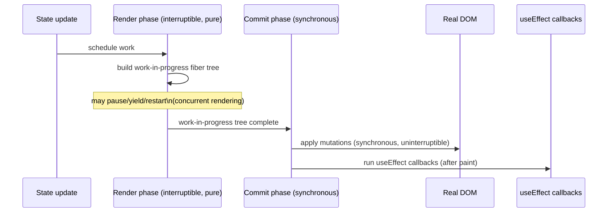

This split is the direct explanation for why component function bodies must
be pure (no `fetch()` calls, no `document.title = ...` directly in the
render body) and why such side effects belong in `useEffect` — only the
commit phase (and effects running after it) offers the guarantee that the
work is not being discarded mid-flight.

### 4.10 Concurrent Rendering, Suspense, and Transitions

React 18 introduced **concurrent rendering**: the ability to prepare more
than one version of the UI in memory and interrupt a lower-priority render in
favor of a higher-priority one, made possible by the fiber architecture's
pause/resume capability (Section 4.7). This is opt-in — enabled by using the
concurrent-capable root API (`createRoot`) — and exposed to application code
through two primitives:

- **`useTransition`** marks a state update as a **transition**: a lower
  priority update whose rendering React is allowed to interrupt if a more
  urgent update (like a keystroke) comes in during that render. This is used
  for state updates that produce a possibly-expensive re-render but do not
  need to feel instantaneous (e.g., filtering a large list as the user
  types) — the input itself stays responsive because its own update is not
  marked as a transition and always takes priority.
- **`useDeferredValue`** produces a value that "lags behind" the real value
  during high-priority interruptions, letting a component render with a
  slightly stale value while a fresher render is prepared in the background,
  without the caller needing to manage a transition explicitly.
- **Suspense** lets a component "suspend" rendering (by throwing a promise
  internally — the mechanism data-fetching libraries and RSC use) while an
  asynchronous dependency (code being lazily loaded, or data being fetched)
  resolves, and declaratively show a fallback UI in the meantime via a
  `<Suspense fallback={...}>` boundary, without manual loading-state
  bookkeeping in every component that fetches data.

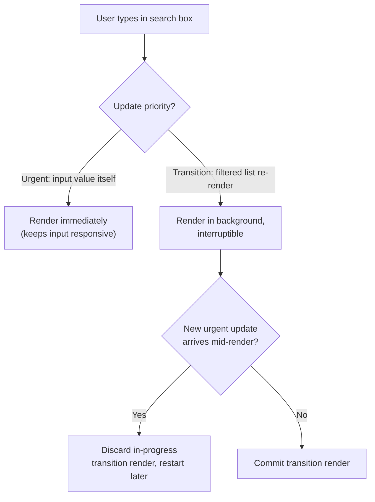

The architectural significance for a Solution Architect: concurrent rendering
does not change *what* a component renders, only *when and whether* an
in-progress render is allowed to be interrupted — it is a scheduling
architecture layered on top of the same reconciliation model from Section
4.4, not a new rendering model.

### 4.11 React Server Components (RSC): A New Client/Server Boundary

**React Server Components (RSC)** are a component type that executes
exclusively on the server (or at build time), and whose JavaScript is never
sent to the browser at all — not "sent, then not re-executed" (that is what
SSR does), but never shipped as client-side JavaScript in the first place.
This is a genuinely new architectural primitive, not a rebranding of SSR, and
the distinction matters:

| | Traditional SSR | React Server Components |
|---|---|---|
| Where does the component render? | Server (first render) **and** client (hydration re-render) | Server (or build time) **only** |
| Is the component's JS shipped to the browser? | Yes — required for hydration | No — zero client bundle impact |
| Can the component hold client-side state/effects? | Yes, after hydration | No — RSC cannot use `useState`/`useEffect` |
| Can it access server-only resources directly (database, filesystem, secrets)? | Only during the server-render pass; awkward to express | Yes, natively, as an `async` function body |
| Composition with client-interactive components | Whole tree hydrates uniformly | RSC and Client Components interleave in one tree |

An RSC can be an `async` function component that queries a database or reads
a file directly in its body — there is no client-side re-execution to keep
consistent with a server-rendered HTML string, because the client never
receives that component's code at all. Interactive parts of the tree
(anything using `useState`, `useEffect`, event handlers, or browser-only
Application Programming Interfaces (APIs)) are explicitly marked as **Client
Components** (conventionally via a `"use client"` directive at the top of the
file) and are the boundary at which client-side JavaScript actually begins.

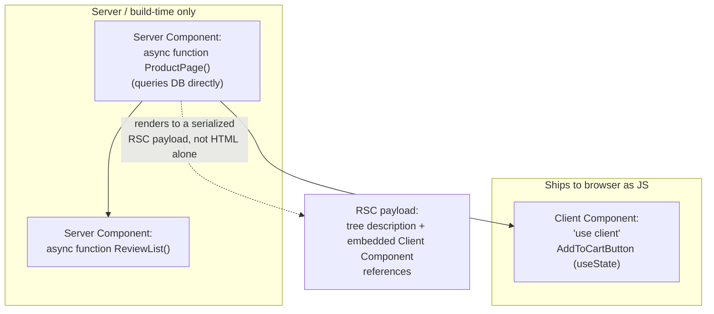

The **RSC payload** is not plain HTML — it is a serialized description of the
rendered tree (including where Client Component boundaries are and what
props they need), which the client runtime uses to reconstruct the DOM and
hydrate only the Client Component subtrees, never the Server Component ones
(because there is no client-side code for them to hydrate into). This is why
RSC dramatically reduces client bundle size for content-heavy, low-interactivity
pages: components that only fetch and display data ship zero bytes of
JavaScript, and only genuinely interactive leaves pay the client-JS cost.

RSC's architectural trade-off: Server Components cannot use Hooks, browser
APIs, or event handlers (they have no client-side lifecycle at all), which
means every component must be explicitly designed as either a data-fetching/
composition component (server) or an interactive leaf (client) — a boundary
decision that did not exist before RSC and that teams must now make
deliberately for every component. RSC also requires a framework capable of
supporting the server/build infrastructure to produce and stream RSC
payloads — React itself defines the component model and payload format, but
[Next.js](CH07_Nextjs.md) (a separate chapter) is the primary framework
implementing RSC support in production today; this chapter teaches the RSC
component model itself, not Next.js's specific routing/build integration of it.

## 5. Internal Working

Putting Sections 4.3, 4.4, 4.7, and 4.9 together, a single state update flows
through React's internals as follows:

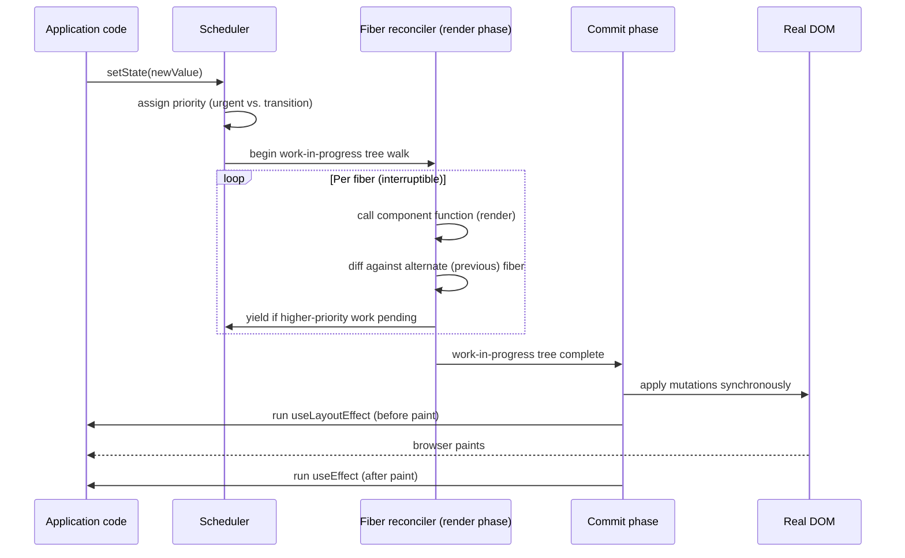

Three details are worth internalizing precisely, because they explain common
production bugs (Section 17):

- **Batching**: React batches multiple `setState` calls that occur within the
  same event handler (and, since React 18, within promises, timeouts, and
  native event handlers too) into a single re-render, rather than
  re-rendering once per call. This is why reading a state variable
  immediately after calling its setter, inside the same function, still shows
  the *old* value — the setter schedules an update; it does not mutate
  synchronously.
- **The alternate fiber**: every fiber has a pointer to its previous render's
  version, which is how `useMemo`/`useCallback`/`useEffect` dependency arrays
  are compared (`Object.is` per-element comparison against the alternate's
  stored array) to decide whether to recompute or re-run.
- **Effects run after paint, layout effects run before**: `useEffect`
  callbacks are deliberately deferred until after the browser paints, so they
  never block visual updates; `useLayoutEffect` runs synchronously after DOM
  mutation but before paint, for the rare cases (measuring a DOM node's
  layout, then adjusting before the user sees a flash) where post-paint
  timing would cause visible flicker.

## 6. Design Principles

- **Composition over inheritance.** React components compose via nesting and
  the `children` prop, not via class inheritance hierarchies. A component
  that needs to "extend" another's behavior wraps it or accepts it as
  `children`/a render prop, rather than subclassing it.
- **Single responsibility per component.** A component should own one
  coherent piece of UI and, ideally, one piece of state. Components that grow
  to own many unrelated pieces of state are a signal to split them.
- **Colocate state with its natural owner** (Section 4.8) — lift state only
  as high as the components that actually need it, no higher, to minimize
  the blast radius of re-renders and keep state ownership traceable.
- **Pure render, effects for side effects** (Section 4.9) — anything that
  reaches outside the component (network calls, subscriptions, direct DOM
  measurement) belongs in `useEffect`/`useLayoutEffect`, never in the
  component body itself.
- **Memoization is an optimization, applied deliberately, not a default.**
  `React.memo`, `useMemo`, and `useCallback` all have a real cost (extra
  comparison work, extra memory for cached values) and should be applied
  where profiling shows a re-render or recomputation is actually expensive —
  not wrapped around every component and value reflexively (see Section 17).
- **Unopinionated core, opinionated application layer.** React's own design
  principle: keep the library's surface area minimal (rendering + component
  model + Hooks) and leave routing, data fetching, and state management to
  the ecosystem — explored fully in Section 21 against Angular's approach.

## 7. Architecture Patterns

- **Container/Presentational split** — separating components that fetch data
  and manage state ("containers") from components that only render given
  props ("presentational"). Largely superseded by Hooks (a container's logic
  can be extracted into a custom Hook instead of a wrapper component), but
  still a useful mental model for separating "what data" from "how it looks."
- **Compound components** — a parent component and a set of child components
  that implicitly share state via Context, presented as a single cohesive
  Application Programming Interface (API) (e.g., `<Tabs><Tabs.Tab/><Tabs.Panel/></Tabs>`),
  letting consumers rearrange or omit children while the parent coordinates
  shared behavior invisibly.
- **Render props and custom Hooks for logic reuse** — render props (a prop
  whose value is a function returning UI) were the pre-Hooks solution for
  sharing stateful logic across components; custom Hooks (Section 4.6) are
  now preferred because they avoid the extra component-tree nesting render
  props require.
- **Controlled vs. uncontrolled components** — a controlled input's value is
  driven entirely by React state (`value={state}` + `onChange`); an
  uncontrolled input keeps its own internal DOM state, read via a `ref` only
  when needed. Controlled components give React full visibility and
  validation control at the cost of a re-render per keystroke; uncontrolled
  components trade that visibility for lower overhead, appropriate for
  simple forms or file inputs where DOM state is the natural source of truth.

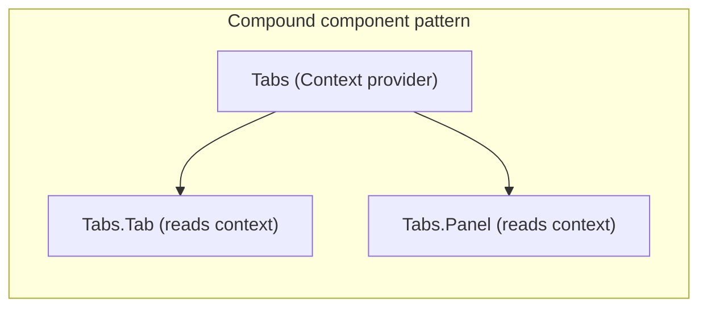

## 8. Production Architecture

A production React application typically layers as follows:

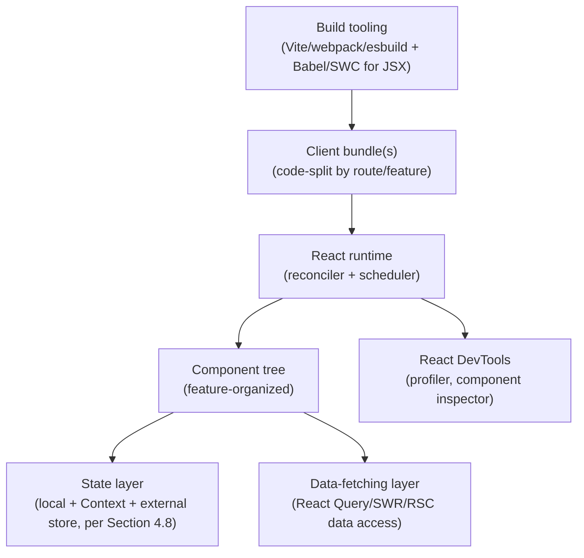

Production concerns layered on top of the core rendering architecture
include: route-based code-splitting (`React.lazy` + `Suspense`) so the
initial bundle only includes what the landing route needs; a dedicated
data-fetching/caching layer (React Query, SWR, or RSC's server-side data
access) rather than ad hoc `useEffect` fetches scattered across components;
and an error-boundary strategy (Section 15) so one component's render error
does not blank the entire application.

## 9. Implementation

A minimal but representative component demonstrating the concepts from
Section 4 together — local state, an effect with cleanup, memoization, and
correct list keys:

```tsx
import { useState, useEffect, useMemo, useCallback } from "react";

interface Order {
  id: string;
  total: number;
  status: "pending" | "shipped" | "delivered";
}

interface OrderListProps {
  customerId: string;
}

function OrderList({ customerId }: OrderListProps) {
  const [orders, setOrders] = useState<Order[]>([]);
  const [filter, setFilter] = useState<Order["status"] | "all">("all");

  // Side effect: data fetching, with cleanup to avoid a stale-response
  // race condition if customerId changes before the fetch resolves.
  useEffect(() => {
    let cancelled = false;

    async function loadOrders() {
      const response = await fetch(`/api/customers/${customerId}/orders`);
      const data: Order[] = await response.json();
      if (!cancelled) {
        setOrders(data);
      }
    }

    loadOrders();
    return () => {
      cancelled = true;
    };
  }, [customerId]);

  // Memoized derived value: only recomputes when orders or filter change.
  const visibleOrders = useMemo(() => {
    return filter === "all"
      ? orders
      : orders.filter((order) => order.status === filter);
  }, [orders, filter]);

  // Memoized callback: stable reference so <OrderRow> (wrapped in
  // React.memo) does not re-render on every OrderList render.
  const handleStatusChange = useCallback(
    (orderId: string, status: Order["status"]) => {
      setOrders((prev) =>
        prev.map((order) =>
          order.id === orderId ? { ...order, status } : order
        )
      );
    },
    []
  );

  return (
    <div>
      <FilterControl value={filter} onChange={setFilter} />
      <ul>
        {visibleOrders.map((order) => (
          <OrderRow key={order.id} order={order} onStatusChange={handleStatusChange} />
        ))}
      </ul>
    </div>
  );
}
```

## 10. Complete Code Examples

### 10.1 A Custom Hook Encapsulating Reusable Stateful Logic

```tsx
import { useState, useEffect, useRef } from "react";

// A custom Hook: reusable "subscribe to window size" logic, with
// its own independent state per call site (Section 4.6).
function useWindowSize(): { width: number; height: number } {
  const [size, setSize] = useState({
    width: window.innerWidth,
    height: window.innerHeight,
  });

  useEffect(() => {
    function handleResize() {
      setSize({ width: window.innerWidth, height: window.innerHeight });
    }
    window.addEventListener("resize", handleResize);
    return () => window.removeEventListener("resize", handleResize);
  }, []);

  return size;
}

// A second custom Hook composing a ref + effect, demonstrating that
// custom Hooks can call other Hooks and be composed like any function.
function useDebouncedValue<T>(value: T, delayMs: number): T {
  const [debounced, setDebounced] = useState(value);
  const timeoutRef = useRef<ReturnType<typeof setTimeout>>();

  useEffect(() => {
    clearTimeout(timeoutRef.current);
    timeoutRef.current = setTimeout(() => setDebounced(value), delayMs);
    return () => clearTimeout(timeoutRef.current);
  }, [value, delayMs]);

  return debounced;
}

function SearchBox() {
  const { width } = useWindowSize();
  const [query, setQuery] = useState("");
  const debouncedQuery = useDebouncedValue(query, 300);

  return (
    <input
      style={{ width: width > 768 ? 400 : "100%" }}
      value={query}
      onChange={(e) => setQuery(e.target.value)}
      placeholder={`Search (debounced: "${debouncedQuery}")`}
    />
  );
}
```

### 10.2 Context API for Broadly Shared, Infrequently Changing State

```tsx
import { createContext, useContext, useState, ReactNode } from "react";

type Theme = "light" | "dark";

interface ThemeContextValue {
  theme: Theme;
  toggleTheme: () => void;
}

// Context created with an explicit `undefined` default so consumers
// outside a Provider fail loudly rather than silently using a wrong default.
const ThemeContext = createContext<ThemeContextValue | undefined>(undefined);

function ThemeProvider({ children }: { children: ReactNode }) {
  const [theme, setTheme] = useState<Theme>("light");
  const toggleTheme = () => setTheme((t) => (t === "light" ? "dark" : "light"));

  return (
    <ThemeContext.Provider value={{ theme, toggleTheme }}>
      {children}
    </ThemeContext.Provider>
  );
}

// Custom Hook wrapping useContext with a runtime guard — the idiomatic
// pattern for consuming Context safely with a helpful error message.
function useTheme(): ThemeContextValue {
  const context = useContext(ThemeContext);
  if (context === undefined) {
    throw new Error("useTheme must be used within a ThemeProvider");
  }
  return context;
}

function ThemedButton() {
  const { theme, toggleTheme } = useTheme();
  return (
    <button onClick={toggleTheme} className={`btn-${theme}`}>
      Current theme: {theme}
    </button>
  );
}
```

### 10.3 An Error Boundary (Class Component — the One Case Hooks Cannot Replace)

```tsx
import { Component, ReactNode, ErrorInfo } from "react";

interface ErrorBoundaryProps {
  fallback: ReactNode;
  children: ReactNode;
}

interface ErrorBoundaryState {
  hasError: boolean;
}

// Error boundaries have no Hook equivalent as of React 19 — they must be
// class components, because they rely on the getDerivedStateFromError/
// componentDidCatch lifecycle pair to intercept render-time errors from
// descendants, which no Hook currently exposes.
class ErrorBoundary extends Component<ErrorBoundaryProps, ErrorBoundaryState> {
  state: ErrorBoundaryState = { hasError: false };

  static getDerivedStateFromError(): ErrorBoundaryState {
    return { hasError: true };
  }

  componentDidCatch(error: Error, info: ErrorInfo): void {
    // Send to an observability pipeline (Section 14) rather than
    // console-only logging in production.
    reportError(error, info.componentStack);
  }

  render(): ReactNode {
    if (this.state.hasError) {
      return this.props.fallback;
    }
    return this.props.children;
  }
}

function reportError(error: Error, componentStack: string | null | undefined): void {
  // Placeholder: forward to Sentry/Datadog/等 observability backend.
}
```

### 10.4 A Server Component Composed with a Client Component (RSC Boundary)

```tsx
// ProductPage.tsx — a Server Component (no directive = server by default
// in an RSC-enabled framework). Runs only on the server; queries the
// database directly; ships zero JavaScript to the client for this file.
import { AddToCartButton } from "./AddToCartButton";
import { getProductById } from "./db";

interface ProductPageProps {
  productId: string;
}

async function ProductPage({ productId }: ProductPageProps) {
  const product = await getProductById(productId); // direct DB access, server-only

  return (
    <article>
      <h1>{product.name}</h1>
      <p>{product.description}</p>
      <p>${product.priceCents / 100}</p>
      {/* Client Component boundary: this is the only part of the tree
          that ships interactive JavaScript to the browser. */}
      <AddToCartButton productId={product.id} />
    </article>
  );
}

export default ProductPage;
```

```tsx
// AddToCartButton.tsx — a Client Component. The "use client" directive
// marks the boundary: this file's JS is bundled and sent to the browser,
// and everything it imports is bundled too.
"use client";

import { useState } from "react";

interface AddToCartButtonProps {
  productId: string;
}

export function AddToCartButton({ productId }: AddToCartButtonProps) {
  const [adding, setAdding] = useState(false);

  async function handleClick() {
    setAdding(true);
    await fetch("/api/cart", {
      method: "POST",
      body: JSON.stringify({ productId }),
    });
    setAdding(false);
  }

  return (
    <button onClick={handleClick} disabled={adding}>
      {adding ? "Adding..." : "Add to Cart"}
    </button>
  );
}
```

## 11. Performance

React performance work operates at three levels, and diagnosing a slowdown
means identifying which level is actually at fault before reaching for a fix:

1. **Unnecessary re-renders** — a component re-rendering when neither its
   props nor state meaningfully changed. Diagnosed with React DevTools'
   Profiler (which highlights re-rendered components per commit) and fixed
   with `React.memo` (skips re-render if props are shallow-equal),
   `useMemo`/`useCallback` (Section 4.5, stabilizing values/references passed
   as props), or restructuring state ownership so unrelated components don't
   share a re-render trigger.
2. **Expensive render-phase computation** — a component's render function
   itself doing heavy work (large array transforms, expensive formatting) on
   every render. Fixed with `useMemo` around the specific computation, or by
   moving the work out of the render path entirely (e.g., into a Web Worker
   for a real background computation — see
   [JavaScript — Web Workers Architecture](CH03_JavaScript.md)).
3. **List rendering at scale** — rendering thousands of DOM nodes at once,
   independent of React's own overhead, is expensive for the browser itself.
   Fixed with **windowing/virtualization** (rendering only the list items
   currently visible in the viewport, via libraries like `react-window` or
   `react-virtual`), not a React-specific technique but essential once list
   size crosses roughly a few hundred items.

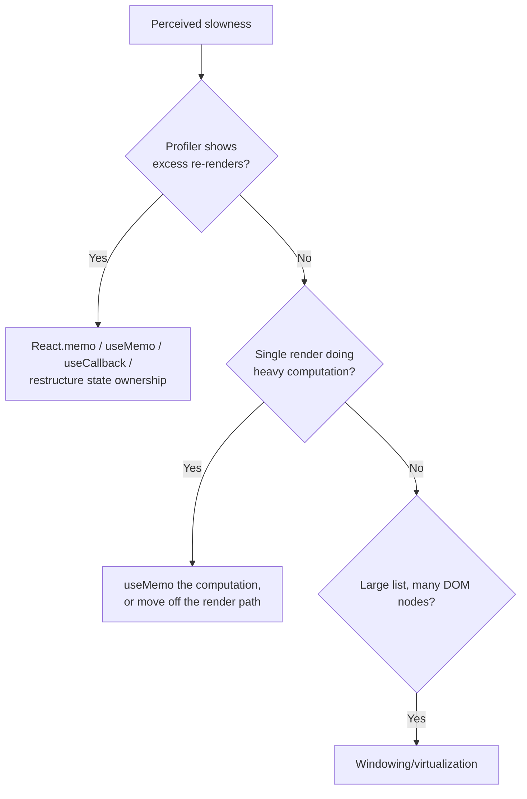

## 12. Scalability

"Scalability" for a React application means the codebase and the running
application both scale — as component count and team size grow — without a
proportional increase in coordination overhead or runtime cost:

- **Code-splitting by route/feature** (`React.lazy` + `Suspense`) keeps the
  initial bundle bounded regardless of total application size, loading each
  feature's code only when navigated to.
- **Feature-folder organization** (grouping a feature's components, hooks,
  and state together) rather than type-based organization (`components/`,
  `hooks/`, `reducers/` as separate top-level folders) scales better for
  large teams, because most changes touch one feature folder rather than
  several type-based folders simultaneously.
- **State architecture scales by scope discipline** (Section 4.8) — an
  application-wide store holding state that only one feature needs is a
  scalability anti-pattern, because it couples unrelated features through a
  shared store shape.
- **Server Components (Section 4.11) scale client bundle size sublinearly**
  with application size — as content-heavy, low-interactivity sections grow,
  they add zero client JavaScript, only server-rendered payload, keeping the
  client bundle bounded by the *interactive surface area* rather than total
  application size.

## 13. Security

React provides real, structural security guarantees, but only within specific
boundaries — understanding those boundaries precisely matters more than a
vague sense that "React is safe":

- **JSX auto-escapes interpolated values**, preventing the most common
  Cross-Site Scripting (XSS) vector: `<p>{userInput}</p>` renders `userInput`
  as text, never as parsed HTML, even if it contains `<script>` tags. This
  protection is automatic and does not require developer action.
- **`dangerouslySetInnerHTML` deliberately opts out of that protection** — its
  intentionally alarming name is a design choice, signaling that any value
  passed through it (e.g., raw HTML from a Content Management System (CMS) or
  rich-text editor) must be sanitized (e.g., with DOMPurify) before reaching
  it, because React will not escape it.
- **RSC (Section 4.11) introduces a new secret-handling boundary**: because
  Server Components run exclusively server-side, they can safely hold API
  keys, database credentials, or other secrets in their scope, as long as
  those values are never passed as props into a Client Component (doing so
  would serialize them into the RSC payload sent to the browser) — this is a
  genuinely new class of mistake specific to RSC architectures, not present
  in traditional SSR.
- **Client-side state is not a security boundary.** Any value held in
  `useState`, Context, or an external store is visible and mutable via
  browser DevTools; authorization decisions must always be enforced
  server-side (see [REST](../08_API_Architecture/CH01_REST.md) for API-level
  authorization), never inferred from client-side state alone.

## 14. Observability

Frontend observability for a React application layers on top of standard web
observability (see [HTTP](../05_Networking_and_OS/CH01_HTTP.md) for
transport-level tracing) with React-specific signals:

- **Error boundaries** (Section 10.3) are the primary hook point for
  forwarding render-time errors to an observability backend
  (`componentDidCatch`), since uncaught errors in a component's render will
  otherwise only appear in the browser console.
- **React DevTools Profiler** records per-commit timing (which components
  rendered, how long each took, and why — "props changed" vs. "state
  changed" vs. "parent re-rendered") and is the primary local debugging tool
  for the performance questions in Section 11.
- **Core Web Vitals** (Largest Contentful Paint, Interaction to Next Paint,
  Cumulative Layout Shift) remain the user-facing performance metrics that
  matter regardless of framework; React-specific concerns (hydration timing,
  Suspense fallback duration) show up as contributing factors to these
  metrics rather than as separate metrics of their own.

## 15. Failure Scenarios

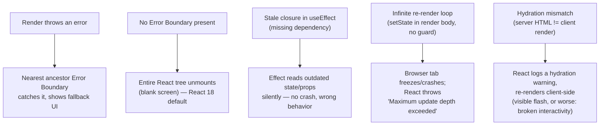

- **No Error Boundary present**: an uncaught render error unmounts the entire
  tree below the root, producing a blank page — the primary reason
  production applications wrap route-level (at minimum) or component-level
  (for resilience) boundaries around risky subtrees.
- **Stale closures**: an effect or callback capturing a prop/state value from
  an earlier render because it was omitted from the dependency array — the
  code runs without error but silently uses outdated data. The
  `exhaustive-deps` lint rule (part of `eslint-plugin-react-hooks`) exists
  specifically to catch this class of bug at build time.
- **Infinite render loops**: calling a state setter unconditionally in the
  render body (rather than inside `useEffect`) re-triggers a render, which
  calls the setter again — React detects this pattern and throws rather than
  hanging the browser tab indefinitely.
- **Hydration mismatches** (relevant when React hydrates server-rendered
  HTML, whether via traditional SSR or an RSC-based framework): if the
  client's first render produces different output than the server-rendered
  HTML (e.g., due to `Date.now()`, `Math.random()`, or `window`-dependent
  logic run during render), React logs a warning and discards the mismatched
  DOM, re-rendering client-side — visible as a layout flash, and in the worst
  case a click handler firing on the wrong (pre-mismatch) element momentarily.

## 16. Testing

React components are tested at three complementary levels:

- **Unit tests** for pure logic extracted from components (custom Hooks,
  utility functions, reducers) — testable with plain Jest/Vitest, no
  rendering required.
- **Component tests** using React Testing Library, which deliberately tests
  components the way a user interacts with them (querying rendered text,
  labels, and roles, then firing real DOM events) rather than inspecting
  internal component state or implementation details — a philosophy
  encoded in the library's own guiding principle: "the more your tests
  resemble the way your software is used, the more confidence they can give
  you."
- **End-to-end tests** (Playwright, Cypress) exercising the full application
  in a real browser, including routing, network calls, and, where relevant,
  the RSC server/client boundary end-to-end.

```tsx
import { render, screen, fireEvent } from "@testing-library/react";
import { describe, it, expect } from "vitest";

describe("Counter", () => {
  it("increments the displayed count on click", () => {
    render(<Counter />);
    const button = screen.getByRole("button");
    expect(button).toHaveTextContent(": 0");

    fireEvent.click(button);
    expect(button).toHaveTextContent(": 1");
  });
});
```

## 17. Common Mistakes

- **Using array index as `key` in a reorderable/filterable list** (Section
  4.4) — causes state, focus, and animation to attach to the wrong item after
  a reorder or insertion.
- **Missing dependency array entries in `useEffect`** — produces stale
  closures (Section 15) that silently use outdated props/state; the
  `exhaustive-deps` lint rule catches most cases but suppressing it without
  understanding why is a frequent root cause of production bugs.
- **Overusing `useMemo`/`useCallback` reflexively** — wrapping every value and
  function regardless of whether the child consuming it is actually memoized
  or the computation is actually expensive; this adds comparison overhead and
  code complexity with no corresponding benefit.
- **Mutating state directly** (`state.items.push(x)` instead of
  `setState([...state.items, x])`) — React compares state by reference for
  most memoization and change-detection paths; a direct mutation does not
  produce a new reference, so React may not re-render at all, or may
  re-render inconsistently depending on unrelated triggers.
- **Fetching data directly in the render body** instead of `useEffect` (or an
  RSC `async` component) — causes an infinite fetch loop (each fetch's state
  update triggers a re-render, which triggers another fetch) and violates the
  render phase's purity requirement (Section 4.9).
- **Treating Context as a general-purpose store for frequently changing
  state** (Section 4.8) — causes every consumer to re-render on every change,
  since Context has no built-in selective subscription.
- **Passing secrets from a Server Component into a Client Component's props**
  (Section 13) — silently serializes the secret into the client-visible RSC
  payload.

## 18. Best Practices

- Keep components small and single-purpose; extract stateful logic into
  custom Hooks (Section 4.6) once it is used in more than one place, or once
  it grows complex enough to obscure the component's rendering logic.
- Default to local state; lift only as far as necessary; reach for Context or
  an external store only once the decision criteria in Section 4.8 are
  actually met.
- Always provide a stable, unique `key` (a domain identifier, not an array
  index) for any list that can be reordered, filtered, or have items
  inserted/removed from the middle.
- Wrap route-level (and any high-risk) subtrees in Error Boundaries, and
  forward caught errors to an observability pipeline (Section 14).
- Treat `useEffect`'s dependency array as a correctness contract, not a lint
  annoyance to silence — an incomplete array is a stale-closure bug waiting
  to happen.
- Profile before optimizing (Section 11) — apply `React.memo`/`useMemo`/
  `useCallback` where the Profiler shows a real cost, not preemptively
  everywhere.
- For RSC-based architectures, default new components to Server Components
  and add `"use client"` only where interactivity (state, effects, event
  handlers, browser APIs) is actually needed — this keeps the client bundle
  minimal by construction rather than by after-the-fact trimming.

## 19. Anti-Patterns

- **"Redux/Zustand for everything"** — routing every piece of state, however
  local, through an external store, adding indirection with no architectural
  payoff for state that never leaves one component.
- **Prop drilling instead of Context, at excessive depth** — threading a
  prop through five or six intermediate components that don't use it
  themselves is a signal to introduce Context or restructure the tree, not a
  pattern to defend.
- **God components** — a single component owning UI, data fetching,
  business logic, and multiple unrelated pieces of state, instead of being
  decomposed by responsibility (Section 6).
- **Effect chains that simulate synchronous logic** — one `useEffect` setting
  state that triggers a second `useEffect`, which sets state that triggers a
  third, instead of computing the derived value directly in the render body
  or a single effect — this produces multiple unnecessary re-renders and is
  hard to trace, versus a single `useMemo`d derivation.
- **Wrapping every Client Component boundary too high in an RSC tree** —
  marking a large ancestor component `"use client"` when only a small leaf
  needs interactivity pulls its entire subtree into the client bundle,
  defeating RSC's bundle-size benefit (Section 4.11).

## 20. Trade-off Analysis

| Decision | Option A | Option B | When to prefer A | When to prefer B |
|---|---|---|---|---|
| Shared state mechanism | Context API | External store (Redux/Zustand) | Infrequently changing, broadly needed state (theme, auth) | Frequently changing state needing selective subscription, middleware, or devtools |
| Component reuse mechanism | Custom Hook | Higher-order component/render prop | Almost always (no extra tree nesting, clearer types) | Legacy codebase already using the older pattern extensively |
| Rendering strategy | Client-only rendering | Server Components / SSR | Highly interactive, app-like Single-Page Application (SPA) with little static content | Content-heavy pages where minimizing client JavaScript matters (SEO, first paint) |
| List optimization | Plain `.map()` render | Virtualization (windowing) | Short/medium lists (roughly under a few hundred items) | Long lists (thousands of items) where DOM node count itself is the bottleneck |
| Form control style | Controlled component | Uncontrolled component (`ref`) | Need real-time validation, formatting, or React-visible value | Simple forms, file inputs, or performance-sensitive high-frequency inputs |

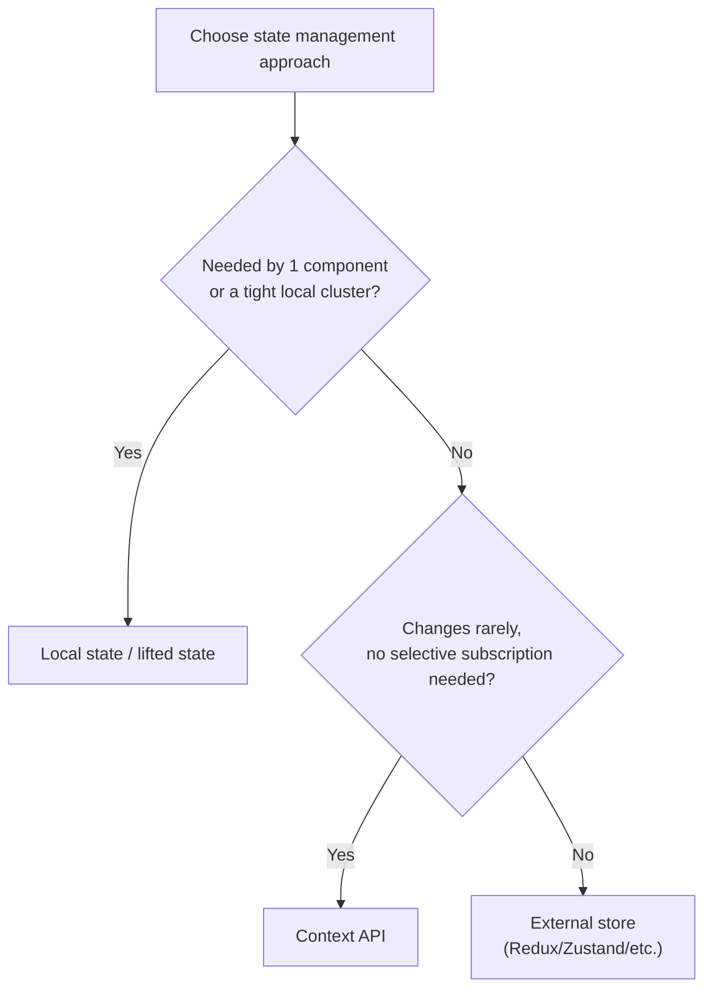

## 21. Comparison Table

React's defining philosophical trade-off, contrasted with Angular (see
[Angular](CH05_Angular.md) for Angular's own internals — recapped only at the
level needed for this comparison, not re-taught here):

| Dimension | React | Angular |
|---|---|---|
| Category | UI library (rendering + component model only) | Full application framework (batteries-included) |
| Routing | Community choice (React Router, Next.js router, etc.) | Built-in (`@angular/router`), one blessed option |
| State management | Community choice (Context, Redux, Zustand, Jotai, etc.) | Built-in patterns (services + RxJS, or NgRx as the community standard) |
| Dependency injection | Not built in (Context can approximate it) | First-class, framework-provided DI container |
| Templating | JSX (JavaScript-embedded markup, full language power in templates) | HTML-based templates with Angular-specific directive syntax |
| Change detection | Virtual DOM diffing (Section 4.3-4.4) | Zone.js-based dirty checking (historically) / fine-grained signals (modern Angular) |
| Build tooling opinion | Unopinionated — pick Vite/webpack/etc. | Opinionated — Angular CLI is the default, expected path |
| Learning curve shape | Small core, then N ecosystem decisions to learn | Larger core surface area upfront, fewer subsequent ecosystem decisions |
| Governance | Meta + open-source community, ecosystem-driven | Google, more centrally directed |

The architectural consequence of this split: a React team's biggest
architecture decisions are *which libraries to adopt* (router, state
management, data fetching, form handling) and *how to enforce consistency*
across those choices (often via internal conventions, templates, or a thin
internal framework layer) — whereas an Angular team inherits most of those
decisions from the framework itself, trading flexibility for consistency out
of the box. Neither is architecturally superior in the abstract; the right
choice depends on team size, need for customization, and tolerance for
ecosystem churn (React's unopinionated core means library choices can and do
shift over a project's lifetime, requiring migration effort; Angular's
built-in choices are more stable but harder to deviate from when a use case
doesn't fit them).

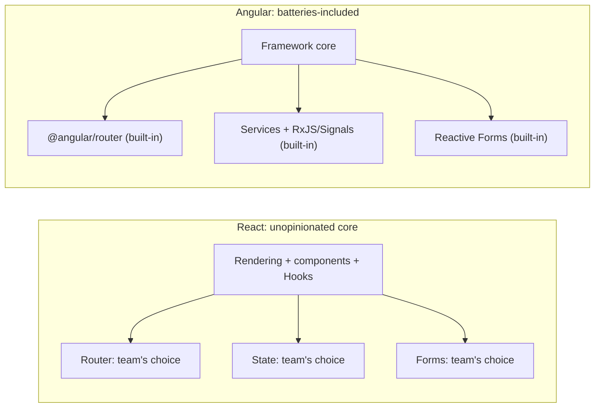

## 22. Real-World Case Study

A mid-size e-commerce platform migrating a jQuery-based product catalog and
checkout flow to React illustrates several of this chapter's decisions in
combination:

1. **Initial migration** wrapped the existing checkout flow's state in a
   single component tree with local `useState`/`useReducer`, deliberately
   avoiding an external store at first (Section 4.8's scope criterion — the
   checkout flow's state was needed by a small, closely related component
   cluster, not broadly).
2. **Cart state**, needed by both the checkout flow and an unrelated header
   badge showing item count, was lifted to a Context provider wrapping the
   whole application — an appropriate use of Context because cart contents
   change infrequently relative to render cost (Section 4.8's update-frequency
   criterion), and because tooling (undo/redo, time-travel) was never a
   requirement.
3. **The product listing page**, previously a template-rendered HTML page,
   was rebuilt using Server Components: the product grid (data-heavy,
   non-interactive) became a Server Component querying the product database
   directly, while only the "Add to Cart" button and quantity selector on
   each card became Client Components (directly following the pattern in
   Section 10.4) — reducing the page's client JavaScript bundle by roughly
   two-thirds compared to an all-client-rendered equivalent, because the
   product grid's substantial rendering logic never needed to ship to the
   browser.
4. **A production incident** during the migration stemmed exactly from
   Section 4.4's key pitfall: a filterable product list used array index as
   `key`, and applying a filter caused input state in an (unrelated) inline
   quantity selector to attach to the wrong product after filtering reordered
   the visible items — diagnosed via React DevTools' Profiler showing
   unexpected component identity changes, and fixed by switching to the
   product's database ID as the key.

This case study demonstrates the chapter's central architectural claim in
practice: React provided the rendering primitives, but every actual
architecture decision (which state lives where, which components become
Server Components, how to prevent a whole class of key-related bugs) was a
decision the team made deliberately, not one React made for them.

## 23. Interview Questions

1. Explain the difference between the render phase and the commit phase.
   Why must the render phase be pure?
2. What problem does the fiber architecture solve that the pre-16 reconciler
   could not, and how does it solve it mechanically?
3. Why do the Rules of Hooks exist? What internal implementation detail makes
   a conditional Hook call unsafe?
4. A list re-render is causing input focus to jump to the wrong row after a
   filter is applied. Diagnose the likely cause and the fix.
5. When would you choose Context over an external store, and vice versa?
   Give the concrete criteria, not just "Context is simpler."
6. What is a React Server Component, and how is it architecturally different
   from traditional server-side rendering with hydration?
7. Explain why `useEffect` dependency arrays cause stale closures when
   incomplete, using the closure model from Section 4.5.
8. What does `useTransition` actually change about how a component renders?
   Does it change what is rendered?
9. Why can `useMemo`/`useCallback` sometimes make performance worse rather
   than better?
10. Contrast React's "unopinionated core" philosophy with Angular's
    batteries-included approach. What organizational trade-off does each
    imply for a growing engineering team?

## 24. Hands-on Exercises

1. Build a filterable, sortable list of at least 20 items with a per-item
   `useState`-backed inline edit field. Intentionally use array index as
   `key`, reproduce the identity-misattribution bug from Section 4.4 by
   filtering, then fix it with a stable identifier key.
2. Implement a custom Hook, `useLocalStorage<T>(key: string, initialValue: T)`,
   that behaves like `useState` but persists to `localStorage`, and reuse it
   in two unrelated components to demonstrate independent per-call-site
   state (Section 4.6).
3. Convert a component holding three independent pieces of state and one
   `useEffect` chain (Section 19's effect-chain anti-pattern) into a single
   derived value computed with `useMemo`, and measure the reduction in
   re-render count using React DevTools' Profiler.
4. Build a small Context-based theme provider (Section 10.2), then wrap one
   consumer in `React.memo` and demonstrate that it still re-renders on every
   theme change — explain why, referencing Context's lack of selective
   subscription.

## 25. Design Exercises

1. Design the state architecture for a collaborative kanban board (multiple
   boards, drag-and-drop cards, real-time updates from other users). Decide,
   with justification against Section 4.8's criteria, what stays local, what
   goes in Context, and what needs an external store — and explain how
   real-time updates from a WebSocket would interact with your chosen state
   layer.
2. Given a content-heavy marketing site (blog-like pages with a few
   interactive widgets — a newsletter signup, a comment count), design a
   Server Component/Client Component boundary for a single page template,
   identifying exactly which pieces must be Client Components and why.
3. Propose a code-splitting and Suspense-boundary strategy for an
   application with 12 major routes, an authenticated dashboard, and a public
   marketing section, balancing initial bundle size against the number of
   loading-fallback flashes a user experiences during typical navigation.

## 26. Architecture Review Questions

1. Is any state held in an external store that is only ever read/written by
   one feature's components? If so, why does it need to be global?
2. Are `key` props on every list a stable domain identifier, or array index?
3. Do any `useEffect` calls have a dependency array suppressed via an eslint
   comment? Is the suppression justified and documented, or a latent
   stale-closure bug?
4. Are Error Boundaries present at, at minimum, the route level? Do they
   forward caught errors to the observability pipeline (Section 14)?
5. If the application uses RSC, is any prop passed from a Server Component to
   a Client Component checked for accidental secret/credential leakage into
   the client bundle?
6. Is `React.memo`/`useMemo`/`useCallback` usage backed by actual profiler
   evidence, or applied reflexively without a measured problem?

## 27. Summary

React's core architectural contribution is separating **what to render** (a
declarative description, expressed as components and elements) from **how to
apply it to the real DOM** (the reconciler's job, via Virtual DOM diffing and,
since React 16, the interruptible fiber architecture). Hooks extended that
declarative model to state and side effects, replacing class lifecycle
methods with a closure-based model whose Rules of Hooks are a direct
consequence of how hook state is tracked by call order on a component's
fiber. Concurrent rendering, transitions, and Suspense are a scheduling layer
built on top of that same reconciliation model, not a new rendering paradigm,
letting React interrupt low-priority work for urgent updates. React Server
Components introduce a genuinely new architectural boundary — components
that render exclusively on the server and never ship client-side JavaScript —
distinct from, and often combined with, traditional server-side rendering.

Architecturally, the throughline across all of this is React's deliberate
choice to stay an unopinionated rendering library rather than a full
framework: state management, routing, and data fetching are left as explicit
decisions for the team, evaluated against concrete criteria (scope, update
frequency, origin, tooling need) rather than dictated by the library. This is
both React's greatest strength (flexibility to fit any application's actual
needs) and its most common source of production pain when those decisions are
made without the criteria this chapter provides — the difference between a
React codebase that scales cleanly with its team and one that becomes
unmaintainable is almost always found in how deliberately those
architectural decisions were made, not in React itself.

## Further Reading

- [JavaScript](CH03_JavaScript.md) — closures, the event loop, and
  asynchronous programming patterns underlying Hooks and data fetching.
- [TypeScript](CH04_TypeScript.md) — discriminated unions, generics, and
  structural typing used throughout this chapter's code examples.
- [Angular](CH05_Angular.md) — the batteries-included framework contrasted in
  Section 21.
- [Next.js](CH07_Nextjs.md) — the primary production framework implementing
  React Server Components and file-based routing on top of React's core.
- [HTML](CH01_HTML.md) — the DOM, critical rendering path, and SSR/CSR/hydration
  models that React's reconciler and Server Components build on.
- [REST](../08_API_Architecture/CH01_REST.md) — API-level authorization,
  relevant to Section 13's point that client-side state is never a security
  boundary.
