# Chapter: Next.js

Part: [04 — Frontend Architecture](PART_OVERVIEW.md) · Status: Drafted

## 1. Introduction

React (see [React](CH06_React.md)) answers a narrow, deliberately
unopinionated question: given a tree of components and some state, how do
you efficiently compute and apply the Document Object Model (DOM) changes
needed to keep the screen correct? React ships no router, no data-fetching
convention, no build pipeline, no server, and no opinion about where any of
your code should run. That is a feature, not a gap — it is what let React
become the substrate for a decade of wildly different architectures. But it
also means that every team shipping a real React application has to
independently answer the same dozen architectural questions: how do URLs
map to screens, where does data get fetched, what runs on the server versus
the browser, how do you avoid shipping a blank page while JavaScript loads,
and how do you deploy the result so that it is fast on a phone in a weak
network as well as on a developer's laptop.

Next.js is Vercel's opinionated, batteries-included answer to exactly that
set of questions. It is not "React with a router bolted on" — it is a
**full-stack, meta-framework architecture** that wraps React's rendering
model in a file-system-based routing convention, a per-route rendering-mode
decision system, a first-class server runtime, and a build/deployment
pipeline, all co-designed by the same team that maintains large parts of
React itself (Vercel engineers are also core React contributors, and
several React features — React Server Components (RSC) chief among them —
were designed and shipped in Next.js before landing in React's own public
API surface). Understanding Next.js as a Solution Architect means
understanding it at exactly that layer: not "how do I write a page," but
"what architectural decisions has this framework made on my behalf, which
of those decisions can I override per route, and what are the runtime and
deployment consequences of each choice."

This chapter deliberately does **not** re-teach the concepts React already
owns. React's Virtual DOM, its reconciliation algorithm, Hooks, and the
general concept of Server Components as a React-level primitive are taught
in full in [React, Section 4](CH06_React.md#4-core-concepts) — this chapter
recaps each only in the two or three sentences needed to anchor the
discussion, then moves directly into what is actually specific to Next.js:
**how Next.js's App Router turns the file system into a routing and
rendering-mode configuration language, how it concretely implements the
server/client component boundary React only specifies abstractly, how its
Route Handlers turn a frontend project into a full backend, how its
Middleware intercepts requests at the network edge before a single React
component runs, and how its build and deployment architecture lets the same
codebase ship as a static file host, a long-running Node.js server, or a
fleet of globally distributed edge functions** — often varying per route,
inside a single build.

A Solution Architect who has not internalized this distinction makes a
specific, expensive mistake: treating Next.js as an interchangeable
"frontend framework" choice, comparable to choosing a CSS methodology, when
in fact choosing Next.js is choosing a rendering topology, a data-fetching
architecture, and a deployment model simultaneously — one that has direct,
quantifiable consequences for Time to First Byte (TTFB), infrastructure
cost, cache invalidation complexity, and which team (frontend or platform)
owns which failure modes in production.

## 2. Historical Evolution

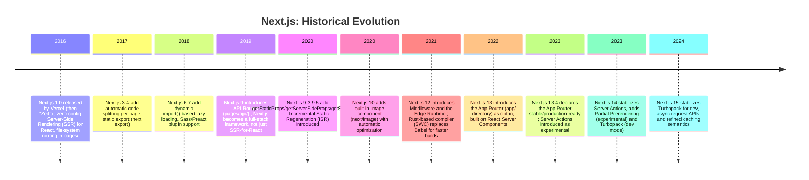

**Why Vercel built it (2016).** By 2016, teams building React applications
faced a recurring first-load problem: a plain client-rendered React app
ships a near-empty `index.html` plus a JavaScript bundle, so a browser (or a
search-engine crawler, or a user on a slow connection) sees a blank screen
until that bundle downloads, parses, and executes React's initial render.
Solving this "properly" required each team to hand-roll a Node.js server
that ran React's `renderToString` Application Programming Interface (API),
matched the resulting Hypertext Markup Language (HTML) to a matching
client-side bundle for hydration, and wired up a router that produced
consistent URLs on both server and client — a nontrivial, easy-to-get-wrong
integration that most teams reimplemented independently. Next.js's founding
insight was to make that integration a zero-configuration default: put a
file in a `pages/` directory, and Next.js would serve it as a fully
server-rendered route at the matching URL, with no server code to write and
no bundler configuration to maintain. Section 4.2 covers the underlying
Pages Router file-system convention this shipped, in full.

**From SSR framework to full-stack platform (2019-2021).** The addition of
API Routes in Next.js 9 (2019) was the moment Next.js stopped being "React,
rendered on a server" and became a genuine full-stack framework: a single
project could now hold both the frontend and a backend Application
Programming Interface (API), deployed together, sharing the same
TypeScript types and the same deployment pipeline. Middleware and the Edge
Runtime (Next.js 12, 2021) pushed part of that backend logic even further
forward — onto a Content Delivery Network (CDN)'s edge points of presence,
executing before a request ever reaches an origin server. Section 4.6 and
4.7 cover both of these as concrete architecture patterns.

**The App Router and React Server Components (2022-2023).** The single
largest architectural shift in Next.js's history is the 2022 introduction
of the App Router, built directly on top of React Server Components — a
React-level rendering primitive that Next.js's own engineers co-designed
with the React core team specifically to solve a problem the Pages Router
could not: letting a component tree mix server-only code (that can talk
directly to a database, never ships its dependencies to the browser) and
interactive client code (that needs the browser's event loop and React's
Hooks) *in the same tree*, with the framework — not the developer —
managing the serialization boundary between the two. Sections 4.3 and 4.5
teach this in full. As of Next.js 15, the App Router is the recommended
default; the Pages Router remains fully supported for existing codebases,
which is why a Solution Architect evaluating or maintaining a Next.js
system must understand both.

## 3. Why It Exists

Next.js exists to close a gap that no combination of "React plus a router
plus a bundler plus a Node.js server you write yourself" closes acceptably
by default: **the gap between a rendering *architecture* decision and a
rendering *implementation* decision**, per route, without forcing an
all-or-nothing choice for the whole application.

Consider the honest alternatives a team faces without a framework like
Next.js:

- **Pure client-side rendering (a Single-Page Application, or SPA, built
  with plain React and a client router).** Every route ships a near-empty
  HTML shell; every visitor pays the cost of downloading and executing
  JavaScript before seeing content, and search-engine crawlers or link
  previews that don't execute JavaScript see nothing meaningful. This is
  architecturally simple (one deployment target: a static file host) but
  operationally costly for anything performance- or Search Engine
  Optimization (SEO)-sensitive.
- **Hand-rolled server-side rendering.** A team stands up its own Node.js
  (or other runtime) server, calls React's `renderToString`/
  `renderToPipeableStream`, matches server output to a client bundle, and
  reimplements routing, code-splitting, and cache-control logic by hand.
  This is architecturally powerful but expensive to build and, worse,
  expensive to keep correct as React itself evolves its own rendering
  Application Programming Interfaces (APIs).
- **A static site generator with no server story.** Fast and cheap to host,
  but architecturally unable to serve any route whose content must be
  computed per-request (a logged-in dashboard, a search results page, an
  API endpoint) — the team ends up bolting a second, unrelated backend onto
  the project anyway.

Next.js's actual value proposition is that **none of these is a single,
project-wide choice** — it is a **per-route, and inside the App Router even
per-component, rendering-mode decision**, expressed declaratively in the
file system and in a small set of configuration exports, with the framework
handling the routing, bundling, hydration-matching, and caching plumbing
that each alternative above requires a team to build by hand. A marketing
page can be fully static (built once, served from a Content Delivery
Network (CDN) edge cache); a product page can regenerate itself on a timer
(Incremental Static Regeneration); a personalized dashboard can render
per-request on a server; and an interactive widget inside that same
dashboard can be a plain client-rendered React component — all in one
project, one build, one deployment.

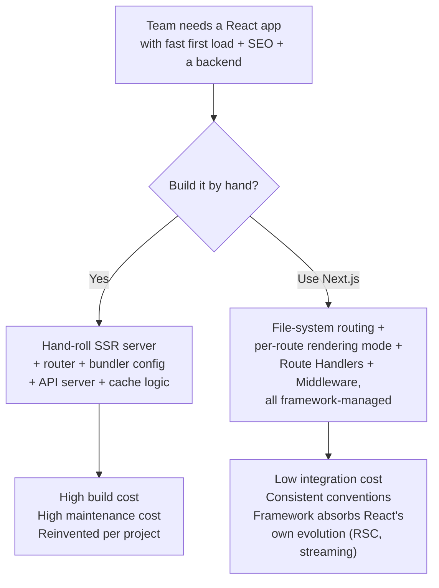

This chapter's scope, precisely, is everything in the right-hand branch of
that diagram: the file-system routing architecture, the rendering-mode
decision system, the concrete server/client component boundary, the
backend-in-frontend Route Handler pattern, the Middleware/edge
interception layer, and the build/deployment architecture that ties all of
it together.

## 4. Core Concepts

### 4.1 Next.js as a Layered Meta-Framework Architecture

**Definition.** A *meta-framework* is a framework built on top of another
framework's rendering primitives, adding routing, data-fetching
conventions, a build pipeline, and a deployment model, so that application
authors work against a higher-level, opinionated contract instead of
assembling those pieces themselves. Next.js is a meta-framework over React:
React supplies the component model and the reconciliation algorithm (owned
and taught in [React, Sections 4.1-4.3](CH06_React.md#4-core-concepts));
Next.js supplies everything that decides *when*, *where*, and *how* that
component tree gets rendered and shipped.

**Mechanism.** Concretely, Next.js sits as a distinct layer between the
developer's component code and the browser/server runtime:

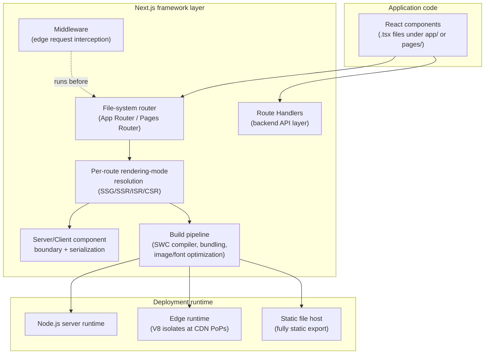

**Decision implications.** Because Next.js owns this middle layer, choosing
Next.js is not additive to choosing React — it *replaces* the routing,
data-fetching, and deployment decisions a team would otherwise make
independently. This is the correct trade-off when a team wants an
opinionated, well-trodden path (most teams, most of the time); it is the
wrong trade-off when a team has an unusual rendering or deployment
requirement that fights the framework's conventions (for example, a
non-Hypertext Transfer Protocol (HTTP) transport, or a rendering pipeline
that must stay entirely outside Vercel's or a compatible host's supported
runtime model).

**Common failure mode.** Teams that adopt Next.js without recognizing it as
an opinionated architectural layer often fight the framework: they disable
its conventions piecemeal (custom servers, fully manual data fetching,
ejecting from the Image component) until what remains is, in effect, a
hand-rolled React server-rendering setup wearing Next.js's build tooling as
a costume — paying Next.js's constraints without collecting its benefits.

**Scenario.** A team migrating a Create React App (CRA) single-page
application to Next.js should not port every page as a fully
client-rendered component under `"use client"` and call the migration
complete — that reproduces the CRA architecture with slower cold starts and
none of the framework's actual value. The correct migration reclassifies
each route by its real rendering-mode requirement (Section 4.4) first.

### 4.2 File-System-Based Routing: The Pages Router Foundation

**Definition.** File-system-based routing means the directory and file
structure of a specific project folder *is* the routing table: a file's
path relative to that folder determines the Uniform Resource Locator (URL)
it serves, with no separate router configuration file to maintain. Next.js
introduced this for React in its original `pages/` directory convention
(the "Pages Router"), and it remains the mental model's foundation even
though the App Router (Section 4.3) extends it substantially.

**Mechanism.** Under the Pages Router, every file in `pages/` (excluding a
small set of reserved names) becomes a route:

```
pages/
  index.tsx            -> /
  about.tsx             -> /about
  blog/
    index.tsx           -> /blog
    [slug].tsx           -> /blog/:slug        (dynamic segment)
    [...all].tsx          -> /blog/*            (catch-all segment)
  api/
    users.ts             -> /api/users          (Route Handler-style endpoint)
  _app.tsx               (special: wraps every page — shared layout/providers)
  _document.tsx           (special: customizes the root HTML document shell)
```

Square brackets denote a **dynamic segment** (`[slug]` binds whatever the
matching URL segment is into a `slug` route parameter); a spread inside
brackets (`[...all]`) denotes a **catch-all segment** that binds every
remaining path segment as an array. Each page file exports a React
component as its default export, and optionally exports one of three
data-fetching functions — `getStaticProps`, `getServerSideProps`, or
`getStaticPaths` (paired with `getStaticProps` for dynamic routes) — whose
return value becomes that page's `props`. Which function a page exports is
*itself* the rendering-mode decision under the Pages Router; Section 4.4
covers the resulting SSG/SSR/ISR/CSR distinctions once both routers'
conventions are on the table.

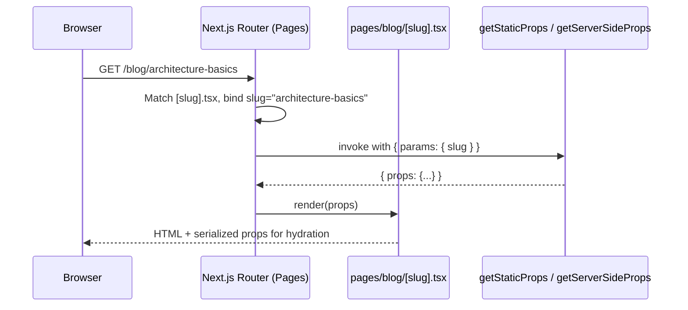

**Decision implications.** File-system routing trades routing-table
flexibility (no wildcard-priority rules to reason about beyond the
static-over-dynamic-over-catch-all precedence Next.js applies
automatically) for *discoverability*: any engineer can find a route by
navigating the folder structure, and route additions require no central
file to edit or merge-conflict over. The cost is that some routing patterns
common in hand-rolled routers (regex-based matching, fully programmatic
route registration) are simply not expressible — Next.js's routing
vocabulary is deliberately a fixed, learnable set of file-naming
conventions rather than a general-purpose routing Domain-Specific Language
(DSL).

**Common failure mode.** Placing a component that is not meant to be a
route (a shared helper, a non-page component) directly inside `pages/`
turns it into an unintended public URL, since every file there is routed by
default; teams must keep shared, non-route code outside `pages/` (typically
in a `components/` or `lib/` directory) as a hard convention, not a
suggestion.

### 4.3 The App Router: Nested Layouts, Route Segments, and Special Files

**Definition.** The App Router (the `app/` directory, stable since Next.js
13.4) is Next.js's current-generation routing architecture. It keeps the
core "folder structure is the route table" idea from Section 4.2 but
changes the unit of routing from a single file to a **folder representing
a route segment**, inside which a small set of reserved file names each
carry a distinct architectural responsibility, and it adds first-class
**nested layouts** that persist across navigations within their subtree —
something the Pages Router's `_app.tsx` could only approximate globally,
not per-subtree.

**Mechanism — special files per segment.** Each folder under `app/`
represents one URL segment; the files *inside* that folder define what
renders for that segment and how:

| File | Responsibility |
|---|---|
| `page.tsx` | The unique UI for this segment; presence of this file is what makes a folder publicly routable |
| `layout.tsx` | Shared UI that wraps this segment *and all its nested segments*; persists (does not re-render/remount) across sibling navigations |
| `loading.tsx` | Automatic React Suspense fallback shown while this segment's server data is being fetched |
| `error.tsx` | A React Error Boundary scoped to this segment, catching rendering/data errors below it |
| `not-found.tsx` | UI shown when this segment (or a nested one) calls Next.js's `notFound()` function |
| `route.ts` | A Route Handler (Section 4.6) instead of a UI page — mutually exclusive with `page.tsx` in the same segment |
| `template.tsx` | Like `layout.tsx`, but remounts (re-runs its state) on every navigation instead of persisting |

**Nested layout composition.** Layouts nest according to folder depth, and
Next.js composes them automatically into the final render tree:

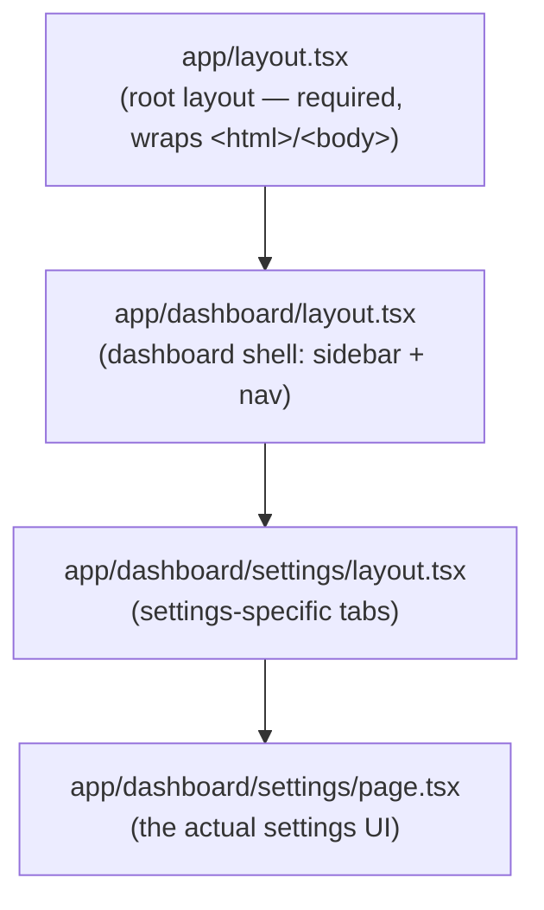

Navigating from `/dashboard/settings` to `/dashboard/billing` re-renders
only the `page.tsx` (and any layout below the point where the two routes
diverge) — the root layout and the dashboard layout are not remounted,
which is why client-side state inside a persistent layout (an open sidebar,
a scroll position) survives the navigation. This persistence-by-default
behavior is a direct architectural consequence of nested layouts being
distinct components in a stable position in the render tree, not a
templating convenience — it is React's own reconciliation rule (see
[React, Section 4.2](CH06_React.md#4-core-concepts)) applied to a tree
shape that Next.js's router constructs from the folder structure.

**Route groups, parallel routes, and intercepting routes.** The App
Router adds three folder-naming conventions with no equivalent in the
Pages Router, each solving a distinct organizational or navigation problem:

- **Route groups** — a folder named `(groupName)` organizes routes and
  shares a layout *without* adding a segment to the URL. `app/(marketing)/
  about/page.tsx` still serves `/about`; the parentheses are purely an
  organizational and layout-scoping device.
- **Parallel routes** — a folder named `@slotName` lets a layout render
  more than one independently-routable subtree at the same URL (for
  example, a dashboard rendering `@analytics` and `@team` slots
  side-by-side, each with its own loading/error boundaries).
- **Intercepting routes** — a folder named `(.)segment` (or `(..)`, `(...)`
  for parent levels) lets a route "intercept" navigation to another route
  and render it in the current layout's context (the canonical use case is
  a photo grid where clicking a photo opens it in a modal while the URL
  still points at the full standalone photo page, so a direct link or
  refresh renders the full page instead of the modal).

**Decision implications.** The App Router's per-segment file model is what
makes React Server Components (Section 4.5) practical to route: every
`page.tsx` and `layout.tsx` is a Server Component by default, and the
framework needs an explicit place to draw the client boundary — `page.tsx`/
`layout.tsx` files are exactly that place. Adopting the App Router is not
free, though: it requires understanding the server/client boundary (Section
4.5) and a different data-fetching mental model (colocated `fetch` calls
inside Server Components instead of `getStaticProps`/`getServerSideProps`),
so a codebase mid-migration commonly runs both routers simultaneously
(Next.js explicitly supports this) while routes are ported incrementally.

**Common failure mode.** Treating `layout.tsx` as "just a wrapper
component" and putting per-page state or data fetching there breaks the
persistence guarantee above — a layout re-fetching per-navigation data
defeats the entire reason nested layouts exist, and cross-navigation state
placed in the wrong layout level either leaks across unrelated routes (too
high) or resets unexpectedly (too low, if actually needed higher).

### 4.4 The Rendering-Mode Decision Architecture: SSG, SSR, ISR, and CSR

**Definition.** A rendering mode is the answer to a specific architectural
question: *when* is a piece of user interface converted from a React
component tree into Hypertext Markup Language (HTML), and *how often* does
that conversion happen relative to a request. Next.js formalizes four
modes, and — this is the point the rest of this section exists to teach —
treats the choice between them as a **per-route (Pages Router) or
per-fetch-call (App Router) architecture decision**, not a single
project-wide setting.

| Mode | When HTML is produced | Data freshness | Typical use case |
|---|---|---|---|
| **Static Site Generation (SSG)** | Once, at build time | Fixed until the next build | Marketing pages, documentation, blog posts with infrequent edits |
| **Incremental Static Regeneration (ISR)** | At build time, then regenerated in the background on a timer or on-demand | Eventually consistent, bounded staleness | Product catalogs, pricing pages — content that changes but not on every request |
| **Server-Side Rendering (SSR)** | Per request, on the server | Always current as of the request | Personalized dashboards, search results, anything requiring per-request auth/state |
| **Client-Side Rendering (CSR)** | In the browser, after JavaScript loads | Always current as of client execution | Highly interactive widgets with no Search Engine Optimization (SEO) requirement (an in-page chat panel, a live-editing canvas) |

**Mechanism — the decision flow.** The right mode for a given route (or,
under the App Router, a given data-fetching call within a route) follows
directly from two questions: does the content depend on per-request state
(the requesting user, query parameters that must reflect live data,
authorization), and if not, how frequently does the underlying data change
relative to how expensive it is to be slightly stale?

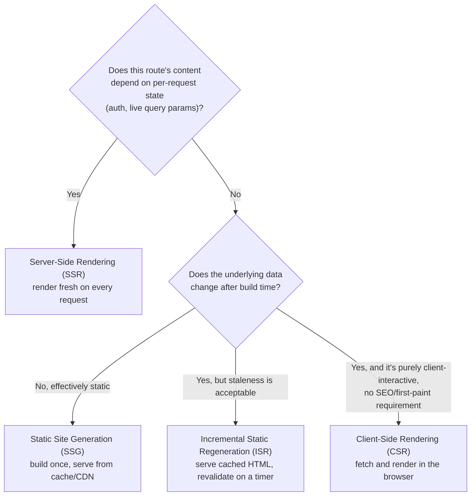

**Mechanism — how each mode is expressed per router.** Under the Pages
Router, the mode is selected by which data function a page exports:
`getStaticProps` alone means SSG; `getStaticProps` with a `revalidate`
option means ISR; `getServerSideProps` means SSR; exporting neither (or
fetching inside a `useEffect`/client library like SWR) means CSR. Under the
App Router, the same decision is made inside a Server Component's own
`fetch` calls via caching options — `fetch(url, { cache: 'force-cache' })`
(the default) behaves like SSG, `fetch(url, { next: { revalidate: 60 } })`
behaves like ISR with a 60-second window, `fetch(url, { cache:
'no-store' })` behaves like SSR, and any data fetch performed inside a
Client Component (Section 4.5) after mount behaves like CSR. This is the
concrete mechanism behind this chapter's opening claim: under the App
Router, rendering mode is not even purely a per-route decision anymore — it
can vary **per data-fetching call within a single route**, so one part of a
page can be statically cached while another part of the same page is
always server-rendered fresh.

**Incremental Static Regeneration, in mechanism detail.** ISR's
architecture is the one genuinely novel piece here relative to
"traditional" SSG/SSR: the first request after a page's configured
`revalidate` window elapses is still served the *existing* (stale) cached
HTML immediately — the user never waits on regeneration — while Next.js
triggers a regeneration in the background; once that regeneration
completes, the cache is atomically swapped so the *next* request gets the
fresh version. This "stale-while-revalidate" pattern trades bounded data
staleness for the response-time guarantees of a fully static page, and it
degrades gracefully: if the regeneration fails (an upstream data source is
down), Next.js keeps serving the last good cached version rather than
failing the request.

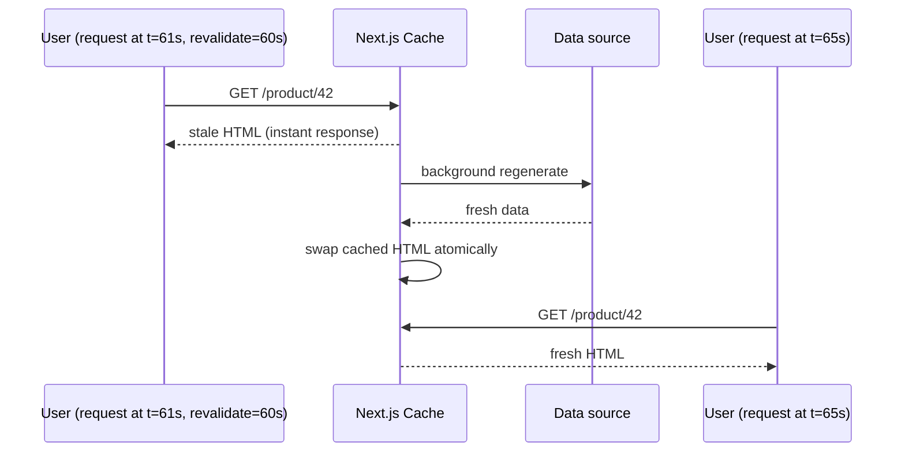

**Decision implications.** The core Solution Architect-level insight is
that rendering mode is a **quality-attribute trade-off**, not a stylistic
preference: SSG/ISR optimize for latency and infrastructure cost (served
from cache, often a CDN edge, with no per-request compute) at the cost of
data freshness; SSR optimizes for freshness and personalization at the cost
of per-request server compute and, typically, higher latency than a cache
hit; CSR optimizes for interactivity and offloads compute to the client at
the cost of first-paint latency and SEO visibility. A production system
routinely mixes all three deliberately: a marketing site on SSG/ISR, an
authenticated dashboard shell on SSR, and a live-updating chart inside that
dashboard on CSR.

**Common failure mode.** The most common production incident this
architecture produces is an **ISR cache stampede**: setting a short
`revalidate` window on a very high-traffic, expensive-to-regenerate route
means many concurrent requests can each trigger a background regeneration
before the first one completes, multiplying origin load. Next.js
deduplicates concurrent regeneration requests for the same path to
mitigate this, but a Solution Architect sizing `revalidate` windows must
still account for regeneration cost, not just staleness tolerance. The
second common failure is defaulting every route to SSR "to be safe" —
this silently converts what should be a cheap, cacheable static page into
a per-request compute cost multiplied across every visitor, the opposite
of the framework's actual value proposition.

**Scenario.** An e-commerce product-listing page whose prices change a few
times a day is a canonical ISR candidate: `revalidate: 300` (five minutes)
serves near-instant, CDN-cacheable responses while bounding price staleness
to an acceptable window; the checkout page that must reflect a live cart
and authenticated session is a canonical SSR candidate; and a "recently
viewed products" widget on that same listing page, which only matters to
the browsing user and carries no SEO value, is a reasonable CSR candidate
even though it lives inside an otherwise-ISR page.

### 4.5 React Server Components in Next.js: The Server/Client Boundary

**Recap (owned by React).** React Server Components (RSC) are a React-level
rendering primitive — a component type that renders exclusively on the
server, never ships its own code to the browser, and can use server-only
capabilities (direct database access, filesystem access, secrets) directly
in its body; React's own architecture and design rationale for this
primitive is taught in full in
[React, Section 4.9](CH06_React.md#4-core-concepts). This chapter's scope
is narrower and concrete: **how Next.js's App Router implements that
primitive as its default rendering model, and the specific mechanics of the
boundary between server and client components inside a Next.js project.**

**Mechanism — Server Components as the App Router default.** Under the App
Router, *every* component is a Server Component unless it (or an ancestor
in its own module, not its render tree) is explicitly marked otherwise.
This is a deliberate inversion from the Pages Router (and from plain
React), where every component is implicitly a client component. The
practical effect: a `page.tsx` can `await` a database call or an internal
service call directly in its component body, with no API layer in between,
and none of that fetching code — nor its dependencies (an ORM, a database
driver) — is included in the JavaScript bundle sent to the browser.

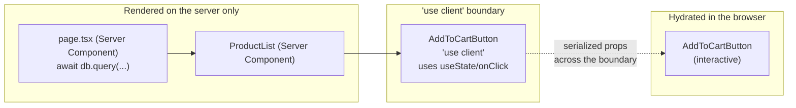

**The `"use client"` directive — mechanism.** A file beginning with the
string literal `"use client"` marks *that module and everything it
imports* as belonging to the client bundle: React (and Next.js's bundler)
treats it as the boundary — components defined in that file may use
Hooks, browser Application Programming Interfaces (APIs), and event
handlers, and will be hydrated in the browser like an ordinary React
component. Critically, `"use client"` marks a **module boundary**, not a
"this single component is a Client Component" marker: every component
that file imports (unless that import is itself re-exported from a
separate server-only module) is pulled into the client bundle too. This is
why a Solution Architect reviewing a Next.js codebase's client-boundary
placement should trace *imports*, not just component definitions, when
answering "what actually ships to the browser from this file."

**Serialization at the boundary.** Because Server Components render on the
server and Client Components hydrate in the browser, any data crossing
from a Server Component into a Client Component as props must be
serializable — plain objects, arrays, strings, numbers, and a small set of
special React-aware values (like passing a Server Component itself as
`children` to a Client Component, which Next.js supports specifically so a
Client Component can "wrap" server-rendered content without forcing that
content to become client code). Functions, class instances, and
non-serializable objects cannot cross this boundary as props — attempting
to pass a database client instance or a raw event handler defined in a
Server Component into a Client Component fails at build or runtime,
because there is no mechanism to serialize "call this server-side function
reference" into a browser-executable value without an explicit mechanism
(that mechanism is a Server Action, a related but distinct App Router
feature for client-triggered server mutations).

**Decision implications.** The architectural discipline this enables is
**push the client boundary as far down the tree as possible.** A common
anti-pattern is marking an entire `page.tsx` as `"use client"` because one
button on the page needs an `onClick` handler — this silently converts the
whole page's subtree (and everything it imports) into client-shipped,
client-hydrated code, discarding the server-rendering, zero-bundle-cost
benefit for the entire page instead of isolating it to the one interactive
leaf component that actually needs it.

**Common failure mode.** Beyond the "boundary placed too high" mistake
above, a second common failure is assuming Server Components re-render
reactively like Client Components do — they do not; a Server Component's
output is fixed once rendered for a given request/build, and updating it
requires a new render pass (a navigation, a full page reload, or, for
mutations, a Server Action triggering `revalidatePath`/`revalidateTag` to
invalidate and re-render the affected cache entries). Treating a Server
Component as if it will "just update" when some unrelated client state
changes is a category error.

**Data-fetching colocation.** Because Server Components can fetch data
directly in their own body with `async`/`await`, Next.js's App Router
architecture *colocates* data-fetching with the component that needs the
data, at whatever depth in the tree that component lives, rather than
centralizing all data-fetching at the top of a page (the Pages Router's
`getServerSideProps`/`getStaticProps` model, which fetches everything a
page needs in one function, one level above the component tree, then
threads it down through props). Next.js deduplicates identical `fetch`
calls made by multiple components within the same render pass
automatically, so colocating a `fetch('/api/user/42')` call in three
different nested Server Components that all need that same user's data
costs one network request, not three.

### 4.6 Route Handlers: Backend-in-Frontend Architecture

**Definition.** A Route Handler is a file named `route.ts` (or `.js`)
inside an App Router segment folder that exports one function per
Hypertext Transfer Protocol (HTTP) method it supports (`GET`, `POST`,
`PUT`, `PATCH`, `DELETE`), each receiving a standard Web `Request` object
and returning a standard Web `Response` object. This is the App Router's
successor to the Pages Router's `pages/api/` convention (Section 4.2),
and, architecturally, it is the mechanism that makes Next.js a genuine
**backend-in-frontend framework**: the same project, the same repository,
the same deployment, and (with TypeScript) the same shared type
definitions serve both the rendered UI and its own Application Programming
Interface (API) surface.

**Mechanism.**

```ts
// app/api/orders/[orderId]/route.ts
import { NextRequest, NextResponse } from "next/server";
import { getOrder, cancelOrder } from "@/lib/orders";

export async function GET(
  request: NextRequest,
  { params }: { params: Promise<{ orderId: string }> }
) {
  const { orderId } = await params;
  const order = await getOrder(orderId);

  if (!order) {
    return NextResponse.json({ error: "Order not found" }, { status: 404 });
  }
  return NextResponse.json(order, {
    headers: { "Cache-Control": "private, no-store" },
  });
}

export async function DELETE(
  request: NextRequest,
  { params }: { params: Promise<{ orderId: string }> }
) {
  const { orderId } = await params;
  const authHeader = request.headers.get("authorization");

  if (!authHeader) {
    return NextResponse.json({ error: "Unauthorized" }, { status: 401 });
  }
  await cancelOrder(orderId);
  return new NextResponse(null, { status: 204 });
}
```

A `route.ts` file in the same folder as a `page.tsx` is not permitted — a
segment is either a UI route or an API route, never both, which forces an
explicit architectural choice at the file-system level rather than
allowing an accidental hybrid. Route Handlers participate in the same
caching model as data fetching elsewhere in the App Router: a `GET`
handler with no dynamic input (no reading of cookies, headers, or search
parameters) can be cached and treated like a static asset; one that reads
request-specific data is automatically treated as dynamic and executed per
request.

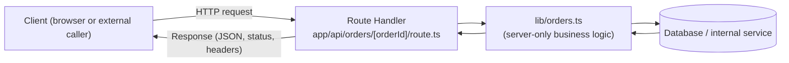

**Decision implications.** Route Handlers make Next.js a legitimate choice
for small-to-medium backend surfaces (a Backend-for-Frontend (BFF) layer
serving the same project's UI, a webhook receiver, a thin proxy in front
of an internal service) without provisioning a separate backend service or
deployment. The architectural boundary a Solution Architect must draw
explicitly is *how much* backend logic belongs here versus in a dedicated
backend service: Route Handlers run inside the same deployment as the
frontend, share its scaling characteristics and runtime constraints
(Section 4.8), and have no independent deployment cadence — appropriate for
logic tightly coupled to this frontend's own concerns, and a poor fit for
a backend that must be shared across multiple independent frontends, scale
independently, or be owned by a separate team with its own release cycle.

**Common failure mode.** Because Route Handlers live in the same codebase
and repository as UI code, teams sometimes let backend business logic
sprawl directly into `route.ts` files rather than a separate `lib/`
service layer, coupling that logic to Next.js's request/response types and
making it harder to reuse from Server Components (which should call the
same business logic directly, in-process, rather than issuing an internal
HTTP fetch to their own Route Handler — an unnecessary network hop for
code running in the same server process).

### 4.7 Middleware Architecture: Edge Request Interception

**Definition.** Next.js Middleware is code in a single `middleware.ts` file
at a project's root that runs **before** a request is matched to any route
— before the App Router's or Pages Router's routing logic executes, before
any Server Component renders, and before any Route Handler runs. It can
inspect and rewrite the request, redirect it, modify response headers, or
short-circuit it entirely, and — architecturally significant — it runs by
default on the **Edge Runtime** (Section 4.8), meaning it executes at a
Content Delivery Network (CDN) point of presence physically close to the
requester, not at a centralized origin server.

**Mechanism.**

```ts
// middleware.ts
import { NextResponse } from "next/server";
import type { NextRequest } from "next/server";

export function middleware(request: NextRequest) {
  const sessionToken = request.cookies.get("session")?.value;
  const { pathname } = request.nextUrl;

  const isProtectedRoute = pathname.startsWith("/dashboard");
  if (isProtectedRoute && !sessionToken) {
    const loginUrl = new URL("/login", request.url);
    loginUrl.searchParams.set("redirectTo", pathname);
    return NextResponse.redirect(loginUrl);
  }

  const response = NextResponse.next();
  response.headers.set("x-request-region", request.geo?.region ?? "unknown");
  return response;
}

export const config = {
  matcher: ["/dashboard/:path*", "/account/:path*"],
};
```

The exported `config.matcher` restricts which request paths invoke the
Middleware at all — an important performance lever, since Middleware runs
on every matched request, adding latency to each one, so scoping it
narrowly (rather than matching every route) is a deliberate architecture
decision, not a default to accept blindly.

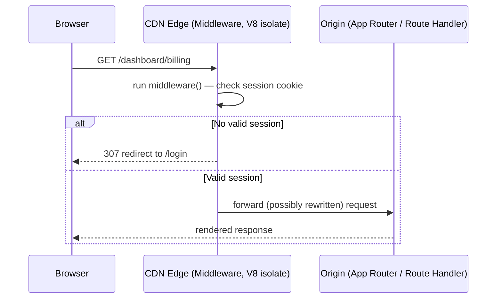

**Decision implications.** Because Middleware runs at the edge, closer to
the requester than an origin server, it is architecturally suited to
cross-cutting concerns that must apply uniformly and cheaply before any
application logic runs: authentication gatekeeping/redirects,
Author/Bot (B) testing bucket assignment, geolocation-based rewrites,
localization redirects, and security headers. It is a poor fit for
anything requiring a database round-trip, heavy computation, or Node.js-
specific Application Programming Interfaces (APIs) unavailable on the Edge
Runtime — those belong in a Route Handler or a Server Component instead.
Middleware can also be configured to run on the Node.js runtime instead of
the Edge Runtime when it genuinely needs Node.js-specific capabilities, at
the cost of losing the edge-proximity latency benefit.

**Common failure mode.** Placing expensive logic (an external Application
Programming Interface (API) call with high latency, a database query) in
Middleware adds that cost to *every single matched request*, including
ones that would otherwise be served instantly from a static or edge cache
— this is one of the most direct ways to accidentally erase the
performance benefits Sections 4.4 and 4.9 describe. A second common
mistake is over-broad matchers: omitting a `matcher` config (or matching
`/:path*` unconditionally) runs Middleware on every asset request,
including static files that gain nothing from interception and only pay
its latency cost.

### 4.8 Build and Deployment Architecture: Runtimes and Output Modes

**Definition.** Next.js's build architecture produces different physical
deployment artifacts depending on two independent configuration axes: the
**runtime** each piece of server code executes in (Node.js runtime vs.
Edge Runtime), and the **output mode** for the build as a whole (a
standard server deployment vs. a fully static export).

**Mechanism — Node.js runtime vs. Edge Runtime.** The Node.js runtime is
the full Node.js Application Programming Interface (API) surface — file
system access, native Node.js modules, longer execution-time allowances —
running on a conventional server process (a container, a serverless
function, or a long-lived process, depending on the host). The Edge
Runtime is a restricted JavaScript execution environment (built on the V8
engine, the same engine underlying Node.js and Chrome, but without
Node.js's Application Programming Interface (API) surface) designed to run
in many small, short-lived, geographically distributed instances at a
Content Delivery Network (CDN)'s edge points of presence, with a
correspondingly tighter execution-time and memory budget and no access to
Node.js-only modules (a raw TCP driver for a database, for instance,
typically will not run there without an HTTP-based alternative).

| | Node.js runtime | Edge Runtime |
|---|---|---|
| **API surface** | Full Node.js (fs, native modules, longer-running processes) | Restricted (Web-standard APIs: fetch, Request/Response, no fs) |
| **Location** | Centralized origin (region-scoped) | Distributed at CDN edge points of presence |
| **Cold start** | Higher (fuller runtime to initialize) | Very low (lightweight V8 isolate) |
| **Best for** | Full ORM/database drivers, heavy compute, long-running work | Middleware, lightweight per-request logic, geolocation/auth gating |

A given Route Handler, Middleware file, or Server Component tree can opt
into the Edge Runtime with `export const runtime = "edge";`; everything
else defaults to the Node.js runtime.

**Mechanism — output modes.** By default, `next build` produces a server
deployment: a mix of statically generated assets (from SSG/ISR routes),
server code (for SSR routes, Route Handlers, and Middleware), and a
manifest tying them together, meant to run behind Next.js's own Node.js
server (`next start`) or a compatible hosting platform. Setting `output:
"export"` in `next.config.js` instead produces a **fully static export** —
plain HTML, CSS (Cascading Style Sheets), and JavaScript files with no
Next.js server process required at all, deployable to any static file host
or Content Delivery Network (CDN). This mode is only compatible with
routes that resolve entirely to Static Site Generation (SSG) at build
time: any route requiring Server-Side Rendering (SSR), Route Handlers with
dynamic behavior, Middleware, or on-demand Incremental Static Regeneration
is incompatible with static export and will fail the build, because none
of those have any runtime server process left to execute against.

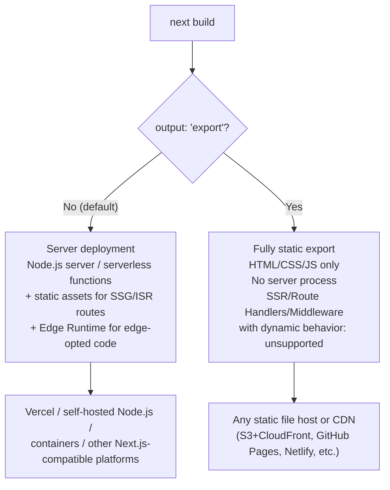

**Decision implications.** This is a deployment-target decision with real
cost and capability trade-offs: a fully static export is the cheapest and
simplest to host (no server compute billed per request, trivially
cacheable everywhere) but forecloses SSR, dynamic Route Handlers, and
Middleware entirely — appropriate only for a project that is genuinely
static end to end (a documentation site, a marketing site with no
personalization). A server deployment keeps every rendering mode and
backend capability available but requires a hosting platform that runs
Next.js's server (or serverless-function equivalent), with associated
per-request compute cost and operational responsibility (scaling,
monitoring, cold starts) that a Solution Architect must plan for
explicitly, whether on Vercel's managed platform or a self-hosted
alternative.

**Common failure mode.** Choosing static export for cost or simplicity
reasons, then later needing personalization or authenticated content,
forces a disruptive re-architecture (removing static export, standing up a
server deployment target) rather than an incremental change — this is why
the output-mode decision belongs in the initial architecture review, not
as an afterthought discovered mid-project when a `getServerSideProps`-
equivalent requirement first appears.

### 4.9 Image and Font Optimization as a Built-In Performance Architecture Layer

**Definition.** Next.js ships two build- and request-time optimization
subsystems — the `next/image` component and `next/font` module — that
convert two of the most common, highest-impact frontend performance
problems (oversized/unoptimized images, render-blocking web font loading)
into framework-managed defaults instead of per-project manual optimization
work.

**Mechanism — `next/image`.** The `Image` component does not just render
an `` tag; it wraps every image in an automated pipeline: it infers
(or requires) intrinsic width/height so the browser can reserve layout
space before the image loads (preventing Cumulative Layout Shift, a Core
Web Vitals metric), it generates a `srcset` of multiple resolutions so the
browser downloads only the size actually needed for the current viewport
and device pixel ratio, it lazy-loads images outside the initial viewport
by default, and — when using Next.js's default or a configured image
loader — it serves modern formats (WebP/AVIF) with on-demand resizing,
either at build time (for static export) or via a request-time image
optimization endpoint (for server deployments), caching each generated
variant so repeat requests are served from cache rather than
re-processed.


**Mechanism — `next/font`.** The font module self-hosts font files (for
both Google Fonts and custom/local fonts) at build time rather than
loading them from a third-party origin at request time, eliminating an
extra Domain Name System (DNS) lookup and connection round-trip per font
family, and it automatically applies `size-adjust`/fallback-font metrics
so text rendered in a fallback font before the real font loads occupies
the same visual space, preventing the layout shift that "flash of
unstyled/invisible text" font-loading strategies commonly cause.

**Decision implications.** Both subsystems trade a small amount of build
complexity and, for `next/image`'s request-time variant, ongoing
per-request optimization compute cost, for eliminating an entire category
of manual performance engineering (responsive image markup, font-loading
strategy, layout-shift prevention) that most teams either skip under
deadline pressure or implement inconsistently across a codebase. This
matters architecturally because Core Web Vitals (Largest Contentful Paint,
Cumulative Layout Shift) are both a user-experience concern and, for
public-facing sites, a direct Search Engine Optimization (SEO) ranking
input — making this "just an optimization" a genuine business-relevant
architecture decision, not a purely cosmetic one.

**Common failure mode.** Using a plain `` tag instead of `<Image>` "to
keep things simple" silently opts a page out of this entire pipeline, and
teams migrating from a plain React/Create React App codebase often miss
this because the plain tag still renders correctly — it just re-introduces
the exact performance problems the framework exists to solve, with no
build-time or lint-time warning by default unless the ESLint plugin
Next.js ships (`@next/eslint-plugin-next`) is enabled to flag it.

## 5. Internal Working

Tying Sections 4.2-4.8 together, a single request's journey through a
Next.js App Router deployment looks like this end to end:

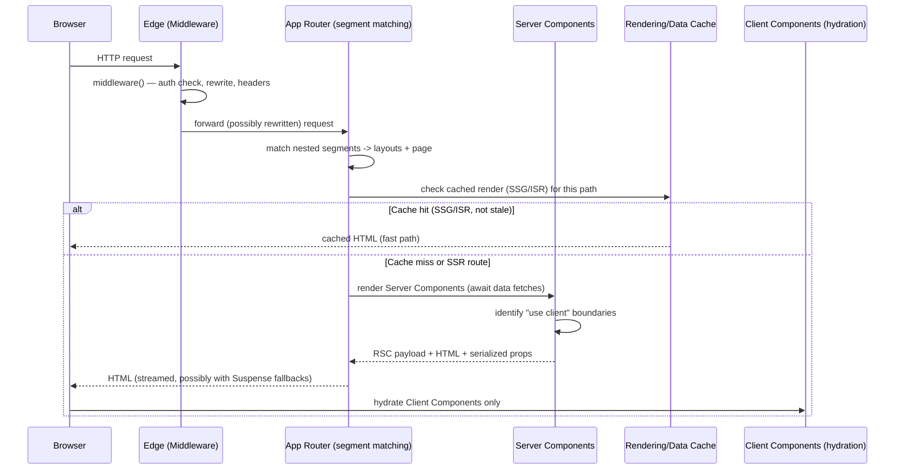

Two details matter architecturally here. First, Middleware executes for
*every* matched request regardless of the eventual cache outcome — it is
upstream of the cache check, which is exactly why Section 4.7 emphasized
keeping it cheap. Second, hydration on the client only attaches event
handlers and state to Client Component boundaries — the Server-Component-
rendered Hypertext Markup Language (HTML) surrounding them is inert markup
the browser never needs to re-render or re-execute, which is the concrete
mechanism behind React Server Components' "less JavaScript shipped"
claim: only the Client Component subtrees' code is included in the
JavaScript bundle at all.

## 6. Design Principles

Next.js's own architecture is guided by a small number of consistent
design principles that explain why its features look the way they do:

- **Convention over configuration, expressed as file-system structure.**
  Routing, layouts, loading/error states, and API endpoints are all
  determined by file placement and naming, not a central config object —
  minimizing the surface area a team must agree on and document
  internally.
- **Sensible defaults, explicit escape hatches.** Every rendering mode has
  a default (cached/static-leaning) and an explicit opt-out (`no-store`,
  `dynamic = "force-dynamic"`) — the framework optimizes for the common,
  cheaper case and requires deliberate action to pay for the more
  expensive one.
- **Push work as early (and as far from the origin) as possible.**
  Middleware runs at the edge before routing; static rendering happens at
  build time before any request exists; image/font optimization happens
  ahead of the browser needing the asset. Each of these principles moves
  cost from "per request, at the origin" to "once, ahead of time, or
  closer to the user."
- **Incremental adoptability.** Both routers can coexist; rendering modes
  can be mixed per route or per fetch; Edge Runtime opt-in is per file.
  Nothing requires an all-or-nothing migration, which is a deliberate
  design response to the reality that production codebases evolve
  incrementally, not in a single rewrite.

## 7. Architecture Patterns

Three architecture patterns recur across production Next.js systems:

**The hybrid-rendering storefront pattern.** Marketing and catalog pages on
Static Site Generation (SSG)/Incremental Static Regeneration (ISR),
account/checkout flows on Server-Side Rendering (SSR), and small
interactive widgets (a cart badge, a live chat panel) as Client-Side
Rendering (CSR) islands inside otherwise-static pages. This is the
canonical shape Section 4.4's decision flow produces for a typical
e-commerce or content-plus-commerce site.

**The Backend-for-Frontend (BFF) pattern via Route Handlers.** Route
Handlers (Section 4.6) aggregate, reshape, or proxy calls to one or more
internal backend services, presenting a frontend-tailored Application
Programming Interface (API) shape to the Next.js UI, while the internal
services themselves remain independently owned and deployed. This keeps
cross-service aggregation logic close to the UI that needs it without
making the UI call multiple internal services directly from the browser.

**The edge-gatekeeper pattern.** Middleware (Section 4.7) centralizes
authentication/authorization gating, geolocation-based routing, and
feature-flag/experiment bucketing in one place that runs before any route
logic, rather than duplicating that logic inside every protected route or
layout.

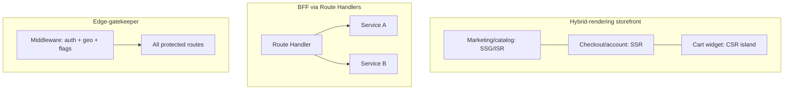

## 8. Production Architecture

A production Next.js deployment typically layers: a Content Delivery
Network (CDN) in front (serving static assets and cached Static Site
Generation (SSG)/Incremental Static Regeneration (ISR) output directly at
the edge), Middleware executing at that same edge tier for
request-interception concerns, an origin compute tier (Node.js server
processes, containers, or serverless functions) handling Server-Side
Rendering (SSR) and Route Handler requests that cannot be served from
cache, and the Edge Runtime as a third, distinct compute tier for any code
explicitly opted into it. Vercel's own platform automates most of this
topology (CDN, edge functions, and serverless origin functions are
provisioned automatically from a single deployment); self-hosting the same
architecture (for example, on Kubernetes or a container platform — see
[Kubernetes](../10_Kubernetes/PART_OVERVIEW.md) and
[Cloud Computing](../09_Cloud_Computing/PART_OVERVIEW.md) for the general
infrastructure patterns) requires assembling the equivalent tiers
explicitly: a CDN/reverse proxy layer, a Node.js server fleet with health
checks and autoscaling, and, if Edge Runtime code is used, a compatible
edge-execution platform (Cloudflare Workers and similar V8-isolate
platforms implement a compatible model).

## 9. Implementation

A representative App Router project structure, combining the conventions
taught in Sections 4.2-4.7:

```
app/
  layout.tsx                    # root layout
  page.tsx                      # "/" — SSG by default
  (marketing)/
    about/page.tsx              # "/about" — route group, no URL segment added
  dashboard/
    layout.tsx                  # persistent dashboard shell
    page.tsx                    # "/dashboard" — SSR (reads cookies)
    loading.tsx                 # Suspense fallback
    settings/page.tsx           # "/dashboard/settings"
  api/
    orders/[orderId]/route.ts   # Route Handler
middleware.ts                   # edge request interception
next.config.js                  # runtime/output/image/font configuration
```

## 10. Complete Code Examples

**Server Component with colocated data fetching, rendering a Client
Component leaf:**

```tsx
// app/dashboard/page.tsx (Server Component — default, no directive needed)
import { getDashboardMetrics } from "@/lib/metrics";
import { RefreshMetricsButton } from "./refresh-metrics-button";

export default async function DashboardPage() {
  const metrics = await getDashboardMetrics(); // runs on the server only

  return (
    <section>
      <h1>Account Overview</h1>
      <ul>
        {metrics.map((m) => (
          <li key={m.id}>
            {m.label}: {m.value}
          </li>
        ))}
      </ul>
      <RefreshMetricsButton />
    </section>
  );
}
```

```tsx
// app/dashboard/refresh-metrics-button.tsx
"use client";

import { useState, useTransition } from "react";
import { revalidateMetrics } from "./actions";

export function RefreshMetricsButton() {
  const [isPending, startTransition] = useTransition();
  const [lastRefreshed, setLastRefreshed] = useState<string | null>(null);

  return (
    <button
      disabled={isPending}
      onClick={() =>
        startTransition(async () => {
          await revalidateMetrics();
          setLastRefreshed(new Date().toLocaleTimeString());
        })
      }
    >
      {isPending ? "Refreshing..." : "Refresh metrics"}
      {lastRefreshed && <span> (last: {lastRefreshed})</span>}
    </button>
  );
}
```

**`next.config.js` expressing rendering/runtime/output decisions:**

```js
/** @type {import('next').NextConfig} */
const nextConfig = {
  images: {
    remotePatterns: [{ protocol: "https", hostname: "cdn.example.com" }],
    formats: ["image/avif", "image/webp"],
  },
  // Uncomment to produce a fully static export (Section 4.8):
  // output: "export",
};

module.exports = nextConfig;
```

(Route Handler and Middleware examples for the remaining required code
depth are given in full in Sections 4.6 and 4.7 above.)

## 11. Performance

Next.js's performance architecture is the composite of Sections 4.4
(rendering mode — avoiding unnecessary per-request compute), 4.5 (Server
Components — minimizing JavaScript shipped to the browser), 4.9
(image/font optimization), and automatic per-route code-splitting (each
route's JavaScript bundle contains only the code that route needs, not the
whole application). The single highest-leverage performance decision a
Solution Architect makes in a Next.js system is the rendering-mode
assignment per route from Section 4.4 — no amount of downstream
optimization compensates for a page that is server-rendered per request
when it could have been served from a Content Delivery Network (CDN)
cache.

## 12. Scalability

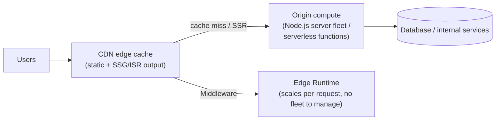

Static Site Generation (SSG)/Incremental Static Regeneration (ISR) routes
scale nearly for free — a cache hit at the Content Delivery Network (CDN)
never reaches origin compute at all, so traffic growth against those
routes is primarily a CDN capacity concern, not an application-scaling
concern. Server-Side Rendering (SSR) routes and Route Handlers scale like
any other server workload: horizontally, by running more server instances
or serverless function concurrency, behind autoscaling and health checks —
this is the tier where a Solution Architect must apply the same capacity
planning discipline covered generally in
[System Design and Distributed Systems](../07_System_Design_and_Distributed_Systems/PART_OVERVIEW.md).

## 13. Security

Middleware (Section 4.7) is the natural place to enforce authentication
gating and security headers consistently, but it must not be the *only*
enforcement point — because Route Handlers and Server Components can, in
some deployment topologies, be reached directly (bypassing an
edge-deployed Middleware is not always impossible depending on hosting
configuration), authorization checks must also exist at the Route Handler
and data-access layer itself, not solely in Middleware. Server-only
secrets (database credentials, private Application Programming Interface
(API) keys) belong exclusively in Server Component/Route Handler code and
environment variables without the `NEXT_PUBLIC_` prefix — any environment
variable prefixed `NEXT_PUBLIC_` is deliberately inlined into the client
JavaScript bundle at build time and must never hold a secret.

## 14. Observability

Server Components, Route Handlers, and Middleware all execute
server-side, so standard backend observability practice applies directly:
structured logging, distributed tracing (propagating trace context through
Server Component data fetches and Route Handler calls to downstream
services), and error tracking for both `error.tsx` boundaries and
uncaught Route Handler exceptions. See
[Observability](../12_Observability/PART_OVERVIEW.md) for the
general logging/tracing/metrics architecture this chapter's server-side
code should integrate with; this chapter does not re-teach that
foundation.

## 15. Failure Scenarios

- **ISR regeneration failure.** If a background ISR regeneration throws
  (an upstream data source is unavailable), Next.js keeps serving the last
  successfully cached HTML rather than failing the request — a resilience
  property to design for deliberately, including alerting on repeated
  regeneration failures even though users see no immediate error.
- **Edge Runtime API incompatibility.** Code opted into the Edge Runtime
  that imports a Node.js-only dependency (a native module, `fs`) fails at
  build or deploy time — this must be caught before production, ideally
  in continuous integration, not discovered from a production error.
- **Middleware latency amplification.** Slow or over-broadly-matched
  Middleware (Section 4.7) adds its latency to every matched request,
  including ones that would otherwise be served near-instantly from
  cache — under load, this can turn a Middleware-level slowdown into a
  site-wide latency incident.

## 16. Testing

Server Components complicate traditional component-testing approaches
because they are `async` functions that cannot be rendered synchronously
in the browser-oriented tools most React testing libraries assume;
practical strategies split by layer: unit-test the plain functions Server
Components call (`lib/` business logic) directly with standard test
runners, integration-test Route Handlers by invoking their exported
`GET`/`POST` functions with constructed `Request` objects, and reserve
end-to-end browser testing (Playwright or similar) for verifying full
navigations, Client Component interactivity, and hydration correctness
across the server/client boundary.

## 17. Common Mistakes

- Marking an entire page `"use client"` to fix one interactive element,
  discarding Server Component benefits for the whole subtree (Section
  4.5).
- Defaulting every route to Server-Side Rendering (SSR) instead of
  classifying each route by the Section 4.4 decision flow.
- Putting expensive or blocking logic in Middleware, adding its cost to
  every matched request (Section 4.7).
- Using a plain `` tag instead of `next/image`, silently forfeiting
  the optimization pipeline in Section 4.9.
- Choosing `output: "export"` (static export) before confirming every
  route can genuinely resolve to Static Site Generation (SSG), then
  discovering a personalization requirement mid-project (Section 4.8).

## 18. Best Practices

- Classify every route's rendering mode explicitly and deliberately
  (Section 4.4), rather than accepting whatever the scaffolding tool
  generated.
- Push `"use client"` boundaries to the smallest, most specific
  interactive leaf components (Section 4.5).
- Scope Middleware `matcher` configuration narrowly, and keep Middleware
  logic itself cheap (Section 4.7).
- Use `next/image` and `next/font` by default; treat opting out as an
  exception requiring justification, not a default choice.
- Keep server-only secrets out of any `NEXT_PUBLIC_`-prefixed environment
  variable, without exception (Section 13).

## 19. Anti-Patterns

- **The "accidental Single-Page Application (SPA)."** Marking most pages
  `"use client"` "just to be safe," which reproduces a plain
  client-rendered React application's performance and SEO characteristics
  while paying the App Router's added conceptual complexity for no
  corresponding benefit.
- **Route Handler business-logic sprawl.** Writing backend logic directly
  in `route.ts` files instead of a separate service layer, coupling
  business logic to Next.js's request/response types and making it
  unreachable, in-process, from Server Components that need the same
  logic.
- **Middleware as a general-purpose backend.** Using Middleware for logic
  that needs a database or heavy compute, rather than only lightweight,
  edge-appropriate concerns (Section 4.7).

## 20. Trade-off Analysis

| Decision | Optimizes for | Costs |
|---|---|---|
| Static Site Generation (SSG)/Incremental Static Regeneration (ISR) | Latency, infrastructure cost, cacheability | Data freshness (bounded staleness for ISR, none for SSG until rebuild) |
| Server-Side Rendering (SSR) | Data freshness, personalization | Per-request server compute, typically higher latency than a cache hit |
| Client-Side Rendering (CSR) | Interactivity, offloaded compute | First-paint latency, Search Engine Optimization (SEO) visibility |
| Edge Runtime | Latency (proximity), cold-start cost | Restricted Application Programming Interface (API) surface (no Node.js-only modules) |
| Static export (`output: "export"`) | Hosting simplicity/cost | No SSR, dynamic Route Handlers, or Middleware with dynamic behavior |

## 21. Comparison Table

| Aspect | Next.js App Router | Next.js Pages Router | Plain React (Single-Page Application) |
|---|---|---|---|
| Routing | Segment-folder file-system convention with nested layouts | File-based, one file per route | Client router library, fully configured by hand |
| Default component model | Server Components, explicit `"use client"` opt-in | Client components only | Client components only |
| Rendering-mode granularity | Per fetch call, within a route | Per page (via exported data function) | Single mode (client-rendered) unless hand-integrated with a server |
| Backend | Route Handlers, colocated | API Routes, colocated | None — requires a separate backend project |
| Edge execution | Middleware + opt-in Edge Runtime | Middleware only | Not applicable |

## 22. Real-World Case Study

A mid-size e-commerce platform migrating from a hand-rolled Node.js/Express
SSR setup plus a separate React SPA admin panel to Next.js's App Router
illustrates the architecture decisions in practice: the public storefront's
catalog and marketing pages moved to Incremental Static Regeneration with a
five-minute `revalidate` window (bounding price staleness while cutting
origin load by over 90% for those routes, since nearly all traffic now hit
the Content Delivery Network (CDN) cache); the checkout flow moved to
Server-Side Rendering to reflect a live cart and authenticated session per
request; the previously separate admin Single-Page Application (SPA) was
absorbed into the same project under `app/(admin)/`, using Route Handlers
to replace its previous standalone Express Application Programming
Interface (API); and Middleware replaced Express middleware for session
validation, now executing at the edge instead of a single regional origin.
The team reported the largest single measured improvement came not from
any individual optimization but from the ISR migration eliminating
per-request server rendering for the highest-traffic (catalog) routes
entirely — directly validating Section 4.4's framing of rendering mode as
the highest-leverage performance decision.

## 23. Interview Questions

1. Explain the difference between Static Site Generation, Server-Side
   Rendering, and Incremental Static Regeneration, and give a concrete
   scenario where each is the correct choice.
2. What does the `"use client"` directive actually mark — a single
   component, or something broader — and why does that distinction matter
   for bundle size?
3. Why can't a function or a database client instance be passed as a prop
   from a Server Component into a Client Component?
4. When would you choose the Edge Runtime over the Node.js runtime for a
   Route Handler, and what capability do you give up by doing so?
5. Walk through what happens, step by step, when a request hits a
   Next.js App Router deployment that has both Middleware and an
   Incremental Static Regeneration route configured.
6. What is a cache stampede in the context of Incremental Static
   Regeneration, and how does Next.js mitigate it?
7. Why is static export (`output: "export"`) incompatible with
   Server-Side Rendering and dynamic Route Handlers?

## 24. Hands-on Exercises

1. Build a small App Router project with one Static Site Generation route,
   one Incremental Static Regeneration route (short `revalidate` window),
   and one Server-Side Rendering route; use browser devtools to observe
   the response headers/timing differences between them.
2. Add a Route Handler that proxies a public third-party Application
   Programming Interface (API), then add Middleware that rate-limits
   requests to it by Internet Protocol (IP) address.
3. Deliberately mark a large page `"use client"`, inspect the resulting
   JavaScript bundle size, then refactor to push the boundary down to a
   single leaf component and compare bundle sizes.

## 25. Design Exercises

1. Design the rendering-mode assignment (Section 4.4) for every route of
   a hypothetical Software-as-a-Service (SaaS) product: a public marketing
   site, a pricing page, a signup flow, an authenticated dashboard, and a
   public API status page. Justify each choice.
2. Design a Middleware-based authentication and feature-flag architecture
   for a multi-tenant application, specifying exactly what Middleware
   checks versus what each Route Handler/Server Component must still
   verify independently, and why.
3. Design the server/client component boundary for a product page that
   includes server-rendered product details, a client-side image gallery
   with zoom interaction, and a server-rendered "related products" list.

## 26. Architecture Review Questions

- For each route in this system, is its rendering mode a deliberate,
  documented decision, or an unexamined default?
- Where are `"use client"` boundaries placed, and could any of them be
  pushed further down the component tree?
- What does Middleware currently do, and does any of it belong in a Route
  Handler or Server Component instead?
- Are server-only secrets confirmed absent from every
  `NEXT_PUBLIC_`-prefixed environment variable?
- If this project uses static export, has every route been confirmed
  compatible, and is there a plan for what happens if a future
  requirement needs Server-Side Rendering?

## 27. Summary

Next.js is not a router bolted onto React — it is a full-stack
meta-framework that turns a set of architectural decisions every
React-based system must eventually make (routing, rendering mode,
server/client boundaries, backend Application Programming Interface (API)
surface, edge interception, deployment topology) into declarative,
file-system-driven conventions with sensible, overridable defaults. The
App Router's nested layouts and React Server Components let a single
project mix statically cached, per-request server-rendered, and purely
client-interactive rendering in the same route, even the same component
tree, while Route Handlers and Middleware extend that same project into a
genuine backend and edge-execution layer. The Solution Architect's job is
never to accept these defaults uncritically: every route's rendering mode,
every `"use client"` boundary, every piece of Middleware logic, and every
runtime/output-mode choice is an explicit trade-off between latency,
freshness, cost, and capability — and this chapter's Section 4 is the
first-principles foundation for making each of those trade-offs
deliberately.

## Further Reading

- [React](CH06_React.md) — Virtual DOM, reconciliation, Hooks, and the
  general React Server Components primitive this chapter builds on.
- [TypeScript](CH04_TypeScript.md) — the type system used throughout this
  chapter's code examples.
- [HTTP](../05_Networking_and_OS/CH01_HTTP.md) — caching headers and
  methods underlying Route Handlers and CDN/ISR caching behavior.
- [REST](../08_API_Architecture/CH01_REST.md) — API design principles
  applicable to Route Handlers.
- [System Design and Distributed Systems](../07_System_Design_and_Distributed_Systems/PART_OVERVIEW.md) —
  general capacity planning and horizontal scaling this chapter's Section
  12 builds on.
- [Observability](../12_Observability/PART_OVERVIEW.md) — logging,
  tracing, and metrics foundations for server-side Next.js code.
