# Chapter 8: Micro Frontends

## 1. Introduction

A **micro frontend (MFE)** is an architectural style in which a browser-based
application is decomposed into independently developed, tested, deployed, and
(often) independently versioned front-end pieces that are composed into a
single user-facing experience at build time, run time, or the network edge.
Where a microservices architecture applies the "small, independently
deployable service owned by one team" principle to the backend, micro
frontends apply the same principle to the presentation layer: the login page,
the product catalog, the checkout flow, and the account-settings screen might
each be built, tested, and shipped by a different team, on a different
release cadence, using a different framework version — yet a user navigating
the site experiences a single, coherent application.

This chapter is scoped specifically to micro frontends as **both an
organizational and a technical pattern** for a Solution Architect: the
motivation (why teams reach for this decomposition at all), the composition
and integration strategies available (build-time, run-time, and server/edge
composition), the shared-dependency and version-skew trade-offs that make
this pattern harder than it looks, cross-micro-frontend communication,
styling isolation, and the operational/deployment architecture that keeps
independently shipped fragments from breaking each other in production.

This chapter deliberately does **not** re-teach three things owned elsewhere
in the handbook:

- **Web Components** (Custom Elements, Shadow DOM, `<template>`/`<slot>`) are
  fully taught in
  [HTML § 4.9](CH01_HTML.md#49-web-components-a-framework-agnostic-component-architecture).
  This chapter recaps only what's needed to use Web Components as a
  micro-frontend composition unit.
- **CSS Shadow DOM style encapsulation** is fully taught in
  [CSS § 4.11](CH02_CSS.md#411-component-isolation-shadow-dom-encapsulation-vs-global-cascade-risk).
  This chapter recaps it only as one of several styling-isolation strategies.
- **Microservices and Conway's Law** are owned by
  [What is Software Architecture? § Conway's Law](../01_Architecture_Mindset/CH01_What_is_Software_Architecture.md).
  This chapter recaps both briefly in Section 3 and then applies them to the
  frontend, rather than re-deriving them.

By the end of this chapter you should be able to: decide whether a system
actually warrants micro frontends versus a well-modularized monolith frontend;
choose a composition strategy (and defend the choice against alternatives);
design a shared-dependency and versioning strategy that avoids "dependency
hell in the browser"; design cross-micro-frontend communication that doesn't
recreate tight coupling through the back door; and design the independent
CI/CD (Continuous Integration/Continuous Deployment), versioning, and rollback
architecture that makes independent deployability real rather than aspirational.

## 2. Historical Evolution

The term "micro frontends" was coined by ThoughtWorks, who added it to their
Technology Radar in 2016 after observing (and helping build) systems where
large single-page applications had become as hard to change safely as the
monolithic backends that motivated microservices in the first place. The
underlying ideas, however, predate the name by well over a decade:

- **Late 1990s-2000s — Server-side includes and portlets.** Enterprise portal
  frameworks (WebSphere Portal, Liferay, JSR-168/286 portlets) let different
  teams contribute independently deployed fragments to one page, composed on
  the server. This is, in essence, server-side micro frontend composition —
  without the name, and without the client-side interactivity users expect
  today.
- **2000s — Ajax and the rise of client-heavy apps.** As Ajax (Asynchronous
  JavaScript and XML) matured, more logic moved to the browser, and portal-
  style server composition fell out of fashion in favor of thick client
  applications — trading composability for interactivity.
- **2010-2015 — The Single Page Application (SPA) era and the "frontend
  monolith."** Frameworks like Angular, Ember, Backbone, and later React
  encouraged building one large client-side application per product. This
  worked well for a single team but became a bottleneck as organizations
  scaled: dozens of engineers committing to one bundle, one build pipeline,
  one release train, and one framework version, mirroring exactly the
  coordination cost that motivated microservices on the backend.
- **2016 — ThoughtWorks names "micro frontends."** The explicit framing:
  apply microservice-style independent deployability and team ownership to
  vertical slices of the UI (User Interface), not just backend services.
- **2017-2019 — Tooling catches up.** `single-spa` (2017) provided a
  framework-agnostic run-time orchestrator for mounting/unmounting multiple
  frontend "applications" on one page. Web Components matured as a
  browser-native, framework-agnostic composition primitive.
- **2020 — Webpack 5 Module Federation.** Webpack's Module Federation plugin
  made run-time composition dramatically easier by letting independently
  built and deployed JavaScript bundles share code and dynamically import
  each other over the network, without a build-time dependency between them.
  This significantly lowered the operational cost of run-time integration and
  drove mainstream adoption.
- **2021-present — Framework-native federation and edge composition.**
  Vite-based federation plugins, Next.js multi-zone patterns, and edge/CDN
  (Content Delivery Network) composition (stitching fragments at the CDN edge
  using platforms like Akamai EdgeWorkers, Fastly Compute, or CloudFront
  Functions) extended composition beyond a single bundler's ecosystem, and
  server-driven UI patterns re-legitimized composing pages outside the
  client entirely for performance-sensitive, SEO-critical surfaces.

The throughline across thirty years: whenever one deployable frontend
artifact becomes the bottleneck for multiple teams, some form of independent,
composed fragments re-emerges — the tooling changes, the underlying pressure
does not.

## 3. Why It Exists

**Recap: Conway's Law, applied to the frontend.** Conway's Law observes that
a system's structure mirrors the communication structure of the organization
that built it (full definition, history, and the Inverse Conway Maneuver are
owned by
[What is Software Architecture? — Conway's Law](../01_Architecture_Mindset/CH01_What_is_Software_Architecture.md);
this chapter assumes that grounding). Applied to a frontend: if five product
teams each own a vertical business capability (search, product detail,
checkout, account, recommendations) but all five commit to one shared
React/Angular codebase and release train, Conway's Law predicts friction —
the *communication topology* (five loosely coordinated teams) doesn't match
the *artifact topology* (one tightly coupled bundle). Micro frontends are, at
their core, an application of the **Inverse Conway Maneuver** to the
presentation layer: reshape the technical boundaries (one deployable UI
fragment per team) to match the desired team boundaries, rather than forcing
five teams to coordinate around one build.

**Recap: microservices and independent deployability.** The backend
microservices pattern's central promise is that a team can design, test, and
deploy its service without waiting on, or breaking, any other team's service,
as long as the contract between them holds. Micro frontends chase the exact
same promise for the browser-facing layer: a team should be able to ship a
change to the checkout experience without requiring the search team, the
recommendations team, or a central "frontend platform" team to review,
rebuild, or re-test their code. The problem micro frontends solve is
therefore **organizational and operational, not primarily technical** — a
well-organized monolith frontend with clean module boundaries and a
disciplined single team can outperform a poorly executed micro frontend split
with five teams tripping over shared dependencies. The pattern earns its
complexity budget specifically when:

1. **Multiple teams must ship independently** to the same digital surface
   (page, app shell) on different cadences, and coordination overhead across
   those teams is already a measured bottleneck (missed release trains,
   cross-team blocking pull requests, "code freeze" windows).
2. **Different parts of the surface have genuinely different technical
   needs** — a marketing landing page optimized for Server-Side Rendering
   (SSR) and Search Engine Optimization (SEO), and a highly interactive
   trading dashboard optimized for client-side state, may not want the same
   framework, build pipeline, or performance budget.
3. **Incremental modernization is required** — replacing a legacy Angular.js
   application feature-by-feature with React, without a multi-year "big bang"
   rewrite, is one of the most common and best-justified reasons micro
   frontends exist in practice.
4. **Team boundaries need to be enforced, not just declared** — a monorepo
   with "module boundaries" enforced only by code review discipline tends to
   erode; independent deployability makes the boundary a *technical* fact
   (you cannot accidentally import another team's internal module across a
   network boundary the way you can across a folder boundary).

Conversely, micro frontends are the wrong tool when a single team owns the
entire surface, when the organization cannot tolerate the duplicated
infrastructure cost (see Section 4.9), or when the *only* stated goal is
"we heard microservices are good so let's do this to the frontend too" —
cargo-culting the backend pattern without the matching organizational
pressure just adds distributed-systems complexity to what could have been a
well-modularized single build.

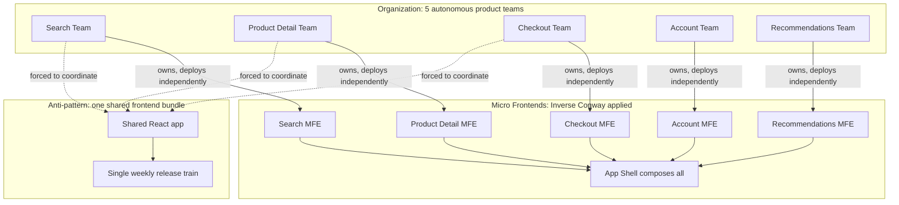

## 4. Core Concepts

### 4.1 Definition: What Counts as a Micro Frontend

**Definition.** A micro frontend is an independently buildable, testable, and
deployable unit of user-facing functionality, owned end-to-end by one team,
that is composed with other such units into a single experience for the end
user. The critical word is *independently* — a component library shared by
one team across many pages is not a micro frontend; it's a shared library. A
"micro frontend" implies an **ownership and deployment boundary**, not just a
code-organization boundary.

**Mechanism.** Three properties distinguish a true micro frontend from a
merely well-modularized module:

1. **Independent deployability** — Team A can ship to production without a
   coordinated release with Team B, and without redeploying Team B's code.
2. **Independent runtime lifecycle** — the fragment can be loaded, mounted,
   updated, and unmounted without requiring a full page reload of the
   composing shell (for run-time integration) — though build-time and
   server-side integration relax this requirement, trading it for simpler
   composition (Section 4.3).
3. **Team-aligned ownership** — one team owns the fragment's full stack
   slice: UI code, its build pipeline, its tests, and (frequently) the
   backend-for-frontend or Application Programming Interface (API) calls it
   makes, end to end.

**Decision implications.** When evaluating whether a piece of a system is
"a micro frontend" or just "a component," ask whether it could be deployed
by its owning team *today*, with zero coordination, and still produce a
working (if perhaps visually rougher) composed page. If the answer requires
"but first Team B has to redeploy the shell," it's not yet independently
deployable — it's a component with aspirations.

**Common failure mode.** Teams frequently build "micro frontends" that are
independently *built* (separate repositories, separate `package.json` files)
but not independently *deployable*, because the shell still pins a specific
version of every remote and requires a shell redeploy to pick up a new
remote version. This delivers the *organizational* cost of micro frontends
(coordination across repos, duplicated tooling) without the primary benefit
(independent deployability) — see Section 17 (Common Mistakes).

### 4.2 Independent Deployability as the North Star

**Definition.** Independent deployability is the property that any one
micro frontend's release process — build, test, deploy — can complete
end-to-end without requiring another micro frontend, or the composing shell,
to change in lockstep.

**Mechanism.** Independent deployability is achieved by decoupling three
things that a monolithic frontend couples by default: the **build**
(separate bundlers/pipelines, so one team's build failure doesn't block
another's), the **deploy artifact** (each micro frontend publishes to its
own Content Delivery Network (CDN) path or registry entry, versioned
independently), and the **runtime resolution** (the shell discovers *which*
version of each remote to load at runtime — or at worst, at its own next
deploy — rather than that version being hard-baked into a shared build
graph).

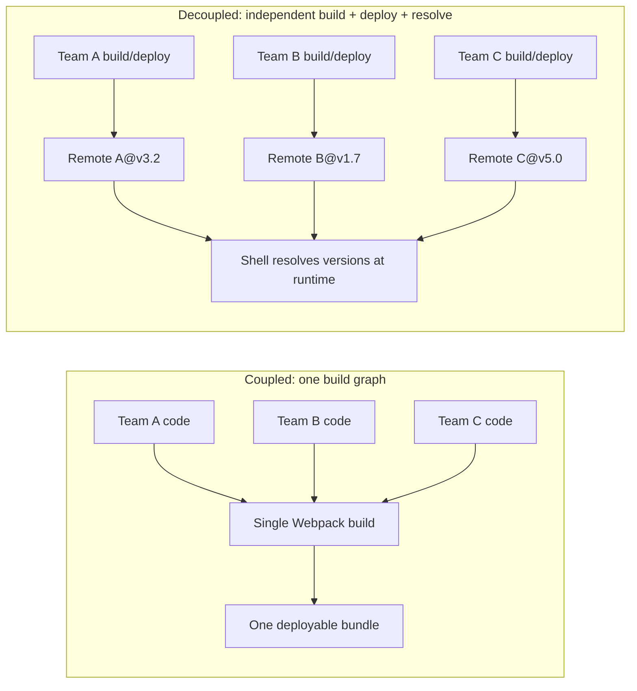

**Decision implications.** Independent deployability is a spectrum, not a
binary — Section 4.3's composition strategies sit at different points on
that spectrum, from "recompile everything together" (no independence) to
"the shell dynamically discovers and loads whatever version each remote
publishes, with no shell redeploy" (full independence). A Solution Architect
must pick a point on this spectrum deliberately, matching how much
independence the organization's team structure actually needs against how
much runtime complexity (and risk) it can absorb.

**Common failure mode.** "We use separate Git repositories" is often
conflated with "we have independent deployability." Repository separation
is necessary but nowhere near sufficient — see Section 15 for what breaks
when repository separation exists without genuine runtime decoupling.

### 4.3 Composition Strategy Taxonomy

**Definition.** Composition is the mechanism by which independently built
micro frontends are assembled into one user-facing page or application.
There are three fundamentally different *points in time* at which this
assembly can happen, and the choice has cascading consequences for
deployability, performance, and coupling.

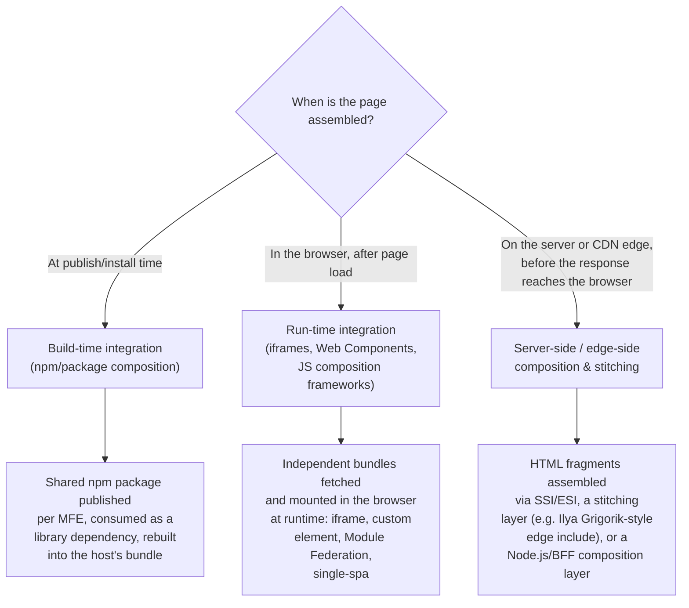

**Mechanism and trade-offs, at a glance** (each strategy is taught in full in
Sections 4.4-4.8):

| Strategy | Deploy coupling | Runtime cost | Framework flexibility | Typical use case |
|---|---|---|---|---|
| Build-time (npm package) | High — consumer must rebuild to pick up changes | None (compiled in) | Low — must match host's framework/version | Internal component libraries, not true independent deployability |
| Run-time: iframe | None | Highest (separate document, separate JS realm) | Highest — total isolation | Untrusted third-party widgets, strict isolation needs |
| Run-time: Web Components | Low | Low-moderate | High — framework-agnostic contract | Design-system-level composition, cross-framework teams |
| Run-time: JS composition (Module Federation / single-spa) | Low | Moderate (shared-dependency negotiation) | Moderate — best with aligned frameworks | Most common: SPA-style micro frontends with a shared shell |
| Server-side / edge-side composition | None | Low (assembled before the browser parses) | High — languages can differ entirely | Marketing/content-heavy, SEO-critical, performance-critical surfaces |

**Decision implications.** The three points on the timeline trade off
against each other on exactly one axis worth memorizing: **the earlier
composition happens, the more it behaves like a monolith (fast, simple,
tightly coupled); the later it happens, the more it behaves like a
distributed system (flexible, independently deployable, operationally
harder)**. A Solution Architect's job is to place each surface of the
application at the point on this timeline that its actual team/technical
needs justify — not to pick the most "modern" option uniformly for every
page.

### 4.4 Build-Time Integration (npm Packages)

**Definition.** Build-time integration means each micro frontend is
published as a versioned package (typically to an npm registry, public or
private) and the host application declares it as a build dependency,
compiling it into one final bundle alongside the shell's own code.

**Mechanism.** A team finishes a feature, bumps a `package.json` version,
publishes to the registry (public npm or an internal registry like
Verdaccio/Artifactory), and the shell's next `npm install && npm run build`
picks up the new version — assuming the shell's `package.json` range
(`^2.3.0`, exact pin, etc.) allows it.

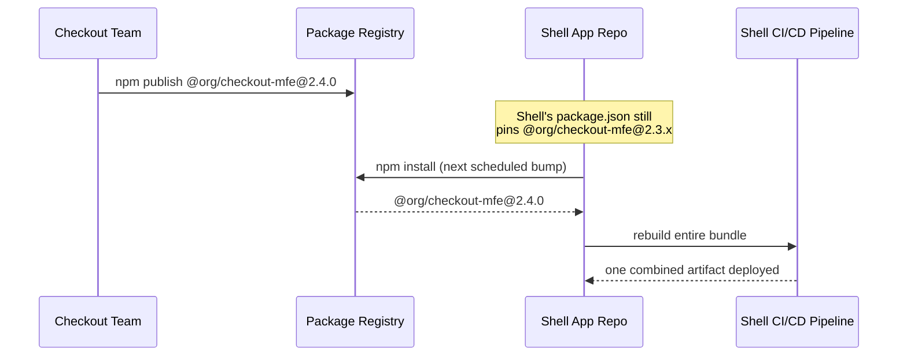

**Decision implications.** This is the *least* independent form of
integration — a new checkout release only reaches production the next time
the shell rebuilds and redeploys, which reintroduces the coordination
bottleneck micro frontends exist to remove. It remains genuinely useful,
though, for **shared design-system components** and **cross-cutting
utilities** (date pickers, form validators) that intentionally *should*
move in lockstep with a single semantic-versioning contract, as opposed to
independently owned business-capability slices. Treat build-time integration
as the right tool for "shared library," and reach for run-time or
server-side integration when the goal is "independently deployable business
capability."

**Common failure mode.** Teams sometimes start here because it's the
easiest to set up (it's just an npm dependency), then discover a year later
that every "micro frontend" release still requires a shell rebuild and a
coordinated deploy — the team-autonomy goal was never actually achieved,
only the code-separation goal was.

### 4.5 Run-Time Integration: iframes

**Definition.** The `<iframe>` element embeds another complete, independent
HTML document inside the parent page, each running in its own browsing
context with its own JavaScript global scope, its own Document Object Model
(DOM), and (by default) no shared state with the parent beyond the limited,
explicit `postMessage` API.

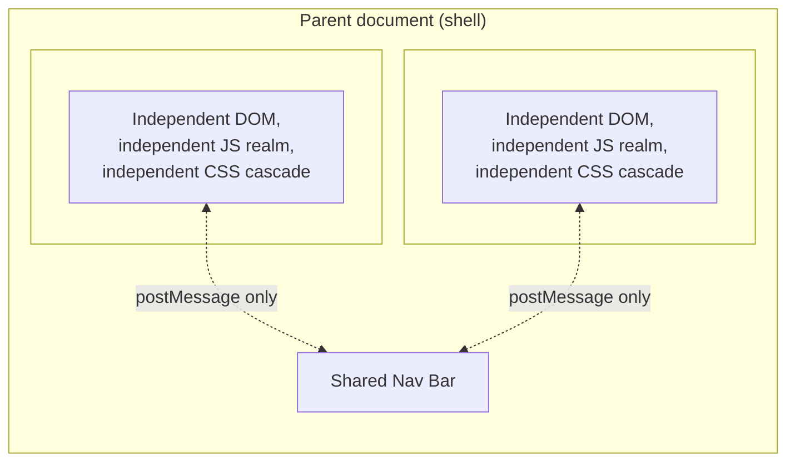

**Mechanism.** Because each `<iframe>` is a genuinely separate browsing
context, style leakage between fragments is structurally impossible (no
cascade crosses the boundary), a crash or infinite loop in one fragment's
JavaScript cannot directly corrupt another's memory or DOM, and each
fragment can be built with an entirely different framework, framework
*version*, or even language runtime (e.g. a WebAssembly-heavy analytics
widget) with zero risk of collision. Communication must go through
`window.postMessage`, an explicit, serializable, cross-origin-safe channel.

**Decision implications.** Choose iframes when the isolation requirement is
non-negotiable — most commonly for **untrusted or semi-trusted third-party
content** (an embedded payment widget from a Payment Card Industry (PCI)
compliance boundary, a partner's embedded chat widget, user-generated
content), where you cannot allow the embedded code to read cookies, local
storage, or the DOM of the host page. The cost is real: iframes cannot
easily share the URL bar's routing, resizing to fit content requires extra
plumbing (`postMessage`-based height reporting or the newer permissions
proposals), Search Engine Optimization (SEO) suffers because crawlers treat
iframe content as a separate document, and deep-linking/sharing a specific
in-app state is harder. For fully trusted, first-party teams building one
cohesive product, iframes are usually a worse choice than Web Components or
a JavaScript composition framework precisely because the isolation you're
paying for isn't a problem you have.

**Common failure mode.** Reaching for iframes "for isolation" between two
first-party micro frontends that are meant to feel like one seamless
application — the isolation tax (broken deep links, layout jank, disjointed
scroll/focus behavior) is paid for a threat model (mutual distrust between
your own teams) that usually doesn't exist.

### 4.6 Run-Time Integration: Web Components as a Composition Unit

**Recap (full teaching owned by** [HTML § 4.9](CH01_HTML.md#49-web-components-a-framework-agnostic-component-architecture)
**).** Web Components — Custom Elements, Shadow DOM, and the
`<template>`/`<slot>` primitives — provide a browser-native way to define a
new HTML tag (e.g. `<checkout-widget>`) with encapsulated markup, styles,
and behavior, independent of any framework. This chapter does not re-derive
how Custom Elements register, how the Shadow DOM tree attaches, or the
component lifecycle callbacks; see the linked section for that.

**Applied to micro frontends.** What Web Components add *specifically* for
composition is a **framework-agnostic contract**: the shell doesn't need to
know whether `<checkout-widget>` was built with React, Vue, Svelte, or
vanilla JavaScript — it just needs to know the tag name and its
attribute/event contract, exactly the way it doesn't need to know how
`<video>` or `<select>` are implemented internally. Each micro frontend
publishes itself as a Custom Element; the shell (or another micro frontend)
uses it exactly like a built-in HTML tag.

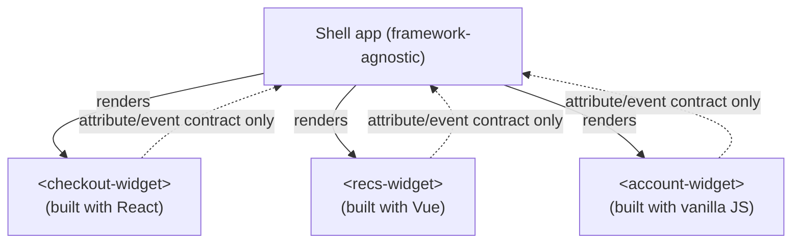

**Decision implications.** Web Components are the strongest choice when the
organization is genuinely polyglot at the framework level (a real,
intentional decision — e.g. mid-migration between frameworks, or a
design-system team supporting multiple product teams' framework choices),
and when you want *some* styling isolation (Shadow DOM, recapped in Section
4.11) without the full document-isolation tax of an iframe. The cost:
cross-component, framework-native state sharing (e.g. React Context) does
not cross a Custom Element boundary — you're back to an explicit
attribute/event/DOM-API contract, and framework-specific optimizations
(React's reconciliation, Vue's reactivity) don't extend across the
boundary either.

### 4.7 Run-Time Integration: JavaScript Composition Frameworks (Module Federation and single-spa)

**Definition.** JavaScript composition frameworks let a "shell" (or "host"
or "container") application dynamically fetch and mount JavaScript bundles
built and deployed *independently* by other teams, at runtime, in the same
JavaScript realm and DOM as the shell — trading the strict isolation of
iframes for lower overhead and richer sharing (including, deliberately,
sharing a single instance of large frameworks like React).

The two dominant approaches solve overlapping but distinct problems:

- **`single-spa`** is a run-time *orchestrator*: it manages the lifecycle
  (bootstrap → mount → unmount) of multiple independently built
  "applications" registered against URL-route activity functions, so that
  navigating between routes mounts the right micro frontend and unmounts the
  others. It is agnostic to *how* each application's code is bundled or
  fetched — that's a separate concern.
- **Webpack Module Federation** (and its Vite/Rspack equivalents) is a
  *bundler-level* mechanism: it lets one built bundle (the "host") declare
  remote bundles (the "remotes") it wants to dynamically `import()` at
  runtime, and — critically — lets multiple bundles agree to **share** a
  single instance of a common dependency (like `react` and `react-dom`)
  instead of each bundle shipping its own copy.

These are complementary, not competing: many production systems use
`single-spa` for route-level lifecycle orchestration *and* Module Federation
for the actual code-loading and dependency-sharing mechanism underneath it.

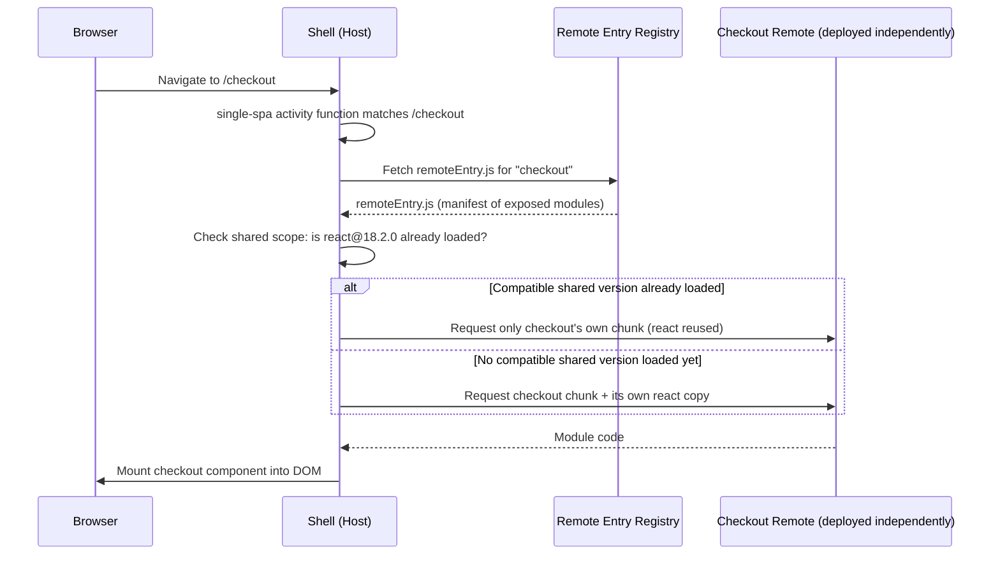

**Mechanism — the shared-scope negotiation.** Module Federation's most
important (and most misunderstood) mechanism is its **shared scope**: when
both the host and a remote declare `react` as a `shared` dependency, the
*first* one loaded at runtime registers itself in a shared module registry;
every subsequent consumer that requests a *semver-compatible* version reuses
that already-loaded instance instead of fetching and instantiating its own.
If a consumer requires a version outside the compatible range, Module
Federation falls back to loading a second copy side-by-side — which works,
but reintroduces the bundle-size and dual-instance problems in Section 4.9.

**Decision implications.** Choose a JavaScript composition framework when
the organization has multiple teams shipping route- or feature-level slices
of what should feel like *one seamless single-page application*, and when
the teams can realistically coordinate on a shared major version of their
core framework (see Section 4.9) — this is, in practice, the most common
production shape for internally built, first-party micro frontends today.

**Common failure mode.** Treating Module Federation's `shared` configuration
as "set it once and forget it." Shared-scope negotiation is a *runtime*
behavior — a seemingly unrelated remote deploying a new incompatible major
version of a shared library can silently cause every *other* remote to fall
back to loading their own duplicate copy, with no build-time signal that
anything changed. Section 15 covers this failure mode in detail.

### 4.8 Server-Side and Edge-Side Composition and Stitching

**Definition.** Server-side (or edge-side) composition assembles the final
HTML response from multiple independently owned fragments *before* it
reaches the browser — on an application server, a Backend-for-Frontend
(BFF), or at the CDN edge — rather than composing DOM nodes in the client's
JavaScript runtime.

**Mechanism.** Three common implementations:

1. **Edge Side Includes (ESI) / Server Side Includes (SSI)** — a
   CDN or reverse proxy (Varnish, Akamai, Fastly) parses lightweight include
   directives (`<esi:include src="/fragments/nav">`) in an otherwise static
   HTML template and fetches + splices in each fragment's HTML before
   forwarding the response, each fragment independently cacheable with its
   own Time To Live (TTL).
2. **A dedicated stitching/composition layer** (a Node.js BFF, or a
   framework feature like Next.js "multi-zone" routing) that fetches
   multiple upstream fragment services in parallel and assembles one HTML
   document, sometimes streaming fragments as they resolve rather than
   waiting for the slowest one.
3. **Edge compute functions** (Akamai EdgeWorkers, Fastly Compute, CloudFront
   Functions/Lambda@Edge) running composition logic directly at Points of
   Presence (PoPs) close to the user, minimizing the extra round trip a
   central stitching server would add.

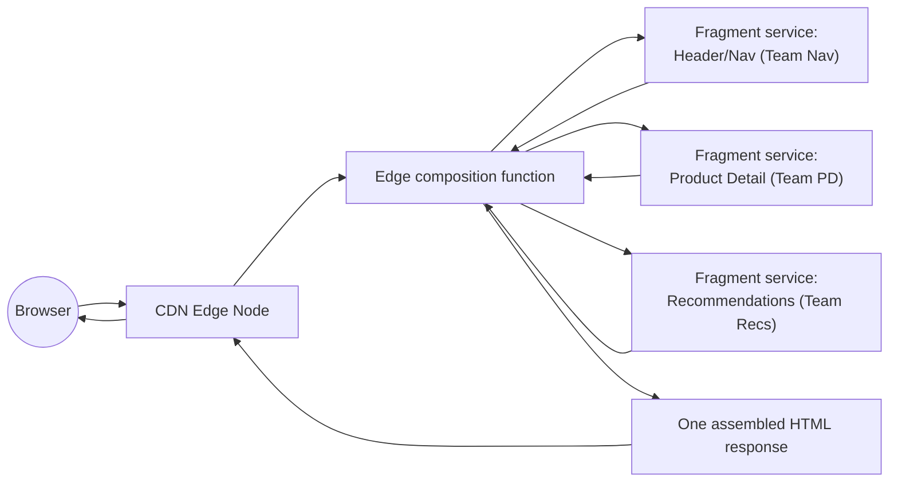

**Decision implications.** Server/edge composition is the strongest choice
when **Search Engine Optimization (SEO) and first-paint performance are
primary quality attributes** — the browser receives one complete HTML
document with no client-side composition waterfall, no framework
JavaScript to download before content appears, and each fragment can be
independently cached at the edge with its own invalidation policy. The
trade-off is that this approach is weakest for **highly interactive,
stateful client experiences** (a trading blotter, a drag-and-drop editor):
once the page is on the client, you still need *some* client-side
mechanism (hydration, or a run-time composition layer for the interactive
parts) to make it behave like an application rather than a document, so
server/edge composition is frequently combined with run-time composition
for the interactive subset of the page rather than used exclusively.

**Common failure mode.** Assuming server-side composition eliminates the
shared-dependency problem entirely. It eliminates the *client-side*
duplicate-framework problem (Section 4.9), but each fragment service still
needs its own deployment, versioning, and failure-isolation story on the
server side — a slow or failing fragment service can still stall or corrupt
the assembled response unless the stitching layer applies timeouts and
fallbacks (Section 15).

### 4.9 The Shared-Dependency Problem and Version Skew

**Definition.** The shared-dependency problem is the tension between two
goals that directly oppose each other once multiple independently built
frontend bundles must coexist in one browser tab: **minimizing duplicate
bytes downloaded** (favoring one shared instance of large frameworks like
React or Angular across all micro frontends) versus **maximizing
independence** (favoring each micro frontend bundling its own exact
dependency versions, so no team is blocked waiting for another team to
upgrade).

**Mechanism.** Consider five micro frontends, each depending on React. There
are exactly two architectural choices, with no free middle ground:

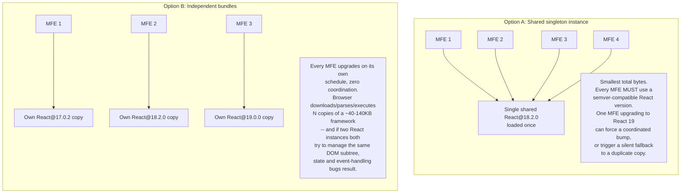

**Decision implications.** There is no version of this trade-off that
avoids a cost — a Solution Architect's job is to choose *which* cost the
organization is better positioned to absorb:

- **Choose the shared singleton** when the organization can realistically
  enforce a coordinated major-version policy across teams (e.g. a platform
  team owns and communicates React upgrade windows), and when bundle size
  and load performance are a hard quality attribute (e.g. mobile-first,
  emerging-market users on constrained networks). The cost is a *governance*
  cost, not a technical one: someone must own compatibility policy and
  communicate breaking upgrades ahead of time.
- **Choose independent bundles** when teams need to upgrade fully
  independently (e.g. a slow-moving legacy remote that can't yet move off
  React 17, alongside a greenfield remote on React 19), and when the
  product's performance budget can absorb the extra duplicated bytes (e.g.
  an internal enterprise tool on corporate networks, not a public
  consumer-facing mobile-first storefront). The cost is *measurable and
  falls on the end user*: extra kilobytes down the wire and extra parse/
  execute time, every time.
- A common middle ground with Module Federation's shared scope (Section
  4.7) is **"shared but not required"**: declare `react` as shared with
  `singleton: true, requiredVersion: false`, which reuses a compatible
  version when one is already loaded but silently tolerates (falls back to
  a duplicate for) an incompatible one — trading a hard build-time failure
  for a soft, harder-to-notice runtime bundle-size regression. Decide
  deliberately whether a mismatch should be a loud build failure or a quiet
  runtime fallback; don't let the tooling default decide for you.

**Common failure mode.** Two independently deployed micro frontends both
mount their *own* full instance of React onto overlapping DOM nodes (rather
than each strictly owning a disjoint DOM subtree). Because React's
reconciler assumes it exclusively owns the subtree it manages, two React
instances fighting over the same nodes produces intermittent, hard-to-
reproduce UI corruption — the fix is an architectural rule, not a code fix:
every micro frontend must own a disjoint DOM mount point, never overlapping
DOM managed by another instance of the same framework.

### 4.10 Cross-Micro-Frontend Communication Patterns

**Definition.** Because independently deployed micro frontends must not
import each other's internal modules directly (that would recreate the
build-time coupling the whole pattern exists to avoid), they need
explicit, contract-based communication channels for the cases where they
genuinely must coordinate — e.g., adding an item to a cart in the Product
Detail micro frontend must update a cart-count badge owned by the Nav micro
frontend.

**Mechanism — three patterns, from loosest to tightest coupling:**

1. **Custom DOM events.** One micro frontend dispatches a
   `CustomEvent` on a shared point in the DOM (commonly `window` or
   `document`); any other micro frontend that cares adds a listener. This
   is the loosest-coupling option: the dispatching micro frontend doesn't
   know or care who's listening, and listeners can be added or removed
   independently of the emitter's release cycle.

   ```mermaid
   sequenceDiagram
       participant PD as Product Detail MFE
       participant Win as window (shared event bus)
       participant Nav as Nav MFE
       participant Cart as Cart MFE
       PD->>Win: dispatchEvent(new CustomEvent('cart:item-added', {detail}))
       Win-->>Nav: 'cart:item-added' listener fires
       Win-->>Cart: 'cart:item-added' listener fires
       Nav->>Nav: increment badge count
       Cart->>Cart: append item to cart state
   ```

2. **A shared state store.** A small, framework-agnostic store (a plain
   pub-sub object, or a shared library like a minimal Redux/Zustand-style
   store loaded once via Module Federation's shared scope) that any micro
   frontend can read from and dispatch updates to. This is tighter coupling
   than custom events (every participant must agree on the *shape* of the
   shared state, not just an event name and payload), but is more ergonomic
   for state that many fragments need to read continuously (e.g. the
   logged-in user's session, feature flags, cart contents) rather than
   react to a one-off event.
3. **URL-based routing coordination.** The browser's URL itself acts as
   shared, framework-agnostic state: micro frontends coordinate which of
   them is "active" purely by which route is active (this is exactly what
   `single-spa`'s activity functions do), and pass small amounts of state
   through query parameters or route segments rather than an in-memory
   channel. This is the most loosely coupled of all three (the URL is a
   platform-native contract every browser and every framework already
   understands) but is only suitable for state that's meaningful to encode
   in a shareable, bookmarkable URL — not for high-frequency or
   sensitive state.

**Decision implications.** Default to custom events for one-off,
occasional cross-micro-frontend notifications (a badge update, a toast
notification triggered by another team's action) — they keep coupling to a
named contract (event name + payload shape) rather than a shared runtime
object. Reach for a shared state store only when multiple fragments need
continuous, reactive access to the same data, and treat that store's shape
as a formal, versioned contract between teams — changing its shape without
coordination is exactly as breaking as changing a shared API's response
shape. Prefer URL-based coordination for "which fragment is currently
active" — it's what makes deep-linking and browser back/forward work
correctly for free.

**Common failure mode.** Reaching for a shared state store by default for
*everything*, which quietly re-creates a single shared "frontend state
schema" that every team must agree on before shipping — the same
coordination bottleneck micro frontends exist to remove, just moved from
the build graph into a runtime object.

### 4.11 Styling Isolation Strategies

**Recap (full teaching owned by** [CSS § 4.11](CH02_CSS.md#411-component-isolation-shadow-dom-encapsulation-vs-global-cascade-risk)
**).** Shadow DOM provides browser-enforced, structural style encapsulation:
styles defined inside a shadow tree cannot leak out to the rest of the page,
and (mostly) the page's global styles cannot leak in. This chapter does not
re-derive the shadow-tree mechanics, `:host`/`::slotted` selectors, or the
inheritance exceptions (e.g. `color`, `font-family` still inherit across the
boundary) — see the linked section for that.

**Applied to micro frontends, three isolation strategies exist, in
increasing order of enforcement strength:**

1. **CSS namespacing conventions** (Block Element Modifier (BEM)-style
   prefixes, e.g. every class in the Checkout micro frontend prefixed
   `checkout__`) — a *discipline*, not an enforcement mechanism; still
   shares one global cascade, so a specificity war or an accidental
   unprefixed selector can still leak across micro-frontend boundaries.
   Cheapest to adopt, weakest guarantee.
2. **CSS Modules / scoped build-time class hashing** — the build tool
   generates unique class names per component at build time (e.g.
   `.button_a3f9c2`), removing *accidental* collisions, but still compiles
   into one shared stylesheet/cascade at runtime — still no protection
   against a micro frontend intentionally targeting `#root .button` with an
   overly broad selector.
3. **Shadow DOM** (recapped above) — the only browser-enforced, structural
   guarantee: even a deliberately broad selector in the host page's global
   stylesheet cannot reach into another micro frontend's shadow tree.
   Strongest guarantee, but requires the micro frontend to actually be
   packaged as (or render inside) a Web Component, and complicates
   *sharing* a design system's base styles across the boundary (they must
   be explicitly injected into each shadow root, e.g. via
   [Constructable Stylesheets](CH01_HTML.md#49-web-components-a-framework-agnostic-component-architecture)).

**Decision implications.** Match the isolation strategy to the composition
strategy chosen in Section 4.3: an iframe already provides total isolation
for free (any CSS strategy works fine inside it, since it can never leak
out); a Web-Component-based composition should use Shadow DOM to get a
matching *style* guarantee alongside its *markup/behavior* guarantee; and
JavaScript-composition-framework-based systems (Module Federation,
`single-spa`) without Web Components must fall back to namespacing or CSS
Modules, and should budget time for the periodic "team B's CSS broke team
A's page" incident that namespacing-only strategies don't fully prevent.

## 5. Internal Working

This section traces, mechanically, what happens in the browser from the
moment a user navigates to a route composed via Module Federation to the
moment the remote's UI is on screen — the "internal working" underneath the
Section 4.7 sequence diagram.

1. **Shell bootstraps.** The shell's own bundle (containing the app shell,
   routing, and its own `shared` dependency declarations) loads and
   executes first.
2. **Route match triggers a remote lookup.** The shell's router (or
   `single-spa`'s activity function) determines the active route requires
   the "checkout" remote, and looks up that remote's entry URL — either
   hardcoded in the shell's build-time Module Federation config, or
   resolved dynamically from a runtime manifest/registry service (the more
   flexible, more common production pattern, since it avoids a shell
   rebuild every time a remote's URL or version changes).
3. **`remoteEntry.js` is fetched.** This tiny file is *not* the remote's
   actual application code — it's a manifest describing which modules the
   remote exposes (e.g. `./CheckoutApp`) and which shared dependencies it
   needs, at what version ranges.
4. **Shared-scope negotiation runs.** Webpack's federation runtime compares
   the remote's declared shared dependencies (e.g. `react@^18.0.0`) against
   what's already registered in the shared scope from the shell or any
   previously loaded remote. If a semver-compatible version is already
   present, it's reused; otherwise the remote's own copy is fetched
   alongside.
5. **The actual exposed module's chunk is fetched and executed**, now able
   to `import` the resolved shared dependencies rather than bundling its
   own duplicate copies.
6. **The shell mounts the resolved component** into a DOM node that this
   micro frontend exclusively owns (Section 4.9's disjoint-mount-point
   rule), and the remote's lifecycle (in `single-spa` terms:
   `bootstrap` → `mount`) runs.
7. **On navigation away**, `single-spa` (or equivalent shell logic) calls
   the remote's `unmount` lifecycle hook, tearing down event listeners and
   detaching from the DOM node — critical for avoiding memory leaks when
   the user navigates between many micro frontends across a session.

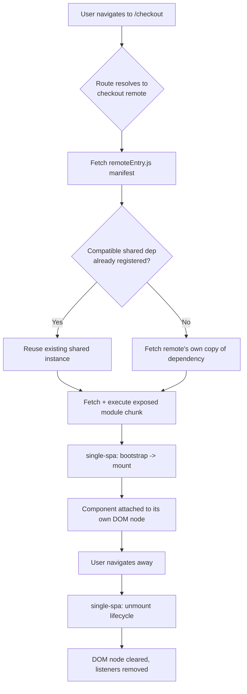

## 6. Design Principles

- **One team, one deployable, one DOM mount point.** Every micro frontend
  must map to exactly one owning team, one independently deployable
  artifact, and one disjoint region of the DOM it exclusively controls.
- **Contracts, not internals, cross boundaries.** Only explicit contracts
  (exposed Custom Element tags, exposed Module Federation module names,
  documented custom-event names/payloads, a versioned shared-state shape)
  may cross a micro-frontend boundary — never a direct import of another
  team's internal module or component.
- **Composition should degrade, not collapse.** A missing or slow remote
  should degrade gracefully (a loading skeleton, a cached last-known-good
  version, or a hidden section) rather than blank the entire composed page
  (see Section 15).
- **Version everything that crosses a boundary.** Exposed modules, custom
  event payload shapes, and shared-state schemas are all public contracts
  and need the same semantic-versioning and deprecation discipline as a
  backend API.
- **Prefer the least coupling that satisfies the actual requirement.**
  Reach for custom events before a shared store, a shared store before
  direct framework-context sharing, and never let "it's more convenient
  right now" quietly reintroduce build-time coupling.

## 7. Architecture Patterns

Two dominant patterns describe *how* a page is split into micro frontends:

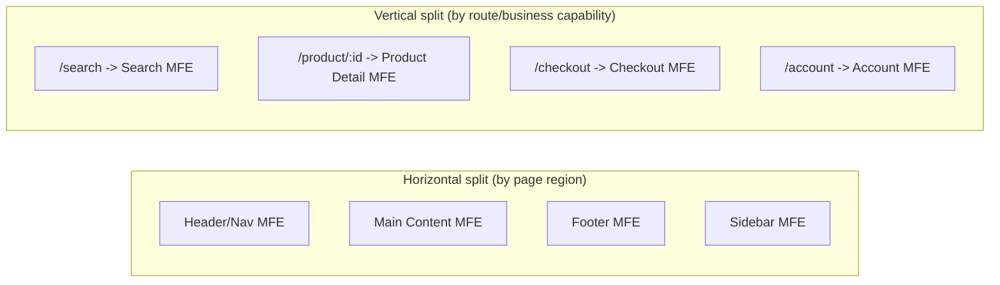

- **Horizontal (page-region) split** composes multiple micro frontends onto
  the *same* page simultaneously (nav, main content, sidebar, footer, each
  owned by a different team). This maximizes reuse of a shared shell layout
  but requires the most careful DOM-mount-point and shared-dependency
  discipline, since several micro frontends are live on screen at once.
- **Vertical (route) split** assigns one micro frontend per route or
  feature area, with only one "main" fragment mounted at a time (the nav/
  shell chrome around it may still be a shared, separately owned
  fragment). This is the more common and generally simpler pattern — it
  maps naturally onto `single-spa`'s route-based activity functions and
  minimizes how many micro frontends are simultaneously live.
- **Nested/atomic micro frontends** (a micro frontend that itself composes
  smaller micro frontends) are possible with any composition strategy but
  add a full extra layer of versioning and shared-dependency negotiation —
  reserve this for genuinely large organizations where even a single
  "vertical slice" team has grown large enough to need its own internal
  split; don't default to nesting for its own sake.

## 8. Production Architecture

A production micro-frontend deployment typically has four moving parts:
the shell, a **remote registry/manifest service** (so the shell can
discover available remotes and their current versions without a shell
rebuild), a CDN serving each remote's built assets from independent
deploy pipelines, and (optionally) an edge/BFF composition layer for
server-rendered fragments.

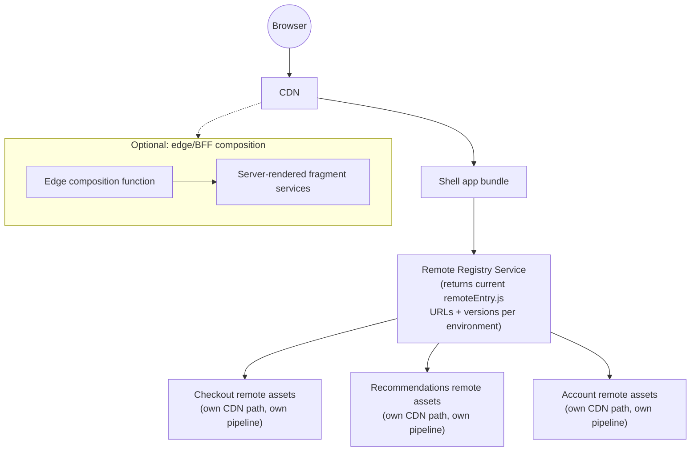

The registry is the piece most teams underestimate: without it, "which
version of the checkout remote does production load" is baked into the
shell's own deploy, recreating exactly the coordination bottleneck
Section 4.2 warns against. With it, a remote's team can promote a new
version through the registry (e.g. per environment: dev → staging →
production, potentially gated by a canary percentage) with zero shell
involvement.

## 9. Implementation

A minimal, realistic implementation sequence for a Module-Federation-based
system:

1. **Stand up the shell** as a Webpack (or Vite) application with its own
   routing and a Module Federation `host` configuration declaring shared
   dependencies (`react`, `react-dom`, and any shared design-system
   package) with explicit `singleton` and `requiredVersion` settings
   (Section 4.9).
2. **Stand up each remote** as its own independently built and deployed
   application, exposing one or more modules via its own Module Federation
   `remote` configuration, declaring the *same* shared dependencies with
   compatible version ranges.
3. **Stand up a remote registry service** (even a simple versioned JSON
   manifest behind a small API is enough to start) that the shell queries
   at runtime (or at its own build time, for a simpler but less flexible
   variant) to resolve each remote's current `remoteEntry.js` URL per
   environment.
4. **Wire cross-micro-frontend communication** using the narrowest pattern
   that satisfies the requirement (Section 4.10) — start with custom
   events; only add a shared store once a genuine continuous-read need
   emerges.
5. **Add composition-level integration tests** (Section 16) that exercise
   the shell with real (not mocked) remote bundles, catching shared-
   dependency and contract-mismatch problems that unit tests inside a
   single repository structurally cannot see.
6. **Wire independent CI/CD** per remote (Section 20/21 cover the
   versioning and rollback architecture this enables).

## 10. Complete Code Examples

### 10.1 Module Federation: Shell (Host) Webpack Configuration

```javascript
// shell/webpack.config.js
const ModuleFederationPlugin = require('webpack/lib/container/ModuleFederationPlugin');
const path = require('path');

module.exports = {
  entry: './src/index.js',
  mode: 'production',
  output: {
    publicPath: 'auto',
    path: path.resolve(__dirname, 'dist'),
  },
  plugins: [
    new ModuleFederationPlugin({
      name: 'shell',
      // Remotes are resolved via a small runtime registry lookup rather
      // than hardcoded here, so a remote's URL/version can change without
      // requiring the shell to rebuild (see Section 8 -- Remote Registry).
      remotes: {
        checkout: 'checkout@[window.__REMOTE_REGISTRY__.checkout]',
        recommendations: 'recommendations@[window.__REMOTE_REGISTRY__.recommendations]',
      },
      shared: {
        react: {
          singleton: true,       // exactly one React instance across all MFEs
          requiredVersion: '^18.2.0',
          eager: false,          // load lazily, not bundled into the shell's initial chunk
        },
        'react-dom': {
          singleton: true,
          requiredVersion: '^18.2.0',
          eager: false,
        },
        '@org/design-system': {
          singleton: true,
          requiredVersion: '^4.0.0',
        },
      },
    }),
  ],
};
```

### 10.2 Module Federation: Remote (Checkout Micro Frontend) Webpack Configuration

```javascript
// checkout-mfe/webpack.config.js
const ModuleFederationPlugin = require('webpack/lib/container/ModuleFederationPlugin');
const path = require('path');

module.exports = {
  entry: './src/bootstrap.js',
  mode: 'production',
  output: {
    publicPath: 'https://cdn.example.com/checkout-mfe/2.4.0/',
    path: path.resolve(__dirname, 'dist'),
  },
  plugins: [
    new ModuleFederationPlugin({
      name: 'checkout',
      filename: 'remoteEntry.js',
      exposes: {
        // Only ./CheckoutApp is a public contract; every other internal
        // module stays private to this remote's own build.
        './CheckoutApp': './src/CheckoutApp',
      },
      shared: {
        react: { singleton: true, requiredVersion: '^18.2.0' },
        'react-dom': { singleton: true, requiredVersion: '^18.2.0' },
        '@org/design-system': { singleton: true, requiredVersion: '^4.0.0' },
      },
    }),
  ],
};
```

### 10.3 Custom-Event-Based Cross-Micro-Frontend Communication

```javascript
// shared contract, documented and versioned like an API:
//   event name:    "cart:item-added"
//   payload shape: { sku: string, quantity: number, unitPriceCents: number }

// --- Emitter: inside the Product Detail micro frontend ---
function addToCart(item) {
  // ... this MFE's own logic to persist the cart item via its own API call ...
  window.dispatchEvent(
    new CustomEvent('cart:item-added', {
      detail: {
        sku: item.sku,
        quantity: item.quantity,
        unitPriceCents: item.unitPriceCents,
      },
    })
  );
}

// --- Listener: inside the Nav micro frontend (a completely separate build) ---
function initCartBadge() {
  let count = 0;

  window.addEventListener('cart:item-added', (event) => {
    const { quantity } = event.detail;
    count += quantity;
    renderBadge(count);
  });

  // Defensive contract validation: a badge update should never throw and
  // take down the shared nav if another team's payload shape drifts.
  window.addEventListener('cart:item-added', (event) => {
    if (typeof event.detail?.quantity !== 'number') {
      console.warn('[nav-mfe] received malformed cart:item-added payload', event.detail);
    }
  });
}

function renderBadge(count) {
  const badge = document.querySelector('[data-testid="cart-badge"]');
  if (badge) badge.textContent = String(count);
}

initCartBadge();
```

### 10.4 Composition Shell Example: `single-spa` Root Config

```javascript
// shell/src/single-spa-config.js
import { registerApplication, start } from 'single-spa';

registerApplication({
  name: 'nav',
  app: () => System.import('nav'),
  activeWhen: () => true, // always mounted -- shared chrome
});

registerApplication({
  name: 'checkout',
  app: () => System.import('checkout'),
  activeWhen: (location) => location.pathname.startsWith('/checkout'),
});

registerApplication({
  name: 'recommendations',
  app: () => System.import('recommendations'),
  activeWhen: (location) =>
    location.pathname.startsWith('/product') || location.pathname === '/',
});

// Fail gracefully: a remote that fails to bootstrap/mount must not take
// down the rest of the composed page (see Section 15 -- Failure Scenarios).
window.addEventListener('single-spa:app-error', (event) => {
  console.error(`[shell] micro frontend failed: ${event.detail.appName}`, event.detail.error);
  renderFallback(event.detail.appName);
});

function renderFallback(appName) {
  const mountPoint = document.querySelector(`[data-mfe="${appName}"]`);
  if (mountPoint) {
    mountPoint.innerHTML = '<div class="mfe-fallback">This section is temporarily unavailable.</div>';
  }
}

start({ urlRerouteOnly: true });
```

## 11. Performance

Micro frontends introduce performance costs that a monolithic frontend
doesn't have to pay, and a Solution Architect must budget for them
explicitly rather than discover them in production:

- **Duplicate framework bytes** when shared-scope negotiation fails or is
  intentionally disabled (Section 4.9) — measurable in KB per incompatible
  remote, multiplied across a session as a user navigates between routes.
- **A composition waterfall**: shell bundle loads, *then* the remote
  registry resolves, *then* `remoteEntry.js` fetches, *then* the actual
  chunk fetches — each a network round trip layered on top of the shell's
  own load time, unless mitigated with `<link rel="modulepreload">`/
  prefetching for remotes likely to be needed next (e.g. prefetch the
  checkout remote once the user reaches the cart page).
- **Increased JavaScript parse/execute cost** from N independent bundler
  runtimes' worth of boilerplate (module federation runtime code itself,
  duplicated small utility dependencies each remote didn't bother sharing).
- **Server/edge composition** (Section 4.8) largely avoids the above by
  moving composition off the critical rendering path entirely, at the cost
  of needing a separate strategy for client-side interactivity.

Mitigation checklist: measure Largest Contentful Paint (LCP) and Time to
Interactive (TTI) per composed route (not just per micro frontend in
isolation — a remote can look fast standalone and still regress the
composed page); prefetch the next likely remote on user intent signals;
keep the shared-scope dependency list intentionally small (sharing every
possible utility library adds negotiation overhead without much bundle-size
payoff); and set a hard per-remote bundle-size budget enforced in each
remote's own CI pipeline.

## 12. Scalability

Micro frontends scale along two distinct axes that must both be designed
for: **team scalability** (adding the 20th team/micro frontend should not
require touching the shell's code, only the remote registry — Section 8)
and **runtime scalability** (a page composing many simultaneously mounted
micro frontends, the horizontal-split pattern from Section 7, must budget
JavaScript execution and DOM size per fragment, since browser performance
degrades with total DOM node count and total main-thread work regardless of
how cleanly the fragments are organizationally separated). A registry-driven
architecture (Section 8) is what makes team-count scaling close to O(1) for
the shell; without it, every new remote is an O(n) change to the shell's own
codebase, which is the scaling ceiling most "micro frontend in name only"
systems (Section 4.1's common failure mode) eventually hit.

## 13. Security

- **Trust boundary between independently deployed teams.** Even for
  first-party micro frontends, a compromised or careless remote (a
  supply-chain-compromised dependency, an XSS (Cross-Site Scripting) bug)
  runs with the *same* privileges as the shell if composed via Module
  Federation/`single-spa` in the same JavaScript realm — unlike an iframe,
  there is no browser-enforced boundary between micro frontends composed
  this way. Treat every remote as part of the same trust boundary as the
  shell, and apply the same code-review, dependency-scanning, and
  Content Security Policy (CSP) rigor to every remote's pipeline, not just
  the shell's.
- **Content Security Policy for federated remotes.** A shell's CSP
  `script-src` directive must explicitly allowlist every remote's CDN
  origin — a common operational gap is forgetting to update the shell's
  CSP when a new remote is added, silently breaking that remote in
  browsers that enforce CSP (a fail-closed, at least *safe* failure mode,
  but still a production incident).
- **iframe sandboxing for genuinely untrusted content.** When isolation is
  the actual goal (Section 4.5), use the `sandbox` attribute
  (`sandbox="allow-scripts allow-same-origin"` at most, never
  `allow-scripts allow-same-origin allow-top-navigation` together, which
  defeats the sandbox by letting the framed content navigate the parent).
- **Supply-chain risk multiplies with remote count.** Each independently
  deployed remote is a separate `npm audit`/Software Bill of Materials
  (SBOM) surface; a vulnerability in one remote's dependency tree is a
  production risk for the composed page even if the shell's own
  dependencies are clean.

## 14. Observability

A composed page spans multiple independently deployed codebases, so
observability must be designed to answer "which micro frontend, which
version, caused this" — not just "something broke":

- **Per-micro-frontend Real User Monitoring (RUM)**, tagged with the
  micro frontend's own name and deployed version, aggregated centrally so
  a regression can be attributed to the remote that shipped it, not just to
  "the page."
- **Correlation identifiers propagated across the composed page** — a
  single `x-correlation-id` generated by the shell (or the edge composition
  layer) and threaded through every fragment's own API calls, so a single
  distributed trace reconstructs the full page's backend call graph even
  though the frontend that issued each call was built and deployed
  independently.
- **Shared-scope version telemetry** — logging which version of each
  shared dependency actually loaded at runtime (not just what each remote
  *declared*) is the only reliable way to detect the Section 4.9 silent
  fallback-to-duplicate-copy failure mode in production before a user
  complaint does.
- **Per-remote error boundaries reporting independently**, tagged with
  `appName`/version, so a spike in one micro frontend's error rate doesn't
  get averaged away inside a single page-wide error metric.

## 15. Failure Scenarios

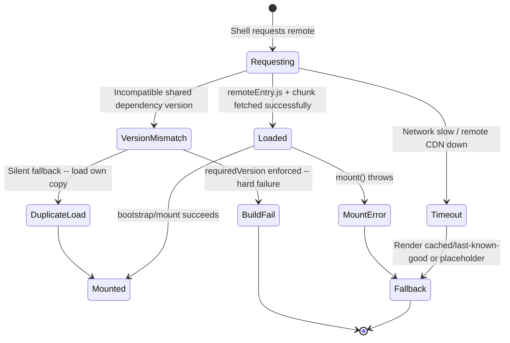

- **Remote unavailable (CDN outage, deploy in progress).** Without an
  explicit timeout and fallback (Section 10.4's `single-spa:app-error`
  handler is the minimum viable version), the composed page can hang
  indefinitely waiting for a fetch that will never resolve. Design every
  composition point with a timeout and a degraded-but-functional fallback
  (a skeleton, a cached last-known-good bundle, or simply hiding that
  section) — never let one remote's outage blank the entire page.
- **Version mismatch in shared dependencies (Section 4.9).** Either a loud
  build/runtime failure (if `requiredVersion` is strictly enforced) or a
  silent duplicate-instance fallback — both need monitoring (Section 14)
  because both are effectively invisible without explicit telemetry.
  Two independent React instances mounting onto overlapping DOM (rather
  than each strictly on their own disjoint node) is the single most common
  root cause of "intermittent UI corruption that nobody can reproduce
  locally" in production micro-frontend incidents.
- **Race conditions during composition.** If a Nav micro frontend that
  displays a cart badge mounts and starts listening for `cart:item-added`
  *after* the Product Detail micro frontend has already dispatched it (a
  timing race, not a logic bug), the event is silently missed. Mitigate
  with either a "replay last event" pattern in the shared event bus, or a
  shared store (Section 4.10) that late-mounting listeners can read
  current state from directly, rather than relying purely on a fire-and-
  forget event they might have missed.
- **Cascading rollback need across independently versioned remotes.** If a
  new checkout remote version breaks production, rolling back the checkout
  remote alone (via the registry, Section 8) must be sufficient — if a
  rollback also requires rolling back the shell or another unrelated
  remote, independent deployability was never actually achieved.

## 16. Testing

- **Unit tests per micro frontend**, exactly as for any standalone
  application — these structurally cannot catch composition-level or
  shared-dependency problems, so they're necessary but not sufficient.
- **Contract tests between shell and remote.** Assert that a remote still
  exposes the module names, custom-event names/payload shapes, and shared-
  state schema its consumers depend on — run in the remote's own CI
  pipeline against a pinned copy of the contract, so a breaking change is
  caught before deploy, not after.
- **Integration tests against real, deployed remote bundles** (not mocks)
  — spin up the shell against the actual currently-deployed version of
  each remote (e.g. in a staging environment, or via a local Module
  Federation dev-server pointing at staging `remoteEntry.js` URLs) to catch
  shared-dependency negotiation and cross-version compatibility problems
  that unit tests inside one repository cannot see by construction.
- **Visual regression testing across the composed page**, not just each
  micro frontend in isolation — a styling-isolation gap (Section 4.11) or
  a layout-shift caused by one remote's CSS is only visible once the full
  page is assembled.
- **Chaos/failure-injection testing** for the Section 15 scenarios — a
  synthetic test that blocks or delays one remote's network requests and
  asserts the composed page still degrades gracefully, rather than hanging
  or blanking.

## 17. Common Mistakes

- Calling something a "micro frontend" when it's actually build-time
  integrated (Section 4.4) and still requires a shell rebuild to release —
  independent deployability was never achieved, only code separation was.
- Sharing every possible utility library in the Module Federation `shared`
  config "just in case," which adds negotiation overhead and coupling
  without meaningfully reducing bundle size for small libraries.
- Two micro frontends mounting onto the same, overlapping DOM node rather
  than each owning a disjoint mount point (Section 4.9's most common
  production incident).
- No timeout/fallback for a remote that fails to load (Section 15),
  turning any one team's outage into a whole-page outage.
- Defaulting to a shared state store for cross-micro-frontend
  communication instead of the narrower custom-event pattern, quietly
  recreating a shared schema every team must coordinate around.
- Skipping composition-level integration tests (Section 16) because "each
  micro frontend has its own unit tests," missing the entire class of bugs
  that only exist at the composition boundary.
- No remote registry (Section 8), so every new remote or version bump
  still requires editing and redeploying the shell.

## 18. Best Practices

- Treat every module exposed across a micro-frontend boundary — Custom
  Element tag, Module Federation exposed module, custom event, shared
  state shape — as a versioned, documented public contract, with the same
  deprecation discipline as a backend API.
- Enforce one disjoint DOM mount point per micro frontend, with automated
  lint/test coverage catching an accidental overlapping mount.
- Build a remote registry from day one, even a simple one — retrofitting
  runtime version resolution after the shell has hardcoded remote versions
  is far more expensive than starting with it.
- Default to the narrowest cross-micro-frontend communication pattern that
  satisfies the requirement (Section 4.10), and document every event name/
  payload shape and shared-state shape in one discoverable place.
- Build a timeout + graceful-fallback path into the composition layer
  itself (shell or edge function), not as an afterthought per remote.
- Measure and budget bundle size and Largest Contentful Paint (LCP) per
  *composed route*, not per micro frontend in isolation.

## 19. Anti-Patterns

- **The "distributed monolith" micro frontend** — repositories are split,
  but every remote must be released together because they share an
  unversioned, tightly coupled contract (a shared state shape that changes
  without any deprecation process). All the operational overhead of
  micro frontends, none of the independent-deployability benefit.
- **The "micro frontend for a team of one"** — decomposing a single
  team's application into independently deployed fragments with no
  organizational driver for it (Section 3), paying the shared-dependency
  and composition-testing tax for a coordination problem that doesn't
  exist.
- **Deep cross-remote imports** — one remote directly importing another
  remote's internal (non-exposed) module through a monorepo path alias,
  quietly recreating build-time coupling underneath an apparently
  run-time-composed architecture.
- **Iframe-everything** — using iframes for first-party, fully-trusted
  micro frontends "to be safe," paying the deep-linking, SEO, and layout-
  integration tax for an isolation guarantee the system doesn't need
  (Section 4.5).
- **Silent shared-dependency fallback treated as fine** — leaving
  `requiredVersion` unenforced and never monitoring actual loaded shared-
  dependency versions in production (Section 14), so version-skew bundle-
  size regressions accumulate invisibly.

## 20. Trade-off Analysis

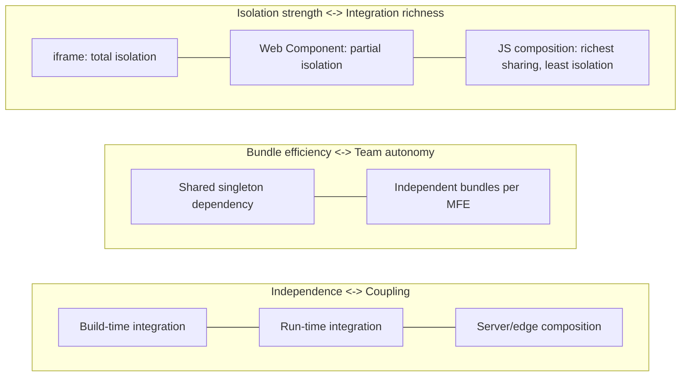

Every decision in this chapter reduces to picking a deliberate point on one
or more of these three axes: how early composition happens (Section 4.3),
whether dependencies are shared or duplicated (Section 4.9), and how much
isolation a given surface actually needs (Sections 4.5-4.7, 4.11). There is
no globally "correct" point — only a point that matches the organization's
team structure, the surface's performance/SEO requirements, and the
system's actual trust boundaries.

## 21. Comparison Table

| Dimension | iframe | Web Components | Module Federation / single-spa | Server/edge composition |
|---|---|---|---|---|
| Isolation strength | Highest (separate document/realm) | Moderate (Shadow DOM style/DOM isolation, shared JS realm) | Lowest (shared JS realm, shared DOM) | N/A on client (assembled before browser) |
| Framework flexibility | Total — any language/framework | High — framework-agnostic contract | Moderate — easiest with aligned frameworks | High — languages/frameworks can differ entirely |
| Shared-dependency efficiency | N/A (each iframe fully separate) | Possible but manual | Best-in-class (shared-scope negotiation) | N/A (no client-side framework needed for static fragments) |
| SEO / first-paint friendliness | Poor | Moderate | Moderate (client composition adds a waterfall) | Best |
| Deep-linking / URL coordination | Hard | Native (same document) | Native (same document) | Native (single assembled document) |
| Typical use case | Untrusted third-party widgets | Cross-framework design-system composition | First-party SPA-style team split | SEO/performance-critical, content-heavy surfaces |

## 22. Real-World Case Study

A large online retailer's storefront illustrates several patterns from this
chapter working together. The **navigation header and footer** are owned by
a platform team and composed via Web Components (Section 4.6), giving every
other team a stable, framework-agnostic mounting contract regardless of
what each team's own micro frontend is built with. The **product listing
and product detail pages** are server-side composed at the edge (Section
4.8) from a content service and a pricing/inventory service, prioritizing
Largest Contentful Paint (LCP) and Search Engine Optimization (SEO) for
anonymous, not-yet-logged-in shoppers arriving from search engines. Once a
shopper adds an item to their cart, the **checkout flow** switches to a
JavaScript-composed, Module-Federation-based micro frontend (Section 4.7),
sharing a single React instance with the account and order-history micro
frontends (all owned by a "purchase experience" team cluster that
deliberately coordinates React major-version upgrades together, per Section
4.9's governance trade-off). Cross-micro-frontend communication uses custom
events for the cart badge (Section 4.10's emitter/listener pattern from
Section 10.3) and a small shared session store for the logged-in user's
identity, since nearly every fragment needs continuous read access to it. A
central remote registry (Section 8) lets the checkout team ship several
releases a day without coordinating with the platform or content teams, and
a synthetic chaos test (Section 16) that simulates the recommendations
remote timing out runs in the shell's own CI pipeline, asserting the page
still renders a functional checkout flow with the recommendations section
gracefully hidden.

## 23. Interview Questions

1. What is the difference between "independently built" and "independently
   deployable," and why does that distinction matter for evaluating whether
   a system is truly using micro frontends?
2. Explain Module Federation's shared-scope negotiation mechanism. What
   happens, step by step, when two remotes declare incompatible major
   versions of a shared dependency?
3. When would you choose an iframe over Module Federation/`single-spa` for
   a first-party (fully trusted) micro frontend, if ever?
4. Design a cross-micro-frontend communication mechanism for a cart badge
   that must update the instant an item is added, and justify why you
   chose that pattern over the alternatives.
5. A production incident shows intermittent UI corruption on a page
   composing three micro frontends. Walk through your diagnostic process,
   including what Section 4.9/15 failure modes you'd rule in or out first.
6. How would you design a remote registry service, and what would break
   without one?
7. Compare the SEO and performance implications of server-side/edge
   composition versus client-side JavaScript composition for a
   marketing-heavy landing page.
8. What governance process would you put in place to manage a shared,
   singleton React dependency across ten independently owned remotes?

## 24. Hands-on Exercises

1. Build a minimal shell and one remote using Webpack Module Federation,
   sharing a single React instance, and verify (via browser devtools'
   Network tab) that only one copy of `react`/`react-dom` is fetched.
2. Deliberately bump the remote's React version to an incompatible major
   version and observe the shared-scope fallback behavior; then set
   `requiredVersion` strictly and observe the resulting build/runtime
   failure instead.
3. Implement the custom-event cart-badge pattern from Section 10.3 across
   two independently served bundles (no shared build step), and add a
   defensive payload-shape check to the listener.
4. Add a `single-spa:app-error` handler (Section 10.4) and simulate a
   remote's `mount()` throwing, verifying the rest of the composed page
   stays functional.
5. Convert one micro frontend to a Web Component and compare its styling-
   isolation behavior against the same fragment composed without Shadow
   DOM, using a deliberately broad, colliding global CSS selector.

## 25. Design Exercises

1. Design the micro-frontend decomposition for a five-team e-commerce
   platform (search, product detail, cart/checkout, account, content/CMS),
   choosing a composition strategy per surface and justifying each choice
   against Section 3's decision criteria.
2. Design the shared-dependency governance process (versioning policy,
   communication cadence, enforcement mechanism) for an organization with
   twelve independently owned remotes sharing one design-system library
   and one core framework.
3. Design the remote registry service's data model and API, including how
   it supports canary rollout of a new remote version to a percentage of
   traffic and instant rollback.
4. Design the cross-micro-frontend communication contract for a "global
   feature flag" system that many fragments must read, and justify your
   choice of custom events vs. shared store vs. URL state.
5. Design the CI/CD pipeline and versioning/rollback strategy (Section 26)
   for one remote, including what a "safe" independent rollback looks like
   if it does not also roll back the shell or any other remote.

## 26. Architecture Review Questions

1. Does every micro frontend map to exactly one owning team, one
   independently deployable artifact, and one disjoint DOM mount point?
2. Is there a documented, versioned contract (exposed module names, custom
   event names/payloads, shared-state schema) for every boundary a micro
   frontend crosses — and a deprecation process for changing one?
3. Is shared-dependency version compatibility enforced (build-time
   failure) or silently tolerated (runtime fallback) — and is that a
   deliberate choice, monitored in production either way?
4. Does the composition layer have an explicit timeout and graceful
   fallback for a remote that is slow or unavailable, tested with chaos/
   failure-injection tests?
5. Can a single remote be rolled back in production without requiring the
   shell or any other remote to be redeployed in lockstep?
6. Is there a remote registry (or equivalent runtime discovery mechanism),
   or does adding/upgrading a remote still require a shell code change and
   redeploy?
7. Is the styling-isolation strategy (Shadow DOM vs. namespacing vs. CSS
   Modules) matched to the actual risk of cross-team CSS collisions for
   this surface, per Section 4.11?
8. Is the CI/CD pipeline independent per micro frontend, with independent
   versioning, canary rollout, and rollback — or does "independent
   pipeline" only mean "separate repository" (Section 4.1's common
   failure mode)?

## 27. Summary

Micro frontends apply the same organizational logic behind microservices —
Conway's Law, independent deployability, team-aligned ownership boundaries —
to the presentation layer, and the pattern is justified by the same test:
does the organization have genuine, measured coordination friction across
teams shipping to one shared frontend artifact? Composition can happen at
build time (weakest independence, simplest mental model), at run time via
iframes, Web Components, or JavaScript composition frameworks like Module
Federation and `single-spa` (a spectrum from strongest isolation to richest
sharing), or at the server/edge (best for SEO- and performance-critical,
content-heavy surfaces). Every composition strategy forces an explicit
choice on the shared-dependency axis — one shared framework instance
(smallest bundle, requires cross-team version governance) versus
independent bundles per micro frontend (full team autonomy, duplicated
bytes) — and there is no version of this trade-off that avoids a real cost.
Cross-micro-frontend communication should default to the loosest coupling
that satisfies the actual requirement (custom events before a shared
store, a shared store before direct framework-level sharing), and styling
isolation should be matched to the actual risk of cross-team CSS collision,
from namespacing conventions up to Shadow DOM's browser-enforced guarantee.
Above all, micro frontends only deliver on their promise when independent
deployability is real — enforced by a remote registry, versioned
contracts, disjoint DOM ownership, and an independent CI/CD pipeline per
micro frontend — rather than merely aspirational behind separate Git
repositories that still require a coordinated shell release to actually
ship a change.

## Further Reading

- Conway's Law and the Inverse Conway Maneuver: [What is Software Architecture?](../01_Architecture_Mindset/CH01_What_is_Software_Architecture.md)
- Web Components (Custom Elements, Shadow DOM, `<template>`/`<slot>`): [HTML § 4.9](CH01_HTML.md#49-web-components-a-framework-agnostic-component-architecture)
- CSS Shadow DOM style encapsulation: [CSS § 4.11](CH02_CSS.md#411-component-isolation-shadow-dom-encapsulation-vs-global-cascade-risk)
- HTTP caching and CDN behavior underlying server/edge composition: [HTTP](../05_Networking_and_OS/CH01_HTTP.md)
