# Chapter: HTTP

Part: [05 — Networking and Operating Systems](PART_OVERVIEW.md) · Status: Reviewed — enriched and expanded (full first-principles depth pass on Section 4, inline diagrams, new owned concepts)

## 1. Introduction

HTTP (HyperText Transfer Protocol) is the application-layer protocol that
almost every distributed system a Solution Architect designs ultimately rides
on top of — REST APIs, GraphQL, gRPC-Web, browser traffic, service mesh
sidecars, and CDN (Content Delivery Network) edge caches all speak some
version of HTTP. This chapter is the *owning* chapter for HTTP's core
transport-level vocabulary: **methods** (semantics, idempotency, safety),
**status codes** (the full 1xx-5xx taxonomy), and **caching headers**
(`Cache-Control`, `ETag`, and the rest of the validation/expiration model).
This enrichment pass also claims ownership of several closely related,
previously under-taught concepts that are genuinely HTTP's own to teach:
**content negotiation**, **conditional requests and validators** (which
deepen the existing caching-headers ownership), **HTTP compression**,
**cookies**, **CORS** (Cross-Origin Resource Sharing), **connection
management**, and **chunked transfer encoding** — see
[review/concept-proposals/http-enrichment.md](../review/concept-proposals/http-enrichment.md)
for the staged CORE_CONCEPTS.md rows.

This chapter deliberately does **not** re-teach concepts that belong to
sibling chapters, even though HTTP touches all of them: the TLS (Transport
Layer Security) handshake is recapped in 2-3 sentences and owned by
[TLS](CH06_TLS.md); HTTP/2's binary framing, multiplexing, and HPACK
(HTTP/2 header compression) are recapped and owned by [HTTP/2](CH04_HTTP2.md);
HTTP/3 and QUIC (Quick UDP Internet Connections) specifics are recapped and
owned by [HTTP/3](CH05_HTTP3.md) and [QUIC](CH18_QUIC.md); the WebSocket
`Upgrade`/`101` handshake and frame format are owned by
[WebSockets](CH17_WebSockets.md); and reverse proxy/load balancer/CDN
placement decisions are owned by [Reverse Proxy](CH11_Reverse_Proxy.md),
[Load Balancer](CH10_Load_Balancer.md), and [CDN](CH09_CDN.md) respectively.
Other chapters in this handbook (starting with
[REST](../08_API_Architecture/CH01_REST.md)) must recap and link here for
methods/status codes/caching rather than re-explaining them, per the Concept
Ownership Rule in [STYLE_GUIDE.md](../STYLE_GUIDE.md).

## 2. Historical Evolution

- **HTTP/0.9 (1991)** — a one-line request, no headers, no status codes;
  the response was raw HTML, connection closed immediately after.
- **HTTP/1.0 (1996)** — introduced headers, status codes, and content types,
  but opened a new TCP (Transmission Control Protocol) connection per request.
- **HTTP/1.1 (1997, RFC 2068 then RFC 2616)** — added persistent connections
  (`Connection: keep-alive`), chunked transfer encoding, host-based virtual
  hosting (the mandatory `Host` header), pipelining (specified but never
  safely deployed — see Section 4.9), and the conditional-request/caching
  machinery (`ETag`, `If-None-Match`, `Cache-Control`) this chapter still
  owns today. HTTP/1.1 was re-specified more precisely in RFCs 7230-7235
  (2014) and again consolidated in RFCs 9110-9112 (2022), which is the
  current normative reference.
- **HTTP/2 (2015, RFC 7540, later RFC 9113)** — binary framing, multiplexed
  streams over a single TCP connection, header compression (HPACK), and
  server push (since deprecated in most browsers). Recapped only — see
  [HTTP/2](CH04_HTTP2.md).
- **HTTP/3 (2022, RFC 9114)** — replaces TCP with QUIC (built on UDP),
  eliminating transport-level head-of-line blocking and speeding up
  connection establishment by folding the transport and TLS handshakes
  together. Recapped only — see [HTTP/3](CH05_HTTP3.md) and
  [QUIC](CH18_QUIC.md).

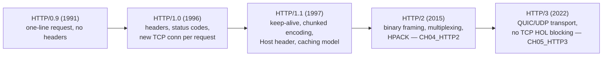

## 3. Why It Exists

Before HTTP, every application-to-application protocol invented its own
framing, addressing, and content-negotiation scheme. HTTP standardized a
request/response model with a URI (Uniform Resource Identifier) addressing
scheme (Section 4.11), a small fixed vocabulary of methods (Section 4.1) with
well-defined safety/idempotency guarantees, an extensible status-code
taxonomy (Section 4.2) that lets any HTTP-aware intermediary reason about the
outcome of a request without understanding the application's business logic,
and a caching/validation model (Sections 4.3-4.4) that lets proxies and
browsers avoid re-fetching unchanged data. This combination is what let
browsers, proxies, caches, and servers built by entirely different vendors
interoperate without bespoke integration work — a client written in 1996
against RFC 1945 can still, in broad strokes, talk to a server written in
2026, because the core vocabulary this chapter teaches has stayed
backward-compatible for three decades.

## 4. Core Concepts

### 4.1 Methods, idempotency, and safety

**Definition.** An HTTP method is a verb declaring the *intent* of a request
against a resource identified by a URI. **Safety** means a method must not
change server-side state as an intended effect (logging/metrics side effects
are allowed). **Idempotency** means issuing the same request N times has the
same net effect on server state as issuing it once — the response *can*
differ (e.g. a second `DELETE` may return `404` instead of `204`), but the
resource's state converges to the same place.

**Mechanism.** `GET` and `HEAD` are both safe and idempotent — they only
read state, so retrying is always harmless. `PUT` and `DELETE` are
idempotent but not safe — they change state, but repeating the exact same
request converges to the same end state (replace with the same body again;
delete something already deleted). `POST` is neither safe nor idempotent by
default — a `POST` typically creates a new resource or triggers a side
effect (charge a card, send an email), so blindly retrying it can create
duplicates. `PATCH` is explicitly *not guaranteed* idempotent by the spec,
because a partial update expressed as a diff or increment (`{"balance":
"+10"}`) is not idempotent even though a partial *replace* expressed as
absolute values could be. `OPTIONS` is safe and used for capability
discovery, including CORS preflight (Section 4.8).

```mermaid
flowchart TD
    M[Choose HTTP method] --> Q1{Does it read<br/>without side effects?}
    Q1 -->|Yes| SAFE[GET / HEAD<br/>safe + idempotent<br/>cacheable, freely retryable]
    Q1 -->|No, it writes| Q2{Repeating the exact<br/>same request converges<br/>to the same state?}
    Q2 -->|Yes, full replace or delete| IDEM[PUT / DELETE<br/>idempotent, not safe<br/>safe to retry on timeout]
    Q2 -->|Depends on payload shape| PATCHQ[PATCH<br/>idempotent only if the diff<br/>is itself idempotent, e.g. a<br/>full-field replace, not a delta]
    Q2 -->|No, creates/triggers each time| NOTIDEM[POST<br/>neither safe nor idempotent<br/>needs an idempotency key to retry safely]
```

**Decision implications.** This taxonomy is *the* reason retry logic in
distributed systems is safe or unsafe by default. A load balancer, an HTTP
client library, or a service mesh sidecar can automatically retry a `GET`
that times out — nothing bad happens even if the original request actually
reached the server. The same automatic retry on a `POST` (say, "charge
$50") risks a duplicate charge if the first attempt succeeded server-side
but the response was lost. This is why payment/order-creation APIs
routinely require clients to supply an explicit `Idempotency-Key` header
(an application-level convention layered on top of HTTP, not part of the
spec itself) so the server can deduplicate retried `POST`s.

**Common failure mode.** Using `GET` to change state (`GET /logout`,
`GET /delete-account?id=42`) breaks every assumption an intermediary makes
about safety — a prefetching browser, a crawler, or an antivirus link-scanner
can trigger the action just by *following the link*, with no user intent
behind the click at all. The inverse mistake — treating `PATCH` as
automatically idempotent because `PUT` is — causes silent double-application
bugs when a client retries a delta-style `PATCH` after a timeout and the
server had actually already applied it.

**Scenario.** An e-commerce checkout endpoint accepts `POST
/orders` to create an order. The client generates a UUID (Universally
Unique Identifier) client-side and sends it as `Idempotency-Key: <uuid>`.
The server stores completed idempotency keys with their response for 24
hours; if the same key arrives again (because the client's HTTP call timed
out even though the server had committed the order), the server returns the
*stored* response instead of creating a second order. This pattern exists
precisely because `POST` offers no idempotency guarantee at the protocol
level — the application has to build one on top.

### 4.2 Status code taxonomy

**Definition.** A status code is a three-digit integer in the response's
start line signaling the outcome of a request; the leading digit defines a
broad category, and RFC 9110 defines the full registry of specific codes
within each category.

**Mechanism.**
- **1xx Informational** — the request was received and processing continues;
  `100 Continue` (client can proceed to send a large body after checking
  headers were acceptable), `101 Switching Protocols` (the WebSocket upgrade
  handshake owned by [WebSockets](CH17_WebSockets.md)).
- **2xx Success** — `200 OK` (generic success with a body), `201 Created`
  (a new resource now exists, typically with a `Location` header), `202
  Accepted` (queued for async processing, not yet complete), `204 No
  Content` (success, deliberately no body — common for `PUT`/`DELETE`).
- **3xx Redirection** — `301 Moved Permanently` (update bookmarks/links),
  `302 Found`/`307 Temporary Redirect` (redirect for this request only,
  method preserved on 307 but not guaranteed on 302), `304 Not Modified`
  (the conditional-request outcome, Section 4.4).
- **4xx Client Error** — `400 Bad Request` (malformed syntax), `401
  Unauthorized` (missing/invalid credentials — despite the name, it's about
  authentication, not authorization), `403 Forbidden` (authenticated but not
  permitted), `404 Not Found`, `405 Method Not Allowed`, `409 Conflict`
  (concurrent modification, version mismatch), `422 Unprocessable Entity`
  (syntactically valid, semantically invalid), `429 Too Many Requests` (rate
  limited, often paired with `Retry-After`).
- **5xx Server Error** — `500 Internal Server Error` (unhandled fault), `502
  Bad Gateway` (upstream returned an invalid response or refused the
  connection), `503 Service Unavailable` (temporarily overloaded/down,
  should pair with `Retry-After`), `504 Gateway Timeout` (upstream didn't
  respond in time).

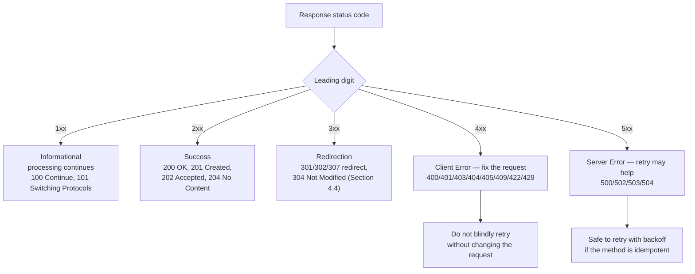

**Decision implications.** The category alone tells a generic HTTP client
(a load balancer health check, a retry middleware, a monitoring dashboard)
how to react without understanding the application: 4xx means "the client
must change something before retrying identically," 5xx means "this might
be transient, a retry with backoff might succeed," and 3xx means "follow the
`Location` header." Choosing the *specific* code within a category (e.g.
`409 Conflict` versus a generic `400`) is what lets clients implement
targeted handling (optimistic-concurrency retry on `409`) instead of falling
back to showing the raw error message to a user.

**Common failure mode.** Returning `200 OK` with an error payload in the
body (`{"status": "error", "message": "not found"}`) defeats every
HTTP-aware intermediary: caches will happily cache the error as if it were
good data, monitoring dashboards built on status-code SLOs (Service Level
Objectives) won't see the failure, and generic retry logic won't know to
retry. The opposite mistake — collapsing every server-side fault into a
blanket `500` regardless of whether it's a validation failure (`400`) or a
genuine crash — makes root-cause triage from logs alone far slower.

**Scenario.** A payments API distinguishes `402 Payment Required` (card
declined — the client should prompt for a new payment method, not retry),
`409 Conflict` (the order was already paid by a concurrent request — the
client should refresh state, not retry the charge), and `503 Service
Unavailable` with `Retry-After: 30` (the payment processor is temporarily
down — the client's retry middleware backs off and tries again). Collapsing
all three into `500 Internal Server Error` would force every client to parse
the response body just to decide whether retrying is even safe.

### 4.3 Caching headers and `Cache-Control` directives

**Definition.** HTTP caching headers let an origin server declare, per
response, whether and for how long a representation may be reused by a
downstream cache (browser, CDN edge, reverse proxy) without contacting the
origin again. `Cache-Control` is the primary directive header; `Expires`
and `Pragma` are older, less flexible predecessors kept for backward
compatibility.

**Mechanism.** Key `Cache-Control` directives: `public` (any cache, including
shared/CDN caches, may store it), `private` (only the end-user's own
browser cache may store it — typical for authenticated, per-user data),
`no-store` (never cache this response at all, anywhere), `no-cache`
(counter-intuitively, *may* be cached, but must be revalidated with the
origin — via a conditional request, Section 4.4 — before being reused),
`max-age=<seconds>` (how long the response is considered fresh without
revalidation), `s-maxage=<seconds>` (a separate freshness lifetime that
applies only to shared caches like a CDN, overriding `max-age` for them),
`must-revalidate` (once stale, the cache must not serve it without
successfully revalidating, even if the origin is unreachable), and `immutable`
(the representation at this URL will never change — skip revalidation
entirely for the lifetime of `max-age`, useful for hashed static assets like
`app.a1b2c3.js`).

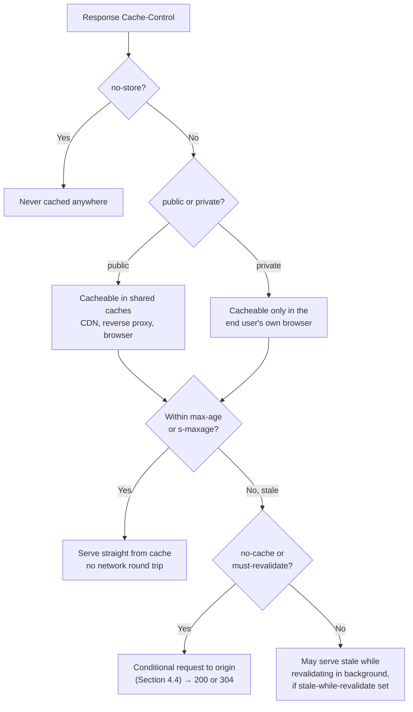

**Decision implications.** The `public`/`private` and `max-age`/`s-maxage`
split lets an architect tune *where* caching happens independently of *how
long*: a CDN might be allowed to cache a product page for 5 minutes
(`s-maxage=300`) while the end-user's browser only trusts it for 0 seconds
(`max-age=0, must-revalidate`) so a hard refresh always revalidates, or vice
versa. This chapter's caching model, combined with conditional requests
(Section 4.4), is the mechanism CDN edge caching (recapped, owned by
[CDN](CH09_CDN.md)) and reverse-proxy caching (recapped, owned by
[Reverse Proxy](CH11_Reverse_Proxy.md)) build on.

**Common failure mode.** Setting `Cache-Control: no-store` blanket-wide "to
be safe" on every response — including genuinely public, rarely-changing
data like a product catalog page — throws away nearly all of the benefit of
having a CDN or browser cache at all, pushing 100% of read traffic back to
the origin. The opposite mistake — caching an authenticated, per-user
response as `public` — leaks one user's data into a shared cache that a
different user's request might then be served from.

**Scenario.** A news site serves its homepage as `Cache-Control: public,
s-maxage=60, max-age=0` — the CDN edge refreshes every 60 seconds (bounding
staleness to one minute across a traffic spike), while every individual
browser always revalidates on load so a user immediately sees a
just-published breaking-news update reflected in the *conditional* request's
outcome rather than serving a minute-old cached copy blindly.

### 4.4 Conditional requests and validators

**Definition.** A conditional request lets a client ask the server "give me
the full representation only if it has changed since I last saw it";
otherwise, the server responds with a small `304 Not Modified` and no body,
telling the client its cached copy is still good. This is the mechanism that
makes `no-cache`/`must-revalidate` (Section 4.3) cheap instead of forcing a
full re-download on every revalidation.

**Mechanism.** Two validator pairs exist. `ETag`/`If-None-Match`: the server
attaches an opaque `ETag` (Entity Tag) — a fingerprint of the current
representation, e.g. a content hash or version string — to a response; the
client echoes it back as `If-None-Match` on the next request, and the server
compares. `Last-Modified`/`If-Modified-Since`: the server attaches a
timestamp of the last change; the client echoes it back as
`If-Modified-Since`. `ETag` is preferred where available because it's a
**strong validator** by default (byte-for-byte equality, immune to clock
skew and to the coarse one-second resolution of HTTP dates), whereas
`Last-Modified` is comparatively coarse and can miss sub-second changes. A
**weak validator** is marked with a `W/` prefix on the `ETag` (e.g. `W/"abc"`)
and asserts only *semantic* equivalence (e.g. same rendered content
ignoring a footer timestamp) — acceptable for cache revalidation but not
safe for the write-side validators below. `If-Match`/`If-Unmodified-Since`
invert the check for *writes*: a `PUT`/`DELETE` carrying `If-Match: "v3"`
only proceeds if the resource's current `ETag` is still `"v3"`, otherwise
the server returns `412 Precondition Failed` — this is the standard
optimistic-concurrency-control mechanism built directly into HTTP.

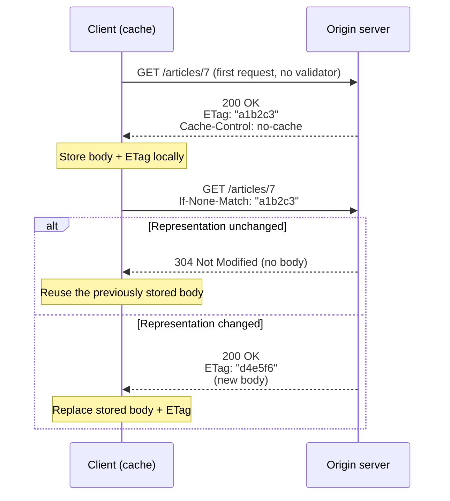

**Decision implications.** Conditional requests decouple "how often do I
revalidate" from "how much bandwidth does revalidation cost" — a client can
revalidate on *every* request (`max-age=0, must-revalidate`) and still save
essentially all bandwidth for unchanged resources, because a `304` carries
no body. This is why APIs serving large, infrequently-changing payloads
(a product catalog, a configuration document) should always emit an `ETag`
even when full caching isn't appropriate, purely to make revalidation cheap.
For writes, `If-Match` gives an architect a lock-free concurrency-control
primitive at the protocol level instead of requiring a database-level
locking scheme visible to the client.

**Common failure mode.** Generating a new `ETag` on every response even when
content hasn't meaningfully changed (e.g. hashing a response that embeds the
current server timestamp) defeats conditional requests entirely — every
request looks "changed" and gets a full `200` body. The opposite failure is
skipping `If-Match` on a `PUT`/`PATCH` entirely: two concurrent clients each
read the same version, each `PUT` their own edit, and the second write
silently clobbers the first with no conflict ever surfaced (the "lost
update" problem).

**Scenario.** Two support agents open the same customer ticket. Agent A's
client fetched it with `ETag: "v5"`. Agent B updates and saves first,
producing `"v6"`. Agent A submits their edit with `If-Match: "v5"`; the
server compares against the current `"v6"`, finds a mismatch, and returns
`412 Precondition Failed` instead of overwriting Agent B's change — Agent
A's client then re-fetches, merges, and resubmits with the current ETag.

### 4.5 Content negotiation

**Definition.** Content negotiation is the mechanism by which a client and
server agree on which *representation* of a resource to exchange — its
media type, language, character set, or encoding — when more than one is
available.

**Mechanism.** In **server-driven (proactive) negotiation**, the client
sends preference headers and the server picks: `Accept` (media types, e.g.
`application/json`), `Accept-Language` (e.g. `en-GB`), `Accept-Charset`
(character encodings, rarely needed today since UTF-8 dominates), and
`Accept-Encoding` (compression, Section 4.6). Each value can carry a
**quality value** (`q=`) from 0 to 1 expressing relative preference, e.g.
`Accept: application/json;q=1.0, text/html;q=0.5, text/plain;q=0` says
"prefer JSON, tolerate HTML, never send plain text even if nothing else
matches." The server should respond with the highest-`q` type it can
actually produce, and must echo which dimensions it negotiated on via the
`Vary` response header (e.g. `Vary: Accept-Encoding` tells any downstream
cache to store separate cached copies per distinct `Accept-Encoding` value
seen, rather than serving one client's compressed copy to another client
that didn't accept that encoding). In **agent-driven (reactive)
negotiation**, the server instead returns `300 Multiple Choices` (or a
single representation with `Link` headers to alternates) and lets the
client pick explicitly — used far less often in practice because it costs
an extra round trip.

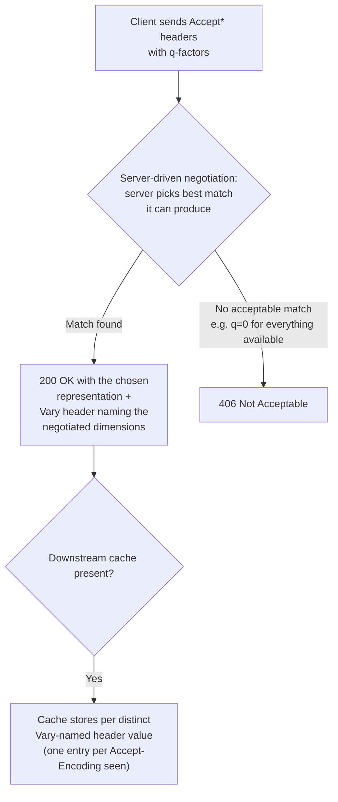

**Decision implications.** Content negotiation lets one URI serve multiple
audiences (a browser wanting HTML, a script wanting JSON, a French-locale
user wanting `fr` copy) without inventing parallel URL schemes
(`/en/product/42` vs. `/fr/product/42`) purely for representation
differences — though many real systems *do* also use URL-based variants for
SEO (Search Engine Optimization) or CDN-cache-key simplicity, trading
negotiation's elegance for cache-ability without needing `Vary`-aware
caches. The `Vary` header is the critical, easy-to-forget link between
negotiation and caching correctness.

**Common failure mode.** Negotiating on `Accept-Encoding` (or any `Accept-*`
header) without setting the matching `Vary` header lets a cache serve one
client's gzip-compressed response to a client that never sent
`Accept-Encoding: gzip` (a proxy, an old client), producing garbled,
undecodable bytes on the receiving end.

**Scenario.** A public API serves both `application/json` (default,
`q=1.0` clients) and `application/vnd.api+json` (JSON:API-flavored clients
sending `Accept: application/vnd.api+json;q=1.0, application/json;q=0.8`).
The server inspects `Accept`, picks the JSON:API representation for clients
that prefer it, and always sets `Vary: Accept` so a CDN in front of the API
never conflates the two representations under one cache key.

### 4.6 HTTP compression

**Definition.** HTTP compression transparently reduces the number of bytes
sent over the wire for a response body, negotiated via the
`Accept-Encoding`/`Content-Encoding` header pair — distinct from *transfer*
encoding (Section 4.10), which affects how the body is framed, not its
content.

**Mechanism.** The client advertises which compression algorithms it can
decode via `Accept-Encoding` (e.g. `br, gzip;q=0.8, deflate;q=0.5`); the
server compresses the body with whichever algorithm it supports that the
client accepted, and labels the result with `Content-Encoding: br` (or
`gzip`/`deflate`). Brotli (`br`) generally compresses text better than gzip
at a comparable CPU cost and is now supported by all major browsers over
HTTPS; gzip remains the near-universal fallback; `deflate` is rarely used
today due to inconsistent raw-deflate-vs-zlib-wrapped implementations across
servers. Compression is CPU-bound on the server (or CDN edge) and
decompression is CPU-bound on the client — this is a genuine trade-off, not
a free win.

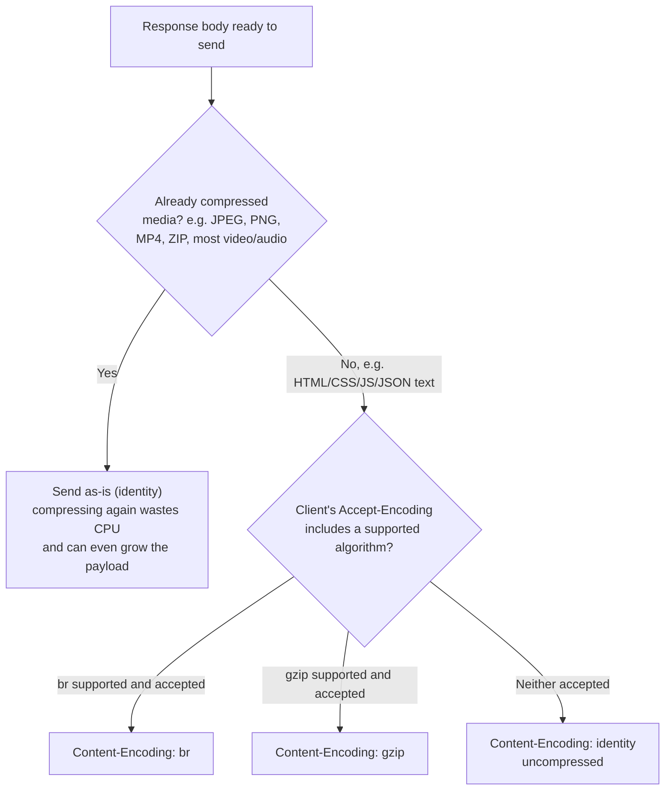

**Decision implications.** Compression pays off enormously for
text-based payloads (HTML, CSS, JavaScript, JSON, XML) — often a 60-80%
size reduction — because text has high redundancy that these algorithms
exploit well. It should generally be enabled at a reverse proxy or CDN edge
(recapped — see [Reverse Proxy](CH11_Reverse_Proxy.md) and
[CDN](CH09_CDN.md)) rather than reimplemented per application server, both
for consistency and because dedicated infrastructure can cache the
compressed bytes rather than recompressing per request.

**Common failure mode.** Compressing already-compressed media — JPEG, PNG,
MP4, pre-gzipped `.gz` downloads, or already-Brotli'd static assets — wastes
CPU on both ends for negligible or even negative size benefit (compressed
formats' entropy is already close to random, so a second compression pass
can add container overhead without reducing size). A second, security-
relevant failure mode is compressing a response body that mixes
attacker-influenced input with a secret (e.g. a CSRF token echoed alongside
user-controlled search text) — this is the general shape of the CRIME/BREACH
compression-oracle attack class, whose full mechanics are recapped only
here and owned by [SSL](CH07_SSL.md)'s security-history coverage.

**Scenario.** An API gateway enables Brotli-with-gzip-fallback compression
for all `application/json` and `text/*` responses above 1 KB (below that,
compression overhead can exceed the savings), while explicitly excluding
`/images/*` and `/videos/*` routes that already serve pre-compressed
formats — cutting typical JSON payload sizes by roughly 70% for mobile
clients on constrained networks, with negligible CPU cost at the gateway
tier since only text responses are touched.

### 4.7 Cookies

**Definition.** A cookie is a small, named piece of state that a server asks
a client (typically a browser) to store via the `Set-Cookie` response
header, and which the client automatically re-attaches on subsequent
requests to matching URLs via the `Cookie` request header — the primary
mechanism for carrying session state over HTTP's otherwise stateless request
model.

**Mechanism.** `Set-Cookie: name=value; <attributes>` attributes control
scope and safety: `Domain` (which host(s) the cookie is sent to — omitting
it scopes the cookie to the exact host that set it, the safer default;
setting it to a parent domain widens the scope to subdomains, which is
frequently over-broadened by mistake); `Path` (which URL paths on that
domain receive the cookie); `Max-Age=<seconds>` or `Expires=<date>` (a
persistent cookie surviving browser restarts — omitting both makes it a
session cookie, cleared when the browser closes); `HttpOnly` (JavaScript
cannot read this cookie via `document.cookie`, mitigating token theft via
cross-site scripting); `Secure` (only sent over HTTPS, never plaintext
HTTP); and `SameSite` (`Strict` — never sent on a cross-site navigation at
all; `Lax` — sent on top-level cross-site navigation like clicking a link,
but not on cross-site subresource requests/forms; `None` — sent on every
cross-site request, and requires `Secure` to be set). A **first-party
cookie** is set by the domain the user is directly visiting; a
**third-party cookie** is set by a different domain embedded in that page
(e.g. an ad network's iframe) — third-party cookies are what `SameSite` and
increasing browser-level blocking primarily target, since they're the
mechanism behind most cross-site tracking.

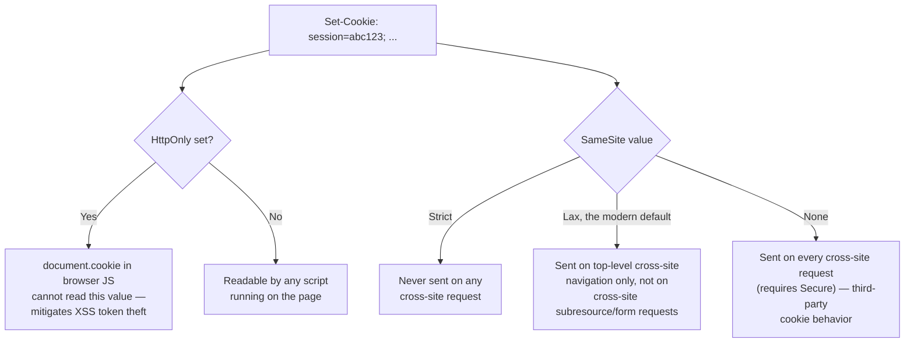

**Decision implications.** Cookies are how most session-based
authentication and shopping-cart state survive across otherwise-stateless
HTTP requests (Section 6). The `HttpOnly`/`Secure`/`SameSite` trio is the
baseline hardening every session cookie should carry by default; loosening
any of them (readable by JS, sent over plaintext, or sent cross-site) should
be a deliberate, reviewed exception, not a default. This chapter owns the
wire-level mechanics of these attributes; the attack mechanics they
mitigate — Cross-Site Request Forgery (CSRF) exploitation and session
fixation — are recapped only, owned by the future Security part.

**Common failure mode.** Setting `SameSite=None` without also setting
`Secure` causes modern browsers to reject the cookie outright (a spec
requirement, not optional). A more subtle failure is scoping `Domain` too
broadly (e.g. `Domain=example.com` on a cookie meant only for
`app.example.com`), which leaks the cookie to every subdomain, including
ones with weaker security postures (a marketing microsite on
`promo.example.com` now also receives the session cookie).

**Scenario.** An authentication service issues a session cookie as
`Set-Cookie: session_id=<opaque token>; HttpOnly; Secure; SameSite=Lax;
Path=/; Max-Age=1800` — unreadable by client-side scripts, never sent over
plaintext HTTP, not attached to cross-site form-based CSRF attempts to
state-changing endpoints, scoped only to the site's own paths, and expiring
after 30 minutes of being issued regardless of activity, forcing periodic
re-authentication.

### 4.8 CORS (Cross-Origin Resource Sharing)

**Definition.** CORS is the browser-enforced mechanism that relaxes the Same-
Origin Policy for specific, server-approved cross-origin requests — without
it, a script running on `https://evil.example` could not read responses from
`https://api.example.com` even if the user's browser is happily sending
requests there (the request itself is often still *sent*; CORS controls
whether the *browser lets the calling script read the response*).

**Mechanism.** A **simple request** (a `GET`/`HEAD`/`POST` using only a
small allow-listed set of headers and content types, e.g.
`application/x-www-form-urlencoded`) is sent directly; the browser then
checks the response's `Access-Control-Allow-Origin` header against the
calling page's origin before exposing the response to the script. Any
request outside that narrow allow-list — a custom header like
`X-Requested-With`, a `PUT`/`DELETE` method, or a `Content-Type` of
`application/json` — triggers a **preflighted request**: the browser first
sends an `OPTIONS` request with `Access-Control-Request-Method` and
`Access-Control-Request-Headers` describing what the real request will do,
and only proceeds with the actual request if the server's preflight
response approves it via `Access-Control-Allow-Methods` and
`Access-Control-Allow-Headers`. `Access-Control-Allow-Credentials: true`
is required (on both the preflight and the actual response) if the request
carries cookies or HTTP authentication, and in that case
`Access-Control-Allow-Origin` must echo the specific requesting origin — it
cannot be the wildcard `*`, by design, since a wildcard-plus-credentials
combination would let any site ride the user's session.

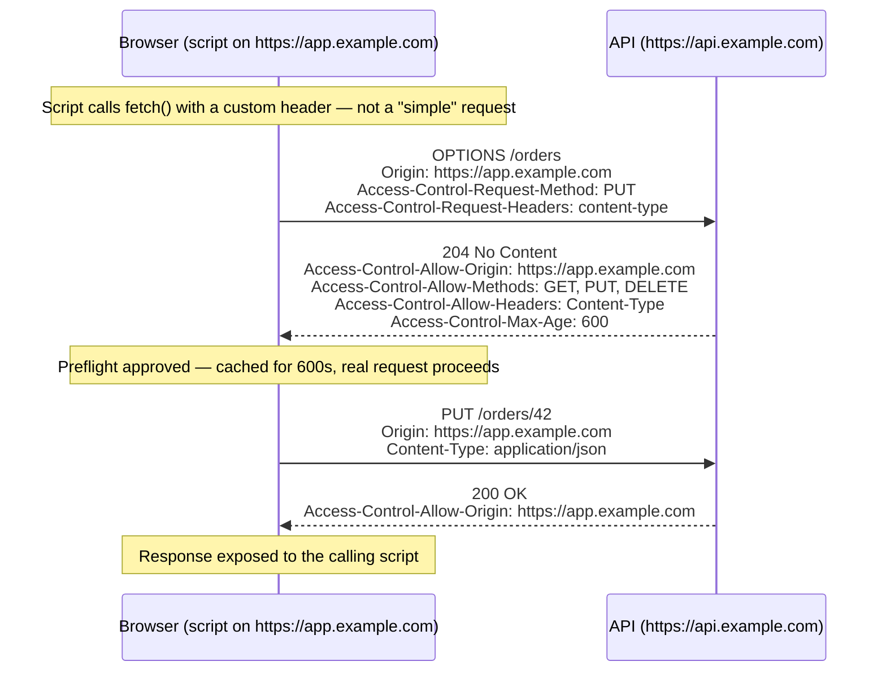

**Decision implications.** `Access-Control-Max-Age` lets a server tell the
browser to cache a preflight's result, avoiding a redundant `OPTIONS` round
trip on every subsequent call for that duration — meaningful for
latency-sensitive single-page applications making frequent cross-origin
calls. Because CORS is enforced entirely client-side by the browser, it is
**not** a server-side authorization mechanism — a non-browser client
(`curl`, a backend service, a mobile app) simply ignores CORS headers
entirely, so CORS must never be relied on as the actual access-control
boundary; it only controls which *browser-hosted scripts* can read a
response.

**Common failure mode.** Setting `Access-Control-Allow-Origin: *` together
with `Access-Control-Allow-Credentials: true` is invalid per spec and
browsers will refuse to expose the response — but a common workaround
mistake is dynamically echoing back whatever `Origin` header the request
sent (`Access-Control-Allow-Origin: <request's own Origin>` for every
origin) *combined* with credentials, which functionally reintroduces the
same vulnerability the spec's `*`-plus-credentials ban was designed to
prevent: any origin can now make credentialed requests and read the
response.

**Scenario.** A single-page application at `https://app.example.com` calls
`https://api.example.com`. The API's CORS configuration explicitly
allow-lists `https://app.example.com` (never a wildcard, since the API uses
cookie-based auth), allows `GET, POST, PUT, DELETE`, allows the
`Content-Type` and `Authorization` headers, and sets
`Access-Control-Allow-Credentials: true` — a request from any other origin
(including a malicious site the user happens to visit) is preflight-rejected
by the browser before the real request is ever sent for non-simple calls,
and its response is never exposed to the script even for simple ones.

### 4.9 Connection management

**Definition.** Connection management covers how a client and server reuse
(or don't reuse) the underlying TCP connection across multiple HTTP
request/response exchanges, trading off the cost of establishing a new
connection (TCP handshake, plus a TLS handshake for HTTPS — recapped, owned
by [TLS](CH06_TLS.md)) against the complexity of managing a pool of open
ones.

**Mechanism.** HTTP/1.0 opened a fresh TCP connection per request by
default and closed it after the response — simple, but expensive under load
since every single request pays a full connection-setup cost. HTTP/1.1
made **persistent connections** (`Connection: keep-alive`) the default: the
TCP connection stays open after a response, ready for the next request to
the same host, closed only after an idle timeout or an explicit
`Connection: close`. **Pipelining** — sending several requests back-to-back
on one connection without waiting for each response before sending the
next — was specified in HTTP/1.1 but is essentially unused in production:
responses must still arrive strictly in request order (head-of-line
blocking), a single slow response stalls every response queued behind it,
and several real-world proxies handled pipelined requests incorrectly,
making it unsafe to rely on. Browsers instead worked around HTTP/1.1's
one-request-at-a-time-per-connection limit by opening multiple *parallel*
persistent connections per host (commonly 6) — a workaround that HTTP/2's
multiplexing (recapped, owned by [HTTP/2](CH04_HTTP2.md)) made unnecessary.
**Connection pooling**, from the client's perspective, means an HTTP client
library maintains a bounded set of open, reusable connections per host
(rather than opening one new connection per outbound call and closing it
immediately), checking a connection back into the pool after use instead of
tearing it down.

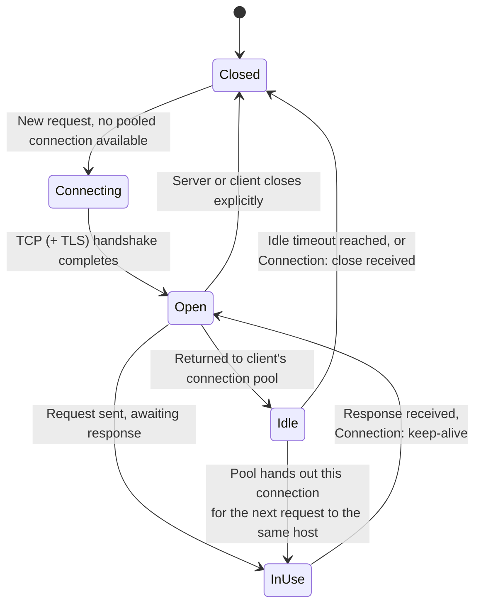

**Decision implications.** For server-side architecture, the practical
consequence is capacity planning: every idle-but-open keep-alive connection
still consumes a file descriptor and some memory on the server, so a
reverse proxy or load balancer (recapped — see
[Load Balancer](CH10_Load_Balancer.md)) needs an explicit keep-alive
timeout tuned against expected client concurrency, not left at a framework
default that might be far too long or too short. For client-side
architecture, connection-pool sizing directly bounds achievable
request concurrency to a given host — too small a pool serializes requests
that could have run in parallel; too large a pool risks exhausting the
server's connection capacity or the client's own ephemeral ports.

**Common failure mode.** Mismatched keep-alive timeouts between a client (or
an intermediate load balancer) and the origin server cause intermittent
"connection reset" errors: if the server's idle timeout is shorter than the
client's, the server silently closes a connection the client believes is
still usable, and the client's next request on that connection fails with a
reset rather than a clean retry-on-a-fresh-connection.

**Scenario.** A backend service calls a downstream API using an HTTP client
configured with a connection pool of 50 keep-alive connections per host, and
an idle timeout set 5 seconds *shorter* than the downstream API's own
keep-alive timeout (a deliberate convention across the whole fleet) — this
guarantees the client always initiates connection teardown first, avoiding
the reset-on-stale-connection failure mode entirely.

### 4.10 Chunked transfer encoding

**Definition.** Chunked transfer encoding lets a server stream a response
body whose total length isn't known in advance (or is inconvenient to
compute upfront) by sending it as a series of length-prefixed chunks instead
of declaring a single `Content-Length` upfront.

**Mechanism.** Each chunk is written as a hexadecimal length, a CRLF (carriage
return + line feed), the chunk's raw bytes, and a trailing CRLF; a final
zero-length chunk (`0\r\n`) signals the end of the body. `Transfer-Encoding:
chunked` and `Content-Length` are mutually exclusive on the same response —
the receiver either knows the exact byte count upfront, or reads chunks
until it sees the terminating zero-length chunk. Optionally, **trailer
headers** can follow the final chunk — headers whose values weren't known
until the body was fully generated (e.g. a checksum computed while
streaming, or a row count for a database export), declared in advance via a
`Trailer` header naming which fields will follow.

```mermaid
sequenceDiagram
    participant S as Server (streaming a large export)
    participant C as Client
    S->>C: HTTP/1.1 200 OK<br/>Transfer-Encoding: chunked<br/>Trailer: X-Row-Count
    S->>C: chunk 1 (1024 bytes of CSV rows)
    S->>C: chunk 2 (1024 bytes of CSV rows)
    S->>C: chunk N (final partial chunk)
    S->>C: 0-length chunk (end of body)
    S->>C: trailer: X-Row-Count: 48213
    Note over C: Body fully received; trailer read<br/>only after the terminating chunk
```

**Decision implications.** Chunked encoding is what makes streaming
responses practical — a large CSV export, a server-sent-events-style feed,
or a proxied response whose upstream length isn't known until the upstream
finishes — without buffering the entire body in memory just to compute
`Content-Length` first. It's also load-bearing for reverse proxies that
transform a response on the fly (e.g. inserting content), since the
transformed length may differ from the original.

**Common failure mode.** A misconfigured intermediary that doesn't correctly
parse chunk boundaries (or that conflates a chunked body's framing with a
`Content-Length`-based one) is one of the classic root causes of HTTP
**request/response smuggling** — where a front-end proxy and a back-end
server disagree about where one message ends and the next begins, letting
an attacker's payload be interpreted as a separate, unintended request. Full
smuggling-attack mechanics are recapped only here and owned by the future
Security part; architecturally, the mitigation is ensuring every
intermediary in a chain uses one single, standards-compliant HTTP parser
implementation rather than several independently-written ones.

**Scenario.** An API endpoint streams a multi-gigabyte data export as
chunked CSV rows, computing a checksum incrementally as each chunk is
written, and emits that checksum as a `Trailer: X-Content-SHA256` header
only after the last row — letting the client verify integrity without the
server ever needing to buffer the entire export in memory to compute the
checksum upfront.

### 4.11 URI structure and semantics

**Definition.** A URI (Uniform Resource Identifier) is the addressing scheme
HTTP uses to identify a resource; a URL (Uniform Resource Locator) is the
subset of URIs that also specifies how to retrieve the resource (its
scheme). RFC 3986 defines the generic syntax every HTTP URI follows.

**Mechanism.** A URI decomposes as
`scheme://authority/path?query#fragment`: **scheme** (`https`, `http`) tells
the client which protocol to use, including implying the default port (443
for HTTPS, 80 for HTTP) and, for HTTPS, that TLS applies (recapped, owned by
[TLS](CH06_TLS.md)); **authority** is `[userinfo@]host[:port]`, where `host`
is what the `Host` header (or HTTP/2's `:authority` pseudo-header, recapped,
owned by [HTTP/2](CH04_HTTP2.md)) carries at the wire level, letting one IP
address serve many virtual hosts; **path** hierarchically identifies the
resource within that authority; **query** (`?key=value&key2=value2`) carries
non-hierarchical parameters; **fragment** (`#section`) identifies a part of
the resource but is resolved entirely client-side and is *never sent to the
server* in an HTTP request — a detail that surprises engineers debugging why
a server-side log never shows fragment values.

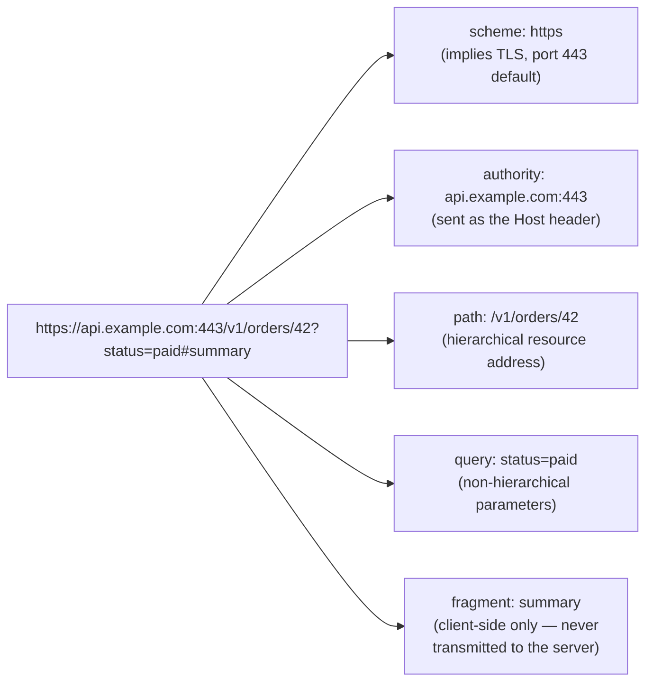

**Decision implications.** This wire-level anatomy is the substrate on top
of which REST's resource-modeling *conventions* (nouns-not-verbs paths,
nested-collection design, query-parameter filtering conventions) are built —
those design conventions are recapped only here and fully owned by
[REST](../08_API_Architecture/CH01_REST.md). At the transport level, what
matters architecturally is that the `Host`/`:authority` component is what
enables name-based virtual hosting and TLS SNI (Server Name Indication,
recapped, owned by [TLS](CH06_TLS.md)) to route one physical listener to the
correct backend/certificate, and that fragments being client-side-only means
they cannot be used for any server-side routing or access-control decision.

**Common failure mode.** Treating the fragment as if it reaches the server
— e.g. trying to implement server-side routing or logging based on
`#fragment` values — silently fails, since browsers never include the
fragment in the actual HTTP request line. A related, security-relevant
mistake is failing to validate the `Host` header against an allow-list of
expected values, which enables host-header-injection attacks (recapped only
here; full mitigation detail is owned by the future Security part) where a
crafted `Host` value tricks a misconfigured application into generating
poisoned links (e.g. in a password-reset email) pointing at an
attacker-controlled domain.

**Scenario.** A single-page application uses `#/orders/42` as a client-side
router path for a JavaScript framework that intercepts fragment changes
without a page reload — this works precisely *because* the fragment never
reaches the server, so no server-side route needs to exist for
`/orders/42` at all; the same application's actual API calls instead use
`/api/v1/orders/42` as the path, which *does* reach the server and is
resolved through REST's resource-modeling conventions (owned by
[REST](../08_API_Architecture/CH01_REST.md)).

## 5. Internal Working

This section shows the full HTTP/1.1 request/response lifecycle at the wire
level. TLS and HTTP/2/HTTP/3 internals are deliberately recapped only, not
re-derived — see the owning chapters linked below.

**Full lifecycle, first request (cold cache) then a conditional revalidation
(warm cache):**

```mermaid
sequenceDiagram
    participant C as Client
    participant S as Server
    Note over C,S: TCP three-way handshake (owned by CH03_TCPIP), then for HTTPS a TLS handshake (owned by CH06_TLS) — recapped only
    C->>S: GET /articles/7 HTTP/1.1<br/>Host: api.example.com<br/>Accept: application/json<br/>Connection: keep-alive
    S-->>C: HTTP/1.1 200 OK<br/>Content-Type: application/json<br/>ETag: "a1b2c3"<br/>Cache-Control: no-cache<br/>Connection: keep-alive<br/>(body: the article JSON)
    Note over C: Store body + ETag; connection kept open (Section 4.9)
    C->>S: GET /articles/7 HTTP/1.1<br/>Host: api.example.com<br/>If-None-Match: "a1b2c3"<br/>Connection: keep-alive
    S-->>C: HTTP/1.1 304 Not Modified<br/>ETag: "a1b2c3"<br/>(no body — Section 4.4)
    Note over C: Reuse previously cached body, no re-download
```

For HTTPS, the transport is secured before any HTTP bytes are exchanged. The
TLS handshake — cipher suite negotiation, SNI (Server Name Indication), the
certificate chain, and session resumption — is recapped in 2-3 sentences
here and fully owned by [TLS](CH06_TLS.md): in short, TLS 1.3 completes a
handshake in one round trip (down from two in TLS 1.2), authenticates the
server via its certificate chain, and derives a symmetric session key before
any HTTP request line is sent, so everything shown above travels encrypted
end-to-end between client and server.

HTTP/2's binary framing (`HEADERS`/`DATA`/`SETTINGS` frames tagged with
stream IDs), stream multiplexing over a single TCP connection, and HPACK
header compression are recapped only here — see [HTTP/2](CH04_HTTP2.md) for
the full frame-level mechanics. HTTP/3's replacement of TCP with QUIC (built
on UDP, folding the transport and TLS handshakes together) is likewise
recapped only — see [HTTP/3](CH05_HTTP3.md) and [QUIC](CH18_QUIC.md).

**CORS preflight sequence** (full mechanism taught in Section 4.8; shown
here as part of the request lifecycle for a non-simple cross-origin call):

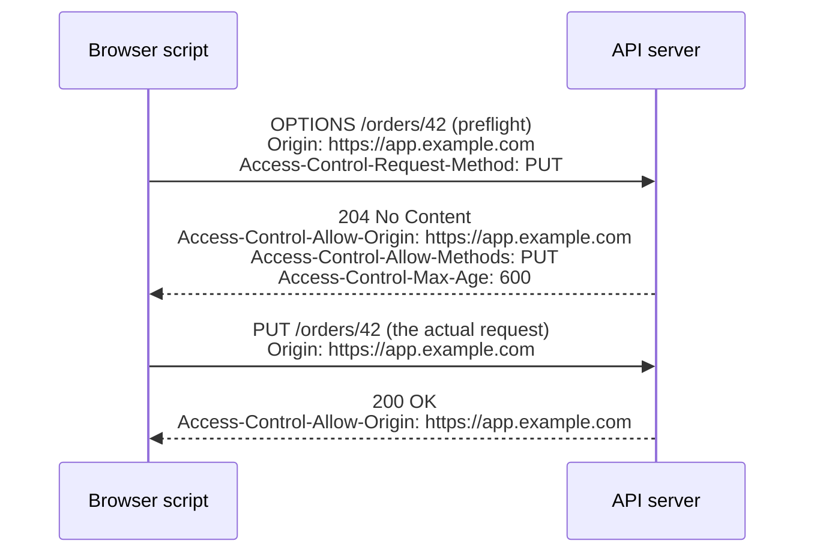

## 6. Design Principles

- **Statelessness**: each request carries all the context the server needs
  (or a token/cookie referencing server-side state, Section 4.7); this is
  what lets any server behind a load balancer handle any request.
- **Uniform interface**: a small, fixed vocabulary of methods and status
  codes that every HTTP-aware intermediary (proxy, cache, gateway) can
  reason about without understanding the application's business logic.
- **Layered system**: a client cannot generally tell whether it's talking
  directly to the origin server or through a chain of proxies/CDNs — this
  enables caching and load balancing to be inserted transparently.
- **Cacheability as a first-class property**: whether a response is
  cacheable, and by whom, is declared explicitly per response
  (Sections 4.3-4.4) rather than left to intermediary guesswork.

## 7. Architecture Patterns

- **Reverse proxy termination**: TLS terminates at a reverse proxy/load
  balancer, which forwards plain HTTP to backend instances over a private
  network — reduces certificate management surface and CPU cost on app
  servers. Full reverse-proxy architecture recapped only — owned by
  [Reverse Proxy](CH11_Reverse_Proxy.md).
- **Edge caching**: `Cache-Control` and `ETag` headers (Sections 4.3-4.4)
  let a CDN serve repeated `GET` requests without hitting the origin. Full
  CDN placement/invalidation architecture recapped only — owned by
  [CDN](CH09_CDN.md).
- **API Gateway as HTTP front door**: a single HTTP entry point that handles
  authentication, CORS (Section 4.8), rate limiting, and routing before
  requests reach services speaking REST, gRPC, or GraphQL internally.
- **Load-balanced fleets behind a single virtual host**: name-based routing
  via the `Host`/`:authority` component of the URI (Section 4.11) lets one
  load balancer front many backend pools. Full load-balancing algorithms
  recapped only — owned by [Load Balancer](CH10_Load_Balancer.md).

## 8. Production Architecture

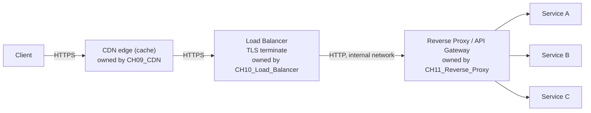

Each hop can add its own headers (`X-Forwarded-For`, `X-Request-Id`) for
traceability — see [Observability](../14_Observability/PART_OVERVIEW.md) for
how these threads through distributed tracing (owned there).

## 9. Implementation

A minimal server must: parse the request line and headers, dispatch to a
handler by method + path (Section 4.1), set `Content-Length` or use chunked
encoding (Section 4.10), negotiate content representation and compression if
supported (Sections 4.5-4.6), evaluate any conditional-request validators
before doing expensive work (Section 4.4), apply CORS headers for
cross-origin callers (Section 4.8), and close or keep the connection alive
per `Connection` semantics (Section 4.9). See the code samples in
Section 10.

## 10. Complete Code Examples

- Python: [code/python/http-chapter/simple_http_client.py](../code/python/http-chapter/simple_http_client.py)
  — method/status-code handling client.
- Python: [code/python/http-chapter/content_negotiation_client.py](../code/python/http-chapter/content_negotiation_client.py)
  — content negotiation (Section 4.5) with q-factors across `Accept`,
  `Accept-Language`, `Accept-Encoding`, plus transparent gzip decompression
  (Section 4.6).
- Node.js: [code/node/http-chapter/simple_http_server.js](../code/node/http-chapter/simple_http_server.js)
  — method dispatch and status-code semantics.
- Node.js: [code/node/http-chapter/conditional_and_cors_server.js](../code/node/http-chapter/conditional_and_cors_server.js)
  — conditional requests with `ETag`/`If-None-Match` and `Last-Modified`
  (Section 4.4), a hardened `Set-Cookie` (Section 4.7), and a full CORS
  preflight + simple-request exchange (Section 4.8).
- Java: [code/java/http-chapter/SimpleHttpClient.java](../code/java/http-chapter/SimpleHttpClient.java)
  — `java.net.http.HttpClient` request/response handling.

## 11. Performance

- Persistent connections (HTTP/1.1 keep-alive, Section 4.9) avoid a new
  TCP + TLS handshake per request — the single biggest early win over
  HTTP/1.0.
- Conditional requests (Section 4.4) turn a full re-download into a
  near-zero-byte `304` for unchanged resources, which matters more for
  overall latency/bandwidth than raw compression in many read-heavy APIs.
- Compression (Section 4.6) typically cuts text-based payload sizes by
  60-80%, at the cost of CPU on both ends — skip it for already-compressed
  media and very small responses where overhead can exceed the savings.
- HTTP/2 multiplexing removes the need for the "6 connections per host"
  workaround browsers used under HTTP/1.1 — recapped, owned by
  [HTTP/2](CH04_HTTP2.md).
- HPACK header compression matters most for request-heavy, small-payload
  APIs (e.g. mobile apps polling frequently) — recapped, owned by
  [HTTP/2](CH04_HTTP2.md).
- HTTP/3's 0-RTT/1-RTT connection setup materially reduces latency on
  high-latency/lossy networks (mobile) versus TCP+TLS — recapped, owned by
  [HTTP/3](CH05_HTTP3.md).

## 12. Scalability

Stateless HTTP requests scale horizontally behind a load balancer trivially;
the scaling challenge moves to whatever holds state (databases, caches,
sessions, and any server-side session data referenced by a cookie, Section
4.7) — see [System Design and Distributed Systems](../07_System_Design_and_Distributed_Systems/PART_OVERVIEW.md).
Connection limits (file descriptors, ephemeral ports on the load balancer,
Section 4.9's pool sizing) are the usual first HTTP-layer scaling
bottleneck in production. Caching (Sections 4.3-4.4) is the single highest-
leverage scaling lever available at the HTTP layer itself — every request a
CDN or browser cache satisfies from a `304`/cached copy is a request the
origin never sees at all.

## 13. Security

- Always terminate HTTPS, never plain HTTP, for anything crossing an
  untrusted network — TLS mechanics recapped only, owned by
  [TLS](CH06_TLS.md).
- Validate the `Host` header against an allow-list to prevent host-header
  injection attacks (Section 4.11).
- Use `HttpOnly`, `Secure`, and `SameSite` on every session cookie by
  default (Section 4.7); the CSRF/session-fixation attack mechanics these
  attributes mitigate are recapped only here and owned by the future
  Security part.
- Scope CORS `Access-Control-Allow-Origin` to an explicit allow-list, never
  a wildcard combined with `Access-Control-Allow-Credentials: true`
  (Section 4.8) — remember CORS is a browser-enforced, not server-enforced,
  boundary.
- Rate-limit and validate all `Content-Length`/chunked bodies (Section 4.10)
  to avoid request-smuggling and resource-exhaustion attacks.
- Avoid compressing responses that mix attacker-influenced input with a
  secret value (Section 4.6) to avoid the CRIME/BREACH compression-oracle
  attack class, recapped only here and owned by [SSL](CH07_SSL.md).
- See [Security](../15_Security/PART_OVERVIEW.md) for OWASP (Open Worldwide
  Application Security Project) Top 10 coverage (owned there).

## 14. Observability

Log method, path, status code, latency, and a correlation ID
(`X-Request-Id`) per request at minimum; propagate the correlation ID through
every downstream hop. Also worth tracking per-endpoint: cache hit/miss and
`304` rates (Sections 4.3-4.4), compression ratio and CPU cost (Section
4.6), and CORS preflight rejection rates (Section 4.8) as an early signal of
misconfigured allow-lists. Full tracing/metrics patterns are owned by
[Observability](../14_Observability/PART_OVERVIEW.md).

## 15. Failure Scenarios

- **504 Gateway Timeout**: upstream service too slow — check whether it's a
  true backend slowdown or a misconfigured proxy timeout shorter than the
  backend's expected latency.
- **502 Bad Gateway**: upstream connection refused/reset — often a backend
  crash or health-check misconfiguration.
- **Connection pool exhaustion**: client-side symptom of slow/hanging
  backends; without a request timeout, one slow dependency can starve an
  entire pool (Section 4.9).
- **Cache never invalidates / "sticky staleness"**: an `ETag` generator that
  embeds a volatile value (a timestamp, a request-scoped ID) never matches
  on revalidation, so every request looks changed and the client never
  benefits from `304`s (Section 4.4) — the inverse of the intended failure
  mode, silently wasting bandwidth rather than serving stale data.
  Conversely, an `ETag` that's too coarse (e.g. hashing only a cheap summary
  field) can wrongly return `304` for content that actually changed,
  serving genuinely stale data.
- **CORS silently blocking a legitimate integration**: a new frontend
  origin added without updating the API's CORS allow-list fails with no
  server-side error logged at all — the browser blocks the response
  client-side before the application code ever sees a problem
  (Section 4.8).
- **Chunked-encoding/request-smuggling desync**: a front-end proxy and
  backend server disagreeing on chunk framing lets one attacker request be
  split into two by an intermediary, recapped only here (Section 4.10).

## 16. Testing

- Contract tests against expected status codes and headers per endpoint
  (Section 4.2), including conditional-request behavior — assert a second
  identical `GET` with the returned `ETag` yields `304` (Section 4.4).
- Fuzzing malformed headers/bodies (including malformed chunked framing) to
  check for request-smuggling and crash resilience (Section 4.10).
- CORS test matrix: allowed origin + simple request, allowed origin +
  preflighted request, disallowed origin (must be rejected client-side by a
  real browser, not just by inspecting response headers in a server test)
  (Section 4.8).
- Cookie attribute assertions: verify `HttpOnly`/`Secure`/`SameSite` are
  actually present on every `Set-Cookie` for session tokens, not just in the
  common-path test but across every response that sets them (Section 4.7).
- Load testing with realistic keep-alive/connection-reuse patterns, not just
  raw requests-per-second with fresh connections each time (Section 4.9).

## 17. Common Mistakes

- Using `GET` for state-changing operations, breaking caching and retry
  safety assumptions (Section 4.1).
- Returning `200 OK` with an error payload in the body instead of the correct
  `4xx`/`5xx` status code, breaking generic HTTP-aware tooling (Section 4.2).
- Setting overly aggressive `Cache-Control: no-store` everywhere "to be
  safe," losing all CDN/browser caching benefit (Section 4.3).
- Negotiating on a request header (`Accept-Encoding`, `Accept`) without
  setting the matching `Vary` response header, letting a shared cache serve
  the wrong representation to the wrong client (Section 4.5).
- Compressing already-compressed media, wasting CPU for no size benefit
  (Section 4.6).
- Scoping a cookie's `Domain` broader than necessary, leaking it to
  subdomains that don't need it (Section 4.7).
- Echoing back the request's `Origin` as `Access-Control-Allow-Origin` for
  every origin while also allowing credentials — functionally a wildcard
  with credentials (Section 4.8).

## 18. Best Practices

- Use the status code that most specifically matches the outcome, not just
  `200`/`400`/`500` (Section 4.2).
- Make every `PUT`/`DELETE` genuinely idempotent at the server, not just by
  convention; require an `Idempotency-Key` for `POST`s that must be safely
  retryable (Section 4.1).
- Emit an `ETag` on every cacheable/revalidatable response, even if the
  response isn't otherwise heavily cached, purely to make revalidation cheap
  (Section 4.4).
- Enable compression at a shared reverse proxy or CDN tier rather than
  per-service, and exclude routes that already serve compressed media
  (Section 4.6).
- Default every session cookie to `HttpOnly; Secure; SameSite=Lax` and only
  loosen deliberately, with review (Section 4.7).
- Maintain an explicit CORS origin allow-list per environment (never a
  runtime-computed wildcard) and keep `Access-Control-Max-Age` tuned to
  balance preflight-round-trip cost against staleness of the cached
  preflight decision (Section 4.8).
- Set explicit timeouts at every hop (client, proxy, server) rather than
  relying on defaults (Section 4.9).

## 19. Anti-Patterns

- **Chatty APIs over HTTP/1.1** without connection reuse, forcing a new
  handshake per call (Section 4.9).
- **Ignoring `Retry-After`** on `429`/`503` responses instead of backing off
  (Section 4.2).
- **Overloading a single status code** (e.g. always `200`) to mean multiple
  different outcomes, forcing clients to parse the body to know what
  happened (Section 4.2).
- **Relying on CORS as an access-control boundary** rather than a
  browser-only response-visibility control, forgetting that non-browser
  clients ignore it entirely (Section 4.8).
- **Fragment-based server-side routing assumptions** — trying to key
  server-side behavior off a URI fragment, which never reaches the server
  (Section 4.11).

## 20. Trade-off Analysis

| Decision | Benefit | Cost |
|---|---|---|
| Terminate TLS at the edge vs. end-to-end | Simpler cert management, cheaper CPU on app servers | Internal network must be trusted |
| HTTP/2 vs HTTP/1.1 | Multiplexing, header compression | More complex server implementation, some middleboxes mishandle it |
| Aggressive time-based caching (`max-age`) | Lower origin load, lowest possible latency | Stale-data risk if invalidation is wrong |
| Conditional requests (`no-cache` + `ETag`) over time-based caching | Always fresh, minimal bandwidth cost via `304` | Still one round trip per request, unlike a pure cache hit |
| Compression (br/gzip) | 60-80% smaller text payloads | CPU cost on both ends; near-zero benefit on already-compressed media |
| Cookie-based sessions | Simple, browser-managed, works without client-side token storage code | Coupled to browser same-origin/cross-site semantics; needs CSRF-aware defenses |
| Broad CORS allow-list | Fewer integration friction points for partner frontends | Larger attack surface if any allowed origin is compromised |

## 21. Comparison Table

| Version | Transport | Multiplexing | Header Compression | Typical Use Today |
|---|---|---|---|---|
| HTTP/1.1 | TCP | No (per-connection) | No | Legacy systems, simple internal services |
| HTTP/2 | TCP | Yes (stream-level) | HPACK | Most modern web/API traffic |
| HTTP/3 | QUIC (UDP) | Yes (no TCP head-of-line blocking) | QPACK | Mobile-heavy, high-latency/lossy networks |

| Compression algorithm | Typical ratio (text) | CPU cost | Browser support | Notes |
|---|---|---|---|---|
| Brotli (`br`) | Best | Higher at max quality | Universal (HTTPS only) | Preferred default for static/text assets |
| gzip | Good | Low-moderate | Universal | Safe universal fallback |
| deflate | Good | Low-moderate | Inconsistent wrapping across servers | Rarely used today |
| identity (none) | None | None | N/A | Correct choice for already-compressed media |

## 22. Real-World Case Study

A CDN-fronted e-commerce product page serves cached HTML/JSON for anonymous
users (`Cache-Control: public, s-maxage=60, max-age=0`, Section 4.3) while
routing authenticated cart/checkout calls (`Cache-Control: no-store`)
straight to origin — demonstrating how HTTP's caching headers alone can
offload the majority of traffic from origin servers without any
application-level caching layer. The same site's single-page checkout
frontend calls its cart API cross-origin: the API responds to preflighted
`PUT`/`DELETE` calls with an explicit CORS allow-list (Section 4.8) rather
than a wildcard, since the cart API relies on a `HttpOnly`/`Secure`/
`SameSite=Lax` session cookie (Section 4.7) and therefore cannot safely use
`Access-Control-Allow-Origin: *`. The product-detail endpoint additionally
emits a strong `ETag` (Section 4.4) so that repeat visits from the same
session — common during a shopping session where a user revisits a product
page after browsing others — cost a `304` rather than a full JSON
re-download, and negotiates Brotli compression (Section 4.6) for the
initial `200` response to minimize the payload on first view.

## 23. Interview Questions

1. Why is `PUT` idempotent but `POST` is not, and why does that distinction
   matter for retries?
2. Walk through the difference between a strong and a weak validator, and
   explain when `Last-Modified` isn't precise enough to use safely.
3. What's the difference between `304 Not Modified` and a `200 OK` served
   from a local browser cache — and what has to be true for each to happen?
4. Design the `Cache-Control` header for three endpoints: a static JS
   bundle with a content hash in its filename, an authenticated user profile,
   and a public product listing that changes hourly.
5. Explain why `Access-Control-Allow-Origin: *` cannot be combined with
   `Access-Control-Allow-Credentials: true`, and what vulnerability that
   restriction prevents.
6. Walk through what changes at the transport level between HTTP/1.1,
   HTTP/2, and HTTP/3 (recap-level answer expected; deep framing/QUIC detail
   is out of scope for this chapter).
7. Why was HTTP/1.1 pipelining specified but never safely used in practice?
8. What's the security implication of setting a cookie's `Domain` attribute
   too broadly?
9. Why does content negotiation require the `Vary` response header to be
   cache-safe?
10. Under what circumstances would you choose *not* to compress a response
    body?

## 24. Hands-on Exercises

1. Using the code samples in Section 10, capture a request/response with a
   packet-capture tool (e.g. Wireshark) and identify: the TCP handshake, the
   TLS handshake (if HTTPS, recapped — owned by [TLS](CH06_TLS.md)), the
   HTTP request line, and the response status line.
2. Run [conditional_and_cors_server.js](../code/node/http-chapter/conditional_and_cors_server.js)
   locally, issue a `GET`, capture the returned `ETag`, then reissue the
   `GET` with `If-None-Match` set to that value and confirm a `304` with no
   body is returned.
3. Trigger the CORS preflight in the same server from a browser console on
   a different origin and observe the `OPTIONS` request/response pair;
   change the allowed origin and observe the browser block the response.
4. Run [content_negotiation_client.py](../code/python/http-chapter/content_negotiation_client.py)
   against a server that supports gzip and confirm the client correctly
   decompresses the response body.

## 25. Design Exercises

1. Design the caching strategy (headers, TTLs (Time To Live), invalidation
   approach) for a news site's homepage, article pages, and a logged-in
   comment API. Evaluation criteria: correctness of cacheability per
   endpoint, invalidation approach, and origin-load reduction estimate.
2. Design the cookie strategy for a multi-tenant SaaS (Software as a
   Service) application where each tenant has its own subdomain
   (`tenant.app.example.com`). Evaluation criteria: correct `Domain`/`Path`
   scoping per tenant, `SameSite` choice justified against the app's
   cross-site embedding needs, and session-expiry policy.
3. Design the CORS policy for a public API that must support both a
   first-party web app and third-party partner integrations, some of which
   need credentialed (cookie-based) access and some of which use bearer
   tokens instead. Evaluation criteria: whether the design correctly
   separates the credentialed vs. non-credentialed origin sets.

## 26. Architecture Review Questions

- Does every hop (client, CDN, load balancer, service) have an explicit,
  intentional timeout?
- Are idempotent methods actually implemented idempotently at the server,
  and do state-changing `POST`s support an idempotency key?
- Is TLS enforced everywhere, with no plaintext HTTP fallback reachable
  externally?
- Are cache headers set deliberately per endpoint, not left at framework
  defaults, and does every conditionally-cacheable endpoint emit an `ETag`?
- Is every `Vary`-relevant negotiation dimension actually declared via the
  `Vary` header?
- Are session cookies uniformly `HttpOnly`/`Secure`/`SameSite`-hardened
  across every response that sets them, not just the login endpoint?
- Is the CORS allow-list explicit and environment-scoped, with no
  wildcard-plus-credentials combination anywhere?

## 27. Summary

HTTP's request/response model, method semantics, and status code taxonomy
are the shared vocabulary nearly every other protocol and architecture
pattern in this handbook builds on. This chapter's enrichment pass deepens
that foundation with the full caching/validation model (`Cache-Control`,
conditional requests and `ETag`/`Last-Modified` validators), content
negotiation, compression, cookies, CORS, connection management, chunked
transfer encoding, and URI structure — each taught to first-principles
depth as concepts this chapter genuinely owns. Understanding *why* GET is
safe and cacheable, why PUT/DELETE must be idempotent, why a `304` can save
nearly all bandwidth for an unchanged resource, and why CORS is a
browser-enforced visibility control rather than a security boundary, is
foundational — later chapters (REST, GraphQL, API Gateway, CDN, TLS,
HTTP/2, HTTP/3) will recap and link back here rather than re-deriving these
fundamentals.

**Further reading**: [REST](../08_API_Architecture/CH01_REST.md) ·
[TLS](CH06_TLS.md) · [HTTP/2](CH04_HTTP2.md) · [HTTP/3](CH05_HTTP3.md) ·
[QUIC](CH18_QUIC.md) · [WebSockets](CH17_WebSockets.md) ·
[CDN](CH09_CDN.md) · [Load Balancer](CH10_Load_Balancer.md) ·
[Reverse Proxy](CH11_Reverse_Proxy.md) ·
[API Gateway](../08_API_Architecture/PART_OVERVIEW.md) ·
[Observability](../14_Observability/PART_OVERVIEW.md)

