# Chapter: OSI Model

Part: [05 — Networking and Operating Systems](PART_OVERVIEW.md) · Status: Drafted

## 1. Introduction

The OSI (Open Systems Interconnection) model is a seven-layer reference
framework — Physical, Data Link, Network, Transport, Session, Presentation,
and Application — that describes how two computers exchange data across a
network as a sequence of well-defined responsibilities, each layer building
on the guarantees of the one beneath it. It is not, in 2026, the protocol
stack that actually carries traffic across the internet — that role belongs
to TCP/IP (Transmission Control Protocol/Internet Protocol), covered in the
next chapter. What the OSI model *is* — and why every Solution Architect
must internalize it before touching any other topic in this part of the
handbook — is the shared mental model and vocabulary that every networking,
security, and observability conversation in this industry is conducted in.
When an engineer says "this is an L3 problem" or "that's a Layer 7 load
balancer," they are speaking OSI, not TCP/IP's four-layer model, even though
the packets themselves are TCP/IP packets.

This chapter is the *owning* chapter for the OSI seven-layer model itself,
the encapsulation/de-encapsulation mechanism that moves data down and back up
the stack, the mapping between OSI's seven layers and the TCP/IP four-layer
model, and the "which layer is this problem at" diagnostic framework that
recurs throughout networking, security, and production-incident work. Every
other chapter in this part — [TCP/IP](PART_OVERVIEW.md), [HTTP](CH01_HTTP.md),
TLS (Transport Layer Security), DNS (Domain Name System), Load Balancer,
Reverse Proxy, and the rest — will recap this chapter's layer vocabulary with
a short link rather than re-deriving what a layer is or how encapsulation
works. If you find yourself reading a later Part 05 chapter and it says
"this operates at Layer 4," it means this chapter, not that one.

## 2. Historical Evolution

- **1977 — ISO (International Organization for Standardization) begins
  formal work.** ISO sub-committee SC16 is chartered to define a framework
  for "open systems" that could interconnect regardless of vendor, at a time
  when IBM's SNA (Systems Network Architecture), DECnet, and dozens of other
  proprietary stacks could not talk to each other at all.
- **1978 — the first layered proposal.** Honeywell's Charles Bachman
  submits a draft layered architecture to ISO; it introduces the core idea
  that would define OSI — a stack of layers, each with a narrow, well-defined
  responsibility, communicating with the layer directly above and below it
  through a fixed interface.
- **1984 — ISO 7498 / ITU-T X.200 is published.** The seven-layer OSI
  Reference Model becomes an official joint ISO/ITU-T (International
  Telecommunication Union Telecommunication Standardization Sector)
  standard. It is deliberately protocol-agnostic: it defines *what* each
  layer must do, not a mandatory single implementation for each layer.
- **1980s — parallel OSI protocol development.** Unlike the reference model
  itself, a full *OSI protocol suite* is also developed in parallel — X.25,
  X.400 (email), X.500 (directory services), CLNP (Connectionless Network
  Protocol), and TP4 (an OSI transport protocol) — intended to be an
  actual competing stack to TCP/IP, not merely a teaching diagram.
- **1988 — GOSIP mandates.** The US government's GOSIP (Government OSI
  Profile) requires federal agencies to procure OSI-compliant networking
  equipment, betting that OSI protocols (not TCP/IP) would become the
  long-term standard — a bet that history did not vindicate.
- **1990s — TCP/IP wins the protocol war.** TCP/IP was already running
  the operational, growing ARPANET/NSFNET/early-internet at production
  scale, was simpler to implement, had multiple free, working
  implementations (notably in BSD Unix), and did not require agencies to
  wait for a complete, all-layers-at-once OSI suite to be finished and
  interoperable. By the early-to-mid 1990s, OSI's own protocol
  implementations had lost the commercial and engineering momentum that
  TCP/IP already had.
- **1995 — GOSIP mandate rescinded.** The US government formally drops the
  OSI-protocol procurement requirement, acknowledging that TCP/IP had become
  the de facto standard in practice.
- **1990s onward — the reference model outlives the protocol suite.** Even
  as the OSI *protocols* (X.25, TP4, CLNP) faded from production use, the
  OSI *reference model* itself persisted and grew more influential as a
  teaching tool, a shared troubleshooting vocabulary, and a lingua franca
  that every certification (Cisco's CCNA, CompTIA Network+), every vendor's
  documentation, and every incident postmortem still uses to this day.

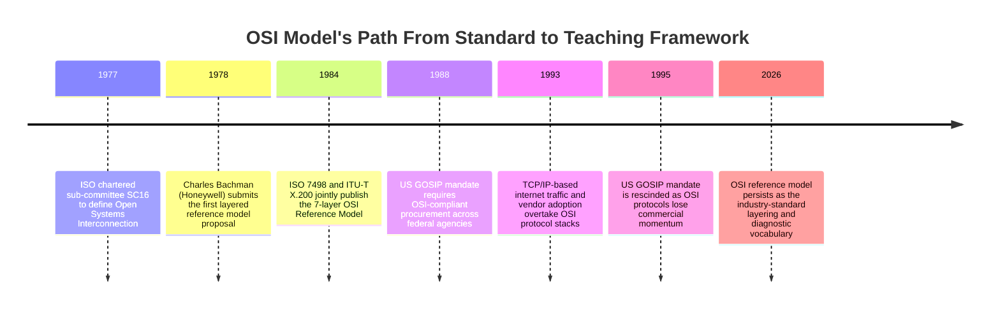

The key historical lesson for an architect: **the reference model and the
protocol suite are not the same thing, and only one of them survived.** OSI
lost the protocol war decisively, but won the vocabulary war so completely
that most engineers today have never touched an OSI protocol yet use OSI
layer numbers daily.

## 3. Why It Exists

Before a shared layering model existed, "networking architecture" meant
picking one vendor's entire proprietary stack — IBM's SNA, DEC's DECnet,
Xerox's XNS — and living inside its assumptions for the life of the system.
A device from one vendor's stack could not meaningfully interoperate with
another's, because there was no agreed decomposition of "what a network does"
into independently replaceable pieces. The OSI model exists to solve three
specific problems that fall directly out of that gap:

1. **Interoperability across vendors without a single shared
   implementation.** By defining *what* each layer's job is (not
   *how* to implement it), two vendors' Layer 2 equipment can interoperate
   as long as both correctly implement the agreed Layer 2 contract, even if
   their internal engineering differs completely. This is the architectural
   pattern of a stable interface hiding swappable implementation detail,
   applied at the scale of an entire internetworking industry.
2. **Independent evolution of each layer.** Because each layer only depends
   on the *interface* the layer below exposes — not its internal mechanism —
   the physical medium can evolve from copper to fiber to radio, and the
   application layer built on top does not need to change at all. This
   decoupling is precisely why HTTP (Application layer, owned by
   [HTTP](CH01_HTTP.md)) works identically whether the underlying Physical
   layer is Ethernet over copper, Wi-Fi, or a satellite uplink.
3. **A shared diagnostic vocabulary for a problem no single team fully
   owns.** A production network incident routinely spans a Network
   Interface Card (NIC) firmware bug, a misconfigured switch, a routing
   table error, a firewall rule, and an application bug — often five
   different teams' equipment. Without a common layer vocabulary,
   diagnosing "where in the stack is this actually broken" becomes a
   Tower-of-Babel problem before the actual troubleshooting can even start.

The OSI model's genius — and the reason it survives while its own protocol
suite did not — is that solving problem 3 (shared diagnostic vocabulary)
does not require the model to actually be the running protocol stack.
Architects use the OSI *model* to reason about and diagnose systems that
actually run the TCP/IP *stack*. Section 4.10 and 4.11 make this split
explicit.

## 4. Core Concepts

### 4.1 Layering as an Architectural Principle

**Definition.** Layering is the decomposition of a complex system into an
ordered stack of components, where each layer (a) provides a well-defined
service to the layer directly above it, (b) uses only the services of the
layer directly below it, and (c) is unaware of any layer's internals beyond
its immediate neighbor. The OSI model applies this principle to networking
with exactly seven layers, numbered 1 (Physical, closest to the wire) through
7 (Application, closest to the user).

**Mechanism.** Each layer communicates with its peer layer on the remote
system through a *protocol* — a shared set of rules both ends agree to — and
communicates with the layer above/below it *locally* through a *service
interface*. Critically, Layer *N* on the sending host talks conceptually to
Layer *N* on the receiving host ("virtual" peer-to-peer communication), but
physically, data always travels down through every layer on the sender, across
the wire at Layer 1, and back up through every layer on the receiver. This
distinction — logical peer communication versus actual physical
data path — is the single most-missed detail when engineers first learn OSI,
and it is the direct explanation for why encapsulation (Section 4.9) exists
at all.

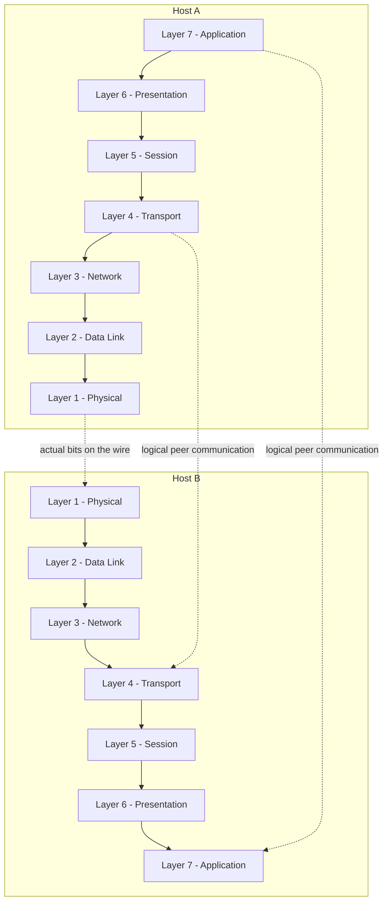

**Decision implications.** Layering is what lets an architect swap a single
layer's technology (moving from a data center's copper Ethernet to a cloud
provider's virtual network fabric, or from IPv4 to IPv6 at Layer 3) without
having to redesign every layer above it. It is also what lets a security team
insert a new control (a firewall at Layer 3/4, a Web Application Firewall
(WAF) at Layer 7) without the layers around it needing to change, as long as
the inserted control honors the existing layer interface.

**Common failure mode.** *Layer violation* — a component at one layer making
assumptions about, or directly manipulating, details that belong to another
layer. Section 19 covers this as a named architecture anti-pattern in depth,
but the root cause is always a breakdown of the layering principle defined
here: something above Layer *N* reached below its interface and touched
Layer *N*'s internals directly, coupling the two layers together in a way
that breaks the "swap one layer without touching the others" property that
layering exists to provide.

**Concrete scenario.** A team builds an internal Application-layer service
that silently assumes every request arrives on a single TCP (Transport
layer) connection and uses connection lifetime as an implicit session
identity. When the team later moves the service behind a load balancer that
recycles or multiplexes TCP connections (a Transport-layer change that is
supposed to be invisible to the Application layer per the layering
principle), the application's implicit session tracking breaks — a direct,
textbook illustration of what happens when a layer's design silently
violates the abstraction the layer below it promises.

### 4.2 Layer 1 — Physical

**Definition.** The Physical layer is responsible for the transmission of
raw, unstructured bits over a physical medium — copper cable, fiber-optic
cable, or radio spectrum. It defines voltage levels, pin layouts, cable
types, signaling rates, and modulation schemes; it has no concept of
"addresses," "packets," or "connections" — only bits and the physical
medium that carries them.

**Mechanism.** A device's NIC (Network Interface Card) converts a Data Link
frame (Section 4.3) into a modulated electrical signal (copper), light pulse
pattern (fiber), or radio waveform (Wi-Fi), and the receiving NIC performs
the reverse conversion, recovering a bit stream from the physical signal
using a clock-recovery mechanism to know where one bit ends and the next
begins.

**Decision implications.** Physical-layer choices (copper Cat6 vs. fiber,
10 Gigabit Ethernet vs. 100 Gigabit Ethernet, Wi-Fi 6 vs. wired) determine
maximum achievable throughput, latency floor, and cable-run distance limits
— decisions that materially constrain data center topology and are almost
always made by network/infrastructure engineering rather than application
architects, but that every architect must be able to reason about when
diagnosing "is this actually a network hardware problem."

**Common failure mode.** Physical-layer failures present as symptoms that
look identical to much higher-layer problems: intermittent packet loss from
a marginal/damaged cable or a failing transceiver can produce the same
user-visible "flaky connection" symptom as an application bug, which is
exactly why the diagnostic framework in Section 4.11 always starts by
ruling out Layer 1 first.

**Concrete scenario.** A newly racked server intermittently drops its
network connection under load. Weeks of application-level debugging find
nothing; the actual root cause is a partially seated fiber transceiver that
only fails once the link is saturated (electrical/optical margin issue),
which is invisible to every layer above Layer 1 except as unexplained packet
loss.

### 4.3 Layer 2 — Data Link

**Definition.** The Data Link layer organizes raw bits from the Physical
layer into structured units called *frames*, provides node-to-node delivery
within a single local network segment using MAC (Media Access Control)
addresses, and detects (though does not correct) transmission errors.

**Mechanism.** Every NIC has a globally unique 48-bit MAC address burned
into it. A Data Link frame wraps the Network-layer packet with a header
(source MAC, destination MAC, and an EtherType field identifying the payload
protocol) and a trailer containing an FCS (Frame Check Sequence) — a CRC
(Cyclic Redundancy Check) value the receiver recomputes to detect (not fix)
bit-level corruption. Within a Local Area Network (LAN), a switch reads only
the destination MAC address and forwards the frame out the correct physical
port using a MAC address table it builds by observing traffic — this is
fundamentally different from a router's Layer 3 forwarding decision (Section
4.4). ARP (Address Resolution Protocol) is the mechanism a host uses to
discover which MAC address corresponds to a known IP address on the same
local segment, bridging Layer 2 and Layer 3.

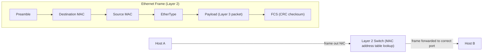

**Decision implications.** VLAN (Virtual Local Area Network) segmentation
operates at Layer 2, letting an architect logically separate broadcast
domains (isolating, for example, a payment-processing subnet from a general
office network) without physically separate cabling. Layer 2 broadcast
domain size is also a direct scalability constraint — see Section 12.

**Common failure mode.** A *switching loop* — redundant physical links
between switches without a loop-prevention protocol (Spanning Tree Protocol)
enabled — causes frames to circulate indefinitely, exponentially multiplying
traffic until the broadcast domain collapses under self-inflicted load; this
is a Layer 2 failure mode with no Layer 3+ equivalent, because only Layer 2
forwarding lacks a TTL-like hop-count safety mechanism by default.

**Concrete scenario.** An architect designing a data center network must
decide the size of each Layer 2 broadcast domain (how many hosts share a
VLAN). Too large, and ARP broadcast traffic and switching-loop blast radius
both grow; too small, and the number of Layer 3 subnets (and the routing
complexity between them) grows instead — a direct Layer 2/Layer 3 trade-off
an architect must make deliberately, not by default.

### 4.4 Layer 3 — Network

**Definition.** The Network layer is responsible for logical addressing
(IP addresses) and *routing* — delivering a packet across multiple,
potentially very different, physical networks between a source and a
destination that are not on the same Layer 2 segment.

**Mechanism.** Every packet is wrapped in an IP (Internet Protocol) header
containing source and destination IP addresses, a TTL (Time To Live) field
that decrements at every router hop and causes the packet to be discarded
(with an ICMP (Internet Control Message Protocol) error sent back) if it
reaches zero, and a protocol field identifying the Layer 4 payload. A router
makes a *per-hop* forwarding decision: it inspects only the destination IP
address, consults its routing table (built via static configuration or a
dynamic routing protocol such as OSPF or BGP), and forwards the packet out
the interface associated with the best-matching route — critically, unlike a
Layer 2 switch, a router operates on logical addresses and can connect
networks using entirely different Layer 1/Layer 2 technologies.

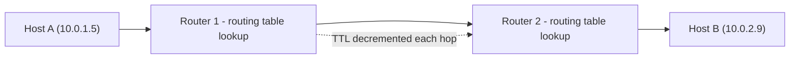

**Decision implications.** Subnetting design (how IP address space is
divided across environments, regions, and security zones) is one of the
highest-leverage, hardest-to-reverse decisions in network architecture —
re-addressing a live production estate is a "one-way door" decision in the
sense described in
[Architecture Thinking](../01_Architecture_Mindset/CH03_Architecture_Thinking.md).
Cloud Virtual Private Cloud (VPC)/Virtual Network (VNet) designs are Layer 3
constructs, and their Classless Inter-Domain Routing (CIDR) block sizing
decisions are made at this layer.

**Common failure mode.** A *routing black hole* — a route exists in a
routing table pointing to a next hop that is unreachable or misconfigured —
silently drops all packets to that destination with no explicit error
returned to the sender at all (versus an explicit "destination unreachable"
ICMP response for some other Layer 3 failures), making it one of the harder
network failures to diagnose without a layer-aware approach.

**Concrete scenario.** After a cloud provider migration, a service in one
subnet cannot reach a service in a peered VPC/VNet. The Layer 3 diagnostic
question is: is there a route to the destination CIDR block in the routing
table, and does a route back exist symmetrically? Missing the return route
is one of the most common Layer 3 connectivity failures in cloud networking,
because unlike a single flat LAN, cloud network peering requires explicit,
bidirectional route table entries.

### 4.5 Layer 4 — Transport

**Definition.** The Transport layer provides end-to-end communication
services between processes (not just hosts) on the two communicating
systems, identified by *port numbers*, and — depending on the protocol
chosen — adds reliability, ordering, and flow control on top of the
Network layer's best-effort delivery.

**Mechanism.** TCP (Transmission Control Protocol) provides a connection-
oriented, reliable, ordered byte stream: a three-way handshake
(`SYN` / `SYN-ACK` / `ACK`) establishes a connection, sequence numbers
detect and reorder out-of-order segments, acknowledgments and retransmission
timers recover from loss, and a sliding-window mechanism provides flow
control. UDP (User Datagram Protocol) provides none of this — it is
connectionless and best-effort, trading reliability for lower latency and
lower per-packet overhead, which is why real-time protocols (DNS lookups,
video/voice, and QUIC — the transport underlying HTTP/3, recapped from
[HTTP](CH01_HTTP.md#2-historical-evolution)) choose it deliberately.

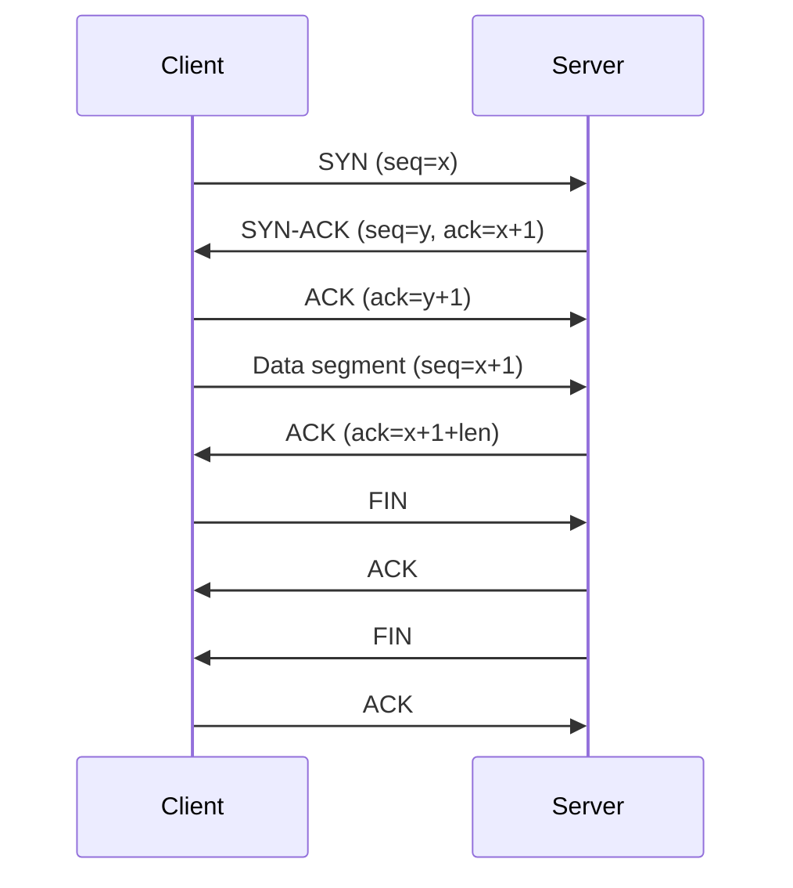

**Decision implications.** Choosing TCP versus UDP at the Transport layer is
an architectural decision about which failure semantics an application is
willing to own itself: TCP hands an architect a reliable stream but adds
handshake/retransmission latency, while UDP hands the architect raw speed
but requires the application (or a Layer 7 protocol running over UDP, such
as QUIC) to build its own reliability if it needs any. Port number choice and
management (well-known ports below 1024, ephemeral port ranges for outbound
connections) is also a Transport-layer decision that constrains connection
scalability under high concurrency — see Section 12.

**Common failure mode.** *TCP connection/ephemeral port exhaustion* — a
system opening far more outbound connections than its ephemeral port range
and TCP `TIME_WAIT` recycling can sustain — causes new connections to fail
even though every layer below Layer 4 is completely healthy; this is a
uniquely Transport-layer failure mode invisible to Physical/Data
Link/Network-layer diagnostics.

**Concrete scenario.** A service under load starts intermittently failing to
open new outbound HTTP connections to a downstream dependency. Layers 1-3
show no packet loss and correct routing; the actual cause is ephemeral port
exhaustion on the connecting host from not reusing keep-alive connections —
this is precisely why [HTTP](CH01_HTTP.md#11-performance)'s persistent
connections matter, and it is a concrete example of an Application-layer
(HTTP) design decision existing specifically to manage a Transport-layer
resource constraint.

### 4.6 Layer 5 — Session

**Definition.** The Session layer manages, coordinates, and synchronizes a
*dialogue* between two communicating applications — establishing, maintaining,
and cleanly terminating a logical session that may span multiple underlying
Transport-layer connections, and providing checkpointing/synchronization for
long-running exchanges.

**Mechanism.** In the pure OSI protocol suite, the Session layer had explicit
protocol machinery for this (session establishment tokens, synchronization
points a failed dialogue could resume from). In practice, on the TCP/IP
stack that actually runs production networks today, session-layer
responsibilities are absorbed into the application itself or into
Application-layer protocols: an HTTP cookie-based session, a database
connection's session state, a TLS session resumption ticket, or a WebSocket
connection's logical session are all Session-layer *responsibilities*
implemented at the Application layer rather than by a dedicated Session-layer
protocol. This is the clearest example in the whole model of why the
seven-layer OSI model and the four-layer TCP/IP model do not map cleanly
one-to-one — see Section 4.10.

**Decision implications.** When an architect designs an application's
session-management strategy (server-side session store vs. stateless
signed tokens, sticky-session load balancing vs. externalized session
state), they are making a Session-layer architectural decision even though
no dedicated "Session-layer protocol" exists in their actual TCP/IP-based
stack — recognizing this is what lets an architect correctly categorize
"this is a session-management problem" rather than mislabeling it as a
Transport-layer or Application-layer concern.

**Common failure mode.** *Session affinity coupling* — an architecture that
requires all requests within a logical session to land on the same backend
server (via sticky-session load balancing) because session state lives only
in that server's memory — breaks horizontal scalability and complicates
failover, because losing that one server silently destroys every session it
was holding.

**Concrete scenario.** A team migrates a monolith (which kept session state
in local server memory) to a horizontally scaled, load-balanced fleet
without externalizing session state first. Users get logged out or lose
shopping-cart contents unpredictably, because each new request may land on
a different backend instance with no shared Session-layer state — a direct
consequence of not treating session management as its own explicit
architectural layer.

### 4.7 Layer 6 — Presentation

**Definition.** The Presentation layer is responsible for translating data
between the format an application uses and a common format both
communicating systems agree on — encoding, encryption, and compression all
conceptually belong here.

**Mechanism.** Character encoding negotiation (ensuring both ends agree on
UTF-8 versus another encoding), serialization format (JSON, Protocol
Buffers, XML), data compression (gzip, Brotli), and encryption/decryption
(TLS's actual cryptographic transformation of bytes, as distinct from the
TLS *handshake*'s Session-layer-like negotiation) are all Presentation-layer
responsibilities. As with the Session layer, TCP/IP-based real-world systems
do not implement a dedicated "Presentation-layer protocol" — instead, these
responsibilities are handled by application libraries (a JSON serializer, a
TLS library) invoked directly by the Application layer.

**Decision implications.** Choosing a serialization format (JSON versus
Protocol Buffers versus Avro) is a Presentation-layer decision with direct
performance and evolvability consequences: a schema-based binary format
reduces payload size and enables strict backward/forward-compatibility
contracts, at the cost of human-readability and requiring shared schema
tooling. Similarly, choosing where compression happens (application-level
gzip versus a CDN's edge compression) is a Presentation-layer architectural
choice with a direct trade-off against CPU cost versus bandwidth savings.

**Common failure mode.** *Encoding mismatch* — one system emits data in one
character encoding or serialization schema version while the receiver
assumes another — produces corrupted or misparsed data that is often
mistaken for an Application-layer logic bug, when the actual defect is a
Presentation-layer contract violation.

**Concrete scenario.** A downstream consumer of an event stream starts
silently misparsing a subset of messages after an upstream producer's
library upgrade changes its default string encoding. Every layer below
Presentation is completely healthy — packets arrive intact, TCP delivers
them in order — the defect is purely in the shared understanding of *how to
interpret the bytes*, which is exactly the Presentation layer's job.

### 4.8 Layer 7 — Application

**Definition.** The Application layer is the layer users and application
developers interact with directly — it defines the protocols that give
meaning to a network exchange from the perspective of the software using the
network, such as HTTP, DNS, Simple Mail Transfer Protocol (SMTP), and File
Transfer Protocol (FTP).

**Mechanism.** An Application-layer protocol defines message semantics (an
HTTP request's method and status codes, recapped from
[HTTP](CH01_HTTP.md#4-core-concepts) rather than re-taught here), not
transport reliability or byte-level encoding — those are the Transport and
Presentation layers' jobs respectively. This is why HTTP can run
unmodified over TCP (HTTP/1.1, HTTP/2) or over QUIC-over-UDP (HTTP/3): the
Application layer's semantics do not depend on which Transport-layer
protocol carries them, precisely because of the layering principle from
Section 4.1.

**Decision implications.** Choosing an Application-layer protocol (REST
over HTTP, gRPC over HTTP/2, GraphQL over HTTP, a raw TCP-based custom
binary protocol) is one of the most consequential and visible architecture
decisions a Solution Architect makes, because — unlike the lower six layers,
which are frequently infrastructure/platform decisions — Application-layer
protocol choice directly shapes API contracts, client tooling, caching
behavior, and every consuming team's day-to-day integration experience.

**Common failure mode.** *Application-layer assumptions leaking into lower
layers* (or the reverse) is the layer-violation anti-pattern this chapter
names explicitly in Section 19 — for example, an application that silently
depends on a specific Transport-layer connection staying open for the
lifetime of a "session" (a Session-layer responsibility, Section 4.6,
mistakenly implemented as a Transport-layer assumption).

**Concrete scenario.** An internal service exposes a custom Application-layer
protocol that assumes messages always arrive whole within a single TCP
segment (conflating Layer 4's segment boundaries with Layer 7's message
boundaries). Under network conditions that fragment a message across
multiple TCP segments — entirely legal Transport-layer behavior the
Application layer must never assume against — the custom protocol's parser
breaks, because it never implemented Layer 7 message framing (a length
prefix or delimiter) independent of Layer 4's segmentation.

### 4.9 Encapsulation and De-encapsulation

**Definition.** Encapsulation is the process by which each layer, on the
sending side, wraps the data handed to it by the layer above with its own
header (and, at Layer 2, a trailer), producing a nested structure often
called a PDU (Protocol Data Unit) at each layer — a *segment* at Layer 4, a
*packet* at Layer 3, a *frame* at Layer 2, and *bits* at Layer 1.
De-encapsulation is the exact reverse process performed by the receiving
host, unwrapping each layer's header in order as the data climbs back up the
stack.

**Mechanism.** Each layer's header contains exactly the information that
layer's peer on the receiving system needs to do its job, and nothing more
— the Transport-layer header carries port numbers and sequence numbers, not
IP addresses (that is Layer 3's job) or MAC addresses (Layer 2's job). This
strict separation is what makes each layer's header independently
parseable without needing to understand any other layer's contents.

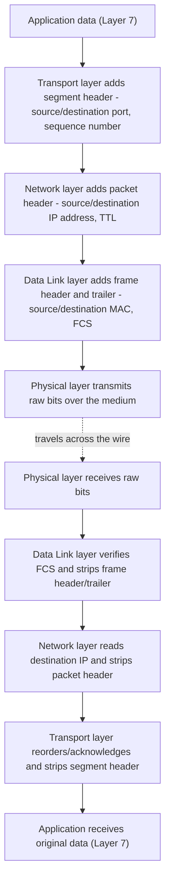

**Decision implications.** Every layer's added header consumes bandwidth
(*protocol overhead*) — an architect designing for very small, very
frequent messages (Internet of Things (IoT) telemetry, high-frequency
trading) must account for cumulative header overhead across all seven
layers, which can dominate payload size for tiny messages, directly
motivating protocol choices like UDP (skipping TCP's larger header and
handshake) at the Transport layer.

**Common failure mode.** *MTU (Maximum Transmission Unit) mismatch causing
fragmentation* — if the fully encapsulated frame at any hop exceeds the
smallest MTU along the path, the packet must be fragmented (IPv4) or
dropped with an ICMP "packet too big" error requiring Path MTU Discovery
(IPv6, and IPv4 with the "don't fragment" bit set) — a subtle,
easy-to-misdiagnose failure that manifests as some packets working and
larger ones silently failing or being fragmented, often blamed incorrectly
on the application.

**Concrete scenario.** A Virtual Private Network (VPN) tunnel adds its own
encapsulation layer (wrapping an entire original packet inside a new outer
packet), reducing the effective MTU available to the original traffic
without any change to the application. Large packets that fit in a normal
1500-byte Ethernet MTU no longer fit inside the tunnel's reduced MTU budget,
causing intermittent failures for large requests/responses while small
requests continue to work — a direct, production-relevant illustration of
encapsulation overhead as an architectural constraint, not merely a diagram
abstraction.

### 4.10 OSI's Seven Layers vs. the TCP/IP Four-Layer Model

**Definition.** The TCP/IP model (formally the Internet Protocol Suite,
detailed in the next chapter) organizes networking into four layers — Link,
Internet, Transport, and Application — and is the model that actually
describes the protocols running the internet today, in contrast to OSI's
seven-layer *reference* model.

**Mechanism — why the internet runs on the simpler model.** TCP/IP was
designed pragmatically, alongside and driven by working implementations
(the ARPANET, then BSD Unix's networking stack), rather than designed
top-down as a complete abstract specification first. Its four layers map
onto OSI's seven, but with two important collapses: TCP/IP's single "Link"
layer covers what OSI splits into Physical (Layer 1) and Data Link (Layer
2), and TCP/IP's single "Application" layer covers what OSI splits into
Session (Layer 5), Presentation (Layer 6), and Application (Layer 7) — this
is exactly why Sections 4.6 and 4.7 above had to explain that real systems
implement session/presentation responsibilities *inside* application
libraries rather than as dedicated protocol layers: TCP/IP never separated
them out as distinct protocol layers to begin with.

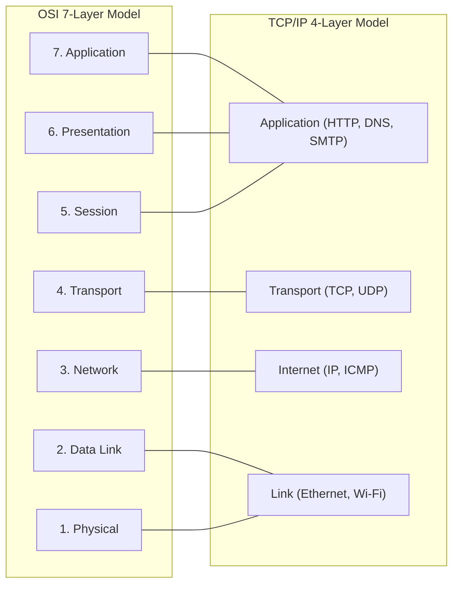

**Decision implications.** When an architect configures real infrastructure
— a cloud security group, a router's routing table, an application's TLS
library — they are always working with TCP/IP's actual protocols (IP, TCP,
UDP, HTTP), never with a literal implementation of OSI's Session or
Presentation layer protocols, because none exist in mainstream production
use. The OSI model's seven-layer *vocabulary*, however, remains the correct
tool for *communicating about* and *diagnosing* those same TCP/IP-based
systems, which is precisely the diagnostic framework covered next in
Section 4.11 and why this handbook still teaches OSI in full depth even
though the next chapter's TCP/IP model is what is actually configured and
deployed.

**Common failure mode.** Treating the two models as interchangeable layer-
for-layer causes confusion in exactly the collapsed regions: calling TLS
"a Session-layer protocol" without qualification, for instance, is
defensible under strict OSI terms (session establishment/negotiation) but
misleading in practice, since TLS also performs Presentation-layer
encryption and is implemented as an ordinary library call from within the
Application layer in every real TCP/IP-based system — recapped briefly here
from [HTTP](CH01_HTTP.md#5-internal-working), which owns the TLS handshake's
full mechanics.

**Concrete scenario.** A vendor's product documentation describes their
appliance as operating "at Layer 4-7." An architect evaluating the product
needs to recognize this claim in OSI terms as shorthand for "this device
understands TCP/UDP port numbers through full HTTP/application-protocol
content" — a claim about *how much of the TCP/IP stack's actual protocol
content* the device inspects, translated into OSI layer numbers because that
is the industry's shared vocabulary for expressing exactly this kind of
capability claim.

### 4.11 The OSI Model as a Diagnostic Framework

**Definition.** Independent of whether OSI's own protocols ever ran in
production, the OSI model's seven-layer decomposition gives every network
troubleshooting effort a systematic, bottom-up (or top-down) checklist:
"which layer is this problem actually at," ruling layers in or out with
evidence rather than guessing at the application layer first out of habit.

**Mechanism.** Because each layer is logically independent (Section 4.1),
a fault at Layer *N* almost always has a distinct, layer-specific class of
symptom and a layer-specific diagnostic tool: link lights and cable testers
for Layer 1, `arp`/switch MAC tables for Layer 2, `ping`/`traceroute`/routing
tables for Layer 3, connection state and port checks (`netstat`, `ss`) for
Layer 4, application logs and protocol-level tracing for Layers 5-7. The
discipline is to test from the bottom up (or, when a specific layer is
suspected from a symptom pattern, jump straight there) rather than
immediately assuming "the application is broken" the moment users report a
problem.

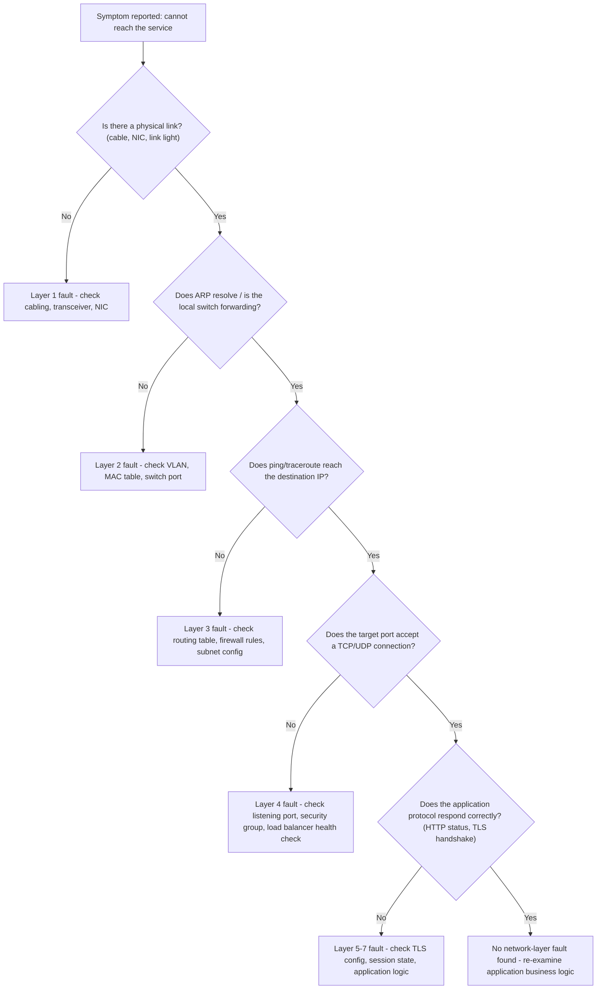

**Decision implications.** Encoding this bottom-up discipline into an
organization's incident-response runbooks (rather than relying on individual
engineers to informally "know" to check cables before blaming code)
materially reduces mean time to diagnosis for cross-team incidents, because
it gives every responder — regardless of which team they're from — the same
starting checklist and the same shared vocabulary for handing off "I've
ruled out Layers 1-3, this looks like a Layer 4/7 issue" to the next
responsible team.

**Common failure mode.** *Layer-skipping under pressure* — during a
high-severity incident, teams often jump straight to the layer they are
personally most comfortable debugging (frequently Layer 7, the application)
without first confirming Layers 1-4 are actually healthy, which both wastes
time chasing a phantom application bug and delays escalating to the team
that actually owns the real fault.

**Concrete scenario.** A production incident report reads "the API is
timing out for some users." Following the diagnostic ladder in the diagram
above (rather than immediately profiling application code) reveals that
Layer 3 routing is fine, but Layer 4 shows the load balancer's health check
is intermittently marking a healthy backend as down due to a Layer 7
health-check endpoint that itself depends on a slow downstream call — a
multi-layer root cause the bottom-up discipline surfaces far faster than an
application-first assumption would have.

## 5. Internal Working

Tracing a single HTTP request across a router illustrates encapsulation
(Section 4.9) and the OSI/TCP-IP split (Section 4.10) together as one
concrete mechanism, not two separate diagrams' worth of abstract theory:

```mermaid
sequenceDiagram
    participant Browser as Client Host
    participant Rtr as Intermediate Router
    participant Origin as Server Host
    Browser->>Browser: L7 builds HTTP request; L6 TLS-encrypts it; L5 attaches session/cookie context
    Browser->>Browser: L4 wraps in a TCP segment (source/destination port, sequence number)
    Browser->>Browser: L3 wraps in an IP packet (source/destination IP, TTL=64)
    Browser->>Rtr: L2 frame (source/destination MAC) carried as L1 bits to the router's Layer 2 hop
    Rtr->>Rtr: L2 header stripped; L3 reads destination IP, decrements TTL, looks up route
    Rtr->>Origin: New L2 frame built for the next hop; same L3 packet, same L4 segment, unchanged
    Origin->>Origin: L2/L3/L4 headers stripped in order up the stack
    Origin->>Origin: L5/L6/L7 reconstruct the TLS session and parse the HTTP request
```

The router in this trace is the clearest illustration of why encapsulation
must be nested exactly the way Section 4.9 describes: **a router only
ever rebuilds the Layer 2 frame** (because the router itself is a new Layer
2 hop with its own MAC addresses on each interface) **while leaving the
Layer 3 packet, Layer 4 segment, and Layer 5-7 payload completely
untouched** — this is precisely what "a router operates at Layer 3" means
in practice: it makes its forwarding decision by reading the Layer 3 header,
but the *only* header it actually rewrites is Layer 2's, because that header's
scope is a single physical hop, not the end-to-end path.

A second internal-working detail worth making explicit: TTL decrementing at
every Layer 3 hop (visible in the trace above) is the mechanism traceroute
exploits — Section 10's traceroute-style diagnostic tool sends packets with
deliberately small TTL values to force each intermediate router to reply
with an ICMP "time exceeded" message, revealing the path one hop at a time.

## 6. Design Principles

- **Separation of concerns per layer.** Each layer should own exactly one
  category of responsibility (addressing, framing, reliability, session
  management) — mixing responsibilities across layers is the root cause of
  the layer-violation anti-pattern (Section 19).
- **Stable interfaces between layers.** A layer's interface to its neighbors
  should change far less often than the layer's internal implementation —
  this is what let Ethernet speeds increase by three orders of magnitude
  (10 Mbps to 100+ Gbps) over three decades without IP, TCP, or HTTP needing
  to change at all.
- **Protocol independence within a layer.** A well-designed layer boundary
  supports multiple interchangeable protocols at that layer (TCP or UDP at
  Layer 4; IPv4 or IPv6 at Layer 3) without the layers above needing
  protocol-specific knowledge of which one is in use, beyond an explicit,
  narrow negotiation point.
- **Fail at the lowest possible layer, not the highest.** A well-architected
  system surfaces a connectivity failure as a Layer 3/4 error as close to
  the fault as possible (a router returning ICMP unreachable, a connection
  refused) rather than letting the failure propagate silently until an
  Application-layer timeout is the first visible symptom, which is far more
  expensive to diagnose.

## 7. Architecture Patterns

- **Layer 4 (L4) vs. Layer 7 (L7) load balancing.** An L4 load balancer
  distributes traffic based only on Transport-layer information (IP address
  and port), without inspecting or understanding the Application-layer
  protocol at all — it is fast and protocol-agnostic, but cannot make
  routing decisions based on HTTP path, header, or content. An L7 load
  balancer terminates the Application-layer protocol (parsing the actual
  HTTP request) and can route based on path, header, cookie, or hostname —
  more capable, but more expensive per connection and requiring the load
  balancer to understand the specific Application-layer protocol in use.

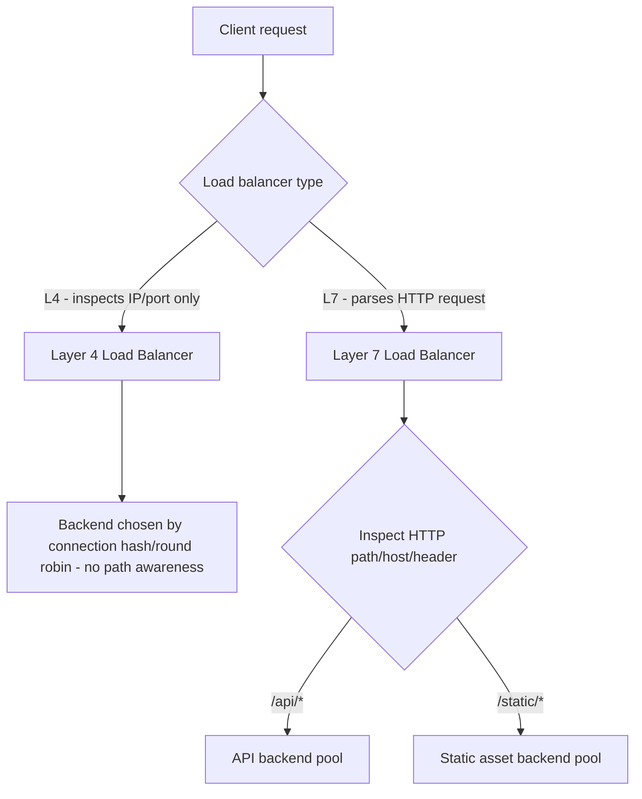

- **Tunneling and overlay networks.** A VPN, a Generic Routing Encapsulation
  (GRE) tunnel, or a container-networking overlay (VXLAN) all work by
  encapsulating an entire Layer 2 or Layer 3 packet inside a new outer
  packet — a deliberate, controlled application of the encapsulation
  mechanism from Section 4.9 to build a virtual network topology
  independent of the underlying physical/routed network, at the direct cost
  of reduced effective MTU (Section 4.9's common failure mode) and added
  per-packet processing overhead.
- **Reverse proxy / API Gateway as an explicit Layer 7 boundary.** Placing a
  reverse proxy or API Gateway at the Application-layer boundary between
  external clients and internal services (recapped from
  [HTTP](CH01_HTTP.md#7-architecture-patterns), which owns this pattern's
  HTTP-specific mechanics) is architecturally significant precisely because
  it is where Layer 7 protocol termination, not just Layer 4 forwarding,
  happens — enabling content-based routing, authentication, and rate
  limiting that a pure Layer 4 device structurally cannot perform.

## 8. Production Architecture

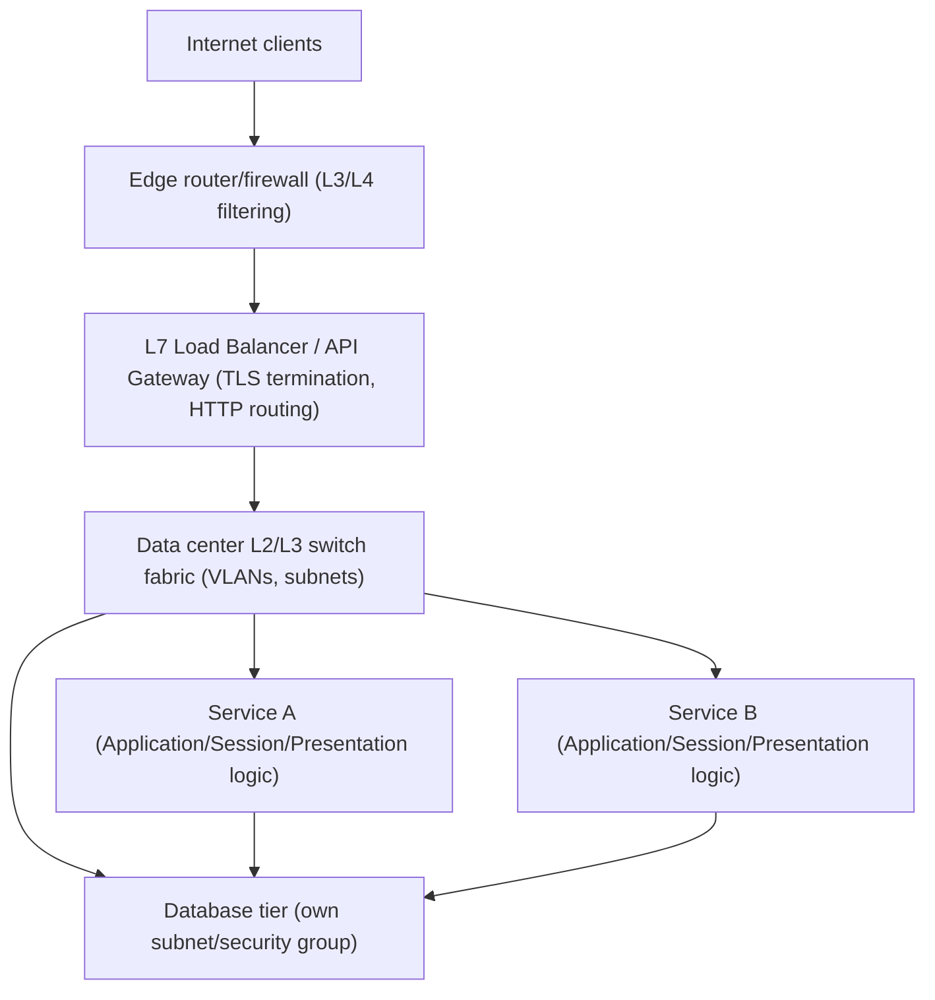

Every box in this diagram maps to specific OSI layers: the edge
router/firewall reasons primarily in Layer 3/4 terms (IP, port, protocol);
the L7 load balancer/API Gateway explicitly terminates Layer 5-7 (TLS
session, HTTP semantics); the switch fabric is Layer 2/3 (VLANs and
subnets); and the services and database communicate using the full stack,
with their own Application-layer protocols (HTTP internally, a database
wire protocol to the database tier) riding on the same Transport/Network/
Data Link/Physical layers underneath.

## 9. Implementation

An architect's actual day-to-day "implementation" work across the OSI
layers, mapped to what is configured in practice:

- **Layer 1/2**: rarely hand-configured by application architects directly;
  expressed as a choice of cloud availability zone/region placement (which
  implies physical network proximity) and VLAN/subnet assignment in
  infrastructure-as-code.
- **Layer 3**: CIDR block allocation for VPCs/VNets and subnets, route table
  entries, and peering configuration.
- **Layer 4**: security group / firewall rules expressed as allowed
  protocol + port combinations, and load balancer listener configuration.
- **Layer 5-7**: TLS certificate configuration, session-management strategy
  (Section 4.6), serialization format choice (Section 4.7), and the actual
  Application-layer protocol and API contract (Section 4.8) — the layer
  where the majority of an application architect's explicit design decisions
  live.

## 10. Complete Code Examples

The following four examples are deliberately chosen to make each layer's
concepts tangible rather than abstract — reading a raw frame byte-for-byte,
sending a hand-built packet below the Transport layer, diagnosing a path
hop-by-hop using TTL, and expressing a Layer 2/3 design decision as
infrastructure configuration.

**Example 1 — interpreting a packet capture layer by layer (Python, using
`scapy`).** This script reads a `.pcap` capture file and prints each layer's
header fields explicitly, in OSI order, which is exactly the discipline
Section 4.11's diagnostic framework requires in practice:

```python
from scapy.all import rdpcap, Ether, IP, TCP, UDP

def describe_packet(pkt) -> None:
    """Print each OSI layer present in a captured packet, bottom to top."""
    if Ether in pkt:
        eth = pkt[Ether]
        print(f"L2 Data Link : src={eth.src} dst={eth.dst} type={hex(eth.type)}")
    if IP in pkt:
        ip = pkt[IP]
        print(f"L3 Network   : src={ip.src} dst={ip.dst} ttl={ip.ttl} proto={ip.proto}")
    if TCP in pkt:
        tcp = pkt[TCP]
        print(f"L4 Transport : sport={tcp.sport} dport={tcp.dport} flags={tcp.flags} seq={tcp.seq}")
    elif UDP in pkt:
        udp = pkt[UDP]
        print(f"L4 Transport : sport={udp.sport} dport={udp.dport} (connectionless)")
    if pkt.haslayer("Raw"):
        payload = bytes(pkt["Raw"].load)
        print(f"L5-7 Payload : {len(payload)} bytes (Session/Presentation/Application data)")
    print("-" * 60)

for packet in rdpcap("capture.pcap"):
    describe_packet(packet)
```

**Example 2 — a raw socket sending a hand-built ICMP echo request (Python).**
Building the ICMP message itself (rather than calling the operating system's
`ping` utility) makes explicit that ICMP is a Network-layer (Layer 3)
protocol carried directly inside IP, with no Transport-layer segment at all:

```python
import socket
import struct
import os

def checksum(data: bytes) -> int:
    """Compute the Internet checksum (RFC 1071) used by ICMP and IP headers."""
    if len(data) % 2:
        data += b"\x00"
    total = sum(struct.unpack(f"!{len(data) // 2}H", data))
    total = (total >> 16) + (total & 0xFFFF)
    total += total >> 16
    return ~total & 0xFFFF

def build_icmp_echo(identifier: int, sequence: int) -> bytes:
    """Build a raw ICMP Echo Request (Layer 3) - no Layer 4 segment involved."""
    icmp_type, icmp_code = 8, 0
    header = struct.pack("!BBHHH", icmp_type, icmp_code, 0, identifier, sequence)
    payload = b"osi-model-chapter-ping"
    csum = checksum(header + payload)
    header = struct.pack("!BBHHH", icmp_type, icmp_code, csum, identifier, sequence)
    return header + payload

def send_raw_ping(destination: str) -> None:
    """Requires elevated privileges - raw sockets bypass normal Layer 4 socket APIs."""
    sock = socket.socket(socket.AF_INET, socket.SOCK_RAW, socket.IPPROTO_ICMP)
    sock.settimeout(2.0)
    packet = build_icmp_echo(identifier=os.getpid() & 0xFFFF, sequence=1)
    sock.sendto(packet, (destination, 0))
    reply, addr = sock.recvfrom(1024)
    print(f"Layer 3 ICMP reply received from {addr[0]}, {len(reply)} bytes")
    sock.close()

if __name__ == "__main__":
    send_raw_ping("8.8.8.8")
```

**Example 3 — a traceroute-style layer diagnosis tool (Python).** This
implements the same TTL-exploitation mechanism referenced in Section 5,
manually incrementing TTL to force each router along the path to reveal
itself — a direct, runnable demonstration of Layer 3's TTL field as a
diagnostic tool, not just a forwarding-loop guard:

```python
import socket
import struct
import time

def trace_route(destination: str, max_hops: int = 30, timeout: float = 2.0) -> None:
    """Send probes with increasing TTL to reveal each Layer 3 hop to destination."""
    port = 33434
    for ttl in range(1, max_hops + 1):
        recv_sock = socket.socket(socket.AF_INET, socket.SOCK_RAW, socket.IPPROTO_ICMP)
        send_sock = socket.socket(socket.AF_INET, socket.SOCK_DGRAM, socket.IPPROTO_UDP)
        send_sock.setsockopt(socket.SOL_IP, socket.IP_TTL, ttl)
        recv_sock.settimeout(timeout)
        recv_sock.bind(("", port))

        start = time.time()
        send_sock.sendto(b"", (destination, port))

        hop_addr = None
        try:
            _, addr = recv_sock.recvfrom(512)
            hop_addr = addr[0]
        except socket.timeout:
            pass
        elapsed_ms = (time.time() - start) * 1000

        send_sock.close()
        recv_sock.close()

        if hop_addr:
            print(f"hop {ttl:2d}: {hop_addr} ({elapsed_ms:.1f} ms)")
            if hop_addr == destination:
                print("Destination reached - Layer 3 path fully traced.")
                break
        else:
            print(f"hop {ttl:2d}: * (no reply within timeout)")

if __name__ == "__main__":
    trace_route("8.8.8.8")
```

**Example 4 — mapping a Layer 2/Layer 3 network design to configuration
(Linux `ip`/VLAN config, illustrating Section 4.3's Data Link and Section
4.4's Network layer decisions as real infrastructure):**

```bash
# Layer 2: create a VLAN-tagged sub-interface on the physical NIC (Data Link)
ip link add link eth0 name eth0.100 type vlan id 100

# Layer 3: assign an IP address and subnet to the VLAN interface (Network)
ip addr add 10.0.100.1/24 dev eth0.100
ip link set eth0.100 up

# Layer 3: add an explicit route for a peered subnet (Network)
ip route add 10.0.200.0/24 via 10.0.100.254 dev eth0.100

# Layer 4: allow only TCP/443 inbound to this subnet (Transport, via firewall)
iptables -A INPUT -i eth0.100 -p tcp --dport 443 -j ACCEPT
iptables -A INPUT -i eth0.100 -j DROP
```

## 11. Performance

- **Layer 1/2**: link speed (1G/10G/25G/100G Ethernet) and duplex/negotiation
  mismatches are the performance floor every higher layer inherits; a
  half-duplex negotiation mismatch alone can silently cap throughput at a
  fraction of the link's rated speed.
- **Layer 3**: routing table size and lookup algorithm efficiency matter at
  internet-backbone scale; for most architects, the practical Layer 3
  performance lever is minimizing unnecessary hops and avoiding suboptimal
  routing between regions/availability zones.
- **Layer 4**: TCP's handshake and slow-start ramp-up add latency per new
  connection — this is the direct motivation for HTTP/1.1's persistent
  connections and HTTP/2's single-connection multiplexing, both recapped
  from [HTTP](CH01_HTTP.md#11-performance) rather than re-derived here.
- **Layer 2 frame size (jumbo frames)**: increasing the Ethernet MTU from
  1500 to 9000 bytes (a Layer 2 configuration) reduces per-packet header
  overhead for large bulk transfers, at the cost of requiring every device
  end-to-end on the path to support the larger frame size consistently.

## 12. Scalability

- **Layer 2 broadcast domain size** is a hard scalability ceiling: ARP
  broadcast traffic and switching-loop blast radius both grow with the
  number of hosts sharing a VLAN, which is why large networks are
  deliberately partitioned into many smaller Layer 2 domains connected by
  Layer 3 routing rather than one enormous flat LAN.
- **Layer 3 subnet sizing** trades address-space efficiency against
  operational flexibility — over-provisioning CIDR blocks avoids painful
  re-addressing later (a "one-way door" per Section 4.4) at the cost of IP
  address space that may go unused.
- **Layer 4 ephemeral port and connection-table scaling** is the direct
  cause of the connection-exhaustion failure mode in Section 4.5; connection
  pooling, keep-alive reuse, and — at very high scale — Source Network
  Address Translation (SNAT) port allocation strategy are the standard
  mitigations.

## 13. Security

Defense-in-depth in a well-architected network deliberately places controls
at multiple OSI layers, because no single layer's control can catch every
attack class:

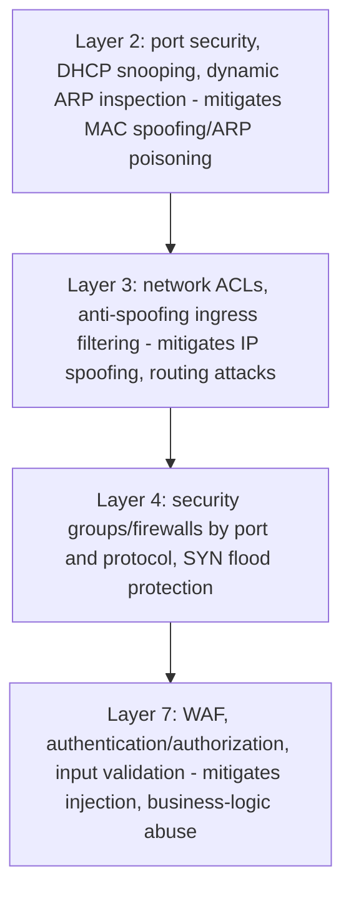

- **Layer 2 attacks**: ARP spoofing/poisoning lets an attacker on the same
  broadcast domain redirect traffic by lying about MAC-to-IP mappings —
  mitigated by dynamic ARP inspection and port security on managed switches.
- **Layer 3 attacks**: IP spoofing forges the source address of a packet;
  ingress/egress filtering (rejecting packets whose source address could not
  legitimately originate from the interface they arrived on) is the standard
  Layer 3 mitigation.
- **Layer 4 attacks**: SYN flood attacks exhaust a server's half-open
  connection table by never completing the TCP handshake; SYN cookies are
  the standard Transport-layer mitigation.
- **Layer 7 attacks**: injection attacks, credential stuffing, and API abuse
  operate entirely within valid, well-formed traffic at every lower layer —
  full OWASP (Open Worldwide Application Security Project) Top 10 coverage
  is owned by [Security](../13_Security/PART_OVERVIEW.md); this chapter's
  contribution is recognizing that no amount of Layer 2-4 hardening
  substitutes for Layer 7 application-security controls, because a
  perfectly valid TCP connection can still carry a malicious HTTP request.

## 14. Observability

Effective network observability instruments each layer distinctly rather
than relying on a single "is the network up" signal:

- **Layer 1/2**: interface error counters, CRC error rates, and link
  flap/negotiation-change events.
- **Layer 3**: packet loss and latency between hops (via active probing),
  routing table convergence events, and BGP/OSPF adjacency state changes.
- **Layer 4**: connection counts, `TIME_WAIT`/`SYN_RECV` state distributions,
  and retransmission rates.
- **Layer 5-7**: TLS handshake failure rates and certificate expiry,
  application request/response latency and status codes (recapped from
  [HTTP](CH01_HTTP.md#14-observability), which owns request-level tracing
  and correlation ID propagation).

Correlating an incident's symptoms against per-layer telemetry is what makes
Section 4.11's diagnostic flowchart executable in an operational tool rather
than a manual checklist alone.

## 15. Failure Scenarios

| Layer | Example failure | Distinguishing symptom |
|---|---|---|
| Physical | Failing transceiver/cable | Intermittent link flaps, CRC errors under load |
| Data Link | Switching loop (no Spanning Tree) | Broadcast storm, exponential traffic growth, total segment outage |
| Network | Routing black hole | Silent packet drop, no ICMP error, `traceroute` stalls at one hop |
| Transport | Ephemeral port/connection exhaustion | New connections fail while existing ones remain healthy |
| Session | Sticky-session backend loss | Users randomly logged out or lose in-progress state after a deploy/failover |
| Presentation | Encoding/schema mismatch | Corrupted or misparsed data despite healthy, complete delivery |
| Application | Protocol-level bug (bad status code, malformed body) | Well-formed connection, application-visible incorrect behavior |

Each row is a direct instantiation of a "common failure mode" already taught
in the matching Section 4 subsection — this table exists to make the
pattern-matching step (symptom to layer) fast during an actual incident,
not to introduce new content.

## 16. Testing

- **Layer 1/2**: cable certification testers and switch port diagnostic
  counters, run as part of physical data center commissioning, not
  application CI/CD.
- **Layer 3**: `ping`/`traceroute`-based synthetic connectivity checks
  between regions/availability zones, run continuously as infrastructure
  health checks.
- **Layer 4**: connection-level load testing that exercises realistic
  connection reuse patterns (recapped from
  [HTTP](CH01_HTTP.md#16-testing)), plus chaos-engineering-style deliberate
  packet loss/latency injection to validate retry and timeout behavior.
- **Layer 5-7**: contract and integration tests against the actual
  Application-layer protocol, and TLS configuration scanners validating
  cipher suite and certificate correctness.

## 17. Common Mistakes

- Assuming "the network" is a single monolithic thing to blame, instead of
  identifying which specific layer is actually implicated before escalating.
- Hardcoding IP addresses in application configuration instead of DNS names,
  coupling an Application-layer configuration to a Network-layer detail that
  is expected to change.
- Assuming a TCP connection staying open implies an unbroken, uninterrupted
  network path the whole time — intermediate NAT/firewall state can silently
  time out and drop a connection's state without either endpoint being
  immediately aware.
- Debugging "network slowness" purely at the Application layer (adding
  caches, optimizing code) when the actual bottleneck is a Layer 1/2
  duplex mismatch or a saturated link — the diagnostic framework in Section
  4.11 exists specifically to prevent this class of mistake.

## 18. Best Practices

- Instrument and alert on each layer's health signals independently
  (Section 14), rather than relying solely on Application-layer error rates
  to reveal a lower-layer problem indirectly and late.
- Design Layer 3 addressing (CIDR allocation) with deliberate headroom
  before launch, since re-addressing a live estate is a costly, largely
  irreversible decision (Section 4.4).
- Keep session state (Layer 5 responsibility) explicitly externalized from
  any single Transport-layer connection or backend instance, so Layer 4
  infrastructure changes (load balancer upgrades, backend restarts) never
  silently destroy Layer 5 session continuity.
- Treat every layer boundary as an explicit interface in system design
  documents (an Architecture Decision Record noting "this component assumes
  X at Layer N") rather than an implicit, undocumented assumption.

## 19. Anti-Patterns

**Layer-violation architecture anti-patterns** — the most important
architectural failure class this chapter names — occur whenever a component
at one layer directly depends on, manipulates, or assumes implementation
details that properly belong to a different layer, breaking the
independent-evolution property that layering exists to provide (Section
4.1). Concrete recurring instances:

- **An application embedding Transport-layer connection-lifetime
  assumptions** (Section 4.5's concrete scenario) — treating "this TCP
  connection stays open" as an implicit session boundary (a Layer 5
  responsibility) instead of an explicit, externalized session mechanism.
- **Hardcoding a specific MAC address or physical port** into application
  logic or firewall rules meant to identify a *logical* service, coupling a
  Layer 2 implementation detail to a Layer 3+ addressing decision that is
  supposed to be independent of it.
- **An Application-layer protocol assuming Transport-layer message
  boundaries** (Section 4.8's concrete scenario) — treating "one TCP
  segment equals one application message" when TCP guarantees only an
  ordered byte stream, not message framing, which is the Application
  layer's own responsibility to implement.
- **A Layer 4 load balancer being asked to make Layer 7 routing decisions**
  it structurally cannot make (path-based routing without parsing HTTP) —
  the inverse violation, where an operational requirement silently exceeds
  what the chosen layer's device can honor, forcing a fragile workaround
  instead of the correct architectural fix (upgrading to an L7 load
  balancer, Section 7).
- **Bypassing DNS (Application-layer name resolution) with hardcoded IP
  addresses** "for reliability," which instead removes the very
  indirection layer that makes Network-layer infrastructure changes
  (failover, migration, re-addressing) transparent to the Application layer
  — a direct violation of the layering principle's core promise.

## 20. Trade-off Analysis

| Decision | Benefit | Cost |
|---|---|---|
| Small Layer 2 broadcast domains (more VLANs/subnets) | Lower broadcast/ARP overhead, smaller failure blast radius | More Layer 3 routing complexity, more subnets to manage |
| TCP vs. UDP at Layer 4 | Reliable, ordered delivery with no extra application code | Handshake/retransmission latency; UDP needs app-level reliability if required |
| L4 vs. L7 load balancing | L4: lower latency, protocol-agnostic; L7: content-aware routing | L7 costs more CPU/connection overhead and requires protocol-specific parsing |
| Externalizing session state (Layer 5) | Enables horizontal scaling and clean failover | Added infrastructure (shared session store) and slight per-request latency |
| Jumbo frames (Layer 2 MTU increase) | Lower per-packet header overhead for bulk transfer | Requires consistent support across every device on the path |

## 21. Comparison Table

| OSI Layer | TCP/IP Layer | Example Protocols | Addressing Unit | Typical Failure Symptom |
|---|---|---|---|---|
| 7. Application | Application | HTTP, DNS, SMTP, FTP | URI / application identifier | Wrong status code, malformed response |
| 6. Presentation | Application | TLS encryption, JSON/Protobuf serialization | N/A (format/encoding) | Encoding/schema mismatch, decryption failure |
| 5. Session | Application | TLS session resumption, application session tokens | Session ID / token | Session loss on backend failover |
| 4. Transport | Transport | TCP, UDP, QUIC | Port number | Connection refused, port exhaustion |
| 3. Network | Internet | IP, ICMP | IP address | Unreachable destination, routing black hole |
| 2. Data Link | Link | Ethernet, Wi-Fi (802.11), ARP | MAC address | Switching loop, ARP failure |
| 1. Physical | Link | Copper/fiber cabling, radio spectrum | N/A (raw bits) | Link down, CRC errors, cable fault |

## 22. Real-World Case Study

An e-commerce platform reports "checkout is randomly failing for about 2% of
users" during a peak sales event. The on-call architect applies the Section
4.11 diagnostic ladder rather than immediately suspecting the checkout
service's code:

1. **Layer 1/2** — interface error counters on the load balancer's uplink
   show no CRC errors or link flaps; ruled out.
2. **Layer 3** — `traceroute` from multiple regions to the checkout
   service's Virtual IP shows consistent, healthy routing; ruled out.
3. **Layer 4** — connection-state metrics reveal the checkout service's
   host is hitting ephemeral port exhaustion on its *outbound* connections
   to the payment provider, precisely the failure mode described in Section
   4.5, triggered by peak-event traffic multiplying outbound calls beyond
   what the existing connection-pooling configuration was sized for.
4. **Resolution** — increasing the outbound connection pool's reuse
   settings and widening the ephemeral port range resolves the failure
   without any Application-layer (Layer 7) code change at all.

The case study's real lesson for a Solution Architect: the initial symptom
("checkout is failing") looked like an Application-layer problem, and a
team that started there would have spent hours reviewing checkout business
logic before ever discovering a Transport-layer resource constraint — the
layer-by-layer discipline from Section 4.11 found the actual root cause in
a fraction of that time.

## 23. Interview Questions

1. Why does the OSI model still matter today if almost nothing in
   production actually runs OSI's own protocol suite?
2. Explain, in terms of encapsulation, exactly what a router does and does
   not rewrite as it forwards a packet.
3. Why do TCP/IP's four layers not map one-to-one onto OSI's seven, and
   which OSI layers get collapsed?
4. Give an example of a layer-violation anti-pattern you've seen in a real
   system, and explain which layer's assumption leaked into which other
   layer.
5. A user reports "the app is slow." Walk through the OSI-layer-by-layer
   diagnostic approach you would take before touching application code.
6. What is the architectural difference between an L4 and an L7 load
   balancer, and when would you choose one over the other?

## 24. Hands-on Exercises

Using Example 1 from Section 10, capture live traffic on a test machine
(e.g. with `tcpdump -w capture.pcap`) while making an HTTPS request to a
public endpoint, then run the `describe_packet` script against the capture
and identify: the Ethernet frame's source/destination MAC addresses, the
IP packet's TTL value, the TCP three-way handshake segments, and the point
at which the payload becomes opaque (TLS-encrypted) Presentation-layer
data.

## 25. Design Exercises

Design the Layer 2/3/4 network segmentation for a three-tier application
(public web tier, internal application tier, database tier) deployed in a
single cloud region. Specify: the number and CIDR sizing of subnets, which
tiers share a Layer 2 broadcast domain versus require Layer 3 routing
between them, and the Layer 4 security group rules that should exist
between each tier. Evaluation criteria: whether the design enforces
least-privilege connectivity between tiers, whether subnet sizing leaves
reasonable headroom, and whether the database tier is unreachable directly
from the public internet at Layer 3/4.

## 26. Architecture Review Questions

- Can you identify, for every cross-team network complaint in the last
  quarter, which OSI layer the eventual root cause was actually found at?
- Does any Application-layer service embed an assumption about Transport-
  layer connection lifetime, addressing, or framing that should instead be
  an explicit, documented contract?
- Are Layer 3 CIDR allocations sized with enough headroom to avoid a
  future re-addressing effort?
- Is session state (Layer 5) externalized from any single Transport-layer
  connection or backend instance, so it survives load balancer or instance
  failover?
- Does observability tooling distinguish failures by layer (Section 14), or
  does every alert collapse into a single undifferentiated "service is
  unhealthy" signal?

## 27. Summary

The OSI seven-layer model — Physical, Data Link, Network, Transport,
Session, Presentation, and Application — lost the protocol war to TCP/IP
decades ago, but won something more durable: the shared vocabulary every
architect, network engineer, and incident responder still uses to decompose
"the network" into independently reasoned-about, independently diagnosable
responsibilities. Encapsulation and de-encapsulation are the concrete
mechanism that makes layering real rather than diagrammatic — each layer
wraps and unwraps exactly its own header, and a router's forwarding decision
is the clearest possible illustration of that principle in production
traffic. The mapping between OSI's seven layers and TCP/IP's simpler four
— with Physical/Data Link collapsing into Link, and Session/Presentation/
Application collapsing into a single Application layer — explains why real
systems implement session and presentation *responsibilities* inside
application code rather than as dedicated protocol layers. Most
practically, the "which layer is this problem at" diagnostic discipline
(Section 4.11) is this chapter's most operationally valuable contribution:
it turns a vague, cross-team "the network is broken" complaint into a
systematic, evidence-based process that finds the actual layer at fault far
faster than an application-first assumption ever will. Every subsequent
chapter in this part — [TCP/IP](PART_OVERVIEW.md),
[HTTP](CH01_HTTP.md), TLS, DNS, CDN, Load Balancer, Reverse Proxy, and the
rest — builds directly on this chapter's layer numbers and vocabulary
rather than re-deriving what a layer is, what encapsulation does, or how to
diagnose a multi-layer failure; when those chapters say "Layer 3" or "Layer
7," they mean exactly what Section 4 of this chapter defined.

**Further reading**: [HTTP](CH01_HTTP.md) ·
[PART_OVERVIEW.md](PART_OVERVIEW.md) ·
[Architecture Thinking](../01_Architecture_Mindset/CH03_Architecture_Thinking.md) ·
[Security](../13_Security/PART_OVERVIEW.md) ·
[Observability](../12_Observability/PART_OVERVIEW.md)
