# Chapter: TCP/IP

Part: [05 — Networking and Operating Systems](PART_OVERVIEW.md) · Status: Drafted

## 1. Introduction

TCP/IP (Transmission Control Protocol / Internet Protocol) is the actual
protocol suite the internet runs on — not the seven-layer OSI (Open Systems
Interconnection) reference model taught in textbooks, but the four-layer
implementation stack every packet on every network you will ever architect
actually traverses. Every HTTP (HyperText Transfer Protocol) request, every
database connection, every gRPC call, every Kubernetes service-to-service
call eventually becomes IP packets carrying TCP segments (or UDP (User
Datagram Protocol) datagrams) between two sockets identified by an IP address
and a port number. This chapter is the *owning* chapter for IP addressing and
routing fundamentals, CIDR (Classless Inter-Domain Routing) and subnetting,
the TCP connection lifecycle and state machine, TCP's reliability and
congestion-control mechanisms, UDP as TCP's connectionless counterpart, and
sockets/ports as the OS (Operating System)-level transport addressing
mechanism. Other chapters — including the not-yet-drafted OSI Model chapter
and [HTTP](CH01_HTTP.md) — recap and link here for these concepts rather than
re-deriving them, per the Concept Ownership Rule in
[STYLE_GUIDE.md](../STYLE_GUIDE.md).

Architects touch TCP/IP decisions constantly even when they never write
socket code directly: choosing IPv6 (Internet Protocol version 6) migration
timelines, sizing VPC (Virtual Private Cloud) CIDR blocks so subnets don't
run out of addresses two years into a project, diagnosing why a
high-throughput service accumulates thousands of sockets in `TIME_WAIT` and
falls over under load, deciding whether a telemetry pipeline should use TCP
or UDP, and tuning `TCP_NODELAY` on a latency-sensitive RPC (Remote Procedure
Call) service. None of these decisions require reimplementing TCP — but all
of them require understanding *why* TCP and IP behave the way they do, which
is what this chapter teaches from first principles.

**Quick orientation — where this chapter sits:**

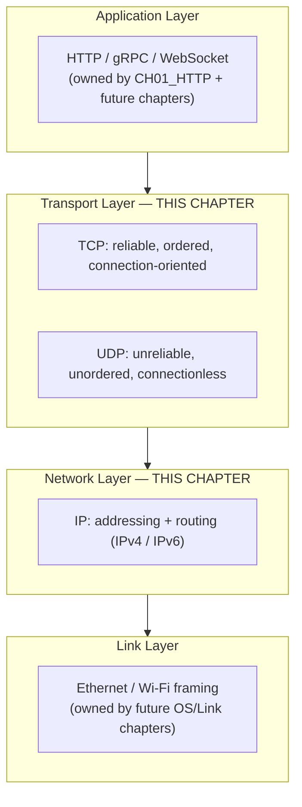

## 2. Historical Evolution

- **1969 — ARPANET** launches using NCP (Network Control Program), a
  host-to-host protocol with no concept of internetworking between
  independent networks.
- **1974 — Cerf and Kahn publish "A Protocol for Packet Network
  Intercommunication"**, the paper that first describes what would become
  TCP: a single monolithic protocol handling both reliable delivery and
  addressing.
- **1978 — TCP and IP are split** into two separate protocols so that
  applications needing unreliable, low-overhead delivery (early voice/video
  experiments) could use IP directly without paying for TCP's reliability
  machinery — this split created the layering this chapter teaches.
- **1980-1983 — TCP/IP is standardized** (RFC 791 for IP, RFC 793 for TCP)
  and on January 1, 1983 ("flag day"), ARPANET fully cuts over from NCP to
  TCP/IP, the event usually cited as the internet's actual birthdate.
- **1981 — UDP is standardized** (RFC 768) as the minimal connectionless
  alternative to TCP.
- **1993 — CIDR is introduced** (RFC 1518/1519) to replace rigid
  class-based IP addressing (Class A/B/C) with variable-length prefixes,
  dramatically slowing IPv4 address-space waste.
- **1998 — IPv6 is standardized** (RFC 2460) specifically to solve IPv4
  address exhaustion with a 128-bit address space, though adoption remained
  slow for over a decade because NAT (Network Address Translation) provided
  a working (if architecturally awkward) stopgap.
- **2011 — IANA (Internet Assigned Numbers Authority) allocates its last
  IPv4 /8 blocks** to the five Regional Internet Registries, marking formal
  IPv4 exhaustion at the top of the allocation hierarchy.
- **2011-present — algorithmic evolution of TCP congestion control**: from
  Reno and NewReno through CUBIC (Linux's default since 2.6.19) to BBR
  (Bottleneck Bandwidth and Round-trip propagation time, Google, 2016), each
  generation targeting the growing bandwidth-delay product of modern
  long-haul, high-bandwidth links.

## 3. Why It Exists

Before the TCP/IP split, a single protocol tried to be everything: reliable
delivery, ordering, flow control, *and* addressing/routing across
heterogeneous networks. That coupling meant any application that didn't need
reliability (early real-time audio experiments) still paid for it, and any
network that couldn't guarantee reliable delivery at the link layer (which
is most of them — Ethernet frames get dropped, corrupted, and reordered
routinely) had nowhere to push that responsibility except back up into a
protocol that assumed reliability was free. Splitting IP (dumb, unreliable,
best-effort packet delivery and addressing) from TCP (reliability, ordering,
and flow control built as a layer *on top of* IP's unreliability) let each
layer solve exactly one problem well, and let a second transport protocol —
UDP — exist for applications that explicitly do not want TCP's overhead.
This is the layering principle this chapter is built around: **IP's job is
"get this packet from address A to address B, best effort, no promises";
TCP's job is "make an unreliable network look reliable to the application
above it."**

## 4. Core Concepts

### 4.1 IP addressing fundamentals

An IP (Internet Protocol) address is a fixed-length numeric identifier that
serves two jobs simultaneously: it names a host, and it encodes enough
structure for routers to make forwarding decisions without knowing about
every host on the internet individually. IPv4 addresses are 32 bits,
conventionally written as four dotted decimal octets (`192.168.1.10`). Every
IPv4 address is split conceptually into a **network portion** and a **host
portion** — the network portion tells routers "which network segment is
this host on," and the host portion identifies the specific host within that
segment. Where that split happens is not encoded in the address itself; it's
carried alongside it as a **subnet mask** (or, in modern notation, a prefix
length).

The historical first attempt at this split was **classful addressing**:
Class A (first bit `0`, 8-bit network / 24-bit host, up to 16 million hosts
per network), Class B (first two bits `10`, 16-bit/16-bit split, 65,536
hosts), and Class C (first three bits `110`, 24-bit/8-bit split, 254 hosts).
This was catastrophically wasteful — an organization with 300 hosts had no
choice but a Class B block (65,536 addresses, using 0.5% of it) because a
Class C block (254 addresses) wasn't quite enough. This wastefulness is the
direct cause of section 4.3's CIDR redesign.

**Decision implication for architects**: when you provision a VPC or VNet
(Virtual Network) CIDR block in AWS (Amazon Web Services), Azure, or GCP
(Google Cloud Platform), you are making the same network/host split decision
classful addressing got wrong — except now it's your mistake to make if you
under-size it. A `/24` VPC (254 usable addresses) that looks generous on day
one becomes a hard blocker eighteen months later when you need six more
Kubernetes subnets and each requires its own non-overlapping block. Size
CIDR ranges for the organization's *multi-year* growth trajectory, not
today's headcount — re-addressing a live VPC is one of the most disruptive,
highest-blast-radius migrations an architect can be asked to execute.

### 4.2 IPv4 exhaustion and why it forced an architectural response

IPv4's 32-bit address space provides roughly 4.3 billion unique addresses.
That sounded inexhaustible in 1981; it was not remotely enough for a world
where a household routinely has a dozen internet-connected devices. The
address space wasn't just consumed by growth in host count — classful
addressing's waste (section 4.1) burned through allocatable blocks decades
before genuine host-count growth would have exhausted them on its own. IANA
allocated its final unassigned IPv4 blocks to the five Regional Internet
Registries in February 2011; most registries have subsequently exhausted
their own free pools and now run waiting lists or transfer markets for IPv4
space.

Two architectural responses emerged, and understanding why both were
necessary (rather than one replacing the other) matters for real design
decisions:

1. **NAT (Network Address Translation)** — a stopgap that lets many hosts
   behind a single public IPv4 address share it, by rewriting the source
   address/port of outbound packets and tracking the mapping so return
   traffic can be routed back to the correct internal host. NAT is why home
   networks and most corporate networks can run thousands of devices on one
   public IP. It is a stopgap, not a fix, because NAT breaks the internet's
   original end-to-end connectivity model — a host behind NAT cannot be
   reached by an unsolicited inbound connection without additional
   configuration (port forwarding, UPnP (Universal Plug and Play), or a
   relay), which is why peer-to-peer protocols, VoIP (Voice over IP), and
   some multiplayer games need NAT traversal techniques (STUN (Session
   Traversal Utilities for NAT), TURN (Traversal Using Relays around NAT))
   that wouldn't be necessary on a fully addressable network.
2. **IPv6** — the actual architectural fix: a 128-bit address space (roughly
   340 undecillion addresses) large enough that address scarcity stops
   being a design constraint at all, restoring the original end-to-end
   addressability model without NAT.

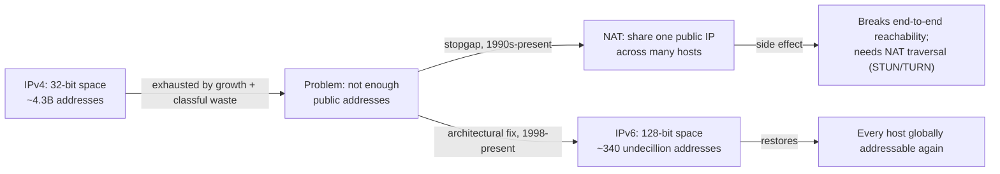

**Common failure mode**: teams treat "we use private IPv4 + NAT, so IPv6
doesn't matter to us" as a permanent architectural stance rather than a
temporary one. It breaks down the moment the organization needs direct
device-to-device connectivity (IoT (Internet of Things) fleets, peer-to-peer
media, multi-cloud VPC peering where private ranges collide), or when a
cloud provider or mobile carrier's IPv6-only network path forces
dual-stack support. Architect for dual-stack (both IPv4 and IPv6 reachable)
as the default assumption for any new public-facing service, not as a
someday migration.

### 4.3 CIDR and subnetting as an address-space allocation architecture

CIDR (Classless Inter-Domain Routing) replaced the rigid Class A/B/C
boundaries with a **variable-length prefix** written as `address/prefix-length`
— e.g. `10.0.0.0/16` means "the first 16 bits are the fixed network portion;
the remaining 16 bits are available for hosts and further subnetting."
This single notational change let network operators allocate exactly as
much address space as a network segment needs, not the nearest classful
size above it, and let routers aggregate many small allocations into fewer
routing-table entries via **route summarization** (advertising one `/16`
instead of 256 separate `/24`s upstream).

**Mechanism**: a prefix length of `/n` means the first `n` bits of the
address are fixed (the network), and the remaining `32-n` bits (for IPv4)
identify hosts within that network. The number of usable host addresses in a
subnet is `2^(32-n) - 2` (subtracting the network address itself and the
broadcast address). A `/24` gives 256 total addresses, 254 usable; a `/28`
gives 16 total, 14 usable.

**Subnetting** is CIDR applied recursively: an organization takes a block
it owns (say `10.0.0.0/16`, granted internally, e.g. as a VPC CIDR) and
carves it into smaller `/24` or `/26` blocks, one per subnet — typically one
per availability zone, tier (public/private/data), or team, so that
security groups, route tables, and network ACLs (Access Control Lists) can
be scoped per subnet without one team's traffic rules affecting another's.

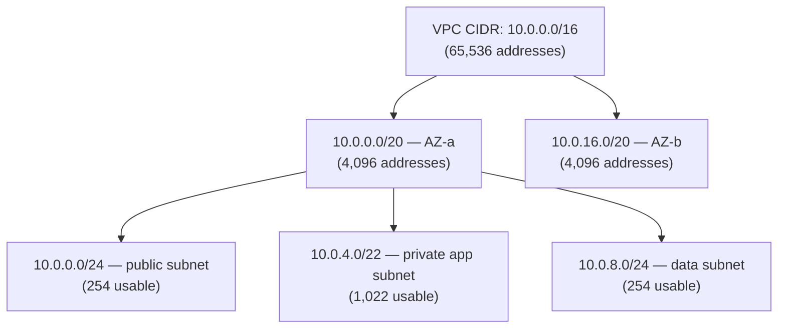

**Decision implication**: subnet sizing is a one-way door in most cloud
providers — subnets generally cannot be resized after creation without
recreating them (and everything attached to them). Reserve headroom (leave
gaps between allocated blocks, and prefer `/20`-`/22` app subnets over `/24`
when the eventual instance/pod count is uncertain) rather than sizing
tightly to launch-day requirements.

**Common failure mode**: overlapping CIDR ranges across VPCs that later need
to be peered or connected via a Transit Gateway/VNet peering. Two VPCs both
provisioned at `10.0.0.0/16` cannot be peered without re-addressing one of
them. Maintain a central CIDR allocation registry across the organization
before any team self-provisions a VPC.

### 4.4 Ports and sockets — the OS-level addressing layer above IP

An IP address identifies a *host*; it says nothing about *which process on
that host* should receive a given packet. **Ports** are a 16-bit number
(0-65535) that the transport layer (TCP or UDP) adds on top of IP addressing
to demultiplex traffic to the correct process. A **socket** is the OS-level
abstraction — identified by the 4-tuple **(source IP, source port,
destination IP, destination port)** for TCP, or the same 4-tuple loosely for
UDP — that the kernel uses to route incoming packets to the correct
listening or connected application. This 4-tuple is exactly why one server
process listening on port 443 can serve millions of concurrent TCP
connections: each *connection* is uniquely identified by the full 4-tuple,
not just the listening port, so 50,000 different clients connecting to the
same `(server_ip, 443)` still produce 50,000 distinct sockets because each
client contributes a different `(client_ip, client_port)` pair.

Ports 0-1023 are the **well-known ports**, reserved by IANA convention for
standard services (22 SSH (Secure Shell), 80 HTTP, 443 HTTPS, 5432
PostgreSQL) and requiring elevated privileges to bind on Unix-like systems.
Ports 1024-49151 are **registered ports** for specific applications. Ports
49152-65535 (on Linux, the actual default range is often
32768-60999, configurable via `net.ipv4.ip_local_port_range`) are
**ephemeral ports** — the OS assigns one from this range automatically as
the *source* port whenever a process initiates an outbound connection, and
this range's finite size is exactly what causes the port-exhaustion failure
mode covered in section 15.

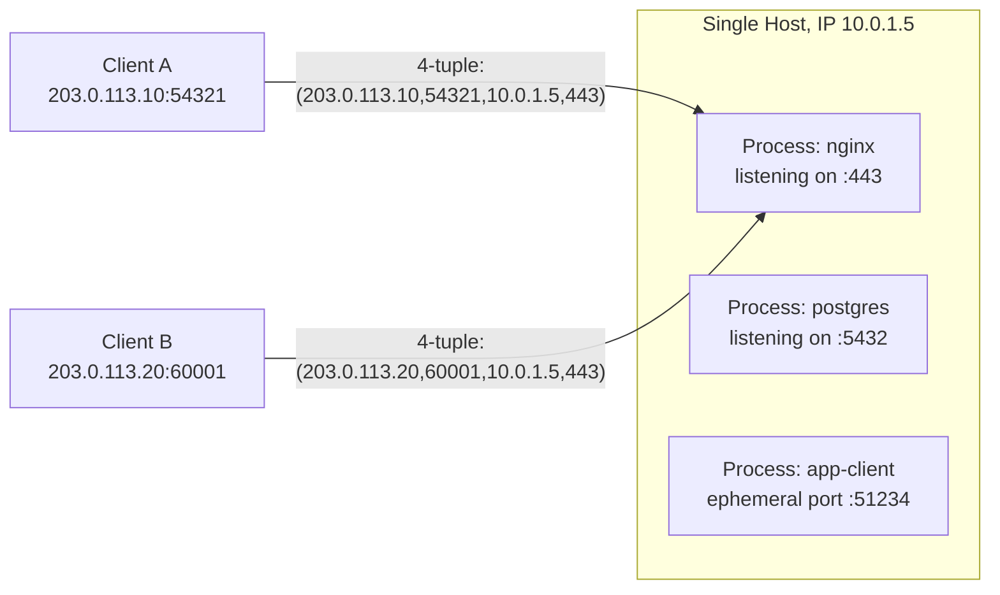

### 4.5 The TCP three-way handshake and connection establishment

TCP is connection-oriented: before either side can exchange application
data, they must agree on **initial sequence numbers** (ISNs) for each
direction, since TCP numbers every byte it sends and needs a starting point.
This agreement is the **three-way handshake**:

1. **SYN** — the client sends a segment with the `SYN` (synchronize) flag
   set and a randomly chosen initial sequence number `client_isn`.
2. **SYN-ACK** — the server responds with `SYN` and `ACK` (acknowledge) set,
   its own random initial sequence number `server_isn`, and an
   acknowledgment number of `client_isn + 1` (confirming it received the
   client's SYN).
3. **ACK** — the client sends a final `ACK` with acknowledgment number
   `server_isn + 1`, confirming receipt of the server's SYN-ACK. The
   connection is now `ESTABLISHED` on both sides.

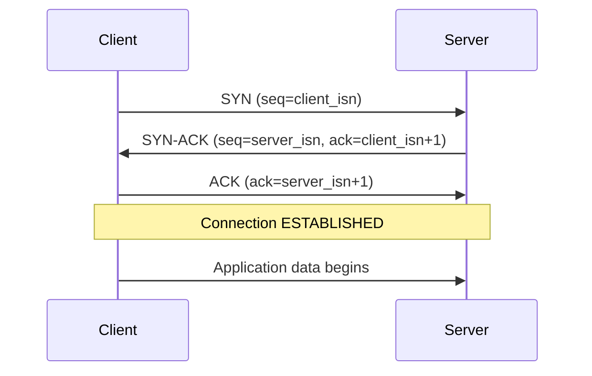

Why random initial sequence numbers rather than starting at zero? Two
reasons that matter architecturally: (1) predictable ISNs historically
enabled **TCP sequence prediction attacks**, where an attacker could inject
forged segments into a connection by guessing the next expected sequence
number — RFC 6528 mandates cryptographically random ISN generation
specifically to close this; (2) random ISNs also help a receiver distinguish
segments from a genuinely new connection from stale, delayed segments left
over from a prior connection on the same 4-tuple (see `TIME_WAIT` in section
4.6).

**Connection establishment cost**: the three-way handshake means a bare TCP
connection cannot carry application data until at least one full round trip
has elapsed (client SYN out, server SYN-ACK back — client can send data
alongside its final ACK, so effectively one RTT (Round-Trip Time) of
overhead before the server sees payload). This is the direct reason
connection pooling and keep-alive exist: paying one RTT of pure handshake
overhead *per request* is unacceptable at scale, so architects reuse
established TCP connections across many logical requests wherever possible
(see section 7).

### 4.6 The TCP connection lifecycle and state machine

TCP models every connection as a finite state machine, and the two states
architects most need to reason about operationally are `ESTABLISHED` (the
connection is actively usable) and `TIME_WAIT` (the connection is closed but
the OS is still holding the socket resource open temporarily).

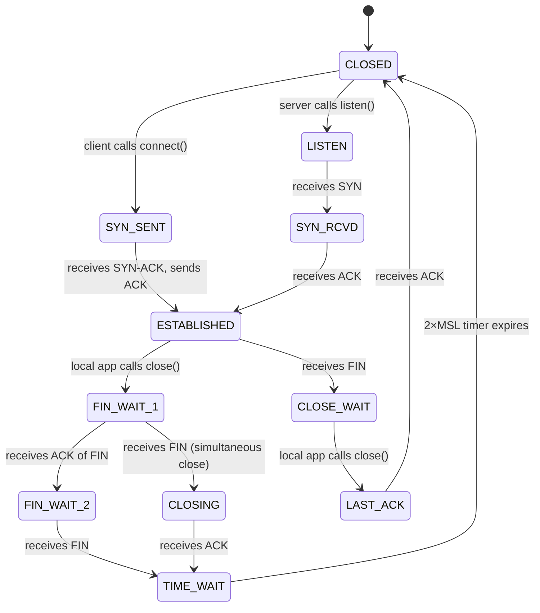

Closing a TCP connection requires **each direction to be closed
independently** — TCP is full-duplex, so one side sending `FIN` (finish)
only closes that side's ability to send further data; the other side can
keep sending until it, too, sends its own `FIN`. This is why a full close
takes four segments in the general case (`FIN`, `ACK`, `FIN`, `ACK`), often
called the "four-way close," even though simultaneous or piggybacked closes
can collapse some of these.

**`TIME_WAIT` and its production implications**: whichever side sends the
*final* `ACK` of the close sequence (almost always the side that initiated
the active close) moves into `TIME_WAIT` and holds that socket's 4-tuple
reserved for **2×MSL (Maximum Segment Lifetime)** — typically 60-120
seconds total on Linux (MSL default 30s, so 2×MSL = 60s, though this is
configurable). Two reasons this wait exists, both essential to actually
understand rather than just memorize:

1. **Guaranteeing the final ACK arrives.** If the last `ACK` is lost, the
   peer (still in `LAST_ACK`) will retransmit its `FIN`. If the side that
   already moved on had immediately reused or forgotten the connection, it
   would have nothing listening to answer that retransmitted `FIN`,
   potentially confusing the peer or leaking a stuck connection on the
   peer's side indefinitely. `TIME_WAIT` guarantees this socket sticks
   around long enough to re-ACK a retransmitted FIN.
2. **Preventing delayed duplicate segments from a prior connection being
   misread as part of a new connection** reusing the same 4-tuple. A packet
   that got delayed in the network (route flap, retransmission storm) could
   arrive after the connection closed; without `TIME_WAIT`, a *new*
   connection quickly reopened on the same 4-tuple could receive that
   stale, delayed segment and misinterpret it as belonging to itself.

**Why this matters in production**: a service that opens a very large
number of short-lived outbound TCP connections — a load-balancer or API
gateway making one connection per client request to a backend, or a service
doing synchronous per-request calls to a downstream without connection
pooling — accumulates sockets in `TIME_WAIT` far faster than the 60-120
second timer can retire them. Because `TIME_WAIT` sockets still consume an
ephemeral port on the initiating side, this is precisely the mechanism
behind **ephemeral port exhaustion** (section 15): the pool of ~28,000-64,000
usable local ports fills up with sockets that are technically "closed" from
the application's point of view but still held by the kernel, and new
outbound connections start failing with `EADDRNOTAVAIL` or connection
timeouts. This is one of the most common "why does our service fall over
under load with no CPU or memory pressure at all" production incidents, and
this chapter's Section 15 and Section 11 tuning parameters directly address
it.

### 4.7 TCP reliability mechanisms: sequence numbers, acknowledgment, and retransmission

IP makes no delivery guarantees at all — packets can be dropped, corrupted,
duplicated, or reordered by any router along the path, and IP itself does
nothing about any of that. TCP's entire value proposition is making an
unreliable IP network look reliable and ordered to the application. It does
this with three cooperating mechanisms:

1. **Sequence numbers**: every byte TCP sends is numbered (not every
   segment — every *byte*), starting from the random ISN negotiated in the
   handshake. A segment's sequence number in its header identifies the
   position of its *first* payload byte in the overall byte stream, letting
   the receiver reconstruct the original byte order even if segments arrive
   out of order.
2. **Acknowledgment numbers**: the receiver tells the sender, in every
   segment it sends back, the sequence number of the *next byte it expects*
   — meaning "I have successfully received everything up to (but not
   including) this number." This is a **cumulative acknowledgment** scheme:
   ACKing byte 5001 means bytes 1-5000 are confirmed received, regardless of
   which segments they arrived in.
3. **Retransmission**: the sender keeps every unacknowledged segment
   buffered and starts a **retransmission timer** (RTO — Retransmission
   Timeout) when it sends it. If no ACK covering that segment arrives before
   the RTO expires, the sender retransmits it, assuming it was lost. RTO is
   not a fixed constant — it's computed dynamically from measured RTT
   (smoothed RTT plus a variance term, per RFC 6298), because a fixed RTO
   would either retransmit too aggressively on high-latency links or too
   slowly on low-latency ones.

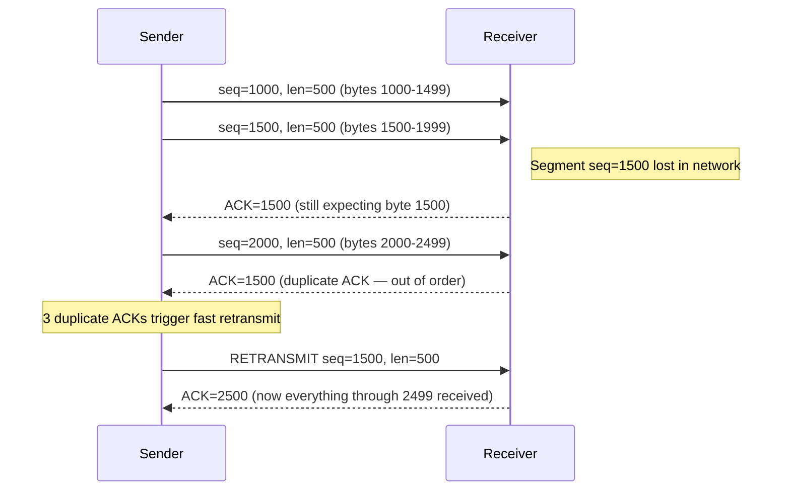

**Fast retransmit** is an optimization layered on top of the base timeout
mechanism: if the sender receives three duplicate ACKs in a row (all naming
the same "next expected byte"), it treats that as strong evidence of a
single lost segment and retransmits immediately, without waiting for the
(much longer) RTO timer to expire. This is why modern TCP recovers from an
isolated packet loss in roughly one RTT instead of a full timeout period.

**Common failure mode**: assuming TCP's reliability means "no application
needs its own retry logic." TCP reliability guarantees delivery *to the
remote host's kernel socket buffer*, not that the remote application
processed the data successfully, and it says nothing about the TCP
connection itself surviving a network partition, an NLB (Network Load
Balancer)-initiated idle-connection reset, or a server restart. Application-
level idempotency and retry semantics (owned by [HTTP](CH01_HTTP.md) for the
HTTP-specific case) remain necessary regardless of TCP's transport-level
guarantees.

### 4.8 Sliding window flow control

If a fast sender simply blasted data at a slow receiver as fast as its own
network interface allowed, it would routinely overrun the receiver's ability
to process incoming bytes, forcing the receiver to silently drop data it had
no buffer space for. **Flow control** solves this by letting the *receiver*
tell the sender how much unacknowledged data it's currently willing to
buffer — the **receive window** (advertised in every TCP segment's header as
the `window` field). The sender must never have more than this much
unacknowledged data in flight at once.

This is called a **sliding window** because the window of "bytes the sender
is allowed to have outstanding" slides forward as the receiver ACKs data and
frees buffer space:

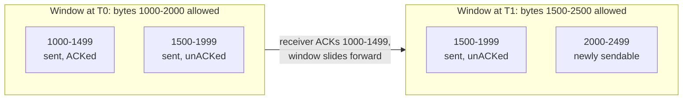

Flow control is distinct from — and answers a different question than —
congestion control (section 4.9): flow control protects the *receiver* from
being overwhelmed (an end-host resource limit); congestion control protects
the *network* from being overwhelmed (a shared, unknown-capacity resource
between sender and receiver). A receiver with unlimited buffer space would
still need congestion control, because the bottleneck might be a router
queue three hops away that the receiver has no visibility into at all.

**Window scaling**: the original TCP header window field is only 16 bits,
capping the advertised window at 65,535 bytes — far too small for modern
high-bandwidth, high-latency links (see the bandwidth-delay product in
section 4.9). The **window scale option** (RFC 7323), negotiated during the
handshake, multiplies the advertised window by a power-of-two scale factor,
allowing effective windows up into the megabytes and making high-throughput
long-haul transfers over TCP practical at all.

### 4.9 TCP congestion control: slow start, congestion avoidance, and the bandwidth-delay product

Congestion control is TCP's mechanism for estimating *how much data the
network path itself can absorb* without a router queue overflowing and
dropping packets — a fundamentally different, harder problem than flow
control because no single host tells the sender this number; it has to be
inferred from observed behavior (RTT and loss).

**Slow start**: a newly established connection has no information about
path capacity, so rather than guessing large and causing an immediate
congestion collapse, TCP starts with a small **congestion window** (`cwnd`)
— historically 1-4 segments, now typically 10 segments per RFC 6928 — and
**doubles it every RTT** as long as ACKs keep confirming successful
delivery. This is exponential growth, hence "slow start" is a slight
misnomer — it's actually the fastest possible ramp-up that still reacts to
feedback, "slow" only relative to sending the full window immediately.

**Congestion avoidance**: once `cwnd` reaches a threshold (`ssthresh`, slow
start threshold — initially set very high, then adjusted downward after any
loss event), TCP switches from doubling every RTT to increasing linearly
(roughly one segment's worth per RTT) — a much more cautious probe for
additional headroom, because by this point the connection is closer to the
path's actual capacity and aggressive growth risks tipping a shared
bottleneck into loss.

**Loss response**: classic congestion control (Reno/NewReno/CUBIC) treats
packet loss as an implicit congestion signal — because early internet
routers primarily dropped packets (rather than signaling explicitly) when
queues filled. On detecting loss, `cwnd` is cut sharply (traditionally
halved) and `ssthresh` is set to that reduced value, so the connection backs
off aggressively then re-probes cautiously via congestion avoidance rather
than immediately re-attempting slow start's exponential growth from
scratch.

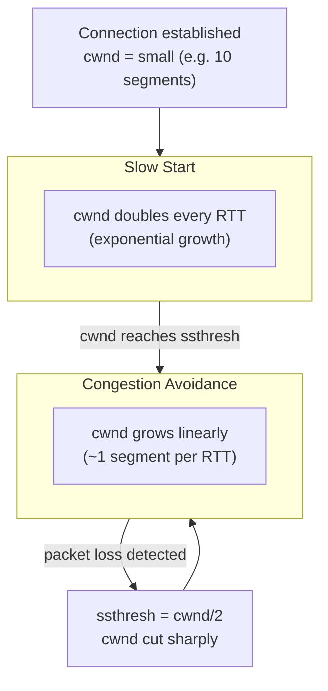

**Why this matters for high-latency, high-bandwidth links — the
bandwidth-delay product**: the **bandwidth-delay product (BDP)** is the
amount of data that can be "in flight" on a network path at any instant —
`BDP = bandwidth × RTT`. It represents the pipe's actual capacity: if `cwnd`
(or the flow-control window, whichever is smaller) is less than the BDP, the
connection is leaving throughput on the table no matter how fast the
underlying link physically is, because the sender simply isn't allowed to
have enough data in flight to keep the pipe full. A transcontinental link at
10 Gbps with a 150 ms RTT has a BDP of roughly 187 MB — meaning a connection
needs nearly 187 MB of unacknowledged data outstanding simultaneously to
saturate that link, which is exactly why both a sufficiently large,
window-scaled TCP window (section 4.8) *and* a congestion-control algorithm
that ramps up fast enough to reach that window before the transfer ends
(motivating BBR and CUBIC's tuning over older Reno-style linear growth) are
both prerequisites for actually using the bandwidth you're paying for on
long-haul or high-bandwidth links. Architects sizing cross-region
replication, backup transfers, or CDN origin-pull bandwidth need to reason
in BDP terms, not just advertised link bandwidth, when diagnosing "why is
this 10 Gbps link only delivering 200 Mbps of actual throughput."

### 4.10 UDP as TCP's connectionless counterpart

UDP (User Datagram Protocol) is deliberately minimal: it adds only a source
port, destination port, length, and checksum to raw IP delivery, with **no
handshake, no ordering guarantee, no retransmission, no flow control, and no
congestion control** built in. Each UDP datagram is independent — there is
no "connection" state at the protocol level at all (some OS APIs let an
application `connect()` a UDP socket, but that's a local convenience for
filtering/addressing, not a wire-level handshake).

**When an architect should choose UDP over TCP** — this is a real,
frequent production decision, not an academic one:

- **Latency-critical, loss-tolerant media**: real-time voice/video (VoIP,
  WebRTC) — a dropped or late audio frame is briefly perceptible and
  recoverable by the codec; but TCP's retransmit-and-reorder guarantee would
  force the receiver to *wait* for a retransmitted frame that's already too
  late to be useful, which is strictly worse than just skipping it.
- **Simple query/response protocols where the application implements its
  own lightweight retry**: DNS (Domain Name System) uses UDP for the common
  case precisely because a single small request/response round trip doesn't
  need TCP's connection-establishment overhead, and the resolver already
  retries on timeout at the application layer.
- **One-to-many and unreliable-by-design telemetry**: metrics/logging
  protocols (e.g., StatsD-style UDP metrics emission) deliberately accept
  some loss in exchange for never letting a slow or unreachable collector
  backpressure or block the application emitting metrics — a lost metric
  sample is an acceptable trade for never risking application-thread
  blocking on a monitoring dependency.
- **Custom reliability semantics that TCP's don't fit**: QUIC (the
  transport underneath HTTP/3, a future chapter) is built on UDP
  specifically so it can implement its *own* reliability and congestion
  control per-stream, avoiding TCP head-of-line blocking across independent
  logical streams multiplexed on one connection.

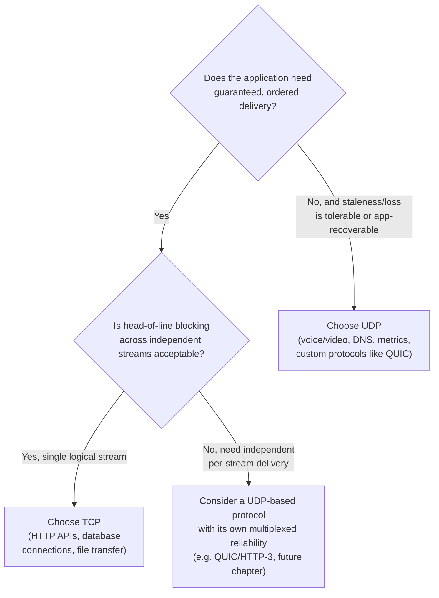

**Common failure mode**: choosing UDP purely for "it's faster" without
building any of the reliability the application actually needs at the
application layer, then discovering under real-world packet loss (which is
routine on public internet paths, not a rare edge case) that the application
silently loses meaningful data. UDP is a legitimate architectural choice
only when either loss is genuinely tolerable, or the application explicitly
reimplements the exact subset of reliability it needs (custom ACK/retry,
sequence numbering, or a library like an RTP (Real-time Transport Protocol)
stack) — never as a default "skip TCP's overhead" shortcut.

### 4.11 Nagle's algorithm and TCP_NODELAY

**Nagle's algorithm** (RFC 896) was designed to fix a real 1980s problem:
early terminal-emulation applications sent single keystrokes as individual,
tiny TCP segments, and on slow WAN (Wide Area Network) links each single
keystroke byte carried 40+ bytes of TCP/IP header overhead — extremely
inefficient. Nagle's fix: if there is unacknowledged data already in flight,
buffer any additional small writes locally instead of sending them
immediately, and only flush the buffered data once the outstanding data is
acknowledged (or enough has accumulated to fill a full segment). This
dramatically improved efficiency for chatty, small-write applications on
slow links.

The problem: Nagle's algorithm interacts badly with **delayed ACKs** (a
separate, common TCP optimization where a receiver waits briefly, up to
~200ms, hoping to piggyback its ACK on outgoing data rather than sending a
bare ACK segment). When both are enabled on opposite ends of a connection,
a sender's small write waits for an ACK that the receiver is deliberately
delaying, producing latency spikes of up to ~200ms on exactly the kind of
small, latency-sensitive request/response exchanges that are ubiquitous in
modern RPC and microservice traffic — the opposite of what either
optimization intended in isolation.

**`TCP_NODELAY`** is the socket option that disables Nagle's algorithm for a
given socket, sending writes immediately regardless of outstanding
unacknowledged data. This is a real, frequent production tuning decision:

- **Set `TCP_NODELAY` (disable Nagle) for**: latency-sensitive RPC/API
  traffic with small, frequent request/response payloads — the
  request/response pattern already implies waiting for a reply, so batching
  small writes buys nothing and the interaction with delayed ACKs actively
  hurts. Most RPC frameworks (gRPC, most HTTP client libraries, most
  database drivers) set this by default already, precisely because this
  failure mode is so well understood in server-side networking.
- **Leave Nagle enabled (default) for**: bulk, high-throughput transfers
  where the application writes many small chunks in a tight loop and
  overall throughput (not per-write latency) is what matters — Nagle's
  coalescing reduces header overhead with no downside when nothing is
  waiting on a fast round trip per write.

**Decision heuristic**: if the traffic pattern is "write small message, wait
for a reply" (any RPC-shaped protocol), enable `TCP_NODELAY`. If the traffic
pattern is "stream continuous data with no per-write acknowledgment
dependency" (bulk file transfer, log shipping), the default (Nagle enabled)
is usually fine, and is occasionally materially better for total throughput
on constrained links.

## 5. Internal Working

Every layer this chapter owns wraps the layer above it in its own header,
and unwraps in reverse on the receiving side — this is **encapsulation**,
the mechanism that lets each layer stay ignorant of the layers around it
while still cooperating to deliver data end to end.

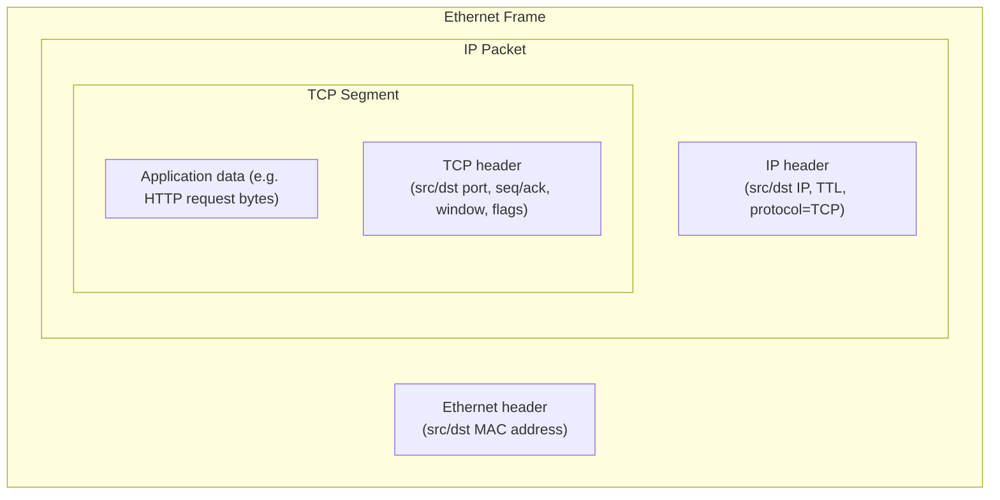

At the receiving host, the network interface strips the Ethernet frame
header, hands the IP packet up to the kernel's IP layer, which reads the
protocol field (`6` for TCP, `17` for UDP) to decide which transport-layer
handler processes it, strips the IP header, and hands the TCP segment to
the TCP state machine, which uses the destination port plus the full
4-tuple to locate the correct socket buffer and deliver the payload bytes to
the waiting application, in order, exactly once — even though nothing below
TCP made any of those three guarantees.

**Routing**, briefly recapped here as the IP-layer complement to the
addressing already taught in section 4.1: every router maintains a routing
table mapping destination-prefix entries (CIDR blocks) to a next-hop
address or interface. For each packet, the router finds the **longest
matching prefix** among its routing table entries (a `/28` match always
wins over a `/16` match if both match the destination address) and forwards
the packet to that entry's next hop, decrementing the IP header's TTL
(Time To Live) field by one — a packet whose TTL reaches zero is dropped and
an ICMP (Internet Control Message Protocol) "Time Exceeded" message is sent
back to the source, which is the exact mechanism `traceroute` exploits to
map a path hop by hop by sending packets with increasing TTL values.

## 6. Design Principles

- **End-to-end principle**: reliability, ordering, and other guarantees the
  application actually needs should be implemented at the endpoints (TCP at
  the transport layer, or the application itself), not assumed from
  intermediate network elements — because those elements can't guarantee
  correctness for every possible application need, and building the
  guarantee into the network adds cost/complexity that most traffic doesn't
  need (this is precisely why UDP exists as a lean alternative).
- **Layering with narrow interfaces**: IP only promises "best-effort
  delivery to this address"; TCP only promises "reliable, ordered delivery
  given an unreliable channel"; neither needs to know how the other is
  implemented, which is what let Ethernet be replaced by Wi-Fi, cellular,
  and fiber underneath IP without any change to IP or TCP themselves.
- **Fail toward safety under congestion, not throughput**: congestion
  control deliberately sacrifices an individual connection's throughput
  (backing off on loss) to protect the shared network from collapse — a
  design that prioritizes the network's collective health over any single
  flow's speed, which is why congestion control cannot be disabled or
  "tuned away" without risking exactly the congestion collapse it exists to
  prevent.
- **Scarcity-aware addressing**: CIDR and subnetting exist because address
  space, real or virtual (cloud CIDR blocks), is a genuinely finite,
  hard-to-expand resource — treat address planning as a capacity-planning
  problem, not an implementation detail.

## 7. Architecture Patterns

- **Connection pooling**: reusing established TCP connections across many
  logical requests (database connection pools, HTTP keep-alive connection
  pools, gRPC channel reuse) amortizes the three-way handshake's one-RTT
  cost and, critically, avoids generating the flood of short-lived
  connections that causes `TIME_WAIT` accumulation and ephemeral port
  exhaustion (section 15).
- **Dual-stack networking**: running IPv4 and IPv6 simultaneously on the
  same infrastructure during a multi-year migration window, rather than a
  hard cutover, so neither IPv4-only nor IPv6-only clients are ever
  unreachable.
- **Hub-and-spoke / Transit Gateway CIDR planning**: centralizing CIDR
  allocation across many VPCs/VNets through a single registry (or a cloud
  provider's IP address manager service) specifically to prevent the
  overlapping-range failure mode from section 4.3 before it happens.
- **UDP-based control-plane heartbeats with TCP-based data-plane transfer**:
  some distributed systems (certain service meshes, some gossip protocols)
  deliberately use lightweight UDP heartbeats for failure detection (loss
  tolerance is fine — a missed heartbeat is just retried next interval)
  while using TCP for the actual data transfer that needs ordering and
  reliability guarantees.

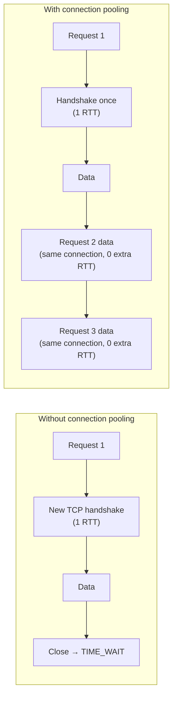

## 8. Production Architecture

```text
Client -->TCP:443--> Load Balancer (connection pool to backends)
                              |
                    TCP (kept-alive, pooled)
                              v
                   Backend Service Instances
                              |
                    TCP (pooled connections)
                              v
                        Database / Cache
```

Each hop is a *separate* TCP connection, each with its own handshake,
window, and congestion-control state — the load balancer terminating client
connections and multiplexing them onto a smaller, reused pool of backend
connections is exactly what keeps backend services from needing to handle
one TCP connection (and one handshake, one congestion-control ramp-up, one
`TIME_WAIT` slot) per end-user request. Load balancer connection-pool sizing
(how many backend connections to keep warm per backend instance) is a
direct application of the `TIME_WAIT`/ephemeral-port reasoning from section
4.6: too small a pool re-establishes connections constantly (handshake
overhead, slow-start throughput penalty on every new connection); too large
a pool wastes backend file descriptors and can itself approach ephemeral
port limits if the load balancer opens connections faster than they're
reused.

## 9. Implementation

Implementing correct TCP/IP-aware application code means, at minimum:
setting socket options deliberately rather than accepting silent defaults
(`SO_REUSEADDR` to allow fast restart on the same port, `TCP_NODELAY` per
section 4.11's decision heuristic), sizing connection pools with the
handshake/TIME_WAIT cost in mind (section 8), configuring OS-level backlog
and ephemeral port ranges for expected connection churn (section 11), and
choosing TCP vs. UDP deliberately per the decision flow in section 4.10
rather than defaulting to whichever a framework happens to pick.

## 10. Complete Code Examples

**Example A — raw TCP socket handshake and options (Python).** This
demonstrates the three-way handshake happening transparently inside
`socket.connect()`, and shows the two most commonly tuned socket options in
production code:

```python
# server.py — minimal TCP echo server exposing key socket options
import socket

HOST, PORT = "0.0.0.0", 5050

with socket.socket(socket.AF_INET, socket.SOCK_STREAM) as server_sock:
    # SO_REUSEADDR: allow immediate rebind after restart, even if a prior
    # socket on this port is still draining through TIME_WAIT.
    server_sock.setsockopt(socket.SOL_SOCKET, socket.SO_REUSEADDR, 1)
    server_sock.bind((HOST, PORT))
    server_sock.listen(128)  # backlog: max pending connections in SYN queue
    print(f"listening on {HOST}:{PORT}")

    while True:
        conn, addr = server_sock.accept()  # blocks until three-way handshake completes
        with conn:
            # TCP_NODELAY: disable Nagle's algorithm for this RPC-shaped,
            # latency-sensitive echo exchange (see section 4.11).
            conn.setsockopt(socket.IPPROTO_TCP, socket.TCP_NODELAY, 1)
            print(f"connection established from {addr}")
            while True:
                data = conn.recv(4096)
                if not data:
                    break  # peer sent FIN — begins the four-way close
                conn.sendall(data)
```

```python
# client.py — connects, measures handshake + first-byte latency
import socket
import time

HOST, PORT = "127.0.0.1", 5050

sock = socket.socket(socket.AF_INET, socket.SOCK_STREAM)
sock.setsockopt(socket.IPPROTO_TCP, socket.TCP_NODELAY, 1)

t0 = time.monotonic()
sock.connect((HOST, PORT))  # three-way handshake happens here, blocking
handshake_ms = (time.monotonic() - t0) * 1000
print(f"handshake completed in {handshake_ms:.2f} ms")

sock.sendall(b"ping")
reply = sock.recv(4096)
print(f"received: {reply!r}")
sock.close()  # initiates active close: FIN sent, this side may enter TIME_WAIT
```

**Example B — packet-trace analysis.** The following is an annotated
`tcpdump`-style capture of one connection's full lifecycle, exactly the kind
of trace an architect reads when diagnosing a production connection issue:

```text
$ sudo tcpdump -i eth0 -n 'host 10.0.1.20 and port 5050'

12:00:01.001 IP 10.0.1.10.51234 > 10.0.1.20.5050: Flags [S], seq 1000, win 65535
             ^ client SYN — three-way handshake step 1, ISN=1000

12:00:01.002 IP 10.0.1.20.5050 > 10.0.1.10.51234: Flags [S.], seq 5000, ack 1001, win 65535
             ^ server SYN-ACK — step 2, ISN=5000, acking client's SYN (1000+1)

12:00:01.002 IP 10.0.1.10.51234 > 10.0.1.20.5050: Flags [.], ack 5001, win 65535
             ^ client final ACK — step 3, connection now ESTABLISHED (1 RTT ≈ 1ms here)

12:00:01.003 IP 10.0.1.10.51234 > 10.0.1.20.5050: Flags [P.], seq 1001:1005, ack 5001
             ^ client sends 4 bytes of payload ("ping"), PSH flag set

12:00:01.003 IP 10.0.1.20.5050 > 10.0.1.10.51234: Flags [P.], seq 5001:5005, ack 1005
             ^ server echoes 4 bytes back, ack confirms client's payload received

12:00:01.004 IP 10.0.1.10.51234 > 10.0.1.20.5050: Flags [F.], seq 1005, ack 5005
             ^ client initiates active close — sends FIN

12:00:01.004 IP 10.0.1.20.5050 > 10.0.1.10.51234: Flags [.], ack 1006
             ^ server ACKs the FIN (connection half-closed; server can still send)

12:00:01.005 IP 10.0.1.20.5050 > 10.0.1.10.51234: Flags [F.], seq 5005, ack 1006
             ^ server sends its own FIN — fully done sending

12:00:01.005 IP 10.0.1.10.51234 > 10.0.1.20.5050: Flags [.], ack 5006
             ^ client's final ACK — client now enters TIME_WAIT for 2×MSL (~60s)
             ^   before 10.0.1.10:51234 -> 10.0.1.20:5050 can be reused
```

Reading this trace, an architect should notice: the whole request/response
exchanged only 4 bytes of application payload but required 3 segments to
establish the connection and 4 to tear it down — 7 of 9 total segments were
pure connection-management overhead. This ratio is exactly why connection
pooling (section 7) matters so much for high-frequency, small-payload
traffic, and exactly why the client (which initiated the close) is the one
left holding a `TIME_WAIT` socket afterward.

**Example C — Linux kernel tuning for a high-connection-churn service.**
Production `sysctl` settings for a service that legitimately cannot avoid
opening many short-lived outbound connections (e.g., an API gateway
fanning out to many backend instances without pooling support):

```bash
# /etc/sysctl.d/99-tcp-tuning.conf
# Widen the ephemeral port range to reduce exhaustion risk under high churn.
net.ipv4.ip_local_port_range = 15000 65000

# Allow the kernel to reuse sockets in TIME_WAIT for NEW outgoing connections
# when it's safe to do so (timestamps confirm no stale-segment risk).
# NOTE: tcp_tw_recycle is REMOVED/dangerous on modern kernels (breaks behind
# NAT); tcp_tw_reuse is the safe, supported option.
net.ipv4.tcp_tw_reuse = 1

# Reduce how long a locally-initiated FIN_WAIT_2 half-closed connection
# lingers before the kernel gives up on it.
net.ipv4.tcp_fin_timeout = 30

# Increase the SYN backlog queue so bursts of new connections aren't
# dropped before accept() can process them.
net.core.somaxconn = 4096
net.ipv4.tcp_max_syn_backlog = 4096

# Enable TCP window scaling (see section 4.8) — on by default on modern
# kernels, but worth asserting explicitly for high-BDP links.
net.ipv4.tcp_window_scaling = 1

# Apply with: sudo sysctl -p /etc/sysctl.d/99-tcp-tuning.conf
```

**Important caveat an architect must state alongside this config**:
`tcp_tw_reuse` mitigates ephemeral port exhaustion but does not eliminate
the underlying architectural problem — the real fix is almost always
connection pooling or reuse at the application layer (section 7), not
kernel tuning. Kernel tuning buys time and headroom; it does not remove the
root cause of a service that opens one new TCP connection per request by
design.

**Example D — Node.js and Java: `TCP_NODELAY` and a comparable UDP send,
side by side**, showing the same decision (section 4.11) expressed in two
common production stacks, plus a UDP example illustrating section 4.10's
decision:

```javascript
// Node.js — disabling Nagle's algorithm on an outbound RPC-style connection
const net = require('net');

const socket = net.connect({ host: 'backend.internal', port: 9090 }, () => {
  socket.setNoDelay(true); // disable Nagle: small request/response RPC traffic
  socket.write(JSON.stringify({ action: 'ping' }));
});

socket.on('data', (data) => {
  console.log('reply:', data.toString());
  socket.end();
});
```

```java
// Java — same decision via the java.net.Socket API
import java.net.Socket;
import java.io.OutputStream;

try (Socket socket = new Socket("backend.internal", 9090)) {
    socket.setTcpNoDelay(true); // disable Nagle for latency-sensitive RPC
    OutputStream out = socket.getOutputStream();
    out.write("ping".getBytes());
    out.flush();
}
```

```python
# Python — UDP send for loss-tolerant telemetry (section 4.10), no
# handshake, no connection state, single fire-and-forget datagram
import socket

sock = socket.socket(socket.AF_INET, socket.SOCK_DGRAM)
metric = b"service.request.count:1|c"
sock.sendto(metric, ("metrics-collector.internal", 8125))
sock.close()  # nothing to tear down — there was never a connection
```

## 11. Performance

TCP/IP performance work is almost always one of three things: (1) reducing
the *number* of handshakes paid (connection pooling, HTTP keep-alive,
section 7), (2) ensuring the connection's window is large enough to fill
the available bandwidth-delay product (window scaling, section 4.8/4.9),
or (3) removing artificial per-write latency from Nagle/delayed-ACK
interaction (section 4.11). Beyond those three levers: **congestion control
algorithm choice** matters materially on long-haul or lossy links — CUBIC
(Linux default) is loss-based and can under-utilize high-BDP paths with any
background loss, while BBR estimates the actual bottleneck bandwidth and
RTT directly and often achieves substantially higher throughput on such
paths without needing loss as a signal; switching congestion control
algorithms is a `sysctl net.ipv4.tcp_congestion_control=bbr` change on
modern Linux kernels, not an application change, making it one of the
higher-leverage, lowest-risk transport-layer performance changes available.

## 12. Scalability

Scaling a TCP-heavy service means managing the finite resources this
chapter has already surfaced: **ephemeral ports** (a single host can serve
at most ~28,000-64,000 truly ephemeral outbound connections *to one
specific destination 4-tuple* before exhausting the range — scale outbound
concurrency horizontally across multiple source IPs/hosts, or reduce
connections-per-request via pooling, rather than assuming one host can
always open "one more connection"), **file descriptors** (each open socket
consumes one; `ulimit -n` and its corresponding OS-level limits must scale
with expected concurrent connection count), and **backlog queue depth**
(`somaxconn`/`tcp_max_syn_backlog`, section 10 Example C) sized for the
burst arrival rate of new connections, not just steady-state throughput.

## 13. Security

- **TCP sequence prediction**: mitigated by mandatory cryptographically
  random ISNs (section 4.5); architects should verify any custom
  network-stack implementation (embedded systems, custom load balancers)
  actually follows RFC 6528 rather than a predictable ISN generator.
- **SYN flood attacks**: an attacker sends many SYN segments without ever
  completing the handshake, exhausting the server's SYN backlog queue and
  denying legitimate connections. **SYN cookies** (encoding the connection
  state cryptographically into the SYN-ACK's sequence number itself,
  avoiding the need to hold half-open connection state in memory at all)
  are the standard mitigation, generally enabled by default on modern
  kernels (`net.ipv4.tcp_syncookies`).
- **NAT and firewall traversal implications**: NAT (section 4.2) means a
  firewall/security-group rule written against a public IP may not
  correspond to the actual originating host behind it — architects
  designing access controls behind NAT boundaries need to reason about
  which layer (NAT device, security group, application-layer auth) is the
  actual enforcement point.
- **TLS as the standard answer to "is this TCP connection's payload
  trustworthy"** is owned by [HTTP](CH01_HTTP.md) (section 5) and applies
  identically to any TCP-based protocol, not only HTTP — recap only here.

## 14. Observability

Key TCP/IP-level signals an architect should expect a platform team to
expose, distinct from application-level metrics: current count of sockets
per state (`ESTABLISHED`, `TIME_WAIT`, `CLOSE_WAIT` — a growing
`CLOSE_WAIT` count specifically indicates the local application isn't
calling `close()` after the peer's FIN, a common connection-leak signature),
retransmission rate (a rising retransmit percentage indicates path loss or
congestion, visible via `netstat -s` or `ss -ti` per-connection stats),
current congestion window and RTT estimate per connection (useful when
diagnosing "why is this specific long-haul connection slow"), and ephemeral
port utilization (percentage of the configured range currently in use,
directly predictive of the exhaustion failure mode in section 15).

## 15. Failure Scenarios

**Ephemeral port exhaustion** (the single most common TCP/IP-level
production incident an architect will diagnose): a service opening many
short-lived outbound connections to the *same* destination 4-tuple
(without pooling) accumulates sockets in `TIME_WAIT` faster than the
2×MSL timer retires them, eventually consuming the entire local ephemeral
port range for that destination. New outbound connection attempts then fail
immediately with `EADDRNOTAVAIL` (no available local port) — and because
this looks like "the service can't reach its dependency" rather than an
obvious resource exhaustion, it's frequently misdiagnosed as a network or
dependency outage rather than a local socket-resource problem.

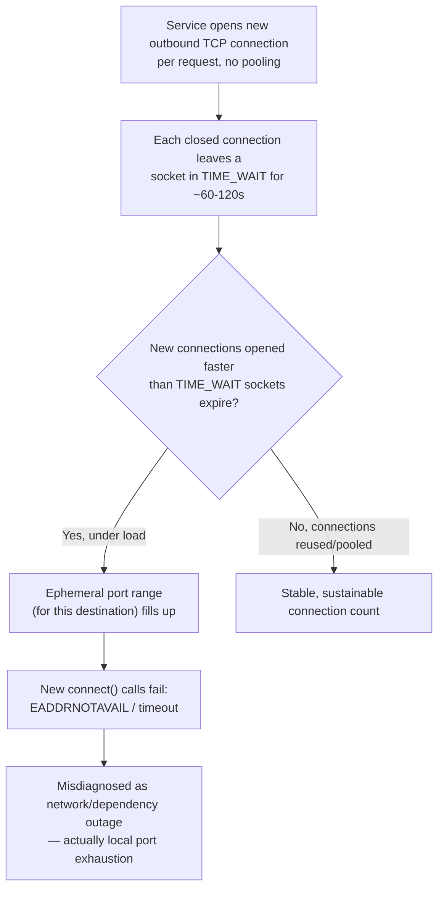

**`CLOSE_WAIT` accumulation**: the local application received the peer's
`FIN` but never called `close()` on its side of the socket — usually an
application bug (exception path that skips cleanup, a connection returned
to a pool that was already closed by the peer). Unlike `TIME_WAIT`,
`CLOSE_WAIT` sockets don't expire on a timer at all; they accumulate
indefinitely until the process is restarted, eventually exhausting file
descriptors.

**Asymmetric routing / firewall drops mid-connection**: a path change
(failover, BGP (Border Gateway Protocol) reconvergence) that routes return
traffic through a stateful firewall that never saw the connection's
original SYN will silently drop the "unrecognized" return packets,
producing a connection that appears `ESTABLISHED` on both ends but never
successfully exchanges data again — diagnosable by comparing retransmission
counts against successful data transfer on both sides of the path.

## 16. Testing

- **Handshake and close-sequence tests**: verify a service under test
  correctly closes its side of connections (no `CLOSE_WAIT` leaks) under
  both graceful shutdown and abrupt peer-disconnect scenarios, using a test
  harness that can simulate a peer that closes without warning.
- **Packet-loss and latency injection**: tools like `tc netem` (Linux
  traffic control) can inject artificial loss, latency, and reordering on a
  test network namespace, letting a team validate retransmission,
  congestion-control backoff, and application-level timeout behavior
  without needing an actual unreliable network.
- **Load testing with connection-churn awareness**: a load test that opens
  one new connection per virtual user per request (rather than reusing
  connections, as most real clients would) will reproduce the exact
  `TIME_WAIT`/ephemeral-port exhaustion failure mode from section 15 on the
  *load generator itself* before the system under test even feels load —
  always confirm whether a load-testing tool pools connections in a way
  representative of real client behavior.
- **Socket option assertions**: automated tests can open a real socket
  against the service and assert `TCP_NODELAY` (or other expected socket
  options) are actually set, catching regressions where a refactor
  accidentally drops an explicit option call.

## 17. Common Mistakes

- Sizing a VPC/subnet CIDR block for launch-day headcount rather than
  multi-year growth, forcing a disruptive re-addressing migration later
  (section 4.1/4.3).
- Treating NAT as a permanent architectural stance rather than a stopgap,
  and being unprepared when IPv6-only paths or peer-to-peer requirements
  force dual-stack support (section 4.2).
- Opening one new TCP connection per request with no pooling, then
  misdiagnosing the resulting ephemeral port exhaustion as a network outage
  (section 15).
- Assuming TCP's reliability guarantee extends to "the remote application
  processed this successfully" rather than just "the remote kernel received
  these bytes" (section 4.7).
- Defaulting to UDP for "speed" without implementing the reliability
  semantics the application actually needs, then losing data silently under
  real-world packet loss (section 4.10).
- Leaving Nagle's algorithm enabled on latency-sensitive RPC traffic and
  attributing the resulting ~200ms tail latency to "the network" rather
  than the Nagle/delayed-ACK interaction (section 4.11).
- Not calling `close()` on the application's side of a socket after
  receiving a peer's FIN, producing unbounded `CLOSE_WAIT` accumulation
  (section 15).

## 18. Best Practices

- Maintain a centralized CIDR allocation registry before any team
  self-provisions a VPC/VNet, to prevent overlapping-range peering
  failures.
- Default new public-facing services to dual-stack (IPv4 + IPv6) rather
  than treating IPv6 as a future migration.
- Pool and reuse TCP connections wherever the client/library supports it;
  treat "opens a new connection per request" as a design smell requiring
  explicit justification.
- Set `TCP_NODELAY` explicitly (don't rely on a framework default) for any
  RPC-shaped, latency-sensitive protocol.
- Monitor per-state socket counts (`ESTABLISHED`, `TIME_WAIT`,
  `CLOSE_WAIT`) as a first-class production signal, not just aggregate
  connection count.
- Tune ephemeral port range and `tcp_tw_reuse` as a mitigation for
  unavoidable connection churn, but treat application-level pooling as the
  actual fix, not the kernel tuning.

## 19. Anti-Patterns

- **"Just disable congestion control / TIME_WAIT for performance"** —
  disabling or crippling either mechanism to chase a short-term throughput
  or connection-reuse win risks the exact correctness and network-stability
  problems they exist to prevent (stale-segment misattribution,
  congestion collapse under load).
- **Classful-style over-provisioning "just in case"** — allocating a
  needlessly enormous CIDR block per team/service without a registry or
  plan reproduces the original classful-addressing waste this chapter's
  history explains CIDR was invented to fix, just at the VPC layer instead
  of the public-internet layer.
- **UDP-by-default for all internal service traffic** "since it's faster
  on our internal network" — internal networks are not loss-free, and this
  substitutes an unexamined assumption for the deliberate section 4.10
  decision process.

## 20. Trade-off Analysis

| Decision | Favors TCP-style choice | Favors UDP-style / alternative choice |
|---|---|---|
| Reliability requirement | Data loss is unacceptable, must be retried transparently | Loss is tolerable or handled by app/codec |
| Latency sensitivity | Some latency acceptable for guaranteed delivery | Stale data is worse than missing data (real-time media) |
| Connection overhead tolerance | Long-lived, reused connections amortize handshake cost | Fire-and-forget, single-datagram exchanges |
| Ordering requirement | Byte-stream order matters to the application | Each message stands alone; ordering not required |
| Congestion-sensitivity | Fine sharing bandwidth fairly via congestion control | Custom or app-specific pacing/priority needed |

## 21. Comparison Table

| Property | TCP | UDP |
|---|---|---|
| Connection model | Connection-oriented (handshake, state machine) | Connectionless |
| Reliability | Guaranteed delivery via ACK + retransmission | Best-effort, no guarantee |
| Ordering | Guaranteed in-order delivery | No ordering guarantee |
| Flow control | Sliding window (section 4.8) | None |
| Congestion control | Slow start + congestion avoidance (section 4.9) | None (application's responsibility, if any) |
| Header overhead | 20+ bytes minimum | 8 bytes |
| Typical use cases | HTTP/API traffic, databases, file transfer | DNS, VoIP/media, telemetry, QUIC's substrate |

## 22. Real-World Case Study

A payments API gateway began intermittently failing outbound calls to a
single downstream fraud-scoring service under peak traffic, with no CPU,
memory, or network-bandwidth pressure visible on either side — the classic
signature of ephemeral port exhaustion from section 15. Investigation via
`ss -tan state time-wait | wc -l` on the gateway hosts showed tens of
thousands of sockets in `TIME_WAIT`, all directed at the fraud-scoring
service's single virtual IP, because the gateway's HTTP client library had
been configured (unintentionally, via a library upgrade that changed a
default) to open a new TCP connection per outbound call rather than reusing
a pooled keep-alive connection.

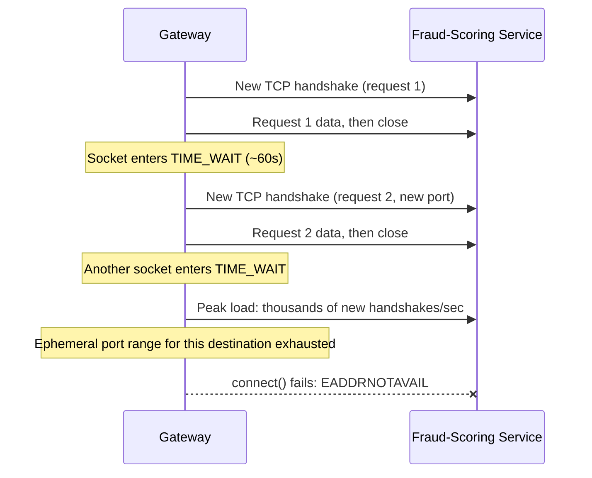

The fix combined two of this chapter's recommendations directly: (1)
immediate mitigation via `net.ipv4.tcp_tw_reuse` and a widened ephemeral
port range (section 10, Example C) to buy headroom without a code deploy,
and (2) the actual architectural fix — reconfiguring the HTTP client to use
a persistent, pooled connection pool sized to the gateway's expected
concurrency to the fraud-scoring service, eliminating the per-request
handshake entirely (section 7). Post-fix, the same peak traffic showed a
stable, low `TIME_WAIT` count and zero `EADDRNOTAVAIL` errors, and P99
latency to the fraud-scoring service dropped as well, since every request
after the fix skipped the one-RTT handshake and slow-start ramp-up entirely.

## 23. Interview Questions

- Explain what happens, segment by segment, during a TCP three-way
  handshake and why the initial sequence numbers are randomized.
- Why does a closed TCP connection remain in `TIME_WAIT`, and what two
  distinct problems does that state prevent?
- Describe the difference between TCP's flow control and congestion
  control — what problem does each solve, and why can't one substitute for
  the other?
- What is the bandwidth-delay product, and why does it matter when sizing
  a TCP window for a high-latency, high-bandwidth link?
- When would you choose UDP over TCP for a new service, and what would you
  need to build yourself to compensate for what UDP doesn't provide?
- What does `TCP_NODELAY` actually disable, and why does the interaction
  between Nagle's algorithm and delayed ACKs cause the specific latency
  pattern it does?
- Why was CIDR introduced, and what specific inefficiency in classful
  addressing did it solve?
- A production service is intermittently failing to open new outbound
  connections to one specific dependency under load, with no CPU or memory
  pressure. What's your diagnostic process?

## 24. Hands-on Exercises

1. Run the Python client/server from Section 10 Example A locally; capture
   the traffic with `tcpdump` and identify each of the three handshake
   segments and the four close segments by their flags and sequence/ack
   numbers.
2. Modify the client to open and close 500 connections in a tight loop
   against the same server without pooling; observe the `TIME_WAIT` count
   grow via `ss -tan state time-wait | wc -l` and explain, in your own
   words, why it doesn't reach zero immediately after the loop ends.
3. Toggle `TCP_NODELAY` on and off in the client and measure round-trip
   latency for a sequence of small (4-byte) writes with an artificial 50ms
   receiver-side delayed-ACK setting, if your OS exposes that tuning;
   otherwise reason through and diagram the expected latency difference.
4. Use `tc netem` to inject 5% packet loss on a loopback or test network
   namespace and observe TCP's retransmission and congestion-window
   behavior via `ss -ti` during a bulk transfer.

## 25. Design Exercises

1. You are given a company that currently runs a single `/24` VPC with no
   subnetting and has just been told it needs to support 8 new
   microservices, each requiring its own subnet across 3 availability
   zones, within the next year. Design the new CIDR allocation, showing
   your subnet sizes and headroom reasoning.
2. Design the connection-pooling strategy for an API gateway that fans out
   to 12 downstream services with very different traffic patterns (some
   high-frequency/low-latency, some low-frequency/bulk) — decide, and
   justify, `TCP_NODELAY` and pool-size settings per downstream.
3. A global service needs to replicate a 500 GB dataset nightly between two
   regions with a measured RTT of 180ms over a 5 Gbps link. Calculate the
   bandwidth-delay product, and propose changes (window scaling,
   congestion control algorithm, parallel connections) to actually achieve
   close to line-rate throughput.

## 26. Architecture Review Questions

- Does this design open a new TCP connection per request anywhere in the
  critical path, and if so, is that deliberate and justified?
- Are CIDR allocations for every VPC/VNet in this design registered
  centrally, with documented headroom for at least 2 years of growth?
- For every UDP usage in this design, what specific reliability guarantee
  does UDP not provide that the application has explicitly decided it
  doesn't need — or has built itself?
- Is `TCP_NODELAY` configured deliberately (not left to a default) for
  every latency-sensitive RPC path in this design?
- What is this design's plan for IPv6 reachability, and is it a documented
  timeline or an indefinitely deferred "someday"?
- What socket-state metrics (`TIME_WAIT`, `CLOSE_WAIT` counts) does this
  design expose, and what alert thresholds are set on them?

## 27. Summary

TCP/IP is the internet's actual working transport and network layer — IP
provides best-effort addressing and routing across a globally scaled,
hierarchically allocated address space (CIDR replacing classful waste,
IPv6 replacing IPv4 exhaustion), and TCP builds reliable, ordered,
flow-controlled, congestion-aware delivery on top of that unreliable
foundation, while UDP remains available for the applications that
explicitly don't want any of that overhead. Every mechanism this chapter
taught — the three-way handshake, the connection state machine and
`TIME_WAIT`, sliding-window flow control, slow-start/congestion-avoidance,
and Nagle's algorithm — exists because of a specific historical failure
mode it was built to prevent, and every one of them still shows up directly
in production incidents an architect will be asked to diagnose: port
exhaustion from unpooled connections, tail latency from Nagle/delayed-ACK
interaction, and under-utilized long-haul links from an unscaled window
against a large bandwidth-delay product. Treating TCP/IP as "solved,
invisible infrastructure" rather than a set of first-principles trade-offs
is exactly what turns these into unplanned incidents instead of deliberate
design decisions.

## Further Reading

- [HTTP](CH01_HTTP.md) — the application-layer protocol built directly on
  top of the TCP connections this chapter teaches; owns HTTP methods,
  status codes, caching headers, and the TLS handshake.
- OSI Model (Part 05, not yet drafted) — the seven-layer reference model
  this chapter's four-layer practical stack is commonly compared against.
- HTTP/2, HTTP/3, TLS, Sockets, WebSockets, QUIC (Part 05, not yet drafted)
  — each builds directly on the TCP/UDP foundation taught here.
