# Chapter: HTTP/2

Part: [05 — Networking and Operating Systems](PART_OVERVIEW.md) · Status: Drafted

## 1. Introduction

HTTP/2 (HyperText Transfer Protocol version 2, standardized as RFC 7540 in
2015 and later obsoleted-and-superseded-in-place by RFC 9113 in 2022) is not
a new application protocol — it keeps the request/response model, the
methods, the status codes, and the caching semantics that
[HTTP](CH01_HTTP.md) already owns and this chapter will not re-teach. What
HTTP/2 replaces is the **wire format and connection model underneath that
vocabulary**: instead of a human-readable text protocol that sends one
request at a time down a Transmission Control Protocol (TCP) connection
before the next one can start, HTTP/2 encodes every request and response as
small binary frames that can be freely interleaved — multiplexed — over a
single long-lived TCP connection.

For a Solution Architect, HTTP/2 matters for three concrete reasons:

1. **It invalidates a decade of HTTP/1.1 performance folklore.** Domain
   sharding, asset concatenation, and image spriting were rational engineering
   responses to HTTP/1.1's connection limits — under HTTP/2 they become
   anti-patterns that actively hurt performance (Section 4.11). Architects who
   don't update this mental model ship slower systems while believing they're
   following best practice.
2. **It changes what "one connection" costs and enables architecturally.**
   Reverse proxies, load balancers, and Content Delivery Networks (CDNs) all
   have to decide whether to speak HTTP/2 to clients, to origins, or both —
   this is a real architecture decision with security and operational
   trade-offs (Section 7-8), not a checkbox.
3. **It is an essential stepping stone to HTTP/3.** HTTP/2 solved
   application-layer head-of-line (HOL) blocking but is still built on TCP,
   which has its own HOL blocking at the transport layer. Understanding
   exactly where HTTP/2's fix stops and why is the direct motivation for
   HTTP/3 and QUIC (Quick UDP Internet Connections), covered in the next
   chapter — this chapter sets that motivation up explicitly rather than
   leaving it implicit.

> **Scope boundary.** This chapter is the owning chapter for HTTP/2's binary
> framing layer, stream multiplexing, HPACK (HTTP/2 header compression,
> RFC 7541) header compression, stream prioritization, server push, and
> HTTP/2-specific flow control. It recaps — and does **not** re-teach — HTTP
> methods, status codes, caching headers, and the general TLS (Transport
> Layer Security) handshake, all of which are owned by [HTTP](CH01_HTTP.md)
> per the Concept Ownership Rule in [STYLE_GUIDE.md](../STYLE_GUIDE.md).
> Where this chapter needs those concepts, it links back rather than
> re-deriving them.

## 2. Historical Evolution

HTTP/2 did not emerge from a standards committee designing in a vacuum — it
was standardized from a browser vendor's production experiment that had
already proven the performance thesis at scale.

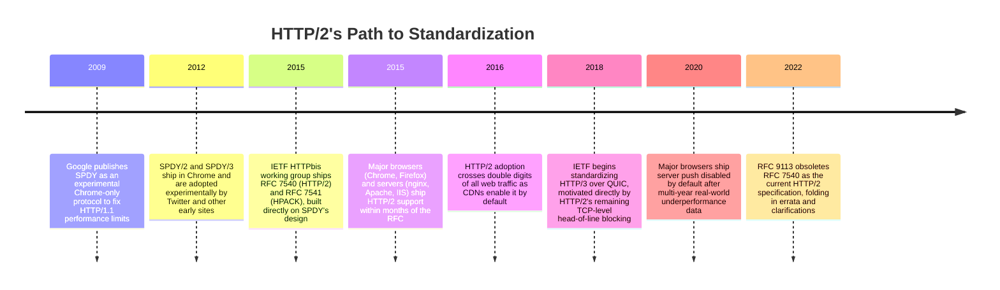

**Why SPDY came first.** By 2009, Google's engineers had measured that page
load time on real sites was dominated not by bandwidth but by **round trips**
— each HTTP/1.1 connection could have only one request in flight at a time
(ignoring the rarely-used and fragile HTTP/1.1 pipelining feature), so
browsers opened up to six parallel TCP connections per hostname just to get
rough concurrency. Google built SPDY as a Chrome-only experimental protocol:
same HTTP semantics, but a binary framing layer that multiplexed many
requests over one TCP connection, plus header compression. It shipped inside
real Chrome traffic, was measured against real websites, and the resulting
data — meaningfully faster page loads on high-latency and mobile
connections — is what convinced the Internet Engineering Task Force (IETF)
to standardize a near-identical design as HTTP/2 rather than starting a
fresh design-by-committee process. This is a recurring pattern architects
should recognize: **protocol standards that succeed quickly are usually
standardizing something already proven in production**, not designing
blind.

**Why RFC 9113 exists.** RFC 7540 accumulated six years of implementation
experience, interoperability edge cases, and a handful of security
clarifications (notably around HPACK compression side-channels, Section
4.4). RFC 9113 (2022) is a clarifying obsoletion, not a new protocol version
— HTTP/2 on the wire is unchanged; if you deploy a server or client claiming
RFC 7540 compliance today, treat RFC 9113 as the current normative reference
for that same protocol.

## 3. Why It Exists

HTTP/1.1's fundamental limitation is that a **TCP connection can carry only
one HTTP transaction at a time**. Once a client sends a request, it cannot
send a second request over the same connection until the first response has
been fully received (pipelining allowed queuing but not reordering, and
suffered its own head-of-line blocking, so almost no production client ever
enabled it). Every workaround the web platform adopted throughout the
2000s and 2010s was really compensating for this single constraint.

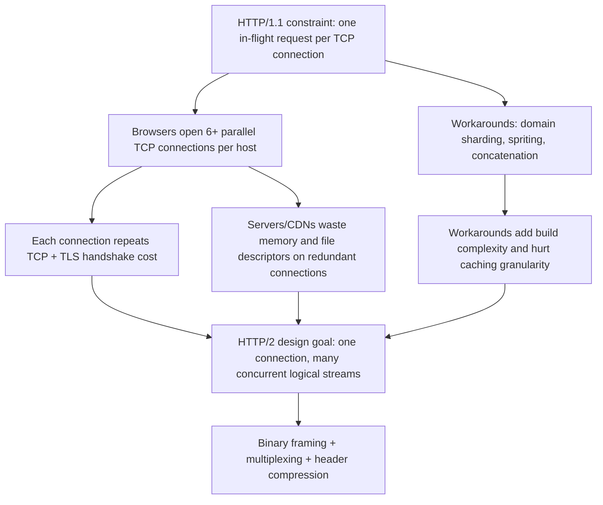

HTTP/2 exists to remove the *cause* of these workarounds rather than adding
another layer on top of them: if many logical requests can share a single
connection safely and efficiently, sharding, concatenation, and spriting stop
being necessary and — as Section 4.11 covers in depth — become actively
counterproductive. The design goal was explicit in the working group's
charter: preserve full compatibility with HTTP semantics (so no existing
server-side application code needs to change) while completely replacing the
wire format underneath it.

## 4. Core Concepts

### 4.1 The Binary Framing Layer

**Definition.** HTTP/1.1 is a text protocol: a client sends readable ASCII
lines like `GET /orders/42 HTTP/1.1\r\n`, and a server parses the response by
scanning for line breaks, colons, and `Content-Length`/chunked boundaries.
HTTP/2 replaces this entirely with a **binary framing layer**: every unit of
communication is a fixed 9-byte frame header followed by a type-specific
payload, and everything the application layer sees (methods, headers,
bodies) is transported as one or more of these frames.

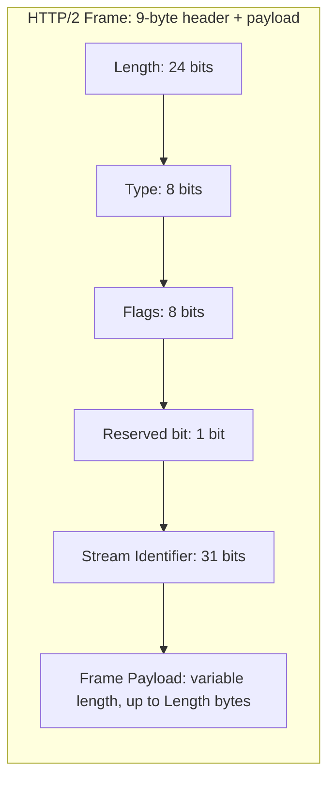

**Mechanism.** The `Type` field selects one of a small fixed set of frame
types — `HEADERS`, `DATA`, `SETTINGS`, `WINDOW_UPDATE`, `PRIORITY`,
`RST_STREAM`, `PUSH_PROMISE`, `PING`, `GOAWAY`, and `CONTINUATION` — each
with its own payload structure defined precisely in RFC 9113. The 31-bit
`Stream Identifier` is what makes multiplexing possible (Section 4.2): every
frame is tagged with the logical stream it belongs to, so a receiver can
demultiplex an interleaved byte stream back into distinct
requests/responses purely by reading this field, with no ambiguity and no
need to wait for a delimiter like HTTP/1.1's blank-line-terminated headers.

**Decision implication.** Because parsing is now fixed-width binary fields
instead of variable-length text scanning, HTTP/2 parsers are simpler to
implement correctly and harder to exploit via malformed-text edge cases
(the request-smuggling class of bugs that plagues HTTP/1.1 intermediaries
disagreeing on where a request ends) — but the trade-off is that HTTP/2 is
no longer human-readable on the wire; debugging requires protocol-aware
tooling (browser DevTools' Network panel decodes it, `curl --http2 -v` shows
frame-level detail, Wireshark has an HTTP/2 dissector) rather than a raw
`nc`/telnet session.

**Common failure mode.** Engineers who assume HTTP/2 "is just HTTP/1.1 but
faster" are surprised when a raw packet capture shows no readable request
line — this is expected and correct; the semantic content (method, path,
headers) is still there, just Huffman-and-table-encoded inside `HEADERS`
frames (Section 4.4), not literal ASCII.

**Concrete scenario.** A load balancer that does regex-based header
inspection on raw HTTP/1.1 text (a common legacy security appliance pattern)
cannot be pointed at raw HTTP/2 frames unsupported — this is why many such
appliances still terminate HTTP/2 from the client and re-issue HTTP/1.1 (or
h2c, Section 4.9) internally rather than passing frames through unmodified
(Section 7-8).

### 4.2 Stream Multiplexing

**Definition.** A **stream** is a bidirectional, independent sequence of
frames exchanged between client and server within a single TCP connection,
identified by its `Stream Identifier`. Multiplexing means many streams can
be interleaved on the wire concurrently — the connection stops being "one
conversation at a time" and becomes "one connection, many concurrent
conversations."

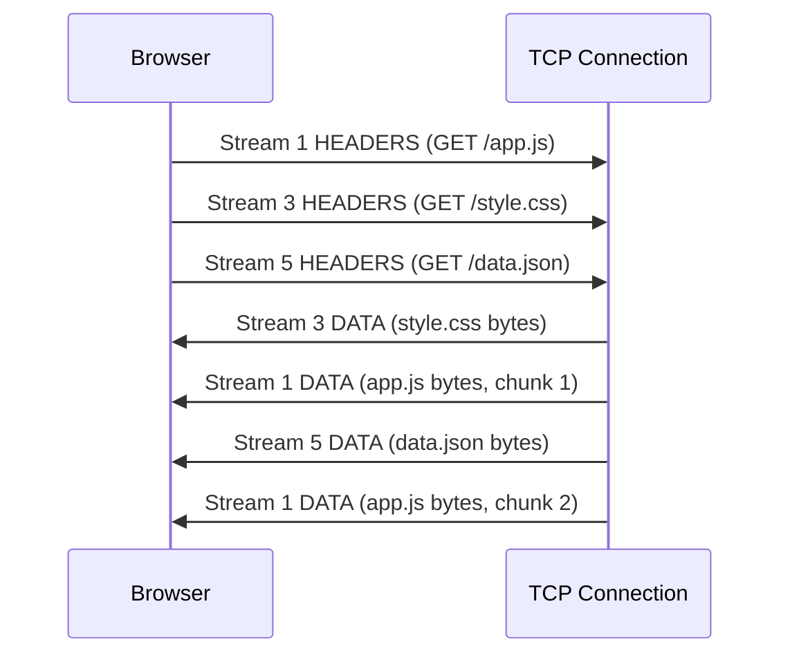

**Mechanism.** Nothing about a stream requires the frames belonging to it to
be contiguous on the wire — a server can start sending `style.css` bytes,
pause to send a chunk of `app.js`, then resume `style.css`, purely by
tagging each frame with its stream ID. The receiver reassembles each stream
independently by demultiplexing on that ID; from the application's point of
view, each stream behaves exactly like an ordinary HTTP request/response,
because HTTP/2's framing is deliberately semantics-preserving (Section 1).
Client-initiated streams always use odd stream IDs; server-initiated streams
(server push, Section 4.7) use even stream IDs — a simple partitioning rule
that avoids ID collisions without a negotiation round trip.

**Decision implication.** Multiplexing is what makes domain sharding
counterproductive (Section 4.11): opening 6 connections to fake concurrency
under HTTP/1.1 was working around the one-request-per-connection limit;
under HTTP/2 that limit doesn't exist, so extra connections just add
redundant handshake overhead without adding real concurrency benefit.

**Common failure mode.** Multiplexing solves head-of-line blocking *at the
HTTP application layer* — it does not make an individual stream's data
arrive faster, and it does not fix problems below the frame layer. This is
precisely where Section 4.3 draws a hard line that many engineers blur.

**Concrete scenario.** A single-page application fetching a bundled
JavaScript file, three Application Programming Interface (API) responses,
and a handful of images can now issue all of those requests over one
already-open connection the instant they're discovered, instead of queuing
behind a connection-count limit — this is the single biggest practical
reason HTTP/2 improves perceived page load time on latency-heavy networks.

### 4.3 Application-Layer vs. Transport-Layer Head-of-Line Blocking

**Definition.** Head-of-line (HOL) blocking is when one held-up unit of work
blocks unrelated units of work behind it that could otherwise proceed
independently. HTTP/1.1 has HOL blocking **at the application layer**: one
slow response holds up every other request queued on that connection.
HTTP/2 fixes exactly that layer — but a TCP connection is a single ordered
byte stream, and TCP itself enforces in-order delivery to the application
above it, so HTTP/2 is still exposed to HOL blocking **at the transport
layer**.

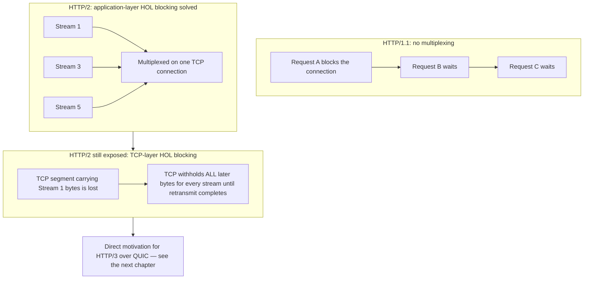

**Mechanism.** TCP guarantees in-order, reliable byte delivery to whatever
sits above it. If a single TCP segment is lost, TCP must hold every
subsequent segment — regardless of which HTTP/2 stream those bytes belong to
— until the lost segment is retransmitted and acknowledged, because TCP has
no concept of "streams" at all; it only knows byte offsets in one ordered
sequence. From HTTP/2's point of view, three completely independent streams
can all stall simultaneously because of packet loss affecting only one of
them, purely because they happen to share the same TCP connection.

**Decision implication.** This single fact is why HTTP/2 alone does not
fully solve mobile/high-latency-network performance the way marketing
sometimes implies, and it is the direct, explicit reason the IETF designed
HTTP/3 on top of QUIC (a transport built on User Datagram Protocol, UDP)
instead of trying to patch TCP: QUIC gives each stream **independent loss
recovery**, so one stream's packet loss no longer stalls unrelated streams.
This chapter does not re-teach QUIC/HTTP/3's mechanism — that is the
forthcoming chapter's job — but an architect evaluating "should we adopt
HTTP/3" must understand that the answer to "does HTTP/2 already solve HOL
blocking" is **partially**: yes at the application layer, no at the
transport layer, and that gap is precisely QUIC's value proposition.

**Common failure mode.** Treating "HTTP/2 fixed head-of-line blocking" as an
unqualified statement, then being confused when lossy Wi-Fi/cellular
networks still show stalls despite HTTP/2 being enabled everywhere in the
stack — the fix was only ever partial by design, not a bug.

**Concrete scenario.** A mobile app over a congested cellular network with
2% packet loss will see HTTP/2 connections repeatedly stall across
*all* in-flight streams on any loss event, even though the requests are
logically unrelated — this is the exact production symptom that HTTP/3
targets, and a reasonable Architecture Decision Record (ADR) for "should we
adopt HTTP/3" should cite this failure mode as the primary quantified
justification, not vague "it's newer and faster" language.

### 4.4 HPACK Header Compression

**Definition.** HPACK (RFC 7541) is HTTP/2's header-compression scheme. It
exists because HTTP headers are extremely repetitive across requests on the
same connection (`User-Agent`, `Cookie`, `Accept-Language`, and dozens of
custom headers rarely change between requests from the same client), and
because a naive general-purpose compressor (like gzip, used by SPDY's
predecessor) turned out to leak enough information to enable practical
compression-oracle attacks.

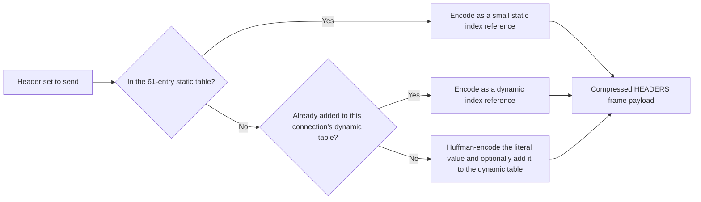

**Mechanism.** HPACK maintains two lookup tables per connection: a fixed
**static table** of 61 commonly used header name/value pairs
(`:method: GET`, `:status: 200`, `content-type`, etc., defined once in the
RFC) and a per-connection **dynamic table** that both endpoints build up
incrementally as headers are actually sent — the first time a novel header
value appears it's sent Huffman-encoded (a variable-length prefix-free
encoding tuned for typical header-value byte frequency) and added to the
dynamic table; every subsequent occurrence on that connection can then be
sent as a tiny table-index reference instead of the literal bytes. Because
the dynamic table is built incrementally and is connection-scoped, HPACK's
compression ratio improves the longer a connection stays open — another
reason HTTP/2's push toward fewer, longer-lived connections compounds its
own benefit.

**Why not just reuse gzip/DEFLATE (the CRIME/BREACH lesson).** SPDY
originally compressed headers with plain DEFLATE (the same algorithm gzip
uses). In 2012, the CRIME (Compression Ratio Info-leak Made Easy) attack
demonstrated that when an attacker can inject chosen plaintext alongside a
secret (e.g. a session cookie) into the *same compressed stream*, and can
observe the resulting compressed length, they can recover the secret
byte-by-byte: a guessed byte that matches the secret compresses slightly
better (shorter output) than a guess that doesn't, because DEFLATE
back-references repeated substrings across the whole stream. BREACH is the
same class of attack applied to HTTP response body compression rather than
headers. HPACK was deliberately designed to prevent this: it does not use
general-purpose back-referencing compression across arbitrary attacker- and
secret-controlled content; Huffman coding alone (used for literal values)
has no cross-value back-reference channel to exploit, and the static/dynamic
table indexing only ever produces short deterministic references, not a
compression ratio that leaks information about the compared content's
length in the way DEFLATE's sliding window does.

**Decision implication.** HPACK is not "gzip for headers" — treating it as
an equivalent general compressor when reasoning about security is a category
error. However, HPACK is not immune to *all* side-channel risk: if an
application echoes attacker-controlled data into a header value that also
sits in the dynamic table alongside a secret header on the same connection,
subtle timing/size side channels are still theoretically possible in
specific implementation configurations, which is why security-sensitive
architectures should avoid mixing attacker-influenced header content with
secret header values on connections shared across trust boundaries, and
should never re-introduce general-purpose stream compression over
attacker-and-secret-mixed content at any layer (see the response-body
equivalent guidance under BREACH mitigation in
[Security](../15_Security/PART_OVERVIEW.md), owned there).

**Common failure mode.** Assuming HPACK compression eliminates the need to
think about header size at all — a request with dozens of large custom
headers (some API gateways attach many `X-`-prefixed headers per hop) still
costs real bytes on first use per connection, and every new distinct value
grows the dynamic table, which has a negotiated maximum size
(`SETTINGS_HEADER_TABLE_SIZE`) that, once exceeded, forces eviction of older
entries and a return to literal encoding for evicted values.

**Concrete scenario.** An API gateway that forwards a unique correlation ID
as a header value on every single request defeats HPACK's compression
benefit for that specific header (it's different every time, so it can never
match a static or already-cached dynamic entry) — architects designing
high-volume, low-latency APIs should distinguish headers that are genuinely
per-request-unique (which gain nothing from HPACK) from headers that are
client-stable across many requests (which gain the most).

### 4.5 Stream Prioritization and Dependency Trees

**Definition.** RFC 7540 let a client express relative importance between
streams using a **priority tree**: each stream can declare a parent stream
it depends on, plus an integer **weight** (1-256) that determines its
proportional share of resources relative to sibling streams under the same
parent, when both are ready to send data.

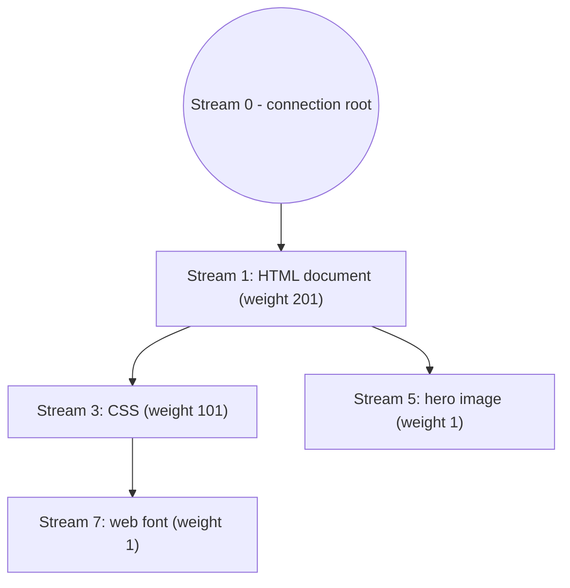

**Mechanism.** A browser can express "render-blocking CSS should get
bandwidth before a below-the-fold image" by making the image stream depend
on (i.e. be scheduled after) the CSS stream, and by weighting the HTML
document stream heavily relative to siblings. The server is expected to
honor this as a *scheduling hint* when deciding which stream's `DATA` frames
to send first when several streams have data ready — it's advisory, not
mandatory, and RFC 9113 explicitly downgrades this mechanism's normative
weight compared to RFC 7540.

**Why this mostly failed in practice.** Priority trees require every
intermediary in the path (CDN edge, reverse proxy, origin server) to
correctly implement, preserve, and honor prioritization signals end-to-end.
In production, this rarely held: many servers implemented a simplistic
round-robin or first-come-first-served scheduler that ignored the tree
entirely, and prioritization information could be silently dropped or
re-ordered by intermediaries that didn't propagate it. Google's own
measurements (published as part of the HTTP/3 prioritization redesign
effort) found that most deployed HTTP/2 servers did not implement stream
prioritization correctly enough to produce the intended benefit. This led to
RFC 9218 defining a simpler, HTTP-version-agnostic "extensible priorities"
scheme (a single `Priority` header/frame with `urgency` and `incremental`
fields) intended to replace the dependency-tree model for both HTTP/2 and
HTTP/3 going forward.

**Decision implication.** Do not architect a performance strategy that
depends on HTTP/2's RFC 7540 dependency-tree prioritization behaving
correctly across your full request path — verify empirically (Section 16)
whether your CDN/reverse proxy/origin combination actually implements and
propagates it, or design for the simpler RFC 9218 model if your stack
supports it, rather than assuming the specification's existence implies
consistent behavior.

**Common failure mode.** Spending engineering effort hand-tuning weight
values in application code, then measuring no change in real-world load
time, because an intermediary between the browser and the origin ignored
the prioritization signal entirely — a wasted optimization cycle that a
five-minute check of the actual server/CDN's documented prioritization
support would have avoided.

**Concrete scenario.** A CDN that serves both a render-blocking CSS file and
several deferred analytics-beacon requests on the same connection, without
honoring prioritization, may end up serving beacon responses ahead of the
CSS purely due to send-buffer ordering — invisible to the client-side code
but directly responsible for a slower Largest Contentful Paint (LCP) metric.

### 4.6 Flow Control (Stream-Level and Connection-Level)

**Definition.** Flow control is the mechanism that prevents a fast sender
from overwhelming a slow receiver's buffers. HTTP/2 implements flow control
independently at **two levels**: per-stream (so one slow-to-consume stream
doesn't starve buffer space needed by others) and per-connection (an overall
cap across all streams combined).

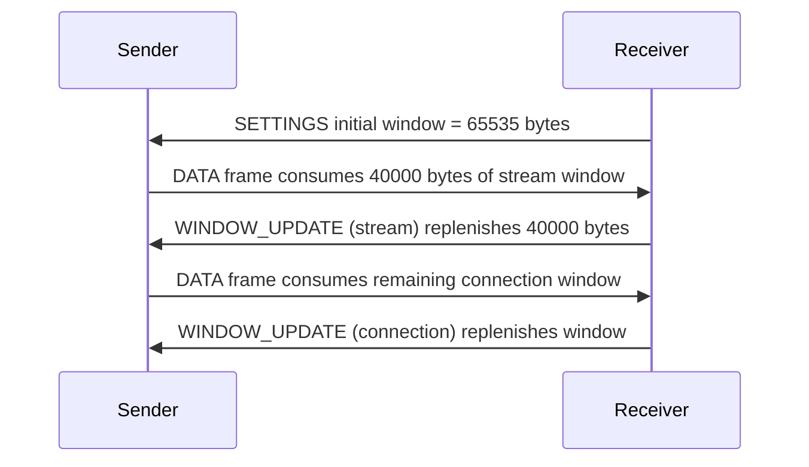

**Mechanism.** Both the stream-level and connection-level windows are
credit-based: each side advertises how many bytes of `DATA` frame payload
it is willing to buffer (default initial value 65,535 bytes per RFC 9113,
commonly tuned much higher in practice), the sender must not send more
unacknowledged `DATA` bytes than the current window allows, and the receiver
sends `WINDOW_UPDATE` frames to add back credit as it consumes buffered
data. Because both levels exist simultaneously, a sender must respect
whichever window (stream or connection) is smaller at any given moment —
a fully open stream-level window is still constrained if the shared
connection-level window is nearly exhausted by other concurrent streams.

**Decision implication.** Flow control is what prevents one slow client (or
one slow consumer of a server-initiated push stream) from forcing a server
to buffer unbounded data in memory — but a *too-small* window setting
directly caps achievable throughput on high-bandwidth, high-latency links
(the bandwidth-delay product problem familiar from TCP window tuning);
architects deploying HTTP/2 servers at scale should treat initial window
size as a real tuning parameter (Section 11), not an implementation detail
to leave at defaults unconditionally.

**Common failure mode.** A server or intermediate proxy that never issues
`WINDOW_UPDATE` frames promptly (e.g. because its own application-layer
consumer is slow) silently stalls that stream indefinitely from the
sender's point of view — this presents to operators as "the connection is
hung" without any error being surfaced, because nothing is technically
wrong at the protocol level; the window is simply not being replenished.

**Concrete scenario.** A large file download over HTTP/2 competing on the
same connection with several small, latency-sensitive API calls can starve
those API calls of connection-level window if the download consumes it
faster than the small calls' responses can claim their share — this is a
real argument for keeping bulk-transfer traffic (large media, downloads) on
a separate connection or origin from small latency-sensitive API traffic,
even though HTTP/2 in principle allows sharing one connection for both.

### 4.7 Server Push — and Why It Was Deprecated

**Definition.** Server push (`PUSH_PROMISE` frames) let a server proactively
send a resource the client hasn't explicitly requested yet, anticipating
that the client will need it — e.g. pushing `style.css` alongside
`index.html` before the browser has even parsed the `<link>` tag that would
have triggered the request.

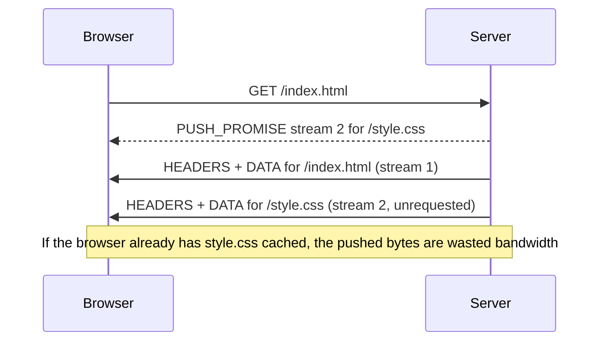

**Mechanism.** A `PUSH_PROMISE` frame is sent on an existing (client-
initiated, odd-numbered) stream and declares a new even-numbered stream the
server will use to send the promised resource, along with the request
headers the client *would have* sent for it — this lets the client check its
own cache and immediately reset (`RST_STREAM`) the pushed stream if it
already has a fresh copy, avoiding wasted transfer in that case only.

**Why it seemed like a good idea.** The theoretical benefit is real:
eliminating an entire round trip for known-dependent resources (the browser
must first receive and parse HTML before it discovers it needs `style.css`;
push skips that discovery latency entirely). This is a legitimate,
well-reasoned architectural idea, not a design mistake at conception.

**Why it was deprecated/removed from most browsers — the architecture
lesson.** In practice, across several years of production deployment,
server push consistently underperformed or actively hurt performance for
reasons that only showed up empirically, not in the specification:

1. **Cache-awareness was too coarse.** A server generally cannot know
   precisely what variant of a resource the specific client already has
   cached (cache keys can depend on cookies, `Vary` headers, service worker
   logic) — pushing "just in case" frequently pushed bytes the client
   already had, wasting bandwidth and, worse, competing for
   connection-level flow-control window (Section 4.6) against genuinely
   needed responses.
2. **Coordinating push policy across a CDN/origin boundary was operationally
   hard.** Push decisions live at the origin (which HTML template knows what
   it will need) but the connection the client actually holds is usually to
   a CDN edge — keeping push manifests correctly synchronized between origin
   logic and edge behavior in production was error-prone and rarely
   maintained correctly as sites evolved.
3. **Measured real-world impact was frequently negative.** Multiple browser
   vendors and CDN operators published data (most notably Chrome's team
   around 2018-2020) showing that, once accounting for wasted-push bytes and
   flow-control contention, HTTP/2 push often made real page-load metrics
   *worse* on average than an equivalent `<link rel="preload">` hint (a
   same-connection, cache-aware, client-driven alternative that lets the
   browser decide based on its actual cache state).
4. **Preload achieves the same goal with better information.** `Link:
   </style.css>; rel=preload` tells the browser "you'll need this soon,"
   letting the client — which has full knowledge of its own cache — decide
   whether to actually fetch it, without the server guessing.

Chrome, Firefox, and Safari all removed or disabled server push by default
between 2020 and 2022; RFC 9113 explicitly notes it as a feature many
implementations no longer support, and the more recent Cache Digests
proposal (an attempt to let clients tell servers what they already have
cached, fixing failure mode #1) was never widely adopted before push itself
fell out of favor.

**The architecture lesson.** Server push is a textbook case of a mechanism
that was *theoretically sound, specified correctly, and shipped in every
major implementation* — and still failed in production because it depended
on information (accurate client cache state) that the server structurally
cannot have with confidence. When designing any "server anticipates client
need" optimization — pre-fetching, speculative execution, predictive
caching — an architect should explicitly ask: *does the server actually have
enough information to make this prediction better than the client could
make it itself, and does getting it wrong cost more than the round trip it
saves?* Server push's history is the canonical answer of "no" to that
question at internet scale, even though it looked obviously beneficial on
paper.

**Decision implication.** Do not design new systems around HTTP/2 server
push in 2026 — treat it as effectively dead. Use `<link rel="preload">` (or
equivalent client-driven resource hints) or, for genuinely bidirectional
proactive server-initiated data, use WebSockets or Server-Sent Events
(covered under [Part 05](PART_OVERVIEW.md)'s WebSockets chapter, not this
one) rather than repurposing HTTP/2 push.

### 4.8 Frame Type Taxonomy

**Definition.** RFC 9113 defines a fixed, closed set of frame types; every
HTTP/2 behavior discussed above is implemented as some combination of these.

| Frame Type | Purpose |
|---|---|
| `DATA` | Carries request/response body bytes for a stream |
| `HEADERS` | Carries HPACK-compressed header block, opens/continues a stream |
| `PRIORITY` | Communicates a stream's dependency/weight (Section 4.5) |
| `RST_STREAM` | Immediately terminates a stream (error or cancellation) |
| `SETTINGS` | Negotiates connection-wide parameters (Section 4.9) |
| `PUSH_PROMISE` | Announces a server-initiated stream (Section 4.7) |
| `PING` | Round-trip-time measurement / keepalive |
| `GOAWAY` | Signals the connection is shutting down, and the last stream ID processed |
| `WINDOW_UPDATE` | Replenishes flow-control credit (Section 4.6) |
| `CONTINUATION` | Carries HEADERS block content too large for one frame |

**Mechanism.** `RST_STREAM` deserves special architectural attention: it
lets either side abandon a single stream instantly without tearing down the
whole connection — a client that navigates away from a page mid-request can
cancel just that stream's in-flight response, which was impossible to do
cleanly under HTTP/1.1 without closing (and later re-establishing) the
entire TCP connection. `GOAWAY` is the connection-level equivalent: a server
that needs to restart or rebalance connections announces the last stream ID
it will process, letting in-flight streams below that ID complete gracefully
while the client opens a new connection for anything after — this is the
mechanism that makes graceful connection draining possible during a
rolling deployment (Section 15).

**Common failure mode.** Load-testing tools or naive proxy implementations
that don't correctly handle `GOAWAY` can interpret a graceful shutdown
signal as a hard connection failure, producing false-positive error spikes
during routine deployments that were, from the server's perspective,
perfectly clean.

### 4.9 Connection Preface, ALPN, and h2 vs. h2c

**Definition.** Before any application data flows, both sides must agree
they are speaking HTTP/2 at all (not HTTP/1.1) and confirm that agreement
unambiguously. HTTP/2 defines two negotiation paths: **h2** (HTTP/2 over
TLS, negotiated via Application-Layer Protocol Negotiation, ALPN) — used for
essentially all public internet traffic — and **h2c** (HTTP/2 over cleartext
TCP, negotiated via an HTTP/1.1 `Upgrade` header or, more commonly in
practice, configured directly by prior agreement between two systems that
control both ends, e.g. inside a private network).

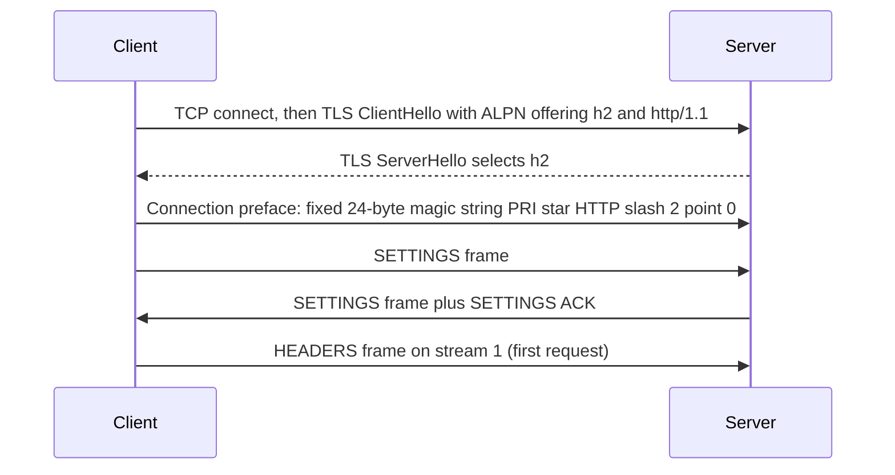

**Mechanism.** ALPN is a TLS extension (recapped here at the level HTTP/2
needs; the general TLS handshake mechanics are owned by
[HTTP](CH01_HTTP.md#5-internal-working)): during the TLS handshake, the
client lists the application protocols it supports (`h2`, `http/1.1`) and
the server picks one from that list, all before the handshake completes —
this is what lets a single TLS port (443) serve both HTTP/1.1 and HTTP/2
clients without a separate round trip to negotiate the HTTP version
afterward. Once `h2` is selected, the client sends a fixed 24-octet
"connection preface" (the literal bytes `PRI * HTTP/2.0\r\n\r\nSM\r\n\r\n`)
— a deliberately chosen string that looks like a malformed HTTP/1.1 request
to any server that doesn't understand HTTP/2, causing it to fail fast and
visibly rather than silently misinterpreting binary frame bytes as text.
Both sides then exchange `SETTINGS` frames to negotiate connection
parameters (initial flow-control window, max concurrent streams, max frame
size, header table size) before any request/response frames are sent.

**h2c and why it's rare in practice.** h2c requires either prior knowledge
(both endpoints configured to assume HTTP/2 immediately) or an HTTP/1.1
`Upgrade: h2c` handshake — but major browsers never implemented the
`Upgrade` path for security and complexity reasons, so h2c only appears in
practice for service-to-service traffic *inside* a trusted network boundary
(e.g. a reverse proxy talking h2c to backend pods) where TLS termination
happens at the edge and the internal hop doesn't need its own TLS overhead.

**Decision implication.** Never expose h2c on any network path that crosses
a trust boundary — because it has no TLS, it also has no ALPN negotiation
step, and an on-path attacker or misrouted request could trivially inject
or intercept cleartext frames. h2c is an internal-network optimization
only, never an internet-facing configuration choice.

**Concrete scenario.** A Kubernetes ingress controller commonly terminates
TLS/h2 at the cluster edge, then speaks h2c to backend pods over the
cluster's internal (trusted, encrypted-at-the-network-fabric-layer or
otherwise isolated) network — this avoids double TLS handshake overhead for
every internal hop while keeping the only externally reachable surface
properly encrypted.

### 4.10 The SETTINGS Frame and Connection Lifecycle Parameters

**Definition.** The `SETTINGS` frame is how two HTTP/2 endpoints agree on
operating parameters for the life of the connection — it is sent once at
connection start (Section 4.9) and can be resent later to change values
mid-connection.

**Mechanism.** The parameters that matter most architecturally:

- `SETTINGS_MAX_CONCURRENT_STREAMS` — caps how many streams a peer will
  accept as simultaneously open; a server sets this low (commonly 100-128)
  to bound worst-case resource usage per connection, which directly caps how
  much real concurrency a single connection can deliver regardless of
  multiplexing's theoretical capacity.
- `SETTINGS_INITIAL_WINDOW_SIZE` — the starting flow-control window
  (Section 4.6) for every new stream; tuning this trades memory headroom
  against achievable per-stream throughput on high-bandwidth-delay-product
  links.
- `SETTINGS_MAX_FRAME_SIZE` — the largest frame payload a peer will accept
  (default 16,384 bytes, can be negotiated up to 16 MB) — affects how large
  a single `DATA` chunk can be before it must be split across frames.
- `SETTINGS_HEADER_TABLE_SIZE` — the maximum size of HPACK's dynamic table
  (Section 4.4); a larger table improves compression for connections with
  many distinct recurring header values, at the cost of memory held per
  connection.

**Decision implication.** `SETTINGS_MAX_CONCURRENT_STREAMS` is the single
most consequential tuning knob for architects to actually look at in
production configuration — a value set too low silently reintroduces a form
of the exact queuing behavior HTTP/2 was designed to eliminate, just at a
higher ceiling than HTTP/1.1's 6-connections-per-host limit rather than
removing the ceiling altogether.

### 4.11 Migration Implications: Why HTTP/1.1 Optimizations Become Anti-Patterns

**Definition.** Because HTTP/2 removes the one-request-per-connection
constraint that HTTP/1.1 workarounds existed to route around, every
technique built specifically to minimize the number of HTTP/1.1 connections
or requests should be re-evaluated — several actively degrade performance
once multiplexing is available.

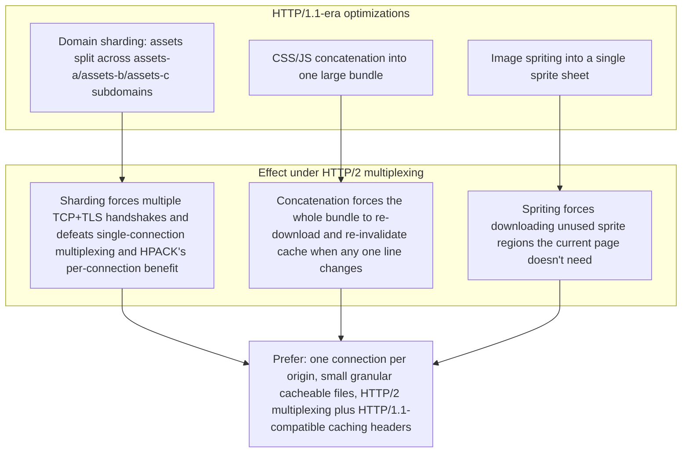

**Mechanism, per technique:**

- **Domain sharding** (splitting assets across `assets1.example.com`,
  `assets2.example.com`, etc. purely to get more parallel HTTP/1.1
  connections) now forces the browser to perform multiple independent TCP
  handshakes, TLS handshakes, and separate HPACK dynamic tables (compression
  state is per-connection, Section 4.4) — all overhead that multiplexing on
  a single connection would have avoided entirely. The correct HTTP/2-era
  approach is to consolidate assets back onto as few origins as practical.
- **Concatenation/bundling** (combining many small CSS/JS files into one
  large file specifically to reduce request count) trades away
  fine-grained cache invalidation: a single-character change anywhere in a
  10,000-line bundle forces every client to re-download the entire bundle,
  where many smaller, individually cacheable files would only invalidate
  the one file that actually changed. Under HTTP/2, the request-count
  penalty that justified bundling is gone, so the cache-granularity cost of
  bundling is now pure downside; modern build tooling (code-splitting,
  granular chunk hashing) reflects this shift explicitly.
- **Image spriting** (combining many small icons into one sprite sheet,
  displayed via CSS background-position cropping) forces downloading the
  *entire* sheet even when a page uses only two icons from it, and prevents
  per-icon caching/versioning. Under HTTP/2, serving each icon as its own
  small file (or using inline Scalable Vector Graphics, SVG, or an SVG
  sprite `<symbol>` referenced by ID, which is a different, still-valid
  technique) avoids that waste.

**Decision implication.** A migration to HTTP/2 is not just a server/CDN
configuration change — a genuinely complete migration includes an asset
pipeline review to remove or reduce these three techniques, because leaving
them in place doesn't just fail to help under HTTP/2, it actively costs
more than a naturally-granular asset strategy would.

**Common failure mode.** Teams "turn on HTTP/2" at the load balancer and
declare the migration complete while their build pipeline still shards
domains and bundles aggressively out of historical inertia — capturing only
partial benefit and sometimes measuring negligible or negative improvement,
which then gets misattributed to "HTTP/2 doesn't actually help" rather than
to the unmigrated asset strategy.

**Concrete scenario.** A team that migrates a single-page application's
load balancer to HTTP/2 but keeps three CDN subdomains for image sharding
will see those three subdomains still open three separate connections
(each with its own handshake and HPACK state) alongside the new HTTP/2
multiplexed main connection — the sharded assets get *none* of HTTP/2's
benefit and add DNS-lookup/handshake latency that a single consolidated
origin would have avoided.

## 5. Internal Working

Every HTTP/2 stream progresses through a well-defined state machine,
independent of every other stream on the same connection — this is what
makes `RST_STREAM` (Section 4.8) and independent flow control (Section 4.6)
possible per-stream rather than only per-connection.

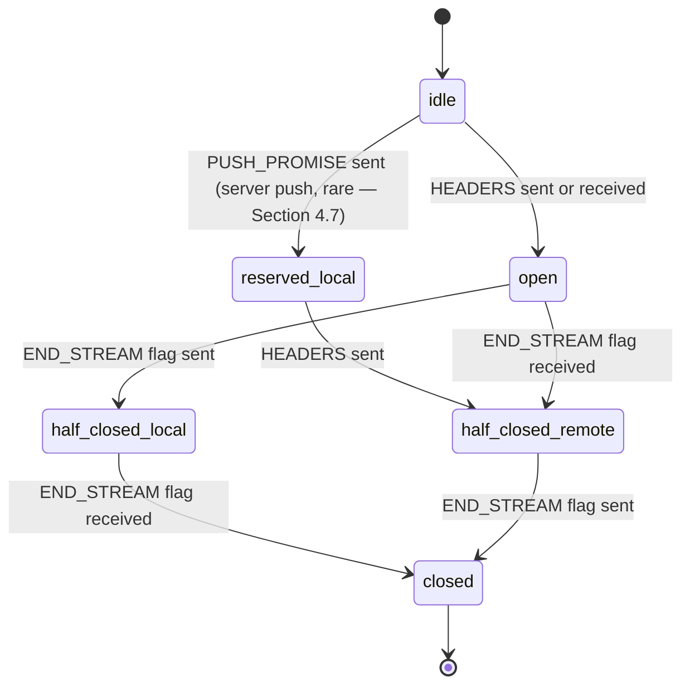

A stream begins **idle** (an ID has been assigned but no frames sent), moves
to **open** once `HEADERS` frames start flowing in either direction, and
transitions to one of the **half_closed** states once one side signals
`END_STREAM` (meaning "I have no more data to send on this stream," carried
as a flag on the final `HEADERS` or `DATA` frame — there is no separate
frame type for it). The stream is fully **closed** once both sides have
signaled completion, or immediately upon an `RST_STREAM` from either side
regardless of what state it was previously in. Critically, all of this state
is tracked per-stream — the connection itself has no equivalent "request in
progress" state, which is exactly why one stream stalling (Section 4.3, 4.6)
does not, by itself, require blocking any other stream's own state machine.

A production HTTP/2 server implementation (nginx, Envoy, most language
runtimes' built-in `http2` modules) maintains: one TCP socket, one TLS
session, one shared HPACK encoder/decoder pair, one flow-control accounting
structure per stream plus one for the connection, and a stream-state table
keyed by stream ID — all multiplexed onto the single OS-level socket
read/write loop that most event-driven servers already use for HTTP/1.1,
which is why adding HTTP/2 support to an existing event-loop-based server
architecture is usually a protocol-layer addition rather than a full
rearchitecture of the I/O model itself.

## 6. Design Principles

- **Semantic preservation over wire-format redesign.** HTTP/2 deliberately
  changed *only* the transport/framing layer, keeping methods, status
  codes, and header semantics identical to HTTP/1.1 — this is why enabling
  HTTP/2 at a load balancer typically requires zero application code
  changes; it's the single design decision that made HTTP/2 adoptable in
  months rather than years.
- **Fewer, longer-lived connections over many short ones.** Every mechanism
  in Section 4 (multiplexing, HPACK's per-connection state, flow control)
  is designed around the assumption of one persistent connection per
  origin — architectural decisions elsewhere (Section 4.11, Section 7-8)
  should reinforce, not fight, that assumption.
- **Advisory over mandatory scheduling hints.** Prioritization (Section 4.5)
  is intentionally a hint, not a guarantee — a design choice that
  simplifies server implementation at the cost of the inconsistent
  real-world behavior discussed in that section.
- **Fail fast on protocol mismatch.** The connection preface (Section 4.9)
  is deliberately designed to break loudly against non-HTTP/2-aware peers
  rather than risk silent binary-frame misinterpretation as malformed text.

## 7. Architecture Patterns

- **Edge-terminated h2, internal h2c or HTTP/1.1.** The most common
  production pattern: TLS and HTTP/2 (h2) terminate at a CDN edge or load
  balancer, which then speaks either h2c or plain HTTP/1.1 to backend
  application servers over a trusted internal network — trading a small
  amount of internal-hop multiplexing benefit for simpler backend TLS
  certificate management (this recaps the general TLS-termination pattern
  owned by [HTTP](CH01_HTTP.md#7-architecture-patterns), applied here
  specifically to the h2/h2c protocol-selection decision).

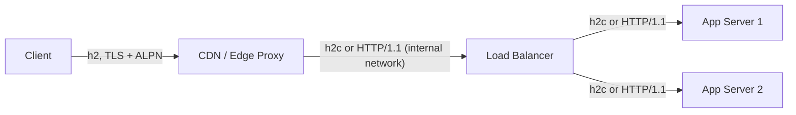

- **Full end-to-end HTTP/2.** Some architectures (particularly internal
  service-to-service Remote Procedure Call, RPC, traffic — gRPC is built
  directly on top of HTTP/2 framing) run HTTP/2 all the way from edge to
  backend, gaining multiplexing benefit on every hop at the cost of every
  intermediary needing full HTTP/2 support and correct flow-control/
  prioritization propagation (Section 4.5's failure mode).
- **Connection coalescing.** Browsers and HTTP/2-aware clients can reuse a
  single existing HTTP/2 connection for multiple hostnames that share a
  compatible TLS certificate (a wildcard or Subject Alternative Name, SAN,
  certificate covering both) and resolve to the same IP address — this
  further reduces the "how many connections does this page actually need"
  question below even the level a naively-consolidated single-origin
  strategy would suggest, but only when certificate and IP-address
  conditions line up.

## 8. Production Architecture

```text
Client (h2, TLS+ALPN)
   |
   v
CDN Edge (h2 termination, HPACK state per client connection)
   |  h2c or HTTP/1.1 (private network)
   v
Load Balancer / Reverse Proxy (may re-terminate TLS for internal h2)
   |
   -----------------------------------------
   |                |                      |
Service A       Service B              Service C
(HTTP/2 or      (gRPC over             (HTTP/1.1 legacy,
HTTP/1.1)       HTTP/2)                unaffected — HTTP/2
                                        migration is edge-only)
```

Because HTTP/2 preserves HTTP semantics exactly (Section 6), backend
services that only understand HTTP/1.1 can remain completely unmodified —
the CDN/load balancer boundary is where the actual protocol-version decision
is made, and it is entirely legitimate architecture to run HTTP/2 only on
the client-facing hop while leaving every internal hop on HTTP/1.1
unchanged, especially for organizations without the operational appetite to
validate HTTP/2 correctness across every internal proxy and service mesh
component simultaneously.

## 9. Implementation

Enabling HTTP/2 on a production server generally requires three things: (1)
TLS configured with ALPN advertising `h2` (nearly all HTTP/2 deployments in
practice are TLS-only, even though the specification permits h2c — Section
4.9), (2) a server/runtime whose HTTP stack actually implements HTTP/2
framing, flow control, and HPACK (rather than only advertising ALPN support
without a real HTTP/2 implementation behind it), and (3) tuning
`SETTINGS_MAX_CONCURRENT_STREAMS` and window sizes (Section 4.10) to match
expected concurrency and payload sizes rather than leaving defaults
unexamined. Section 10 provides concrete, runnable configuration for two of
the most common deployment targets — nginx as a reverse proxy/edge
terminator, and Node.js as an application server speaking HTTP/2 directly.

## 10. Complete Code Examples

**Example 1 — nginx as an HTTP/2 edge terminator.** Demonstrates Section
4.9 (TLS + ALPN negotiation for h2) and Section 8's edge-termination
pattern; nginx negotiates h2 with clients and can be configured to speak
either HTTP/1.1 or h2c to upstream application servers.

```nginx
# /etc/nginx/conf.d/http2-edge.conf
server {
    listen 443 ssl;
    http2 on;                       # HTTP/2 negotiated via ALPN over TLS
    server_name api.example.com;

    ssl_certificate     /etc/ssl/certs/api.example.com.fullchain.pem;
    ssl_certificate_key /etc/ssl/private/api.example.com.key;
    ssl_protocols       TLSv1.2 TLSv1.3;

    # HTTP/2-specific tuning (Section 4.10) — do not leave at nginx defaults
    # for high-concurrency APIs without measuring first (Section 11).
    http2_max_concurrent_streams 128;   # caps SETTINGS_MAX_CONCURRENT_STREAMS
    http2_recv_buffer_size 256k;        # connection-level flow-control buffer

    location / {
        # Upstream speaks plain HTTP/1.1 — this is the "edge-terminated h2,
        # internal HTTP/1.1" pattern from Section 7; no backend code changes
        # were required to add HTTP/2 support at the edge.
        proxy_pass http://app_backend;
        proxy_http_version 1.1;
        proxy_set_header Connection "";
        proxy_set_header Host $host;
        proxy_set_header X-Forwarded-Proto $scheme;
    }
}

upstream app_backend {
    server 10.0.1.10:8080;
    server 10.0.1.11:8080;
    keepalive 64;   # reuse persistent HTTP/1.1 connections to backends
}
```

**Example 2 — Node.js HTTP/2 server (h2).** Demonstrates a server that
speaks HTTP/2 directly to clients (the "full end-to-end HTTP/2" pattern
from Section 7), using Node's built-in `node:http2` module rather than a
framework shim, so the frame-level behavior from Section 4 is directly
visible.

```javascript
// server.js — requires Node.js 16+ and valid TLS cert/key files
const http2 = require('node:http2');
const fs = require('node:fs');

const server = http2.createSecureServer({
  key: fs.readFileSync('server-key.pem'),
  cert: fs.readFileSync('server-cert.pem'),
  // Tune SETTINGS (Section 4.10) rather than accepting library defaults
  // blindly for a production-facing service.
  settings: {
    maxConcurrentStreams: 128,
    initialWindowSize: 1048576, // 1 MB — larger than the 64 KB RFC default
  },
});

server.on('stream', (stream, headers) => {
  const path = headers[':path'];

  if (path === '/api/orders') {
    // Respond on this stream only — unrelated streams on the same
    // connection are not blocked by this one (Section 4.2/4.3).
    stream.respond({
      ':status': 200,
      'content-type': 'application/json',
    });
    stream.end(JSON.stringify({ orders: [] }));
    return;
  }

  stream.respond({ ':status': 404 });
  stream.end('Not Found');
});

server.on('session', (session) => {
  // A "session" here is the HTTP/2 connection; useful hook for
  // connection-level observability (Section 14), e.g. logging when a
  // GOAWAY (Section 4.8) is sent during a graceful shutdown.
  session.on('close', () => console.log('HTTP/2 session closed'));
});

server.listen(8443, () => console.log('HTTP/2 server listening on 8443'));
```

**Example 3 — Multiplexing demonstration (Node.js client).** Fires several
requests over a single HTTP/2 session and logs each stream's ID and timing,
making Section 4.2's multiplexing behavior directly observable rather than
theoretical — contrast this with the equivalent HTTP/1.1 client, which would
need multiple TCP connections to achieve the same concurrency.

```javascript
// multiplex-client.js — demonstrates concurrent streams on ONE connection
const http2 = require('node:http2');

const client = http2.connect('https://api.example.com');
const paths = ['/api/orders', '/api/products', '/api/inventory', '/api/pricing'];

client.on('connect', () => {
  console.log(`Single TCP+TLS connection established at ${Date.now()}`);

  // All four requests are issued immediately and concurrently — each gets
  // its own odd-numbered stream ID (Section 4.2) multiplexed over the one
  // connection just opened above, with no per-request handshake cost.
  paths.forEach((path) => {
    const start = Date.now();
    const req = client.request({ ':path': path });

    req.on('response', (headers) => {
      console.log(`Stream for ${path}: status ${headers[':status']}`);
    });

    let data = '';
    req.on('data', (chunk) => { data += chunk; });
    req.on('end', () => {
      console.log(`${path} completed in ${Date.now() - start}ms, ${data.length} bytes`);
    });

    req.end();
  });
});

client.on('error', (err) => console.error('Session error:', err));
```

**Example 4 — Java 21 `HttpClient` issuing concurrent HTTP/2 requests.**
`java.net.http.HttpClient` (standard since Java 11, stable and
production-ready by Java 21) negotiates HTTP/2 automatically when the
server supports it, and reuses one underlying connection across multiple
`sendAsync` calls — demonstrating that multiplexing is transparent to
application code once the client/server both support HTTP/2, with no
manual stream-management code required.

```java
import java.net.URI;
import java.net.http.HttpClient;
import java.net.http.HttpRequest;
import java.net.http.HttpResponse;
import java.util.List;
import java.util.concurrent.CompletableFuture;

public class Http2MultiplexDemo {
    public static void main(String[] args) {
        HttpClient client = HttpClient.newBuilder()
                .version(HttpClient.Version.HTTP_2) // request HTTP/2; falls
                                                     // back to 1.1 if unsupported
                .build();

        List<String> paths = List.of("/api/orders", "/api/products", "/api/inventory");

        // Each request runs concurrently; the client reuses one underlying
        // HTTP/2 connection to the same origin (Section 4.2), rather than
        // opening a separate socket per request as an HTTP/1.1-only client
        // implementation would need to for real concurrency.
        List<CompletableFuture<HttpResponse<String>>> futures = paths.stream()
                .map(path -> HttpRequest.newBuilder()
                        .uri(URI.create("https://api.example.com" + path))
                        .GET()
                        .build())
                .map(request -> client.sendAsync(request, HttpResponse.BodyHandlers.ofString()))
                .toList();

        futures.forEach(future -> future.thenAccept(response ->
                System.out.println(response.uri() + " -> " + response.statusCode())));

        CompletableFuture.allOf(futures.toArray(new CompletableFuture[0])).join();
    }
}
```

## 11. Performance

- **Fewer handshakes dominate the win on high-latency networks.** Every
  avoided TCP+TLS handshake (Section 4.11) saves at least one full round
  trip; on a 150ms Round-Trip Time (RTT) mobile connection, six avoided
  handshakes is close to a full second saved before any actual content
  transfers.
- **HPACK compression matters most for request-heavy, small-payload
  traffic** (Section 4.4) — a mobile app polling a small API frequently
  benefits far more from header compression than a service transferring a
  few large file downloads, where header bytes are a negligible fraction of
  total payload.
- **`SETTINGS_MAX_CONCURRENT_STREAMS` and window sizes are real tuning
  levers** (Section 4.10) — default values chosen for general safety are
  frequently too conservative for a high-throughput internal service mesh
  and too generous (a resource-exhaustion risk, Section 13) for a public,
  untrusted-client-facing endpoint; measure actual concurrent stream counts
  under realistic load before tuning either direction.
- **Prioritization's real-world benefit is inconsistent** (Section 4.5) —
  do not budget expected performance gains on it without first verifying
  your specific server/CDN's actual implementation behavior.

## 12. Scalability

HTTP/2's push toward fewer, longer-lived connections changes a server's
resource-scaling profile compared to HTTP/1.1: instead of scaling primarily
by file-descriptor/socket count (many short-lived connections), an HTTP/2
server scales primarily by **per-connection memory** (HPACK dynamic tables,
per-stream flow-control state, buffered `DATA` awaiting `WINDOW_UPDATE`) and
by **CPU cost of HPACK encode/decode and frame multiplexing logic**. A
server previously provisioned assuming "N concurrent HTTP/1.1 connections"
needs re-profiling for "M long-lived HTTP/2 connections each carrying up to
`SETTINGS_MAX_CONCURRENT_STREAMS` concurrent logical requests" — the
practical concurrency ceiling per connection is now a deliberate
configuration choice (Section 4.10) rather than an emergent property of how
many sockets the OS can hold open.

## 13. Security

- **HPACK's own security history (Section 4.4) is the headline
  consideration**: understand why HPACK was designed to avoid the
  CRIME/BREACH class of compression-oracle attack, and never introduce
  general-purpose stream compression over attacker-and-secret-mixed content
  at any layer above or alongside it.
- **Never expose h2c across an untrusted network boundary** (Section 4.9) —
  it has no TLS and therefore no confidentiality, integrity, or
  authenticated protocol negotiation.
- **Resource-exhaustion via frame floods.** Because HTTP/2 allows many
  cheap, small frames per connection (rapid `SETTINGS`, `PING`, or
  zero-length `HEADERS`/`RST_STREAM` sequences), several 2023-era
  vulnerabilities (the widely reported "HTTP/2 Rapid Reset" class of attack)
  exploited rapid stream open/`RST_STREAM`/re-open cycles to consume server
  CPU far faster than an equivalent volume of full HTTP/1.1 requests would
  — mitigations include rate-limiting stream creation/reset per connection
  and capping `SETTINGS_MAX_CONCURRENT_STREAMS` conservatively rather than
  generously. This is owned in full detail by
  [Security](../15_Security/PART_OVERVIEW.md); this chapter flags it because
  it is a direct consequence of the multiplexing/frame model taught here.
- **Validate that intermediaries genuinely support HTTP/2 frame parsing**
  before trusting them to enforce header-based security controls (Section
  4.1) — a proxy that only partially understands HTTP/2 framing can be a
  request-smuggling vector between HTTP/2 and HTTP/1.1 representations of
  what should be the same logical request.

## 14. Observability

Per-connection metrics matter more under HTTP/2 than they did under
HTTP/1.1: track active streams per connection, `WINDOW_UPDATE` frequency
(a proxy for flow-control pressure, Section 4.6), `RST_STREAM` rate
(elevated rates can indicate either legitimate client-side cancellation or
the Rapid Reset attack pattern from Section 13), and `GOAWAY` frequency
(unexpectedly frequent connection churn undermines the entire multiplexing
benefit). General request-level logging (method, path, status, latency,
correlation ID) is unchanged from HTTP/1.1 and owned by
[HTTP](CH01_HTTP.md#14-observability); this chapter's addition is the
connection/stream-level metrics layer specific to HTTP/2's framing model.

## 15. Failure Scenarios

- **`GOAWAY` during a rolling deployment** (Section 4.8): a server signals
  the last stream ID it will process before shutting down, letting
  in-flight streams drain gracefully — a load balancer or client that
  mishandles this signal as a hard error rather than a graceful-drain
  notice produces false-positive alerts during entirely routine deployments.
- **Stream starvation from a misbehaving peer**: a client (or a compromised/
  buggy one) that opens streams faster than it consumes responses can
  exhaust `SETTINGS_MAX_CONCURRENT_STREAMS` for legitimate concurrent
  traffic on that same connection — mitigated by the same controls as
  Section 13's Rapid Reset guidance.
- **Silent stalls from unreplenished flow-control windows** (Section 4.6):
  presents as "the connection looks alive but data has stopped flowing,"
  distinguishable from a network partition only by inspecting
  `WINDOW_UPDATE` frame activity, not by any connection-level error signal.
- **Intermediary HTTP/2-to-HTTP/1.1 downgrade mismatches**: a request that
  is valid as an HTTP/2 stream (e.g. certain header ordering or
  pseudo-header combinations) can translate ambiguously when a proxy
  downgrades it to HTTP/1.1 text for a backend that doesn't support HTTP/2
  — a documented source of request-smuggling incidents when the two
  representations of "the same" request diverge.

## 16. Testing

- Verify actual protocol negotiation end-to-end with `curl --http2 -v` (or
  `openssl s_client -alpn h2`) at every hop in the production path, not just
  at the public edge — a common gap is assuming HTTP/2 is used
  internally when an intermediary silently downgraded to HTTP/1.1.
- Load-test with realistic per-connection stream concurrency, not
  fresh-connection-per-request patterns — HTTP/2's performance
  characteristics only show up when a load-testing tool actually reuses
  connections and issues genuinely concurrent multiplexed streams (Example
  3, Section 10) rather than serializing requests over a supposedly
  HTTP/2-capable client.
- Specifically test `RST_STREAM`/rapid-reset resilience (Section 13) as part
  of security testing, not just functional correctness testing.
- Empirically verify whether your specific CDN/proxy/server combination
  honors stream prioritization (Section 4.5) before relying on it in any
  performance budget.

## 17. Common Mistakes

- Assuming "HTTP/2 solves head-of-line blocking" without the transport-layer
  qualification from Section 4.3, then being surprised by lossy-network
  stalls.
- Leaving HTTP/1.1-era domain sharding, concatenation, and spriting in place
  after migrating the load balancer to HTTP/2 (Section 4.11), capturing only
  partial migration benefit.
- Designing new features around server push in 2026 (Section 4.7) — it is
  effectively deprecated across major browsers.
- Treating HPACK as a general-purpose compressor equivalent to gzip when
  reasoning about security properties (Section 4.4).
- Leaving `SETTINGS_MAX_CONCURRENT_STREAMS` and window sizes at library
  defaults for a high-throughput production service without measuring
  actual concurrency needs (Section 4.10, 11).

## 18. Best Practices

- Consolidate assets onto as few origins as practical to maximize
  multiplexing and HPACK benefit (Section 4.11) — verify with real
  measurements, not assumptions.
- Use `<link rel="preload">` instead of server push for anticipated
  resource needs (Section 4.7).
- Tune `SETTINGS_MAX_CONCURRENT_STREAMS` and flow-control window sizes
  deliberately per workload rather than accepting defaults unconditionally
  (Section 4.10, 11).
- Rate-limit stream creation/reset per connection to mitigate Rapid Reset
  class attacks (Section 13).
- Keep bulk-transfer traffic separate from latency-sensitive small API
  traffic when connection-level flow-control contention (Section 4.6) is a
  measured concern.

## 19. Anti-Patterns

- **Domain sharding, concatenation, and spriting under HTTP/2** (Section
  4.11) — carried-over HTTP/1.1 optimizations that actively hurt
  performance once multiplexing removes their original justification.
- **Relying on server push for critical-path performance** (Section 4.7) —
  a feature most browsers no longer support.
- **Exposing h2c across a trust boundary** (Section 4.9, 13).
- **Ignoring `GOAWAY`/graceful-drain semantics** in load balancer health
  checks and connection-pooling logic (Section 15), causing false-positive
  failure signals during routine deployments.

## 20. Trade-off Analysis

| Decision | Benefit | Cost |
|---|---|---|
| End-to-end HTTP/2 (edge to backend) | Multiplexing benefit on every hop; required for gRPC | Every intermediary must correctly implement flow control/prioritization propagation |
| Edge-only HTTP/2, HTTP/1.1 internally | Simpler backend/proxy stack, no internal HTTP/2 validation burden | Loses multiplexing benefit on internal hops |
| Large `SETTINGS_MAX_CONCURRENT_STREAMS` | Higher achievable per-connection concurrency | More memory/CPU exposure per connection; larger Rapid Reset attack surface |
| Enabling server push | (Theoretical) round-trip savings for anticipated resources | Real-world data shows frequent wasted bandwidth and flow-control contention; largely unsupported by browsers today |
| Keeping HTTP/1.1-era asset sharding after HTTP/2 migration | None — a legacy holdover | Redundant handshakes, wasted HPACK benefit, no offsetting gain |

## 21. Comparison Table

| Property | HTTP/1.1 | HTTP/2 | HTTP/3 (next chapter, for orientation only) |
|---|---|---|---|
| Wire format | Text | Binary framing | Binary framing over QUIC |
| Transport | TCP | TCP | QUIC (UDP-based) |
| Multiplexing | No (one request per connection) | Yes, stream-level over one TCP connection | Yes, stream-level with independent loss recovery |
| Header compression | None | HPACK | QPACK |
| Application-layer HOL blocking | Yes | Solved | Solved |
| Transport-layer HOL blocking | N/A (no multiplexing to block) | Present (Section 4.3) | Solved (QUIC per-stream loss recovery) |
| Server push | N/A | Specified, largely deprecated in practice | Specified, same deprecation trajectory |
| Typical deployment today | Legacy/simple internal services | Most modern web/API traffic | Mobile-heavy, high-latency/lossy networks; growing adoption |

## 22. Real-World Case Study

A media company serving a content-heavy news site migrated its CDN
configuration from HTTP/1.1-only to HTTP/2, but initially left in place a
three-way image-domain-sharding scheme (`img1.`, `img2.`, `img3.`) built
years earlier specifically to defeat HTTP/1.1's six-connection-per-host
limit. Post-migration measurements showed only a modest Largest Contentful
Paint (LCP) improvement — far below what HTTP/2 case studies elsewhere
reported. A follow-up architecture review (using exactly the checklist in
Section 26) identified the leftover sharding as the cause: each shard still
forced its own TCP/TLS handshake and its own HPACK dynamic table, meaning
the page was still paying for three connections' worth of handshake
overhead even though the *primary* origin now spoke HTTP/2. Consolidating
all images onto the single primary origin (removing the shards entirely,
per Section 4.11) after the initial HTTP/2 rollout produced a second,
larger LCP improvement than the protocol migration itself had — a concrete
illustration that **completing** a migration (removing the workarounds the
new protocol makes obsolete) can matter more than the protocol upgrade
alone.

## 23. Interview Questions

1. Explain exactly what problem HTTP/2's binary framing and multiplexing
   solve, and precisely what class of head-of-line blocking they do *not*
   solve — why not, mechanically?
2. Why was HPACK designed instead of reusing gzip/DEFLATE for header
   compression? What specific attack motivated that design choice?
3. Server push was specified, shipped in every major browser, and later
   deprecated. What went wrong, and what general architectural lesson does
   that history illustrate?
4. Why do HTTP/1.1 techniques like domain sharding and asset concatenation
   become anti-patterns under HTTP/2? Be specific about the mechanism, not
   just the conclusion.
5. What is the difference between h2 and h2c, and why is h2c never
   appropriate across an untrusted network boundary?
6. Describe both levels of HTTP/2 flow control and explain a failure mode
   where the connection-level window, not the stream-level window, is the
   actual bottleneck.

## 24. Hands-on Exercises

Using Example 2 and Example 3 from Section 10, start the Node.js HTTP/2
server locally with a self-signed certificate, then run the multiplexing
client against it. Capture the traffic with Wireshark (using its HTTP/2
dissector) or `curl --http2 -v`, and identify: the TLS ALPN negotiation, the
connection preface, the `SETTINGS` frame exchange, and at least two
concurrent streams' `HEADERS`/`DATA` frames interleaved on the same TCP
connection. Confirm you can see multiple stream IDs active without a second
TCP handshake anywhere in the capture.

## 25. Design Exercises

Design the HTTP/2 deployment for a public API gateway expecting 50,000
concurrent client connections, each issuing roughly 10 concurrent requests
on average, with occasional bursts to 40 concurrent requests per connection
from automated integration clients. Specify: `SETTINGS_MAX_CONCURRENT_STREAMS`
and your reasoning, initial flow-control window sizing, whether you
terminate HTTP/2 end-to-end or only at the edge (and why), and your Rapid
Reset (Section 13) mitigation strategy. Evaluation criteria: whether stated
concurrency limits are actually justified against the described traffic
profile, whether the edge-vs-end-to-end decision considers Section 7's
trade-offs explicitly, and whether the security mitigation is concrete
rather than a vague mention.

## 26. Architecture Review Questions

- Has domain sharding, asset concatenation, or spriting been fully removed
  from the build/asset pipeline after the HTTP/2 migration, not just at the
  load balancer (Section 4.11, 22)?
- Is server push disabled/unused, with `<link rel="preload">` used instead
  where anticipatory loading is genuinely needed (Section 4.7)?
- Are `SETTINGS_MAX_CONCURRENT_STREAMS` and flow-control window sizes
  explicitly chosen and measured against real traffic, not left at library
  defaults (Section 4.10, 11)?
- Is h2c confined strictly to trusted internal network segments, with TLS/h2
  used everywhere else (Section 4.9, 13)?
- Is there a specific, tested mitigation for Rapid Reset-class stream-flood
  attacks (Section 13)?
- Does the team understand — and can they articulate — exactly which class
  of head-of-line blocking HTTP/2 does *not* solve, as input to any future
  HTTP/3 adoption decision (Section 4.3)?

## 27. Summary

HTTP/2 keeps every piece of HTTP vocabulary this handbook's
[HTTP](CH01_HTTP.md) chapter already owns — methods, status codes, caching
— and replaces only the wire format underneath it: a binary framing layer
that enables true stream multiplexing over one TCP connection, HPACK header
compression engineered specifically to avoid the CRIME/BREACH class of
compression-oracle attack, advisory stream prioritization, per-stream and
per-connection flow control, and a server-push feature that stands as a
genuine architecture lesson in how a theoretically sound, fully-specified,
universally-implemented mechanism can still fail once measured in
production. The single most consequential mindset shift for a Solution
Architect is recognizing that HTTP/2 solves head-of-line blocking only at
the application layer — TCP-level head-of-line blocking remains, and is the
direct, explicit motivation for HTTP/3 and QUIC, covered next. Equally
consequential: a decade of HTTP/1.1-era optimizations (domain sharding,
concatenation, spriting) built to route around a connection-count
limitation that no longer exists must be actively unwound, not merely left
alongside a new protocol, to realize HTTP/2's actual benefit.

**Further reading**: [HTTP](CH01_HTTP.md) ·
[REST](../08_API_Architecture/CH01_REST.md) ·
[Security](../15_Security/PART_OVERVIEW.md) ·
[Observability](../14_Observability/PART_OVERVIEW.md) · Part 05's forthcoming
HTTP/3 and QUIC chapters
