# Chapter: HTTP/3

Part: [05 — Networking and Operating Systems](PART_OVERVIEW.md) · Status: Draft

## 1. Introduction

HTTP/3 (Hypertext Transfer Protocol version 3) is the third major generation
of the web's application-layer protocol, standardized in RFC 9114 (2022).
Where [HTTP/2](../05_Networking_and_OS/CH01_HTTP.md) solved *application-layer*
head-of-line blocking by multiplexing many logical streams over a single
Transmission Control Protocol (TCP) connection, HTTP/3 solves the deeper
problem that HTTP/2 could not: *transport-layer* head-of-line blocking baked
into TCP itself. HTTP/3 does this by discarding TCP entirely as its transport
and running over QUIC (originally a recursive backronym for "Quick UDP
Internet Connections," now just a proper name), a new transport protocol
built on top of User Datagram Protocol (UDP).

This chapter is scoped narrowly and deliberately. It does **not** re-teach
general HTTP semantics (methods, status codes, caching headers, the
request/response model) — those are owned by
[HTTP](../05_Networking_and_OS/CH01_HTTP.md). It does **not** re-teach HTTP/2's
binary framing, stream multiplexing over TCP, or HPACK (Header Compression for
HTTP/2) — those are recapped only at the depth needed to explain *why* they
were insufficient, and owned by HTTP/2's chapter (`CH04_HTTP2.md`, not yet
drafted at the time of writing — flagged as a forward reference). And it does
**not** teach the full mechanics of QUIC as a general-purpose transport
protocol (its packet format, congestion control, loss recovery, or its
suitability for non-HTTP protocols like DNS-over-QUIC) — that is the
dedicated job of a future chapter, `CH18_QUIC.md`, in this same part. What
*this* chapter teaches in full is HTTP/3 as an application-layer protocol: how
HTTP semantics are mapped onto QUIC streams, connection migration, 0-RTT/1-RTT
handshake trade-offs as they affect HTTP request latency and security, QPACK
(QUIC-compatible header compression, the successor to HPACK), and the very
real operational risk of UDP being blocked or deprioritized on the path
between client and server.

For a Solution Architect, HTTP/3 matters because it changes default
assumptions baked into a decade of infrastructure decisions: connection
pooling strategies, load balancer affinity, CDN (Content Delivery Network)
edge termination, corporate firewall rules, and mobile client resilience all
need re-evaluation once HTTP/3 is on the table.

## 2. Historical Evolution

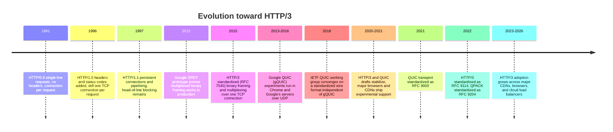

The critical turning point is 2015-2018: HTTP/2 shipped first and delivered
real gains, but its designers and the broader community quickly recognized a
structural ceiling that no amount of application-layer cleverness could lift.
Google's own production telemetry from SPDY and early HTTP/2 deployments
showed that under real-world packet loss (particularly on lossy mobile
networks), HTTP/2's multiplexing gains partially evaporated. That observation
directly motivated funding a from-scratch transport protocol (QUIC) rather
than patching TCP, because TCP's in-order-delivery guarantee is not a bug to
patch — it is the protocol's foundational contract, implemented in kernel
space across billions of deployed devices that cannot all be upgraded in
lockstep.

## 3. Why It Exists

HTTP/2 fixed the *application-layer* head-of-line blocking problem inherited
from HTTP/1.1: instead of one request-per-connection (or a small pool of
connections used to fake parallelism), HTTP/2 interleaves frames from many
logical streams onto a single TCP connection, identified by stream IDs. This
was a genuine win — fewer connections means less handshake overhead, better
congestion control behavior, and no need for the domain-sharding hacks
browsers used to work around HTTP/1.1's per-host connection limits.

But HTTP/2's multiplexing sits *above* TCP, and TCP makes one unconditional
promise to everything above it: bytes arrive at the application in the exact
order they were sent, with no gaps. To keep that promise, if a single TCP
segment is lost in transit, the TCP stack must hold *every subsequent byte
already received* — even bytes belonging to a completely unrelated HTTP/2
stream — in a kernel-space buffer until the lost segment is retransmitted and
arrives. From the application's point of view, all streams stall
simultaneously, even though only one of them was logically affected by the
loss.

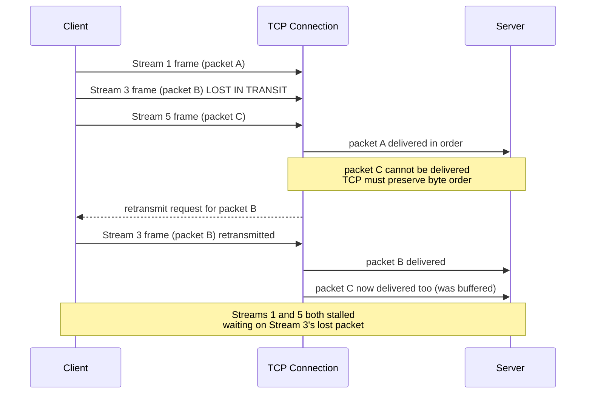

This is **TCP-level head-of-line blocking**, and it is invisible to and
unfixable by anything running above TCP — no amount of clever HTTP/2 framing
can route around a guarantee the transport layer itself enforces. Fixing it
requires either abandoning strict in-order delivery as a transport-wide
guarantee, or moving stream framing *into* the transport layer itself so the
transport can reason about per-stream loss instead of per-connection loss.
QUIC does the latter: it implements multiple independent, ordered streams
*inside* a single QUIC connection, each with its own loss-recovery state, all
running over UDP (which offers no ordering or delivery guarantees at all,
leaving QUIC free to define its own). HTTP/3 exists to be the HTTP mapping
onto that transport — carrying the request/response semantics HTTP already
defines, but riding on a transport that does not have TCP's single-queue
head-of-line-blocking limitation.

A second, related motivator: TCP connection establishment plus a TLS
(Transport Layer Security) handshake takes a minimum of two round trips
before any application data moves (one for the TCP three-way handshake, at
least one more for TLS). Mobile networks with 100-300ms round-trip times pay
that cost on every new connection, and every time a client's IP address
changes (e.g. moving from WiFi to cellular), TCP's four-tuple
(source IP, source port, destination IP, destination port) identity breaks
and a brand-new connection — and a brand-new handshake — is required. QUIC
integrates the transport and cryptographic handshakes into a single exchange
and identifies connections by an explicit Connection ID rather than the
four-tuple, which is what enables both faster connection establishment and
connection migration across network changes. Both are explained in depth in
Section 4.

## 4. Core Concepts

### 4.1 Recap: what HTTP/2 already solved (and what it didn't)

*Owned by HTTP/2's chapter (`CH04_HTTP2.md`); recapped here only to establish
the boundary of this chapter's scope.* HTTP/2 introduced binary framing
(`HEADERS`, `DATA`, `SETTINGS`, `WINDOW_UPDATE` frames), multiplexed many
logical streams over one TCP connection using stream IDs, added HPACK header
compression to shrink repetitive header overhead, and briefly supported
server push (since deprecated in most browsers due to poor real-world cache
efficiency). What it explicitly did *not* solve — and could not solve while
remaining bound to TCP — is transport-level head-of-line blocking (Section 3)
and the two-round-trip-minimum connection setup cost. HTTP/3 exists
specifically to close those two remaining gaps.

### 4.2 QUIC as a transport: what HTTP/3 needs to know (recap only)

*Full transport mechanics — packet number spaces, congestion control
algorithms, QUIC's loss detection state machine, its packet/frame wire
format — are owned by the future `CH18_QUIC.md` chapter.* What this chapter's
reader needs as background: QUIC runs over UDP, encrypts nearly all of its
own metadata (frame headers are visible only to endpoints, not to
middleboxes, unlike TCP), multiplexes independent streams inside one QUIC
connection so a lost packet only blocks the one stream whose data it carried,
and folds the transport handshake and the TLS 1.3 cryptographic handshake
into a single combined exchange. HTTP/3 is simply the definition of how HTTP
requests, responses, and headers are encoded as QUIC stream data — it adds no
new transport-level behavior of its own.

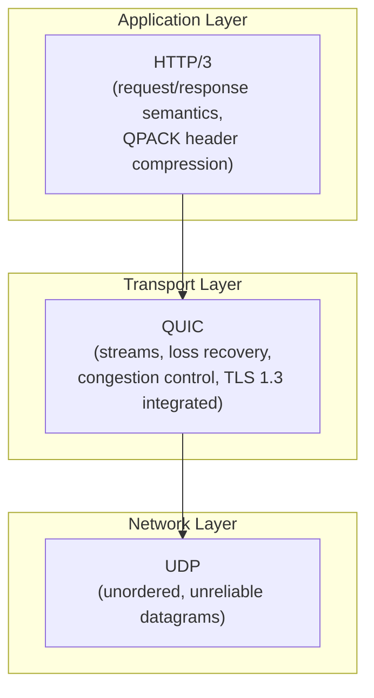

Contrast with the HTTP/2 stack, where TLS and TCP are two separate layers
below the application, each with its own handshake:

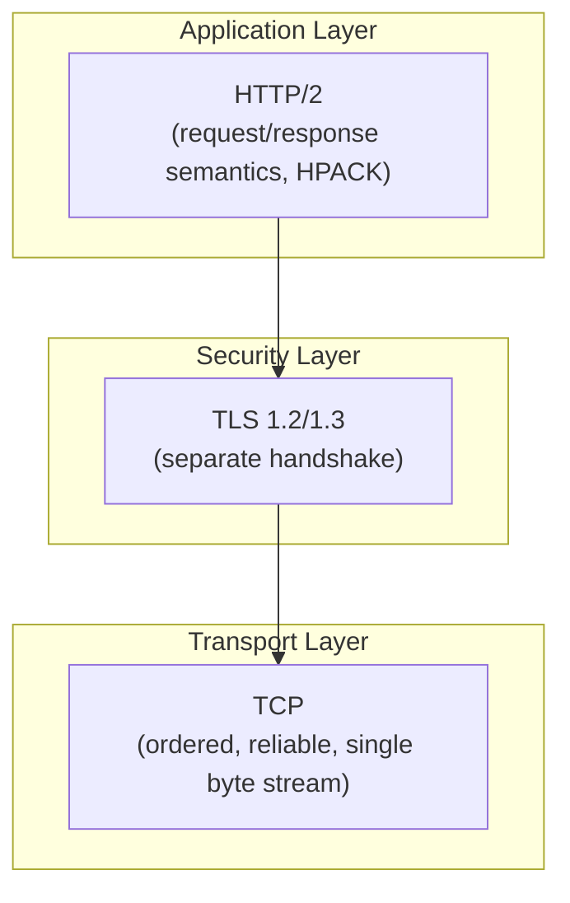

The structural difference — QUIC absorbing TLS into itself rather than
layering it on top of a separate transport handshake — is what enables both
the faster handshake (Section 4.4) and per-stream loss isolation (Section
4.3).

### 4.3 Per-stream loss isolation: how QUIC actually avoids head-of-line blocking

**Definition.** Per-stream loss isolation means that when a UDP packet
carrying data for QUIC stream A is lost, only stream A's data delivery is
delayed; QUIC streams B, C, and D — multiplexed on the same QUIC connection —
continue delivering their data to the application as soon as it arrives, with
no dependency on stream A's retransmission.

**Mechanism.** QUIC assigns each stream its own delivery order guarantee,
scoped to that stream alone, rather than one order guarantee scoped to the
entire connection (which is what TCP does). Internally, each QUIC packet
carries one or more frames, and frames carrying stream data are tagged with a
stream ID and an offset within that stream. The QUIC receiver reassembles each
stream independently: it can hand stream C's bytes to the application layer
immediately upon arrival, even while it is still waiting on a retransmission
for stream A, because nothing in QUIC's design requires cross-stream
ordering. Loss detection and retransmission are also *packet*-scoped, not
*connection*-scoped: only the specific lost packet (and the specific stream
data it carried) needs retransmitting, not any data belonging to unrelated
streams that happened to arrive later.

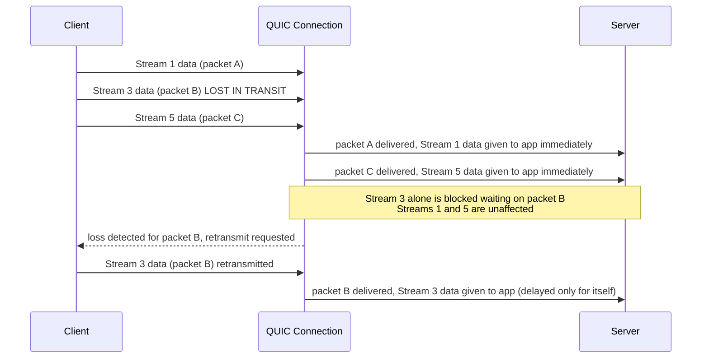

**Decision implications.** For a Solution Architect, this changes what
"good" looks like on lossy network paths — mobile clients on cellular
networks, satellite links, or congested Wi-Fi see the most benefit, because
those are precisely the environments where packet loss is common enough for
TCP's connection-wide stall to matter. On a clean, low-loss data-center-to-
data-center link, the practical difference between HTTP/2 and HTTP/3 is much
smaller, because there is rarely any loss to isolate in the first place —
this is a key input when deciding whether HTTP/3 is worth the deployment
complexity for internal service-to-service traffic versus edge/client-facing
traffic.

**Common failure mode.** Assuming HTTP/3 "fixes multiplexing" in some
absolute sense and therefore always outperforms HTTP/2. In practice, on
low-latency low-loss paths, QUIC's per-packet encryption overhead and
userspace (rather than kernel-space, highly optimized) implementation can
make it *measurably slower* in raw CPU terms than a mature TCP+TLS stack. The
architectural win is specifically about loss resilience and connection
lifecycle, not a universal performance multiplier.

**Concrete scenario.** A mobile banking app fetches an account dashboard
via 6 parallel API calls multiplexed over one connection. On a subway
platform with intermittent connectivity, one of the six responses experiences
packet loss. Over HTTP/2, all six responses stall until the lost TCP segment
is retransmitted (which itself may take multiple round trips if the loss
recurs). Over HTTP/3, the five unaffected responses render immediately in
the UI, and only the one component waiting on the lost packet's data shows a
loading spinner a little longer.

### 4.4 Connection migration: surviving a network change without a new handshake

**Definition.** Connection migration is QUIC's ability to keep a single
logical connection alive across a change in the client's network path (for
example, the client's IP address changing when it switches from Wi-Fi to a
cellular network), without tearing down and re-establishing the connection —
and therefore without a new handshake.

**Mechanism.** TCP identifies a connection by the four-tuple: source IP,
source port, destination IP, destination port. If any element of that tuple
changes — most commonly the client's source IP address after a network
switch — the operating system's TCP stack considers it an entirely different
connection, because the four-tuple *is* the connection's identity in TCP's
model. QUIC instead identifies a connection by an explicit, negotiated
Connection ID that is independent of the underlying IP addresses and ports in
use. When a client's network path changes, it can continue using the same
Connection ID over the new path; the server recognizes the Connection ID,
associates it with existing connection state (encryption keys, stream state,
flow control), and — after a brief path-validation exchange to confirm the
client genuinely controls the new address (preventing an off-path attacker
from hijacking traffic to a spoofed address) — resumes the connection with no
new cryptographic handshake and no lost application state.

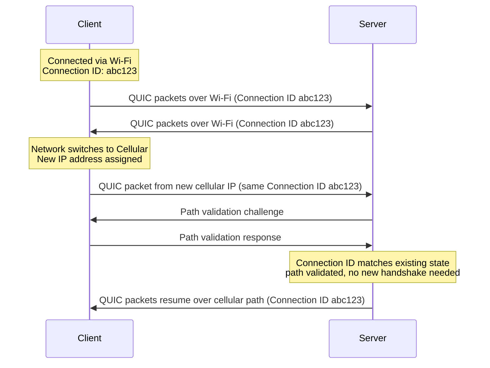

**Decision implications.** For any client-facing service where users are
commonly mobile (consumer apps, field-service tooling, video/audio calling,
IoT devices moving between networks), connection migration removes an entire
class of user-visible failure: the "spinner on network switch" experience
that TCP-bound HTTP/1.1 and HTTP/2 cannot avoid. Architecturally, this shifts
some resilience work from the application layer (retry logic, exponential
backoff on reconnect) down into the transport, simplifying client code that
previously had to detect and gracefully recover from mid-request connection
resets.

**Common failure mode.** Assuming connection migration is free of security
consideration. Without the path-validation step, an attacker who can spoof
packets appearing to come from a victim's Connection ID could redirect
traffic to an address they control (a denial-of-service or traffic-hijacking
vector) — this is precisely why QUIC mandates a path-validation round trip
before fully trusting a new path, trading a small latency cost for that
protection.

**Concrete scenario.** A delivery-driver app maintains a long-lived QUIC
connection to a dispatch server. The driver's phone hands off from an
in-warehouse Wi-Fi access point to the cellular network as they leave the
building mid-request. With HTTP/3, the in-flight request completes
transparently over the new path. With HTTP/2 over TCP, the TCP connection
resets, the TLS session must be renegotiated (or resumed via a session
ticket, still an extra round trip), and the application must detect the
failure and retry — a visible hiccup for the driver.

### 4.5 0-RTT and 1-RTT connection establishment

**Definition.** 1-RTT (one Round-Trip Time) establishment means the client
can begin sending encrypted application data after exactly one round trip to
the server — combining what used to be a separate TCP handshake and TLS
handshake into a single exchange. 0-RTT (zero Round-Trip Time) establishment
goes further: for a client that has *previously* connected to the same
server, it can send application data in its very first flight of packets,
before waiting for any reply at all, by reusing cryptographic parameters
remembered from the earlier session.

**Mechanism — 1-RTT.** QUIC integrates the TLS 1.3 handshake directly into
its own handshake packets rather than running TLS as a protocol layered on
top of an already-established transport connection. The client's first
packet carries both QUIC's initial transport parameters and TLS's
`ClientHello` (including a key share); the server's response carries its
`ServerHello`, certificate, and `Finished` message, encrypted as soon as the
key share allows — mirroring TLS 1.3's own one-round-trip design, but with
the transport handshake happening in the same exchange rather than before it.
Application data (the actual HTTP/3 request) can be sent as soon as the
client processes the server's response, which is why this is "1-RTT" rather
than the two-or-more round trips TCP+TLS 1.2 historically required.

**Mechanism — 0-RTT.** If the client and server have communicated before,
the server can have previously issued the client a resumption token (a Pre-
Shared Key derived from the earlier session). On a subsequent connection
attempt, the client includes this token in its very first packet, along with
already-encrypted early application data — the HTTP/3 request itself — using
keys derived from the remembered session, without waiting for any reply. The
server can decrypt and act on that data immediately upon receipt.

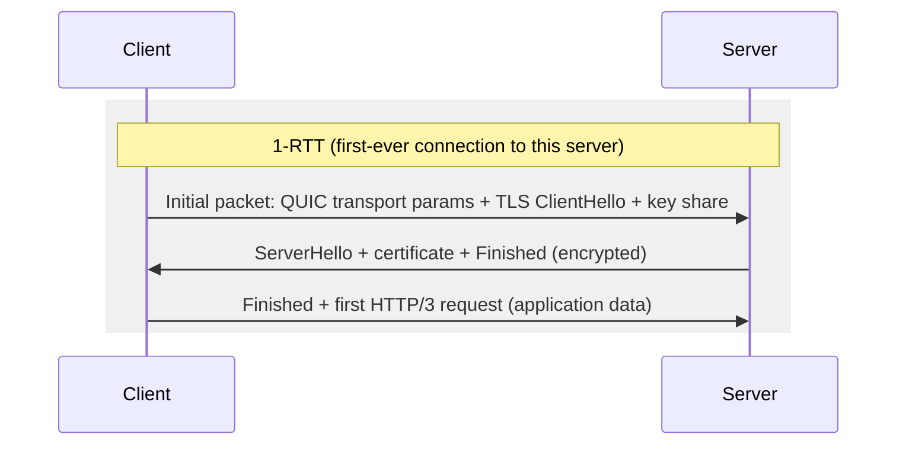

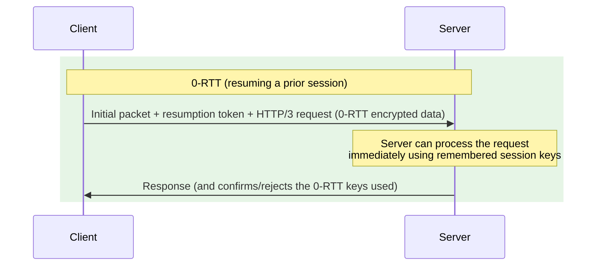

**Decision implications and the replay-attack trade-off.** 0-RTT's speed
comes at a specific, well-documented security cost: because the very first
packet's application data is encrypted using a *previously* derived key with
no fresh randomness exchanged yet in this connection, an attacker who
captures that first packet can replay it verbatim to the server, and the
server has no protocol-level way to distinguish a replay from the client's
genuine retry. This is safe for **idempotent** requests (a repeated `GET` for
the same resource causes no harm) but dangerous for **non-idempotent**
requests (a repeated `POST /transfer-funds` could execute the transfer
twice). The architectural mitigation is a hard rule: 0-RTT data should only
ever be used for requests the application can prove are safe to receive more
than once, and servers commonly restrict 0-RTT acceptance to safe HTTP
methods, or require an idempotency key ([see Idempotency, owned by
HTTP](../05_Networking_and_OS/CH01_HTTP.md)) on any 0-RTT-carried mutation
before processing it — some server implementations disable 0-RTT for
non-`GET` methods by default for exactly this reason.

**Common failure mode.** Enabling 0-RTT globally without auditing which
request types can arrive over it. A team migrating to HTTP/3 for latency
wins can inadvertently expose a replay vector on a checkout or payment
endpoint if the reverse proxy or CDN in front of it accepts 0-RTT
indiscriminately for all paths.

**Concrete scenario.** A news site's CDN edge enables 0-RTT to shave a round
trip off returning-visitor page loads. Article `GET` requests over 0-RTT are
safe to replay — worst case, the CDN serves the same cached article twice.
The same CDN's origin-forwarded API path for submitting a newsletter
subscription is explicitly excluded from 0-RTT eligibility at the edge
configuration, because a replayed subscription `POST` should not silently
double-submit a form.

### 4.6 QPACK: QUIC-compatible header compression

**Definition.** QPACK (specified in RFC 9204) is HTTP/3's header compression
scheme — the successor to HPACK used by HTTP/2 — redesigned specifically to
avoid introducing head-of-line blocking of its own on top of QUIC's
per-stream delivery model.

**Mechanism.** *Recap of HPACK's design (owned by HTTP/2's chapter):* HPACK
compresses repeated header values (like `:authority`, `user-agent`, or
repeated `cookie` values) using a shared, ordered dynamic table that both
sides update incrementally as new header field/value pairs are seen —
referencing an existing table entry by index is far cheaper than
re-transmitting the full string. The problem QPACK had to solve: HPACK's
dynamic table updates *must be processed strictly in the order they were
sent*, because each update can reference the table state left by the
previous one. Over HTTP/2's single TCP byte stream, that was free — TCP
already guarantees in-order delivery. But over QUIC, where different HTTP
streams can be delivered to the application in *any* order relative to each
other (Section 4.3's entire point), naively reusing HPACK's ordering
requirement would silently reintroduce head-of-line blocking: a stream
referencing dynamic table entry #12 cannot be decoded until whatever QUIC
stream carried table update #12 has arrived, even if that update was
logically unrelated to this particular request.

QPACK solves this by carrying dynamic table updates over two *dedicated*
unidirectional QUIC streams (one per direction) separate from the
request/response streams, and by encoding, for every header block, the
specific table state it depended on. A receiver can then either: (a) decode
a header block immediately if the referenced table entries have already
arrived on the dedicated update stream, or (b) buffer *only that one header
block* — not the whole connection, and not other streams — until the
specific table entries it needs arrive. Critically, QPACK also defines a
"static table" (a fixed, pre-agreed set of extremely common header
field/value pairs, similar in spirit to HPACK's static table) that requires
no dynamic update at all and can always be decoded instantly, further
reducing how often a header block needs to wait on anything.

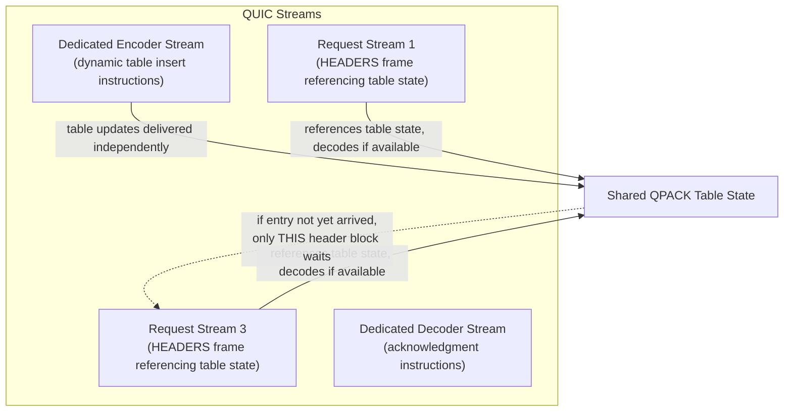

**Decision implications.** QPACK requires more implementation complexity
than HPACK — encoders must decide, per header block, whether to reference
the dynamic table (better compression, risk of blocking) or fall back to the
static table or literal encoding (worse compression, guaranteed no
blocking). Most production QPACK encoders default to a conservative strategy
that favors avoiding blocking over maximizing compression ratio, especially
early in a connection's life when the dynamic table is still small. For
architects evaluating HTTP/3 proxy/CDN vendors, this is a legitimate
question to ask: how aggressively does their QPACK encoder use the dynamic
table, and does that trade-off match the traffic profile (many small
repeated headers vs. mostly unique headers)?

**Common failure mode.** Assuming QPACK and HPACK are interchangeable at the
wire level because they solve "the same problem." They are not
wire-compatible, and a proxy that terminates HTTP/3 and forwards HTTP/2 (or
vice versa) must fully decode one header compression scheme and re-encode
the other — this is real CPU and complexity cost that must be accounted for
in any mixed-protocol deployment (Section 8).

**Concrete scenario.** An API gateway serving both HTTP/2 and HTTP/3 clients
against the same backend receives a request with a large `cookie` header
repeated across many requests from the same client. Over HTTP/2, HPACK's
dynamic table lets subsequent requests reference that cookie by a one-byte
index. Over HTTP/3, QPACK achieves the same compression ratio over time, but
the gateway's QPACK encoder must independently track per-connection table
state and decide, request by request, whether referencing that table entry
risks blocking this particular header block on data not yet received.

### 4.7 ALPN and protocol negotiation in an HTTP/3 world

**Definition.** ALPN (Application-Layer Protocol Negotiation) is a TLS
extension that lets a client advertise, during the handshake itself, which
application-layer protocols it supports (e.g. `h2`, `http/1.1`, `h3`), so the
server can select one without any additional round trip.

**Mechanism.** For HTTP/2, ALPN operates during the TCP+TLS handshake: the
client's `ClientHello` includes an ALPN extension listing supported
protocols in preference order; the server's `ServerHello` echoes back the
one it selected. Because HTTP/3 runs over a completely different transport
(QUIC/UDP rather than TCP), a client cannot know in advance, from URL scheme
alone, whether a given server even supports HTTP/3 — the browser must
usually attempt a normal HTTPS connection first (HTTP/1.1 or HTTP/2 over
TCP) and *learn* that HTTP/3 is available via a response header,
`Alt-Svc` (Alternative Services), which advertises "this origin also speaks
h3 on this UDP port, for the next N seconds." On subsequent visits within
that window, the client can attempt HTTP/3 directly (racing it against a
fallback TCP connection, Section 22), and ALPN within the QUIC handshake
itself confirms `h3` as the negotiated protocol once the UDP path is
attempted.

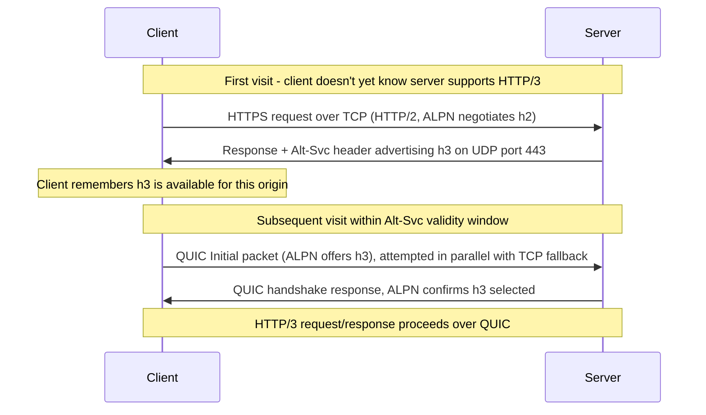

**Decision implications.** Because HTTP/3 discovery depends on `Alt-Svc`
having been seen at least once, a client's very first request to a new
origin is essentially never HTTP/3 — this has real implications for
first-visit latency benchmarks (they will reflect TCP-based HTTP/2 or
HTTP/1.1, not HTTP/3) and for testing/monitoring setups that must
deliberately warm the `Alt-Svc` cache before measuring HTTP/3 behavior.

**Common failure mode.** Configuring a server to advertise `Alt-Svc: h3=":443"`
without actually having a UDP listener bound and reachable on port 443 (for
example, a firewall rule that only opens 443/TCP) — clients will then waste
time attempting and timing out on HTTP/3 connections that can never
succeed, adding latency instead of removing it. See the ALPN negotiation
trace and fallback strategy in Sections 10 and 22.

### 4.8 UDP as QUIC's foundation: why this is a deployment risk, not just a technical footnote

**Definition.** Because QUIC is built entirely on UDP rather than TCP, every
network device between client and server that treats UDP differently from
TCP — firewalls, NAT (Network Address Translation) gateways, corporate proxy
appliances, deep-packet-inspection middleboxes — can affect whether HTTP/3
traffic reaches its destination at all, independent of whether the
HTTP/3 protocol implementation itself is correct.

**Mechanism.** TCP has had roughly four decades of near-universal middlebox
support: virtually every firewall, load balancer, and corporate network
policy has mature, well-tested rules for TCP port 443. UDP has historically
been associated with a narrower set of use cases (DNS, Domain Name System;
Voice over Internet Protocol; and Session Traversal Utilities for NAT
punch-through) and is frequently rate-limited, deprioritized in Quality of
Service (QoS) policies, or blocked outright by conservative corporate
firewalls that were never configured with "high-volume general-purpose web
traffic over UDP" in mind. A client behind such a firewall may find its
HTTP/3 QUIC packets silently dropped with no explicit rejection — from the
client's perspective, the connection simply times out.

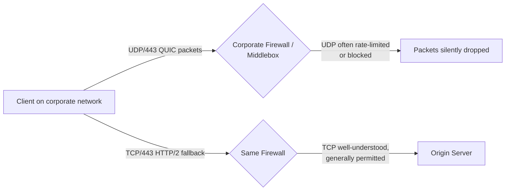

**Decision implications.** This is the single most important operational
fact about HTTP/3 for a Solution Architect to internalize: HTTP/3 must
always be deployed as an *enhancement layered on top of a working HTTP/2 or
HTTP/1.1 fallback*, never as the sole transport. Every production HTTP/3
deployment needs (a) a genuine, tested, non-degraded fallback path over TCP,
(b) a connection-racing or fast-fallback strategy so a blocked UDP path
doesn't add a long timeout before the client tries TCP (Section 22 covers
the concrete mechanism, "Happy Eyeballs"-style racing), and (c) monitoring
that distinguishes "client doesn't support HTTP/3" from "client's network
blocks HTTP/3" from "our own UDP listener is misconfigured or overloaded" —
these three failure modes look identical from a simple "percentage of
requests served over h3" metric but require entirely different remediation.

**Common failure mode.** Treating a drop in HTTP/3 negotiation rate as
purely a client-adoption metric, when it is frequently a *network-path*
signal — corporate VPNs, restrictive campus networks, and certain mobile
carrier middleboxes are known to interfere with UDP/443 traffic at a rate
meaningfully higher than their TCP/443 interference rate. Architects
supporting enterprise or B2B (business-to-business) customers, where traffic
disproportionately originates from corporate networks with conservative
firewall policies, should expect a *materially lower* HTTP/3 negotiation
success rate than a consumer-facing service with mostly residential/mobile
traffic, and should never assume HTTP/3 rollout percentages will match
across customer segments.

**Concrete scenario.** A Software-as-a-Service (SaaS) vendor rolls out
HTTP/3 globally and sees 68% of consumer-app traffic successfully upgrade to
`h3`, but only 22% of traffic from its top enterprise customers upgrades —
investigation finds several large customers' corporate firewalls block
outbound UDP except for a short allow-list of known ports/protocols,
silently forcing those users onto the TCP fallback path every time. Because
the fallback path was tested and performant, end users experience no
functional degradation — but the architecture team must not mistakenly
read the low upgrade rate as a client software problem and spend time
"fixing" client configuration that was never broken.

### 4.9 Server push's removal and stream prioritization in HTTP/3

**Definition.** HTTP/3 does not carry forward HTTP/2's server push
mechanism (a server proactively sending resources the client didn't
explicitly request); instead, RFC 9114 removes it from the protocol, and
stream and request prioritization is instead handled via a simpler,
separate extensible-priority scheme (RFC 9218) rather than HTTP/2's
dependency-tree-based prioritization.

**Mechanism.** *Recap:* HTTP/2's server push let a server send, say, a
CSS (Cascading Style Sheets) file alongside an HTML (HyperText Markup
Language) response before the client even asked for it, aiming to save a
round trip. In practice, browsers found this frequently pushed resources
the client already had cached, wasting bandwidth, and most major browsers
disabled push support by 2022. HTTP/3 does not define push at all. In its
place, both HTTP/2 (retrofitted) and HTTP/3 support a simpler priority
signaling scheme using an `Urgency` value (0-7, lower is more urgent) and an
`Incremental` flag (whether partial delivery is useful, e.g. progressively
rendering an image) carried in a `Priority` header field or a dedicated
frame — a flat, explicit signal rather than HTTP/2's more complex weighted
dependency tree, which many server and proxy implementations found
difficult to implement correctly and rarely used to its full potential.

**Decision implications.** Architects who previously relied on server push
for critical-resource preloading (rare in practice, but present in some
older performance-optimization playbooks) must migrate that strategy to
`<link rel="preload">` resource hints or 103 Early Hints responses instead —
both of which work identically regardless of HTTP version and don't depend
on a deprecated mechanism.

**Common failure mode.** Porting an old HTTP/2 server-push configuration
directly when migrating a service to HTTP/3 and being surprised it has no
effect — server push configuration directives are simply inert (or
rejected) under HTTP/3, since the protocol has no equivalent frame type.

**Concrete scenario.** A team migrating a content-heavy site to HTTP/3
finds their `nginx` configuration still has `http2_push_preload on;`
directives left over from an HTTP/2-era optimization pass; because HTTP/3
has no push mechanism, those directives become no-ops for HTTP/3 traffic,
and the team instead adds `Link: </style.css>; rel=preload` response
headers, which work as resource hints across HTTP/1.1, HTTP/2, and HTTP/3
alike.

## 5. Internal Working

At a request/response level, HTTP/3 maps directly onto HTTP's existing
semantics: a request still has a method, a path, and headers; a response
still has a status code and headers; bodies still flow as a stream of bytes.
What differs internally is purely how that mapping happens on the wire.

Each HTTP/3 request/response exchange occupies one bidirectional QUIC
stream. Headers are serialized using QPACK (Section 4.6) into a `HEADERS`
frame; body data flows in one or more `DATA` frames on the same stream; the
stream is closed to signal the end of the message, mirroring HTTP/2's
framing model closely — the key structural difference is *where* that
framing lives (inside a QUIC stream, which QUIC itself delivers and
reassembles independently of other streams) rather than inside a shared TCP
byte stream.

```mermaid
sequenceDiagram
    participant Client
    participant QUICStream as QUIC Stream (bidirectional)
    participant Server
    Client->>QUICStream: HEADERS frame (QPACK-compressed request headers)
    Client->>QUICStream: DATA frame(s) (request body, if any)
    QUICStream->>Server: Stream data delivered in this stream's own order
    Server->>QUICStream: HEADERS frame (QPACK-compressed response headers, status code)
    Server->>QUICStream: DATA frame(s) (response body)
    QUICStream->>Client: Stream data delivered independently of other streams
    Note over Client,Server: Stream closes; QUIC connection remains open<br/>for other concurrent streams
```

Two additional, dedicated *unidirectional* streams exist per QUIC connection
purely for QPACK's own bookkeeping (the encoder and decoder streams from
Section 4.6) — these carry no HTTP request/response data themselves, only
header-compression table state.

Connection-level control information (settings negotiation, flow-control
window updates, and the priority signaling from Section 4.9) is carried on a
reserved control stream, separate from any individual request/response
stream — mirroring HTTP/2's `SETTINGS` frame concept but adapted to QUIC's
stream model rather than a single shared TCP byte stream.

## 6. Design Principles

- **Loss isolation over global ordering**: HTTP/3's entire value proposition
  rests on abandoning "one connection, one strict byte order" in favor of
  "many independently-ordered streams" — every other design choice (QPACK's
  dedicated update streams, per-stream flow control) follows from protecting
  that property.
- **Fold handshakes together, but make the speed/safety trade-off explicit**:
  QUIC does not treat "fewer round trips" as an unconditional good — 0-RTT is
  opt-in and scoped, precisely because folding cryptographic and transport
  handshakes together can't be allowed to silently weaken replay protection.
- **Never require a flag day**: HTTP/3 is designed to be discovered
  opportunistically (via `Alt-Svc`) and to always have a working fallback —
  no client or server is ever required to support only HTTP/3, which is what
  makes incremental internet-wide adoption possible at all.
- **Push complexity to where it can be verified, not where it's convenient**:
  QPACK's design deliberately accepts more encoder-side complexity (deciding
  when it's safe to reference the dynamic table) in exchange for a
  guarantee that decoding never blocks the whole connection — complexity is
  pushed to the side of the protocol that can reason about it locally.

## 7. Architecture Patterns

- **TLS/transport termination at the edge, HTTP/3-aware**: CDN edge nodes
  terminate the QUIC/TLS 1.3 handshake and HTTP/3 framing, then forward
  requests to origin over whatever protocol the origin supports (frequently
  plain HTTP/1.1 or HTTP/2 over a private network) — the QPACK/HPACK
  translation cost (Section 4.6) is absorbed at the edge rather than
  requiring every origin service to implement HTTP/3 natively.
- **Dual-stack listener pattern**: production HTTP/3 deployments run a UDP
  listener (QUIC/HTTP/3) and a TCP listener (HTTP/1.1 or HTTP/2) on the same
  port number in parallel, advertising the UDP option via `Alt-Svc` while
  keeping the TCP path as the unconditional fallback (Section 8's nginx and
  Caddy examples both follow this pattern).
- **Connection racing ("Happy Eyeballs" for transports)**: rather than
  waiting for a UDP attempt to time out before falling back to TCP, clients
  race both simultaneously (once `Alt-Svc` has advertised HTTP/3 support) and
  use whichever completes its handshake first — avoiding the deployment risk
  in Section 4.8 from becoming a hard latency penalty.

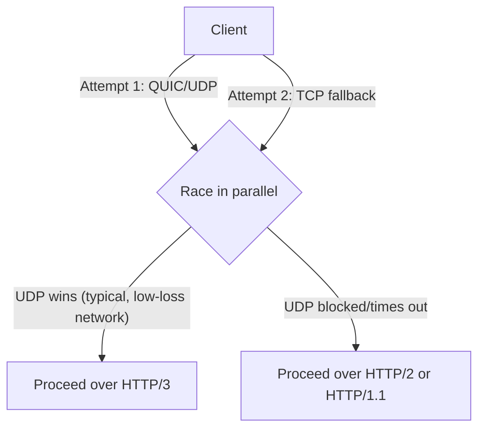

## 8. Production Architecture

A typical production topology places HTTP/3-terminating edge nodes in front
of origin services that may or may not speak HTTP/3 themselves:

```text
Client (HTTP/3 over QUIC/UDP:443, TCP:443 fallback)
        |
        v
CDN / Edge Load Balancer
  - Terminates QUIC + TLS 1.3, decodes QPACK
  - Terminates TCP + TLS 1.3 (HTTP/2 or HTTP/1.1), decodes HPACK, for fallback traffic
  - Advertises Alt-Svc: h3=":443"; ma=86400 on all responses
        |
   HTTP/2 or HTTP/1.1 over private network (origin need not support HTTP/3)
        v
Origin Service / API Gateway
        |
   ------------------------------
   |             |              |
Service A     Service B      Service C
```

The origin frequently does not need to speak HTTP/3 at all — the protocol
translation happens once, at the edge, which is why most organizations adopt
HTTP/3 first at the CDN/load-balancer layer rather than rewriting every
internal service. Internal east-west service-to-service traffic on a
low-loss data-center network sees far less benefit from HTTP/3 (per Section
4.3's decision implications), so architects commonly scope initial adoption
to client-facing edge termination only.

## 9. Implementation

Enabling HTTP/3 on a server generally requires three things: a UDP listener
bound to the same port number as the existing HTTPS TCP listener, a valid
TLS certificate (QUIC mandates TLS 1.3 — there is no unencrypted QUIC/HTTP/3
in practice), and an `Alt-Svc` response header advertised on the existing
HTTP/1.1 or HTTP/2 responses so clients discover HTTP/3 is available.
Section 10 shows both a reverse-proxy (nginx) and a purpose-built HTTP/3-first
(Caddy) configuration, plus a captured ALPN negotiation trace showing the
protocol upgrade in practice.

## 10. Complete Code Examples

**Example 1 — nginx HTTP/3 (QUIC) listener configuration.** Requires an
nginx build with the QUIC module (nginx 1.25+ has this built in).

```nginx
# /etc/nginx/conf.d/http3-example.conf
server {
    # Existing TCP listener for HTTP/1.1 and HTTP/2 fallback
    listen 443 ssl;
    listen [::]:443 ssl;
    http2 on;

    # New UDP listener for HTTP/3 (QUIC), same port number
    listen 443 quic reuseport;
    listen [::]:443 quic reuseport;

    server_name example.com;

    ssl_certificate     /etc/ssl/certs/example.com.fullchain.pem;
    ssl_certificate_key /etc/ssl/private/example.com.key;
    ssl_protocols TLSv1.3;  # QUIC requires TLS 1.3

    # Advertise HTTP/3 availability to clients that connected over TCP
    add_header Alt-Svc 'h3=":443"; ma=86400' always;

    # Signal to the browser that this response was served over QUIC
    add_header X-Quic-Status $http3 always;

    location / {
        proxy_pass http://origin_backend;
        proxy_set_header Host $host;
        proxy_set_header X-Forwarded-Proto $scheme;
    }
}
```

**Example 2 — Caddy HTTP/3 configuration.** Caddy enables HTTP/3 by default
whenever TLS is active, requiring far less explicit configuration:

```caddyfile
# Caddyfile
example.com {
        # HTTP/3 is enabled automatically alongside HTTP/2 once TLS is set up;
        # explicit protocols directive shown here for clarity/auditability.
        servers {
                protocols h1 h2 h3
        }

        reverse_proxy origin_backend:8080 {
                header_up Host {host}
                header_up X-Forwarded-Proto {scheme}
        }

        # Caddy automatically emits the Alt-Svc header once h3 is active;
        # no manual header directive is required.
}
```

**Example 3 — captured ALPN negotiation trace (`curl` with HTTP/3 support),
annotated.** This shows the two-step discovery pattern from Section 4.7:
first connection negotiates `h2` and learns about `h3` via `Alt-Svc`; a
subsequent connection negotiates `h3` directly.

```text
$ curl -v --http2 https://example.com/
* TLS ALPN, offering h2
* TLS ALPN, offering http/1.1
* TLS ALPN, server accepted to use h2
< HTTP/2 200
< alt-svc: h3=":443"; ma=86400
# Client now knows example.com supports HTTP/3 for the next 86400 seconds.

$ curl -v --http3 https://example.com/
* QUIC Initial packet sent, ALPN offering h3
* QUIC handshake complete, ALPN confirms h3 selected
* Using HTTP/3 Stream ID: 0
< HTTP/3 200
< alt-svc: h3=":443"; ma=86400
```

**Example 4 — Node.js: detecting and preferring HTTP/3 via `Alt-Svc`
awareness (client-side, illustrative).** Most production Node.js HTTP
clients don't yet implement QUIC natively; this example illustrates the
discovery logic conceptually using a hypothetical HTTP/3-capable client
library's API shape, so architects reviewing client code know what to look
for:

```javascript
// http3-aware-client.js
// Illustrates the Alt-Svc discovery + racing pattern (Section 7) at the
// application level, using a hypothetical HTTP/3-capable client.
const { request } = require('http3-capable-client'); // illustrative import

async function fetchWithHttp3Preference(url) {
  // The client library is expected to internally race QUIC against a TCP
  // fallback once it has previously seen an Alt-Svc header for this origin,
  // and to fall back transparently on UDP failure (Section 4.8).
  const response = await request(url, {
    allowHttp3: true,
    // Never block indefinitely on a UDP attempt; bound the race so a
    // firewall silently dropping QUIC packets degrades to a normal, if
    // slightly delayed, TCP connection rather than a long hang.
    http3RaceTimeoutMs: 300,
  });

  console.log(`Negotiated protocol: ${response.httpVersion}`); // "h3" or "h2"
  return response;
}

module.exports = { fetchWithHttp3Preference };
```

**Example 5 — Python: server-side `Alt-Svc` header injection for a
framework not yet HTTP/3-native.** Many application frameworks sit behind an
HTTP/3-terminating edge (Section 8) and only need to advertise availability,
not implement QUIC themselves:

```python
# app.py - FastAPI middleware advertising HTTP/3 availability
from fastapi import FastAPI, Request
from starlette.middleware.base import BaseHTTPMiddleware

app = FastAPI()

class AltSvcMiddleware(BaseHTTPMiddleware):
    async def dispatch(self, request: Request, call_next):
        response = await call_next(request)
        # Advertise that the edge in front of this origin also serves h3;
        # this app itself does not need to speak QUIC directly (Section 8).
        response.headers["Alt-Svc"] = 'h3=":443"; ma=86400'
        return response

app.add_middleware(AltSvcMiddleware)

@app.get("/health")
async def health():
    return {"status": "ok"}
```

## 11. Performance

HTTP/3's performance profile is *conditional*, not universally superior:

- **High-loss networks (mobile, satellite, congested Wi-Fi)**: HTTP/3
  typically wins clearly, because per-stream loss isolation (Section 4.3)
  avoids the connection-wide stalls TCP imposes.
- **Low-latency, low-loss networks (data center, wired broadband)**: gains
  shrink substantially, and QUIC's userspace implementation (versus
  kernel-optimized TCP stacks refined over decades) can introduce measurably
  higher CPU cost per byte transferred — a genuine trade-off, not a strict
  improvement.
- **New connection establishment latency**: 1-RTT (Section 4.5) is a
  consistent win over TCP+TLS's historical two-round-trip minimum, and 0-RTT
  is a further win specifically for repeat visitors, bounded by the
  replay-safety constraint discussed in that section.
- **CPU and encryption overhead**: because QUIC encrypts substantially more
  of its own metadata than TCP+TLS does (even packet-number and some framing
  information), servers handling very high connection volumes should budget
  for higher per-connection CPU cost when planning HTTP/3 capacity,
  particularly before kernel-offload paths for QUIC (e.g. `UDP GRO`/`GSO`
  generic offload) are fully available on a given platform.

## 12. Scalability

- **Connection ID load balancing**: because QUIC connections are identified
  by Connection ID rather than the TCP four-tuple, load balancers fronting a
  fleet of HTTP/3-terminating servers must route based on Connection ID (or
  a portion of it) rather than source IP/port — a source IP/port-based
  hashing scheme (common for TCP load balancing) would break connection
  migration (Section 4.4), since the whole point of migration is that the
  IP/port pair can change mid-connection.
- **Horizontal scaling of QUIC termination**: because each QUIC connection's
  state (encryption keys, stream state, congestion state) lives in
  userspace on whichever server instance first accepted it, scaling out
  HTTP/3 termination requires either sticky routing by Connection ID or a
  shared connection-state store if migration across load-balanced instances
  is required — a materially different scaling model from stateless TCP
  connection handling at a load balancer.
- **UDP packet-processing throughput**: at very high request volumes, UDP
  packet processing (traditionally less optimized in some network stacks
  than TCP fast paths) can become the bottleneck before application logic
  does — a capacity-planning input specific to HTTP/3 that TCP-based
  services didn't need to consider.

## 13. Security

- **0-RTT replay risk**: covered in depth in Section 4.5 — the load-bearing
  mitigation is restricting 0-RTT eligibility to safe/idempotent requests.
- **Connection migration path validation**: covered in Section 4.4 — QUIC's
  mandatory path-validation challenge before trusting a new network path is
  what prevents connection migration from becoming a traffic-hijacking
  vector.
- **UDP amplification risk**: because QUIC's initial handshake packets can
  be small while triggering larger server responses (the certificate
  exchange), QUIC includes anti-amplification limits (a server must not send
  more than roughly 3x the bytes it has received from an unvalidated client
  address) specifically to prevent HTTP/3 servers from being weaponized as
  reflection/amplification Distributed Denial of Service (DDoS) vectors
  against a spoofed victim IP — an architect evaluating a QUIC
  implementation should confirm this limit is enforced, not merely
  documented.
- **TLS 1.3 is mandatory, not optional**: unlike TCP (which can carry
  unencrypted HTTP, or TLS 1.0-1.2), QUIC's handshake has TLS 1.3
  cryptographically woven into the transport handshake itself — there is no
  meaningful "HTTP/3 without encryption" deployment mode, which removes an
  entire historical class of misconfiguration (forgetting to enable TLS)
  but also means QUIC support cannot be retrofitted onto legacy
  plaintext-only infrastructure.

## 14. Observability

- **Protocol-version dimension on every metric**: because a single service
  may now serve HTTP/1.1, HTTP/2, and HTTP/3 concurrently to different
  clients (Section 7's dual-stack pattern), latency, error-rate, and
  throughput dashboards need protocol version as a standard dimension —
  otherwise a regression specific to one protocol (e.g. a misconfigured
  QUIC listener) can hide inside an aggregate that looks healthy overall.
- **Distinguishing "never attempted h3" from "attempted and fell back"**:
  monitoring should separately track clients that never saw an `Alt-Svc`
  header (first-visit, expected), clients that attempted HTTP/3 and
  succeeded, and clients that attempted HTTP/3 and fell back to TCP — the
  last category is the actionable signal for the UDP-blocking risk in
  Section 4.8, and it is invisible if only "percent served over h3" is
  tracked.
- **QUIC connection migration events**: logging when a Connection ID
  successfully resumes on a new network path (Section 4.4) gives direct
  visibility into how much real-world value connection migration is
  delivering for mobile users, which is otherwise easy to under-appreciate
  from aggregate latency numbers alone.

## 15. Failure Scenarios

- **UDP silently blocked end-to-end**: covered in depth in Section 4.8 —
  the client's connection-racing fallback (Section 7) is the primary
  mitigation; without it, users behind such networks experience a full
  connection-timeout delay before any content loads.
- **QUIC listener misconfigured or crashed while TCP listener remains
  healthy**: because the two listeners are independent processes/sockets on
  most server implementations, it's possible for the UDP/QUIC side to fail
  while the TCP side keeps serving traffic normally — clients simply fall
  back to TCP and users notice nothing, which is good for availability but
  can mask the QUIC-side outage from operators unless monitoring explicitly
  tracks QUIC listener health (Section 14).
- **0-RTT replay causing duplicate side effects**: if 0-RTT is misconfigured
  to accept non-idempotent requests (Section 4.5's common failure mode),
  duplicate transactions (double charges, duplicate record creation) are the
  concrete production symptom — this failure mode is specific to HTTP/3 and
  has no HTTP/2 equivalent, since HTTP/2 has no 0-RTT concept.
- **Middlebox-induced QUIC packet corruption/mangling**: some older or
  poorly-implemented middleboxes that do pass UDP traffic have been observed
  to still interfere with QUIC packets in ways that cause repeated
  handshake failures rather than a clean block — QUIC's "greasing" of
  reserved bits (deliberately varying otherwise-unused bits to prevent
  middleboxes from assuming they're always zero) exists specifically to
  surface and discourage this class of interference, but it can still appear
  as a confusing "works for most users, intermittently fails for others
  behind specific corporate networks" pattern in production.

## 16. Testing

- **Loss-injection testing**: because HTTP/3's core value proposition is
  loss resilience (Section 4.3), meaningful performance testing must inject
  simulated packet loss (e.g. via `tc netem` on Linux) and compare HTTP/2
  versus HTTP/3 behavior under identical loss rates — testing only on a
  clean network will understate HTTP/3's benefit and can lead to an
  inaccurate "not worth the complexity" conclusion.
- **Fallback-path testing**: deliberately blocking outbound UDP in a test
  environment to confirm the TCP fallback path (Section 7's connection
  racing) degrades gracefully and within an acceptable latency bound, rather
  than assuming the fallback works because it was never actually exercised.
- **0-RTT replay testing**: capturing and replaying a genuine 0-RTT first
  packet against a test server to confirm non-idempotent endpoints reject or
  ignore it appropriately (Section 13), rather than trusting configuration
  alone.
- **Connection migration testing**: simulating a client network change
  mid-request (e.g. toggling network interfaces during a load test) to
  confirm migration (Section 4.4) actually completes without an application
  layer visible error.

## 17. Common Mistakes

- Assuming HTTP/3 is strictly faster in all conditions rather than
  conditionally faster under loss and connection-establishment scenarios
  (Section 11).
- Enabling 0-RTT without auditing which endpoints can safely receive
  replayed requests (Section 4.5).
- Deploying HTTP/3 without a genuinely tested TCP fallback, treating the
  fallback as a checkbox rather than a load-bearing path (Section 4.8).
- Load-balancing QUIC traffic using the same IP/port-hash scheme used for
  TCP, breaking connection migration (Section 12).
- Assuming QPACK and HPACK are wire-compatible when translating between
  HTTP/2 and HTTP/3 at a protocol-translating proxy (Section 4.6).
- Reading a low HTTP/3 negotiation rate purely as a client-adoption gap
  rather than investigating network-path interference (Section 4.8).

## 18. Best Practices

- Always deploy HTTP/3 as an addition alongside a working HTTP/2 or
  HTTP/1.1 listener, never as a replacement (Section 7).
- Scope 0-RTT eligibility explicitly to safe, idempotent request types at
  the reverse proxy or application layer (Section 4.5).
- Track protocol version as a first-class dimension in observability
  dashboards (Section 14).
- Load balance QUIC by Connection ID, not by source IP/port (Section 12).
- Start HTTP/3 adoption at the CDN/edge termination layer before requiring
  every internal service to implement QUIC natively (Section 8).
- Budget CPU capacity for QUIC's higher per-connection encryption overhead
  during initial rollout, and re-benchmark once kernel-offload support
  (`UDP GSO`/`GRO`) is confirmed available on the deployment platform
  (Section 11).

## 19. Anti-Patterns

- **"HTTP/3-only" deployment**: removing the TCP fallback listener entirely
  once HTTP/3 looks stable in testing — this guarantees a hard outage for
  every client on a network that blocks UDP (Section 4.8), which is not a
  rare edge case at enterprise/B2B scale.
- **Blind 0-RTT enablement**: turning on 0-RTT globally without auditing
  request idempotency (Section 4.5) — a latency optimization that silently
  introduces a replay-driven correctness bug.
- **Porting HTTP/2 server-push configuration verbatim**: carrying forward
  push directives that are simply inert under HTTP/3 (Section 4.9), giving a
  false sense that a "resource preloading" strategy is still active when it
  is not.
- **Treating QUIC and TCP load balancing as interchangeable**: reusing a
  TCP-tuned load-balancer hashing scheme for QUIC traffic, silently breaking
  connection migration for every client that changes networks mid-session
  (Section 12).

## 20. Trade-off Analysis

| Dimension | HTTP/2 (TCP) | HTTP/3 (QUIC) |
|---|---|---|
| Head-of-line blocking | Application-layer solved; transport-layer (TCP) blocking remains on any packet loss | Both application- and transport-layer blocking avoided via per-stream delivery |
| Connection establishment | Minimum 2 round trips (TCP handshake + TLS) | 1-RTT typical, 0-RTT possible for returning clients (with replay trade-off) |
| Network-change resilience | New connection + handshake required on IP change | Connection migration via Connection ID, no new handshake |
| Middlebox/firewall compatibility | Very high (decades of TCP support) | Lower and inconsistent (UDP often blocked/deprioritized) |
| CPU/encryption overhead per connection | Lower (kernel-optimized TCP+TLS stacks) | Higher (userspace implementation, more encrypted metadata) |
| Header compression | HPACK, simple, TCP's ordering guarantees it for free | QPACK, more complex encoder logic, avoids reintroducing blocking |
| Server push | Supported (though largely deprecated in browsers) | Removed entirely from the protocol |

## 21. Comparison Table

| Protocol | Transport | Multiplexing | Head-of-line blocking | Handshake round trips | Header compression |
|---|---|---|---|---|---|
| HTTP/1.1 | TCP | None (one request per connection, or pooled connections) | Severe (per-connection serialization) | 2+ (TCP + TLS) | None |
| HTTP/2 | TCP | Yes, application-layer streams | Transport-layer (TCP) blocking remains | 2+ (TCP + TLS) | HPACK |
| HTTP/3 | QUIC (UDP) | Yes, transport-layer streams | Avoided (per-stream isolation) | 1 (1-RTT), 0 for repeat visits (0-RTT) | QPACK |

## 22. Real-World Case Study

A global video-streaming platform observed that rebuffering events on mobile
networks correlated strongly with packet-loss bursts, not with average
bandwidth — exactly the scenario Section 4.3 predicts HTTP/2's TCP-bound
multiplexing handles poorly. After enabling HTTP/3 at their CDN edge with
the dual-stack pattern from Section 7 (QUIC/UDP alongside the existing
TCP/HTTP/2 listener, `Alt-Svc` advertised on every response, and a
300-millisecond-bounded connection race so a blocked UDP path never added
more than a third of a second before falling back), they measured a material
reduction in playback-stall events specifically on cellular network
segments, while desktop broadband users on stable connections saw
negligible change — matching the conditional performance profile described
in Section 11. The team also discovered, via the protocol-dimensioned
observability approach in Section 14, that traffic from users on a handful
of corporate VPN providers consistently fell back to TCP; rather than
treating this as a bug, they confirmed it was expected UDP-blocking
behavior (Section 4.8) and left the TCP fallback path as the correct,
intentional outcome for that segment.

## 23. Interview Questions

1. Explain precisely why HTTP/2's stream multiplexing does not eliminate
   head-of-line blocking, even though it solves the HTTP/1.1-era problem of
   one-request-per-connection. (Section 3)
2. What is the fundamental structural difference between how QUIC and TCP
   identify a "connection," and why does that difference specifically enable
   connection migration? (Section 4.4)
3. Describe the security trade-off inherent in 0-RTT connection
   establishment and the concrete mitigation used in production HTTP/3
   deployments. (Section 4.5)
4. Why couldn't HTTP/3 simply reuse HPACK unmodified over QUIC? What
   specific property of HPACK's dynamic table conflicts with QUIC's delivery
   model, and how does QPACK resolve it? (Section 4.6)
5. Why must every production HTTP/3 deployment retain a working HTTP/2 or
   HTTP/1.1 fallback path, and what operational signal distinguishes "client
   doesn't support HTTP/3" from "client's network blocks HTTP/3"? (Sections
   4.8, 14)
6. Under what network conditions would you expect HTTP/3 to underperform
   HTTP/2, and why? (Section 11)

## 24. Hands-on Exercises

1. Stand up an nginx server using the configuration in Section 10 (Example
   1) with a self-signed or Let's Encrypt certificate, and confirm HTTP/3
   negotiation using `curl --http3` (or a browser's network inspector),
   capturing an ALPN trace similar to Example 3.
2. Using `tc netem` (or an equivalent traffic-shaping tool) on a Linux test
   host, inject 2-5% packet loss on a link serving both HTTP/2 and HTTP/3
   traffic to the same content, and measure page-load or file-download
   completion time for each — reproduce, at small scale, the loss-isolation
   effect from Section 4.3.
3. Configure a reverse proxy to advertise `Alt-Svc` for HTTP/3 but
   deliberately firewall the corresponding UDP port, and observe client
   behavior (Section 4.8) — confirm whether your client's fallback strategy
   degrades gracefully or hangs.

## 25. Design Exercises

1. Design the protocol-rollout plan for a consumer mobile app with a
   significant user base on cellular networks with variable packet loss.
   Specify: which layer (CDN edge vs. origin) terminates HTTP/3 first, how
   0-RTT eligibility is scoped per endpoint, and what observability
   dimensions (Section 14) you would add before rollout.
2. Design the load-balancing architecture for a fleet of HTTP/3-terminating
   edge servers that must support connection migration for mobile clients,
   explaining why a standard IP/port-hash load-balancing scheme is
   insufficient (Section 12) and what alternative you'd use instead.
3. A B2B SaaS platform's largest enterprise customers report inconsistent
   page-load performance. Design a diagnostic approach to determine whether
   HTTP/3 UDP blocking (Section 4.8) is a contributing factor, and specify
   what you would change (or explicitly not change) as a result.

## 26. Architecture Review Questions

1. Does this service maintain a genuinely tested TCP/HTTP-2 fallback path,
   or has HTTP/3 support silently become a single point of failure?
2. Is 0-RTT enabled indiscriminately, or scoped explicitly to endpoints that
   are provably safe to receive duplicate requests?
3. Does the load-balancing layer in front of HTTP/3 termination route by
   Connection ID, or does it risk breaking connection migration by routing
   on source IP/port?
4. Do observability dashboards distinguish "never attempted HTTP/3,"
   "successfully negotiated HTTP/3," and "attempted and fell back," or is
   only an aggregate "percent on h3" tracked?
5. Has the team benchmarked HTTP/3 versus HTTP/2 under realistic packet-loss
   conditions for this service's actual traffic profile, rather than
   assuming a universal performance win?

## 27. Summary

HTTP/3 exists to remove the one head-of-line-blocking problem HTTP/2 could
not solve while remaining bound to TCP: a single lost packet stalling every
multiplexed stream on a connection, because TCP's in-order-delivery
guarantee applies to the whole connection, not per logical stream. HTTP/3
achieves this by discarding TCP in favor of QUIC, a transport built on UDP
that implements independently-ordered streams, folds the transport and TLS
1.3 handshakes into a single 1-RTT (or 0-RTT, with an explicit replay-safety
trade-off) exchange, identifies connections by Connection ID rather than the
IP/port four-tuple (enabling connection migration across network changes),
and replaces HPACK with QPACK to preserve per-stream header-decoding
independence. None of this comes free: QUIC's userspace implementation adds
CPU overhead, and UDP's inconsistent treatment by corporate firewalls and
middleboxes means every production HTTP/3 deployment must retain a working,
actively tested TCP fallback rather than treating HTTP/3 as a drop-in
replacement. For a Solution Architect, the practical takeaway is that
HTTP/3 is a conditional, not universal, upgrade — most valuable at the
client-facing edge for mobile and lossy-network traffic, requiring explicit
observability, load-balancing, and fallback design decisions that don't
exist in a pure HTTP/2 world. The full mechanics of QUIC as a
general-purpose transport remain the scope of the forthcoming
`CH18_QUIC.md`; this chapter's job was to teach HTTP/3 as the
application-layer protocol built on top of it.

### Further reading

- [HTTP](../05_Networking_and_OS/CH01_HTTP.md) — general HTTP semantics,
  methods, status codes, caching headers, TLS handshake fundamentals.
- HTTP/2's chapter (`CH04_HTTP2.md`, not yet drafted) — binary framing,
  stream multiplexing over TCP, HPACK.
- QUIC's chapter (`CH18_QUIC.md`, not yet drafted) — full QUIC transport
  mechanics: packet format, congestion control, loss recovery.
- [REST](../08_API_Architecture/CH01_REST.md) — resource modeling and API
  design patterns that sit above HTTP regardless of version.
