# Chapter: TLS (Transport Layer Security)

Part: [05 — Networking and Operating Systems](PART_OVERVIEW.md) · Status: Drafted

## 1. Introduction

TLS (Transport Layer Security) is the cryptographic protocol that sits between
TCP (Transmission Control Protocol) and every application-layer protocol a
Solution Architect designs around — HTTPS, gRPC, database drivers, message
brokers, and service-mesh sidecars all delegate confidentiality, integrity,
and (usually) authentication to TLS rather than reinventing cryptography
themselves. This chapter is the *owning* chapter for the TLS handshake
mechanics, symmetric/asymmetric cryptography as TLS applies it, cipher suite
negotiation, Perfect Forward Secrecy (PFS), Server Name Indication (SNI),
ALPN (Application-Layer Protocol Negotiation) as a mechanism, TLS termination
architecture patterns, and mutual TLS (mTLS) — per the Concept Ownership Rule
in [STYLE_GUIDE.md](../STYLE_GUIDE.md). [HTTP](CH01_HTTP.md) currently carries
a summary-level recap of the handshake for readers who only need the HTTPS
big picture; this chapter is where that summary is unpacked to full
first-principles depth, and [HTTP](CH01_HTTP.md) should be treated as
recapping-and-linking here going forward. Certificates themselves — issuance,
rotation, revocation, key management, and the operational lifecycle of a
Certificate Authority (CA) — are a distinct PKI (Public Key Infrastructure)
topic owned by a dedicated `CH15_Certificates.md` chapter in this same part;
this chapter recaps certificate *structure* only as far as is needed to
explain how TLS validates a chain during the handshake.

## 2. Historical Evolution

- **SSL (Secure Sockets Layer) 1.0 (1994, Netscape)** — never publicly
  released; internal review found serious flaws before shipping.
- **SSL 2.0 (1995)** — the first public version; had weak cipher suite
  negotiation and no protection against downgrade or cipher-suite-rollback
  attacks, deprecated by RFC 6176 in 2011.
- **SSL 3.0 (1996)** — a full redesign after SSL 2.0's flaws, but still used
  a padding scheme in CBC (Cipher Block Chaining) mode that the POODLE attack
  (2014) later exploited; formally deprecated by RFC 7568 in 2015.
- **TLS 1.0 (1999)** — standardized by the IETF (Internet Engineering Task
  Force) as RFC 2246, essentially SSL 3.0 with cryptographic fixes; still
  vulnerable to the BEAST attack against CBC-mode ciphers and was deprecated
  by browsers/RFC 8996 in 2021.
- **TLS 1.1 (2006)** — added an explicit initialization vector for CBC mode
  to close the BEAST-class weakness, but saw little real-world adoption
  before being superseded; also deprecated by RFC 8996.
- **TLS 1.2 (2008)** — the long-lived workhorse version: added SHA-256-based
  cipher suites, AEAD (Authenticated Encryption with Associated Data) modes
  like AES-GCM, and configurable hash algorithms for the handshake transcript.
  It remained the de facto internet standard for over a decade and is still
  supported in 2026 for backward compatibility, though new deployments should
  prefer TLS 1.3.
- **TLS 1.3 (2018, RFC 8446)** — a deliberate, near-complete handshake
  redesign: cut the handshake to one round trip (down from two), removed an
  entire generation of legacy/insecure cipher suites and key-exchange modes
  (static RSA key exchange, CBC-mode ciphers, compression, renegotiation),
  and made ephemeral (Perfect-Forward-Secret) key exchange mandatory rather
  than optional.

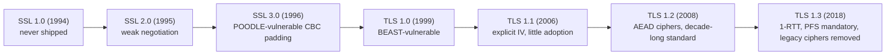

## 3. Why It Exists

TCP guarantees ordered, reliable delivery of bytes, but it does nothing to
stop an on-path attacker from reading or modifying those bytes, or to prove
that the server on the other end of the connection is who it claims to be.
Before SSL/TLS existed, any sensitive data — passwords, credit card numbers,
session tokens — sent over the open internet was readable by anyone who could
observe the network path (a shared Wi-Fi network, a compromised router, an
ISP (Internet Service Provider), or a state-level network operator). TLS
exists to give every application built on top of TCP three guarantees without
each application having to implement its own cryptography: **confidentiality**
(an eavesdropper cannot read the data), **integrity** (an attacker cannot
silently modify the data in transit), and **authentication** (the client can
cryptographically verify it is talking to the server it intended to reach,
and — with mTLS — the server can verify the client too). Centralizing this in
one well-audited protocol layer is what let HTTPS, gRPC, and countless other
protocols become secure by simply running "on top of TLS" rather than each
inventing bespoke, likely-flawed cryptographic schemes.

## 4. Core Concepts

### 4.1 Symmetric vs. asymmetric cryptography — and why TLS uses both

**Definition.** Symmetric cryptography uses a single shared secret key for
both encryption and decryption (e.g. AES — Advanced Encryption Standard).
Asymmetric cryptography (also called public-key cryptography) uses a
mathematically linked key *pair* — a public key that can be shared openly and
a private key that must never leave its owner — where data encrypted with
one key can only be decrypted with the other (or, for signatures, a message
signed with the private key can be verified by anyone holding the public key).

**Mechanism.** Symmetric algorithms like AES are fast (often hardware
accelerated via AES-NI CPU instructions) and computationally cheap per byte,
but they have a bootstrapping problem: both parties need the *same* secret
key before they can communicate securely, and safely transmitting that key
over an insecure channel is exactly the problem TLS is trying to solve.
Asymmetric algorithms like RSA (Rivest–Shamir–Adleman) or ECDHE
(Elliptic-Curve Diffie-Hellman Ephemeral) solve the bootstrapping problem —
two parties can derive a shared secret over a public channel without ever
transmitting the secret itself — but they are 100-1000x more computationally
expensive per byte than symmetric ciphers, making them impractical for
encrypting an entire HTTP response body or a large gRPC stream.

**Decision implications.** This cost asymmetry is *why* TLS uses both: the
asymmetric handshake solves the hard problem (establishing trust and agreeing
on a secret with no prior shared knowledge, over a network an attacker can
observe), then hands off to a symmetric cipher for the actual bulk data
transfer, which needs to sustain gigabits per second on API gateways and CDN
edges. A Solution Architect designing anything that needs "encryption" from
scratch — proprietary inter-service protocols, custom binary formats — should
recognize this pattern (asymmetric to establish trust and a session key,
symmetric for the payload) rather than trying to use RSA to encrypt bulk data
directly, which is both slow and structurally unsafe for large payloads.

**Common failure mode.** Treating "asymmetric encryption" as a drop-in
replacement for symmetric bulk encryption — some early proprietary protocols
(and some interview candidates) assume you can just encrypt the whole
payload with RSA. In practice, RSA's message size is bounded by its key size
minus padding overhead, throughput is far too low for real payloads, and RSA
has no native streaming mode, so this doesn't scale and isn't how any
production system encrypts data at volume.

**Scenario.** A payment gateway terminating 50,000 TLS connections per second
needs the asymmetric operations (key exchange, signature verification) to
happen only once per new connection (or once per few thousand connections
with session resumption, Section 4.11), while the symmetric AES-GCM cipher
does the actual per-request encrypt/decrypt work for the lifetime of that
connection — this is precisely why TLS's design separates "handshake"
(asymmetric-heavy) from "record layer" (symmetric-only) into two distinct
phases.

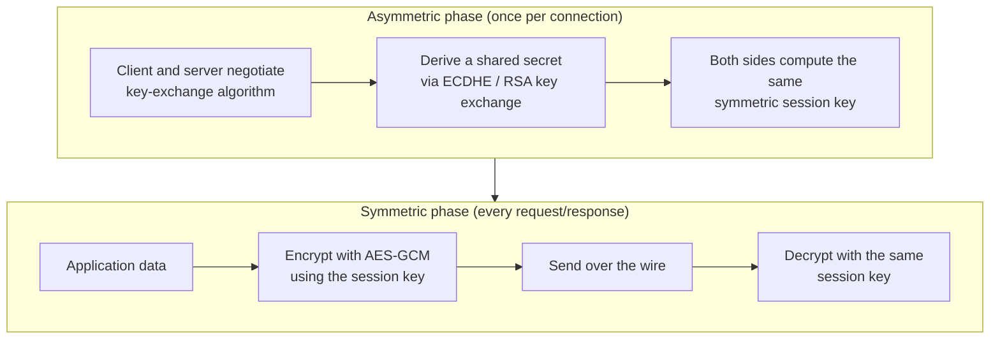

### 4.2 The TLS 1.2 handshake — the two-round-trip baseline

**Definition.** The TLS 1.2 handshake is the multi-message exchange that
negotiates a protocol version, cipher suite, and session keys before any
application data can be sent, taking a minimum of two full network round
trips (in addition to the TCP three-way handshake that must complete first).

**Mechanism.** Concretely:

1. **Client → Server: `ClientHello`** — supported TLS versions, a list of
   cipher suites in preference order, a random nonce, and (usually) the SNI
   hostname (Section 4.7).
2. **Server → Client: `ServerHello`** — the chosen TLS version and cipher
   suite, its own random nonce, followed immediately by its **`Certificate`**
   message (the server's leaf certificate and the intermediate chain,
   recapped in Section 4.4), a **`ServerKeyExchange`** message (its ephemeral
   Diffie-Hellman public value, if the cipher suite uses ephemeral key
   exchange — see Section 4.5), and a **`ServerHelloDone`** marker.
3. **Client**: validates the certificate chain against its trusted root store,
   generates its own key-exchange contribution, and sends
   **`ClientKeyExchange`**, then switches to encrypted mode with
   **`ChangeCipherSpec`** and sends an encrypted **`Finished`** message (a
   MAC — Message Authentication Code — over the entire handshake transcript,
   proving both sides agree on everything negotiated so far, and that no
   attacker altered messages in transit).
4. **Server**: derives the same session keys, verifies the client's
   `Finished` message, and replies with its own `ChangeCipherSpec` +
   `Finished`.
5. Only now — after two full round trips — can either side send encrypted
   application data.

**Decision implications.** Every one of those round trips costs real,
physics-bound latency (speed of light over fiber, plus queuing), which is why
TLS 1.2's 2-RTT (Round-Trip Time) minimum was a first-class motivator for the
TLS 1.3 redesign in Section 4.3 — on a transcontinental connection with a
150ms RTT, the handshake alone can add 300ms before the first HTTP byte
moves, which is a meaningful fraction of a page-load budget.

**Common failure mode.** Assuming the TLS handshake happens "once" for a
whole browsing session — without session resumption (Section 4.11), a new
TCP connection to the same origin (e.g. after a connection pool evicts an
idle socket) means paying the full 2-RTT handshake cost again, which is a
common, easy-to-miss source of tail latency in services that don't tune
connection-pool keep-alive settings.

**Scenario.** A mobile client on a high-latency cellular network (150-300ms
RTT) connecting to an API that still negotiates TLS 1.2 pays roughly
300-600ms just for the handshake before the first request can even be sent —
this is a concrete, measurable case for why an architecture review should ask
"can we require TLS 1.3?" before assuming HTTPS overhead is negligible.

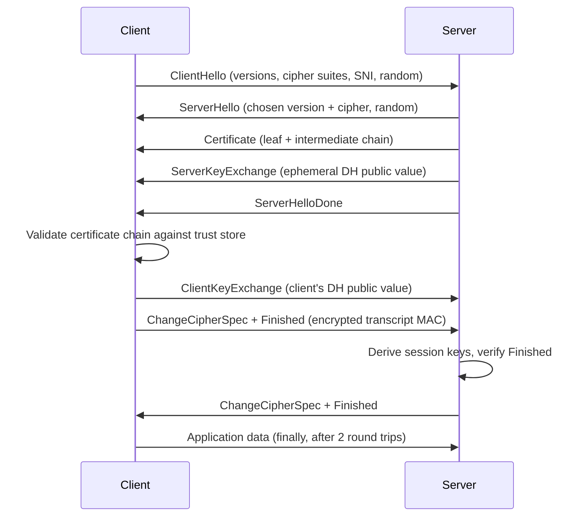

### 4.3 The TLS 1.3 redesign — 1-RTT and 0-RTT

**Definition.** TLS 1.3 restructures the handshake so the client sends its
key-exchange contribution *in the first message*, letting both sides derive
handshake (and often application) keys after a single round trip, and adds an
optional 0-RTT (zero round-trip) mode for returning clients that eliminates
the round trip entirely at the cost of a specific, well-understood replay
risk.

**Mechanism — 1-RTT.** The client's very first `ClientHello` now includes a
**key share** (its ephemeral Diffie-Hellman public value) alongside the
cipher suite list, guessing which key-exchange group the server will accept
(if the guess is wrong, one extra round trip — a `HelloRetryRequest` — is
needed, but this is the exception, not the rule, for well-configured
clients). The server can immediately compute the shared secret from that key
share, derive handshake traffic keys, and send back its `ServerHello` (with
its own key share), its `EncryptedExtensions`, `Certificate`,
`CertificateVerify` (a signature over the transcript, proving possession of
the private key — TLS 1.3 signs the handshake directly rather than TLS 1.2's
separate key-exchange message), and `Finished` — **all of this after
`ServerHello` is now encrypted**, closing off a class of metadata leakage
that TLS 1.2 exposed in plaintext. The client verifies the certificate,
sends its own `Finished`, and application data can flow immediately after —
one round trip total, versus TLS 1.2's two.

**Mechanism — 0-RTT.** If the client has previously connected to this server
and holds a resumption ticket (a pre-shared key issued at the end of a prior
session, Section 4.11), it can send **application data in the very first
flight**, alongside the `ClientHello`, encrypted under a key derived from
that prior session's secret — zero round trips before the first request
byte moves. The trade-off: 0-RTT data has no replay protection at the TLS
layer — a network attacker who captures that first flight can resend it, and
the server has no cryptographic way to distinguish a replay from the
original at the TLS layer alone. This is why TLS 1.3 explicitly restricts
0-RTT data to operations the application itself considers safe to replay
(idempotent `GET` requests, not `POST /transfer-funds`), and servers that
enable 0-RTT must apply their own anti-replay mitigation (e.g. a short-lived
single-use ticket cache) if 0-RTT is used for anything beyond truly
idempotent operations.

**Decision implications.** The 1-RTT default is close to a free latency win
with no security trade-off (it's simply a better protocol arrangement), so
"upgrade to TLS 1.3" is close to a strictly-dominant architectural decision
once client/server compatibility allows it. 0-RTT is a genuine trade-off,
not a free win — an architect enabling it must confirm the specific
endpoints exposed to 0-RTT traffic are replay-safe, or explicitly accept the
residual replay risk with compensating controls.

**Common failure mode.** Enabling 0-RTT globally on a load balancer/CDN
without auditing which routes it applies to — a `POST` endpoint that
processes an order or moves money, if reachable via 0-RTT, becomes
replayable by anyone who can capture and resend that first packet, turning a
performance optimization into a business-logic vulnerability.

**Scenario.** A CDN edge terminating TLS for a news site enables 0-RTT for
its cacheable `GET /articles/*` routes (replay-safe: at worst the same
article is fetched twice) but explicitly disables it for `/api/checkout`
routes behind the same edge — this per-route split is the correct
architectural response to the 0-RTT replay trade-off, not an all-or-nothing
toggle.

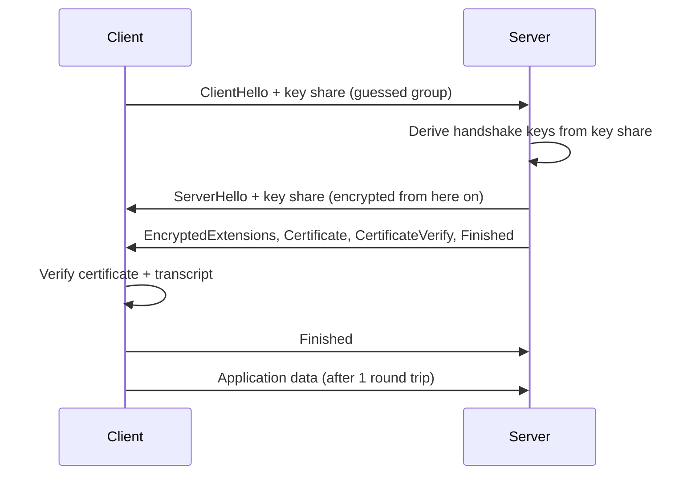

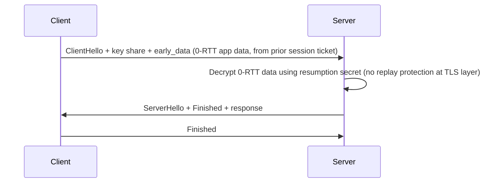

### 4.4 Certificate chains and the CA trust model (recap)

**Definition (recap only — full lifecycle owned by `CH15_Certificates.md`).**
A TLS certificate binds a public key to an identity (typically a hostname)
and is digitally signed by a CA whose own certificate is either a trusted
**root** (pre-installed in the client's/OS's trust store) or an
**intermediate** signed by that root. During the handshake, the server
presents its **leaf** certificate plus the intermediate chain up to (but
usually not including) the root, and the client walks that chain, verifying
each signature, until it reaches a root it already trusts.

**Mechanism (as relevant to the handshake).** Chain validation fails closed:
if any link's signature doesn't verify, the certificate is expired, the
hostname doesn't match (or isn't covered by a Subject Alternative Name), or
the chain doesn't terminate at a trusted root, the client must abort the
handshake — a client that "soft-fails" and proceeds anyway defeats the
entire purpose of authentication. This is why certificate-chain problems
(an intermediate not sent, a clock-skewed server treating a valid cert as
not-yet-valid) show up as hard handshake failures rather than degraded
behavior — see Section 15 for concrete failure scenarios.

**Decision implications.** Solution Architects deciding *how* certificates
are issued, rotated, and revoked (public CA vs. private internal CA vs.
ACME-automated short-lived certs) should read `CH15_Certificates.md` for the
full treatment; this chapter's concern is narrower — ensuring the TLS
termination point (Section 4.9) always presents a complete, valid,
correctly-ordered chain, since an incomplete intermediate chain is one of
the most common real-world TLS outages (works in a browser that cached the
intermediate from another site, fails for a fresh client or a strict
non-browser HTTP client that doesn't do that caching).

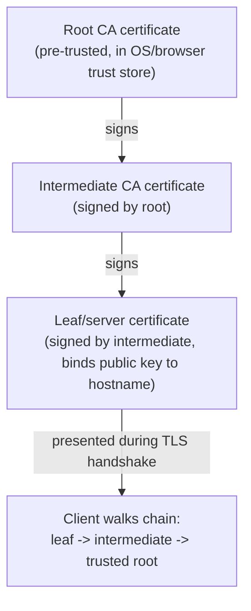

### 4.5 Perfect Forward Secrecy via ephemeral Diffie-Hellman

**Definition.** Perfect Forward Secrecy is the property that compromising a
server's long-term private key at some point in the future does not let an
attacker decrypt TLS sessions recorded in the past — each session's
encryption key is derived from a fresh, ephemeral key pair that is discarded
immediately after the handshake and never stored anywhere.

**Mechanism.** In TLS's older, non-forward-secret key exchange (static RSA
key exchange, removed entirely in TLS 1.3), the client encrypted a
pre-master secret directly with the server's long-term RSA public key; if an
attacker recorded that encrypted traffic and later stole the server's
private key (through a breach, subpoena, or vulnerability like Heartbleed),
they could retroactively decrypt every recorded session. Ephemeral
Diffie-Hellman (DHE, or its elliptic-curve variant ECDHE) instead has both
sides generate a brand-new key pair *for this connection only*; the shared
secret is derived from those ephemeral keys, and even the server's own
long-term certificate private key (used only to *sign* the exchange, proving
authenticity, not to encrypt it) becomes irrelevant to decrypting a
previously-recorded session if it's later compromised.

**Decision implications.** TLS 1.3 makes this the *only* option (all TLS 1.3
cipher suites use ephemeral key exchange) rather than a configurable choice,
directly closing the "record now, decrypt later" mass-surveillance threat
model that motivated much of the post-2013 push toward PFS-by-default. Any
architecture still supporting TLS 1.2 for compatibility should explicitly
disable static-RSA-key-exchange cipher suites (Section 4.6) to get this
property even on the older protocol version.

**Common failure mode.** Believing "we use HTTPS" is sufficient without
checking *which* cipher suites are actually negotiated — a TLS 1.2 endpoint
that still allows a non-ephemeral RSA key-exchange cipher suite for
backward compatibility with very old clients silently gives up PFS for any
connection that negotiates it, and most TLS libraries won't warn about this
by default.

**Scenario.** A regulated financial services company undergoes a security
audit; the auditor asks specifically whether session traffic recorded years
ago could be decrypted if the current TLS certificate's private key were
ever compromised — with PFS enabled (mandatory under TLS 1.3, or
enforced via cipher-suite allowlisting under TLS 1.2), the answer is no,
because that recorded traffic's actual encryption key was never derived from
the long-term private key in the first place.

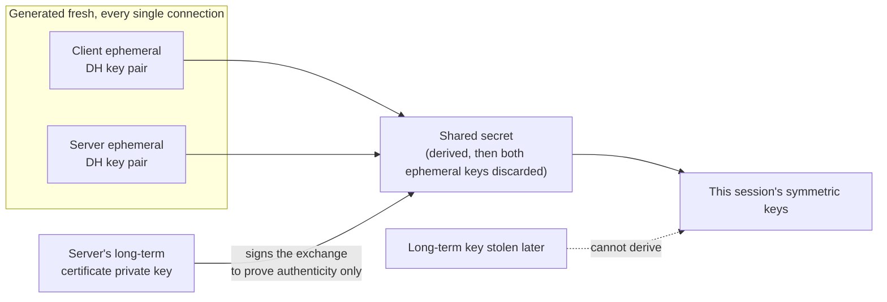

### 4.6 Cipher suite negotiation — and why TLS 1.3 shrank the list

**Definition.** A cipher suite is the bundle of algorithms TLS negotiates for
a connection: the key-exchange algorithm, the authentication/signature
algorithm, the symmetric bulk cipher, and the MAC/AEAD construction used for
integrity — historically written as a single name like
`TLS_ECDHE_RSA_WITH_AES_128_GCM_SHA256`.

**Mechanism.** In the `ClientHello`, the client sends a preference-ordered
list of cipher suites it supports; the server picks the first one from that
list it's also willing to use (server-side preference ordering is a common
hardening practice, so the server's own list — not the client's — wins ties).
TLS 1.2 supported a large combinatorial space of suites, many of which paired
a modern cipher with a legacy weak component (CBC-mode block ciphers
vulnerable to padding-oracle attacks like POODLE and Lucky 13, or RC4, which
turned out to have exploitable statistical biases). TLS 1.3 collapsed this
entire space down to five suites, all mandatorily using AEAD ciphers
(AES-GCM or ChaCha20-Poly1305) and ephemeral key exchange — there is no
TLS-1.3-compliant way to negotiate a CBC-mode or non-forward-secret cipher
suite at all, because the protocol simply doesn't define one.

**Decision implications.** This is a deliberate, architecturally significant
simplification: rather than trusting every operator to correctly configure
an allowlist out of dozens of TLS 1.2 cipher suite combinations (a
frequently-misconfigured surface area that scanners like SSL Labs exist
specifically to audit), TLS 1.3 makes the secure choice the *only* choice.
For a Solution Architect, this reframes "TLS configuration" work: on TLS 1.3
there's very little to configure (mostly just which key-exchange groups and
certificate types to support); on TLS 1.2 (kept only for backward
compatibility with legacy clients), an explicit, actively-maintained
allowlist of AEAD, forward-secret suites is mandatory hardening work, not
optional.

**Common failure mode.** Leaving a TLS 1.2 listener's cipher suite list at a
library or load balancer's older default, which may still include CBC-mode
or 3DES suites for legacy-client compatibility — this passes casual
testing (the site "works") but fails a proper security scan and represents
real exploitable risk against the CBC-mode attacks above.

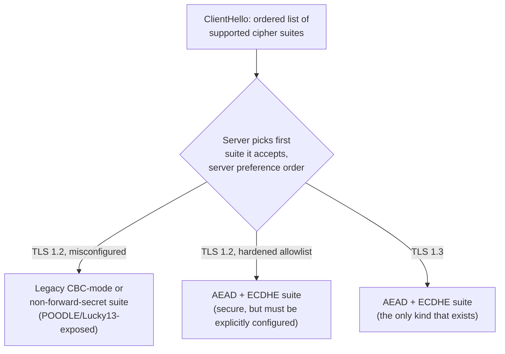

### 4.7 Server Name Indication (SNI) and multi-tenant TLS termination

**Definition.** SNI is a TLS extension in which the client includes the
target hostname, in plaintext, inside its very first `ClientHello` message —
before the server has sent any certificate — so a server can select which
certificate to present when multiple hostnames share the same IP address and
port.

**Mechanism.** Without SNI, a TLS server terminating connections for
multiple hostnames on one IP address has no way to know *which* certificate
to send back, because the certificate must be chosen before the handshake
has revealed anything about the request (the HTTP `Host` header, which would
normally disambiguate this, is only sent *after* the TLS handshake
completes, since it's part of the encrypted application data). SNI solves
this by moving hostname disambiguation into the unencrypted first message of
the handshake itself, letting a reverse proxy or load balancer inspect the
SNI field and route to (or select a certificate for) the correct backend
before the rest of the handshake proceeds.

**Decision implications.** SNI is the architectural enabler of
cost-efficient multi-tenant TLS termination: a single load balancer IP (and a
single set of TLS-terminating compute) can serve thousands of distinct
customer domains, each with its own certificate, because SNI lets the
termination point pick the right certificate per-connection without needing
a dedicated IP per hostname — this is exactly how most CDNs and multi-tenant
SaaS platforms scale HTTPS for large numbers of customer-owned domains
without an IPv4 address per customer (a real scarcity constraint).

**Common failure mode.** Forgetting that SNI is sent **in plaintext** — an
on-path observer can see which hostname a client is connecting to even over
TLS (this metadata leak is what ECH — Encrypted Client Hello, an emerging
TLS extension — aims to close, though it is not yet universally deployed);
architects designing for hostname-level traffic confidentiality (e.g. hiding
which internal tenant a request is destined for) cannot rely on TLS alone to
hide that metadata today.

**Scenario.** A SaaS platform lets customers bring their own custom domain
(`app.customer.com`) pointed via CNAME at the platform's shared load
balancer IP; the load balancer's TLS termination layer reads the SNI
hostname from the unencrypted `ClientHello`, looks up the matching
certificate (issued per-customer, often via automated ACME issuance — full
detail in `CH15_Certificates.md`), and presents it — all before the
handshake's asymmetric key exchange even happens.

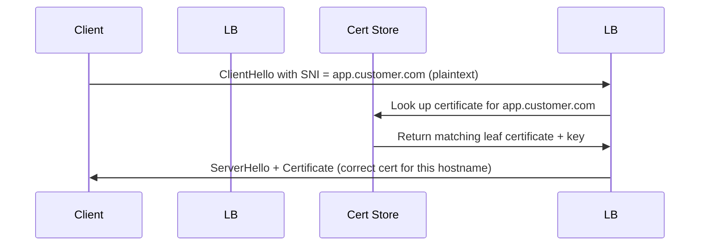

### 4.8 ALPN — the mechanism, not the per-protocol policy

**Definition.** ALPN is a TLS extension that lets client and server agree,
*during* the TLS handshake, which application-layer protocol will run over
the resulting encrypted connection — most commonly used to choose between
`http/1.1`, `h2` (HTTP/2), and (for QUIC-based transports) `h3` (HTTP/3).

**Mechanism.** The client's `ClientHello` includes an ALPN extension listing
its supported application protocols in preference order (e.g.
`["h2", "http/1.1"]`); the server, if it recognizes the extension, includes
its chosen protocol in the corresponding field of its handshake response
(`EncryptedExtensions` in TLS 1.3). Because this negotiation happens as part
of the TLS handshake itself — not as a separate exchange after the connection
is already encrypted — a client can decide *before completing the handshake*
which framing layer to speak, avoiding a wasteful upgrade dance (like HTTP/1.1's
`Upgrade` header round trip) once the connection is live. This chapter owns
the ALPN *mechanism itself* (how the extension is structured and negotiated
inside the handshake); the specific reasons a browser prefers `h2` over
`http/1.1`, or how a client races a QUIC/`h3` attempt against a TCP/TLS
fallback, are covered in the protocol chapters that actually consume the
negotiated value — see [HTTP/2](CH04_HTTP2.md) and [HTTP/3](CH05_HTTP3.md)
for that applied detail; treat ALPN's presence there as this chapter's
mechanism being *used*, not re-derived.

**Decision implications.** Any TLS-terminating component in an architecture
(load balancer, API gateway, CDN edge, service-mesh sidecar) that needs to
support both HTTP/1.1 and HTTP/2 (or HTTP/3) behind the same listener depends
on ALPN being correctly configured and its result correctly propagated to
whatever internal framing layer picks up after termination — a
misconfigured or absent ALPN extension is a common root cause of "the client
falls back to HTTP/1.1 even though the server supports HTTP/2."

**Common failure mode.** Configuring a reverse proxy to support HTTP/2 but
forgetting that ALPN (not the `Upgrade:` header, which HTTP/2 dropped
entirely for HTTPS) is the only negotiation path over TLS — clients that
never see `h2` offered/accepted in ALPN will silently and permanently
negotiate `http/1.1` instead, with no error surfaced anywhere.

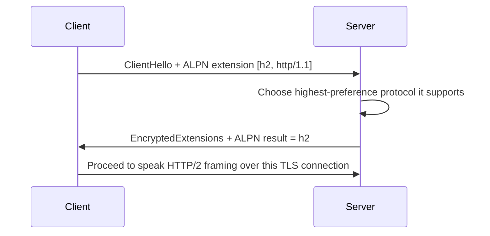

### 4.9 TLS termination architecture patterns

**Definition.** "TLS termination" refers to where, in a request's path
through an architecture, the TLS-encrypted connection is decrypted back into
plaintext — the choice of termination point is a distinct, recurring
architecture decision with real trade-offs, independent of which TLS version
or cipher suite is used.

**Mechanism — three patterns:**

1. **Edge/load-balancer termination.** The TLS connection ends at the
   internet-facing load balancer or CDN edge; traffic from there to backend
   application servers travels as plain, unencrypted HTTP over a (presumed)
   trusted private network. This centralizes certificate management and CPU
   cost for the asymmetric handshake work at one tier, but means anyone with
   access to the internal network segment (a compromised container, a
   misconfigured VPC (Virtual Private Cloud) peering rule) can read traffic
   in the clear.
2. **End-to-end / re-encryption termination.** The edge terminates the
   client-facing TLS connection, inspects/routes the request, then opens a
   *new*, separately-negotiated TLS connection to the backend — encryption
   in transit is maintained for the entire path, at the cost of a second
   handshake (mitigated by keep-alive/connection reuse and session
   resumption, Section 4.11) and doubled certificate management (the edge
   needs a customer-facing cert, and every backend needs its own internal
   cert, often issued by a private CA — see `CH15_Certificates.md`).
3. **TLS passthrough.** The load balancer routes encrypted bytes to a
   backend without terminating TLS at all (routing decisions are made on
   SNI, Section 4.7, or on the raw TCP connection, not on decrypted HTTP
   content); the backend itself holds the certificate and does the actual
   termination. This preserves end-to-end encryption without doubling
   certificate/CPU cost at the edge, but sacrifices the load balancer's
   ability to do any content-aware routing (path-based routing, header
   inspection, WAF (Web Application Firewall) inspection) since it never
   sees plaintext.

**Decision implications.** The right pattern depends on the trust boundary
the architecture is actually defending: if the internal network is
genuinely isolated and trusted (a single VPC with strict security groups),
edge termination is simplest and cheapest; if the internal network spans
multiple trust domains (a shared Kubernetes cluster with multi-tenant
workloads, a hybrid on-prem/cloud path, or a regulatory requirement for
encryption-in-transit everywhere), end-to-end re-encryption (often
implemented transparently via a service mesh's automatic mTLS, Section 4.10)
is the safer default despite its extra cost. Passthrough is chosen when the
edge genuinely cannot be trusted with the plaintext or the private key at
all (e.g. routing to a backend that must independently prove its own
identity to the client, or a strict regulatory requirement that only the
origin ever holds the private key).

**Common failure mode.** Defaulting to edge termination without examining
what the "trusted internal network" claim actually means in a modern cloud
deployment — a Kubernetes cluster shared across teams, a VPC with overly
broad peering, or any environment where lateral movement by a compromised
workload is plausible undermines the entire "internal traffic doesn't need
encryption" assumption edge termination relies on.

**Scenario.** A financial services platform running microservices in a
shared Kubernetes cluster adopts a service mesh (Istio/Linkerd) specifically
to get automatic end-to-end mTLS between every service-to-service call,
because their compliance requirement is "encryption in transit for all
traffic carrying customer financial data," which edge-only termination
cannot satisfy once traffic crosses from the edge into a multi-tenant
cluster.

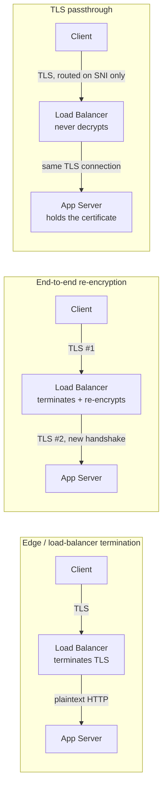

### 4.10 Mutual TLS (mTLS) for service-to-service authentication

**Definition.** Mutual TLS extends the standard TLS handshake so that *both*
sides present and verify a certificate — not just the server proving its
identity to the client (as in ordinary HTTPS), but the client also proving
its identity to the server, using the same certificate-chain-validation
machinery in both directions.

**Mechanism.** After the server sends its own `Certificate` message, it adds
a **`CertificateRequest`** message specifying which CAs it will accept
client certificates from; the client, if it holds a matching certificate,
sends its own `Certificate` message followed by a `CertificateVerify`
signature proving possession of the corresponding private key. The server
validates the client's certificate chain exactly as the client validated the
server's (Section 4.4) before completing the handshake — if the client has
no acceptable certificate, or the certificate fails validation, the server
aborts the connection before any application data is exchanged. In
practice, mTLS in modern service-mesh architectures is usually automated
end-to-end: a per-workload short-lived certificate is minted by an internal
CA (via SPIFFE/SPIRE or the mesh's own CA), rotated automatically every few
hours, and presented transparently by a sidecar proxy — the application code
itself typically never touches certificates directly.

**Decision implications.** mTLS is the architectural answer to "how does
Service A cryptographically prove to Service B which service it actually is"
in a zero-trust network model, replacing (or supplementing) network-perimeter
trust ("if it's inside the VPC, we trust it") and shared-secret API keys
(which are bearer tokens — anyone holding the key can impersonate the
caller, and rotating them safely across a fleet is operationally painful)
with per-workload cryptographic identity that's automatically rotated and
individually revocable. The cost is real: an extra round of certificate
validation per connection, a private CA (or SPIFFE/SPIRE trust domain) to
operate, and certificate lifecycle automation that must not fail silently
(an expired client cert should degrade to a clear, alertable authentication
failure, not a mysterious connection drop).

**Common failure mode.** Treating mTLS as "solved" once it's enabled at the
transport layer without also validating the client certificate's *identity*
(its Subject/SPIFFE ID) against an authorization policy at the application
layer — mTLS proves *which* workload is calling, but a service that accepts
any successfully-mTLS-authenticated caller without checking whether that
specific caller is *authorized* for the requested operation has only solved
authentication, not authorization; the two must be layered together.

**Scenario.** A payments microservice in a service mesh only accepts calls
from services whose mTLS client certificate identifies them as the
`order-service` or `refund-service` SPIFFE identities, rejecting a request
from a compromised, unrelated `reporting-service` workload even though that
workload sits on the same trusted internal network and has a
mesh-issued mTLS certificate — the certificate proves *identity*, and a
separate authorization policy decides what that identity is permitted to do.

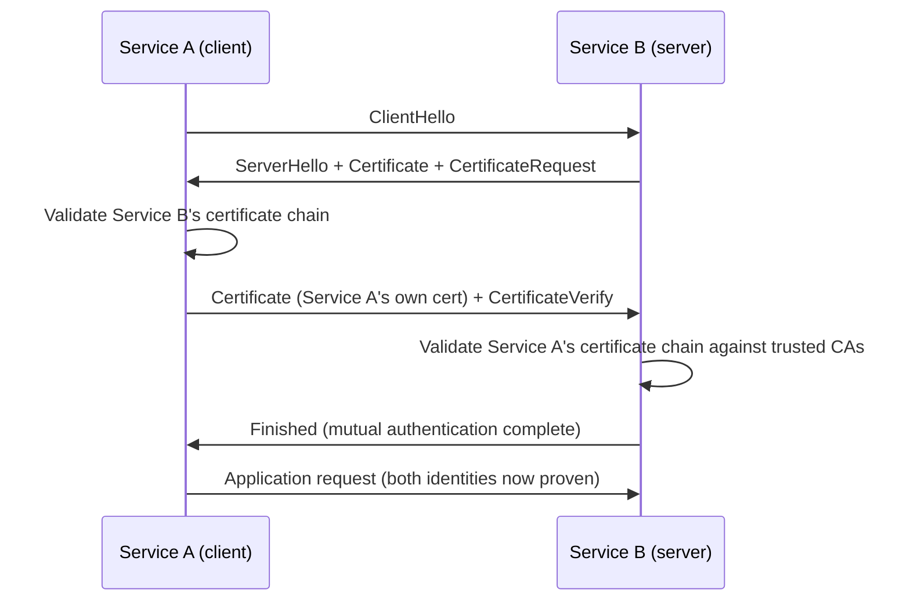

### 4.11 Session resumption — avoiding a full handshake on reconnect

**Definition.** Session resumption lets a client and server that have
previously completed a full handshake re-establish a new connection using an
abbreviated exchange, skipping the expensive asymmetric key-exchange and
certificate-validation steps, by relying on secret material derived from the
original session.

**Mechanism.** TLS 1.2 offered two mechanisms: **session IDs** (the server
caches session state keyed by an ID it hands the client) and **session
tickets** (RFC 5077 — the server instead encrypts its session state into an
opaque ticket it hands the client, avoiding server-side storage entirely,
which matters for horizontally-scaled fleets where the reconnecting client
might land on a different server instance). TLS 1.3 unifies this into
**PSK (Pre-Shared Key) resumption**: at the end of a full handshake, the
server issues one or more session tickets containing a resumption secret;
on a later connection, the client presents that ticket in its
`ClientHello`, and if the server still recognizes it, both sides derive new
traffic keys from the shared resumption secret — this is also the mechanism
that enables 0-RTT (Section 4.3), since a valid resumption ticket is a
prerequisite for sending 0-RTT application data.

**Decision implications.** Session resumption is a significant, often
underappreciated latency and CPU-cost lever at scale: skipping the
asymmetric operations on reconnect avoids the most expensive part of the
handshake, which matters enormously for a fleet terminating millions of
short-lived connections. The operational cost is key management: session
ticket encryption keys must be rotated regularly (a stolen never-rotated
ticket key can decrypt any past ticket it issued) and, in a horizontally
scaled load-balancer fleet, must be synchronized across every instance —
if instance A issues a ticket encrypted with a key that instance B doesn't
share, resumption silently fails and falls back to a full handshake.

**Common failure mode.** Running a fleet of TLS-terminating load balancers
that each generate their own local session ticket key independently, with no
synchronization — resumption then only succeeds if the client happens to
reconnect to the same instance, which behind a typical load balancer is
essentially random, so the fleet pays for full handshakes almost every time
despite resumption being "enabled."

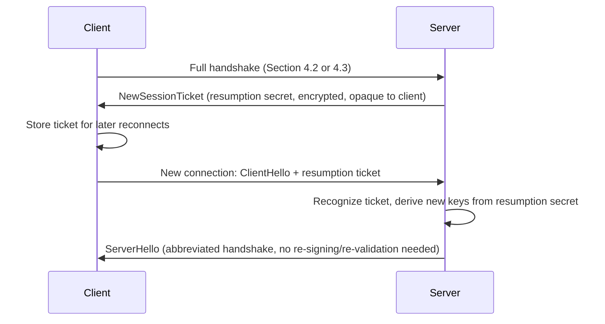

## 5. Internal Working

Putting Sections 4.2-4.3 together, here is what actually crosses the wire for
a TLS 1.3 connection, byte-level, captured with `openssl s_client`:

```
$ openssl s_client -connect example.com:443 -tls1_3 -msg -state

CONNECTED(00000003)
>>> TLS 1.3, Handshake [length 0136], ClientHello
    01 00 01 32 03 03 5a 8f e2 3c ... (random) ...
    00 20 (session_id length) ...
    00 08 13 02 13 03 13 01 00 ff (cipher suites: TLS_AES_256_GCM_SHA384,
                                    TLS_CHACHA20_POLY1305_SHA256,
                                    TLS_AES_128_GCM_SHA256)
    ... extensions: server_name=example.com, supported_versions=[TLSv1.3],
        key_share (x25519 public value), signature_algorithms ...
SSL_connect:before SSL initialization
SSL_connect:SSLv3/TLS write client hello
<<< TLS 1.3, Handshake [length 007a], ServerHello
    02 00 00 76 03 03 ... (random) ...
    13 02 (chosen cipher: TLS_AES_256_GCM_SHA384)
    key_share (server's x25519 public value)
SSL_connect:SSLv3/TLS write client hello
SSL_connect:TLSv1.3 read server hello
<<< TLS 1.3, Handshake [length 0017], Change Cipher Spec
<<< TLS 1.3, Handshake [length 0aa3], Certificate
<<< TLS 1.3, Handshake [length 0104], CertificateVerify
<<< TLS 1.3, Handshake [length 0024], Finished
SSL_connect:TLSv1.3 read encrypted extensions
SSL_connect:SSLv3/TLS read server certificate
SSL_connect:TLSv1.3 read server certificate verify
SSL_connect:SSLv3/TLS read finished
>>> TLS 1.3, Handshake [length 0024], Finished
SSL_connect:SSLv3/TLS write finished
---
New, TLSv1.3, Cipher is TLS_AES_256_GCM_SHA384
Server public key is 256 bit
Secure Renegotiation IS NOT supported
Verify return code: 0 (ok)
```

Reading this trace against Section 4.3: the `ClientHello` already carries a
`key_share`, so the server can respond with `ServerHello` and immediately
switch to encrypted handshake messages (`Certificate`, `CertificateVerify`,
`Finished` all arrive in one encrypted flight); the client verifies and
replies with its own `Finished`; the connection is then ready for
application data after this single round trip. Compare this to a TLS 1.2
trace against the same tool (`-tls1_2` instead of `-tls1_3`), which would
show a `ServerKeyExchange` message (Section 4.2) sent in plaintext before
`ChangeCipherSpec`, and an extra round trip before `Finished` completes on
both sides — the structural difference between the two protocol versions is
directly visible in the message ordering, not just in a version number field.

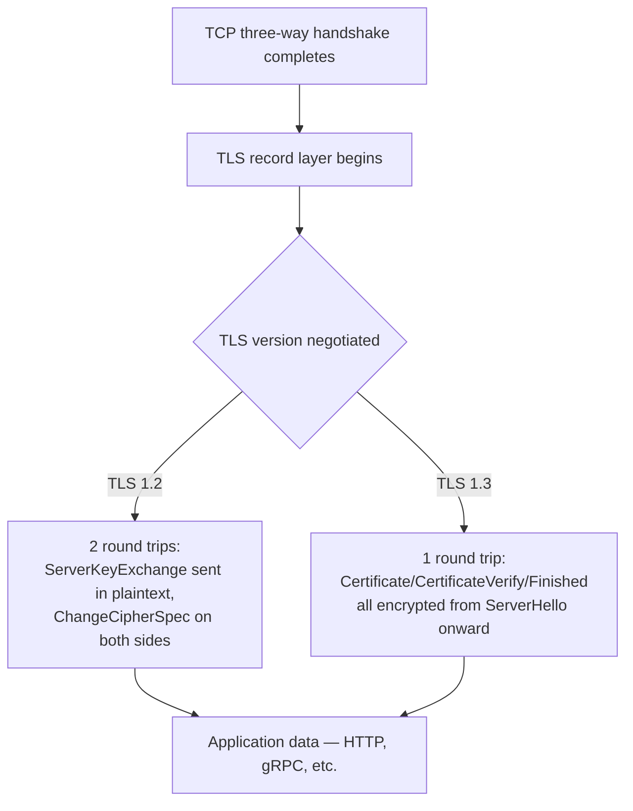

## 6. Design Principles

- **Fail closed, not open.** Every validation step in TLS (certificate chain,
  hostname match, signature verification, `Finished` MAC) must abort the
  connection on failure rather than degrading gracefully — a protocol whose
  security properties can be silently bypassed by any single failed check is
  not actually providing those properties.
- **Negotiate capability, don't assume it.** Cipher suites, protocol
  versions, and ALPN protocols are all negotiated rather than hardcoded,
  letting the same server support a wide range of client capabilities while
  the negotiation logic (server preference ordering, Section 4.6) keeps the
  *outcome* under the operator's control.
- **Minimize what a compromised key exposes.** PFS (Section 4.5) and
  short-lived certificates (a lifecycle concern in `CH15_Certificates.md`)
  both follow the same underlying principle: limit the blast radius of any
  single key compromise, in time (short-lived certs) and in scope
  (ephemeral per-session keys).
- **Push complexity out of the application layer.** TLS's entire value
  proposition to an architect is that application code — an HTTP handler, a
  gRPC service, a database driver — never has to implement cryptography
  itself; it just runs "on top of TLS" and inherits confidentiality,
  integrity, and authentication.

## 7. Architecture Patterns

Section 4.9 already covered the three termination patterns (edge,
end-to-end, passthrough) in first-principles depth; this section frames how
they combine with other architectural components in practice.

- **Sidecar-mediated mTLS in a service mesh.** Rather than every service
  implementing TLS/mTLS itself, a sidecar proxy (Envoy, in Istio/Linkerd)
  intercepts all inbound/outbound traffic for a workload and handles TLS
  termination, certificate rotation, and mTLS enforcement transparently —
  the application speaks plain HTTP to `localhost`, and the sidecar upgrades
  it to mTLS before it leaves the pod.
- **API gateway as the single TLS-terminating front door.** An API gateway
  terminates client-facing TLS once, applies authentication/rate
  limiting/routing, then either re-encrypts (end-to-end pattern) or trusts a
  private network segment (edge pattern) for the hop to backend services.
- **TLS passthrough for protocols the load balancer can't safely
  proxy.** Some protocols (certain database wire protocols, or a legacy
  system requiring the *client* to see the true origin server's certificate
  rather than a load balancer's) require passthrough because introducing a
  re-encrypting intermediary would break the client's own certificate
  validation assumptions.

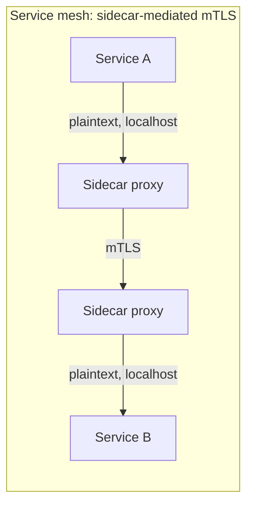

## 8. Production Architecture

A production TLS-terminating tier typically combines several of the concepts
above into one coherent system:

- **Certificate provisioning** via an ACME (Automatic Certificate Management
  Environment) client (e.g. Let's Encrypt integration, or a private CA's
  equivalent) that automatically issues and renews leaf certificates well
  before expiry — full detail in `CH15_Certificates.md`.
- **Private key storage** in an HSM (Hardware Security Module) or a cloud
  KMS (Key Management Service)-backed certificate store, so the private key
  material never exists as a plain file on a compute instance's disk that
  could be exfiltrated by a compromised process.
- **Cipher suite and protocol version allowlists** enforced centrally (at the
  load balancer or API gateway config, Section 4.6), not left to individual
  service defaults, so a security policy change (e.g. "drop TLS 1.2 CBC
  suites") is a single config change rather than an audit of every service.
- **Session ticket key rotation and synchronization** (Section 4.11) across
  every instance of a horizontally-scaled termination tier, usually via a
  shared secret store (e.g. a KMS-encrypted value replicated to every
  instance on a fixed rotation schedule).
- **mTLS enforcement** for service-to-service traffic inside the trust
  boundary, typically delegated to a service mesh's automatic certificate
  issuance and rotation (SPIFFE/SPIRE-based identity) rather than hand-rolled
  per-service certificate management.

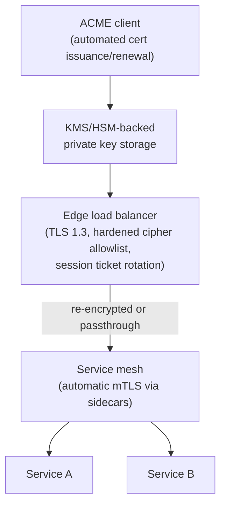

## 9. Implementation

Enabling TLS 1.3-first termination on an nginx edge, with a hardened
fallback allowlist for TLS 1.2 clients that can't yet negotiate 1.3:

```nginx
server {
    listen 443 ssl;
    server_name example.com;

    ssl_certificate     /etc/nginx/certs/example.com/fullchain.pem;
    ssl_certificate_key /etc/nginx/certs/example.com/privkey.pem;

    # Prefer TLS 1.3; keep 1.2 only for legacy-client compatibility.
    ssl_protocols       TLSv1.2 TLSv1.3;
    ssl_prefer_server_ciphers on;

    # TLS 1.3 cipher suites are fixed by the protocol (Section 4.6) —
    # this allowlist only constrains the TLS 1.2 fallback path.
    ssl_ciphers ECDHE-ECDSA-AES128-GCM-SHA256:ECDHE-RSA-AES128-GCM-SHA256:ECDHE-ECDSA-AES256-GCM-SHA384:ECDHE-RSA-AES256-GCM-SHA384;

    # Session resumption (Section 4.11): shared ticket key across the fleet,
    # rotated out-of-band — never left at nginx's per-instance default.
    ssl_session_tickets on;
    ssl_session_ticket_key /etc/nginx/tls/ticket.key;
    ssl_session_cache shared:TLS:10m;
    ssl_session_timeout 1h;

    location / {
        proxy_pass http://backend_pool;
    }
}
```

## 10. Complete Code Examples

**Example 1 — mutual TLS server (Node.js), rejecting any client without a
valid certificate signed by the internal CA:**

```javascript
const https = require('https');
const fs = require('fs');

const server = https.createServer({
  cert: fs.readFileSync('server-cert.pem'),
  key: fs.readFileSync('server-key.pem'),
  ca: fs.readFileSync('internal-ca.pem'),   // trust anchor for client certs
  requestCert: true,                         // ask the client for a certificate
  rejectUnauthorized: true,                  // hard-fail if validation fails
}, (req, res) => {
  const clientCert = req.socket.getPeerCertificate();
  // Authentication (mTLS) proved *who* is calling — authorization (Section
  // 4.10's common failure mode) must still check *what* they're allowed to do.
  if (clientCert.subject.CN !== 'order-service') {
    res.writeHead(403);
    return res.end('Client identity not authorized for this operation');
  }
  res.writeHead(200);
  res.end(`Authenticated as ${clientCert.subject.CN}`);
});

server.listen(8443);
```

**Example 2 — matching mTLS client, presenting its own certificate:**

```javascript
const https = require('https');
const fs = require('fs');

const options = {
  hostname: 'payments.internal',
  port: 8443,
  path: '/charge',
  method: 'POST',
  cert: fs.readFileSync('order-service-cert.pem'),
  key: fs.readFileSync('order-service-key.pem'),
  ca: fs.readFileSync('internal-ca.pem'),   // trust anchor for the server's cert
};

const req = https.request(options, (res) => {
  console.log(`Server responded: ${res.statusCode}`);
});
req.on('error', (err) => console.error('mTLS handshake or request failed:', err));
req.end();
```

**Example 3 — captured OpenSSL handshake trace** for a TLS 1.3 connection is
shown in Section 5; re-run with `-tls1_2` against the same host to see the
extra `ServerKeyExchange` message and additional round trip that
distinguishes the two protocol versions structurally, not just by a version
field.

**Example 4 — quick TLS configuration audit** with `openssl s_client`,
useful in an incident or a pre-migration check:

```bash
# Confirm which protocol version and cipher suite were actually negotiated
echo | openssl s_client -connect example.com:443 2>/dev/null | \
  openssl x509 -noout -dates -subject -issuer

echo | openssl s_client -connect example.com:443 -tls1_3 2>&1 | \
  grep -E "Protocol|Cipher"
```

## 11. Performance

- **Handshake cost is dominated by round trips, not raw computation** on
  well-provisioned hardware (AES-NI accelerates the symmetric phase to
  multi-gigabit throughput per core) — this is why TLS 1.3's 1-RTT design
  (Section 4.3) is the single biggest lever for reducing perceived latency,
  especially on high-RTT mobile networks.
- **Session resumption (Section 4.11)** eliminates the asymmetric
  key-exchange and certificate-validation cost on reconnect entirely,
  which matters more at scale (millions of short connections) than for a
  single long-lived connection.
- **Connection reuse (HTTP keep-alive, HTTP/2 multiplexing)** amortizes the
  handshake cost over many requests — a service that opens a new TCP+TLS
  connection per request pays the full handshake tax every time, which is
  one of the most common, easily fixed sources of unnecessary latency.
- **0-RTT (Section 4.3)** removes even the single remaining round trip for
  returning clients on replay-safe routes, at the explicit cost documented
  there.

## 12. Scalability

- **Session ticket key synchronization** across a horizontally-scaled
  termination fleet (Section 4.11) is what makes resumption actually work at
  scale — without it, resumption rate degrades toward zero as fleet size
  grows and load balancing spreads reconnects across instances.
- **Offloading the asymmetric handshake cost** to purpose-built hardware
  (TLS-terminating load balancers with dedicated crypto acceleration, or
  cloud-managed load balancer TLS offload) frees application server CPU for
  business logic rather than handshake cryptography.
- **Certificate/SNI lookup performance** at the termination tier must scale
  with the number of distinct hostnames served (Section 4.7) — a
  multi-tenant platform serving tens of thousands of customer domains needs
  an efficient, frequently-refreshed certificate lookup structure, not a
  linear scan.

## 13. Security

- **Downgrade attacks**: an on-path attacker tries to force a client/server
  pair that both support TLS 1.3 down to a weaker, exploitable version;
  TLS 1.3 includes a specific anti-downgrade signal (a fixed pattern in the
  server's random value) that lets a client detect this attempted downgrade
  and abort.
- **POODLE, BEAST, Lucky 13** — all exploit weaknesses specific to CBC-mode
  ciphers under TLS 1.0-1.2 (Section 4.6); TLS 1.3's AEAD-only cipher suites
  are structurally immune to this entire attack class.
- **Heartbleed (2014)** was a memory-disclosure bug in a specific TLS library
  implementation (OpenSSL's heartbeat extension handling), not a protocol
  flaw — it's included here as the canonical example of why PFS (Section
  4.5) matters: Heartbleed-affected servers that used ephemeral key exchange
  limited the damage to future/current sessions rather than every session
  ever recorded.
- **Certificate validation bypass** (disabling `rejectUnauthorized` in
  development code that then ships to production) is one of the most common
  and most severe real-world TLS misconfigurations — it silently converts
  TLS's authentication guarantee into "encrypted, but to anyone."
- **Weak/legacy cipher suite exposure**, covered in depth in Section 4.6.

## 14. Observability

- **Handshake failure logs and metrics** at the termination tier (certificate
  expiry, unsupported protocol version requested, cipher suite mismatch,
  client certificate validation failure for mTLS endpoints) should be
  monitored as first-class signals, not buried in generic connection-error
  logs — a spike in handshake failures is often the earliest signal of a
  certificate about to expire or a client population running an outdated
  TLS stack.
- **Certificate expiry monitoring**, run independently of the ACME
  renewal automation itself, catches the case where renewal silently fails
  (full detail in `CH15_Certificates.md`) before it becomes a customer-facing
  outage.
- **JA3/JA3S fingerprinting** — hashing the specific set and order of cipher
  suites/extensions a client offers (JA3) or a server selects (JA3S) — gives
  operators a lightweight way to fingerprint client TLS stacks for anomaly
  detection (e.g. detecting bot traffic pretending to be a browser) without
  needing to decrypt any traffic.

## 15. Failure Scenarios

- **Clock skew causing spurious certificate validation failure**: if a
  server's or client's system clock drifts significantly, a perfectly valid,
  unexpired certificate can appear "not yet valid" or "expired" purely due
  to clock skew — a subtle failure mode that looks like a certificate
  problem but is actually an NTP (Network Time Protocol) synchronization
  problem.
- **Incomplete intermediate certificate chain**: a server presents its leaf
  certificate but omits an intermediate (Section 4.4); browsers that
  already cached that intermediate from a previous visit to a different site
  succeed, while a fresh client, a strict non-browser HTTP client, or a
  mobile app without that cached intermediate fails the handshake entirely —
  a classic "works for me, fails for everyone else" production incident.
- **Session ticket key desynchronization** across a load-balancer fleet
  (Section 4.11): resumption silently falls back to a full handshake on
  every reconnect that lands on a different instance, showing up only as
  unexplained elevated handshake-related CPU/latency, not as an outright
  error.
- **0-RTT replay on a non-idempotent endpoint** (Section 4.3): if 0-RTT is
  enabled globally and a route that isn't actually replay-safe is reachable
  through it, a captured-and-resent first flight can cause a duplicate
  side-effecting operation with no TLS-layer error at all.

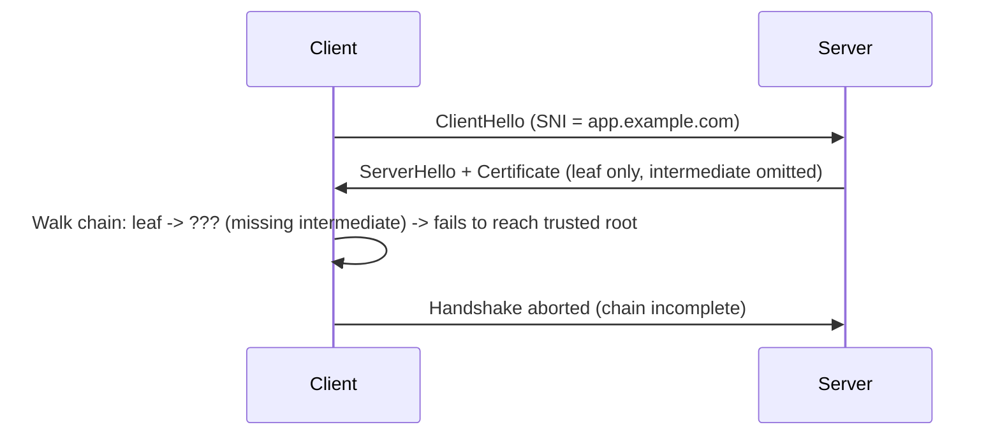

## 16. Testing

- **`openssl s_client`** (Section 10, Example 4) for manual, scriptable
  handshake inspection — protocol version, cipher suite, certificate chain,
  and full message-level traces via `-msg -state`.
- **`testssl.sh`** and **SSL Labs' server test** for an automated audit of
  supported protocol versions, cipher suites, known-vulnerable
  configurations (POODLE, Heartbleed, weak Diffie-Hellman parameters), and
  an overall grade — a standard pre-production or periodic compliance check.
- **mTLS integration tests** should explicitly assert both the "happy path"
  (valid client certificate accepted) and the negative paths (expired
  client certificate rejected, certificate from an untrusted CA rejected,
  no certificate presented at all rejected) — mTLS configuration mistakes
  are easy to introduce silently, and only negative-path tests catch a
  handshake that's accidentally permissive.
- **Certificate expiry tests** in a CI (Continuous Integration) pipeline or
  scheduled job that fail loudly well before actual expiry, independent of
  whatever renewal automation is supposed to prevent expiry in the first
  place (defense in depth against automation failure).

## 17. Common Mistakes

- Disabling certificate validation (`rejectUnauthorized: false`,
  `-k`/`--insecure` flags, or equivalent) to unblock local development, and
  having that setting leak into production configuration.
- Leaving legacy, non-forward-secret or CBC-mode cipher suites enabled on a
  TLS 1.2 listener "just in case," without an active justification or
  compensating control.
- Treating mTLS as authorization rather than authentication (Section 4.10's
  common failure mode) — accepting any successfully-authenticated caller
  without a separate identity-based authorization check.
- Forgetting to include the full intermediate certificate chain, not just
  the leaf, when configuring a TLS-terminating server (Section 15).
- Enabling 0-RTT globally across every route without auditing which
  endpoints are actually replay-safe (Section 4.3).
- Assuming "we use HTTPS" alone answers a compliance/security review
  question, without being able to state which TLS version, cipher suites,
  and termination pattern are actually in effect.

## 18. Best Practices

- Prefer TLS 1.3 wherever client compatibility allows it; where TLS 1.2 must
  be kept for legacy clients, enforce an explicit AEAD-and-ephemeral-only
  cipher suite allowlist (Section 4.6).
- Automate certificate issuance and renewal (ACME or equivalent) rather than
  relying on manual renewal, and monitor expiry independently as a
  defense-in-depth measure (Section 14).
- Choose a TLS termination pattern (Section 4.9) deliberately based on the
  actual trust boundary of the network, not by default — favor end-to-end
  encryption (often via a service mesh's automatic mTLS) whenever the
  internal network spans more than one trust domain.
- Rotate and synchronize session ticket keys across the entire
  TLS-terminating fleet (Section 4.11), not per-instance.
- Layer application-level authorization on top of mTLS's authentication
  (Section 4.10) — never treat "the mTLS handshake succeeded" as equivalent
  to "this caller is authorized."

## 19. Anti-Patterns

- **Rolling your own cryptographic protocol** instead of using TLS, on the
  theory that a proprietary scheme is "more secure through obscurity" — TLS
  has been through decades of public cryptanalysis (including the
  vulnerabilities cataloged in Section 13); a custom protocol has had none.
- **Wildcard-certificate overreach**: issuing one wildcard certificate
  (`*.example.com`) and deploying its private key onto dozens of
  loosely-trusted services, so that compromising the least-secure service
  compromises every hostname the wildcard covers — full treatment of
  certificate scoping strategy belongs to `CH15_Certificates.md`, but the
  architectural risk surfaces directly through this chapter's trust-chain
  model (Section 4.4).
- **"HTTPS everywhere except internally"** without examining whether
  "internal" is actually a single trust domain (Section 4.9's common failure
  mode) — a stale assumption that ages poorly as infrastructure grows more
  multi-tenant.
- **Silent 0-RTT enablement** across all routes without a replay-safety
  audit (Section 4.3).

## 20. Trade-off Analysis

| Decision | Option A | Option B | Trade-off |
|---|---|---|---|
| TLS termination pattern | Edge termination | End-to-end re-encryption | Simplicity/cost vs. defense against a compromised internal network segment |
| TLS termination pattern | End-to-end re-encryption | TLS passthrough | Content-aware routing capability vs. avoiding doubled cert/CPU cost at the edge |
| Protocol version support | TLS 1.3 only | TLS 1.2 + 1.3 (hardened allowlist) | Best security/performance vs. legacy client compatibility |
| 0-RTT | Enabled | Disabled | Zero-round-trip latency win on replay-safe routes vs. avoiding any replay-risk audit burden |
| Service-to-service auth | mTLS (service mesh) | Shared API keys | Per-workload, automatically-rotated cryptographic identity vs. simpler bearer-token setup with weaker revocation/rotation story |

## 21. Comparison Table

| Property | TLS 1.2 | TLS 1.3 |
|---|---|---|
| Handshake round trips (full handshake) | 2 | 1 (0 for 0-RTT resumption) |
| Ephemeral (forward-secret) key exchange | Optional (must be explicitly configured) | Mandatory for every cipher suite |
| Cipher suite space | Large, includes CBC-mode/legacy options | Reduced to 5 AEAD-only suites |
| Handshake message encryption | Only after `ChangeCipherSpec` | Encrypted starting immediately after `ServerHello` |
| Static RSA key exchange | Supported (no PFS) | Removed entirely |
| Compression | Supported (enabled CRIME-class attacks) | Removed entirely |
| Renegotiation | Supported (historically had CVEs) | Removed; replaced by post-handshake key update |

| Termination pattern | Internal traffic encrypted? | Content-aware routing at edge? | Relative cost |
|---|---|---|---|
| Edge termination | No | Yes | Lowest |
| End-to-end re-encryption | Yes | Yes | Highest (double handshake + dual cert management) |
| Passthrough | Yes | No | Low at the edge, cert/CPU cost shifted to backend |

## 22. Real-World Case Study

A mid-size SaaS platform running services in a shared Kubernetes cluster
started as a single monolith behind an edge-terminating load balancer
(Section 4.9, pattern 1) — a reasonable choice when "internal" genuinely
meant "one trusted process." As the platform decomposed into microservices
shared across multiple product teams (and, later, onboarded a third-party
integration partner's workloads into an adjacent namespace), the "internal
network is trusted" assumption stopped holding: any workload in the cluster
could, in principle, observe plaintext traffic between any two services.
The team adopted a service mesh (Section 7) specifically to get automatic,
per-workload mTLS (Section 4.10) between every internal call, with
certificates issued and rotated every few hours by the mesh's own CA — no
application code changes were required, since the sidecar proxies handled
TLS termination transparently. The migration surfaced two of this chapter's
common failure modes directly: several services initially accepted *any*
successfully-mTLS-authenticated caller without an authorization check
(Section 4.10), which had to be closed with an explicit per-route caller
allowlist; and the edge load balancer's TLS 1.2 cipher suite list still
included several CBC-mode suites left over from years-old default
configuration, flagged by a routine SSL Labs scan (Section 16) during the
same initiative and remediated alongside the mTLS rollout.

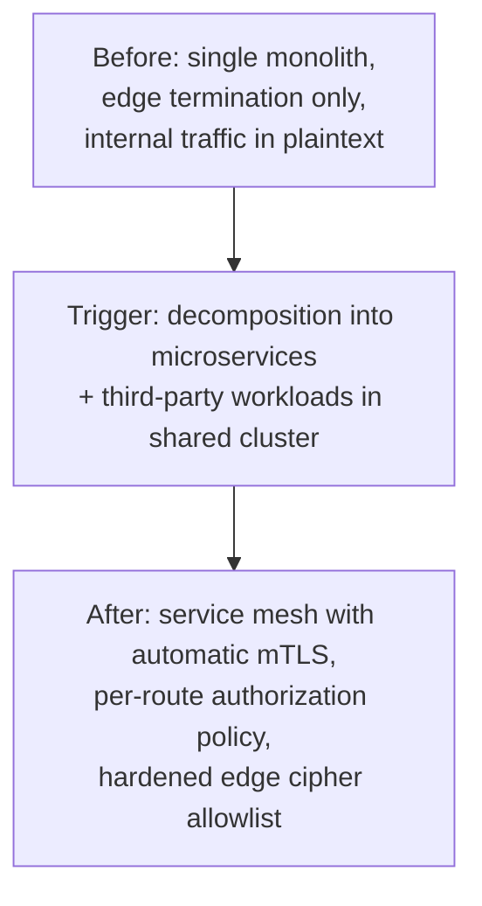

## 23. Interview Questions

1. Walk through the TLS 1.3 handshake message by message, and explain
   specifically why it needs only one round trip where TLS 1.2 needed two.
2. Why does TLS use both symmetric and asymmetric cryptography instead of
   just one? What would break if you tried to use only one?
3. What is Perfect Forward Secrecy, and what specific real-world incident
   (or attack) does it protect against that non-ephemeral key exchange
   doesn't?
4. Explain SNI: why is it needed, what information does it leak, and to
   whom?
5. What does ALPN actually negotiate, and at what point in the handshake
   does that negotiation happen?
6. Compare edge termination, end-to-end re-encryption, and TLS passthrough.
   When would you choose each?
7. What does mTLS prove, and what does it *not* prove? Why is that
   distinction operationally important?
8. Why did TLS 1.3 remove static RSA key exchange, CBC-mode ciphers, and
   compression? What specific attacks motivated each removal?
9. What's the security trade-off of enabling 0-RTT, and how would you
   decide which routes are safe to expose to it?
10. How does session resumption work, and what operational problem occurs
    if session ticket keys aren't synchronized across a load-balancer fleet?

## 24. Hands-on Exercises

1. Run `openssl s_client -connect <a real host> -tls1_3 -msg -state`
   against a production site you control or a public test endpoint, and
   annotate the trace against the message sequence in Section 5.
2. Repeat the same command with `-tls1_2` instead, and identify the extra
   message(s) and round trip that TLS 1.3 eliminated.
3. Configure an nginx (or equivalent) server with the config in Section 9,
   then run it through `testssl.sh` or SSL Labs and fix any findings.
4. Implement the mTLS client/server pair from Section 10 locally, generate
   a small private CA with OpenSSL, issue a server and a client certificate
   from it, and verify that a request using the wrong (or no) client
   certificate is rejected.
5. Deliberately misconfigure the mTLS server to skip the authorization
   check (accept any valid client certificate for any operation), then add
   the check back and write a test that would have caught the gap.

## 25. Design Exercises

1. Design the TLS termination architecture for a multi-tenant SaaS platform
   that lets customers bring their own custom domains. Where does
   termination happen, how are certificates issued per customer domain, and
   how does SNI factor into your design?
2. Your platform currently uses edge-only TLS termination inside a single
   trusted VPC. The company is about to onboard a third-party partner's
   workloads into the same Kubernetes cluster. Propose and justify a
   termination-pattern change.
3. Design a session-ticket-key rotation and synchronization scheme for a
   fleet of 50 TLS-terminating load balancer instances that must all be able
   to resume sessions issued by any other instance in the fleet.
4. A service wants to expose a subset of its endpoints to 0-RTT for latency
   reasons. Design the review process (and any technical safeguards) you'd
   require before approving which specific routes are eligible.

## 26. Architecture Review Questions

1. Which TLS versions and cipher suites are actually enabled at every
   TLS-terminating point in this architecture, and is that allowlist
   actively maintained or a stale default?
2. What is the trust boundary each TLS termination point is defending, and
   does the chosen termination pattern (Section 4.9) actually match that
   boundary?
3. Is Perfect Forward Secrecy guaranteed for every negotiable cipher suite,
   or only for some?
4. For any mTLS-authenticated service boundary: is there a separate,
   explicit authorization check beyond "the handshake succeeded"?
5. Is 0-RTT enabled anywhere, and if so, has every route reachable through
   it been confirmed replay-safe?
6. How is certificate expiry monitored, independently of whatever renewal
   automation is in place?
7. Is session ticket key material synchronized and rotated consistently
   across every instance of a horizontally-scaled termination tier?

## 27. Summary

TLS gives every protocol built on top of TCP confidentiality, integrity, and
authentication without each one reinventing cryptography — it does this by
combining asymmetric cryptography (to solve the hard bootstrapping problem of
agreeing on a secret over an untrusted channel with no prior shared
knowledge) with symmetric cryptography (for fast, sustained bulk encryption).
TLS 1.3's redesign — folding the handshake into one round trip, making
ephemeral (forward-secret) key exchange mandatory, and collapsing the cipher
suite space down to a handful of AEAD-only options — is a direct, deliberate
response to a decade of accumulated attacks (POODLE, BEAST, Lucky 13,
Heartbleed's PFS lesson) against TLS 1.2's more permissive design, and
should be the default target for any new deployment. Architecturally, the
concepts that matter most beyond the handshake itself are SNI (letting one
IP serve many hostnames' certificates), ALPN (letting the handshake also
settle which application protocol runs next), the choice of TLS termination
pattern (edge, end-to-end, or passthrough, matched deliberately to the
network's actual trust boundary), and mTLS (proving service-to-service
identity in a zero-trust network, always paired with a separate
authorization check). Certificates themselves — their issuance, rotation,
and revocation lifecycle — are a distinct concern owned by
`CH15_Certificates.md`; this chapter's job was the protocol and handshake
mechanics that make every one of those certificates useful in the first
place.

## Further Reading

- [HTTP](CH01_HTTP.md) — HTTPS request/response semantics that ride on top
  of the TLS connection this chapter establishes.
- [HTTP/2](CH04_HTTP2.md) and [HTTP/3](CH05_HTTP3.md) — how ALPN's negotiated
  result (Section 4.8) determines which framing layer a connection actually
  speaks, and how HTTP/3 folds the TLS 1.3 handshake into QUIC's own
  transport handshake.
- `CH15_Certificates.md` (not yet drafted) — full certificate lifecycle:
  issuance, ACME automation, rotation, revocation (OCSP/CRL), and
  certificate scoping strategy.
- [OSI Model](CH02_OSI_Model.md) — where TLS sits relative to the transport
  and application layers.
