# Chapter 7: SSL (Secure Sockets Layer)

## 1. Introduction

Every Solution Architect, at some point, will write or approve a design
document that says "terminate SSL at the load balancer," configure a
certificate and call it an "SSL certificate," or get asked by a security
auditor whether "SSL is disabled." None of these sentences are technically
accurate — Secure Sockets Layer (SSL) has been fully retired from every
production system that follows current security guidance, and has been
replaced by Transport Layer Security (TLS), a protocol with a different name,
different version numbering, and (from TLS 1.3 onward) a substantially
different wire protocol. And yet "SSL" is still the term the entire industry
uses, in vocabulary, in product names (Amazon's "AWS Certificate Manager" is
one of the few that got the naming right; most competitors still ship an
"SSL certificate" purchase flow), in `openssl` the command-line tool's name,
and in the informal speech of engineers who know better.

This chapter is not a repeat of the TLS handshake, cipher suite negotiation,
Perfect Forward Secrecy (PFS), Server Name Indication (SNI), or Application-
Layer Protocol Negotiation (ALPN) mechanics — that full first-principles
teaching belongs to
[TLS (Transport Layer Security)](CH06_TLS.md), the sibling chapter in this
same part, and this chapter recaps and links to it rather than re-deriving
it. What this chapter teaches instead is the material a TLS-mechanics chapter
does not cover but that a Solution Architect is nonetheless expected to know
cold: where SSL came from, exactly why and how it died (not just "it was
insecure," but the specific chain of named attacks — POODLE, BEAST, CRIME —
that forced each version's deprecation), why the industry kept calling its
replacement by the old name instead of cleanly rebranding, what compliance
regimes like the Payment Card Industry Data Security Standard (PCI DSS) say
about legacy protocol versions and why, and — the part with the most direct
operational payoff — how an architect actually audits a production estate to
find and eliminate lingering SSLv3, TLS 1.0, and TLS 1.1 support before an
auditor or an attacker finds it first.

Treat this chapter as the "history, vocabulary, and audit" companion to the
TLS chapter's "mechanics" chapter. Read them together; neither is complete
without the other for a Solution Architect's job.

## 2. Historical Evolution

SSL was not designed by a standards body — it was designed by a single
company, Netscape Communications, in the early-to-mid 1990s, as a
proprietary answer to a business problem: nobody would type a credit card
number into a web form if the browser and server were exchanging that number
in plaintext over the open Internet.

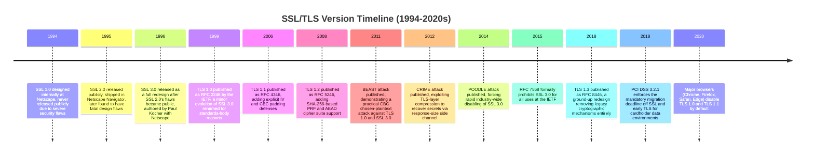

Netscape's original SSL 1.0 never shipped to the public; internal review
found flaws serious enough (including a design that allowed an active
attacker to truncate a connection undetected) that Netscape scrapped it
before release. SSL 2.0 did ship, inside Netscape Navigator in 1995, and it
is the version most people mean when they talk about "SSL" as a historical
artifact — it is also the version with the most catastrophic list of design
flaws of any protocol still discussed in a serious architecture context
(covered in depth in Section 4).

By 1996, security researchers (most visibly Wagner and Schneier's public
analysis) had cataloged SSL 2.0's flaws thoroughly enough that Netscape
commissioned a near-total redesign. SSL 3.0, largely authored by cryptographer
Paul Kocher working with Netscape engineers, fixed essentially every
structural problem in SSL 2.0: it added a proper Message Authentication Code
(MAC) construction over the full handshake transcript to prevent downgrade
and truncation attacks, removed insecure export-grade cipher negotiation
defaults, and introduced a cleaner separation between handshake and record
layers. SSL 3.0 was a genuinely competent protocol for 1996 — and it is the
direct ancestor of every TLS version in use today.

That direct lineage is the reason the rename to TLS in 1999 was so
disorienting for an industry that had just gotten comfortable saying "SSL":
TLS 1.0 is, at the protocol level, an extremely close relative of SSL 3.0 —
close enough that TLS 1.0's own specification (RFC 2246) describes the
differences from SSL 3.0 as "not dramatic." Section 3 explains why the
Internet Engineering Task Force (IETF), the standards body that took over
stewardship of the protocol from Netscape, insisted on a name change rather
than simply calling it "SSL 4.0" — and why that organizational decision is
the direct cause of the persistent "SSL" vocabulary problem this chapter
exists to explain.

## 3. Why It Exists (as a Chapter, and as History)

**Why does a chapter about a dead protocol matter to a Solution Architect?**
Because "dead" and "irrelevant" are not the same thing here. SSL, as an
actual wire protocol, should never be negotiated by any production system in
2026 — but the *word* "SSL" is alive and load-bearing across the entire
industry's vocabulary, tooling, and compliance language:

- Certificate Authorities still sell "SSL certificates" (the certificate
  itself is protocol-version-agnostic — it is the same X.509 certificate
  format used by TLS, but the commercial product name never changed).
- Load balancer and reverse proxy documentation across every major cloud
  and vendor still uses "SSL termination" and "SSL offload" as the standard
  term for what is, functionally, TLS termination.
- The `openssl` command-line tool — the near-universal utility for
  inspecting, generating, and debugging certificates and TLS connections —
  has never been renamed, and its subcommands (`openssl s_client`,
  `openssl s_server`) still use the `s_` (SSL) prefix.
- Compliance frameworks (PCI DSS foremost among them) historically wrote
  requirements using the literal phrase "SSL and early TLS," and auditors
  still ask the question that way.

An architect who insists on correcting every colleague's "SSL" to "TLS" in
casual speech is not wrong, technically, but is missing the more useful
skill: understanding *why* the vocabulary persists, so that when an
architecture review document, a compliance questionnaire, or a vendor's
support ticket says "SSL," the architect can correctly translate that into
"they mean TLS, and probably need to know whether *any* real SSL or
early-TLS versions are still reachable" — which is an entirely different,
concrete, auditable question, covered in Section 17 (Security) and Section
5 (Internal Working — audit methodology).

The second reason this chapter exists is that SSL's death was not abstract
or gradual — it was a sequence of named, dated, public cryptographic
attacks, each of which forced a specific version off the Internet on a
specific timeline. Understanding *that* chain (POODLE, BEAST, CRIME, and the
weaknesses each one exploited) is what lets an architect explain, with
authority, why a legacy system still negotiating SSL 3.0 or TLS 1.0 is not
a theoretical risk but a protocol with publicly known, automatable exploits
against it.

## 4. Core Concepts

### 4.1 SSL 2.0's Fatal Design Flaws

**Definition.** SSL 2.0 (1995) was the first publicly shipped version of the
protocol, bundled with Netscape Navigator. It established the basic shape
every later version kept — a handshake to negotiate cipher parameters and
authenticate the server, followed by a symmetric-encrypted record layer for
application data — but its specific mechanisms had structural flaws serious
enough that no later version reused them unmodified.

**Mechanism — what actually went wrong.** SSL 2.0 had no integrity
protection over the handshake messages themselves. Each handshake message
was sent independently, with no cumulative MAC covering the full negotiation
transcript. That single omission enabled several distinct attacks:

- **Cipher-suite downgrade / "man-in-the-middle truncation."** Because the
  list of cipher suites the client offered was not itself authenticated, an
  active attacker sitting on the network path could rewrite that list in
  transit, stripping out strong ciphers and leaving only weak, export-grade
  options (a legal artifact of 1990s U.S. cryptography export restrictions,
  which capped exportable symmetric key lengths at 40 bits). Client and
  server would then negotiate a cipher weak enough for the attacker to
  brute-force in real time, with neither party able to detect that a
  downgrade had occurred.
- **No message integrity on the handshake as a whole.** SSL 2.0 used a
  weak, non-standard MAC construction for records, but critically applied
  no authentication across the handshake's message *sequence* — an attacker
  could truncate the connection (inject a fake "close" at the transport
  layer) without either endpoint detecting tampering, since TCP-level
  connection closure was not itself authenticated by the SSL layer.
- **Same key used for authentication and encryption.** SSL 2.0 derived both
  the message-authentication key and the bulk-encryption key from the same
  master secret in a way that leaked information between the two uses,
  weakening both.
- **Weak MAC construction for certain cipher/hash combinations,** allowing
  attackers in some configurations to recover partial plaintext without
  breaking the underlying cipher.

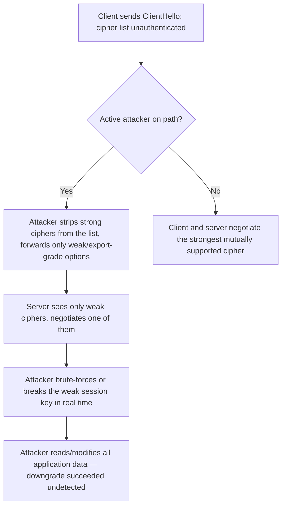

**Decision implication.** No Solution Architect will ever be asked to
*choose* SSL 2.0 today — every modern Transport Layer Security (TLS)
library and operating system has removed it entirely from negotiable cipher
and protocol lists. The practical decision implication is diagnostic, not
selective: if a legacy appliance, embedded device, or ancient application
server is ever found still offering SSL 2.0 in a protocol scan (Section 17),
that is an unconditional, non-negotiable decommission-or-patch finding —
there is no compensating control that makes SSL 2.0 acceptable in any
network-reachable context.

**Common failure mode.** Architects sometimes assume "legacy protocol
support" is a spectrum where the risk scales smoothly with age. SSL 2.0 does
not sit on that spectrum — its downgrade and truncation flaws mean an
attacker with any network path (not just one capable of breaking modern
cryptography) can fully compromise a connection. Treat any SSL 2.0 finding
as a Sever-1 security incident, not a routine hardening backlog item.

**Concrete scenario.** A payment gateway integration built in the early
2000s exposes a legacy Simple Object Access Protocol (SOAP) endpoint that
still has SSL 2.0 enabled in its Java 6 application server's default
configuration (Java did not disable SSL 2.0 by default until later
versions). A vulnerability scan flags this during a PCI DSS assessment. The
architecturally correct response is not "reduce the weight of the finding
because it's an internal system" — internal-only reachability does not
neutralize the downgrade attack if any host on that internal segment can be
compromised first (lateral movement). The finding requires disabling SSL
2.0 at the server configuration level immediately, independent of any
broader modernization timeline.

### 4.2 SSL 3.0 — The Redesign, and Its Own Fatal Flaw (POODLE)

**Definition.** SSL 3.0 (1996) was a structural redesign that fixed SSL
2.0's handshake-integrity problems by introducing a `finished` message
containing a MAC over the entire handshake transcript, so any tampering
(including cipher-suite downgrade) would be detected before either side
trusted the connection. It remained in wide use for nearly two decades
after its 1996 release, far longer than its designers likely expected,
because so much legacy infrastructure negotiated it as a fallback.

**Mechanism.** SSL 3.0's record layer used the Cipher Block Chaining (CBC)
mode of block encryption for its symmetric ciphers, combined with a padding
scheme that had a subtle but eventually fatal flaw: the padding bytes
appended to the final block of a record were *not* covered by the MAC in a
way that let an attacker verify guesses about padding validity. This became
exploitable via the Padding Oracle On Downgraded Legacy Encryption (POODLE)
attack, published in 2014.

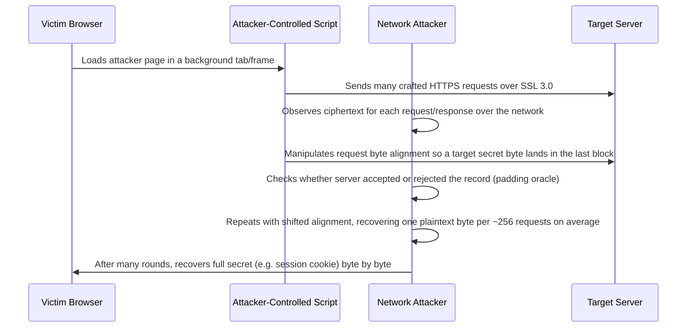

POODLE required an attacker who could both run script in the victim's
browser context (for example, via a malicious ad or compromised third-party
script) *and* observe/manipulate network traffic (a Man-in-the-Middle
position) — a realistic combination on public Wi-Fi. The attack itself
targeted SSL 3.0's CBC padding validation directly, but its real
architectural significance was broader: because many clients and servers
implemented an automatic "fallback" behavior — retry with an older protocol
version if a newer handshake failed for any reason, including transient
network errors — an attacker could deliberately *force* a downgrade to SSL
3.0 even when both endpoints actually supported far newer, unaffected
versions. That "fallback as an active downgrade vector" lesson directly
shaped later protocol design (TLS_FALLBACK_SCSV, and TLS 1.3's removal of
version-negotiation ambiguity entirely — see [TLS](CH06_TLS.md) for the
mechanics).

**Decision implication.** POODLE is the single event most directly
responsible for SSL's final industry-wide death. Before POODLE (October
2014), SSL 3.0 support lingered widely as a "harmless" legacy fallback
because CBC padding oracles were seen as a narrow, hard-to-exploit class of
weakness. After POODLE, every major browser vendor and server software
project moved within months to disable SSL 3.0 entirely by default, and the
IETF formally deprecated the protocol via RFC 7568 (2015), explicitly
stating implementations "MUST NOT" negotiate SSL 3.0 under any
circumstance — a stronger prohibition than a typical "SHOULD NOT"
deprecation notice.

**Common failure mode.** Treating POODLE as "just a browser problem" — the
underlying CBC padding oracle weakness also affected TLS 1.0 and TLS 1.1
implementations that used certain CBC cipher suites with vulnerable padding
validation logic (a variant sometimes called "POODLE against TLS"), which
is one of the concrete reasons compliance frameworks group "SSL and early
TLS" together as a single remediation category rather than treating SSL and
TLS 1.0/1.1 as separate risk tiers (see Section 4.5 and Section 13).

**Concrete scenario.** An architect reviewing a legacy F5 load balancer
configuration finds SSL 3.0 still listed as a negotiable protocol
"for backward compatibility with a small number of old kiosk devices that
integrate with the checkout API." Because that fallback path is externally
reachable, any attacker capable of positioning as a Man-in-the-Middle on
that network segment (trivial on shared Wi-Fi, or via Address Resolution
Protocol (ARP) spoofing on an internal segment) can force a downgrade
specifically to exploit the legacy kiosks, regardless of what protocols the
kiosks would prefer if left alone. The architecturally sound fix is not to
"monitor the kiosk traffic more closely" — it is to remove SSL 3.0 as a
negotiable option entirely and replace the kiosks or put a modern
TLS-terminating proxy in front of them.

### 4.3 BEAST — The CBC Chosen-Plaintext Attack Against TLS 1.0/SSL 3.0

**Definition.** Browser Exploit Against SSL/TLS (BEAST), published in 2011
by Rizzo and Duong, was a practical demonstration that TLS 1.0 (and SSL
3.0)'s CBC-mode implementation used a predictable Initialization Vector
(IV) — specifically, each record's IV was derived from the last ciphertext
block of the *previous* record, rather than being freshly random and
unpredictable for each new record.

**Mechanism.** With a predictable IV, an attacker who can both inject
chosen plaintext into the same connection (again, via attacker-controlled
script running in the victim's browser) and observe ciphertext can perform
a chosen-plaintext attack: guess a byte of a secret (such as an
authentication cookie), construct a plaintext block that would produce a
matching ciphertext block *if* the guess is correct (because the IV for the
next record is already known in advance), send it, and compare the
resulting ciphertext to confirm or reject the guess — recovering the secret
byte by byte, similar in spirit to POODLE's oracle but exploiting IV
predictability rather than a padding-validation oracle.

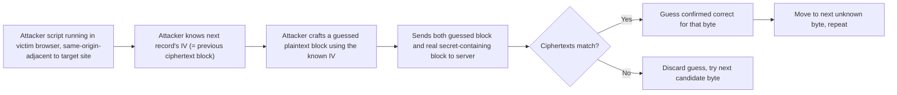

TLS 1.1 (2006) fixed this specific flaw by mandating an explicit,
unpredictable IV per record rather than chaining from the previous record's
final block — one of the concrete, named reasons TLS 1.1 existed as its own
version rather than being folded into a later TLS 1.0 revision. In
practice, though, TLS 1.1 saw limited real-world adoption before TLS 1.2
(2008) arrived with a larger set of improvements, so many servers and
clients jumped from TLS 1.0 directly to TLS 1.2 rather than passing through
TLS 1.1 — one reason TLS 1.1 is often lumped with TLS 1.0 in modern
"disable legacy TLS" guidance despite technically fixing BEAST.

**Decision implication.** BEAST is largely a historical concern today
because virtually every modern TLS client and server defaults to TLS 1.2 or
TLS 1.3, both of which use fundamentally different (and non-vulnerable) IV
handling or, in TLS 1.3's case, Authenticated Encryption with Associated
Data (AEAD) cipher modes that don't use CBC chaining at all (see
[TLS](CH06_TLS.md) Section 4 for AEAD mechanics). The decision implication
for an architect is retrospective and diagnostic: if a system is found still
negotiating TLS 1.0 with CBC cipher suites, BEAST is one of several
concrete named exploits (alongside the CBC-padding-oracle family that
POODLE belongs to) that justify treating that finding as urgent rather than
theoretical.

**Common failure mode.** Confusing BEAST with POODLE in an audit report —
they exploit different mechanisms (predictable IV vs. padding-oracle) even
though both target CBC-mode ciphers in SSL/early TLS. An architect
presenting findings to a security or compliance stakeholder should name the
specific attack that applies to the specific protocol version/cipher
combination found, not use "POODLE-style" as a generic catch-all for every
CBC weakness — precision here materially affects how a remediation ticket
gets prioritized and understood downstream.

### 4.4 CRIME — Compression-Based Side-Channel Attack

**Definition.** Compression Ratio Info-leak Made Easy (CRIME), published in
2012 (also by Rizzo and Duong, the same researchers behind BEAST), exploited
optional TLS-layer (and separately, HTTP-layer, in a related follow-on
attack called BREACH) compression, rather than a flaw in the cipher itself.

**Mechanism.** When compression is applied to data that mixes
attacker-controlled content with a secret (such as a session cookie or
authentication token) before encryption, the *size* of the resulting
compressed-then-encrypted output leaks information about the secret: if the
attacker's guessed substring matches part of the secret, the compressor
finds a redundant match and produces a shorter compressed output than it
would for an incorrect guess. Because the attacker can observe the
ciphertext length even without decrypting it, this becomes a byte-by-byte
oracle exactly analogous in spirit to BEAST and POODLE, but exploiting an
optional protocol *feature* (compression) rather than a core cryptographic
mechanism.

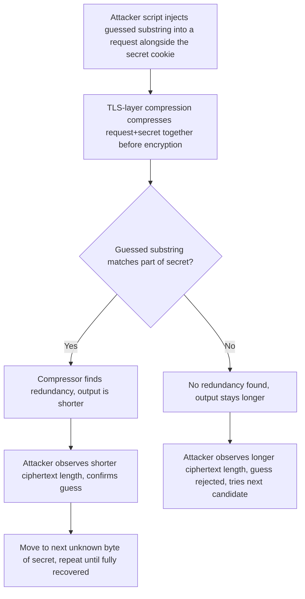

**Decision implication.** The fix was structural and simple: disable
TLS-level compression entirely, which is why no TLS library enables it by
default today, and why TLS 1.3 removes compression from the protocol
entirely rather than leaving it as an optional, misuse-prone feature. The
related HTTP-layer variant, BREACH (2013), exploits HTTP response
compression (such as gzip) the same way and is *not* fixed merely by
disabling TLS compression — it requires application-layer mitigations
(such as not reflecting attacker-controlled input into a response that also
contains a secret, or disabling response compression for sensitive
endpoints), which is why BREACH remains a live consideration in modern web
application security reviews even though CRIME itself is fully closed at
the TLS layer. This distinction — protocol-layer compression (CRIME, dead)
versus application-layer compression (BREACH, still requires deliberate
mitigation) — is a common gap in architecture reviews that assume "we
disabled TLS compression" fully addresses the compression-oracle class of
risk.

**Common failure mode.** Assuming CRIME and BREACH are the same
vulnerability because they share an attack shape. They target different
layers, have different fixes, and — critically for an audit — a protocol
scanner that confirms TLS compression is disabled (closing CRIME) tells you
nothing about whether the application still reflects secrets into
compressed HTTP responses (leaving BREACH open). Treat them as two separate
line items in any security review.

### 4.5 Why SSLv3 Became TLS 1.0 (Not "SSL 4.0") — Organizational History

**Definition.** In 1996, the IETF began the process of taking over
stewardship of SSL from Netscape as an open, vendor-neutral Internet
standard rather than a single company's proprietary protocol, publishing
the result in 1999 as RFC 2246 under the name Transport Layer Security (TLS)
1.0.

**Mechanism — why a rename, and not a version bump.** Several concrete,
non-technical reasons drove the naming decision, and all of them matter for
understanding why "SSL" persists as vocabulary even though the underlying
protocol identity changed:

- **Trademark and ownership.** "SSL" was Netscape's protocol and, in
  practice, associated with Netscape's brand. Handing stewardship to an
  open standards body while keeping Netscape's product name attached to the
  result would have been organizationally awkward and arguably misleading
  about who now controlled the specification.
- **Competitive neutrality.** By the mid-1990s, Microsoft had shipped its
  own competing security protocol (Private Communication Technology, PCT)
  for Internet Explorer. Part of the IETF's mandate in standardizing this
  space was to produce a vendor-neutral protocol that no single browser or
  server vendor could claim ownership of — a fresh name signaled a fresh,
  jointly governed standard rather than "Netscape's protocol, now with an
  IETF stamp on it."
- **Precedent for IETF-adopted protocols.** The IETF has a general pattern
  of renaming protocols it standardizes from previously vendor-specific
  origins, to mark the transition to open governance and multi-stakeholder
  design — TLS is not a unique case of this pattern.
- **The technical changes, while modest, were real enough to justify a
  distinct identity.** TLS 1.0 changed the pseudorandom function (PRF)
  construction, adjusted the MAC computation slightly, and made a handful
  of other small protocol-level changes relative to SSL 3.0 — described in
  the RFC itself as differences that "are not dramatic," but real enough
  that TLS 1.0 and SSL 3.0 do not interoperate directly without an explicit
  compatibility/downgrade mechanism.

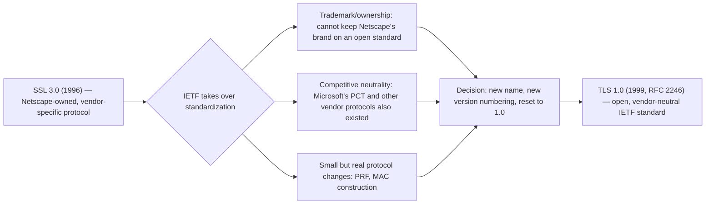

**Decision implication.** This history explains a fact every architect
should be able to state precisely when asked "why isn't it just called SSL
4.0?": the rename was primarily an organizational/governance signal (open
standard, vendor-neutral, no single company's brand attached), not evidence
of a completely different protocol. That is also precisely why the "SSL"
vocabulary never fully died in casual and even semi-formal industry usage —
practitioners correctly sensed that TLS 1.0 was "basically SSL 3.0 with
small fixes" and the terminology lagged the underlying rename by decades,
a lag that is still ongoing in product names and casual speech today.

**Common failure mode.** Some engineers assume the SSL-to-TLS rename
indicates TLS is unrelated to SSL, or conversely that "SSL" and "TLS" are
fully interchangeable synonyms with no protocol-level distinction at all.
Neither is correct: they are directly related (TLS is SSL's standardized
descendant), but they are also not identical or interchangeable at the
protocol-negotiation level — a server configured to accept "SSL" is
accepting an actual different, and now-broken, protocol version, not merely
using old terminology for the same TLS connection.

### 4.6 The Full Deprecation Chain — Which Attack Killed Which Version

**Definition.** No single event killed "SSL" — it was a chain of separate,
named attacks, each targeting a specific mechanism in a specific version,
that cumulatively forced the industry through SSL 2.0 to SSL 3.0 to TLS 1.0
to TLS 1.1 to (now) a strong preference for TLS 1.2 and TLS 1.3 only.

| Version | Released | Fatal/major weakness | Named attack | Effective end-of-life |
|---|---|---|---|---|
| SSL 1.0 | 1994 (internal only) | Multiple severe design flaws | None published (never released) | Never shipped |
| SSL 2.0 | 1995 | No handshake-transcript integrity; cipher downgrade; weak MAC | Downgrade/truncation attacks (Wagner & Schneier analysis) | Disabled by default across all major implementations by ~2011; formally prohibited by RFC 6176 (2011) |
| SSL 3.0 | 1996 | CBC padding-oracle | POODLE (2014) | Formally prohibited by RFC 7568 (2015) |
| TLS 1.0 | 1999 | Predictable CBC IV | BEAST (2011) | PCI DSS mandated disable by June 2018; browsers disabled by default in 2020 |
| TLS 1.1 | 2006 | Limited adoption; grouped with TLS 1.0 in modern guidance | (Fixed BEAST's specific flaw, but superseded quickly) | PCI DSS mandated disable alongside TLS 1.0; browsers disabled by default in 2020 |
| (protocol-agnostic) | — | Compression side-channel | CRIME (2012), BREACH (2013, HTTP-layer variant) | TLS compression disabled by default industry-wide by ~2013 |
| TLS 1.2 | 2008 | None fatal; remains fully approved | — | Current minimum acceptable version as of this writing |
| TLS 1.3 | 2018 | None fatal; current best practice | — | Current recommended version |

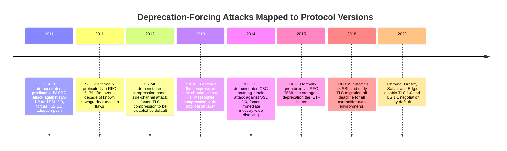

**Decision implication.** An architect auditing or designing for a system
with any legacy protocol constraint should be able to name the *specific*
attack that justifies removing a *specific* version — "just disable
everything old" is the right end state, but being able to say "TLS 1.0 must
go because of BEAST, and separately because PCI DSS names it explicitly" is
the difference between an audit finding a stakeholder accepts and one they
argue with.

**Common failure mode.** Treating this as a strictly linear "each version
replaced the previous one because it was attacked" story. In reality, some
versions (TLS 1.1) were pushed out largely by adoption timing rather than by
a dedicated named attack against TLS 1.1 itself — precision about *why* each
version is deprecated avoids overstating the case in a way a technically
sharp stakeholder could challenge.

### 4.7 Certificates Are Version-Agnostic — Why "SSL Certificate" Persists

**Definition.** An X.509 digital certificate — the credential that binds a
public key to an identity (a domain name, an organization, or both) and is
issued by a Certificate Authority (CA) — is not tied to SSL or TLS as a
specific protocol version. The same certificate format, the same
certificate chain-of-trust model, and the same issuance process work
identically whether the connection ultimately negotiates TLS 1.2 or TLS
1.3. Full certificate mechanics (chain validation, extended validation,
certificate transparency, revocation) are owned by the dedicated
Certificates chapter later in this part; this chapter's contribution is
narrower — explaining *why* the commercial and colloquial term never
updated.

**Mechanism.** Because certificates predate and are independent of the
protocol-version question, and because the commercial product ("buy a
certificate from a CA") existed under the "SSL certificate" name from the
Netscape era onward, Certificate Authorities and hosting providers had no
technical forcing function to rename the product — unlike the protocol
itself, where browsers and servers had to actively remove SSL negotiation
capability for security reasons, nothing about a certificate's function
required a rename. The result is a linguistic fossil: the certificate
product name reflects branding history from the mid-1990s, while the
protocol that actually uses that certificate has moved on twice (SSL to
TLS, TLS 1.0/1.1 to TLS 1.2/1.3).

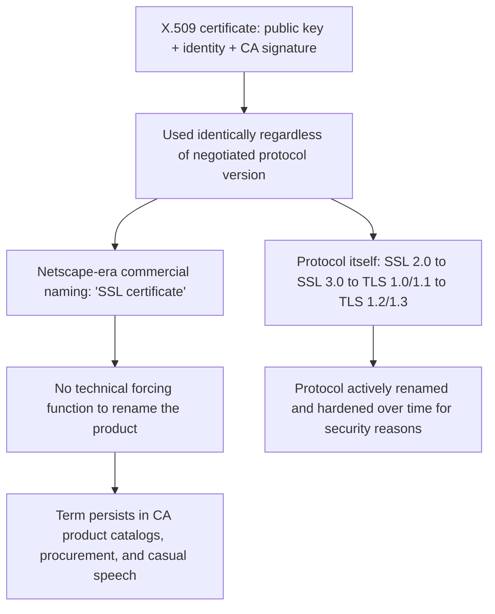

**Decision implication.** When a procurement or vendor document says "SSL
certificate," an architect should read that as "TLS certificate" without
requiring the vendor to fix their terminology — but should still verify
separately, and explicitly, what protocol versions the system presenting
that certificate is actually configured to negotiate, since the two
questions (certificate validity and negotiable protocol version) are
answered independently.

**Common failure mode.** Assuming that because a system has a valid,
correctly issued "SSL certificate," it is therefore using a secure,
modern protocol. A perfectly valid certificate can be presented over a
connection still willing to negotiate SSL 3.0 or TLS 1.0 if server
configuration hasn't been hardened — certificate validity and protocol
version are orthogonal configuration concerns, and an audit must check
both (Section 17 covers the concrete checks).

## 5. Internal Working — Auditing a Production Estate for Legacy SSL/TLS

Given that no architect should ever need to reason about the byte-level
handshake of SSL itself (that mechanism, for the versions still legitimately
in use, belongs to [TLS](CH06_TLS.md)), the "internal working" that matters
for this chapter is the operational one: how do you actually discover,
across a real production estate, every place a legacy protocol version
might still be silently accepted?

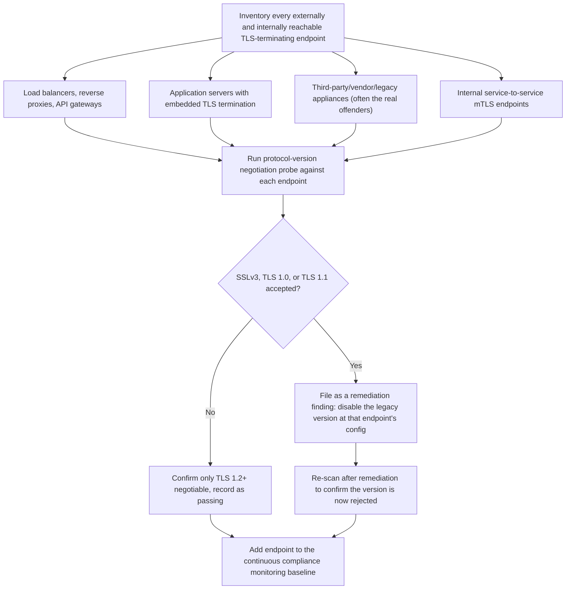

The audit has three practical layers, each with a different tool and a
different failure mode if skipped:

1. **Direct protocol-negotiation probing** (`openssl s_client`, `nmap`'s
   `ssl-enum-ciphers` script, or purpose-built scanners like `testssl.sh`) —
   attempts to actually negotiate each legacy version against the live
   endpoint and reports which ones succeed. This is the ground truth: a
   configuration file review can be wrong (a config might reference a
   version list that a load balancer's actual firmware doesn't honor as
   written), but a live negotiation attempt cannot lie about what the
   endpoint accepts today.
2. **Configuration review** (nginx, Apache, load balancer, API gateway
   configs) — confirms *why* an endpoint behaves the way the live probe
   showed, and is where the actual fix gets made (Section 10 has a worked
   nginx example).
3. **Continuous monitoring**, not a one-time scan — because legacy
   protocol support has a habit of silently reappearing: a load balancer
   firmware upgrade resets to vendor defaults that re-enable TLS 1.0, a new
   third-party integration is provisioned with an old Software Development
   Kit (SDK) that only speaks TLS 1.0, or a disaster-recovery failover
   environment was configured before the hardening pass and never received
   the same update. An architect who treats "we disabled legacy TLS" as a
   completed project rather than an ongoing control is the most common
   root cause of a compliance finding reappearing on a later audit.

## 6. Design Principles

- **Fail closed on protocol negotiation, not just on cipher choice.**
  Configuring a strong cipher-suite allow-list while still permitting
  SSLv3/TLS 1.0 as a fallback protocol version is a common half-fix — an
  attacker forcing a downgrade to an old *version* can still land on a weak
  cipher available under that version, independent of what your preferred
  cipher list looks like at TLS 1.2+.
- **Never rely on client behavior for protocol-version safety.** Design
  server-side configuration as the sole enforcement point; assuming "modern
  clients won't request SSLv3 anyway" ignores that an active attacker, not
  a well-behaved client, is the actual threat model POODLE-class attacks
  exploit.
- **Treat legacy-protocol compatibility requirements as a scoped exception
  with an expiry date, not a permanent configuration.** If a genuine
  business need exists to support an old client (a kiosk, an embedded
  device, a partner's legacy integration), isolate that exception to a
  narrowly scoped, monitored endpoint rather than relaxing protocol
  requirements estate-wide, and attach a decommissioning or upgrade date to
  the exception in the architecture's risk register.
- **Prefer terminating legacy compatibility at a dedicated, heavily
  monitored edge component** (a proxy purpose-built for the exception)
  rather than loosening the primary production fleet's baseline
  configuration — this keeps the blast radius of the exception small and
  auditable.

## 7. Architecture Patterns

The recurring pattern for handling any lingering legacy-protocol
requirement is **isolate-and-bridge**: a narrowly scoped edge component
accepts the legacy protocol from the constrained client, immediately
re-encrypts using a modern protocol version for everything past that single
hop, and is the only component in the estate whose configuration and
monitoring differ from the hardened baseline.

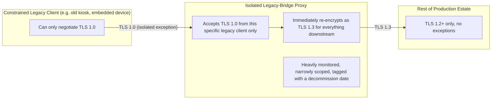

This pattern is the direct architectural answer to the common but wrong
alternative — "just enable TLS 1.0 on the main load balancer for this one
client" — which instead widens the attack surface for every other client
and every other traffic flow through that same load balancer.

## 8. Production Architecture

In a real estate, legacy-protocol exposure tends to concentrate in
predictable places, and a production architecture review should check each
explicitly rather than assuming a single "TLS termination point" covers
everything:

- **Edge load balancers / Content Delivery Network (CDN) termination** —
  usually the best-maintained layer, since cloud providers push default
  hardening, but custom listener configurations can still override safe
  defaults.
- **Internal service mesh / mutual TLS (mTLS) between microservices** —
  frequently overlooked in an audit because it's "internal," but internal
  mTLS configured years ago on an older sidecar-proxy version can still
  default to accepting TLS 1.0.
- **Database connection strings and driver-level TLS configuration** —
  many database drivers have historically defaulted to accepting a wide
  protocol range unless explicitly restricted, and this layer is commonly
  missed because it isn't "web traffic."
- **Third-party webhook receivers and partner integrations** — often the
  actual reason a legacy protocol version can't be immediately switched
  off, because the *partner's* system, not yours, is the one still on TLS
  1.0.
- **Disaster-recovery and staging environments** — frequently provisioned
  from an older image or Infrastructure as Code (IaC) template than
  production and never re-hardened after the primary environment was fixed.

## 9. Implementation

Implementing "no legacy SSL/TLS" as an actual control, not just a policy
statement, means encoding the minimum protocol version directly into every
layer's configuration — not relying on a single upstream component to be
the only enforcement point, since defense in depth means an attacker who
somehow reaches a downstream component directly (bypassing the intended
edge) should still find it refuses legacy negotiation.

Concretely, this means:

1. Set an explicit minimum TLS version at every TLS-terminating
   component's configuration (load balancer listener policy, reverse proxy
   `ssl_protocols` directive, application server connector settings,
   database driver connection parameters).
2. Remove legacy protocol versions from the *allowed* list rather than
   merely deprioritizing them in a preference order — a preference order
   still permits negotiation if a client insists.
3. Verify the change with a live negotiation probe (Section 5), not just a
   configuration-file review.
4. Add the check to continuous compliance monitoring so a future
   configuration drift (firmware update, new deployment, template reuse)
   is caught automatically rather than at the next annual audit.

## 10. Complete Code Examples

**Example 1 — nginx configuration explicitly disabling legacy SSL/TLS
versions**, showing both the incorrect legacy-permissive default and the
corrected hardened configuration:

```nginx
# nginx.conf — TLS listener hardening
# INCORRECT (legacy-permissive, do not use):
#   ssl_protocols SSLv3 TLSv1 TLSv1.1 TLSv1.2 TLSv1.3;

server {
    listen 443 ssl;
    server_name api.example.com;

    ssl_certificate     /etc/nginx/certs/api.example.com.crt;
    ssl_certificate_key /etc/nginx/certs/api.example.com.key;

    # CORRECT: only TLS 1.2 and TLS 1.3 are negotiable. SSLv3, TLS 1.0, and
    # TLS 1.1 are absent from the list entirely — not merely deprioritized.
    ssl_protocols TLSv1.2 TLSv1.3;

    # Restrict TLS 1.2 cipher suites to AEAD (authenticated encryption)
    # ciphers only, avoiding CBC-mode suites that carry the historical
    # BEAST/POODLE-class padding and IV risk described in Section 4.
    ssl_ciphers 'ECDHE-ECDSA-AES128-GCM-SHA256:ECDHE-RSA-AES128-GCM-SHA256:'
                'ECDHE-ECDSA-AES256-GCM-SHA384:ECDHE-RSA-AES256-GCM-SHA384';
    ssl_prefer_server_ciphers on;

    # Disable TLS-layer compression outright to close the CRIME class.
    ssl_session_tickets off;

    location / {
        proxy_pass http://backend_upstream;
    }
}
```

**Example 2 — OpenSSL command demonstrating protocol-version negotiation**,
used to confirm live behavior against a target endpoint (this is the ground
truth check referenced in Section 5, run once per candidate legacy version):

```bash
# Attempt to negotiate TLS 1.0 explicitly against a target host.
# A hardened server will reject the handshake; a legacy-permissive server
# will complete it — this is the single most direct way to prove what a
# server actually accepts, independent of what its config file claims.
openssl s_client -connect api.example.com:443 -tls1

# Expected output on a correctly hardened server (handshake failure):
#   140129738068096:error:1409442E:SSL routines:ssl3_read_bytes:
#   tlsv1 alert protocol version:s3_pkt.c:1493:SSL alert number 70

# Repeat for each legacy version to build a full picture:
openssl s_client -connect api.example.com:443 -ssl3
openssl s_client -connect api.example.com:443 -tls1_1

# Confirm the modern floor is still reachable (this should succeed):
openssl s_client -connect api.example.com:443 -tls1_2
```

**Example 3 — A protocol-audit script** in the spirit of `testssl.sh`/`nmap`
`ssl-enum-ciphers`, scripted for repeatable use across a fleet of endpoints
rather than one host at a time (suitable for a continuous-compliance job
per Section 5's third audit layer):

```bash
#!/usr/bin/env bash
# audit_legacy_tls.sh — probes a list of hosts for legacy SSL/TLS support.
# Usage: ./audit_legacy_tls.sh hosts.txt
# hosts.txt format: one "host:port" per line.

set -euo pipefail

LEGACY_FLAGS=("-ssl3" "-tls1" "-tls1_1")
LEGACY_NAMES=("SSLv3" "TLSv1.0" "TLSv1.1")

while IFS= read -r target; do
    host="${target%%:*}"
    port="${target##*:}"
    echo "== Auditing ${host}:${port} =="

    for i in "${!LEGACY_FLAGS[@]}"; do
        flag="${LEGACY_FLAGS[$i]}"
        name="${LEGACY_NAMES[$i]}"

        # -brief keeps output terse; a 2-second connect timeout avoids
        # hanging the whole scan on an unreachable or firewalled host.
        if echo | timeout 5 openssl s_client -connect "${host}:${port}" \
            "${flag}" -brief >/tmp/audit_out.txt 2>&1; then
            if grep -q "Protocol version" /tmp/audit_out.txt; then
                echo "  [FAIL] ${name} is negotiable on ${host}:${port} — remediation required"
            fi
        else
            echo "  [PASS] ${name} rejected on ${host}:${port}"
        fi
    done
done < "$1"

echo "Audit complete. Any [FAIL] line requires a config change per Section 10."
```

## 11. Performance

There is no meaningful performance trade-off in disabling legacy SSL/TLS
versions — TLS 1.2 and TLS 1.3 are both faster than SSL 3.0/TLS 1.0 in
practice (TLS 1.3's reduced handshake round-trip count, covered fully in
[TLS](CH06_TLS.md), is strictly faster than any older version's handshake).
The only performance-adjacent consideration an architect should raise is
during a migration window: if a legacy-bridge proxy (Section 7) is
introduced to isolate a genuinely constrained client, that extra hop adds a
small fixed latency cost, which should be measured and disclosed as part of
the exception's documented trade-off rather than left implicit.

## 12. Scalability

Legacy-protocol isolation (the bridge pattern in Section 7) should be
designed to scale independently from the rest of the fleet, since by
definition it serves a shrinking, bounded set of legacy clients rather than
general production traffic — over-provisioning the bridge component as if
it needed to scale with the whole estate wastes capacity, while
under-provisioning it risks the bridge becoming an availability bottleneck
for whatever legacy integration still depends on it. Track the bridge's
traffic volume explicitly as a leading indicator for when the legacy
exception can finally be retired.

## 13. Security

This is the section where the compliance dimension of legacy SSL/TLS
matters most concretely, and PCI DSS is the clearest worked example of a
regulatory body converting the historical attack chain from Section 4 into
an enforceable deadline.

**PCI DSS's SSL/early-TLS mandate — a concrete case study.** The PCI
Security Standards Council, which governs PCI DSS (a compliance standard
required for any organization that stores, processes, or transmits
cardholder payment data), issued guidance following the 2014 POODLE
disclosure that explicitly named "SSL and early TLS" (meaning SSL of any
version, plus TLS 1.0, and later interpreted to include TLS 1.1) as
no longer meeting the standard's encryption requirements. PCI DSS version
3.1 (2015) initially set a migration deadline of June 30, 2016, later
extended to June 30, 2018 (in PCI DSS 3.2) after industry feedback that
many organizations had significant legacy-client populations still
dependent on TLS 1.0. After that deadline, any Cardholder Data Environment
(CDE) — the scoped part of an organization's infrastructure that handles
card data — found still negotiating SSL or early TLS is a direct
compliance failure, independent of whether an actual breach occurred.

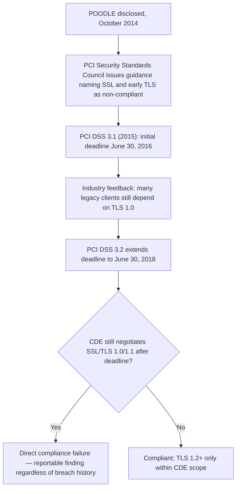

**Why this matters architecturally, not just legally.** The PCI DSS
deadline forced organizations to solve exactly the isolate-and-bridge
problem in Section 7 at scale: many large retailers had a long tail of
in-store payment terminals, older mobile card readers, and third-party
integrations that genuinely could not be upgraded to TLS 1.2 by the
deadline. The architecturally sound response most organizations converged
on was the same pattern this chapter recommends generally — isolate the
legacy-protocol acceptance to a narrowly scoped, heavily monitored
component explicitly outside the primary CDE's hardened baseline, with an
active decommissioning plan, rather than relaxing the CDE-wide baseline to
accommodate the exception.

**Beyond PCI DSS.** Other frameworks converged on the same guidance
independently: the National Institute of Standards and Technology (NIST)'s
SP 800-52 revision explicitly prohibits SSL and recommends TLS 1.2 minimum
(with TLS 1.3 preferred), and most enterprise security baselines and cyber
insurance underwriting questionnaires now ask the "SSL/early TLS disabled?"
question directly, using that exact legacy phrasing — reinforcing why the
vocabulary from Section 4.5/4.7 persists even in formal compliance
documents, not just casual speech.

## 14. Observability

Continuous protocol-version monitoring (Section 5's third audit layer)
should surface as a first-class, alertable metric, not a manual quarterly
check:

- Emit a metric (or log field) recording the negotiated protocol version
  for every terminated connection at each TLS-terminating component, and
  alert if any connection negotiates below the organization's declared
  floor (TLS 1.2, in most current baselines).
- Feed periodic external protocol-scan results (Section 10's audit script,
  or a commercial scanning tool) into the same dashboard used for other
  security posture metrics, so a drift (Section 5's "silently reappears"
  risk) is visible alongside other security signals rather than living in
  a separate, easily forgotten compliance spreadsheet.
- Alert distinctly on *any* successful legacy-version negotiation, even a
  single connection — unlike most availability metrics where a small
  percentage is tolerable noise, a single successful SSLv3/TLS 1.0
  negotiation indicates a configuration gap that will not fix itself.

## 15. Failure Scenarios

- **Silent re-enablement after a firmware or platform upgrade.** A load
  balancer or Content Delivery Network (CDN) vendor pushes a firmware
  update that resets custom listener policies to vendor defaults,
  re-enabling TLS 1.0 without any deliberate change on the organization's
  part. Mitigation: the continuous monitoring from Section 14, not a
  one-time hardening project.
- **A newly onboarded third-party integration ships an old Software
  Development Kit (SDK).** A partner's client library, built years earlier
  and never updated, only supports TLS 1.0, and the integration fails
  outright once the organization's endpoint stops accepting it —
  discovered only in production rather than in a pre-integration
  compatibility check. Mitigation: require a protocol-support statement as
  part of third-party integration onboarding, before the integration is
  built, not after.
- **Disaster-recovery environment drift.** A DR region or environment was
  provisioned from an older Infrastructure as Code (IaC) template before
  the primary environment's hardening pass, and only surfaces the gap
  during an actual failover — the worst possible time to discover a
  compliance or security gap. Mitigation: include DR/staging environments
  explicitly in the audit scope (Section 5), not just production.
- **Over-broad legacy exception.** A bridge component (Section 7) intended
  for one narrowly scoped legacy client gradually becomes the default
  on-ramp for other traffic because it's "already there and it works,"
  quietly widening the exception's blast radius over time. Mitigation:
  scope the bridge to a specific client identity (mutual TLS client
  certificate, source IP allow-list, or similar), not just a network
  location, and review its actual traffic sources periodically.

## 16. Testing

- **Negotiation tests, not just functional tests.** Include an automated
  test (integrated into the deployment pipeline) that actively attempts to
  negotiate each legacy protocol version against every environment
  (including staging and DR) and fails the build/deployment if any legacy
  version succeeds — this converts Section 5's audit script from a manual,
  periodic activity into a continuously enforced gate.
- **Regression testing after any TLS-terminating component change.** Any
  change to a load balancer, reverse proxy, or application server's TLS
  configuration (including routine platform patches) should re-trigger the
  negotiation test suite, since Section 15's "silent re-enablement" failure
  mode is exactly the scenario this regression test catches.
- **Legacy-bridge isolation tests.** For any intentional legacy exception
  (Section 7), test that the bridge component accepts the legacy protocol
  *only* from its intended, narrowly scoped client identity, and rejects it
  from any other source — verifying the isolation boundary is actually
  enforced, not just documented as an intention.

## 17. Common Mistakes

- Assuming "we have a valid SSL certificate" means the connection is using
  a secure protocol version — certificate validity and protocol-version
  negotiation are independent, as explained in Section 4.7.
- Treating a configuration-file review as sufficient evidence of what a
  server actually accepts, instead of running a live negotiation probe
  (Section 5) — configuration intent and runtime behavior can diverge,
  especially on appliances with vendor-managed firmware.
- Disabling legacy protocol versions once and considering the project
  "done," rather than adding continuous monitoring (Section 14) to catch
  drift.
- Widening a narrowly scoped legacy exception (the bridge pattern, Section
  7) into a general-purpose fallback because it's operationally convenient.
- Conflating BEAST, CRIME, and POODLE as generically interchangeable "old
  SSL bugs" in a report to stakeholders, losing the precision that makes a
  finding credible and actionable (Section 4.3/4.4/4.2).
- Assuming an internal-only system is exempt from legacy-protocol hardening
  because it isn't Internet-facing — lateral movement from any compromised
  host on the same segment makes internal systems reachable by exactly the
  same downgrade/oracle attacks described in Section 4.

## 18. Best Practices

- Set an explicit minimum negotiable protocol version (TLS 1.2 at minimum,
  TLS 1.3-only where every client population supports it) at every
  TLS-terminating layer, not just the outermost edge.
- Treat any legacy-protocol compatibility requirement as a time-boxed,
  narrowly scoped, actively monitored exception (Section 7), never a
  permanent estate-wide configuration relaxation.
- Run live protocol-negotiation probes (Section 5, Section 10) as a
  continuously enforced pipeline gate, not a periodic manual audit.
- Track compliance-mandated deadlines (Section 13's PCI DSS example) as
  concrete architecture roadmap milestones with an owner and a date, not
  just a line item in a compliance spreadsheet.
- When writing or reviewing architecture documentation, use "TLS" for the
  protocol and reserve "SSL" only for genuinely historical discussion or
  unavoidable vocabulary (a vendor's product name) — and be explicit, in
  writing, about which meaning is intended when the ambiguous term must be
  used.

## 19. Anti-Patterns

- **The "just in case" fallback.** Leaving SSLv3 or TLS 1.0 enabled
  indefinitely on the theory that some unknown client somewhere might still
  need it, without ever identifying that client, measuring its actual
  traffic, or setting a review date.
- **Hardening the edge only.** Disabling legacy protocols at the primary
  public load balancer while leaving internal service-to-service traffic,
  database connections, or DR environments unaudited, on the assumption
  that the edge is the only relevant attack surface.
- **Config-file-only compliance.** Treating a configuration file that
  lists only modern protocol versions as sufficient proof of compliance,
  without a live negotiation test confirming the running system actually
  behaves as configured.
- **Uncontrolled exception sprawl.** Allowing a legacy-bridge proxy
  (Section 7) to silently absorb more and more traffic over time because
  it's the path of least resistance, until it is effectively a second,
  unmonitored production edge.

## 20. Trade-off Analysis

| Decision | Benefit | Cost |
|---|---|---|
| Disable SSLv3/TLS 1.0/1.1 estate-wide immediately | Closes POODLE/BEAST/CRIME-class exposure entirely; meets PCI DSS and most modern compliance baselines | Breaks any client that cannot negotiate TLS 1.2+, with no advance notice if the client population wasn't inventoried first |
| Isolate legacy clients behind a dedicated bridge proxy (Section 7) | Contains the exception's blast radius; keeps the primary estate at a clean modern baseline | Adds an extra network hop and a component that itself needs monitoring and an eventual decommission plan |
| Allow a temporary, time-boxed exception with an explicit expiry | Buys migration time for a genuinely hard-to-upgrade legacy integration without an open-ended risk | Requires organizational discipline to actually retire the exception on schedule; easy to let the deadline slip |
| Do nothing (leave legacy protocols enabled indefinitely) | Avoids any short-term breakage or migration effort | Direct compliance failure risk (PCI DSS and others), and exposure to a fully public, automatable attack chain (POODLE, BEAST) |

## 21. Comparison Table

| Aspect | SSL 2.0 | SSL 3.0 | TLS 1.0 | TLS 1.1 | TLS 1.2 | TLS 1.3 |
|---|---|---|---|---|---|---|
| Released | 1995 | 1996 | 1999 | 2006 | 2008 | 2018 |
| Governing body | Netscape (proprietary) | Netscape (proprietary) | IETF | IETF | IETF | IETF |
| Handshake transcript integrity | No (fatal flaw) | Yes (fixed) | Yes | Yes | Yes | Yes (redesigned) |
| Known fatal named attack | Downgrade/truncation | POODLE | BEAST (CBC IV) | None dedicated; grouped with TLS 1.0 | None | None |
| Compression enabled by default | N/A | Historically yes (CRIME risk) | Historically yes (CRIME risk) | Historically yes | Disabled by default | Removed from protocol |
| Current status | Formally prohibited (RFC 6176) | Formally prohibited (RFC 7568) | Deprecated; PCI DSS-mandated disable | Deprecated; PCI DSS-mandated disable | Current minimum acceptable | Current recommended |
| Full mechanics owned by | This chapter (history only) | This chapter (history only) | This chapter (history) + [TLS](CH06_TLS.md) (where still discussed structurally) | This chapter (history) | [TLS](CH06_TLS.md) | [TLS](CH06_TLS.md) |

## 22. Real-World Case Study

A mid-size e-commerce retailer, preparing for its annual PCI DSS assessment
in early 2018 ahead of the June 2018 mandatory deadline (Section 13),
commissioned an audit of its Cardholder Data Environment (CDE). The
protocol-negotiation probe (the Section 5 methodology, run with an early
version of the `testssl.sh`-style approach in Section 10) found three
categories of lingering exposure that a configuration-file review alone had
missed entirely:

1. **The primary public-facing checkout load balancer** was already
   correctly configured to TLS 1.2 minimum — a config review alone would
   have reported "compliant" here, and did, in an earlier internal review.
2. **A secondary, less-visible load balancer fronting the in-store
   point-of-sale (POS) terminal integration** was still accepting TLS 1.0,
   because the POS vendor's own middleware, embedded in terminals deployed
   several years earlier, had never been updated and would fail outright
   if TLS 1.0 were disabled without a hardware/firmware refresh across
   thousands of physical terminals.
3. **A disaster-recovery region**, provisioned from an Infrastructure as
   Code (IaC) template that predated the primary region's hardening pass,
   still permitted TLS 1.1 across the board — invisible in day-to-day
   operations because DR traffic only flows during a failover drill or an
   actual incident.

The architecturally sound remediation, matching this chapter's Section 7
pattern, isolated the POS integration behind a dedicated, narrowly scoped
bridge proxy that accepted TLS 1.0 only from the specific IP ranges the
in-store terminals used, immediately re-encrypted to TLS 1.2 for
everything past that hop, and carried an explicit decommissioning target
tied to the terminal hardware refresh cycle already planned for the
following fiscal year. The DR region's IaC template was updated to match
the primary region's hardened baseline, and a negotiation-probe test
(Section 16) was added to the deployment pipeline for every region,
closing the exact "config review says compliant, live probe says
otherwise" gap that the initial internal review had missed.

## 23. Interview Questions

1. Why was SSL renamed to TLS instead of simply becoming "SSL 4.0"? What
   organizational, not just technical, factors drove that decision?
2. Explain the specific mechanism POODLE exploits. Why does it require both
   a Man-in-the-Middle network position and attacker-controlled script
   execution in the victim's browser?
3. How does BEAST differ from POODLE, given that both target CBC-mode
   ciphers? What specific mechanism does each exploit?
4. Why is CRIME fixed by disabling TLS-layer compression, while BREACH (its
   HTTP-layer relative) is not fixed the same way?
5. A colleague says "our system uses an SSL certificate, so we're secure."
   What is missing from that statement, and what would you check next?
6. Walk through how PCI DSS's "SSL and early TLS" mandate came about
   historically, and what an organization's CDE must demonstrate to remain
   compliant today.
7. Design an audit approach to detect lingering legacy protocol support
   across a production estate that a configuration-file review alone would
   miss. What's the ground-truth check, and why does it matter?
8. Why is SSL 2.0 considered a more severe historical risk than SSL 3.0,
   even though SSL 3.0 has its own famous named attack (POODLE)?

## 24. Hands-on Exercises

1. Using `openssl s_client`, attempt to negotiate `-ssl3`, `-tls1`,
   `-tls1_1`, and `-tls1_2` against a handful of public HTTPS endpoints of
   your choosing, and record which versions each accepts or rejects.
2. Take the audit script from Section 10 (Example 3) and extend it to also
   report the negotiated cipher suite for whichever protocol version
   succeeds, not just pass/fail per version.
3. Write an nginx configuration (using Section 10's Example 1 as a
   starting point) for a fictional service that must temporarily support
   TLS 1.0 for one specific legacy client IP range while rejecting TLS 1.0
   from everywhere else, implementing the isolate-and-bridge pattern from
   Section 7 in a single configuration file.

## 25. Design Exercises

1. You are asked to design the remediation plan for a payment-processing
   estate with 40 different TLS-terminating components (load balancers,
   application servers, third-party integrations, and a DR region) ahead
   of a PCI DSS assessment in 6 months. Produce a prioritized rollout plan,
   including which components to audit first and why, and how you would
   handle any component that cannot be immediately upgraded.
2. Design the continuous-monitoring system (Section 14) that would have
   caught the disaster-recovery drift described in the Section 22 case
   study before it reached an actual assessment. What signal would you
   monitor, and how would you avoid alert fatigue if legacy protocol
   findings are common during an active migration period?

## 26. Architecture Review Questions

1. Does this design specify an explicit minimum negotiable protocol
   version at every TLS-terminating layer, not just the primary public
   edge?
2. Is there a live, continuously enforced negotiation test (not just a
   configuration review) confirming no component accepts SSLv3, TLS 1.0,
   or TLS 1.1?
3. If a legacy-protocol exception exists, is it isolated to a narrowly
   scoped, monitored component with an explicit decommissioning date,
   rather than a relaxation of the primary estate's baseline?
4. Have disaster-recovery, staging, and third-party integration
   environments been included in the audit scope, not just production?
5. Does the team distinguish precisely between "SSL certificate"
   (vocabulary/product naming) and actual negotiable protocol version when
   discussing compliance or security posture with stakeholders?

## 27. Summary

SSL is not a chapter about a protocol a Solution Architect will ever
configure, negotiate, or defend in production — every version of it, along
with early TLS, should already be absent from any well-run estate. It is,
instead, a chapter about the gap between vocabulary and reality: "SSL
certificate" and "SSL termination" remain the industry's universal
language for a protocol that has actually moved on twice, first from
Netscape's proprietary SSL to the IETF's open TLS standard, and then from
TLS 1.0/1.1's now-broken mechanisms to TLS 1.2 and TLS 1.3. Understanding
*why* that vocabulary persisted — an organizational rename decision in
1999, and certificates that never needed to change names because they were
never protocol-version-specific to begin with — is what lets an architect
correctly translate ambiguous "SSL" language in a compliance questionnaire,
a vendor conversation, or a legacy system's documentation into the precise
question that actually matters: what protocol versions can this system
negotiate today, and can I prove it with a live check rather than a
configuration file's stated intent?

The historical attack chain — SSL 2.0's fatal lack of handshake integrity,
SSL 3.0's CBC padding oracle exploited by POODLE, TLS 1.0's predictable IV
exploited by BEAST, and the compression side-channel exploited by CRIME and
its HTTP-layer relative BREACH — is not trivia. It is the evidence base
that makes a "disable legacy TLS" finding non-negotiable rather than a
matter of risk appetite, and it is what a PCI DSS assessor, a security
reviewer, or a well-informed engineering peer expects a Solution Architect
to be able to explain precisely, attack by attack, rather than wave away
as "old SSL stuff was insecure." For everything this chapter deliberately
did not re-teach — the modern TLS handshake, cipher suite negotiation,
Perfect Forward Secrecy, SNI, ALPN, and mutual TLS mechanics that any
current system actually relies on — continue to [TLS (Transport Layer
Security)](CH06_TLS.md).
