# Chapter: DNS (Domain Name System)

Part: [05 — Networking and Operating Systems](PART_OVERVIEW.md) · Status: Drafted

## 1. Introduction

DNS (Domain Name System) is the internet's hierarchical, distributed
name-resolution architecture — the system that turns a human-readable name
like `api.example.com` into the Internet Protocol (IP) address a client
actually needs to open a TCP (Transmission Control Protocol) connection or
send a UDP (User Datagram Protocol) datagram. Every HTTP (HyperText Transfer
Protocol) request covered in [HTTP](CH01_HTTP.md), every TCP/IP session
covered in [TCP/IP](CH03_TCPIP.md), and every service a Solution Architect
designs that has a public or internal hostname depends on DNS resolving
correctly, quickly, and securely before a single application-layer byte is
exchanged.

For a Solution Architect, DNS is not merely "the phone book of the
internet" — that folk description undersells three things this chapter
treats as first-class architectural concerns:

1. **DNS is a deploy-latency and rollback-speed lever.** The Time To Live
   (TTL) an architect sets on a record determines how fast a DNS-based
   failover, blue-green cutover, or region migration can propagate — and how
   expensive that speed is in query volume and cache-miss load on
   authoritative servers.
2. **DNS is a genuinely common production failure point.** Unlike a bug in
   application code, a DNS misconfiguration or provider outage can take down
   traffic to an otherwise perfectly healthy fleet of servers, and it fails
   in ways that are slow to diagnose (client-side caching, resolver caching,
   and TTL make symptoms appear inconsistent across users and geographies).
3. **DNS is an attack surface**, not just a lookup service — cache
   poisoning, spoofing, and Distributed Denial of Service (DDoS) attacks
   against DNS infrastructure are a recurring category of real-world
   incident, motivating DNSSEC (DNS Security Extensions) and defense-in-depth
   patterns covered later in this chapter.

This chapter is the *owning* chapter for DNS hierarchy and resolution
mechanics, DNS record types and their architectural uses, TTL/caching as a
deploy-latency lever, DNS-based load balancing and traffic steering, DNSSEC,
and split-horizon/private DNS for internal service discovery. Other chapters
that touch DNS-adjacent topics — [Load Balancer](CH10_Load_Balancer.md) (not
yet drafted) for backend-health-aware traffic distribution, and
[CDN](CH09_CDN.md) (not yet drafted) for edge-caching architectures that sit
behind DNS-based routing — must recap and link here per the Concept
Ownership Rule in [STYLE_GUIDE.md](../STYLE_GUIDE.md) rather than
re-explaining DNS resolution from scratch.

## 2. Historical Evolution

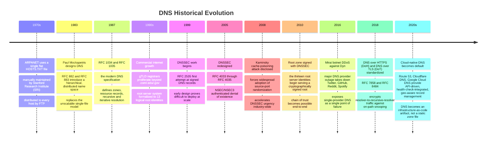

- **Pre-1983 — HOSTS.TXT**: every ARPANET host was identified in a single
  text file mapping name to address, maintained centrally by the Stanford
  Research Institute Network Information Center (SRI-NIC) and distributed by
  File Transfer Protocol (FTP) to every participating host. This did not
  scale: every new host required a manual edit to one file, every host on
  the network needed to re-download that file, and name collisions had no
  systematic resolution.
- **1983 — Mockapetris's design**: RFC 882/883 (later superseded by RFC
  1034/1035) proposed a hierarchical namespace with distributed
  administrative authority — no single organization owns the whole
  namespace; instead, authority is delegated down a tree, and each delegated
  zone can be managed independently. This is the architectural decision that
  let the namespace scale from thousands of hosts to billions of names
  without a central bottleneck.
- **1987 — RFC 1034/1035**: the modern DNS specification, defining zones,
  resource records, the resolution algorithm (recursive and iterative
  queries), and caching semantics with TTLs. This is still the normative
  reference for DNS's core mechanics.
- **2008 — Kaminsky attack**: security researcher Dan Kaminsky disclosed a
  practical cache-poisoning technique that could inject forged records into
  a resolver's cache by winning a race on the 16-bit transaction ID and a
  predictable (or narrow) source port, before the legitimate authoritative
  response arrived. The industry-wide emergency patch was source-port
  randomization (turning a ~65,536x harder-to-guess-in-time attack), and the
  incident is the direct motivation for accelerating DNSSEC deployment.
- **2016 — Dyn DDoS**: the Mirai Internet of Things (IoT) botnet directed a
  massive DDoS attack at Dyn, a major managed DNS provider, taking down
  resolution for Twitter, GitHub, Reddit, Spotify, and many other sites that
  depended solely on Dyn for authoritative DNS. This incident is the
  canonical case study (Section 22) for why single-provider DNS is an
  architectural single point of failure regardless of how reliable that one
  provider's uptime SLA (Service Level Agreement) claims to be.
- **2018 onward — encrypted DNS**: DoH (DNS over HTTPS) and DoT (DNS over
  TLS) address a different threat model — not cache poisoning of an
  authoritative answer, but on-path eavesdropping and manipulation between a
  client's stub resolver and its recursive resolver, which previously
  travelled as cleartext UDP visible to any network intermediary.

## 3. Why It Exists

Distributed systems need a name-to-location mapping that (a) does not
require every participant to agree on or store the entire mapping, (b) can
be updated by the owner of a name without coordinating with unrelated
parties, and (c) resolves quickly enough that it does not become the
dominant latency cost of every network interaction. A single centralized
database fails all three: it becomes a write bottleneck, a trust
bottleneck (every registrant would need to trust one operator), and a read
bottleneck (a single database serving billions of queries per second from
across the globe cannot offer acceptable latency without regional
replication — which is itself a delegation-and-caching architecture, just
without formal naming).

DNS solves this with two mechanisms this chapter teaches in depth: **hierarchical
delegation** (Section 4.1–4.2) so that authority over `example.com`'s records
belongs only to whoever operates `example.com`'s nameservers, not to any
central registry; and **aggressive, TTL-bounded caching** (Section 4.7) so
that the overwhelming majority of queries are answered from a nearby
resolver's cache rather than making a round trip to an authoritative server
on every single lookup.

## 4. Core Concepts

### 4.1 The DNS Hierarchy: Root, TLD, Authoritative, Recursive

DNS's namespace is a tree, read right-to-left when written as a dotted name.
For `api.example.com`, the tree walk is: root (`.`) → top-level domain (TLD)
`com` → second-level domain `example.com` → subdomain `api.example.com`. Each
level of this tree can be **delegated** to a different organization — ICANN
(the Internet Corporation for Assigned Names and Numbers) coordinates the
root and TLD layer, a domain registrar/registrant controls the second-level
domain, and that registrant's own nameservers control everything below it.
This delegation is what lets millions of organizations manage their own DNS
records without asking a central authority for permission on every change.

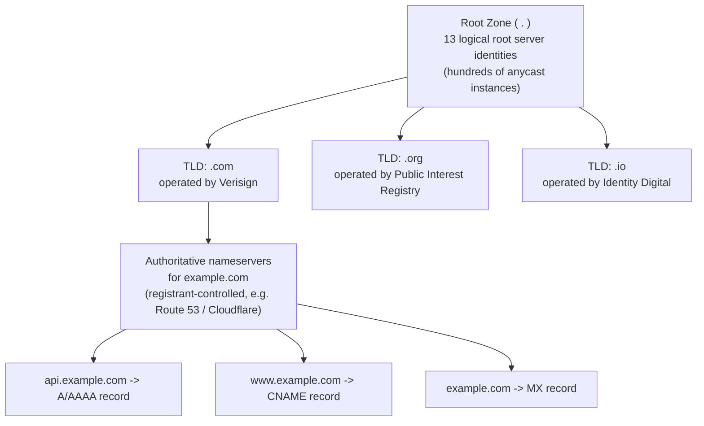

The four architectural roles a Solution Architect must distinguish:

- **Root servers**: answer only "which nameservers are authoritative for
  this TLD" — they never hold a record for `example.com` itself. There are
  13 logical root identities (`a.root-servers.net` through
  `m.root-servers.net`), but each is served by hundreds of physical servers
  worldwide via anycast (Section 12), so "13 root servers" is a common but
  slightly misleading simplification — it is 13 *identities*, not 13
  physical machines.
- **TLD nameservers**: answer "which nameservers are authoritative for this
  second-level domain" for every domain registered under that TLD (e.g.
  Verisign's servers answer for every `.com` domain).
- **Authoritative nameservers**: hold the actual resource records
  (A/AAAA/CNAME/MX/TXT/etc. — Section 4.4) for a specific zone and are the
  ultimate source of truth. This is the layer a Solution Architect directly
  configures (whether self-hosted BIND, or a managed provider like Route 53,
  Cloudflare DNS, or Google Cloud DNS).
- **Recursive resolvers**: the layer a client actually talks to (an
  Internet Service Provider's (ISP's) resolver, a corporate DNS server, or a
  public resolver like 8.8.8.8 or 1.1.1.1). A recursive resolver does the
  *work* of walking the tree on the client's behalf and caches the results
  so subsequent queries for the same name — from any client using that
  resolver — are answered instantly from cache instead of re-walking the
  hierarchy.

### 4.2 Zones, Delegation, and the SOA Record

A **zone** is the unit of administrative delegation — a contiguous portion
of the namespace that one set of nameservers is authoritative for. Critically,
a zone is not the same thing as a domain: `example.com` might be one zone
containing all its records, or the registrant might delegate
`api.example.com` to an entirely different set of nameservers (a
sub-delegation), making `api.example.com` its own zone with its own
authority boundary — common when a subdomain is operated by a different team
or a third-party SaaS (Software as a Service) vendor.

Every zone has exactly one **SOA (Start of Authority) record**, which is not
a name-to-address mapping but zone-level metadata:

```text
example.com.  3600  IN  SOA  ns1.example.com. hostmaster.example.com. (
                          2024031501 ; serial number
                          7200       ; refresh interval (seconds)
                          3600       ; retry interval (seconds)
                          1209600    ; expire time (seconds)
                          300 )      ; minimum TTL / negative-cache TTL
```

- **Serial number**: incremented on every zone change; secondary
  nameservers compare this to detect whether they need a zone transfer.
- **Refresh/retry/expire**: govern how secondary (replica) nameservers stay
  in sync with the primary — refresh is the normal polling interval, retry
  is the backoff on a failed poll, and expire is how long a secondary will
  keep serving stale data before considering the zone invalid if it cannot
  reach the primary at all.
- **Minimum TTL**: since RFC 2308, this field specifically governs how long
  resolvers cache a *negative* answer (NXDOMAIN — the name does not exist).
  Getting this wrong is a common failure mode (Section 17): a stale, long
  negative-cache TTL means a newly created record stays invisible to
  resolvers that already cached the NXDOMAIN, well after the record exists.

### 4.3 The Full Resolution Process, End to End

When a client resolves `api.example.com` for the first time (nothing
cached anywhere), the recursive resolver performs an **iterative** walk down
the hierarchy, while the client itself performs a single **recursive**
request to that resolver and waits for a complete answer. This distinction —
recursive vs. iterative — is one of the most commonly conflated pairs of
terms in DNS, so it is worth being precise:

- A **recursive query** asks the receiving server to fully resolve the name
  and return a final answer (or an authoritative error), doing whatever
  further querying is necessary itself. Clients (stub resolvers) always send
  recursive queries to their configured recursive resolver.
- An **iterative query** asks the receiving server to answer with its best
  current knowledge — either the final answer if it has it, or a referral
  ("I don't know, but ask this other server") if it does not. Recursive
  resolvers send iterative queries to root, TLD, and authoritative servers;
  those servers never do recursive work on the resolver's behalf.

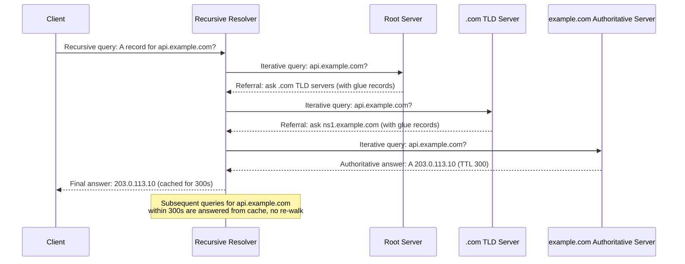

**Glue records** deserve explicit attention: when a TLD server refers the
resolver to `ns1.example.com`, the resolver would need to resolve
`ns1.example.com`'s own address first — but that name is itself inside the
`example.com` zone the resolver is trying to reach, creating a circular
dependency. Glue records solve this: the TLD server includes the IP address
of `ns1.example.com` directly alongside the referral (in the "additional"
section of the DNS response), breaking the circularity. This is why
registrars require you to register nameserver hostnames with their IP
addresses ("glue") when your nameservers are themselves inside the domain
they serve.

### 4.4 Resource Record Types and Their Architectural Uses

Each resource record type has a distinct architectural purpose; a Solution
Architect who conflates them will design broken failover or email-delivery
architectures.

| Record | Purpose | Architectural note |
|---|---|---|
| `A` | Maps a name to an IPv4 address | The most basic record; can list multiple IPs for simple round-robin DNS (Section 4.8) |
| `AAAA` | Maps a name to an IPv6 address | Dual-stack architectures publish both `A` and `AAAA` for the same name |
| `CNAME` | Aliases a name to another name (canonical name) | Cannot coexist with any other record type at the same name, and cannot legally be used at a zone apex (Section 4.5) |
| `MX` | Mail Exchange — routes email for a domain to specific mail servers, with a priority value | Lower priority number = more preferred; multiple `MX` records give mail-delivery redundancy |
| `TXT` | Arbitrary text at a name; used for machine-readable domain metadata | Domain-ownership verification, SPF, DKIM, DMARC (Section 4.6) |
| `NS` | Delegates a subtree to another set of nameservers | Defines zone boundaries (Section 4.2) |
| `SOA` | Zone-level authority metadata | One per zone (Section 4.2) |
| `PTR` | Reverse mapping — IP address to name | Used for reverse DNS lookups; email deliverability and some security tooling check that forward and reverse resolution match |
| `SRV` | Service location — host, port, priority, and weight for a named service | Used by protocols like SIP (Session Initiation Protocol) and internally for service discovery (Section 4.10) |
| `CAA` | Certification Authority Authorization — restricts which Certificate Authorities may issue TLS certificates for the domain | A defense-in-depth control against mis-issued certificates, independent of DNSSEC |

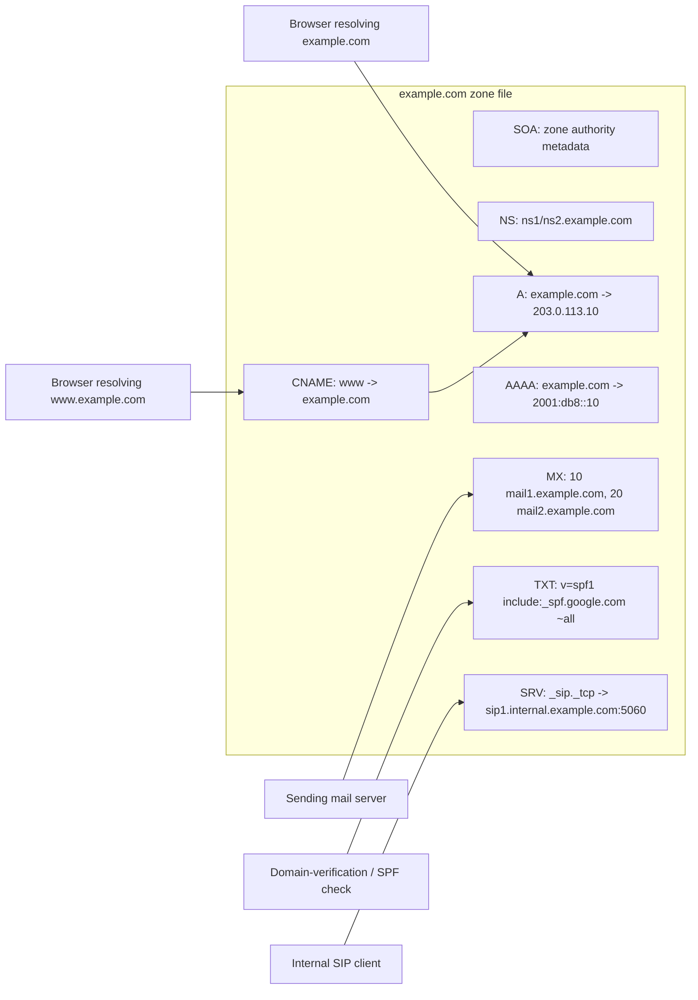

### 4.5 CNAME Flattening and ALIAS Records at the Zone Apex

A `CNAME` record aliases one name to another, but the DNS specification
forbids a `CNAME` from coexisting with any other record at the same name —
and critically, the **zone apex** (the bare domain, e.g. `example.com` with
no subdomain) almost always needs an `NS` record and often an `MX`/`TXT`
record too (delegation, mail routing, SPF). This creates a real
architectural problem: many managed platforms (content delivery networks,
load balancers, platform-as-a-service hosts) only give you a *hostname* to
point at (e.g. `my-app.some-platform.net`), which is naturally a `CNAME`
target — but you often want your root domain `example.com` itself, not just
`www.example.com`, to point there, and a bare `CNAME` at the apex is
illegal.

Two architectural solutions exist:

- **ALIAS/ANAME records** (provider-specific, not in the original RFCs):
  the DNS provider's authoritative servers resolve the target hostname
  server-side and return an `A`/`AAAA` record to the client, while still
  allowing other records (`NS`, `MX`, `TXT`) to coexist at the apex. Route
  53 calls this an "alias record," Cloudflare calls it "CNAME flattening" —
  functionally equivalent from the architect's perspective: the illegal
  apex `CNAME` is flattened into a legal `A`/`AAAA` answer before it ever
  reaches the client.
- **Provider-managed dynamic resolution**: because the flattening happens
  at query time on the provider's authoritative servers (not as a static
  zone-file entry), if the target hostname's underlying IP changes (e.g. a
  CDN reassigns edge IPs), the flattened answer changes automatically on
  the next query — the alias always tracks the target, unlike a manually
  copied `A` record that would go stale.

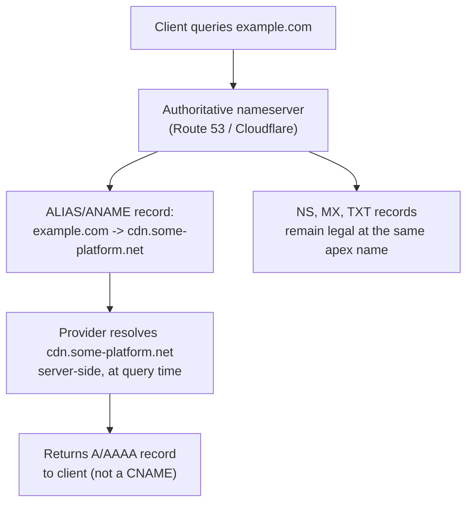

### 4.6 TXT Records for Verification, SPF, DKIM, and DMARC

Because `TXT` records hold arbitrary text at any name, they became the
default mechanism for machine-readable domain metadata that doesn't fit any
other record type:

- **Domain ownership verification**: services (Google Workspace, AWS
  Certificate Manager, Microsoft 365) ask you to add a `TXT` record with a
  provider-issued token at your domain, proving you control the DNS zone —
  the only practical way to verify domain control without a shared identity
  system, since controlling the zone that answers queries for a domain is
  the operational definition of controlling that domain.
- **SPF (Sender Policy Framework)**: a `TXT` record listing which mail
  servers are authorized to send email as your domain, e.g.
  `v=spf1 include:_spf.google.com ip4:203.0.113.0/24 ~all`. A receiving mail
  server checks the sending server's IP against this list; `~all` is a
  "soft fail" (mark suspicious) and `-all` is a "hard fail" (reject).
- **DKIM (DomainKeys Identified Mail)**: a `TXT` record at a
  selector-prefixed name (e.g. `selector1._domainkey.example.com`)
  publishing a public key; outgoing mail is signed with the matching
  private key, and the receiving server verifies the signature against this
  published key, proving the message wasn't altered in transit and really
  originated from a server holding the private key.
- **DMARC (Domain-based Message Authentication, Reporting, and
  Conformance)**: a `TXT` record at `_dmarc.example.com` that tells
  receiving servers what to do when SPF and/or DKIM checks fail (quarantine,
  reject, or none) and where to send aggregate failure reports — this is the
  policy layer that makes SPF/DKIM enforceable rather than merely advisory.

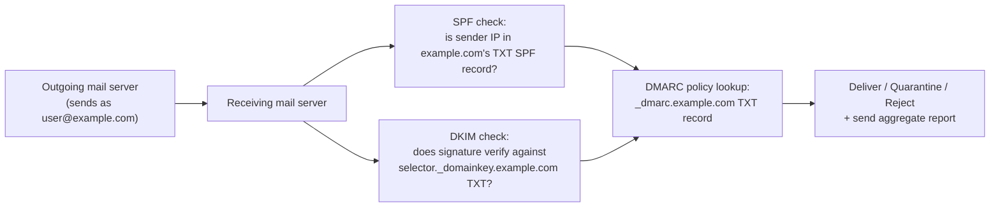

### 4.7 TTL and Caching as a Deploy-Latency and Rollback-Speed Lever

TTL (Time To Live), expressed in seconds on every resource record, tells
every resolver and client along the path how long they may reuse a cached
answer before re-querying. This single number is one of the most
underappreciated architectural levers in DNS-based deployment strategy:

- **Low TTL (e.g. 30–60 seconds)**: enables fast DNS-based failover,
  blue-green cutover, or canary traffic shifting — change the record, and
  within roughly one TTL window, essentially all resolvers worldwide have
  picked up the new answer. The cost: every resolver must re-query your
  authoritative servers far more often, multiplying query volume (and cost,
  for pay-per-query managed DNS) and increasing load on the authoritative
  layer. It also means a misconfiguration propagates just as fast as a
  fix — low TTL cuts both ways.
- **High TTL (e.g. 3600–86400 seconds)**: dramatically reduces query volume
  and authoritative-server load, and is appropriate for records that rarely
  change (e.g. `MX` records, stable infrastructure). The cost: a genuine
  emergency failover or rollback can take up to the full TTL duration to
  reach every cached resolver — and worse, some resolvers and client
  operating systems do not strictly honor TTL (Section 17), so a "guaranteed"
  low-TTL cutover can still leave some fraction of clients stuck on stale
  answers well past the nominal window.

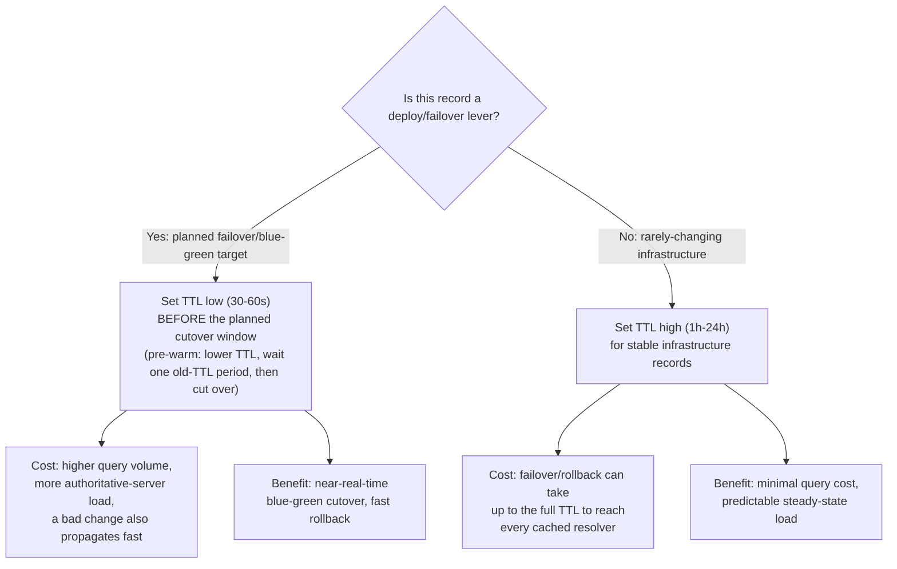

**Pre-warming discipline**: because TTL only bounds how long a resolver *may*
cache an answer starting from when it last queried, an architect planning a
cutover must lower the TTL *before* the cutover, and wait at least one full
*old* TTL period before actually changing the record's value — otherwise
resolvers that cached the record under the old (long) TTL will still hold it
for the old duration, defeating the purpose of lowering TTL right before the
change.

### 4.8 DNS-Based Load Balancing and Traffic Steering

Because a single name can resolve to multiple addresses, or resolve
differently depending on who is asking, DNS itself can perform a coarse
form of load balancing and traffic steering before any packet reaches a
load balancer or backend server:

- **Round-robin DNS**: publish multiple `A`/`AAAA` records for the same
  name; resolvers commonly rotate (or shuffle) the order returned, and most
  clients try the first address, spreading load approximately evenly across
  all listed servers over many independent clients. It has no concept of
  server load, capacity, or health — a dead server stays in rotation until
  someone manually removes its record.
- **Geo-DNS**: the authoritative server answers differently based on the
  querying resolver's (approximate) geographic location, routing users to
  the nearest regional deployment — reducing latency and keeping traffic
  within a jurisdiction for data-residency compliance.
- **Latency-based routing**: a more refined form of geo-steering where the
  DNS provider maintains measured latency data between resolver networks
  and each candidate region, and returns whichever region has historically
  offered the lowest measured latency to that resolver's network — often
  outperforming a naive geographic proximity assumption (a physically close
  region can still have a slow network path).

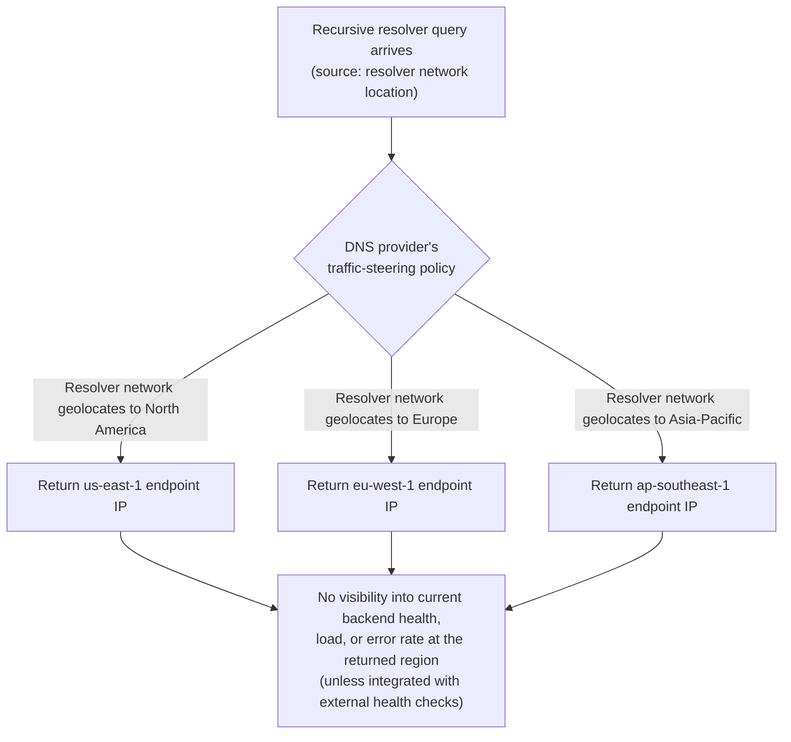

**The fundamental limitation**: DNS-based traffic steering operates entirely
at the *resolution* layer, before any connection is attempted — it has no
inherent knowledge of real-time backend health, current load, active error
rates, or in-flight connection counts. Managed providers mitigate this
partially with **DNS health checks** (periodically probing an endpoint and
withdrawing its record if it fails), but that check runs on the provider's
own polling interval (often tens of seconds), not per-request — so DNS-based
steering is fundamentally coarser-grained and slower-reacting than a real
Load Balancer making a per-connection or per-request routing decision with
live backend health state. This is precisely the gap the (not yet drafted)
[Load Balancer](CH10_Load_Balancer.md) chapter picks up: Layer 4/Layer 7 load
balancers sit *after* DNS resolution has already pointed a client at an IP,
and make fine-grained, real-time routing decisions DNS structurally cannot.

### 4.9 DNSSEC: Countering Cache Poisoning and Spoofing

Classic DNS has no built-in authentication — a resolver has no
cryptographic way to verify that a response actually came from the genuine
authoritative server rather than an attacker who guessed (or won a race
condition against) the query's 16-bit transaction ID and source port, as
the 2008 Kaminsky attack (Section 2) demonstrated at scale. DNSSEC (DNS
Security Extensions) solves this with a chain of cryptographic signatures
mirroring the delegation hierarchy itself:

- Each zone signs its records with a **Zone Signing Key (ZSK)**, producing
  `RRSIG` (Resource Record Signature) records alongside the normal answers.
- The **Key Signing Key (KSK)** signs the ZSK itself, and the KSK's
  fingerprint is published as a `DS` (Delegation Signer) record in the
  *parent* zone — so the parent vouches for the child's key, exactly
  mirroring how the parent delegates the child's `NS` records.
- This creates an unbroken chain: the root zone's key is the trust anchor
  (distributed out-of-band, built into resolver software), the root signs
  the TLD's `DS` record, the TLD signs the domain's `DS` record, and the
  domain signs its own records — a validating resolver can walk this entire
  chain and mathematically confirm no link was forged or tampered with.

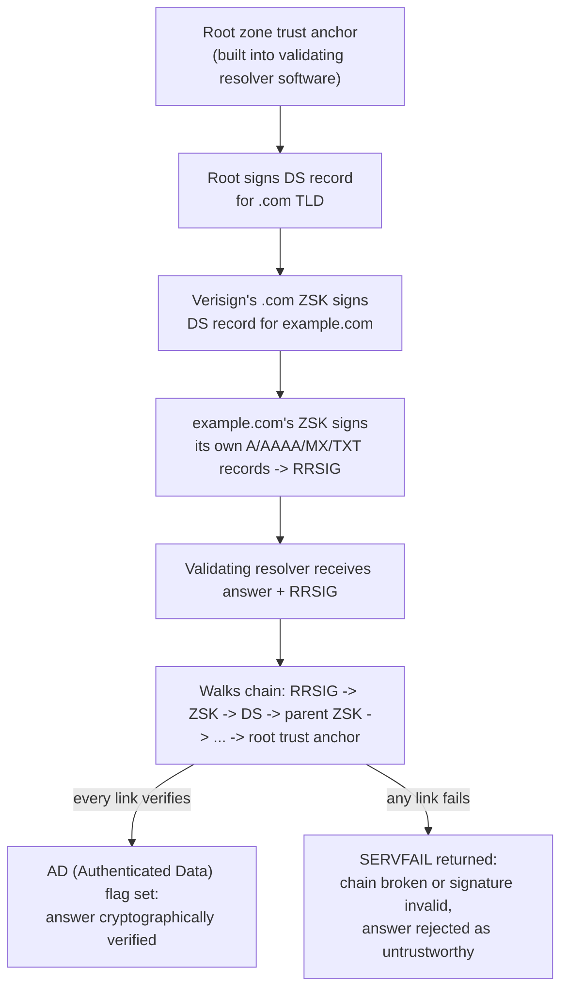

DNSSEC authenticates that an answer is genuine and unmodified — it does
**not** encrypt DNS traffic (that is the separate concern DoH/DoT address,
Section 13) and does not protect against an authoritative server itself
being compromised (DNSSEC only proves the signed answer matches what the
key holder signed, not that the key holder's infrastructure is trustworthy).

### 4.10 Split-Horizon and Private DNS for Internal Service Discovery

**Split-horizon DNS** (also called split-brain DNS) serves different
answers for the same name depending on where the query originates — most
commonly, an internal network resolver returns a private IP address for
`api.example.com` (routing internal traffic directly to a service without
leaving the corporate network or Virtual Private Cloud), while the public
internet's resolvers return a public-facing address (through a load
balancer or API gateway) for the same name.

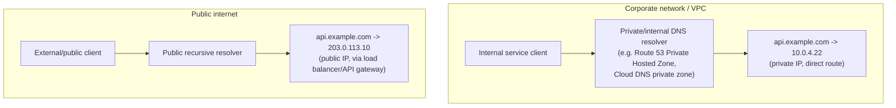

Architecturally, this is used for **internal service discovery**: instead
of hardcoding IP addresses (which change as instances scale, restart, or
fail over) into service configuration, services resolve each other by
stable internal names, and the private zone's records are kept in sync with
actual running instances — often automatically, via integration with a
container orchestrator or service mesh's own service registry, which writes
or updates DNS `A`/`SRV` records as instances register and deregister. This
chapter teaches split-horizon DNS at the level a Solution Architect needs to
reason about internal-vs-external resolution and DNS-based service
discovery as one mechanism among several; a deeper treatment of full
service-mesh-based discovery (sidecar proxies, health-aware routing tables
distinct from DNS's TTL-bounded caching model) belongs to a dedicated
service-discovery or service-mesh chapter, which does not yet exist
elsewhere in this handbook — until one is drafted, treat this section as
the canonical explanation of DNS-based internal service discovery
specifically.

## 5. Internal Working

A recursive resolver is not a single monolithic lookup function — it is
layered caching plus a state machine that walks the hierarchy only on a
cache miss.

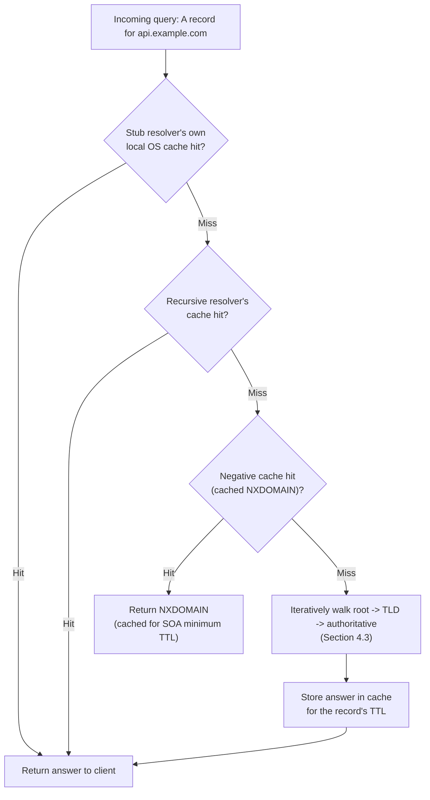

Underlying transport details a Solution Architect should know:

- **UDP port 53 by default**: DNS queries and responses are small enough to
  usually fit in a single UDP datagram, avoiding the overhead of a TCP
  handshake (see [TCP/IP](CH03_TCPIP.md#4-core-concepts) for the handshake
  mechanics, owned there) for every single lookup.
- **TCP fallback**: when a response would exceed the UDP payload size the
  client advertised (classically 512 bytes without extensions, larger with
  EDNS0), the server sets the truncation (`TC`) bit, and the client retries
  the same query over TCP port 53. Zone transfers between primary and
  secondary nameservers also always use TCP, since they carry the entire
  zone rather than one record.
- **EDNS0 (Extension Mechanisms for DNS)**: an extension that lets clients
  advertise a larger UDP payload size (commonly 1232–4096 bytes) and carry
  additional metadata (including DNSSEC's `RRSIG`/`DS` records, which would
  not fit in a classic 512-byte UDP response), reducing how often TCP
  fallback is needed.
- **Negative caching**: an NXDOMAIN (name does not exist) or NODATA (name
  exists but not for the queried record type) answer is itself cached, per
  the zone's SOA minimum TTL field (Section 4.2) — this is why a
  newly-created record can appear invisible to a resolver that queried
  moments before the record existed, until that negative-cache entry
  expires.

## 6. Design Principles

- **Delegation over centralization**: authority is pushed down the tree so
  no single organization is a bottleneck for the whole namespace — this is
  the same principle behind federated identity and microservice bounded
  contexts, applied to naming.
- **Cache-first, origin-on-miss**: the overwhelming majority of queries
  should be answered from a cache close to the client; the authoritative
  layer should see only a small fraction of total query volume (cache-miss
  traffic), which is what makes the system scale to the query rate of the
  entire internet.
- **Explicit trade-off exposure via TTL**: rather than hiding
  caching-vs-freshness behind a fixed policy, DNS exposes the trade-off as
  a single tunable number per record, letting each zone owner choose their
  own point on the propagation-speed-vs-query-volume curve (Section 4.7).
- **Redundancy at every layer**: multiple root identities, multiple TLD
  servers, and a requirement (in most registries) for at least two
  authoritative nameservers per zone — no single server outage should be
  able to make a zone entirely unresolvable.
- **Fail-safe delegation, not fail-safe content**: DNS guarantees you can
  always find out *who* is authoritative for a name; it makes no guarantee
  that the authoritative answer itself is correct, current, or that the
  service behind the returned IP is healthy — those guarantees are the
  responsibility of the zone owner's operational practices and, at the
  connection layer, the Load Balancer.

## 7. Architecture Patterns

- **Multi-provider DNS**: delegate a zone's `NS` records across two
  independent managed DNS providers (e.g. Route 53 and a secondary
  provider) so a provider-wide outage (Section 2's Dyn incident) does not
  make the zone entirely unresolvable — requires keeping both providers'
  zone data in sync, typically via infrastructure-as-code applied to both
  provider APIs identically.
- **DNS-based blue-green cutover**: pre-lower TTL on the record that fronts
  a service (Section 4.7's pre-warming discipline), deploy the new
  environment fully and validate it out-of-band, then flip the record to
  the new environment's endpoint — traffic shifts within roughly one TTL
  window, and rollback is symmetrically fast if the low TTL is still in
  effect.
- **DNS failover with health checks**: a managed DNS provider polls a
  health-check endpoint on each candidate target and automatically
  withdraws (or deprioritizes) an unhealthy target's record, providing a
  coarse, DNS-layer failover — appropriate as a cross-region failover
  mechanism where the granularity of "polling interval, not per-request" is
  acceptable, and inappropriate as a substitute for a real-time Load
  Balancer's per-request health-aware routing.
- **Geo-DNS + CDN edge routing**: combine geo-DNS or latency-based routing
  (Section 4.8) at the DNS layer with a CDN's own edge points of presence,
  so DNS steers a client to the *region*, and the CDN's own anycast or
  edge-routing logic steers within that region — a two-tier steering
  architecture, each tier optimized for a different granularity.

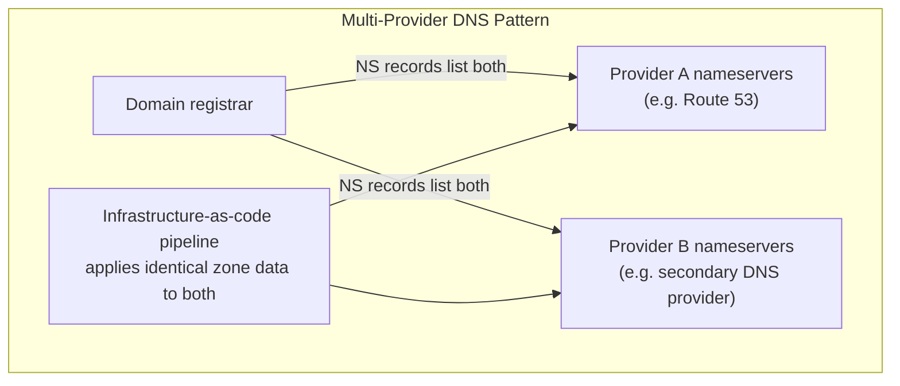

## 8. Production Architecture

A representative production DNS architecture for a globally distributed
service combines several of the patterns above into one coherent design:

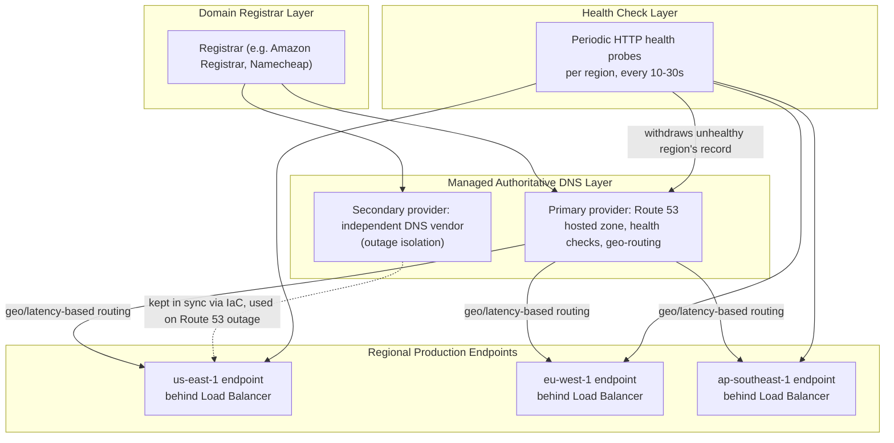

This design accepts DNS-layer routing's coarse granularity (Section 4.8)
deliberately at the *regional* level (a decision made every 10–30 seconds is
an acceptable cadence for "is this entire region healthy"), while delegating
finer-grained, per-request routing decisions within a healthy region to the
region's own Load Balancer.

## 9. Implementation

Implementing a production DNS zone follows a consistent sequence regardless
of provider:

1. **Register the domain** with a registrar, which creates the delegation
   from the relevant TLD to the nameservers you specify.
2. **Create the hosted zone** at your chosen authoritative DNS provider,
   which generates that zone's own `NS` and `SOA` records.
3. **Update the registrar's delegation** to point at the provider's
   nameservers (this is the step that actually makes the provider
   authoritative — until this is done, the zone can be fully configured at
   the provider but no query will ever reach it).
4. **Define records** (Section 4.4) for every name the zone needs to
   answer, choosing TTLs deliberately per Section 4.7's trade-off, not
   defaulting blindly.
5. **Enable DNSSEC** (Section 4.9) at the provider, which generates the
   signing keys and requires publishing the resulting `DS` record with the
   registrar so the parent zone completes the chain of trust.
6. **Configure health checks and routing policy** (Section 4.8/4.10) for
   any record that needs failover, geo-steering, or split-horizon behavior.

## 10. Complete Code Examples

### 10.1 Interpreting a `dig +trace` Resolution Trace

`dig +trace` performs the iterative walk itself (rather than delegating to
a recursive resolver), which is the most direct way to observe the
hierarchy from Section 4.1/4.3 in action:

```text
$ dig +trace api.example.com A

; <<>> DiG 9.18.1 <<>> +trace api.example.com A
;; global options: +cmd
.                       518400  IN  NS  a.root-servers.net.
.                       518400  IN  NS  b.root-servers.net.
;; Received 811 bytes from 192.168.1.1#53(192.168.1.1) in 12 ms
;; ^ Step 1: local resolver already knows the 13 root identities (built-in hints file)

com.                    172800  IN  NS  a.gtld-servers.net.
com.                    172800  IN  NS  b.gtld-servers.net.
;; Received 1170 bytes from 198.41.0.4#53(a.root-servers.net) in 28 ms
;; ^ Step 2: root server referred us to the .com TLD servers (Section 4.1/4.3)

example.com.            172800  IN  NS  ns1.example.com.
example.com.            172800  IN  NS  ns2.example.com.
;; Received 197 bytes from 192.5.6.30#53(a.gtld-servers.net) in 34 ms
;; ^ Step 3: .com TLD server referred us to example.com's own authoritative servers

api.example.com.        300     IN  A   203.0.113.10
;; Received 62 bytes from 205.251.192.5#53(ns1.example.com) in 9 ms
;; ^ Step 4: authoritative answer, TTL 300s (Section 4.7) - this is the final answer
```

Reading this trace tells an architect exactly which layer is slow (each
`Received ... in N ms` line is one hop's round-trip time) and exactly which
nameserver is authoritative for the final answer — invaluable when
diagnosing "DNS seems slow" or "DNS seems to be answering the wrong thing"
incidents (Section 15).

### 10.2 A Route 53 / Cloudflare-Style DNS Record Set (Terraform)

A production record set expressed as infrastructure as code, showing an
apex `ALIAS` record (Section 4.5), a low-TTL failover-ready record, SPF/DKIM
`TXT` records (Section 4.6), and a `CAA` record:

```hcl
resource "aws_route53_zone" "primary" {
  name = "example.com"
}

# Zone apex - ALIAS record, not a CNAME (Section 4.5), so NS/MX can coexist
resource "aws_route53_record" "apex" {
  zone_id = aws_route53_zone.primary.zone_id
  name    = "example.com"
  type    = "A"
  alias {
    name                   = aws_lb.production.dns_name
    zone_id                = aws_lb.production.zone_id
    evaluate_target_health = true # withdraws this alias if the LB is unhealthy
  }
}

# Failover-critical record: deliberately low TTL (Section 4.7)
resource "aws_route53_record" "api" {
  zone_id = aws_route53_zone.primary.zone_id
  name    = "api.example.com"
  type    = "A"
  ttl     = 60
  records = ["203.0.113.10"]
}

# Stable infrastructure: deliberately high TTL
resource "aws_route53_record" "mx" {
  zone_id = aws_route53_zone.primary.zone_id
  name    = "example.com"
  type    = "MX"
  ttl     = 3600
  records = [
    "10 mail1.example.com.",
    "20 mail2.example.com.",
  ]
}

# SPF (Section 4.6)
resource "aws_route53_record" "spf" {
  zone_id = aws_route53_zone.primary.zone_id
  name    = "example.com"
  type    = "TXT"
  ttl     = 3600
  records = ["v=spf1 include:_spf.google.com ~all"]
}

# DKIM selector (Section 4.6)
resource "aws_route53_record" "dkim" {
  zone_id = aws_route53_zone.primary.zone_id
  name    = "selector1._domainkey.example.com"
  type    = "TXT"
  ttl     = 3600
  records = ["v=DKIM1; k=rsa; p=MIGfMA0GCSqGSIb3DQEBAQUAA4GNADCBiQKBgQC..."]
}

# CAA - restrict which CAs may issue certificates for this domain
resource "aws_route53_record" "caa" {
  zone_id = aws_route53_zone.primary.zone_id
  name    = "example.com"
  type    = "CAA"
  ttl     = 3600
  records = ["0 issue \"amazon.com\""]
}
```

### 10.3 DNSSEC Validation Trace Interpretation

`dig +dnssec` requests the `RRSIG`/`DS` records introduced in Section 4.9,
and the `AD` (Authenticated Data) flag in the response header confirms the
resolver validated the full chain of trust:

```text
$ dig +dnssec api.example.com A

;; ->>HEADER<<- opcode: QUERY, status: NOERROR, id: 4821
;; flags: qr rd ra ad; QUERY: 1, ANSWER: 2, AUTHORITY: 0, ADDITIONAL: 1
;;                       ^^ 'ad' flag set: resolver cryptographically
;;                          validated this answer end-to-end (Section 4.9)

;; ANSWER SECTION:
api.example.com.    300  IN  A      203.0.113.10
api.example.com.    300  IN  RRSIG  A 13 3 300 (
                                     20240401000000 20240315000000 24509 example.com.
                                     MEQCIGz3... )
;;                       ^^ RRSIG proves this A record was signed by
;;                          example.com's Zone Signing Key and has not
;;                          been altered since signing

;; A validating resolver rejects the answer instead of the 'ad' flag
;; when the chain breaks, e.g.:
;;   ;; flags: qr rd ra; QUERY: 1, ANSWER: 0, ...
;;   status: SERVFAIL
;;   -- returned when RRSIG doesn't verify against the published DNSKEY,
;;      or the parent zone's DS record doesn't match, i.e. tampering
;;      or misconfiguration detected somewhere in the chain (Section 4.9)
```

### 10.4 Node.js: Custom Resolver Timeout and Failover-Aware Lookup

Application code that resolves a name should not assume DNS resolution is
instantaneous or infallible — this example shows explicit timeout handling
and a fallback resolver list, relevant when a service must stay resilient
to a resolver-level outage independent of the DNS provider issues in
Section 15:

```javascript
const dns = require('node:dns');
const { Resolver } = dns.promises;

// Explicit fallback resolvers, so a single resolver outage
// does not stall every outbound connection this service makes.
const primaryResolver = new Resolver({ timeout: 2000, tries: 2 });
primaryResolver.setServers(['10.0.0.2']); // internal resolver

const fallbackResolver = new Resolver({ timeout: 2000, tries: 2 });
fallbackResolver.setServers(['1.1.1.1', '8.8.8.8']); // public resolvers

async function resolveWithFallback(hostname) {
  try {
    return await primaryResolver.resolve4(hostname);
  } catch (primaryError) {
    console.warn(
      `Primary resolver failed for ${hostname}: ${primaryError.code}. ` +
      'Falling back to public resolvers.'
    );
    return fallbackResolver.resolve4(hostname);
  }
}

async function connectToApi() {
  const addresses = await resolveWithFallback('api.example.com');
  // addresses may contain multiple A records (Section 4.8's round-robin
  // pattern) - a resilient client should try each in order on failure
  // rather than assuming the first address is always reachable.
  for (const address of addresses) {
    try {
      return await attemptConnection(address);
    } catch {
      continue; // try next address
    }
  }
  throw new Error(`All resolved addresses for api.example.com unreachable`);
}
```

## 11. Performance

- **TTL tuning is the primary DNS performance lever** (Section 4.7):
  too-low TTLs on stable records needlessly multiply query volume against
  the authoritative layer; too-high TTLs on volatile records slow down
  legitimate operational responses.
- **Resolver proximity**: the latency of the *first* (cache-miss) lookup is
  dominated by the round-trip time to the recursive resolver plus however
  many hierarchy hops are needed; placing recursive resolvers close to
  clients (a corporate resolver on-premises, an ISP's local resolver, or a
  well-provisioned public resolver's nearest anycast instance) matters far
  more to perceived performance than authoritative-server performance,
  since the overwhelming majority of queries are cache hits.
- **EDNS0 buffer sizing** (Section 5) avoids UDP-to-TCP fallback's extra
  round trip for larger DNSSEC-signed responses.
- **Connection reuse amortizes lookup cost**: once a name is resolved and a
  connection established, keeping that connection alive (HTTP/1.1 keep-alive
  or HTTP/2's multiplexing, both owned by [HTTP](CH01_HTTP.md)) means DNS
  lookup cost is paid once per TTL window, not once per request.

## 12. Scalability

DNS scales to internet-wide query volume primarily through two mechanisms:

- **Anycast**: the same IP address is announced from many physical
  locations worldwide via Border Gateway Protocol (BGP), and network
  routing naturally sends each query to the topologically nearest
  announcing location. This is how "13 root server identities" actually
  serve hundreds of billions of queries daily from hundreds of physical
  sites without any single site becoming a bottleneck, and it is the same
  technique most managed DNS providers and CDNs use for their authoritative
  and edge layers.
- **Hierarchical caching**: every layer of resolver (client OS cache,
  corporate/ISP recursive resolver, and any forwarding resolver in between)
  absorbs a share of query volume, so the fraction of total internet DNS
  traffic that ever reaches an authoritative server for a popular domain is
  a small percentage of actual lookups performed by end users.

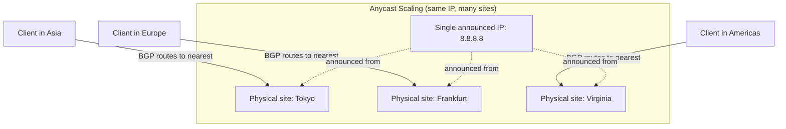

## 13. Security

- **Cache poisoning / spoofing**: an off-path attacker forges a DNS
  response before the legitimate one arrives, exploiting a guessable
  transaction ID and/or source port (Section 2's Kaminsky attack).
  Mitigations: source-port randomization (now standard), DNSSEC (Section
  4.9) for cryptographic verification of the answer itself.
- **DNSSEC**: authenticates answers but does not encrypt them — an
  eavesdropper can still see which names a client is resolving.
- **DoH (DNS over HTTPS) / DoT (DNS over TLS)**: encrypt the client-to-
  recursive-resolver query itself, addressing eavesdropping and on-path
  tampering of that specific hop (they do not replace DNSSEC's
  authoritative-answer authentication — the two are complementary, not
  substitutes for each other).
- **DNS-based DDoS**: authoritative infrastructure is a high-value DDoS
  target precisely because taking it down denies resolution for every name
  in the zone, effectively taking down every service under that zone
  without needing to attack each service directly (Section 2's Dyn
  incident, Section 15).
- **DNS amplification attacks**: attackers spoof a victim's source IP in
  queries sent to open recursive resolvers requesting large responses
  (e.g. `ANY` queries or DNSSEC-signed records), so the resolver's large
  response floods the victim — this is why open recursive resolvers that
  answer queries from arbitrary internet sources are considered a
  misconfiguration to avoid, and why response-rate-limiting is a standard
  authoritative-server control.
- **CAA records** (Section 4.4) reduce the blast radius of a mis-issued
  certificate by restricting which Certificate Authorities may legitimately
  issue for the domain at all.

## 14. Observability

- **Query logging**: authoritative and recursive resolvers can log every
  query (name, type, source, response code) — essential for diagnosing
  "who is querying this record and how often," detecting abuse patterns,
  and validating that a TTL/record change actually propagated as expected.
- **Propagation checking**: after a record change, tools that query
  multiple public resolvers across different geographic networks
  simultaneously reveal whether propagation is complete or whether some
  networks are still serving a stale cached answer — critical during a
  cutover (Section 7) to know when it is actually safe to decommission the
  old environment.
- **Health-check dashboards**: for any DNS-based failover or geo-routing
  setup (Section 4.8), the health-check status feeding that routing
  decision must itself be monitored and alertable — a health check that
  silently fails open (always reports healthy) defeats the entire failover
  design.
- **DNSSEC validation monitoring**: alerting on a rising rate of `SERVFAIL`
  responses for your own domain's records can catch a broken DNSSEC chain
  (e.g. an expired `RRSIG` after a key rotation was not completed
  correctly) before it silently makes your domain unresolvable for every
  validating resolver on the internet.

## 15. Failure Scenarios

- **DNS propagation delay incidents**: a team lowers a record's value
  expecting an immediate cutover, but the *previous* TTL was long and had
  not been pre-warmed down (Section 4.7) — some fraction of users continue
  reaching the old (possibly decommissioned) environment for up to the old
  TTL's full duration, appearing as an inconsistent, hard-to-reproduce
  partial outage.
- **Single DNS provider as a single point of failure**: the 2016 Dyn
  incident (Section 2/22) — an organization's entire public-facing presence
  became unreachable not because any of their own servers failed, but
  because their sole DNS provider was taken down by a DDoS attack.
- **DDoS attacks against DNS infrastructure**: whether targeting a specific
  organization's authoritative servers or (in rarer, more severe cases) root
  or TLD infrastructure itself, a successful attack denies resolution for
  every name under the affected zone(s) simultaneously.
- **Stale negative caching**: a newly created record appears not to exist
  for some clients because their resolver cached an NXDOMAIN from before
  the record was created, and the SOA's negative-cache TTL (Section 4.2)
  has not yet expired.
- **Broken delegation**: a registrar-side `NS` record update that doesn't
  match the actual authoritative provider's `NS` records (a "lame
  delegation") can leave a zone partially or fully unresolvable, often only
  detected when *some* resolvers (those that happened to cache the correct
  answer previously) still work while others fail.
- **DNSSEC misconfiguration**: an expired signature or a `DS`/`DNSKEY`
  mismatch after an incomplete key rotation causes every validating
  resolver to return `SERVFAIL` for the entire zone — a stricter, more
  total failure mode than an unsigned zone would have had, which is why
  DNSSEC key-rotation runbooks require careful, monitored sequencing.

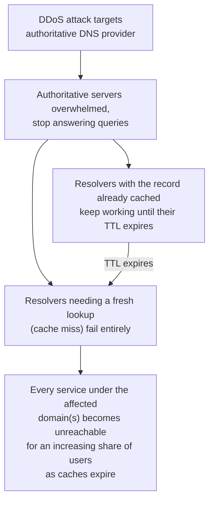

## 16. Testing

- **`dig` and `nslookup`**: the baseline tools for manually querying a
  specific resolver, tracing the full hierarchy (`dig +trace`, Section
  10.1), and inspecting DNSSEC status (`dig +dnssec`, Section 10.3).
- **Multi-region propagation checks**: query the same name against
  resolvers in multiple geographic/network locations to validate that a
  change has fully propagated before decommissioning an old environment.
- **Pre-production zone validation**: apply record changes to a staging or
  test zone first, and validate with automated `dig` assertions (correct
  record type, value, and TTL) in a deployment pipeline before applying to
  the production zone — treating DNS records as infrastructure-as-code
  artifacts subject to the same review and testing discipline as any other
  configuration.
- **DNSSEC chain validation tooling**: automated tools (and public web-based
  checkers) that walk and report on the full chain of trust for a domain,
  catching a broken link before it causes a production `SERVFAIL` incident.
- **Health-check simulation**: for any DNS-based failover configuration,
  periodically simulate a failure on a non-production target to confirm the
  health check actually withdraws the record and that failover completes
  within the expected time bound.

## 17. Common Mistakes

- **Forgetting to restore TTL after a low-TTL cutover window**: leaving a
  record at 30–60 seconds indefinitely multiplies ongoing query volume/cost
  for no benefit once the cutover is complete and stable.
- **Placing a `CNAME` at the zone apex**: violates the specification
  (Section 4.5) and breaks `NS`/`MX`/`TXT` coexistence; the fix is a
  provider `ALIAS`/`ANAME` record, not a workaround `CNAME`.
- **Assuming every client strictly honors TTL**: some client-side caches,
  browsers, and misbehaving resolvers cache longer than the published TTL
  (or don't re-check promptly), so treat TTL as a strong lower bound on
  propagation speed, not an absolute guarantee.
- **Single-provider DNS for a business-critical domain**: recreates the
  2016 Dyn incident's blast radius for your own organization (Section 15).
- **Ignoring negative-cache TTL** when creating a record right after a
  failed lookup was performed against the same name — the previous
  NXDOMAIN answer can remain cached and served to the same resolver.
- **Rotating DNSSEC keys without the correct overlap sequencing**:
  publishing a new key before the old signatures expire (or vice versa)
  causes validating resolvers to reject the zone entirely (Section 15).
- **Treating geo-DNS/latency-based routing as a health-aware load
  balancer**: DNS-layer routing reacts on a health-check polling interval,
  not per-request — using it as the *only* failover mechanism for a
  service that needs sub-second failure detection under-delivers (Section
  4.8).

## 18. Best Practices

- Set TTL deliberately per record based on its actual volatility, not a
  single default across the whole zone — high for stable infrastructure,
  low (and pre-warmed) for anything that is a deliberate deploy/failover
  lever.
- Delegate a business-critical zone across at least two independent DNS
  providers.
- Enable DNSSEC, and maintain a documented, tested key-rotation runbook
  rather than performing key rotation as an improvised one-off.
- Manage DNS records as infrastructure-as-code (Section 10.2) with review
  and automated pre-deployment validation, not manual console edits.
- Publish `CAA` records restricting certificate issuance to your actual
  Certificate Authorities.
- Monitor query volume, `SERVFAIL` rate, and health-check status for every
  production zone, not just uptime of the servers behind it.
- Use split-horizon DNS (Section 4.10) deliberately for internal service
  discovery rather than hardcoding IPs, but keep the private zone's records
  synchronized with actual running infrastructure through automation.

## 19. Anti-Patterns

- **Hardcoding IP addresses instead of using DNS names** in application
  configuration, defeating the entire purpose of a stable, updatable name
  layer and making every infrastructure change require an application
  redeploy.
- **Using round-robin DNS as a substitute for a real load balancer** in a
  production architecture that needs health-aware, low-latency,
  per-request routing.
- **"Set TTL to the maximum forever" as a blanket policy**, ignoring that
  some records legitimately need to change quickly.
- **Open recursive resolvers** answering queries from arbitrary internet
  sources, enabling DNS amplification attacks (Section 13) against third
  parties.
- **Manual, undocumented DNS changes** applied directly through a
  provider's console with no change record, making incident diagnosis
  (Section 15) far slower than it needs to be.
- **Relying on DNS alone for security** (e.g. treating a private DNS name
  as an access control boundary) — DNS names are not a substitute for
  actual network segmentation, authentication, or authorization controls.

## 20. Trade-off Analysis

| Decision | Option A | Option B | Trade-off |
|---|---|---|---|
| TTL for a deploy-lever record | Low (30-60s) | High (1h+) | Fast propagation and rollback vs. lower query volume/cost |
| DNS provider strategy | Single provider | Multi-provider | Simpler operations vs. resilience to a provider-wide outage |
| Traffic steering | DNS-based (geo/latency) | Load-balancer-based (post-resolution) | Coarse, resolver-cached, region-level vs. fine-grained, real-time, per-request |
| DNSSEC adoption | Signed zone | Unsigned zone | Cryptographic authenticity and Kaminsky-class attack resistance vs. operational complexity of key rotation |
| Service discovery | DNS-based (split-horizon/SRV) | Service-mesh/registry-based | Simpler, widely supported, TTL-bounded staleness vs. real-time registration/deregistration with richer health semantics |

## 21. Comparison Table

| Provider | Health-check-integrated failover | Geo/latency routing | DNSSEC support | Notable characteristic |
|---|---|---|---|---|
| Amazon Route 53 | Yes | Yes (latency-based and geolocation) | Yes | Deep integration with other AWS services (ALIAS to Load Balancer, CloudFront, S3) |
| Cloudflare DNS | Yes | Yes (via load balancing product) | Yes | Anycast-based authoritative network by default; free tier widely used |
| Google Cloud DNS | Yes (via Cloud Load Balancing integration) | Yes | Yes | Tight integration with Google Cloud's global load balancing |
| NS1 (IBM) | Yes | Yes, with granular traffic-steering filter chains | Yes | Positioned for advanced, programmable traffic-steering logic |
| Self-hosted BIND | Only via external tooling | Only via external tooling (e.g. `views`) | Yes, manually managed | Full control, full operational burden — key rotation, redundancy, DDoS mitigation all self-managed |

## 22. Real-World Case Study

**The 2016 Dyn DDoS incident** remains the canonical case study for DNS as a
production failure point (Section 2/15). The Mirai botnet — composed of
compromised IoT devices — generated a massive, distributed DDoS attack
against Dyn, at the time a major managed authoritative DNS provider. Because
Twitter, GitHub, Reddit, Spotify, Netflix, and many other prominent services
used Dyn as their sole DNS provider, the attack did not need to target any
of those companies' own infrastructure directly — degrading Dyn's ability to
answer authoritative queries was sufficient to make all of their domains
intermittently unresolvable for large portions of the internet, for several
hours across multiple attack waves.

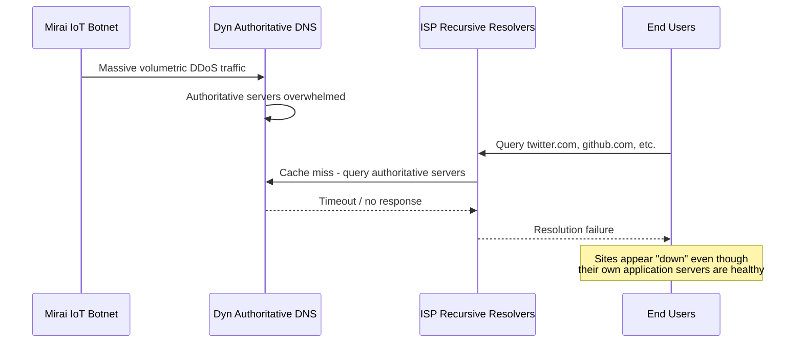

**Architectural lessons drawn directly into this chapter's guidance**:
single-provider DNS is a single point of failure regardless of that
provider's individual reliability (Section 7's multi-provider pattern);
DDoS resilience at the DNS layer requires the same anycast/scale thinking
applied to any other internet-facing infrastructure (Section 12); and the
incident accelerated broader industry adoption of multi-provider DNS
strategies and DNS-layer DDoS mitigation services as a standard resilience
practice, not an optional extra for only the largest organizations.

## 23. Interview Questions

1. Explain the difference between a recursive query and an iterative
   query, and identify which type of query a client sends versus which
   type a recursive resolver sends to authoritative servers.
2. Why can't a `CNAME` record be used at a zone apex, and what mechanism do
   managed DNS providers offer to work around this limitation?
3. A team lowers a record's TTL from 3600 seconds to 60 seconds and
   immediately changes the record's value expecting an instant cutover, but
   some users still reach the old endpoint for nearly an hour. What went
   wrong?
4. What problem does DNSSEC solve, and what problem does it explicitly *not*
   solve (i.e. what is the difference between DNSSEC and DoH/DoT)?
5. Why is DNS-based load balancing fundamentally unable to react to
   real-time backend health the way a Layer 4/7 load balancer can?
6. What is a glue record, and why is it necessary for a domain whose own
   nameservers are subdomains of that same domain?
7. Describe how SPF, DKIM, and DMARC work together, and explain what each
   one specifically protects against.
8. What is negative caching, and how can it cause a newly created DNS
   record to appear not to exist for some period of time?
9. Why is single-provider DNS considered an architectural anti-pattern for
   business-critical domains, and what is the standard mitigation?
10. Explain how anycast allows "13 root server identities" to serve
    internet-wide query volume without any single physical server becoming
    a bottleneck.

## 24. Hands-on Exercises

1. Run `dig +trace` against a domain you control (or a public domain) and
   annotate each hop, identifying the root, TLD, and authoritative layers
   in the output, as demonstrated in Section 10.1.
2. Configure a zone with a deliberately low-TTL record, perform a
   controlled cutover to a different backing IP, and use a multi-region
   propagation checker to observe how long full propagation actually takes
   versus the nominal TTL.
3. Enable DNSSEC on a test domain at a managed provider, then use `dig
   +dnssec` to confirm the `AD` flag is set, and intentionally break the
   chain (e.g. by publishing an incorrect `DS` record) to observe the
   resulting `SERVFAIL`.
4. Write an SPF record, a DKIM selector `TXT` record, and a DMARC policy
   record for a test domain, then use an email-testing service to confirm
   all three validate correctly against a test message.
5. Set up a split-horizon configuration (a private hosted zone plus a
   public zone for the same domain name) and confirm that internal and
   external clients receive different answers for the same name.

## 25. Design Exercises

1. Design a DNS architecture for a globally distributed e-commerce
   platform that must support: (a) a blue-green deployment cutover
   completing within 5 minutes, (b) resilience to a single DNS provider
   outage, and (c) geographic traffic steering to the nearest of three
   regional deployments. Specify TTLs, provider strategy, and routing
   policy, and justify each choice against Section 20's trade-offs.
2. Your organization currently hardcodes internal service IP addresses in
   configuration files, causing an outage every time an instance is
   replaced. Design a split-horizon, DNS-based internal service discovery
   architecture that eliminates hardcoded IPs, and identify the specific
   integration point where your container orchestration platform would
   need to update DNS records automatically.
3. A security review flags that your organization's domain has no DNSSEC,
   no CAA records, and a single DNS provider. Propose a phased remediation
   plan, ordering the three fixes by risk reduction versus implementation
   effort, and explain any operational risk each fix introduces if done
   incorrectly (Section 17).

## 26. Architecture Review Questions

1. What is this record's TTL, and is that value a deliberate choice given
   how often this record needs to change, or an unexamined default?
2. If our DNS provider suffered a multi-hour outage today, would our domain
   become entirely unresolvable? If so, why has that risk been accepted?
3. Is DNSSEC enabled for this domain, and is there a documented, tested key
   rotation runbook, or would rotation be improvised under time pressure?
4. Are internal service names resolved via split-horizon DNS or service
   discovery, or are IP addresses hardcoded anywhere in configuration?
5. For any DNS-based failover or geo-routing configuration, what is the
   health-check polling interval, and has anyone validated that a failure
   actually triggers failover within the expected time bound?
6. Are SPF, DKIM, and DMARC all correctly configured and enforced (not
   merely present in permissive/monitor-only mode) for domains that send
   email?

## 27. Summary

DNS (Domain Name System) is the internet's hierarchical, distributed
name-resolution architecture, scaling to internet-wide query volume through
delegation (root → TLD → authoritative) and aggressive, TTL-bounded caching
at recursive resolvers. For a Solution Architect, DNS is not a solved,
invisible utility: TTL is a direct architectural lever trading deploy/
rollback speed against query volume; record types like `CNAME`/`ALIAS` and
`TXT` encode real architectural patterns (zone-apex flattening, domain
verification, SPF/DKIM/DMARC email authentication); DNS-based load
balancing offers coarse, resolver-cached traffic steering that is
structurally incapable of real-time backend-health awareness, motivating
the dedicated [Load Balancer](CH10_Load_Balancer.md) chapter; DNSSEC
provides cryptographic authenticity against cache-poisoning and spoofing
attacks (but not encryption or infrastructure-compromise protection); and
DNS infrastructure itself — as the 2016 Dyn incident demonstrated — is a
recurring, high-leverage production failure point and DDoS target that
demands the same redundancy discipline (multi-provider delegation, anycast
scaling, health-check-driven failover) an architect would apply to any
other business-critical, internet-facing system.
