# Chapter: CDN (Content Delivery Network)

Part: [05 — Networking and Operating Systems](PART_OVERVIEW.md) · Status: Drafted

## 1. Introduction

A Content Delivery Network (CDN) is a globally distributed system of proxy
servers — deployed at hundreds or thousands of physical locations called
Points of Presence (PoPs) — that sits between origin servers and end users
so that content is served from a location physically close to the user
rather than always traveling back to a single, distant origin data center.
Every large-scale system a Solution Architect designs eventually runs into
the same wall: no amount of extra bandwidth, faster servers, or clever code
can make a request travel from Sydney to a single origin server in Virginia
faster than the speed of light over that distance allows. A CDN is the
architectural answer to that wall — not a performance optimization applied
after the fact, but a first-class placement decision baked into how a
system's traffic reaches its users at all.

For a Solution Architect, a CDN matters for reasons well beyond "make the
website faster":

1. **It is the primary lever against a hard physical constraint.** Section 3
   and Section 4.1 make the case in full, but the short version is: latency
   has a floor set by the speed of light over distance, and the only way to
   push under that floor is to move the served content — or increasingly,
   the computation itself — physically closer to the user.
2. **It has quietly absorbed security responsibilities.** Distributed
   Denial-of-Service (DDoS) mitigation and Web Application Firewall (WAF)
   capabilities are now bundled into most commercial CDN offerings by
   default, making the CDN layer a de facto first line of defense for
   internet-facing systems (Section 4.8).
3. **It has become a genuine compute platform.** Edge computing — running
   application logic at CDN PoPs via edge workers/functions — is a new
   architectural layer distinct from traditional caching, and changes what
   "the edge" means for system design (Section 4.9).
4. **Cache invalidation at CDN scale is a distributed-systems problem in its
   own right**, not a configuration afterthought — the trade-off between
   instant purge cost and Time To Live (TTL)-based eventual expiry recurs in
   almost every CDN architecture decision (Section 4.10).

> **Scope boundary.** This chapter is the owning chapter for CDN
> architecture: PoPs and anycast routing as the mechanism that steers a user
> to a nearby edge node, edge caching architecture (cache-hit/cache-miss/
> origin-shield/cache-key design), static-versus-dynamic content
> acceleration, CDN-based DDoS mitigation and WAF integration as a bundled
> capability, edge computing (edge workers/functions) as a new architectural
> layer, cache invalidation/purging trade-offs, and multi-CDN architecture.
> It recaps — and does **not** re-teach — HTTP (HyperText Transfer Protocol)
> caching headers (`Cache-Control`, `ETag`, `Last-Modified`, `Vary`), which
> are owned by [HTTP](CH01_HTTP.md#4-core-concepts), and Domain Name System
> (DNS) record types, TTL mechanics, and geo-DNS, which are owned by this
> part's DNS chapter (CH08_DNS, not yet drafted at the time of writing —
> recapped here in Section 4.3 at the level a CDN architect needs, with the
> full mechanics deferred to that chapter). Per the Concept Ownership Rule in
> [STYLE_GUIDE.md](../STYLE_GUIDE.md), where this chapter needs those
> concepts it links back rather than re-deriving them.

## 2. Historical Evolution

CDNs did not begin as a web-performance product — they began as a direct,
commercial response to a specific traffic event that made the limits of
single-origin hosting undeniable.

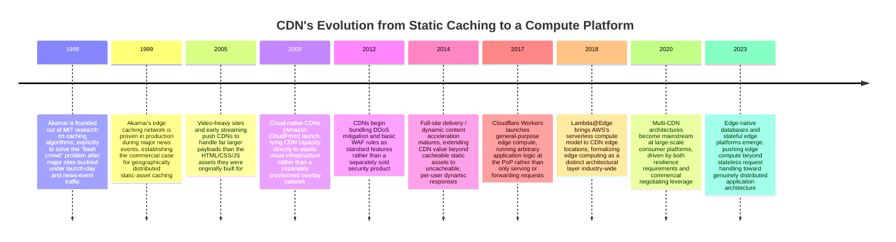

**Why Akamai came first, and why it looked the way it did.** In 1998, MIT
researchers (including Tom Leighton and Danny Lewin) had been working on
algorithms for efficiently distributing web content across many servers to
avoid the "flash crowd" problem: a single origin server, however powerful,
has a fixed maximum request rate, and a sudden traffic spike (a major news
event, a product launch) could take a site offline entirely regardless of
how much the operator had over-provisioned for "normal" traffic. The
insight that became Akamai's founding technology was that **caching content
at many geographically distributed servers, and routing each user's request
to a nearby, healthy one**, solved both the flash-crowd capacity problem and
the latency problem simultaneously — the same architectural mechanism
addressed two distinct pains at once, which is part of why the CDN model
spread so quickly once proven.

**Why CDNs kept absorbing new responsibilities.** Each subsequent expansion
in the timeline above follows the same pattern: CDNs already sit on every
network path between users and origins, so any capability that benefits
from being applied at that specific point in the path (DDoS absorption,
TLS termination, WAF rule evaluation, edge compute) is a natural fit to add
there rather than building a separate, parallel piece of infrastructure. A
Solution Architect evaluating a CDN vendor today is rarely evaluating "a
cache" — they are evaluating a bundled edge platform that combines caching,
security, and compute, and the bundling itself is a deliberate commercial
and architectural strategy on the vendor's part, not an accident of
feature creep.

## 3. Why It Exists

The single fact that makes a CDN necessary, rather than merely convenient,
is that **latency has an unavoidable physical floor set by the speed of
light**. Signals through fiber-optic cable travel at roughly two-thirds the
speed of light in a vacuum (about 200,000 kilometers per second accounting
for the refractive index of glass). A round trip between New York and
Sydney — roughly 16,000 kilometers of great-circle distance, and
considerably more over actual cable routes — has a physical minimum
Round-Trip Time (RTT) of well over 100 milliseconds, before any routing,
queuing, processing, or server-side work is even considered. No amount of
server hardware improvement, code optimization, or bandwidth upgrade can
reduce that number: it is a property of geography and physics, not of
engineering effort.

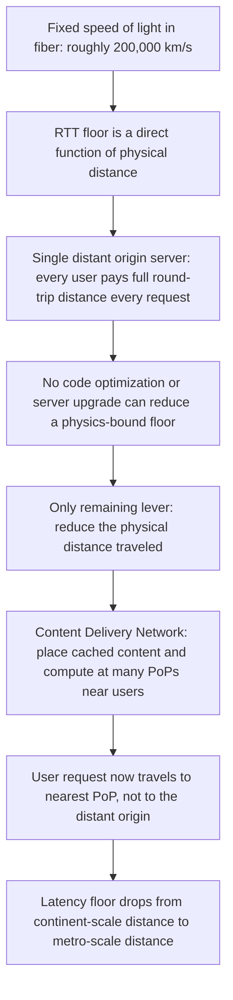

This reframes what a CDN actually is, architecturally: it is not a caching
optimization layered on top of an application, it is **the only category of
solution that addresses the physics-bound component of latency at all**.
Every other performance technique — database indexing, connection pooling,
algorithmic improvements, horizontal scaling — reduces *processing* time,
which is real and valuable, but sits on top of an unreducible transmission
floor. A Solution Architect who treats CDN placement as an operational
afterthought, added once a system is already built and slow, is deferring
the one architecture decision that cannot be substituted for by any amount
of later backend optimization. This chapter teaches the CDN as that
first-class placement decision.

## 4. Core Concepts

### 4.1 The Physics Floor: Why Distance Is the Real Enemy

**Definition.** The physics floor is the minimum possible latency for a
round trip between two points, determined entirely by the speed of light
through the transmission medium and the physical distance between those
points — independent of server speed, application efficiency, or available
bandwidth.

**Mechanism.** Latency for any network request is the sum of several
components: propagation delay (bound by distance and the speed of light in
the medium), transmission delay (bound by bandwidth and payload size),
processing delay (server-side compute time), and queuing delay (contention
for shared resources along the path). Of these, only propagation delay is a
true physical constant for a given distance — the others can all be
improved with engineering investment. As distance increases, propagation
delay increasingly dominates total latency, until at continental scale it
overwhelms every other component combined.

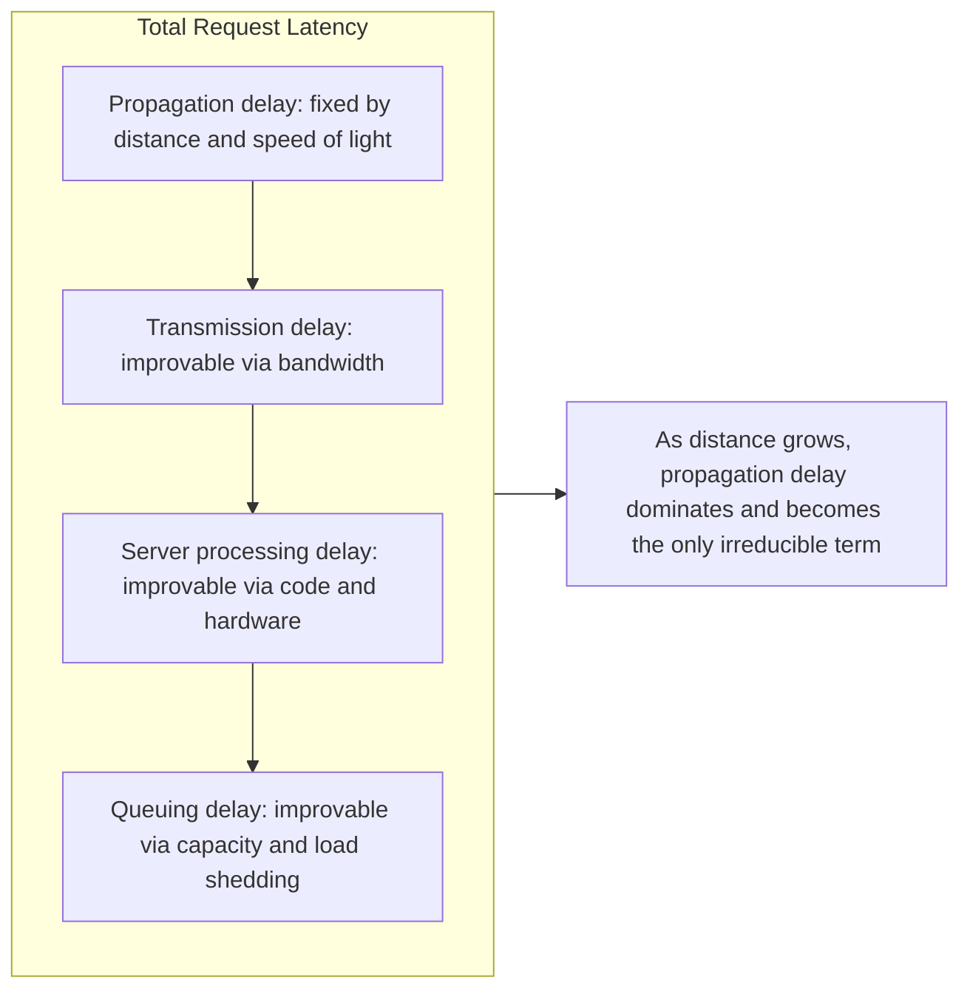

**Decision implication.** If a system's users are geographically dispersed
and latency matters (almost always true for interactive applications), the
single highest-leverage architecture decision is *where* content and
compute physically live relative to those users — not how fast the origin
server itself is. A CDN converts an unsolvable physics problem (make light
travel faster) into a solvable engineering problem (place a cheap, capable
node close enough that the remaining distance no longer dominates).

**Common failure mode.** Teams frequently diagnose a "slow API" purely by
profiling server-side code and database queries, finding those components
fast in isolation, and concluding the system is well-optimized — while a
user 12,000 kilometers from the single origin region is still experiencing
200+ milliseconds of unavoidable propagation delay per round trip, often
multiplied by several sequential round trips (DNS lookup, TLS handshake,
the request itself). The fix is architectural (move content/compute
closer), not further code-level tuning, and no amount of the latter will
resolve it.

**Concrete scenario.** An e-commerce platform with its only origin in
`us-east-1` measures 40ms server-side processing time for its product page
API — genuinely fast — yet Australian users report the page "feels slow."
Measurement shows total client-observed latency of over 350ms, almost
entirely explained by propagation delay across three sequential round trips
(DNS resolution, TLS handshake, the HTTP request itself) each crossing the
Pacific. Placing a CDN PoP in Sydney, serving cached responses and
terminating TLS locally, collapses each of those round trips to a
metro-scale distance, cutting total latency by an order of magnitude
without touching a single line of the 40ms-fast backend code.

### 4.2 Points of Presence (PoPs) and Anycast Routing

**Definition.** A Point of Presence (PoP) is a physical CDN edge location —
a data center or colocation facility containing edge servers — deployed in
a specific metro area or region. Anycast is a network addressing and
routing methodology in which the *same* Internet Protocol (IP) address is
announced from many physical locations simultaneously, and the network's
own routing infrastructure (via Border Gateway Protocol, BGP) delivers each
user's packets to whichever announcing location is "closest" by routing
cost — not necessarily geographic distance, but the number and quality of
network hops.

**Mechanism.** A large CDN operates hundreds to low thousands of PoPs
worldwide, each announcing the same anycast IP address (or small block of
addresses) to its local Internet Service Providers (ISPs) and internet
exchange points via BGP. When a user's device sends a packet to that IP,
ordinary internet routing — with no CDN-specific logic required at the
client — carries the packet to whichever PoP the network path considers
nearest in routing-cost terms. Critically, this happens at the IP-routing
layer, below DNS and below the application: the "nearest PoP" decision is
made continuously and automatically by the internet's own routing fabric,
which also means it adapts automatically if a PoP goes offline (its BGP
announcement withdraws, and traffic reroutes to the next-nearest PoP within
normal BGP convergence time) without any CDN-side failover logic needed.

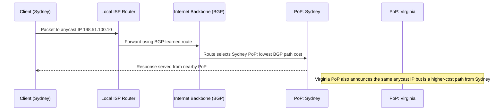

**Decision implication.** Anycast is why a CDN can present a single,
simple DNS record or IP address to the world while still routing each user
to a genuinely nearby physical server — the complexity of "which PoP should
serve this user" is pushed down into internet routing infrastructure rather
than requiring client-side or DNS-side logic (contrast with the geo-DNS
approach in Section 4.3, which solves the same routing problem one layer
higher, with different trade-offs). Choosing a CDN vendor is partly
choosing the density and quality of their PoP footprint and their peering
relationships with regional ISPs — a vendor with fewer, better-peered PoPs
in a target region can outperform one with more PoPs but worse peering.

**Common failure mode.** Treating "number of PoPs" as the primary CDN
vendor selection metric, without validating actual measured latency from
target user populations — PoP count is a marketing metric; peering quality
and BGP route health to your specific user base is the metric that
determines real-world latency. Two CDNs with an identical PoP count in a
region can differ by tens of milliseconds for the same user population
depending on their peering arrangements.

**Concrete scenario.** A CDN vendor advertises 300 global PoPs, but a
Solution Architect's synthetic monitoring from target markets in Southeast
Asia shows latency no better than a single well-connected origin in
Singapore — investigation reveals the vendor's regional PoPs exist but have
poor peering with the specific ISPs the target user base uses, forcing
traffic onto a longer BGP path despite geographic proximity. The
architecturally correct evaluation criterion is measured latency from real
or representative vantage points, not raw PoP count.

### 4.3 DNS-Based Traffic Steering (Recap)

**Recap.** An alternative (and often complementary) mechanism to anycast for
directing users to a nearby PoP operates one layer up, at DNS resolution
time: a CDN's authoritative DNS servers answer a hostname lookup with a
different IP address depending on the resolving client's apparent location
(geo-DNS), current PoP health, or measured latency — steering the user
toward a specific PoP *before* any packet is sent to an anycast address.
The mechanics of DNS record types, TTL-driven cache expiry, and geo-DNS
resolution algorithms are owned in full by this part's DNS (Domain Name
System) chapter; this chapter only needs the summary that DNS-based
steering and anycast-based steering solve the same "which PoP" problem at
different layers, and many CDNs use both together (DNS for a coarse,
health-aware regional decision; anycast for fine-grained routing-cost
optimization within that region).

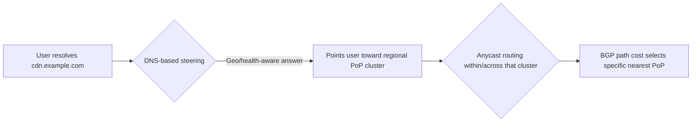

**Decision implication.** A Solution Architect does not need to choose
between DNS-based steering and anycast — most CDN vendors already combine
both, and the practical decision is instead about DNS TTL configuration for
failover speed (a shorter TTL means faster failover to a healthy PoP, at
the cost of more frequent DNS lookups) — a trade-off owned and taught in
depth by the DNS chapter, recapped here only as a reminder that it directly
affects CDN failover behavior.

### 4.4 Edge Caching Architecture: Cache-Hit, Cache-Miss, and Origin Shield

**Definition.** Edge caching is the core traditional function of a CDN: a
PoP stores a copy of a response so that subsequent requests for the same
resource can be served directly from the PoP without contacting the origin
server at all. A **cache-hit** is a request the PoP can serve entirely from
its own stored copy; a **cache-miss** is a request the PoP does not have a
valid stored copy for, requiring it to fetch (and typically then store) the
response from the origin (or from an intermediate origin shield layer,
below) before responding to the user.

**Mechanism.** On a cache-miss, a naive CDN design would have every PoP
independently contact the origin server directly — but at scale (hundreds
of PoPs, each potentially receiving a wave of near-simultaneous
cache-misses for the same newly-published or newly-invalidated resource)
this creates a "thundering herd" against the origin, multiplying load by
the PoP count at precisely the moment the origin is least prepared for it.
An **origin shield** is an intermediate caching tier — typically a single
designated PoP or small cluster per origin — that sits between edge PoPs
and the origin: edge PoPs experiencing a cache-miss first check the origin
shield rather than the origin directly, and only the origin shield itself
contacts the true origin on its own cache-miss. This collapses what would
be "PoP-count many" origin requests down to "one, from the shield" for any
given resource, regardless of how many edge PoPs are simultaneously
missing on it.

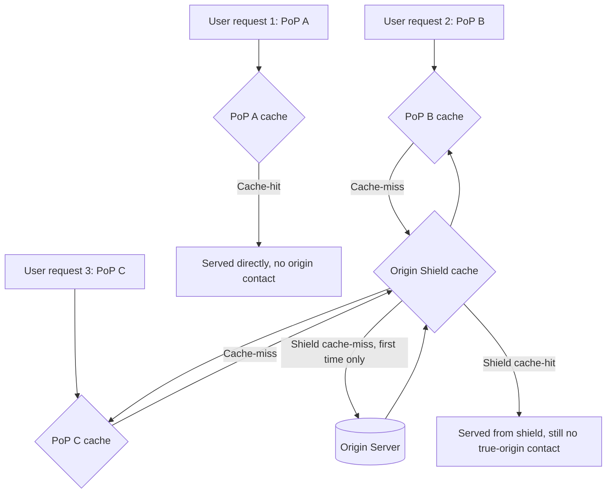

**Decision implication.** Origin shield is not optional infrastructure for
any CDN deployment serving meaningful traffic volume — without it, a global
PoP footprint that seems like a resilience improvement can instead become a
liability, since a popular resource's cache-miss (after a purge, a TTL
expiry, or a fresh deployment) fans out into simultaneous load from every
PoP that happened to miss at once. Most commercial CDNs enable an origin
shield by default or as a strongly recommended configuration; a Solution
Architect should verify it is enabled and correctly pinned (all PoPs in a
region routing through the same shield node for a given resource, so the
shield's own cache is actually shared rather than fragmented) rather than
assuming default behavior is safe.

**Common failure mode.** Deploying a CDN across many PoPs without an origin
shield, then experiencing an origin outage precisely during a traffic spike
or right after a cache purge — the PoP count that was supposed to protect
the origin instead multiplies simultaneous cache-miss load against it,
producing an outage the origin's own capacity planning never accounted for
because it assumed the CDN would absorb, not amplify, miss traffic.

**Concrete scenario.** A media site purges its homepage cache after
publishing a major breaking-news update. Without an origin shield, all 200
PoPs serving that region simultaneously experience a cache-miss for the
homepage and each independently fetch it from the origin at nearly the same
instant — a 200x instantaneous load spike the origin was never sized for,
causing a brief 503 (Service Unavailable) outage precisely when traffic (and
the news event) is at its peak. With an origin shield in place, that same
purge produces exactly one origin fetch, regardless of how many PoPs miss
simultaneously.

### 4.5 Cache-Key Design

**Definition.** A cache key is the identifier a CDN uses to decide whether
two requests should be considered "the same resource" for caching purposes
— by default typically the request URL, but configurable to include or
exclude specific headers, query parameters, cookies, or the client's device
type. Cache-key design is the deliberate architecture decision of exactly
which request attributes participate in that identity.

**Mechanism.** If the cache key is too coarse (e.g. URL only, ignoring a
`Vary`-relevant header like `Accept-Language`), the CDN may serve one user's
localized response to a different user expecting a different locale — a
serious correctness bug, not merely a performance issue. If the cache key
is too fine (e.g. including every query parameter and cookie, even ones
that don't actually change the response body), the CDN fragments what
should be one cached object into many near-duplicate cache entries, each
requiring its own cache-miss and dramatically reducing the effective
cache-hit ratio. Correct cache-key design requires enumerating exactly
which request dimensions genuinely produce a different response, and
including only those in the key — everything else should be normalized out
before the cache lookup.

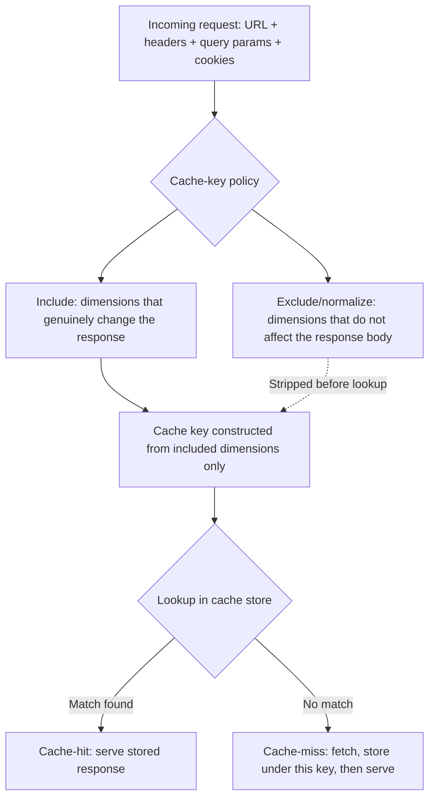

**Decision implication.** Cache-key design is where the abstract HTTP
`Vary` header (owned by [HTTP](CH01_HTTP.md#4-core-concepts)) becomes a
concrete CDN configuration decision: every header listed in a response's
`Vary` header must be reflected in the CDN's cache-key policy, or the CDN
will violate the very correctness guarantee `Vary` exists to provide. A
common, high-value cache-key optimization is explicitly stripping
marketing/analytics query parameters (e.g. `utm_source`, click-tracking
IDs) from the key, since they never affect response content but, if left
in, fragment an otherwise cacheable page into thousands of near-identical
cache entries with a near-zero individual hit rate.

**Common failure mode.** Including session cookies in the cache key for a
page that doesn't actually vary by session — this silently caps the
cache-hit ratio for that page at effectively zero (since almost every
user's cookie value differs, guaranteeing a fresh cache-miss for practically
every request), while looking, from cache-hit-ratio dashboards alone, like
"the CDN just isn't helping" rather than "the cache key is misconfigured."

**Concrete scenario.** A Software-as-a-Service (SaaS) marketing site adds a
session cookie to every request (for logged-in dashboard users elsewhere on
the same domain), and the CDN's default cache-key policy includes all
cookies present on the request. The marketing pages — which are identical
for every visitor — end up cached under a distinct key per visitor's
session cookie value, achieving a near-0% cache-hit ratio despite being
fully cacheable content. Excluding that cookie from the cache-key policy
for the marketing-page path pattern restores the expected 90%+ hit ratio
without changing a single response header on the origin.

### 4.6 The Deep Relationship to HTTP Caching Headers (Recap)

**Recap.** Everything a CDN decides about *whether* and *for how long* to
cache a given response is driven by HTTP caching headers set by the origin
— `Cache-Control` directives (`max-age`, `s-maxage`, `public`/`private`,
`no-store`, `must-revalidate`), validators (`ETag`, `Last-Modified`), and
the `Vary` header's declaration of which request headers affect the
response. The full semantics of these headers — including the distinction
between browser-cache and shared-cache behavior that `s-maxage` and
`private` specifically address — are owned by
[HTTP](CH01_HTTP.md#4-core-concepts); this chapter's contribution is that a
CDN is precisely the "shared cache" those semantics were designed for, and
CDN behavior is close to entirely a function of correctly set origin
headers rather than CDN-side configuration alone.

**Decision implication specific to CDNs.** The `s-maxage` directive exists
almost entirely *because* of shared caches like CDNs: it lets an origin
specify a caching duration for shared/proxy caches that differs from the
duration given to an individual browser via `max-age` — commonly a longer
`s-maxage` (since the CDN is a trusted, purgeable layer the origin
operator controls) combined with a shorter `max-age` (since a stale
response cached in an arbitrary end user's browser is much harder to
invalidate). Section 10's first code example demonstrates this concrete
`s-maxage`/`max-age` split in a production configuration.

### 4.7 Static vs. Dynamic Content Acceleration

**Definition.** Traditional CDN value applies to **static content** —
images, stylesheets, scripts, videos, and any response that is identical
for many users and can be validly cached per Section 4.4-4.6. **Dynamic
content acceleration** is a distinct, more recent CDN capability that
improves delivery of content that genuinely cannot be cached (personalized
API responses, real-time data, per-user pages) by optimizing the
*transport path and connection handling* between the PoP and the origin,
rather than by storing a reusable copy of the response at all.

**Mechanism.** Dynamic acceleration works through several transport-level
techniques applied at the PoP, all independent of caching:

- **TCP (Transmission Control Protocol) optimization**: the CDN maintains
  a pool of already-open, already-warmed TCP connections (and, where
  supported, HTTP/2 or HTTP/3 connections) from each PoP to the origin, so
  a user's uncacheable request doesn't pay the cost of a fresh TCP
  handshake plus TLS (Transport Layer Security) handshake all the way to a
  potentially distant origin — only the short PoP-to-user hop pays full
  connection-setup cost, and the long PoP-to-origin hop reuses an
  already-established, kept-alive connection.
- **Route optimization**: the CDN continuously measures latency and packet
  loss across many candidate paths through its private backbone network
  between PoPs and the origin, and forwards traffic over the
  measured-fastest path rather than relying on default public internet
  BGP routing, which is optimized for reachability and cost, not latency.
- **Protocol upgrade at the edge**: a PoP can terminate a modern,
  low-latency protocol (HTTP/3 over QUIC) with the end user, while using
  whatever protocol the origin actually supports (often HTTP/1.1 or
  HTTP/2) for the backend leg — the user gets the newer protocol's
  latency benefits on the leg where round trips are most expensive
  (the long, high-RTT public-internet leg), without requiring the origin
  to support it at all.

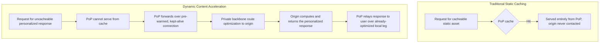

**Decision implication.** A Solution Architect evaluating CDN benefit for a
predominantly API-driven or highly personalized application should not
dismiss CDN placement just because most responses are uncacheable — dynamic
content acceleration provides a real, measurable latency benefit even for
0%-cacheable traffic, because it optimizes the transport path independent
of caching. This is a distinct value proposition from Sections 4.4-4.6 and
should be evaluated separately: a CDN vendor's private backbone quality and
TCP/TLS session-reuse architecture matters even for a system that never
caches a single response.

**Common failure mode.** Assuming "our API responses are all
personalized/uncacheable, so a CDN provides no value" — this conflates
caching value with the CDN's separate, transport-level acceleration value,
and skips a genuinely useful architecture option for latency-sensitive,
mostly-dynamic systems.

**Concrete scenario.** A financial services API returns account-specific,
never-cacheable data for every request, but routes through a CDN's dynamic
acceleration layer anyway. Measurements show a 30-40ms latency improvement
per request purely from pre-warmed connection reuse and private-backbone
routing between the PoP and origin — despite a 0% cache-hit ratio, the
transport-level optimization alone justifies the CDN's presence in the
request path.

### 4.8 CDN-Based DDoS Mitigation and WAF Integration

**Definition.** A Distributed Denial-of-Service (DDoS) attack attempts to
overwhelm a target's available capacity (network bandwidth, connection
slots, or application-processing capacity) using traffic from many
distributed sources simultaneously. A Web Application Firewall (WAF) is a
rule-based (and increasingly machine-learning-assisted) filter that
inspects HTTP requests for known attack patterns (SQL injection,
cross-site scripting, known bad request signatures) and blocks matching
requests before they reach the application. Because a CDN's PoPs already
sit in front of every request to an origin, and because a CDN operator's
aggregate capacity across all their customers vastly exceeds any single
customer's own infrastructure, CDN-based DDoS mitigation and WAF
integration have become one of the most commonly bundled non-caching CDN
capabilities.

**Mechanism.** DDoS mitigation at the CDN layer works because the attack
traffic is absorbed and filtered at the edge, distributed across the CDN's
entire PoP footprint, before it ever reaches the origin's much smaller
capacity:

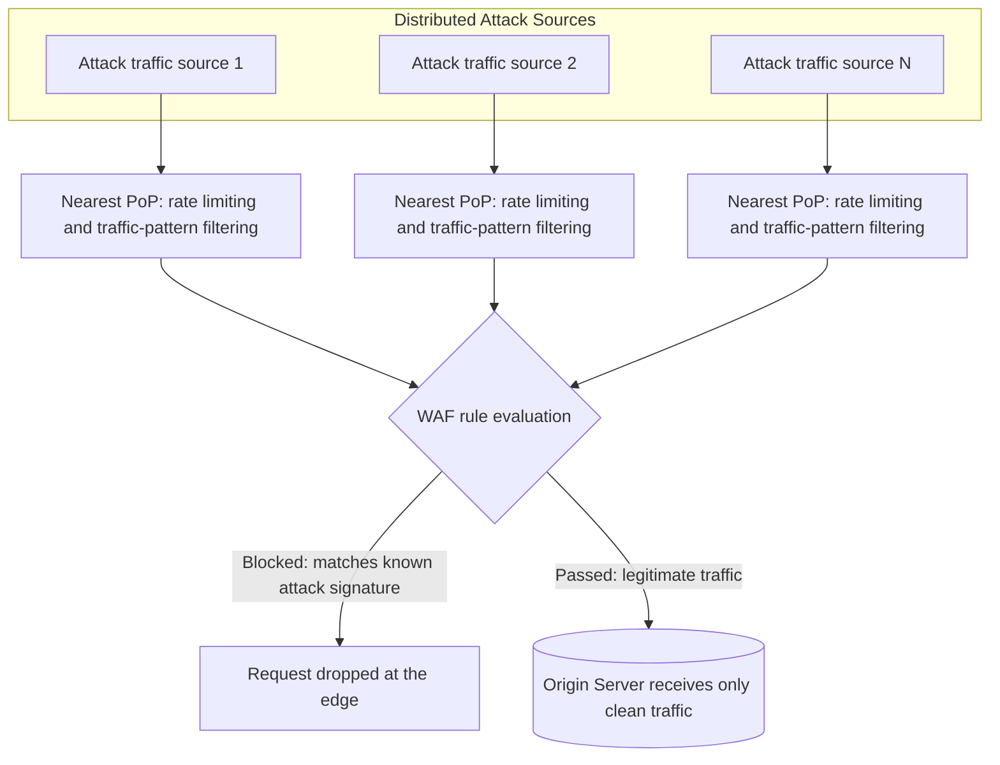

The CDN's aggregate absorption capacity (measured in terabits per second
across its entire global footprint) is typically orders of magnitude larger
than any individual customer's own network capacity — an attack volume that
would trivially saturate a single origin's uplink is instead spread across
hundreds of PoPs, each handling a small, individually manageable fraction,
and much of the malicious traffic never reaches the origin at all because
WAF rules and rate limiting filter it out at the edge first.

**Decision implication.** For any internet-facing production system, CDN
placement should be evaluated as a baseline security control, not solely a
performance optimization — an origin with no CDN in front of it has its
real IP address and full capacity directly exposed to any attacker,
whereas an origin behind a CDN can (and should) be configured to accept
traffic *only* from the CDN's published IP ranges, making the CDN the sole
externally reachable surface. WAF rule tuning is an ongoing operational
responsibility, not a one-time setup: overly aggressive rules produce false
positives that block legitimate traffic, while overly permissive rules
leave real attack patterns unfiltered.

**Common failure mode.** Deploying a CDN for performance but leaving the
origin's real IP address reachable directly (not firewalled to only accept
CDN-sourced traffic) — attackers who discover the origin's actual address
(via DNS history, misconfigured subdomains, or leaked infrastructure
details) can bypass the CDN's DDoS/WAF protection entirely by attacking the
origin directly.

**Concrete scenario.** An online retailer enables a CDN's WAF and DDoS
protection but does not restrict origin firewall rules to the CDN's IP
ranges. During a subsequent attack, the CDN successfully absorbs and
filters attack traffic aimed at the CDN's published anycast addresses —
but the attacker, having previously discovered the origin's direct IP
address from an old DNS record, bypasses the CDN entirely and takes the
origin offline directly. The remediation (restricting the origin's
security group/firewall to only the CDN's published IP ranges) closes this
gap and is a standard, low-effort hardening step frequently skipped.

### 4.9 Edge Computing Architecture: Edge Workers and Functions

**Definition.** Edge computing, in the CDN context, refers to running
actual application logic — not just serving or forwarding cached
responses — directly at CDN PoPs, using a lightweight, sandboxed execution
environment (commonly a V8 isolate-based JavaScript runtime, as with
Cloudflare Workers, or a constrained serverless function runtime, as with
AWS Lambda@Edge). This is architecturally distinct from traditional
caching: caching serves a *stored* response; edge computing *executes
code* per request, geographically distributed across every PoP the CDN
operates, with no single "region" the function runs in.

**Mechanism.** An edge worker is typically deployed once (from a single
source artifact) and automatically replicated to run at every PoP in the
CDN's footprint, rather than being deployed to one or a handful of
specific cloud regions the way a conventional serverless function is. Each
incoming request is intercepted at the nearest PoP and handed to the edge
runtime, which can inspect and modify the request, generate a response
directly without ever contacting the origin, conditionally route to
different origins, or call out to other services — all executing within
milliseconds of the user, with no cross-continental round trip required
for logic that doesn't need to touch centralized data.

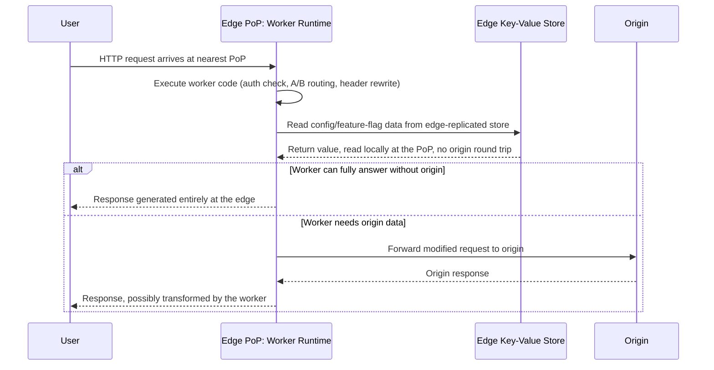

**Decision implication.** Edge computing is the right architectural choice
for logic that is (a) latency-sensitive, (b) needs to run for every
request regardless of cache status, and (c) does not require centralized,
strongly consistent state — common examples include authentication token
validation, A/B test bucketing, request/response header rewriting,
geolocation-based redirects, and lightweight API composition. It is the
wrong choice for logic requiring strong consistency against a central
database, complex multi-step transactions, or heavy computation, since
edge runtimes are deliberately constrained (limited CPU time per request,
limited memory, restricted APIs) to keep per-PoP resource usage
predictable across a globally replicated fleet.

**Common failure mode.** Treating edge workers as a drop-in replacement
for full backend services and pushing business logic that depends on
strongly consistent, centralized state (e.g. inventory decrement,
payment processing) into the edge runtime — this either fails outright
against the runtime's constraints or, worse, silently introduces
consistency bugs when multiple PoPs' edge instances make conflicting
decisions against eventually-consistent edge-replicated data stores.

**Concrete scenario.** A global Software-as-a-Service (SaaS) platform
moves JSON Web Token (JWT) validation and geolocation-based feature-flag
evaluation into an edge worker, eliminating a full round trip to a
centralized auth service for every request — reducing median added
latency for that check from roughly 80ms (cross-region round trip) to
under 2ms (evaluated entirely at the nearest PoP). The team explicitly
keeps payment processing and inventory decrement logic in the centralized
backend, recognizing those operations require strong consistency
guarantees the edge runtime's replicated, eventually-consistent data model
cannot provide.

### 4.10 Cache Invalidation: The Hard Distributed-Systems Problem

**Recap of the framing.** "There are only two hard things in Computer
Science: cache invalidation and naming things" is a well-known (and
only half-joking) observation, and CDN cache invalidation is precisely the
class of problem it refers to: once a response has been copied to hundreds
or thousands of PoPs worldwide, ensuring every copy reflects an update —
without either serving stale data indefinitely or paying the cost of
propagating a purge everywhere instantly for every write — is a genuine
distributed-systems trade-off, not a solved configuration checkbox.

**Mechanism.** There are two fundamentally different approaches, each with
a real cost:

- **TTL-based eventual expiry**: every cached object carries a maximum
  age (from `Cache-Control: max-age`/`s-maxage`, Section 4.6); once that
  age is reached, the PoP treats the object as stale and revalidates or
  refetches it on the next request. This requires no active coordination
  across PoPs at all — each PoP independently ages out its own copies —
  but means that after an origin update, users can continue seeing the old
  version anywhere from seconds to hours later, depending on the
  configured TTL, until each PoP's own copy happens to expire.
- **Instant purge (active invalidation)**: the origin operator explicitly
  tells the CDN "this object is now invalid," and the CDN propagates that
  instruction to every PoP holding a copy, typically within seconds. This
  achieves near-immediate consistency but is expensive to do universally
  and instantly at full CDN scale — propagating a purge instruction
  reliably to thousands of geographically distributed PoPs, confirming
  each has actually applied it, and doing so for every single write a
  busy system makes, is itself a non-trivial distributed coordination
  problem, which is why most CDN vendors rate-limit or charge
  differently for purge operations compared to ordinary caching.

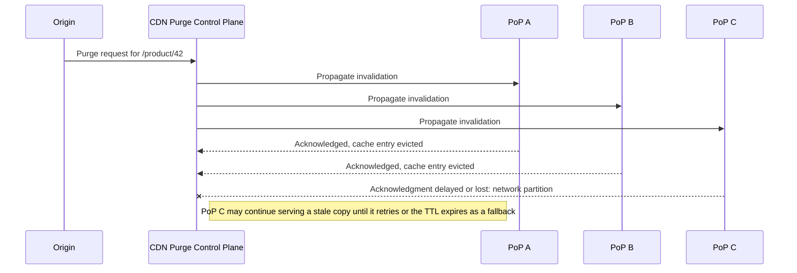

**Decision implication.** The practical answer, used by essentially every
mature CDN architecture, is not to pick one mechanism exclusively but to
**use TTL as the default safety net and instant purge as the exception**:
set a reasonably short `max-age`/`s-maxage` for content that changes
occasionally (bounding worst-case staleness even if a purge is delayed or
lost, as in the diagram above), and reserve active purge calls for
genuinely urgent corrections (an incorrect price, a legal takedown, a
security-sensitive update) where the cost of the purge propagation is
justified by the cost of staleness. Relying on purge as the *only*
invalidation mechanism (setting very long TTLs and assuming every update
will always be followed by a successful, universally-acknowledged purge)
is fragile — any missed or delayed purge (as PoP C illustrates above)
produces indefinitely stale content with no automatic recovery.

**Common failure mode.** Setting an aggressively long TTL "for maximum
cache-hit ratio" while relying entirely on purge calls to handle every
update, then discovering that a purge silently failed for a subset of PoPs
(due to a transient network issue, a bug in the deployment pipeline that
forgot to call purge, or a partition like the one in the sequence diagram
above) — with no TTL-based fallback, the stale content persists at those
PoPs until the next manual intervention, sometimes for hours or days
before anyone notices.

**Concrete scenario.** A retailer sets `max-age=86400` (24 hours) on
product pages and relies exclusively on an explicit purge call whenever a
price changes. A deployment bug causes the purge call to silently fail for
price updates originating from one specific internal tool, and a
discounted item's page continues showing the old, higher price at a subset
of PoPs for over 12 hours before customer complaints surface the issue.
Reducing the TTL to a much shorter safety-net value (e.g. 5 minutes) for
price-sensitive fields, while keeping purge as the fast path for the
common case, would have bounded the worst-case staleness to minutes
regardless of purge reliability.

### 4.11 Multi-CDN Architecture

**Definition.** A multi-CDN architecture uses two or more CDN vendors
simultaneously (rather than relying on a single provider) for the same
application, with traffic steered between them based on real-time
performance, cost, or availability considerations.

**Mechanism.** Multi-CDN steering is typically implemented at the DNS
layer (per Section 4.3's recap) or via a dedicated traffic-steering
service: a resolver measures real-user latency and error rates against
each CDN vendor continuously, and directs new DNS resolutions toward
whichever vendor is currently performing best for a given region — or,
during a vendor-specific outage, away from the affected vendor entirely.

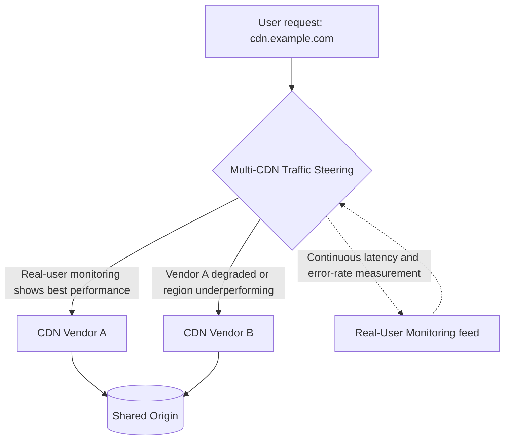

**Decision implication.** Multi-CDN architecture serves two genuinely
distinct motivations that are worth evaluating separately:

1. **Resilience.** No single CDN vendor's global network is immune to
   outages (regional BGP misconfigurations, DDoS events large enough to
   affect the vendor itself, software bugs in the vendor's own control
   plane) — a multi-CDN architecture means a single vendor's outage
   degrades, rather than eliminates, service, since traffic steering can
   shift away from the affected vendor.
2. **Negotiating leverage.** A single-vendor CDN relationship gives that
   vendor significant pricing power once a system is deeply integrated
   with vendor-specific features (custom WAF rules, edge worker code
   written against a vendor-specific runtime API, purge tooling built
   against a vendor-specific control-plane Application Programming
   Interface (API)) — maintaining genuine multi-vendor capability, even
   if one vendor carries the large majority of traffic in steady state,
   preserves the operator's ability to credibly threaten (and follow
   through on) shifting volume, which materially affects contract
   renewal pricing.

**Common failure mode.** Building "multi-CDN" architecture in name only —
provisioning a second vendor but writing all edge worker code, WAF rules,
and purge automation against the primary vendor's proprietary APIs with no
abstraction layer — such that actually shifting meaningful traffic to the
secondary vendor during an incident would require significant emergency
reconfiguration, defeating the resilience purpose and substantially
weakening the negotiating-leverage purpose as well, since the "leverage"
is not credible if switching is operationally impractical.

**Concrete scenario.** A streaming platform maintains active integrations
with two CDN vendors, with 80% of steady-state traffic on the primary
vendor (chosen for its superior price-per-gigabyte at that volume) and 20%
continuously routed to the secondary vendor — not because the secondary is
needed for that volume today, but specifically to keep its integration,
edge worker code, and purge automation genuinely production-tested and
ready to absorb far more traffic within minutes if the primary vendor has
an incident. During a subsequent primary-vendor regional outage, traffic
steering shifts a majority of affected-region traffic to the secondary
vendor within the steering service's detection-and-failover window, with
no emergency engineering work required, because the failover path was
already continuously exercised rather than theoretical.

## 5. Internal Working

The end-to-end lifecycle of a single user request through a CDN combines
several of the mechanisms from Section 4 into one path: DNS-based or
anycast-based routing to a nearby PoP, a cache-key lookup, and — on a
miss — an origin-shield-mediated fetch, all before the response reaches the
user.

```mermaid
sequenceDiagram
    participant User
    participant DNS as DNS Resolver
    participant PoP as Nearest PoP
    participant Shield as Origin Shield
    participant Origin
    User->>DNS: Resolve cdn.example.com
    DNS-->>User: Anycast IP (Section 4.3 recap; full mechanics owned by DNS chapter)
    User->>PoP: HTTPS request routed via BGP to nearest PoP (Section 4.2)
    PoP->>PoP: Construct cache key from URL, headers, cookies per policy (Section 4.5)
    alt Cache-hit at PoP
        PoP-->>User: Serve stored response directly
    else Cache-miss at PoP
        PoP->>Shield: Check origin shield cache (Section 4.4)
        alt Shield cache-hit
            Shield-->>PoP: Serve from shield, no true-origin contact
        else Shield cache-miss
            Shield->>Origin: Fetch over pre-warmed connection (Section 4.7)
            Origin-->>Shield: Response with Cache-Control/ETag headers (Section 4.6 recap)
            Shield-->>PoP: Store and forward
        end
        PoP-->>User: Store per cache-key policy, then respond
    end
```

Two details in this flow are easy to overlook but architecturally
important. First, the WAF and DDoS mitigation layer (Section 4.8) and any
edge worker logic (Section 4.9) sit *before* the cache-key lookup in the
actual request path — a malicious or malformed request can be blocked, and
an edge worker can fully answer a request, before the cache is ever
consulted. Second, whether a response is even eligible to be stored at all
(and for how long) is decided entirely by the `Cache-Control`/`ETag`
headers the origin returned on the response that populated that cache
entry — the CDN's caching behavior on subsequent requests is a direct,
deterministic function of what the origin declared, not an independent
CDN-side heuristic.

## 6. Design Principles

- **Treat physical placement as a first-class architecture decision, not
  an afterthought** (Section 4.1) — decide where content and compute live
  relative to users at design time, not after a latency complaint.
- **Design cache keys before writing cache-control headers** — a
  correctly-scoped `Vary` header (Section 4.6) is meaningless if the CDN's
  cache-key policy (Section 4.5) doesn't reflect the same dimensions.
- **Assume purge will occasionally fail, and design TTLs accordingly**
  (Section 4.10) — never rely on active invalidation as the sole
  correctness mechanism for content where staleness has real cost.
- **Separate the caching decision from the acceleration decision**
  (Section 4.7) — evaluate CDN placement for uncacheable, dynamic traffic
  on its own transport-optimization merits, not only on projected
  cache-hit ratio.
- **Restrict the origin to CDN-only ingress** (Section 4.8) — a CDN in
  front of an origin that remains directly reachable provides an
  incomplete security boundary.
- **Keep multi-CDN integrations genuinely portable** (Section 4.11) — avoid
  building irreversible, vendor-specific lock-in into edge worker code and
  purge automation if resilience or negotiating leverage is a stated goal.

## 7. Architecture Patterns

- **Pull-through caching (lazy population)**: PoPs populate their cache
  lazily on first request (the default model described in Sections 4.4-5)
  — simple, requires no pre-warming step, but the very first request for
  any resource at any PoP always pays a cache-miss.
- **Push/pre-warmed caching**: the origin (or a deployment pipeline)
  proactively pushes known-popular content to PoPs ahead of expected
  demand (e.g. before a scheduled product launch or a known traffic event)
  — avoids the cold-cache miss for predictable, high-value traffic spikes,
  at the cost of extra deployment-pipeline complexity and pre-provisioned
  storage for content that may not be requested from every region.
- **Origin-shield-mediated fan-in** (Section 4.4): a required pattern, not
  optional, for any deployment with meaningful PoP count and popular,
  frequently-invalidated content.
- **Edge-side composition/API aggregation** (an application of Section
  4.9): an edge worker assembles a response from multiple upstream calls
  or cache lookups directly at the PoP, reducing the number of
  cross-continental round trips a client would otherwise need to make
  itself.
- **Tiered/regional caching hierarchy**: a middle tier of regional
  "shield-like" caches between edge PoPs and a single global origin shield,
  used by very large-footprint CDNs to further reduce fan-in load on the
  global shield for extremely popular content.

## 8. Production Architecture

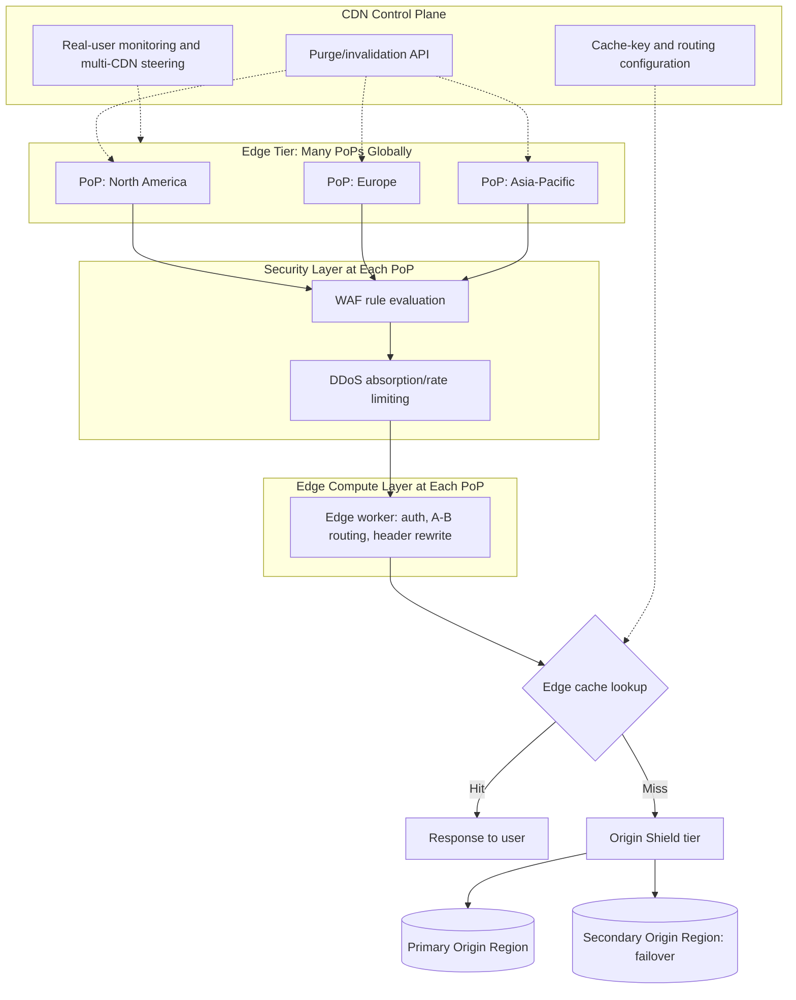

A production CDN deployment is best understood as four cooperating layers:
an edge tier (many PoPs), a security layer evaluated before caching or
compute at each PoP, an edge compute layer for request/response logic that
must run regardless of cache status, and a control plane (purge API,
cache-key configuration, and — where applicable — multi-CDN traffic
steering) that operates across the entire fleet rather than per-PoP.
Solution Architects should treat the control plane's own reliability and
authentication model as part of the production architecture, not an
implementation detail — a compromised purge API credential, for instance,
could be used to force mass cache invalidation as a denial-of-service
vector against the origin (forcing every PoP to simultaneously fetch from
origin), which is exactly the origin-shield-fan-in risk from Section 4.4
triggered deliberately rather than accidentally.

## 9. Implementation

Implementing a CDN in front of an existing system is primarily a
configuration and header-discipline exercise rather than an application
rewrite, but requires deliberate sequencing:

1. **Audit and correct origin `Cache-Control`/`ETag`/`Vary` headers first**
   (Section 4.6) — a CDN cannot cache correctly if the origin's headers are
   wrong or absent; this step alone often surfaces existing bugs (e.g.
   `no-cache` accidentally applied globally via a shared middleware).
2. **Define cache-key policy explicitly per route pattern** (Section 4.5)
   — do not accept default "include everything" or "include only the URL"
   policies without validating against actual `Vary` usage and known
   personalization dimensions.
3. **Enable and verify origin shield** (Section 4.4) before going live with
   meaningful traffic.
4. **Lock down origin ingress to CDN-only IP ranges** (Section 4.8) as part
   of the same rollout, not a follow-up task.
5. **Configure WAF rules in monitor-only/log mode first**, then move to
   blocking mode after validating false-positive rate against real traffic
   (Section 4.8, 16).
6. **Define the purge/TTL strategy per content class** (Section 4.10)
   before launch — do not discover the trade-off during an incident.
7. **Only after the above is stable**, evaluate edge compute (Section 4.9)
   for logic that benefits from running at the edge, and multi-CDN
   (Section 4.11) if resilience or negotiating leverage justifies the added
   operational surface.

## 10. Complete Code Examples

**Example 1 — Origin `Cache-Control` header strategy (Node.js/Express).**
Demonstrates the `s-maxage`/`max-age` split from Section 4.6: a longer
duration for the CDN (a shared cache the operator controls and can purge)
than for individual browsers (which are far harder to invalidate).

```javascript
// server.js — origin response headers driving CDN caching behavior
const express = require('express');
const app = express();

app.get('/api/products/:id', async (req, res) => {
  const product = await getProduct(req.params.id);

  // s-maxage targets shared caches (the CDN) specifically; max-age targets
  // individual browsers. A longer CDN duration is safe because purge
  // (Section 4.10) can correct it quickly; a shorter browser duration
  // bounds worst-case staleness for caches this operator cannot purge.
  res.set(
    'Cache-Control',
    'public, max-age=60, s-maxage=3600, stale-while-revalidate=30'
  );
  // ETag lets the CDN and browsers revalidate cheaply (a 304 Not Modified)
  // instead of re-transferring the full body after s-maxage expires.
  res.set('ETag', `"${product.version}"`);
  // Declares which request headers change the response body, so the CDN's
  // cache-key policy (Example 3) must include the same dimensions.
  res.set('Vary', 'Accept-Language');

  res.json(product);
});

app.get('/api/dashboard', async (req, res) => {
  // Per-user dynamic content: explicitly not cacheable by any shared cache,
  // but still eligible for dynamic content acceleration (Section 4.7) at
  // the transport level even though the CDN never stores this response.
  res.set('Cache-Control', 'private, no-store');
  res.json(await getDashboardData(req.user.id));
});

module.exports = app;
```

**Example 2 — Cloudflare Worker: authentication check and A/B routing at
the edge.** Demonstrates edge computing (Section 4.9): request handling
that fully resolves at the PoP for the common case, with fallback to the
origin only when required.

```javascript
// worker.js — runs at every PoP; deployed once, replicated globally
export default {
  async fetch(request, env, ctx) {
    const url = new URL(request.url);

    // Validate a signed JWT (JSON Web Token) locally at the edge — no
    // round trip to a centralized auth service (Section 4.9 scenario).
    const token = request.headers.get('Authorization')?.replace('Bearer ', '');
    if (!token || !(await isValidToken(token, env.JWT_PUBLIC_KEY))) {
      return new Response('Unauthorized', { status: 401 });
    }

    // Deterministic A/B bucketing from a stable cookie, avoiding a call to
    // a centralized experimentation service for every request.
    const bucketCookie = getCookie(request, 'ab_bucket');
    const bucket = bucketCookie || (Math.random() < 0.5 ? 'control' : 'variant');

    const modifiedRequest = new Request(request, {
      headers: new Headers(request.headers),
    });
    modifiedRequest.headers.set('X-AB-Bucket', bucket);

    // Only requests that actually need origin data are forwarded; the
    // worker itself never becomes a bottleneck for logic it can resolve.
    const response = await fetch(modifiedRequest);
    const newResponse = new Response(response.body, response);

    if (!bucketCookie) {
      newResponse.headers.append(
        'Set-Cookie',
        `ab_bucket=${bucket}; Path=/; Max-Age=2592000; Secure; HttpOnly`
      );
    }
    return newResponse;
  },
};

function getCookie(request, name) {
  const cookie = request.headers.get('Cookie') || '';
  const match = cookie.match(new RegExp(`${name}=([^;]+)`));
  return match ? match[1] : null;
}
```

**Example 3 — Cache-key and `Vary`-aligned configuration (Fastly VCL-style
pseudocode).** Demonstrates the cache-key design discipline from Section
4.5, aligned explicitly with the `Vary: Accept-Language` header set in
Example 1, and shows marketing-parameter stripping to protect the
cache-hit ratio.

```vcl
sub vcl_hash {
    # Base cache key: scheme + host + path only, deliberately excluding
    # the full query string to avoid fragmentation (Section 4.5).
    set req.hash += req.url.path;
    set req.hash += req.http.host;

    # Explicitly include Accept-Language because the origin's Vary header
    # (Example 1) declares this response varies by it — omitting this
    # would silently serve one locale's content to another locale.
    set req.hash += req.http.Accept-Language;

    # Explicitly strip known marketing/tracking query parameters before
    # they reach the cache key, so cdn.example.com/p/42?utm_source=ad1
    # and .../p/42?utm_source=ad2 share one cache entry instead of two.
    set req.url = querystring.remove_regex(
        req.url,
        "utm_[a-z]+|gclid|fbclid"
    );

    return (hash);
}

sub vcl_recv {
    # Session cookies never affect this route's response body, so they
    # must never enter the cache key (the failure mode in Section 4.5).
    if (req.url.path ~ "^/marketing/") {
        unset req.http.Cookie;
    }
}
```

**Example 4 — Cache purge/invalidation script with a TTL safety net
(shell + curl).** Demonstrates the Section 4.10 trade-off in practice:
active purge as the fast path, with a deliberately short fallback TTL
already configured at the origin (Example 1's `s-maxage`) bounding
worst-case staleness if this script itself fails.

```bash
#!/usr/bin/env bash
# purge-product.sh — invalidates a single product page across all PoPs
# after a price update; relies on Example 1's short s-maxage as a safety
# net if this call fails or a PoP misses the propagated purge.
set -euo pipefail

PRODUCT_ID="$1"
CDN_API_TOKEN="${CDN_API_TOKEN:?CDN_API_TOKEN must be set}"

response=$(curl -sS -w '\n%{http_code}' -X POST \
  "https://api.cdn-vendor.example.com/v1/purge" \
  -H "Authorization: Bearer ${CDN_API_TOKEN}" \
  -H "Content-Type: application/json" \
  -d "{\"path\": \"/api/products/${PRODUCT_ID}\"}")

http_code=$(echo "$response" | tail -n1)
body=$(echo "$response" | sed '$d')

if [[ "$http_code" != "200" ]]; then
  # Deliberately non-fatal: the price-update deployment must not fail just
  # because purge propagation failed. The 60s s-maxage from Example 1
  # bounds staleness even if this purge is never retried.
  echo "WARNING: purge failed (HTTP ${http_code}): ${body}" >&2
  echo "Falling back to TTL expiry (s-maxage=3600, worst case) for product ${PRODUCT_ID}" >&2
  exit 0
fi

echo "Purge succeeded for product ${PRODUCT_ID}: ${body}"
```

## 11. Performance

- **Cache-hit ratio is the single highest-leverage metric**, but only when
  measured alongside cache-key correctness (Section 4.5) — a high hit
  ratio achieved by an overly coarse cache key that risks serving wrong
  content to some users is not a real performance win.
- **Origin shield fan-in ratio** (Section 4.4) — track how many
  simultaneous edge-PoP misses collapse into a single shield-to-origin
  fetch; a ratio far below the PoP count for popular content indicates a
  shield misconfiguration (e.g. PoPs not consistently pinned to the same
  shield node for a given resource).
- **Dynamic acceleration gains are measurable independent of cache-hit
  ratio** (Section 4.7) — benchmark uncacheable API latency with and
  without CDN routing to isolate the transport-level benefit from caching
  benefit.
- **Edge worker execution time budget** (Section 4.9) — edge runtimes
  enforce strict per-request CPU time limits; profile worker code against
  the vendor's specific limit, since exceeding it produces a hard failure
  for every affected request, at every PoP, simultaneously.

## 12. Scalability

A CDN's scaling model is fundamentally different from a conventional
backend's: capacity scales with PoP count and per-PoP hardware, both
controlled by the CDN vendor rather than the application team, and the
practical scaling lever available to a Solution Architect is almost
entirely about *reducing origin-facing load* (via cache-hit ratio, Section
4.4's origin shield, and dynamic acceleration's connection reuse) rather
than provisioning more CDN capacity directly. This inverts the usual
scaling conversation: instead of "how do we add more servers," the question
becomes "how do we make each origin request served by the CDN cheaper and
rarer," since the CDN's own PoP capacity is effectively elastic from the
application team's perspective (subject to contractual/vendor limits) while
origin capacity remains the actual constrained resource.

## 13. Security

- **Restrict origin ingress to CDN IP ranges only** (Section 4.8) — the
  single most common CDN security gap, and the one most directly
  exploitable to bypass every other CDN-provided protection.
- **Treat the purge/control-plane API credential as a high-privilege
  secret** (Section 8) — it can be used to force mass cache invalidation
  as a denial-of-service vector against the origin shield/origin.
- **Validate WAF rules against false-positive rate before enforcing block
  mode** (Section 9, 16) — an overly aggressive WAF can itself become an
  availability incident by blocking legitimate traffic.
- **Never place secrets or unvalidated user input directly into edge
  worker code paths that construct outgoing requests** (Section 4.9) —
  edge workers are still application code and inherit the same
  injection-class risks as any backend service; this general
  input-validation discipline is owned in full by
  [Security](../15_Security/PART_OVERVIEW.md).
- **Ensure TLS is terminated correctly at every hop** — client-to-PoP TLS
  is necessary but not sufficient; verify the PoP-to-origin leg (Section
  4.7) is also encrypted, not silently downgraded to plaintext on the
  private backbone.

## 14. Observability

Track cache-hit ratio, origin-shield fan-in ratio (Section 4.4), purge
success/failure rate and propagation latency (Section 4.10), WAF
block/allow rates segmented by rule (Section 4.8), and edge worker
execution time and error rate per PoP (Section 4.9) as CDN-specific
metrics layered on top of the general request-level observability
(latency, status code, correlation ID) owned by
[HTTP](CH01_HTTP.md#14-observability). Purge failure rate in particular
deserves an explicit alert threshold — per Section 4.10, a silently failing
purge pipeline has no other visible symptom until a customer-facing
staleness complaint surfaces, often hours later.

## 15. Failure Scenarios

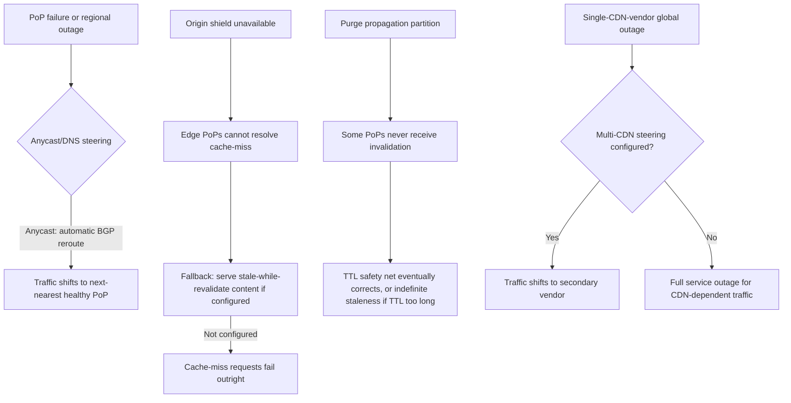

- **Single PoP or regional failure**: anycast (Section 4.2) reroutes
  automatically via standard BGP convergence; DNS-based steering (Section
  4.3) provides a complementary, health-aware fallback at a coarser grain.
- **Origin shield unavailability**: without a configured
  `stale-while-revalidate` fallback (visible in Example 1), a shield
  outage turns every cache-miss into a hard failure rather than a
  degraded-but-available response.
- **Purge propagation partition** (Section 4.10): the TTL safety net is the
  only recovery mechanism if a purge silently fails to reach a subset of
  PoPs — this is precisely why Section 4.10 argues against relying on
  purge alone.
- **Vendor-wide outage with no multi-CDN fallback** (Section 4.11): a
  single-vendor architecture has no failover path if the vendor's own
  global control plane or network fails, which has occurred industry-wide
  on more than one occasion.

## 16. Testing

- Validate cache-key correctness explicitly: issue requests differing only
  in each `Vary`-listed header/cookie/parameter and confirm distinct,
  correct responses are served for each (Section 4.5-4.6).
- Load-test purge propagation latency and failure rate under realistic
  purge volume, not just functional correctness of a single purge call
  (Section 4.10).
- Test WAF rules in monitor-only mode against real production traffic
  before enabling block mode, explicitly measuring false-positive rate
  (Section 9, 13).
- For edge worker code, test against the runtime's actual CPU-time and
  memory constraints in a staging environment that mirrors production
  limits, not just local unit tests with no such constraints (Section
  4.9, 11).
- For multi-CDN architectures, regularly exercise actual failover (not
  just document that it's theoretically possible) to confirm the
  secondary vendor's integration is genuinely production-ready (Section
  4.11 scenario).

## 17. Common Mistakes

- Treating CDN adoption as purely a performance optimization and skipping
  the security hardening step of restricting origin ingress (Section 4.8,
  13).
- Accepting default cache-key policies without validating against the
  origin's actual `Vary` usage (Section 4.5-4.6).
- Relying exclusively on purge for cache correctness with no TTL safety
  net (Section 4.10).
- Dismissing CDN value for predominantly dynamic/uncacheable systems
  without evaluating dynamic content acceleration separately (Section
  4.7).
- Building a "multi-CDN" architecture that is never actually exercised in
  practice, undermining both its resilience and negotiating-leverage
  purpose (Section 4.11).
- Pushing strongly-consistent business logic into edge worker code where
  the runtime's constraints and eventually-consistent data model cannot
  support it correctly (Section 4.9).

## 18. Best Practices

- Audit and correct origin caching headers before any CDN rollout
  (Section 9, step 1).
- Enable and verify origin shield before meaningful production traffic
  (Section 4.4, 9).
- Restrict origin ingress to CDN-only IP ranges as part of initial rollout,
  not a follow-up (Section 4.8, 13).
- Use a short TTL as a safety net even on content primarily managed via
  active purge (Section 4.10).
- Evaluate dynamic content acceleration on its own merits for
  latency-sensitive, mostly-uncacheable systems (Section 4.7).
- Keep edge worker code and purge automation vendor-portable if multi-CDN
  resilience or negotiating leverage is a stated architecture goal
  (Section 4.11).

## 19. Anti-Patterns

- **Direct-reachable origin behind a CDN** (Section 4.8, 13) — defeats the
  CDN's DDoS/WAF protection for any attacker who discovers the real origin
  address.
- **Purge-only invalidation with no TTL fallback** (Section 4.10) — a
  single missed purge produces unbounded staleness.
- **Cache key too coarse or too fine relative to actual `Vary` usage**
  (Section 4.5-4.6) — either a correctness bug (serving wrong locale/
  personalized content) or a self-inflicted near-zero hit ratio.
- **"Multi-CDN" in name only** (Section 4.11) — vendor-specific,
  non-portable edge and purge tooling that makes real failover
  operationally impractical.
- **Edge worker logic requiring strong consistency** (Section 4.9) —
  business-critical, transactional logic pushed into a deliberately
  constrained, eventually-consistent edge runtime.

## 20. Trade-off Analysis

| Decision | Benefit | Cost |
|---|---|---|
| TTL-based invalidation only | No coordination overhead, resilient to partial failures | Bounded but real staleness window after every update |
| Instant purge as sole mechanism | Near-immediate consistency | Fragile: any missed/delayed propagation produces indefinite staleness with no fallback |
| Aggressive cache-key coarseness | Higher cache-hit ratio | Risk of serving incorrect content across `Vary` dimensions if misaligned with origin headers |
| Fine-grained cache-key (many dimensions) | Correctness safety margin | Fragmented cache, lower effective hit ratio |
| Enabling edge compute for auth/routing logic | Sub-millisecond latency for logic resolved entirely at the edge | Constrained runtime; wrong fit for strongly consistent business logic |
| Multi-CDN architecture | Vendor-outage resilience, negotiating leverage | Ongoing dual-integration engineering and operational cost |
| Single-CDN architecture | Lower integration/operational overhead | No fallback path during a vendor-wide outage; weaker renewal-negotiation position |

## 21. Comparison Table

| Property | Traditional Static CDN Caching | Dynamic Content Acceleration | Edge Computing (Workers/Functions) |
|---|---|---|---|
| What is served | A stored, reusable response | A freshly computed, per-request response | Application logic executed per request |
| Origin contact | Avoided entirely on cache-hit | Always required, but over an optimized path | Optional — can fully resolve at the edge or forward to origin |
| Primary benefit | Eliminates propagation delay and origin load for repeat content | Reduces transport-level round-trip cost for uncacheable content | Sub-millisecond execution of latency-sensitive logic close to the user |
| Cacheability requirement | Content must be validly cacheable (Section 4.4-4.6) | None — works for 0%-cacheable traffic | None — works regardless of cache status |
| Consistency model | Governed by TTL/purge trade-off (Section 4.10) | Always reflects current origin state (no caching involved) | Depends on data source used; edge-replicated stores are typically eventually consistent |
| Best fit | Static assets, largely-identical-for-all-users pages | Personalized APIs, real-time data | Auth checks, A/B routing, header rewriting, lightweight composition |

## 22. Real-World Case Study

A global online education platform launched a new course-catalog page that
was fully cacheable and correctly configured with `Cache-Control` and a
matching cache-key policy (Sections 4.5-4.6), achieving a 95% cache-hit
ratio within days — but user-reported latency in Southeast Asia remained
noticeably worse than in North America and Europe despite the high hit
ratio. Investigation using per-region real-user monitoring (Section 14)
showed the issue wasn't caching at all: the platform's CDN vendor had
comparatively sparse PoP density and weaker regional ISP peering in
Southeast Asia specifically (the exact failure mode described in Section
4.2's common failure mode), so even cache-hit responses were traveling a
longer-than-necessary BGP path to reach a farther PoP than the user's
actual nearest network hop. The team evaluated peering quality (not just
PoP count) as an explicit vendor-selection criterion, added a second CDN
vendor with materially better Southeast Asian peering, and used multi-CDN,
region-aware steering (Section 4.11) to route that specific region's
traffic to the better-peered vendor while keeping the original vendor for
the rest of the world — resolving the regional latency gap without a full
vendor migration, and validating that "high cache-hit ratio" and "good CDN
performance" are related but genuinely distinct measurements.

## 23. Interview Questions

1. Explain precisely why a CDN cannot be replaced by simply adding more or
   faster origin servers, in terms of the physics involved.
2. What problem does an origin shield solve that individual PoP caching
   alone does not, and why does that problem scale with PoP count?
3. Walk through the difference between anycast-based and DNS-based
   traffic steering — what does each solve, and why do most CDNs use both?
4. A system's API responses are all personalized and never cacheable —
   does a CDN still provide value? Justify the answer mechanically.
5. Describe the fundamental trade-off between TTL-based expiry and instant
   purge for cache invalidation, and explain why relying on only one of
   the two is fragile.
6. What makes edge computing architecturally distinct from traditional CDN
   caching, and what class of application logic is a poor fit for an edge
   runtime, and why?
7. What are the two distinct motivations for a multi-CDN architecture, and
   why does "provisioning a second vendor" not automatically satisfy
   either of them?

## 24. Hands-on Exercises

Using Example 1's Express server and Example 3's Fastly VCL-style cache-key
configuration as a reference, stand up a local origin server that sets
`Cache-Control`, `ETag`, and `Vary: Accept-Language` headers on a sample
API route. Issue requests with different `Accept-Language` header values
against a local caching reverse proxy (e.g. Varnish or nginx configured as
a cache) configured to include `Accept-Language` in its cache key, and
confirm distinct cached responses are served per language. Then
deliberately misconfigure the cache key to exclude `Accept-Language` and
observe the resulting correctness bug (one language's response served to a
different language's request) firsthand.

## 25. Design Exercises

Design the CDN architecture for a global video-streaming platform expecting
concurrent viewers across five continents, with a mix of pre-recorded
(fully cacheable) video segments and live-stream (uncacheable, low-latency
critical) content on the same domain. Specify: the cache-key policy for
each content type, whether and how you'd use origin shield differently for
the two content types, your purge/TTL strategy for pre-recorded content
that gets occasionally re-encoded, whether edge compute has a role for
either content type, and whether a multi-CDN architecture is justified —
and if so, how traffic would be split and steered between vendors for
live versus recorded content specifically. Evaluation criteria: whether
the live/recorded distinction is treated as architecturally different
throughout (not just "apply the same CDN settings to both"), whether the
purge/TTL trade-off is addressed concretely rather than assumed away, and
whether the multi-CDN justification is tied to a specific business
requirement (resilience, cost, negotiating leverage) rather than asserted
generically.

## 26. Architecture Review Questions

- Is the origin restricted to accept traffic only from the CDN's published
  IP ranges (Section 4.8, 13)?
- Does the cache-key policy for every route explicitly reflect that
  route's actual `Vary` header usage, verified rather than assumed
  (Section 4.5-4.6)?
- Is origin shield enabled and correctly pinned so that all PoPs in a
  region share one shield node's cache for a given resource (Section
  4.4)?
- Is there a TTL safety net configured for every content class relying on
  active purge, bounding worst-case staleness if a purge silently fails
  (Section 4.10)?
- Has dynamic content acceleration been evaluated on its own merits for
  latency-sensitive, largely-uncacheable traffic, rather than dismissed
  because "nothing is cacheable" (Section 4.7)?
- If a multi-CDN architecture exists, has failover actually been exercised
  recently, not merely documented as theoretically possible (Section
  4.11, 16)?
- Is edge worker code restricted to logic that tolerates the runtime's
  constraints and eventually-consistent data model, with strongly
  consistent business logic kept centralized (Section 4.9)?

## 27. Summary

A CDN exists because latency has a physical floor set by the speed of
light over distance, and moving content — and increasingly, computation —
physically closer to users is the only architectural lever that addresses
that floor directly. Points of Presence and anycast routing (recapping DNS
based steering, owned by this part's DNS chapter) deliver users to a nearby
edge node largely transparently; cache-key design, origin shield, and the
deep, deterministic relationship to HTTP's `Cache-Control`/`ETag`/`Vary`
headers (owned by [HTTP](CH01_HTTP.md)) govern whether and how correctly a
response gets served from that edge node; dynamic content acceleration
extends CDN value to uncacheable traffic through transport-level
optimization alone; DDoS mitigation and WAF integration have become a
default bundled security capability precisely because the CDN already sits
in front of every request; edge computing (Cloudflare Workers/Lambda@Edge
style edge workers and functions) is a genuinely new architectural layer
for running application logic geographically distributed, distinct from
and not a replacement for centralized, strongly-consistent backend logic;
cache invalidation remains a real distributed-systems trade-off between
TTL-based eventual expiry and instant purge, best handled by using both
together rather than relying on either alone; and multi-CDN architecture
serves two distinct, legitimate motivations — resilience and negotiating
leverage — that only pay off if the secondary integration is kept
genuinely production-ready rather than nominal. The recurring theme across
every section is that a CDN is not an optimization layered on top of a
finished system, but a placement and trust-boundary decision that shapes
the system's actual architecture from the start.

**Further reading**: [HTTP](CH01_HTTP.md) ·
[HTTP/2](CH04_HTTP2.md) · [HTTP/3](CH05_HTTP3.md) ·
[Security](../15_Security/PART_OVERVIEW.md) ·
[Observability](../14_Observability/PART_OVERVIEW.md) · this part's
forthcoming DNS, Load Balancer, and Reverse Proxy chapters
