# Chapter: Load Balancer

Part: [05 — Networking and Operating Systems](PART_OVERVIEW.md) · Status: Drafted

## 1. Introduction

A load balancer is the piece of infrastructure that sits in front of a pool
of backend servers and decides, for every incoming connection or request,
which single backend instance will actually handle it. It is one of the
most consequential — and most frequently misunderstood — components in any
distributed system a Solution Architect designs, because the load balancer
is simultaneously a traffic-distribution mechanism, a health-monitoring
system, a failure-isolation boundary, and (in its Layer 7 form) an
Application-layer (Layer 7 of the OSI (Open Systems Interconnection) model)
policy-enforcement point. Get the load balancer wrong and you get one of two
failure modes that look identical from a user's perspective but have opposite
root causes: either the load balancer becomes the very single point of
failure it was introduced to eliminate, or it silently keeps routing traffic
to backend instances that are unhealthy, turning a partial outage into a
full one.

This chapter is the *owning* chapter for load-balancing architecture in this
handbook: the mechanics of Layer 4 (L4, transport-level) versus Layer 7 (L7,
application-level) load balancing, the algorithm families used to select a
backend, health-checking architecture, session affinity (sticky sessions)
and the architectural tension it creates with stateless horizontal scaling,
Global Server Load Balancing (GSLB), load-balancer high-availability
patterns, and connection draining during deployments. [CH02_OSI_Model.md](CH02_OSI_Model.md#7-architecture-patterns)
already introduced "Layer 4 vs. Layer 7 load balancing" at a high level, as
one example of how a networking concept changes in character as you move up
the OSI stack — that chapter's job was to place load balancing correctly on
the seven-layer map. This chapter's job is to teach load balancing itself,
in full mechanical depth, as the practicing discipline of designing traffic
distribution for a production system. Similarly, DNS (Domain Name System) —
already fully taught in [CH08_DNS.md](CH08_DNS.md) — reappears here only in
its role as the traffic-steering substrate underneath GSLB; this chapter
recaps DNS mechanics briefly and links back rather than re-deriving zones,
resolvers, or record types.

## 2. Historical Evolution

Load balancing did not begin as a single product category; it emerged in
three distinct technology waves, each solving the scaling problem available
to the hardware and network stack of its era.

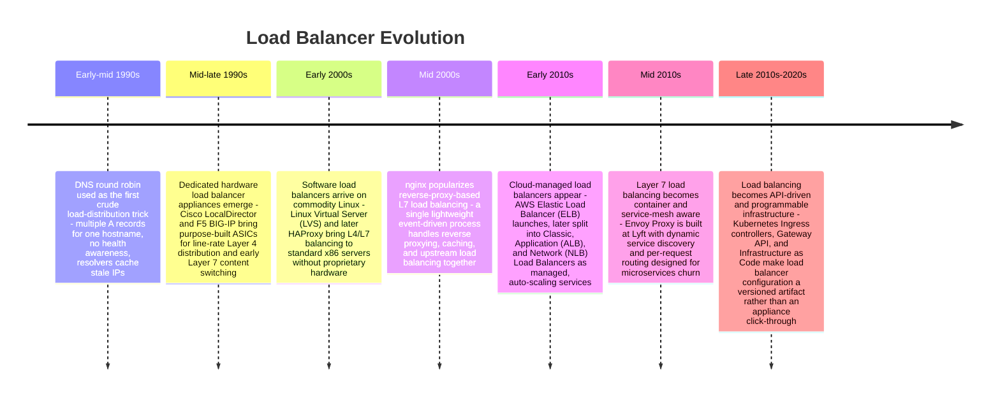

The pattern across every wave is the same underlying force: as the number of
backend instances a system needs grew — first from one server to a rack,
then from a rack to a data center, then from a data center to multiple
regions running ephemeral containers — the mechanism for choosing *which*
instance handles a given request had to become progressively more dynamic,
more health-aware, and more decoupled from any single piece of physical
hardware.

**DNS round robin (early-mid 1990s).** The earliest load-distribution trick
was not a load balancer at all — it was simply publishing multiple `A`
records for one hostname and letting DNS resolvers rotate through them (see
[CH08_DNS.md](CH08_DNS.md#4-core-concepts) for the full mechanics of DNS
resolution and caching, which this chapter does not re-teach). This
"worked" for coarse traffic spreading but had no concept of backend health:
if one of the three servers behind a hostname crashed, a fraction of
resolvers would keep handing clients its IP address until every resolver's
Time to Live (TTL) expired and re-resolved — potentially minutes of users
hitting a dead server with no mechanism to detect or route around it.

**Hardware appliances (mid-late 1990s to 2000s).** As e-commerce traffic
grew past what DNS round robin could safely handle, vendors like Cisco
(LocalDirector) and F5 Networks (BIG-IP) built dedicated hardware appliances:
purpose-built devices with Application-Specific Integrated Circuits (ASICs)
tuned to terminate and forward millions of Transmission Control Protocol
(TCP) connections per second, run active health checks against backends, and
(in later Layer 7-capable models) parse HTTP well enough to route by URL
path. These appliances were expensive, required specialized operational
skills, and typically came in redundant hardware pairs — but they were, for
a long time, the only way to get line-rate load balancing with real health
awareness.

**Software load balancers (2000s).** Linux Virtual Server (LVS) brought
Layer 4 load balancing into the Linux kernel itself, and HAProxy (2000) then
nginx (2004, initially a web server, later a reverse proxy/load balancer)
proved that a well-written software process on commodity x86 hardware could
match or exceed appliance throughput for most workloads, at a fraction of
the cost and with configuration as a text file instead of a vendor GUI. This
shift — from a fixed-function box to a piece of software you could run
anywhere, script, and version-control — is the single biggest architectural
change in this chapter's history, because it decoupled "load balancer" from
"a specific physical device."

**Cloud-managed services (2010s-present).** Once compute itself moved to the
cloud, load balancing followed: AWS's Elastic Load Balancer (2010, later
split into Classic, Application, and Network Load Balancer variants), Azure
Load Balancer / Application Gateway, and Google Cloud Load Balancing turned
the load balancer into an auto-scaling, multi-availability-zone managed
service that a Solution Architect provisions via API or Infrastructure as
Code rather than racking hardware or patching an HAProxy fleet. Envoy Proxy
(2016) then pushed the same software lineage into the service-mesh era,
built from the ground up to handle the constant churn of container
scheduling rather than a mostly-static set of physical backend servers.

## 3. Why It Exists

A load balancer exists to solve one structural problem: a single server has
a finite capacity ceiling — in connections per second, requests per second,
CPU, memory, or network bandwidth — and beyond that ceiling the only options
are to make the server bigger (vertical scaling, which has physical and cost
limits) or to run more of them and distribute traffic across the group
(horizontal scaling). The load balancer is the component that makes
horizontal scaling *transparent* to the client: a client (or DNS record)
addresses one stable endpoint, and the load balancer is responsible for the
otherwise-invisible decision of which of potentially hundreds of backend
instances actually processes that specific request.

Beyond raw capacity, a load balancer exists to solve three further problems
that a single server or a naive DNS round-robin scheme cannot:

1. **Availability.** If a backend instance crashes, is being deployed, or is
   overloaded, the load balancer must detect this (via health checking,
   Section 4.4) and stop routing traffic to it — turning an individual
   instance failure into a non-event for the client instead of a visible
   outage.
2. **Elasticity.** As backend capacity is added or removed (autoscaling,
   deployments, capacity planning), the load balancer must absorb that churn
   without requiring clients or DNS caches to be aware of it.
3. **Policy enforcement at a single choke point.** Especially for Layer 7
   load balancers, concentrating TLS (Transport Layer Security) termination,
   request routing, and traffic-shaping policy at one architectural boundary
   is cheaper to operate and secure than replicating that logic into every
   backend instance.

The alternative — no load balancer at all, with clients or DNS holding a
list of backend addresses directly — pushes all of this complexity (health
awareness, failover, connection draining) into every client, which does not
scale operationally and is exactly the class of problem this handbook
teaches architects to centralize instead of duplicate.

## 4. Core Concepts

### 4.1 Layer 4 vs. Layer 7 load balancing

**Recap (owned by [CH02_OSI_Model.md](CH02_OSI_Model.md#7-architecture-patterns)):**
an L4 load balancer distributes traffic using only Transport-layer
information — source/destination IP address and port — without inspecting
the Application-layer payload at all; an L7 load balancer terminates the
Application-layer protocol (typically HTTP) and can make routing decisions
based on the parsed request. This section teaches the full mechanical depth
of both, which is this chapter's own concept to own.

**Definition and mechanism — Layer 4.** An L4 load balancer operates at the
TCP (or User Datagram Protocol, UDP) level. When a new connection arrives,
the load balancer picks a backend using an algorithm (Section 4.2) applied
to connection-level attributes — typically the 4-tuple of source IP, source
port, destination IP, and destination port — and then does one of two
things depending on implementation:

- **NAT (Network Address Translation) mode**: the load balancer rewrites the
  destination IP/port of every packet in the connection to the chosen
  backend's address, and rewrites the reply packets' source address back to
  the load balancer's own address so the client never sees the backend's
  real IP. The load balancer sits in the data path for the life of the
  connection.
- **Direct Server Return (DSR) mode**: the load balancer forwards the
  inbound packet to the backend (often via a Layer 2 rewrite of the MAC
  destination address rather than a Layer 3 rewrite), but the backend sends
  its response packets *directly* back to the client, bypassing the load
  balancer on the return path. This is faster (the load balancer never
  processes response traffic) but requires the backend to be configured to
  accept traffic addressed to the load balancer's virtual IP, which adds
  operational complexity.

Crucially, an L4 load balancer never parses the TCP payload — it does not
know this is HTTP, does not know the URL path, and cannot distinguish a
`GET /health` from a `POST /checkout`. All routing decisions are made once,
at connection-establishment time, and every packet in that connection then
follows the same path for its lifetime.

**Definition and mechanism — Layer 7.** An L7 load balancer is, mechanically,
a reverse proxy: it terminates the client's TCP (and typically TLS)
connection completely, parses the Application-layer protocol (almost always
HTTP/1.1, HTTP/2, or gRPC), and then opens its *own*, separate TCP connection
to a chosen backend to forward the (possibly rewritten) request. Because the
load balancer has fully parsed the request, it can route based on anything
in that request: the URL path (`/api/*` vs `/static/*`), the `Host` header
(multiple domains sharing one load balancer), a cookie (Section 4.5), a
custom header (canary/feature-flag routing), or even the request body for
gRPC-aware routing.

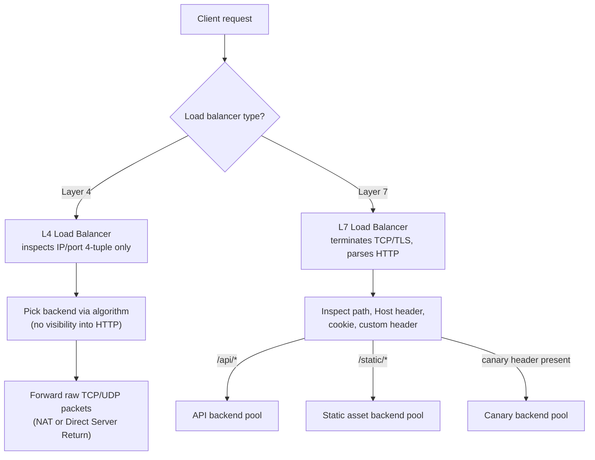

**Decision implications.** The choice between L4 and L7 is an architectural
trade-off, not a preference:

- **Choose L4** when the protocol is not HTTP (raw TCP databases, custom
  binary protocols, some gRPC deployments that terminate TLS themselves), or
  when the workload is so latency- and throughput-sensitive that the extra
  CPU cost of terminating TLS and parsing HTTP at the load balancer is
  unacceptable — L4 load balancers can push millions of connections per
  second with minimal CPU because they never look past the packet header.
  L4 is also the correct choice when the backend needs to see the client's
  true source IP without header-based workarounds, since some L4 modes
  (particularly Direct Server Return) preserve this naturally.
- **Choose L7** whenever routing needs to depend on anything inside the
  request: path-based microservice routing, host-based multi-tenant routing,
  cookie-based session affinity, canary/blue-green traffic splitting by
  header, or Web Application Firewall (WAF) request inspection. L7 costs
  more per connection (TLS termination, HTTP parsing, and a second TCP
  connection to the backend for every client connection) but is what makes
  API Gateway-style architectures possible at all.
- A great many real production systems use **both**, layered: an L4 load
  balancer or network load balancer sits at the very edge (absorbing volume
  and DDoS load cheaply), forwarding to a tier of L7 load balancers/reverse
  proxies that do the content-aware routing — this is exactly the pattern
  [CH02_OSI_Model.md](CH02_OSI_Model.md#7-architecture-patterns) illustrated
  at a high level with its edge-router-to-L7-gateway diagram.

**Common failure mode.** Asking an L4 load balancer to make an L7 decision
by proxy — for example, trying to route based on source port ranges or
connection patterns as a substitute for real path-based routing — produces
fragile, unmaintainable configuration that breaks the moment traffic
patterns shift, and is a symptom that the architecture needs an L7 tier, not
a cleverer L4 hack.

**Concrete scenario.** A payments company runs a network load balancer (L4)
in front of an Envoy fleet (L7). The network load balancer's only job is to
spread millions of TLS connections per second across the Envoy instances
using nothing but the 4-tuple hash — cheap, fast, and stable per-connection.
Envoy then terminates TLS, parses the HTTP request, and routes `/v1/charges`
to the charges service and `/v1/refunds` to the refunds service, each with
its own health checks, retry policy, and circuit breaker. Neither tier could
do the other's job efficiently: the network load balancer at that packet
volume cannot afford to parse HTTP, and a single L7 tier alone would need
to handle raw connection volume that the L4 tier absorbs far more cheaply.

### 4.2 Load-balancing algorithms: round robin, least connections, and weighted variants

**Definition.** A load-balancing algorithm is the deterministic (or
pseudo-random) rule the load balancer applies, at either connection time
(L4) or request time (L7), to select which backend instance handles the
next unit of work. The algorithm is orthogonal to the L4/L7 choice — both
layers can use any of these algorithms — but the *frequency* of the
decision differs: L4 decides once per connection, L7 can decide once per
*request*, even across a single persistent connection carrying many HTTP/2
streams.

**Round robin.** The simplest algorithm: maintain an ordered list of
backends and hand out connections/requests to each in turn, wrapping back to
the start. It requires no state about backend load — only a rotating
pointer — which makes it trivial to implement and reason about.

- **Mechanism**: `backend[i % N]` for a monotonically increasing counter `i`.
- **When it's correct**: backends are homogeneous (same hardware, same
  capacity) and requests are roughly uniform in cost. This is the common
  case for stateless microservices with similar instance sizes.
- **Common failure mode**: if requests vary wildly in cost (some take 5ms,
  some take 5 seconds), round robin can pile several expensive requests onto
  the same backend by pure bad luck, while an idle backend sits waiting for
  its next turn — round robin has no feedback loop to correct for this.

**Least connections.** Route the next request to whichever backend
currently has the fewest active (in-flight) connections/requests.

- **Mechanism**: the load balancer must track, in real time, how many
  requests are currently outstanding to each backend, incrementing on
  dispatch and decrementing on completion.
- **When it's correct**: request cost varies significantly, or backends
  have heterogeneous capacity combined with weighting (see below) — least
  connections naturally self-balances load away from a backend that is
  slow to finish its current work, which round robin cannot do.
- **Common failure mode**: a backend that has just come back online after
  a restart has zero active connections and looks maximally attractive to
  the algorithm, so it can be flooded with a "thundering herd" of new
  requests the instant it rejoins the pool, before its caches/connection
  pools/Just-In-Time (JIT) compiler have warmed up — this is why production
  systems pair least connections with a slow-start ramp (Section 8).

**Weighted round robin / weighted least connections.** Both of the above
algorithms can be extended with a per-backend weight, so that a backend
with weight 3 receives three times the traffic of a backend with weight 1
in the same window.

- **Mechanism**: for weighted round robin, a common implementation is a
  smooth weighted round-robin scheduler (used by nginx and LVS) that
  interleaves selections proportionally rather than sending three requests
  in a row to the heavy backend, which would create momentary bursts;
  for weighted least connections, the comparison becomes
  `active_connections / weight` rather than raw connection count.
- **When it's correct**: heterogeneous backend hardware (a mixed fleet of
  old and new instance types during a rolling hardware upgrade), or
  deliberate traffic shaping such as canary deployments where you want 5%
  of traffic on the new version and 95% on the old.
- **Common failure mode**: weights set once and never revisited as
  instance types or traffic patterns change, silently under- or
  over-loading part of the fleet for months.

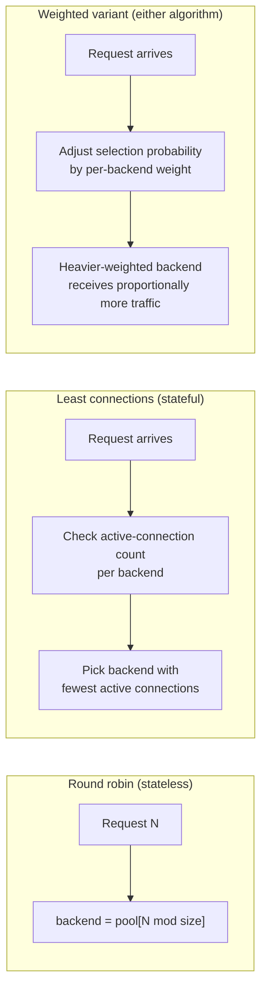

**Random and power-of-two-choices.** Two further algorithms deserve mention
because they trade a small amount of coordination overhead for much better
tail-latency behavior at scale: **random selection** picks a backend
uniformly at random per request — surprisingly effective at high request
volume because the law of large numbers smooths out imbalance without any
shared state at all — and **power of two choices** (used internally by many
modern L7 proxies including Envoy) picks two backends at random and then
routes to whichever of the two currently has fewer active connections. This
gets most of least-connections' load-awareness benefit with far less
coordination overhead than tracking global connection counts precisely
across a large, horizontally-scaled load-balancer tier.

**Decision heuristic a practitioner can apply**: start with round robin for
homogeneous, low-variance workloads; move to least connections (or power of
two choices) the moment request cost variance or backend heterogeneity
becomes visible in your latency distributions; add weights only when you
have a concrete, measured reason (mixed instance types, deliberate canary
percentage) rather than as a default.

### 4.3 Consistent hashing

**Definition.** Consistent hashing is a hashing scheme designed so that
adding or removing a backend from the pool remaps only a small, predictable
fraction of keys to a different backend — as opposed to naive modulo
hashing (`hash(key) % N`), where changing `N` (the number of backends)
remaps *almost every* key, because the modulus itself changed.

**Mechanism.** Both backends and request keys (a client IP, a session ID, a
cache key) are hashed onto the same fixed-size numeric ring (commonly
0 to 2^32-1). A request is routed to the first backend found by walking
clockwise around the ring from the request key's hash position. When a
backend is added, it only "steals" the portion of the ring between itself
and the previous backend going counter-clockwise — every other key's
assignment is untouched. When a backend is removed, only the keys that were
assigned to it fall through to the next backend clockwise; nothing else
moves.

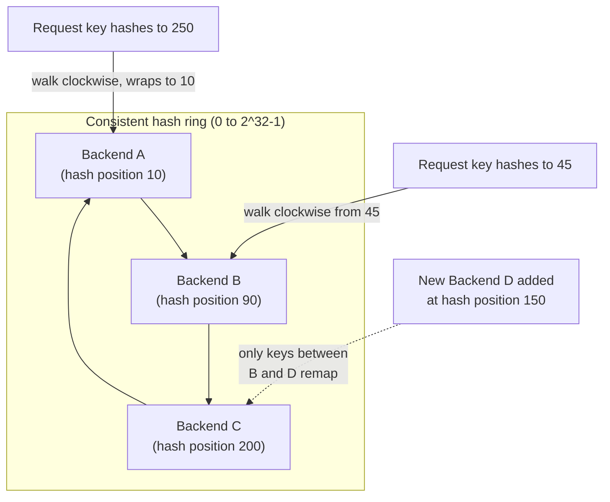

Because a single physical backend maps to only one point on the ring, real
implementations assign each backend *multiple* points ("virtual nodes," a
few hundred per backend is typical) to smooth out the otherwise-lumpy
distribution that a small number of ring points would produce — without
virtual nodes, a backend could by chance own a disproportionately large or
small arc of the ring.

**Decision implications — when consistent hashing is architecturally
correct.** Consistent hashing matters specifically when the *identity of the
backend a given key lands on* needs to stay stable across pool membership
changes:

- **Caching layers** (routing a cache key consistently to the same cache
  node) — without consistent hashing, every scale-up/scale-down event would
  invalidate almost the entire cache's effective hit rate simultaneously,
  because modulo hashing reshuffles nearly every key.
- **Session affinity without a shared session store** (Section 4.5) — an
  IP-hash or session-ID-hash based affinity scheme built on modulo hashing
  falls apart the moment the backend pool resizes; consistent hashing keeps
  the overwhelming majority of sessions pinned to the same backend even as
  instances are added or removed.
- **Sharded stateful services** where a client must always reach the shard
  holding its data, and the shard topology changes over time as the fleet
  scales.

Consistent hashing is *not* the right tool when backends are fully stateless
and interchangeable and you have no per-key affinity requirement at all — in
that case, plain round robin or least connections is simpler, easier to
reason about, and does not carry the ring-imbalance and virtual-node tuning
overhead consistent hashing adds for no benefit.

**Common failure mode.** Choosing consistent hashing but forgetting virtual
nodes (or setting too few) produces a "hot backend" problem: one physical
backend randomly owns a much larger arc of the ring than its peers and
receives a disproportionate share of traffic — a subtle imbalance that looks
like a totally different problem (a slow or undersized instance) until
someone plots the actual key distribution against ring position.

### 4.4 Health-checking architecture: active vs. passive checks

**Definition.** Health checking is the mechanism by which a load balancer
determines whether a backend instance is currently able to correctly serve
traffic, and removes (or "drains," Section 4.8) instances that fail that
determination from the eligible pool.

**Active health checks.** The load balancer, independent of any real client
traffic, periodically sends its own synthetic request to each backend — a
TCP connect attempt (L4), an HTTP `GET /healthz` (L7), or a protocol-specific
probe — and marks the backend unhealthy if the response fails, times out, or
returns a non-success status a configured number of times in a row.

**Passive health checks.** Instead of (or in addition to) synthetic probes,
the load balancer observes *real* client traffic outcomes — connection
failures, timeouts, or a run of 5xx responses on actual requests routed to a
backend — and ejects the backend from the pool based on that observed
failure rate, without ever sending a dedicated probe.

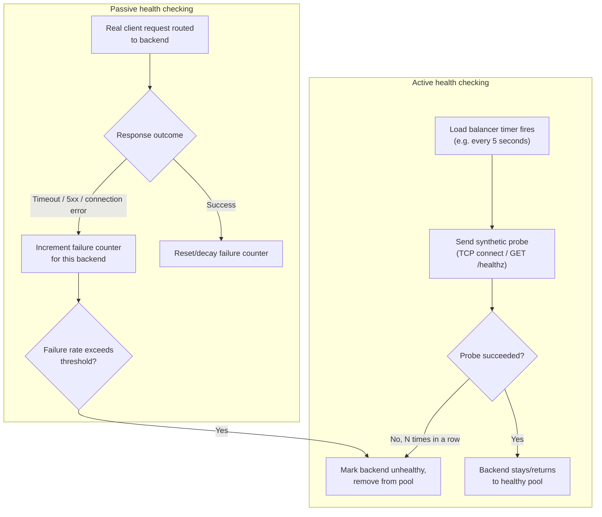

**Failure-detection-speed vs. false-positive-rate trade-off.** This is the
central engineering tension in health-check design, and every configuration
knob in a real health-check config exists to tune this one trade-off:

- **Faster detection** (short check interval, low failure-count threshold,
  e.g. "unhealthy after 2 consecutive failures every 2 seconds") means a
  genuinely broken backend is ejected from the pool quickly, minimizing the
  number of real client requests that hit a dead instance — but it also
  means a backend experiencing a brief, self-recovering blip (a garbage
  collection pause, a momentary network hiccup, a slow but not failed
  database query) gets ejected for a problem that would have resolved
  itself, needlessly reducing effective capacity and causing unnecessary
  connection churn as the instance is repeatedly ejected and re-admitted.
- **Slower, more tolerant detection** (longer interval, higher failure-count
  threshold, e.g. "unhealthy after 5 consecutive failures every 10 seconds")
  reduces false positives — transient blips are tolerated and the backend
  is never ejected for something that self-heals — but it means a *truly*
  broken backend keeps receiving live traffic for longer, and every request
  routed to it during that window either fails outright or, worse, hangs
  until a client-side timeout fires.

There is no setting that minimizes both simultaneously; a Solution Architect
must pick a point on this curve deliberately, based on how expensive a false
positive is (wasted capacity, connection churn) versus how expensive a false
negative is (real user requests failing against a known-bad instance) for
the specific workload. A payments checkout flow, where a single failed
request has direct revenue and trust cost, typically justifies a more
aggressive (faster-detecting, more false-positive-tolerant) configuration
than an internal batch-processing pipeline that can absorb an occasional
retried request.

**Active vs. passive as complements, not alternatives.** Active checks catch
a backend that is down but *not currently receiving traffic* (important
right after a deploy, before real requests are routed there) — passive
checks cannot see a problem on a backend nothing is currently calling.
Passive checks catch failure modes that only manifest under real traffic
shape (a backend that handles simple health-check `GET`s fine but fails on
a specific, complex, real endpoint) — a shallow active health check would
never notice this. Production load-balancer configurations almost always run
both together.

**Common failure mode — the "always green" health check.** A health-check
endpoint that only verifies the web server process is running (returns
`200 OK` unconditionally) without checking the dependencies the real
request path needs — a database connection pool, a downstream service, disk
space — will report the backend healthy right up until real requests start
failing against those broken dependencies. A correctly designed health
check exercises enough of the real request path to be a meaningful proxy
for "can this instance actually serve traffic," without being so heavy
(e.g. running a full end-to-end database write on every 2-second probe)
that the health check itself becomes a source of load.

### 4.5 Session affinity (sticky sessions): cookie-based vs. IP-hash, and the tension with stateless scaling

**Definition.** Session affinity (also called "sticky sessions") is a load
balancer configuration where, once a specific client is first routed to a
specific backend, subsequent requests from that same client are
deliberately routed to the *same* backend for the duration of a session,
rather than being distributed by the normal load-balancing algorithm.

**Mechanism — cookie-based affinity.** On the first request, the L7 load
balancer (this requires Layer 7 visibility, since it depends on parsing an
HTTP cookie) either observes an application-set session cookie or, more
commonly, injects its *own* cookie (e.g. HAProxy's `SRV` cookie or an AWS
ALB's `AWSALB` cookie) whose value identifies the chosen backend. On every
subsequent request, the load balancer reads that cookie and routes directly
to the named backend, bypassing the normal algorithm entirely, as long as
that backend is still healthy.

**Mechanism — IP-hash affinity.** At Layer 4 (where there is no HTTP cookie
to read), the load balancer instead hashes the client's source IP address
(sometimes combined with the source port, though that reduces stability
across a client's own connection churn) and uses that hash to consistently
select the same backend for that source IP, similar in spirit to the
consistent-hashing ring in Section 4.3 but applied specifically for
affinity rather than general key distribution.

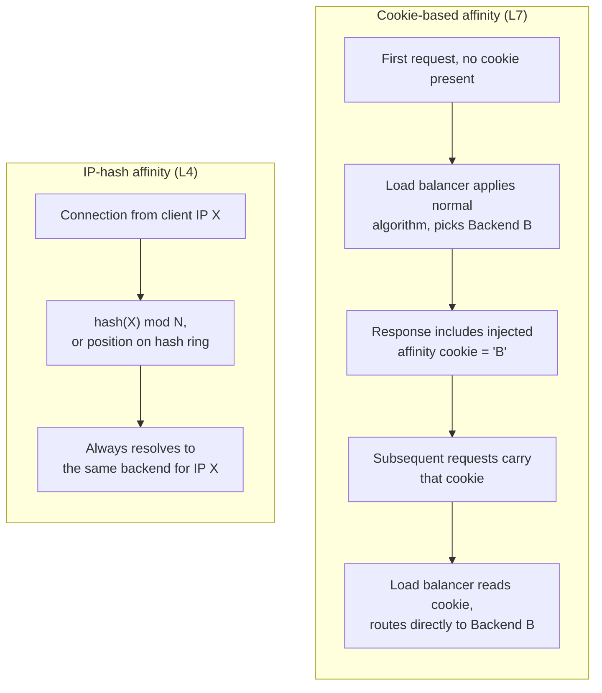

**Why sticky sessions exist.** Affinity is a workaround for backends that
hold session state *in local memory* — an in-process HTTP session object,
an in-memory shopping cart, a WebSocket connection's application-level
state — where losing affinity means the client's session data is simply not
present on whichever backend the normal algorithm happens to pick next.

**The architectural tension with stateless horizontal scaling.** This is the
concept the chapter must teach in full, because it is a recurring source of
production incidents and a genuine trade-off, not a solved problem:

- Horizontal scaling and rolling deployments assume that *any* backend
  instance can be added, removed, or restarted at any time without a client
  noticing anything beyond, at most, one retried request. Session affinity
  directly violates that assumption: if the one backend a client is pinned
  to is removed (scaled down, redeployed, or crashes), that client's
  in-memory session state is gone, and depending on the application, this
  can mean the user is silently logged out, loses an in-progress shopping
  cart, or gets an inconsistent view of application state.
- Affinity also actively fights load balancing's core purpose — even
  distribution of load. If session durations vary (some users browse for
  seconds, others stay logged in and active for hours), a backend that
  happens to accumulate several long-lived, active sessions becomes
  persistently hotter than its peers, and the load balancer cannot correct
  this by simply picking a different backend for those clients' *next*
  request, because affinity forces it not to.
- Affinity interacts badly with autoscaling: a newly added backend starts
  with zero pinned sessions and, until new clients arrive and get pinned to
  it, contributes nothing to relieving load from the already-hot existing
  backends holding all the established sessions.

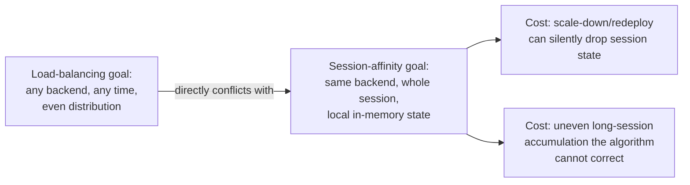

**The architecturally preferred resolution.** The recurring, correct fix
across this handbook's stateless-service guidance is to **externalize
session state** entirely — store session data in a shared, external store
(Redis, Memcached, a database) that every backend instance can read
regardless of which one a request lands on — and then let the load balancer
run with *no* affinity at all, free to distribute every request purely by
its normal algorithm. This fully resolves the tension by removing its root
cause (state living only on one instance) rather than papering over it with
stickier routing. Affinity should be treated as a tactical, temporary
workaround for legacy applications that cannot yet externalize session
state, not a default production pattern for new systems.

**Decision heuristic**: if you are designing a new service, default to no
affinity plus externalized session state. Only reach for cookie-based or
IP-hash affinity when you are fronting an existing application that
genuinely cannot be changed to externalize its session state in the current
project's timeframe, and even then, treat it as technical debt with an
explicit remediation plan, because every day it persists is a day your
scaling and deployment operations carry extra, avoidable risk.

### 4.6 Global Server Load Balancing (GSLB) and DNS-based traffic steering

**Recap (DNS mechanics owned by [CH08_DNS.md](CH08_DNS.md#4-core-concepts)):**
DNS resolves a hostname to one or more IP addresses, with a Time to Live
(TTL) controlling how long resolvers may cache that answer, and supports
geo-aware responses (returning different IP addresses depending on the
resolver's inferred location). This chapter does not re-teach zones,
resolvers, or record types — see CH08_DNS.md for that. What this chapter
teaches is GSLB itself: the practice of using that DNS-steering capability
as the entry point into a multi-region load-balancing architecture.

**Definition.** Global Server Load Balancing is the practice of directing
client traffic to one of several *regional* deployments — each of which has
its own local load balancer distributing traffic across that region's
backend instances — based on factors that a single, regional load balancer
cannot see: the client's geographic location, each region's current
capacity/health, and (in disaster-recovery configurations) which regions are
currently serving traffic at all.

**Mechanism.** A GSLB system sits logically above the regional load
balancers and answers DNS queries for a service's hostname dynamically,
rather than returning a fixed, static set of `A` records:

1. A client resolves `api.example.com`.
2. The GSLB-integrated DNS service (examples include AWS Route 53 with
   latency-based or geolocation routing policies, or a dedicated GSLB
   appliance/service) inspects the resolver's location, current health
   signals from each region's regional load balancer, and configured
   routing policy (latency-based, geographic, weighted, or failover).
3. It returns the IP address of the regional load balancer for whichever
   region that policy selects — commonly, "the healthy region with the
   lowest network latency to this resolver."
4. From that point forward, the client talks directly to that region's
   local load balancer, which then applies its own algorithm (Section 4.2)
   across that region's backend pool.

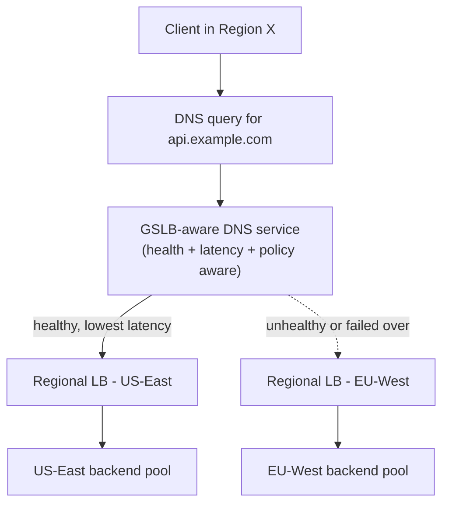

**Decision implications.** GSLB is architecturally correct when a service
must operate across multiple geographic regions for latency reasons (users
on different continents), regulatory data-residency reasons, or disaster
recovery (an entire region becoming unavailable must not take down the
whole service). It is unnecessary complexity for a single-region deployment,
where a regional load balancer alone is sufficient.

**The DNS TTL failure mode inherited from Section 4 of CH08_DNS.md.**
Because GSLB's mechanism *is* DNS, it inherits DNS's fundamental limitation:
a resolver that has already cached an answer will not re-query until that
answer's TTL expires, no matter how fast the GSLB layer detects a regional
failure. This is why GSLB deployments intentionally set short TTLs
(seconds, not hours) on the records involved, accepting slightly higher
query volume and slightly reduced cacheability in exchange for the ability
to redirect traffic away from a failed region within a bounded, predictable
window rather than waiting out a long-cached TTL. A GSLB failover plan that
does not account for this — assuming failover is instantaneous the moment
the GSLB layer flips its answer — will be surprised by clients continuing
to hit a dead region for the remainder of their cached TTL.

**Concrete scenario.** A global retailer runs regional deployments in
US-East, EU-West, and AP-Southeast, each behind its own regional load
balancer with independent health checks. Route 53 is configured with
latency-based routing plus a health check against each region's public
endpoint and a 30-second TTL. When AP-Southeast's regional load balancer
starts failing its own health check (perhaps because that region's entire
backend pool has gone unhealthy), Route 53 stops including AP-Southeast in
its answers within roughly one health-check interval, and clients resolving
fresh queries (or whose 30-second-old cached answer expires) are steered to
the next-lowest-latency healthy region instead — all without any change to
the application itself, entirely at the DNS/GSLB layer.

### 4.7 Load-balancer high availability: active-passive vs. active-active

**Definition.** Because every request to a system typically flows through
the load balancer, the load balancer itself is a natural single point of
failure unless it is deployed redundantly — this section teaches how to
avoid that outcome.

**Active-passive pairs.** Two (or more) load balancer instances are
deployed, but only one — the active — actually processes traffic at a
given time; the other, the passive/standby, sits idle, continuously
health-checking the active instance (commonly via a heartbeat protocol such
as Virtual Router Redundancy Protocol, VRRP, or a cloud provider's
equivalent), ready to take over the shared virtual IP address the moment the
active instance is detected as failed.

**Active-active pairs.** Two or more load balancer instances are deployed
and *all* of them actively process live traffic simultaneously, typically
with traffic distributed between them by an even earlier layer — for
example, Equal-Cost Multi-Path (ECMP) routing at the network layer, or
multiple DNS `A` records each pointing at a different load-balancer
instance, or (in cloud-managed services) the provider's own internal
redundancy hidden behind a single managed endpoint.

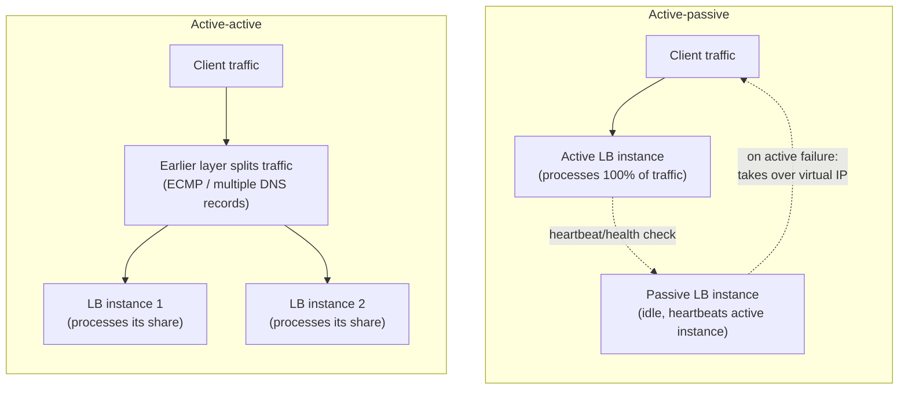

**Decision implications.** Active-passive is simpler to reason about — at
any moment exactly one instance owns the traffic and the failover state
machine is a binary switch — but it wastes the passive instance's capacity
entirely during normal operation, and the failover itself is not
instantaneous: detecting the active instance's failure and completing the
virtual-IP takeover takes some number of seconds, during which in-flight
connections are dropped and new connections may briefly fail. Active-active
uses all deployed capacity all the time and, because there is no single
"the" active instance, a single instance's failure only removes its share
of capacity rather than requiring a full failover event — but it requires
every active instance to have a consistent enough view of backend health
and (if applicable) session-affinity state that a client's requests being
spread across multiple load-balancer instances does not produce
inconsistent routing decisions.

**Avoiding the load balancer becoming a single point of failure.** The
underlying principle, regardless of active-passive or active-active choice,
is that no architecture should have exactly one load-balancer instance in
the request path with no redundancy plan — the same reasoning that applies
to backend instances applies recursively to the load balancer itself. In
practice this means: for self-managed software load balancers (HAProxy,
nginx, Envoy), always deploy at least two instances behind either a
keepalived/VRRP-managed virtual IP (active-passive) or an ECMP-capable
router/switch (active-active); for cloud-managed load balancers (AWS
ALB/NLB, Azure Load Balancer, Google Cloud Load Balancing), the redundancy
is typically handled by the provider across multiple availability zones as
part of the managed service, but the architect must still explicitly
configure the load balancer to span multiple availability zones rather than
pinning it to one, and must still verify the provider's Service Level
Agreement (SLA) and failure-domain boundaries rather than assuming
redundancy is automatic.

**Common failure mode.** Deploying a redundant load-balancer pair correctly
at the network layer, but forgetting that the redundancy is worthless if
both instances share a single upstream dependency that is itself a single
point of failure — a shared configuration database, a shared certificate
store, or (most commonly) both instances being deployed in the same single
availability zone or physical rack, so that the *infrastructure* failure
that takes down the "active" instance takes down the "passive" one at the
same time.

### 4.8 Connection draining and graceful deregistration

**Definition.** Connection draining (also called graceful deregistration or
graceful shutdown) is the process by which a load balancer stops sending
*new* connections/requests to a backend instance that is about to be
removed from the pool (for a deployment, a scale-down, or planned
maintenance), while allowing that instance's *already in-flight* requests to
complete normally before it is fully removed.

**Mechanism.** Without connection draining, removing a backend instance
from a load balancer's pool the instant a deployment begins would abruptly
terminate every request currently being processed by that instance,
producing visible errors for whichever clients happened to have a request
in flight at that exact moment. Connection draining instead follows a
timed sequence:

1. The instance is marked "draining" in the load balancer — it is
   immediately removed from consideration for *new* connections/requests,
   but existing connections are left alone.
2. The load balancer (or, for L7, sometimes the backend itself) waits up to
   a configured drain timeout for in-flight requests on that instance to
   finish naturally.
3. Once the drain timeout expires (or all in-flight requests have
   completed, whichever is first), the instance is fully deregistered and,
   if this is a deployment, can now be safely terminated.

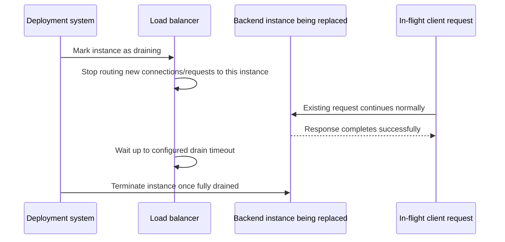

**Decision implications.** The drain timeout is itself a trade-off: too
short, and legitimately slow-but-healthy requests (a large file upload, a
long-running report generation call) are forcibly terminated mid-flight
anyway, producing the exact errors draining was meant to prevent; too long,
and deployments become slow, because the orchestrator must wait out the
full drain window for every instance being replaced before it can proceed
to the next batch — this matters especially for rolling deployments
replacing many instances in sequence. A practical heuristic is to set the
drain timeout comfortably above your service's observed p99 (99th
percentile) request duration, so that the overwhelming majority of in-flight
requests finish naturally well within the window, while accepting that a
small number of true outlier requests may still be cut off.

**Interaction with health checking (Sections 4.4).** A subtlety that
production incidents frequently expose: a backend instance can pass its
active health check right up until the moment it is asked to shut down, so
the deployment orchestrator and the load balancer must coordinate
explicitly — typically via a deregistration API call or a load-balancer
"drain" state — rather than relying on the health check alone to notice a
planned shutdown, because the health check's job is to detect *unplanned*
failure, not to serve as a deployment coordination signal.

**Common failure mode.** Terminating an instance immediately after removing
it from the load balancer's routing table, without waiting for the drain
timeout at all — a mistake that looks correct in testing (where there is
little to no real in-flight traffic) but causes a visible spike in client
errors during real production deployments, precisely when traffic is
non-trivial.

### 4.9 The hardware-to-software-to-cloud-managed evolution as an architectural decision

**Recap and synthesis.** Section 2 already narrated this evolution
historically; this subsection teaches it as a present-day *decision
framework* — which of the three tiers should a Solution Architect actually
choose for a new system, and why.

**Hardware appliances (F5, Citrix ADC, and similar).** Still deployed today,
primarily inside large enterprises with existing data-center investments,
strict compliance requirements around physical control of network
equipment, or workloads (very high-throughput Layer 4 forwarding, dedicated
crypto-offload hardware for TLS) where a purpose-built ASIC still
outperforms general-purpose CPUs running software. The cost is high
capital expenditure, vendor lock-in to that appliance's configuration
model, and a slower iteration cycle (changes typically go through a
network-operations team and a change-control process, rather than a
developer merging a configuration file).

**Software load balancers (HAProxy, nginx, Envoy).** The correct choice when
an organization needs full control over load-balancing behavior, wants
configuration to live in version control alongside application code, or is
running in an environment (on-premises Kubernetes, a private cloud, a
colocation facility without a managed load-balancer product) where a
managed cloud service is not available or not desired. The cost is that the
organization now owns the operational burden of that software's own
availability (Section 4.7), patching, and capacity planning — the software
load balancer is infrastructure the team must run, not consume as a service.

**Cloud-managed services (AWS ALB/NLB, Azure Load Balancer/Application
Gateway, Google Cloud Load Balancing).** The default choice for greenfield
systems running in a public cloud, because the provider handles the load
balancer's own high availability, patching, and (usually) automatic scaling
of the load-balancing layer itself — the concerns of Section 4.7 become the
provider's operational responsibility rather than the architecture team's.
The cost is reduced configurability (only the routing/health-check/TLS
features the provider's product exposes are available), a recurring
usage-based cost model instead of a fixed appliance/software cost, and a
degree of vendor lock-in to that provider's specific configuration and API
surface.

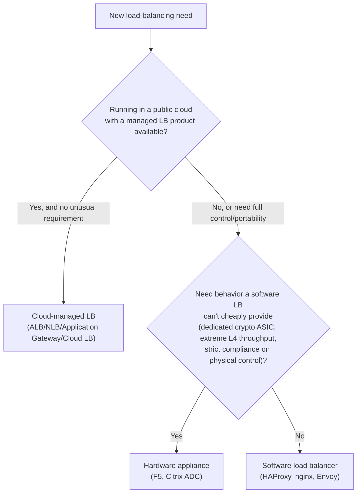

**Decision heuristic**: default to a cloud-managed service unless a
concrete, named requirement rules it out (on-premises/hybrid deployment,
a feature the managed product genuinely lacks, or a portability requirement
to avoid cloud-provider lock-in); reach for a software load balancer when
you need that control or portability and are willing to own its operational
lifecycle; reserve hardware appliances for organizations already invested in
that model or workloads with genuinely extreme, specialized throughput or
compliance requirements that neither of the other two tiers satisfies.

## 5. Internal Working

Tying Section 4's individual concepts together, here is the full request
lifecycle through a Layer 7 load balancer, from the moment a client's
request arrives to the moment the response is returned — the sequence that
every one of the mechanisms above actually participates in during normal
operation.

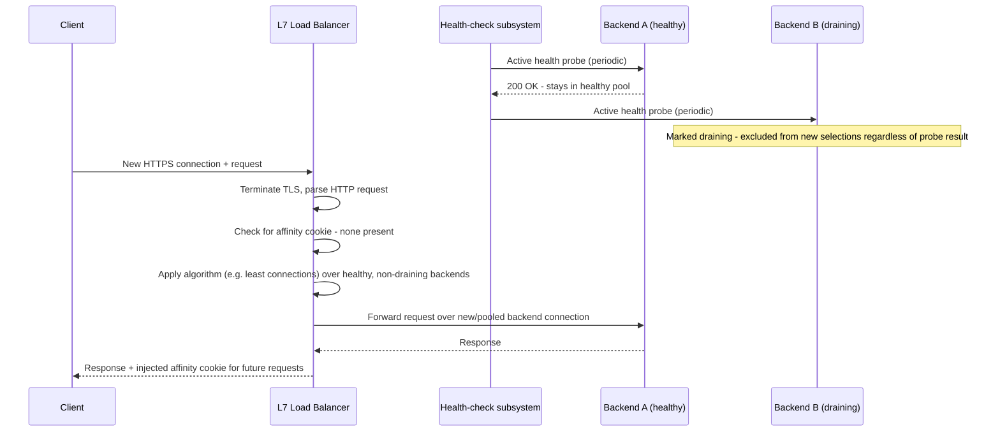

Every stage in this diagram maps directly to a Section 4 concept: TLS
termination and HTTP parsing is what makes this an L7 load balancer at all
(4.1); the algorithm selection step is 4.2 (and would be 4.3 if this were a
consistent-hashed cache-routing scenario); the health-check subsystem
running independently in the background is 4.4; the affinity-cookie check
and injection is 4.5; and Backend B being excluded despite still answering
health probes is 4.8's draining state taking precedence over raw health
status.

**Internal load-balancer software architecture.** Modern software load
balancers (nginx, HAProxy, Envoy) share a common internal shape: a small
number of worker processes or threads, each running an event loop (very
similar in spirit to the reactor-pattern event loops covered for Node.js in
[CH03_Nodejs.md](../03_Software_Engineering_Foundations/CH03_Nodejs.md)),
handling many thousands of concurrent connections without one
operating-system thread per connection. Configuration (the backend pool
list, health-check parameters, routing rules) is typically held in an
in-memory data structure that is updated either by a full process reload
(older nginx model) or, in modern implementations like Envoy, by a
dynamically-pushed configuration update via a discovery protocol (Envoy's
xDS APIs) that avoids dropping existing connections during a configuration
change — an important distinction for high-churn container environments
where the backend pool can change every few seconds as pods scale or
reschedule.

## 6. Design Principles

- **Push complexity into the load balancer, not into every client.** Health
  awareness, failover, and affinity logic belong at the load-balancing tier
  precisely once, not duplicated into every client or backend.
- **Prefer statelessness over affinity.** As taught in Section 4.5, design
  backends so the load balancer's job stays purely about distributing load,
  not about preserving per-client routing history.
- **Treat the load balancer as a first-class piece of infrastructure with
  its own availability requirements**, not an assumed-reliable given —
  Section 4.7's redundancy planning applies to it exactly as rigorously as
  to the backends it fronts.
- **Make health checks a true proxy for "can serve traffic," not merely
  "process is running."** A shallow health check produces false confidence
  that manifests as real client-facing errors.
- **Calibrate detection speed against failure cost explicitly** (Section
  4.4) rather than copying a default configuration value from documentation
  without considering the specific workload's tolerance for false positives
  versus false negatives.

## 7. Architecture Patterns

**Edge L4 + internal L7 tiering.** As introduced in Section 4.1's concrete
scenario, placing a network/L4 load balancer at the very edge (cheap,
high-throughput, DDoS-absorbing) in front of an L7 tier (Envoy, nginx, or a
managed Application Load Balancer) that does the content-aware routing is
one of the most common production topologies for high-traffic systems.

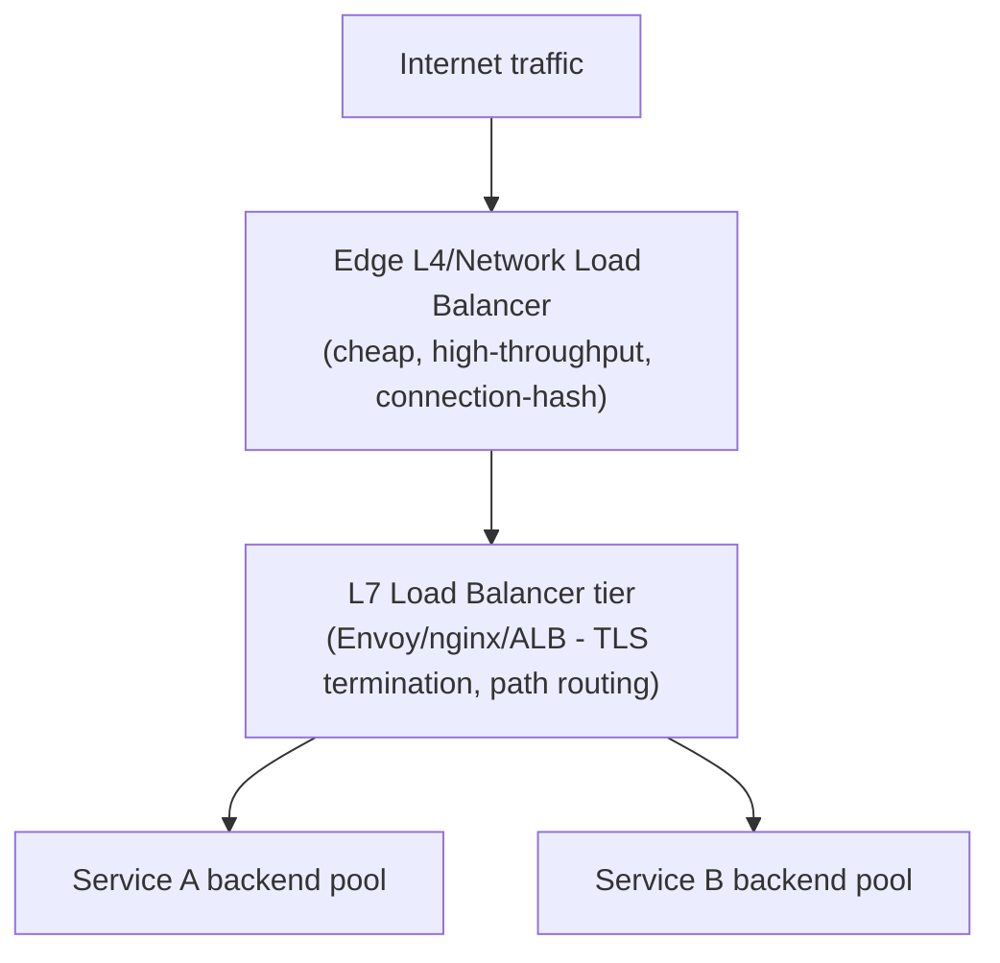

**Sidecar/service-mesh load balancing.** In a service mesh, every service
instance runs a local sidecar proxy (frequently Envoy) that performs
client-side load balancing across the *callee* service's instances,
discovered dynamically rather than through a centralized load balancer in
the traditional sense — this pushes the algorithm and health-check logic
(Sections 4.2 and 4.4) out to the edge of every calling service instead of
concentrating it in one tier, trading a single choke point for
per-service-instance intelligence and reduced hop count.

**API Gateway as an L7 load balancer with policy attached.** An API Gateway
(fully owned by the future API Architecture part of this handbook) is, at
its load-balancing core, an L7 load balancer with authentication, rate
limiting, and request/response transformation layered on top of the routing
decision described in Section 4.1 — this chapter owns the underlying
load-balancing mechanics that pattern builds on.

**Blue-green and canary deployment via weighted routing.** Section 4.2's
weighted algorithms are the direct mechanism underneath blue-green
deployments (100%/0% weight split that flips atomically) and canary
deployments (a small, deliberately weighted percentage, e.g. 5%/95%, shifted
gradually as confidence in the new version grows).

## 8. Production Architecture

A production load-balancer deployment is rarely a single instance; it is a
layered system with explicit redundancy, capacity headroom, and slow-start
behavior for newly added backends.

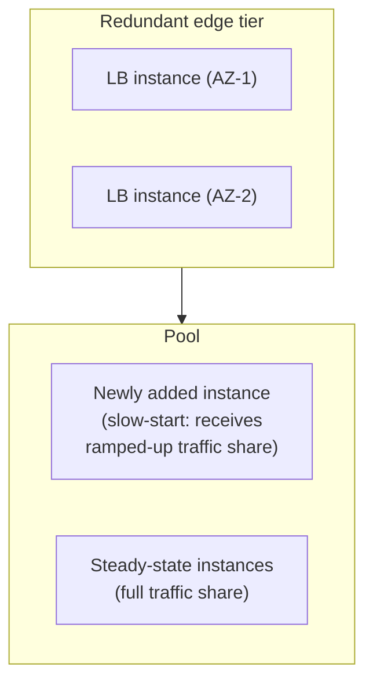

**Slow start for newly added backends.** As flagged in Section 4.2's least
connections failure mode, a backend that just joined the pool with zero
active connections looks maximally attractive to a naive algorithm and can
be flooded before it is warmed up (JIT compilation, connection pools, local
caches). Production load balancers (HAProxy's `slowstart`, similar features
in cloud ALBs) address this by ramping a new backend's effective weight
from near-zero up to its full target weight over a configured window,
giving the instance time to warm up under gradually increasing load rather
than a step-function full share on arrival.

**Capacity headroom and N+1 (or N+2) redundancy.** A production pool should
be sized so that losing at least one — often two, for maintenance overlap —
backend instances (or, at the load-balancer tier itself, one load-balancer
instance) still leaves enough capacity to serve current traffic without
overload; sizing a pool to exactly current peak demand across all instances
removes the safety margin the whole architecture depends on during a
partial failure.

## 9. Implementation

Implementing a load-balancing tier means choosing a point on the Section
4.9 hardware/software/cloud spectrum, then configuring: the backend pool
(static list or dynamic service discovery), the algorithm (Section 4.2), the
health-check parameters (Section 4.4), TLS termination if operating at L7,
and (if needed) affinity and connection-draining behavior. The three worked
configuration examples in Section 10 show this concretely for HAProxy
(software, L4/L7 capable), nginx (software, L7), and a cloud-managed
service's health-check configuration expressed as Infrastructure as Code.

**Service discovery integration.** In container/orchestrator environments
(Kubernetes, ECS), the backend pool is rarely a static list — it must be
kept in sync with the orchestrator's own view of which pod/task IP addresses
are currently running and ready. This is typically implemented either by
the orchestrator's built-in controller directly programming a cloud load
balancer's target group (e.g. the AWS Load Balancer Controller for
Kubernetes) or by a dynamic discovery protocol (Envoy's xDS, Consul) pushing
pool membership changes to the load balancer without a full reload.

## 10. Complete Code Examples

**Example 1 — HAProxy configuration** demonstrating L7 path-based routing,
weighted least-connections balancing, active health checks tuned for the
detection-speed/false-positive trade-off (Section 4.4), cookie-based
affinity (Section 4.5), and slow-start for newly added backends (Section 8):

```
# /etc/haproxy/haproxy.cfg
global
    maxconn 50000
    log stdout format raw local0

defaults
    mode http
    timeout connect 5s
    timeout client  30s
    timeout server  30s
    option httplog

frontend public_https
    bind *:443 ssl crt /etc/haproxy/certs/example.com.pem
    # Layer 7 path-based routing decision (Section 4.1)
    acl is_api path_beg /api
    acl is_static path_beg /static
    use_backend api_pool if is_api
    use_backend static_pool if is_static
    default_backend web_pool

backend api_pool
    balance leastconn
    # Cookie-based session affinity (Section 4.5) - SRV cookie names the backend
    cookie SRV insert indirect nocache
    # Active health check: 2 consecutive failures/successes at 2s interval
    # (fast-detecting, tuned for a customer-facing API - Section 4.4 trade-off)
    option httpchk GET /healthz
    http-check expect status 200
    default-server inter 2s fall 2 rise 2 slowstart 30s
    server api1 10.0.1.11:8080 check cookie api1 weight 100
    server api2 10.0.1.12:8080 check cookie api2 weight 100
    server api3 10.0.1.13:8080 check cookie api3 weight 50

backend static_pool
    balance roundrobin
    option httpchk GET /healthz
    default-server inter 5s fall 3 rise 2
    server static1 10.0.2.11:8080 check
    server static2 10.0.2.12:8080 check

backend web_pool
    balance leastconn
    option httpchk GET /healthz
    default-server inter 3s fall 2 rise 2
    server web1 10.0.3.11:8080 check
    server web2 10.0.3.12:8080 check
```

**Example 2 — nginx upstream configuration** demonstrating weighted
round-robin with the `least_conn` directive, an alternative IP-hash affinity
block for a legacy backend, and passive health checking via
`max_fails`/`fail_timeout` (Section 4.4):

```nginx
# /etc/nginx/conf.d/upstreams.conf

upstream api_pool {
    least_conn;
    # Passive health check: 3 failures within 10s ejects the server (Section 4.4)
    server 10.0.1.11:8080 weight=2 max_fails=3 fail_timeout=10s;
    server 10.0.1.12:8080 weight=2 max_fails=3 fail_timeout=10s;
    server 10.0.1.13:8080 weight=1 max_fails=3 fail_timeout=10s;
    server 10.0.1.14:8080 backup;  # only used if all primaries are down
}

# Legacy backend that still relies on in-memory session state (Section 4.5) -
# IP-hash affinity used deliberately as a tactical workaround, not a default
upstream legacy_session_pool {
    ip_hash;
    server 10.0.4.11:8080 max_fails=2 fail_timeout=5s;
    server 10.0.4.12:8080 max_fails=2 fail_timeout=5s;
}

server {
    listen 443 ssl http2;
    server_name api.example.com;
    ssl_certificate     /etc/nginx/certs/example.com.pem;
    ssl_certificate_key /etc/nginx/certs/example.com.key;

    location /api/ {
        proxy_pass http://api_pool;
        proxy_set_header Host $host;
        proxy_set_header X-Real-IP $remote_addr;
        proxy_connect_timeout 3s;
        proxy_read_timeout 30s;
    }

    location /legacy/ {
        proxy_pass http://legacy_session_pool;
        proxy_set_header Host $host;
    }
}
```

**Example 3 — cloud load balancer health-check configuration** (AWS
Application Load Balancer target group, expressed as Terraform), showing
the same detection-speed/false-positive tuning as a managed-service
equivalent of Example 1's HAProxy check, plus connection draining
(Section 4.8) via the deregistration delay:

```hcl
resource "aws_lb_target_group" "api_pool" {
  name        = "api-pool-tg"
  port        = 8080
  protocol    = "HTTP"
  vpc_id      = var.vpc_id
  target_type = "instance"

  health_check {
    enabled             = true
    path                = "/healthz"
    protocol            = "HTTP"
    port                = "traffic-port"
    interval            = 10   # seconds between checks
    timeout             = 5    # seconds before a check counts as failed
    healthy_threshold   = 2    # consecutive successes to mark healthy
    unhealthy_threshold = 2    # consecutive failures to mark unhealthy
    matcher             = "200"
  }

  # Connection draining (Section 4.8): allow up to 45s for in-flight
  # requests to finish before an instance is fully deregistered
  deregistration_delay = 45

  stickiness {
    enabled         = true
    type            = "lb_cookie"
    cookie_duration = 3600
  }
}

resource "aws_lb_listener_rule" "api_routing" {
  listener_arn = var.https_listener_arn
  priority     = 10

  action {
    type             = "forward"
    target_group_arn = aws_lb_target_group.api_pool.arn
  }

  condition {
    path_pattern {
      values = ["/api/*"]
    }
  }
}
```

**Example 4 — algorithm reference implementation** in Python, illustrating
the mechanics of weighted round robin and consistent hashing (Sections 4.2
and 4.3) explicitly enough to teach the underlying logic rather than treat
either as a black box:

```python
import hashlib
import bisect
from itertools import count


class SmoothWeightedRoundRobin:
    """Interleaves selections proportional to weight, avoiding bursts
    (Section 4.2) - based on the algorithm used by nginx and LVS."""

    def __init__(self, backends: dict[str, int]):
        # backends: name -> weight
        self._state = {name: {"weight": w, "current": 0} for name, w in backends.items()}
        self._total_weight = sum(backends.values())

    def next_backend(self) -> str:
        for entry in self._state.values():
            entry["current"] += entry["weight"]
        chosen_name = max(self._state, key=lambda n: self._state[n]["current"])
        self._state[chosen_name]["current"] -= self._total_weight
        return chosen_name


class ConsistentHashRing:
    """Ring-based consistent hashing with virtual nodes (Section 4.3) -
    adding/removing a backend remaps only the keys near it on the ring."""

    def __init__(self, backends: list[str], virtual_nodes: int = 150):
        self._virtual_nodes = virtual_nodes
        self._ring: dict[int, str] = {}
        self._sorted_hashes: list[int] = []
        for backend in backends:
            self.add_backend(backend)

    def _hash(self, key: str) -> int:
        return int(hashlib.md5(key.encode()).hexdigest(), 16)

    def add_backend(self, backend: str) -> None:
        for i in range(self._virtual_nodes):
            point = self._hash(f"{backend}#{i}")
            self._ring[point] = backend
            bisect.insort(self._sorted_hashes, point)

    def remove_backend(self, backend: str) -> None:
        for i in range(self._virtual_nodes):
            point = self._hash(f"{backend}#{i}")
            self._ring.pop(point, None)
            idx = bisect.bisect_left(self._sorted_hashes, point)
            if idx < len(self._sorted_hashes) and self._sorted_hashes[idx] == point:
                self._sorted_hashes.pop(idx)

    def get_backend(self, key: str) -> str:
        if not self._ring:
            raise RuntimeError("No backends available in ring")
        point = self._hash(key)
        idx = bisect.bisect(self._sorted_hashes, point) % len(self._sorted_hashes)
        return self._ring[self._sorted_hashes[idx]]
```

## 11. Performance

Load-balancer performance is measured along three axes that trade off
against each other: **connections/requests per second** (raw throughput
capacity), **added latency** (the extra hop and, at L7, TLS termination and
HTTP parsing cost the load balancer itself adds to every request), and
**connection setup overhead** (each new TCP connection, and doubly each new
TLS handshake, is comparatively expensive relative to reusing an existing
persistent connection). L4 load balancers minimize added latency and
maximize throughput at the cost of routing intelligence (Section 4.1);
enabling connection reuse/keep-alive between the load balancer and backend
instances (rather than opening a fresh backend connection per client
request) is one of the highest-leverage L7 performance optimizations,
because it amortizes TCP/TLS setup cost across many requests instead of
paying it every time. Health-check frequency (Section 4.4) also has a
direct, if usually small, performance cost: very short check intervals
across a very large backend fleet can themselves become a meaningful
fraction of a backend's total incoming request volume if not accounted for
in capacity planning.

## 12. Scalability

The load-balancing tier must scale on two independent dimensions: the
**backend pool** it fronts (Sections 4.2-4.3 cover how traffic is
distributed as that pool grows or shrinks) and the **load-balancer tier
itself** (Section 4.7's active-active pattern is the direct mechanism for
scaling the load balancer's own capacity horizontally, since active-passive
by definition only ever uses one instance's capacity at a time). Cloud-
managed load balancers (Section 4.9) are specifically valuable here because
the provider handles this second dimension's scaling automatically; a
self-managed software load-balancer fleet must have its own scale-out plan
(more HAProxy/nginx/Envoy instances behind an ECMP or DNS-based
active-active scheme) reviewed on the same cadence as backend capacity
planning, not as an afterthought.

## 13. Security

- **TLS termination as a concentrated attack surface.** An L7 load
  balancer terminating TLS for an entire fleet concentrates private-key
  material and cipher/protocol configuration in one place — this is
  operationally convenient (one place to patch/rotate/upgrade instead of
  every backend) but also means a misconfiguration there (an outdated TLS
  version, a weak cipher suite — full mechanics owned by
  [CH06_TLS.md](CH06_TLS.md)) affects every client at once.
- **Health-check endpoints as an unauthenticated surface.** A `/healthz`
  endpoint is, by necessity, reachable without authentication so the load
  balancer can call it — this must be deliberately scoped to reveal nothing
  beyond a boolean health signal (no internal diagnostics, stack traces, or
  configuration details) and, where possible, restricted at the network
  layer to only the load balancer's own source IP addresses.
- **Web Application Firewall (WAF) placement.** An L7 load balancer is the
  natural place to attach WAF request inspection, because it is the one
  point every request must pass through before reaching any backend — but
  a WAF at this layer is not a substitute for backend-side input
  validation and authorization (the Layer 7 security control referenced in
  [CH02_OSI_Model.md](CH02_OSI_Model.md#13-security)'s defense-in-depth
  diagram); it is one layer in a defense-in-depth stack, not the whole
  stack.
- **Affinity cookies must not leak routing or session information usable
  for session fixation or backend fingerprinting** — an affinity cookie
  value should be an opaque identifier, not a directly readable backend
  hostname or internal IP address.

## 14. Observability

A load-balancing tier's key operational signals are: **per-backend request
rate and error rate** (to detect the uneven-distribution failure modes
described in Sections 4.2 and 4.5), **health-check pass/fail transitions
per backend** (to distinguish a flapping backend, one repeatedly toggling
healthy/unhealthy, from a cleanly failed one — flapping is itself a signal
worth alerting on separately, since it often indicates a false-positive
threshold set too aggressively per Section 4.4), **connection/request
latency percentiles measured at the load balancer** (distinguishing latency
added by the load balancer itself from latency inherent to the backend),
and **active connection/drain-state counts** (to verify Section 4.8's
draining behavior is completing within its configured timeout in practice,
not just in configuration).

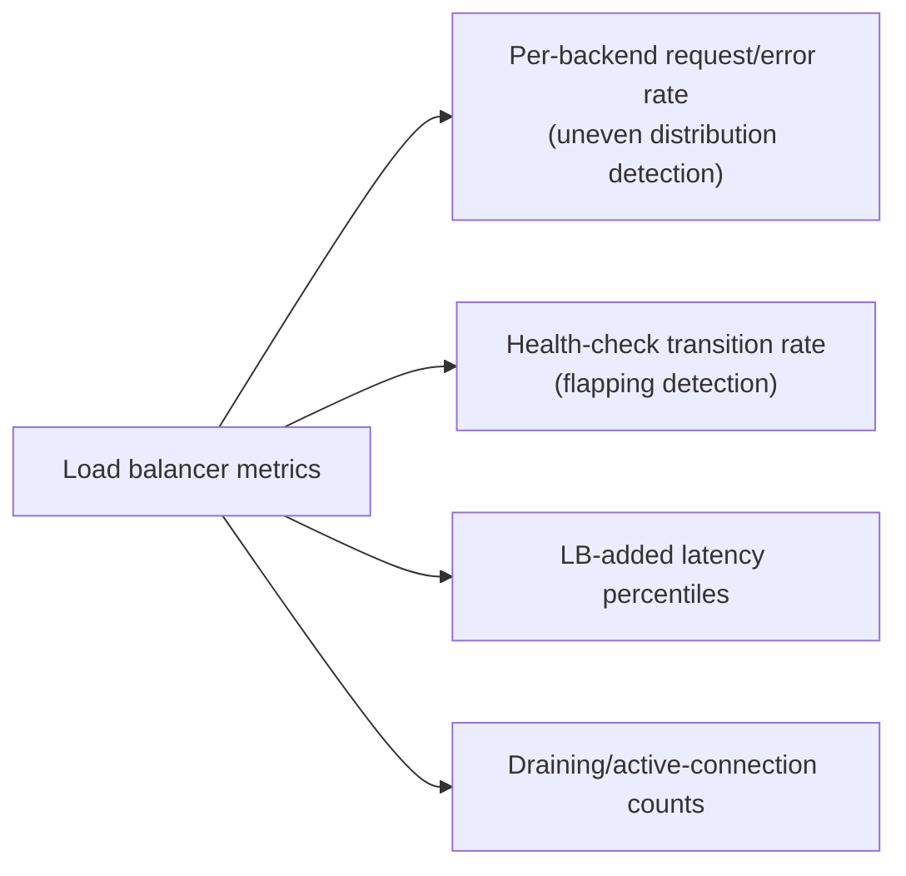

## 15. Failure Scenarios

- **The load balancer itself becomes the single point of failure**
  (Section 4.7's central concern) — no redundancy, or redundant instances
  sharing a hidden common dependency.
- **Slow-start missing, thundering herd on a newly added backend**
  (Section 4.2/Section 8) — a fresh instance immediately receives a full
  share of least-connections traffic before it has warmed up, and falls
  over under that unexpected load, which can trigger its health check to
  fail, removing it again — an oscillating failure loop.
- **Health check false negative** — an overly tolerant threshold
  (Section 4.4) leaves a genuinely broken backend serving live traffic for
  an extended window, producing a steady trickle of real client-facing
  errors that is harder to notice than a hard outage.
- **Cascading failure from lost affinity** (Section 4.5) — a backend
  holding many pinned sessions is removed (deploy, crash), and every one of
  those sessions' next requests lands on a different, unprepared backend
  simultaneously, producing a load spike correlated with the removal event
  rather than smoothly distributed over time.
- **GSLB TTL-related stale routing** (Section 4.6) — clients continuing to
  reach a failed region until their cached DNS answer's TTL expires.

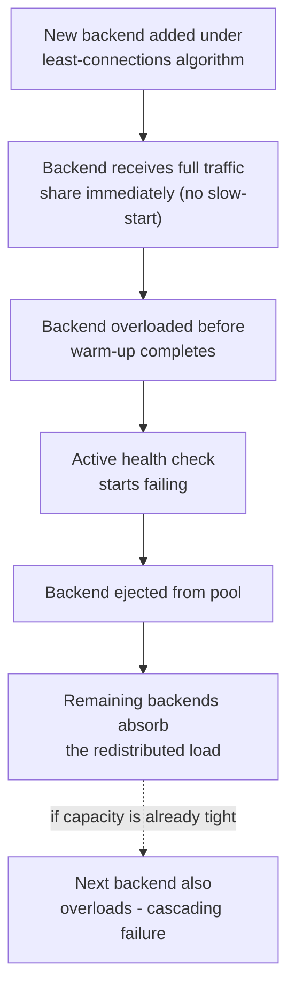

## 16. Testing

- **Health-check unit testing**: verify the health-check endpoint itself
  correctly reflects dependency failures (Section 4.4's "always green"
  failure mode), not merely process liveness.
- **Failover drills**: deliberately fail the active load-balancer instance
  in an active-passive pair (Section 4.7) and measure actual failover time
  against the assumed Recovery Time Objective.
- **Draining verification under load**: deploy while generating
  intentionally long-running synthetic requests and confirm none are
  abruptly terminated within the configured drain timeout (Section 4.8).
- **Algorithm distribution testing**: generate synthetic traffic against a
  test pool and verify the observed request distribution matches the
  configured algorithm and weights (Section 4.2) — a silent misconfiguration
  here (e.g. a weight typo) can go unnoticed for a long time without this
  check.
- **Chaos testing for uneven backend removal**: remove a backend holding
  known session affinity (Section 4.5) under synthetic load and confirm the
  application's behavior (session loss handling) matches expectations
  rather than producing unhandled errors.

## 17. Common Mistakes

- Treating session affinity as a default rather than a tactical workaround
  (Section 4.5), locking a system into the stateless-scaling tension
  indefinitely.
- Configuring health checks that only verify process liveness, not real
  dependency health (Section 4.4).
- Omitting slow-start for newly added backends under least-connections
  balancing (Section 4.2/8), inviting thundering-herd failures.
- Deploying a single load-balancer instance with no redundancy plan
  (Section 4.7), recreating the exact single point of failure the load
  balancer was introduced to remove from the backend tier.
- Setting a drain timeout shorter than the service's real p99 request
  duration (Section 4.8), causing legitimate slow requests to be cut off
  during every deployment.
- Assuming GSLB failover is instantaneous without accounting for DNS TTL
  propagation delay (Section 4.6).

## 18. Best Practices

- Externalize session state and run with no affinity by default
  (Section 4.5); reserve affinity for legacy systems with an explicit
  remediation plan.
- Pair active and passive health checks together (Section 4.4) rather than
  relying on either alone.
- Explicitly tune the failure-detection-speed vs. false-positive-rate
  trade-off (Section 4.4) per workload, rather than accepting a default.
- Deploy the load-balancing tier itself redundantly, in active-active where
  practical (Section 4.7), across independent failure domains.
- Set drain timeouts based on measured p99 request duration, and verify the
  behavior under real deployment load (Sections 4.8, 16).
- Default to a cloud-managed load balancer unless a specific, named
  requirement rules it out (Section 4.9).

## 19. Anti-Patterns

- **DNS round robin as a substitute for real health-aware load balancing**
  (Section 2) — no failure detection, minutes-long stale routing on
  backend failure.
- **IP-hash affinity as a permanent architecture decision** rather than a
  temporary bridge to externalized session state (Section 4.5).
- **A single load balancer instance in production** with no redundancy
  (Section 4.7).
- **Health checks that hit a heavyweight endpoint** (a full database write
  on every probe) turning the health check itself into a load-generation
  problem (Section 4.4).
- **Weight values set once at initial launch and never revisited** as
  instance types, traffic patterns, or fleet composition change
  (Section 4.2).

## 20. Trade-off Analysis

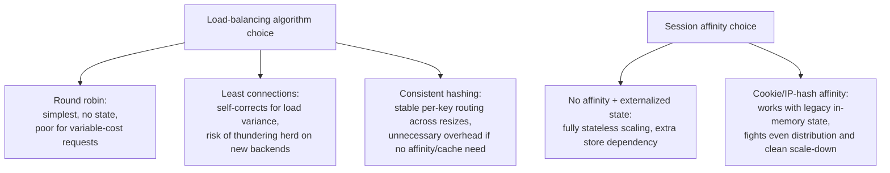

The recurring shape of every trade-off in this chapter is the same:
mechanisms that add intelligence or stickiness (least connections, weighted
routing, consistent hashing, session affinity) buy better behavior under a
specific real-world condition, at the direct cost of more internal state
the load balancer (or the architecture as a whole) must maintain correctly
— and every one of those costs resurfaces specifically at the moment the
backend pool changes (scale-up, scale-down, deploy, failure), which is
exactly when correctness matters most.

## 21. Comparison Table

| Dimension | Layer 4 | Layer 7 |
|---|---|---|
| Visibility | IP/port 4-tuple only | Full parsed HTTP request |
| Routing granularity | Per-connection | Per-request (even within one persistent connection) |
| Throughput/CPU cost | Lower — no payload parsing | Higher — TLS termination + HTTP parsing |
| Content-based routing (path/header/cookie) | Not possible | Native capability |
| Typical use | Raw TCP/UDP, extreme-throughput edge tier | HTTP/gRPC microservice routing, API gateways |

| Algorithm | State required | Best suited for |
|---|---|---|
| Round robin | None | Homogeneous backends, uniform request cost |
| Least connections | Per-backend active count | Variable request cost, heterogeneous load |
| Weighted round robin/least connections | Per-backend weight + count | Mixed instance sizes, canary/blue-green traffic splits |
| Consistent hashing | Ring position, virtual nodes | Cache routing, affinity without a shared store, stable sharding |

| Deployment tier | Control | Operational ownership | Typical use |
|---|---|---|---|
| Hardware appliance | Vendor configuration model | Network operations team, physical hardware | Enterprises with existing data-center investment, extreme-throughput/compliance needs |
| Software load balancer | Full, version-controlled config | Your own team owns availability/patching | On-premises, hybrid, portability requirements |
| Cloud-managed service | Provider's exposed feature set | Provider owns availability/scaling | Default choice for greenfield cloud-native systems |

## 22. Real-World Case Study

A mid-sized e-commerce company runs its checkout flow behind a single
regional AWS Application Load Balancer, with session affinity enabled via
`lb_cookie` stickiness because the checkout service historically kept the
in-progress cart in local memory. During a Black Friday traffic spike, the
autoscaling group adds six new backend instances to absorb load — but
because existing customers' sessions are already pinned via affinity
cookies to the *original*, now-overloaded instances, the new instances
receive almost no traffic until enough *new* checkout sessions begin from
scratch, and the original instances continue degrading under load they
cannot shed. The incident is resolved short-term by manually increasing the
instance size of the original pool (a costly, reactive fix under time
pressure), and the post-incident architecture review implements the
Section 4.5 remediation: cart state is moved to a shared Redis store, and
affinity is disabled entirely for the next peak season, at which point
autoscaling's newly added instances immediately begin absorbing their fair
share of load the moment they pass their health check — directly validating
the "externalize state, remove affinity" resolution this chapter recommends
as the default.

## 23. Interview Questions

1. Explain the mechanical difference between Layer 4 and Layer 7 load
   balancing, including what information each has available for routing
   decisions.
2. Why does least-connections load balancing require a slow-start mechanism
   for newly added backends, and what failure mode occurs without one?
3. Explain the failure-detection-speed vs. false-positive-rate trade-off in
   health-check design, with a concrete example of tuning it for two
   different workload sensitivities.
4. Why does session affinity conflict architecturally with stateless
   horizontal scaling, and what is the preferred long-term resolution?
5. Describe how consistent hashing limits key remapping compared to modulo
   hashing when a backend is added or removed, and why virtual nodes are
   needed in a real implementation.
6. What role does DNS TTL play in GSLB failover time, and why can't GSLB
   make failover instantaneous by itself?
7. What must be true for a load-balancer high-availability pair to actually
   be redundant, beyond simply deploying two instances?
8. Why is connection draining necessary during a rolling deployment, and
   how should the drain timeout be chosen?

## 24. Hands-on Exercises

1. Stand up HAProxy or nginx locally with three simple backend web servers;
   configure round robin, then least connections, and observe the request
   distribution difference under a load-testing tool with artificially
   variable response times per backend.
2. Implement the `ConsistentHashRing` class from Section 10, add and remove
   a backend, and empirically measure what fraction of a large sample of
   keys actually changed backend assignment — compare against a naive
   `hash(key) % N` implementation under the same add/remove operation.
3. Configure an active health check against an endpoint you control, then
   deliberately make that endpoint intermittently fail for short windows;
   tune the interval/threshold parameters and observe the flapping behavior
   change.
4. Enable cookie-based session affinity against a backend pool that stores
   an in-memory counter per session, then remove one backend from the pool
   mid-session and observe what happens to that session's state.

## 25. Design Exercises

1. Design the load-balancing architecture for a global video-streaming
   service with regional data centers on three continents, needing
   sub-100ms path selection, regional failover, and both an L4 edge tier
   and an L7 routing tier — justify every algorithm and health-check
   parameter choice against this chapter's decision heuristics.
2. Given a legacy monolith that keeps user sessions in local memory and
   cannot be changed in the current project timeframe, design a tactical
   load-balancing configuration (affinity strategy, health checks, drain
   timeout) that minimizes risk while a parallel workstream externalizes
   session state — specify what changes once that workstream completes.
3. Design a load-balancer high-availability topology for a self-managed
   HAProxy fleet running in an on-premises data center with two physical
   racks, avoiding every single point of failure identified in Section 4.7.

## 26. Architecture Review Questions

1. Does this design have exactly one load-balancer instance anywhere in the
   critical path with no redundancy plan?
2. Are health checks verifying real dependency health, or only process
   liveness?
3. Is session affinity used here a deliberate, temporary bridge with a
   remediation plan, or has it become a silent permanent dependency?
4. Has the failure-detection-speed vs. false-positive-rate trade-off been
   explicitly discussed and tuned for this workload's actual sensitivity,
   or copied from a default?
5. Does the drain timeout exceed the service's measured p99 request
   duration?
6. If this system spans multiple regions, has DNS TTL been accounted for in
   the stated failover time objective?

## 27. Summary

A load balancer's job looks simple from the outside — spread traffic across
backends — but every mechanism this chapter taught exists to answer a
specific, non-obvious question that simple traffic-spreading alone cannot:
Layer 4 versus Layer 7 (Section 4.1) answers *how much does the load
balancer need to understand about the traffic it's routing*; the algorithm
families (Sections 4.2-4.3) answer *how should the next unit of work be
assigned given real, uneven load and backend churn*; health checking
(Section 4.4) answers *how do we know a backend can actually serve traffic,
and how fast can we find out it can't*; session affinity (Section 4.5)
answers *what happens when backends aren't actually interchangeable*, and
exposes the architectural tension that the right long-term answer is to
make them interchangeable again by externalizing state; GSLB (Section 4.6)
extends all of this across regions using DNS as the steering mechanism;
high availability (Section 4.7) turns the question back on the load
balancer itself, so it never becomes the single point of failure it exists
to eliminate elsewhere; and connection draining (Section 4.8) makes sure
that removing a backend — for a deploy, a scale-down, or a failure — is a
non-event for whichever client happened to have a request in flight at that
exact moment. The hardware-to-software-to-cloud evolution (Section 4.9) is
not just history — it is the decision framework a Solution Architect
applies today to choose which of the three tiers actually fits a given
system's control, portability, and operational-ownership requirements.

**Further reading**: [CH02_OSI_Model.md](CH02_OSI_Model.md) for where L4/L7
load balancing sits on the seven-layer model; [CH08_DNS.md](CH08_DNS.md) for
the DNS mechanics underneath GSLB; [CH01_HTTP.md](CH01_HTTP.md) for the HTTP
methods/status codes/caching headers an L7 load balancer parses and
forwards; [CH06_TLS.md](CH06_TLS.md) for the TLS handshake an L7 load
balancer terminates; and the not-yet-drafted Reverse Proxy chapter for the
broader reverse-proxying concept this chapter's Layer 7 mechanics are one
specialized application of.
