# Chapter: Reverse Proxy

Part: [05 — Networking and Operating Systems](PART_OVERVIEW.md) · Status: Drafted

## 1. Introduction

A reverse proxy is a server that sits in front of one or more backend
(origin) servers, intercepts every inbound request on the backend's behalf,
and decides how, whether, and to which origin server that request is
forwarded — while the client believes it is talking directly to a single
server. The word "reverse" is not decorative: it signals a precise
architectural distinction from an ordinary (forward) proxy, and that
distinction — covered in full in Section 4.1 — is the conceptual key that
unlocks everything else in this chapter. Almost every production web
architecture a Solution Architect will design, review, or inherit has a
reverse proxy somewhere on the request path, whether it is a hand-configured
nginx box, a managed cloud load balancer, an Envoy sidecar injected by a
service mesh, or an API Gateway. Recognizing the reverse proxy as one
architectural pattern with many application-specific costumes — rather than
a grab-bag of unrelated products — is what lets an architect reason about
new tools (a fourth CDN vendor, a new sidecar proxy, a "smart" API gateway)
from first principles instead of re-learning each one from a vendor's
marketing page.

This chapter's scope is deliberately the *general reverse-proxy mechanism*,
not any one of its specialized applications:

> **Scope boundary.** This chapter owns: the forward-proxy-versus-
> reverse-proxy distinction and why it matters architecturally; the reverse
> proxy as a general pattern that *includes* load balancing as one
> application among several (TLS — Transport Layer Security — termination,
> request/response rewriting, header manipulation, compression, caching, and
> centralizing cross-cutting concerns); path-based and host-based routing;
> the reverse proxy as a security boundary; sidecar proxy architecture at
> the level needed to understand it as a service-mesh building block; and
> the technology landscape (nginx, HAProxy, Envoy, Traefik) and each
> product's architectural sweet spot. It deliberately **recaps, and does
> not re-teach**, two adjacent topics that have (or will have) their own
> dedicated chapters: the specific Layer 4 (L4)/Layer 7 (L7) load-balancing
> *algorithms*, health-check mechanics, and sticky-session implementations
> are owned in full by this part's sibling chapter,
> [CH10 — Load Balancer](CH10_Load_Balancer.md) (this chapter treats load
> balancing as *one thing a reverse proxy can do*, and defers the
> algorithmic depth there); and full API
> Gateway architecture — API-key management, per-consumer rate limiting,
> request transformation pipelines as an application-layer product surface
> — is owned by Part 08's future API Gateway chapter
> (`08_API_Architecture/CH08_API_Gateway.md`, not yet drafted), with this
> chapter covering only the base reverse-proxy mechanism an API Gateway is
> built on top of. Full service-mesh architecture (control plane, mTLS
> (mutual TLS) issuance, traffic-shifting policy, multi-cluster mesh
> topology) is deferred to a future dedicated Service Mesh chapter if one is
> drafted; this chapter teaches only the sidecar-proxy building block at the
> depth needed to understand *why* a mesh is built out of many small reverse
> proxies rather than one big one.

For a Solution Architect, the reverse proxy pattern matters for four
reasons that recur across nearly every system this handbook covers:

1. **It is the single most common security boundary in modern
   architectures.** "Never expose an origin server directly to the
   internet" is close to an absolute rule in production systems, and a
   reverse proxy is almost always the mechanism that enforces it
   (Section 4.8).
2. **Load balancing is a special case, not the whole story.** Architects who
   think of a reverse proxy as "just a load balancer" under-use it and
   often bolt on separate tools (a WAF — Web Application Firewall —
   appliance, a caching layer, a header-rewrite service) that the reverse
   proxy they already have could have done natively (Section 4.2).
3. **It is the mechanical basis of the API Gateway and the service mesh
   sidecar**, two of the most consequential architectural patterns in
   modern distributed systems — both are reverse proxies with additional
   responsibility layered on top, not new inventions from scratch
   (Sections 4.6-4.7).
4. **Choosing the wrong reverse proxy technology for the workload shape is a
   recurring, expensive mistake** — nginx, HAProxy, Envoy, and Traefik solve
   overlapping problems with different architectural assumptions about
   configuration reload, dynamic service discovery, and observability
   (Section 4.10, Section 21).

## 2. Historical Evolution

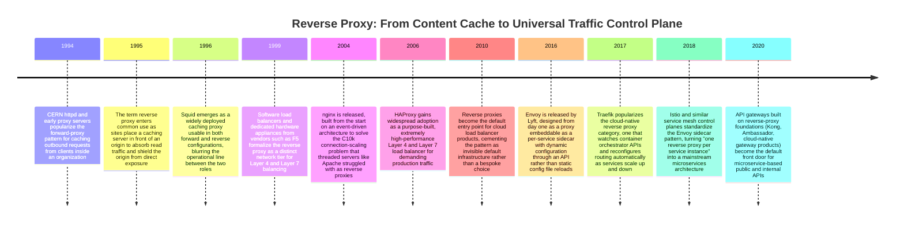

**Why the pattern started with caching, not load balancing.** The earliest
reverse proxies existed to solve a bandwidth and latency problem: a single
origin server answering every request directly, including requests for
identical, unchanging content, was wasteful. Placing a caching server in
front of the origin — serving repeat requests from cache and only
forwarding cache misses — reduced origin load without requiring any change
to the origin server itself. This is the same "insert a layer of
indirection in front of a resource, and get new capabilities without
touching the resource" idea that recurs throughout this chapter, just
applied first to caching rather than to routing or security.

**Why load balancing came next, and why it looked like a separate product
for years.** As sites outgrew a single origin server, the natural next
question was "which origin server should handle this request?" — and
answering it required the same positional advantage a caching reverse
proxy already had: sitting on every request before it reaches an origin.
Early load balancers were often separate hardware appliances (dedicated
ASICs — Application-Specific Integrated Circuits — for Layer 4 switching)
rather than reverse-proxy software, which is part of why many architects
today still mentally separate "the load balancer" from "the reverse
proxy" as if they were different tiers. As commodity servers became fast
enough to handle Layer 7 (application-layer) inspection in software, the
two roles converged: nginx and HAProxy do both content-aware routing and
load balancing in the same process, because both are just different
policies for the same underlying job — deciding what to do with an
incoming request before it reaches an origin.

**Why the sidecar model emerged, and why it needed a new proxy.**
Traditional reverse proxies like nginx and HAProxy were designed around a
small number of long-lived, largely static configuration files, reloaded
occasionally. Microservice architectures introduced a workload shape those
designs did not fit well: dozens to thousands of service instances, scaling
up and down continuously, needing per-service routing decisions updated in
near-real time without a config-file reload storm. Envoy was built
specifically for that shape — configuration delivered dynamically over an
API (the xDS — discovery service — protocol family) rather than read from a
file at startup — which is why it became the default proxy embedded as a
sidecar in service mesh architectures rather than nginx or HAProxy being
retrofitted for the job (Section 4.7, Section 4.10).

## 3. Why It Exists

The reverse proxy exists to solve a problem that has nothing to do with any
single feature it offers, and everything to do with a structural property
of client-server communication: **a client that talks directly to an origin
server is coupled to that origin's identity, location, capacity, and
protocol version, and every one of those things needs to change over the
system's lifetime.**

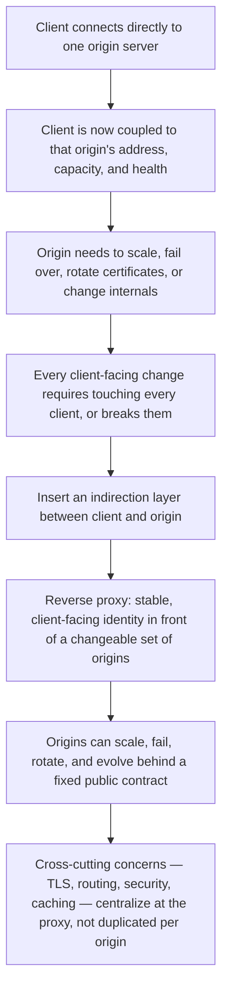

Three consequences follow directly from that indirection, and together they
are why the reverse proxy pattern persists across every generation of
architecture this handbook covers rather than being replaced:

1. **Decoupling client-visible identity from origin topology.** A client
   only ever needs to know one stable name (a domain and, typically, a
   single IP address or anycast address behind it). Behind that name, the
   number of origin servers, their individual addresses, and their health
   can all change continuously without any client-side change — this is
   the foundational property that makes horizontal scaling, blue-green
   deployment, and zero-downtime failover possible at all.
2. **Centralizing a cross-cutting concern beats duplicating it.**
   TLS certificate management, compression, request logging, rate
   limiting, and security header injection are all concerns that, without
   a reverse proxy, would have to be implemented correctly and consistently
   inside every origin application. A reverse proxy lets an architecture
   implement each of these exactly once, in one place, and enforce it
   uniformly regardless of what language or framework each origin service
   happens to use.
3. **A single hardened front door is easier to secure than N independent
   backends.** Every origin server directly reachable from the internet is
   an independent attack surface that must be patched, monitored, and
   configured correctly. Collapsing that surface to one (or a small,
   uniformly hardened set of) reverse proxy instances is a substantial,
   measurable reduction in what has to be defended (Section 4.8, Section
   13).

If none of these forces existed — if origin servers never needed to scale,
change, or be protected — a reverse proxy would be pure overhead: an extra
network hop and a single point of failure to manage. The pattern exists
specifically because those forces are unavoidable in any system meant to
grow, and a reverse proxy is the architectural answer that has proven
durable across three decades of otherwise-unrecognizable changes in the
rest of the stack.

## 4. Core Concepts

### 4.1 Forward Proxy vs. Reverse Proxy: Whose Interest Is Represented

**Definition.** A proxy is any intermediary that sits between a client and a
server and relays requests on one side's behalf. The distinction between a
*forward* proxy and a *reverse* proxy is not about which physical direction
traffic flows — both relay requests forward and responses backward. The
distinction is about **whose interest the proxy represents and which side
is aware an intermediary exists at all.**

- A **forward proxy** acts on behalf of the *client side*. Clients are
  configured to send their traffic to the forward proxy, which then
  contacts whichever server the client asked for. The server on the far
  end typically has no idea a proxy was involved — from the server's point
  of view, a request simply arrived from the proxy's IP address. Common
  purposes: corporate outbound content filtering, client anonymization,
  caching frequently requested external content for many internal clients.
- A **reverse proxy** acts on behalf of the *server side*. Clients believe
  they are talking directly to "the server" — they have no idea, and are
  not meant to know, that the address they are hitting is a proxy in front
  of one or more real origin servers. The origin servers are configured to
  trust and only accept connections that arrive via the reverse proxy.

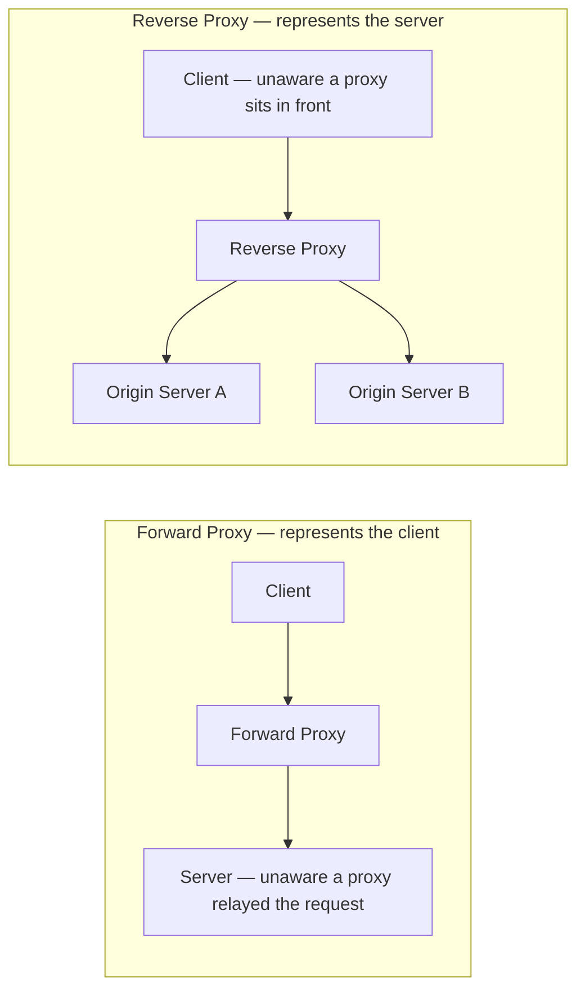

**Mechanism.** Practically, forward and reverse proxies can run identical
proxying software (Squid and even nginx can be configured either way) — the
architectural difference is entirely in *deployment topology and trust
configuration*, not in the code path. A forward proxy is deployed close to
clients and clients are explicitly configured (or transparently
intercepted) to route all outbound traffic through it. A reverse proxy is
deployed close to the origin, is the only path allowed to reach the origin
(often enforced at the network/firewall layer, not just by convention), and
clients reach it via ordinary DNS (Domain Name System) resolution of the
service's public name with no client-side proxy configuration at all.

**Decision implications.** This distinction matters architecturally well
beyond "which direction is the arrow drawn":

- **Trust direction is inverted.** A forward proxy is trusted by (and
  configured by) the client's organization to protect and control *client*
  behavior. A reverse proxy is trusted by (and configured by) the *server*
  operator to protect and control access to their own infrastructure. Mixing
  these up in a design review — treating a corporate outbound proxy as if
  it could enforce backend security, or vice versa — is a common and
  consequential error.
- **Visibility assumptions differ.** Forward proxy deployments generally
  assume the server is unaware of the proxy's existence (though `X-Forwarded-For` -style
  headers leak some of this). Reverse proxy deployments generally assume
  the *client* is unaware, and architectures are built around that
  assumption — for example, TLS certificates are issued for the reverse
  proxy's public name, not for any individual origin, precisely because
  clients are only ever meant to see the proxy's identity (Section 4.3).
- **Failure blast radius differs.** A forward proxy outage typically
  degrades a bounded set of internal clients' ability to reach the outside
  world. A reverse proxy outage typically takes down external access to
  everything behind it — which is why reverse proxy availability
  engineering (Section 15) is a first-order production concern in a way
  forward proxy availability usually is not.

**Common failure mode.** Conflating the two terms in a security review is
the most common practical failure — a design that says "we have a proxy in
front of the API" without specifying which kind leaves an ambiguous trust
boundary. A reviewer who assumes reverse-proxy semantics (client is
unaware, backend is protected) when the actual deployment is closer to a
transparent forward-proxy-like intercept (backend still directly reachable
on another path) will sign off on a security posture that does not actually
exist.

**Concrete scenario.** A company's employees have all outbound web traffic
routed through a corporate forward proxy that blocks known malicious
domains and logs access for compliance — the *company* is the party being
protected, and the external websites employees visit have no idea a
corporate proxy relayed the request. The same company's customer-facing API
sits behind an nginx reverse proxy that terminates TLS, and no client can
reach the origin application servers directly — the *company's backend* is
the party being protected, and customers have no idea, and do not need to
know, how many origin instances actually exist behind that one public
address. Both are "proxies." They solve structurally opposite problems.

### 4.2 The General Reverse-Proxy Pattern as a Superset of Load Balancing

**Definition.** A reverse proxy's job, stripped to its essence, is: receive
a request intended for "the service," apply some policy, and forward it
(possibly transformed) to one of potentially several origin servers, then
relay the response back. Load balancing — choosing *which* origin server
handles a given request, using an algorithm like round-robin, least
connections, or consistent hashing — is exactly one of the policies that
fits inside that job description. It is not a different piece of
infrastructure bolted onto a reverse proxy; it is one column in a much
wider table of things the "receive, decide, forward" loop can do.

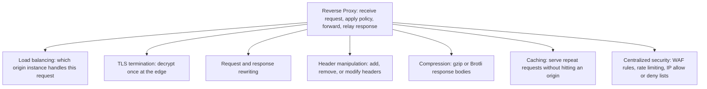

**Mechanism — why one process can do all of this.** All of these
capabilities share the same mechanical precondition: the reverse proxy
already sees the full request (method, path, headers, and — for Layer 7
proxies — often the body) before deciding what to do with it, and it
already sees the full response before relaying it back. Once a piece of
software is positioned to inspect and modify both sides of that exchange,
adding "and also rewrite this header" or "and also cache this response" or
"and also pick which of five origins gets this request" is an incremental
policy addition on data the proxy already has in hand — not a new
architectural capability requiring a new component. This is precisely why
nginx, HAProxy, Envoy, and Traefik all implement load balancing, TLS
termination, and header manipulation in the same binary: they are variations
on one mechanism, not four separate mechanisms glued together.

**Decision implications.** Recognizing load balancing as one application of
a broader pattern changes how an architect scopes a design:

- **The full algorithmic and health-check treatment lives one chapter
  over.** [CH10 — Load Balancer](CH10_Load_Balancer.md) is the owning
  chapter for round-robin/least-connections/consistent-hashing algorithm
  selection, L4-vs-L7 balancing mechanics, health-check design, sticky
  sessions, and Global Server Load Balancing (GSLB) — this chapter does not
  duplicate that depth (Section 4.11).

- **Don't reach for a second tool to do something the reverse proxy already
  does.** A common anti-pattern (Section 19) is standing up a separate
  caching layer, a separate header-rewrite microservice, or a separate WAF
  appliance when the reverse proxy already in the request path could
  implement the same capability with one additional configuration block —
  at the cost of one more network hop, one more system to operate, and one
  more place a misconfiguration can hide.
- **The reverse proxy layer is a natural home for anything that is true for
  every request regardless of which backend serves it.** If a policy
  applies uniformly ("strip this internal header before returning the
  response," "compress every response over 1 KB," "add a request ID for
  tracing") it almost always belongs at the reverse proxy, not duplicated
  in every backend service.
- **Load balancing algorithm choice remains a distinct, deep topic** — this
  chapter deliberately does not re-derive round-robin vs. least-connections
  vs. consistent hashing, weighted balancing, or health-check design; that
  full treatment is [CH10 — Load Balancer](CH10_Load_Balancer.md)'s job. What
  this chapter's Section 4.2 establishes is only the *architectural
  relationship*: load balancing is a policy a reverse proxy applies, not a
  separate kind of infrastructure.

**Common failure mode.** Treating "reverse proxy" and "load balancer" as
two boxes in an architecture diagram that must always be drawn separately,
when in the actual deployment they are the same process. This produces
diagrams that misrepresent the real request path (implying an extra network
hop that does not exist) and confuses on-call engineers who go looking for
a separate "load balancer" component during an incident that does not
exist as distinct infrastructure.

**Concrete scenario.** An nginx instance in front of three application
servers is configured to: terminate TLS for the public domain, route
`/api/*` to the application servers using least-connections balancing,
gzip-compress every JSON response over 1 KB, strip the `X-Powered-By`
header the application framework adds, and cache `/static/*` responses for
one hour. All five of those are configuration blocks in the same `nginx.conf`,
handled by the same worker process, for the same request — not five
separate systems.

### 4.3 TLS Termination

**Definition.** TLS termination is the practice of decrypting incoming
HTTPS (Hypertext Transfer Protocol Secure) connections at the reverse
proxy, so that the reverse proxy — not each individual origin server —
holds the TLS certificate and private key and performs the TLS handshake
with clients. Traffic from the reverse proxy to the origin servers may
then travel as plain HTTP (inside a trusted internal network) or be
re-encrypted with a separate, often internally issued, certificate (a
pattern sometimes called TLS bridging or re-encryption).

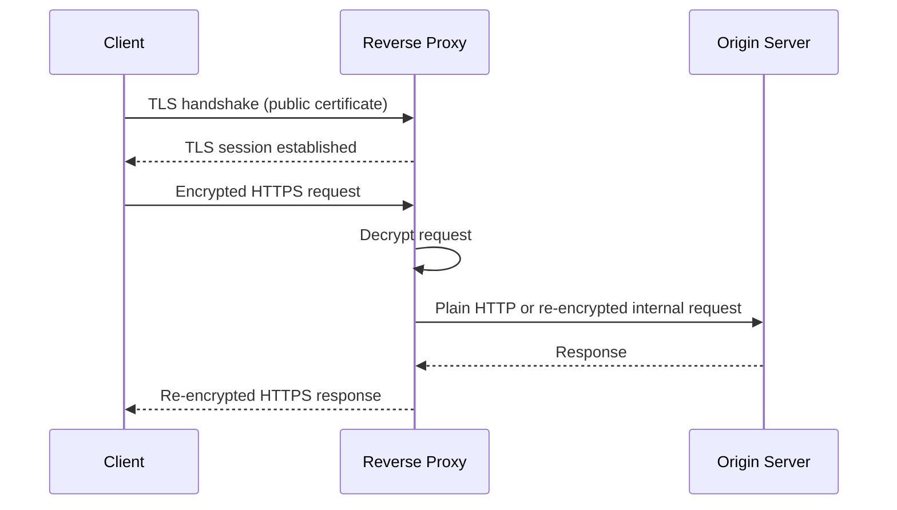

**Mechanism.** The full TLS handshake mechanics — asymmetric key exchange,
cipher suite negotiation, certificate chain validation, session resumption
— are owned by [TLS](CH06_TLS.md#4-core-concepts) and are not re-taught
here. What matters at the reverse-proxy layer is simpler: the reverse
proxy is configured with the certificate and private key for the public
domain, terminates the handshake itself, and the decrypted plaintext
request is what the proxy's routing, rewriting, and load-balancing logic
actually operates on — none of those policies can inspect an encrypted
request, so termination has to happen before any of Section 4.1-4.9's
capabilities can apply.

**Decision implications.** Centralizing TLS termination at the reverse
proxy, instead of terminating it independently at every origin server, is
almost always the right default because:

- **Certificate management centralizes to one place.** Renewal, rotation,
  and cipher-suite policy updates happen once, at the proxy tier, instead
  of being replicated (and potentially inconsistently configured, or
  forgotten) across every origin instance.
- **Origin servers can be simpler and cheaper to run.** TLS handshakes are
  CPU-intensive; offloading that cost to a proxy tier purpose-built for it
  frees origin compute for application logic.
- **The trade-off is the internal segment's encryption posture.** Plain
  HTTP from proxy to origin is only acceptable when that internal network
  segment is genuinely trusted (private VPC — Virtual Private Cloud — subnet,
  no untrusted tenants sharing the network). In zero-trust or multi-tenant
  environments, TLS bridging (re-encrypting proxy-to-origin traffic, often
  with mTLS) is required — this is exactly the justification for sidecar
  proxies performing mTLS between every service pair (Section 4.7).

**Common failure mode.** Terminating TLS at the reverse proxy and then
assuming the internal network is automatically safe to leave in plaintext
forever, without revisiting that assumption as the network topology
changes (new environments sharing a VPC, a compliance requirement for
encryption-in-transit everywhere). This is a common audit finding: TLS
termination was a correct decision at the time it was made, then quietly
became a compliance gap as the internal trust boundary shifted.

**Concrete scenario.** An e-commerce platform terminates TLS 1.3 at an
nginx tier using a certificate for `shop.example.com`. Traffic from nginx
to the application servers travels as plain HTTP over a private subnet with
no other tenants and strict security-group rules limiting which hosts can
reach the application servers at all — an acceptable trust boundary given
the isolation, revisited annually as part of a compliance review.

### 4.4 Request/Response Rewriting and Header Manipulation

**Definition.** Rewriting is the reverse proxy's ability to modify a
request's URL, method, or body before forwarding it to an origin, and
similarly to modify a response before relaying it to the client. Header
manipulation is the narrower, extremely common special case: adding,
removing, or altering individual HTTP headers on the way in or out.

**Mechanism.** Because the reverse proxy is a full intermediary, it can
apply arbitrary transformation rules matched by path, host, method, or
header value. Typical categories:

- **Path rewriting**: `/api/v2/users` on the public-facing path might be
  rewritten to `/users` before reaching an origin that has no concept of
  API versioning in its own routes.
- **Header injection**: adding `X-Request-Id` for distributed tracing
  correlation, adding `X-Forwarded-For` and `X-Forwarded-Proto` so the
  origin can reconstruct the original client IP address and scheme despite
  the proxy hop.
- **Header stripping**: removing internal debug headers, removing a
  backend framework's `X-Powered-By` or `Server` header before it reaches
  the client (a security hardening measure, Section 4.8 and Section 13).
- **Security header injection on the way out**: adding
  `Strict-Transport-Security`, `X-Content-Type-Options`, and similar
  response headers uniformly for every backend, regardless of whether each
  backend application remembered to set them itself.

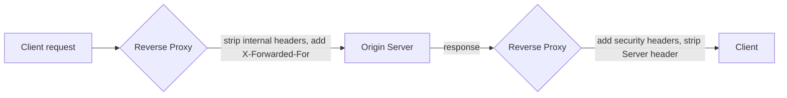

**Decision implications.** Header and rewrite rules are the primary
mechanism by which a reverse proxy decouples a public API contract from an
origin's internal implementation details — an origin can be renamed,
re-versioned, or re-platformed while the reverse proxy absorbs the
translation, so long as the rewrite rules are updated in one place rather
than requiring client-side changes. The corresponding risk is rule sprawl:
as more rewrite and header rules accumulate over years of incremental
changes, the proxy configuration itself becomes a piece of business logic
that is hard to test, hard to review, and easy to silently break (Section
17, Section 19).

**Common failure mode.** Forgetting to forward (or correctly append to) the
`X-Forwarded-For` header chain, which breaks origin-side IP-based rate
limiting, geolocation, and audit logging — the origin sees the reverse
proxy's IP address for every single client, making every request look like
it came from the same source.

**Concrete scenario.** See Section 10.3 for a complete, production-quality
header-rewrite rule set implementing exactly this pattern (forwarding
client IP and protocol correctly, stripping internal and framework-identifying
headers, adding uniform security headers) in nginx configuration syntax.

### 4.5 Compression and Caching at the Proxy Layer

**Definition.** Compression is the reverse proxy transparently encoding
response bodies (typically with gzip or Brotli) before sending them to
clients that advertise support via the `Accept-Encoding` request header,
reducing bytes transferred without any origin-side change. Caching at the
reverse-proxy layer means storing a copy of a response and serving
subsequent matching requests directly from the proxy, without contacting
the origin at all.

**Mechanism.** Both capabilities exploit the same positional advantage as
Section 4.4: the proxy sees every request and response for every origin, so
it can apply a single compression or caching policy uniformly. Reverse-proxy
caching uses the same conceptual building blocks as HTTP caching in general
(cache keys, `Cache-Control` semantics, `Vary` handling) — those mechanics
are owned by [HTTP](CH01_HTTP.md#4-core-concepts) and, at CDN scale, by
[CDN](CH09_CDN.md#4-core-concepts); this chapter's scope is narrower: caching
*at a reverse proxy in front of an origin*, not a globally distributed CDN
edge network, though the underlying cache-key and invalidation reasoning is
the same pattern applied at a smaller radius.

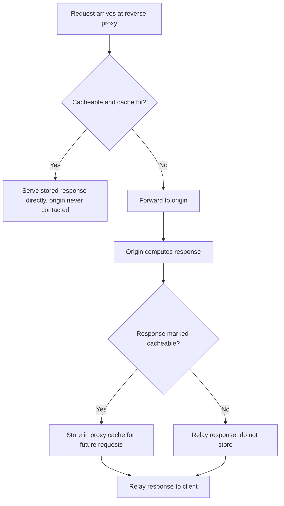

**Decision implications.** Reverse-proxy-level caching is most valuable for
content that is expensive to compute but shared across many requesters
(rendered HTML fragments, computed API responses that are the same for
every caller within a short window) — it trades a small amount of staleness
risk for a large reduction in origin load. Compression is close to free
architecturally (CPU cost at the proxy is usually cheap relative to network
transfer savings) and is one of the few reverse-proxy features with almost
no downside, which is why it is typically enabled globally by default
rather than decided per-route.

**Common failure mode.** Caching responses that vary by authenticated user
identity without a correct cache key (missing `Vary: Authorization` or
equivalent), which leaks one user's personalized response to another user
— a serious security defect, not just a correctness bug (see Section 13).

**Concrete scenario.** An internal reporting dashboard's reverse proxy
caches a `/summary` endpoint's response for 30 seconds — the underlying
computation is expensive and identical for every viewer in that window —
reducing origin load by over 90% during peak viewing hours with an
acceptable, explicitly agreed staleness window.

### 4.6 API Gateway: Reverse Proxy Plus Application Awareness

**Definition.** An API Gateway is a reverse proxy specialized for
API traffic, adding application-layer awareness that a general-purpose
reverse proxy does not natively have: per-consumer API key or OAuth
(Open Authorization) token validation, per-consumer rate-limit quotas
(distinct from simple per-IP rate limiting), request/response schema
transformation between a public contract and one or more backend
protocols, and API-product concerns like usage metering and developer
portal integration.

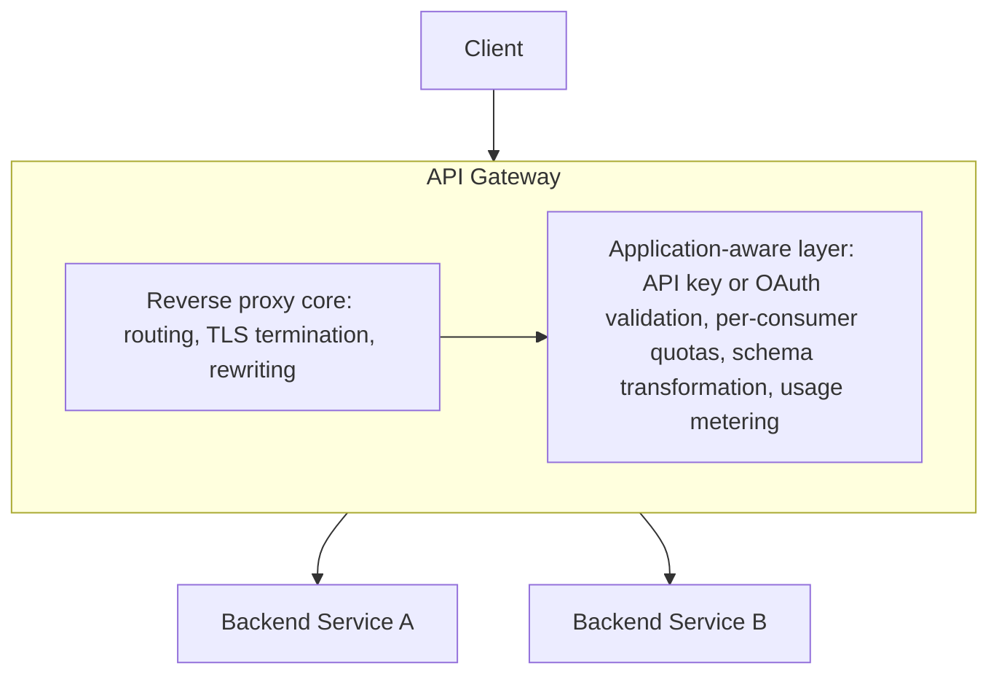

**Mechanism, decision implications, and recap boundary.** Every capability
an API Gateway offers is implemented on top of the same request-intercept
mechanism this chapter has already covered — an API Gateway does not use a
fundamentally different networking primitive than a plain reverse proxy;
it adds a policy layer that is aware of API *consumers* and API *contracts*
as first-class concepts, rather than treating every request identically.
This is why commercial API Gateway products (Kong, Apigee, AWS API Gateway,
Azure API Management) are frequently built on, or resemble, general-purpose
reverse proxies (Kong is built on nginx; several cloud gateways are built on
Envoy) rather than being written from scratch. The full architecture of an
API Gateway — consumer/product modeling, developer portals, contract-first
transformation pipelines, gateway-level authentication/authorization
patterns — is this handbook's Part 08 API Architecture's job to teach in
full, in a future API Gateway chapter (Part 08's `PART_OVERVIEW.md` lists it
as chapter 8, `08_API_Architecture/CH08_API_Gateway.md`, not yet drafted at
the time of writing). This chapter's contribution is the boundary itself:
an API Gateway is *architecturally* a reverse proxy with an
application-aware policy layer added, not a categorically different piece
of infrastructure — an architect deciding "do we need an API Gateway or is
our existing reverse proxy enough" is really asking "do we need the
application-aware layer, or does uniform, consumer-blind policy suffice?"

**Common failure mode.** Introducing a full API Gateway product purely to
get basic reverse-proxy behavior (TLS termination, path routing) that the
organization's existing nginx or Envoy deployment already provides —
adding an expensive, heavier, harder-to-operate component for capability
that was already available, because the two categories were not
distinguished at design time.

### 4.7 Sidecar Proxy Architecture

**Definition.** A sidecar proxy is a reverse proxy deployed *per service
instance* — typically as a second container in the same Kubernetes pod, or
a co-located process on the same host — that intercepts all inbound and
outbound traffic for that one service instance, rather than one shared
reverse proxy sitting in front of many backend instances.

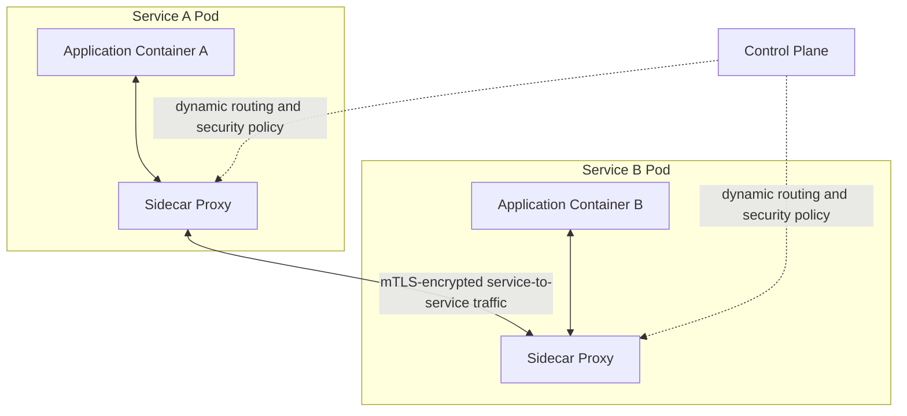

**Mechanism.** Instead of one central reverse proxy routing traffic to N
service instances (Section 4.1-4.2's model), the sidecar model puts a small
reverse proxy next to *every* instance of *every* service, and all
service-to-service traffic is intercepted by the sidecar transparently
(usually via `iptables` rules or an equivalent kernel-level redirect, so the
application code does not need to know a proxy is involved at all). Each
sidecar enforces the same category of policy a traditional reverse proxy
does — routing, retries, timeouts, load balancing across the destination
service's instances, TLS/mTLS — but does it locally, at the edge of a
single service, and receives its configuration dynamically from a central
control plane rather than from a static file.

**Decision implications — why this is a different shape of the same
pattern, not a different pattern.** The sidecar model exists because
centralizing all service-to-service traffic through one shared reverse
proxy tier (as in the classic north-south "one reverse proxy in front of
the whole system" deployment) does not scale well to *east-west*
traffic — the request flow between dozens or hundreds of internal services
calling each other constantly. Routing every internal call through one
central proxy tier makes that tier a bottleneck and a single point of
failure for all internal traffic, not just external. Pushing a small proxy
instance out to sit beside every service converts that shared bottleneck
into a distributed, per-instance capability with the same policy surface
(retries, timeouts, mTLS, observability) applied uniformly without a
central hop. This is precisely why Envoy — designed for dynamic,
API-driven configuration rather than static file reloads (Section 2,
Section 4.10) — became the default sidecar implementation: a fleet of
proxies that must reconfigure themselves continuously as hundreds of
service instances scale up and down needs a proxy built for that from the
ground up.

**Common failure mode.** Treating "we adopted a service mesh" as
synonymous with "we solved our reliability problems," when in practice a
mesh only relocates and standardizes the retry/timeout/mTLS policy
surface — if that policy is misconfigured (overly aggressive retries
amplifying a downstream outage, for example), the mesh distributes the
misconfiguration to every service uniformly instead of containing it to
one integration point.

**Concrete scenario, and explicit deferral.** A microservices platform
deploys Envoy as a sidecar in every pod. Every service-to-service call is
automatically encrypted with mTLS issued and rotated by the mesh's control
plane, and per-route retry/timeout policy is defined centrally and pushed
to every sidecar dynamically. This chapter stops at explaining *why* this
shape exists and *what mechanical problem it solves* — the full control
plane architecture (certificate issuance and rotation, traffic-shifting for
canary releases, multi-cluster mesh federation, mesh observability
topology) is deferred in full to a future dedicated Service Mesh chapter,
not yet drafted at the time of writing.

### 4.8 Reverse Proxy as a Security Boundary

**Definition.** Using the reverse proxy as a security boundary means
treating "no client can ever reach an origin server directly" as an
enforced architectural invariant, not a best-effort convention — with the
reverse proxy positioned as the single, hardened, closely monitored point
through which all external access must pass.

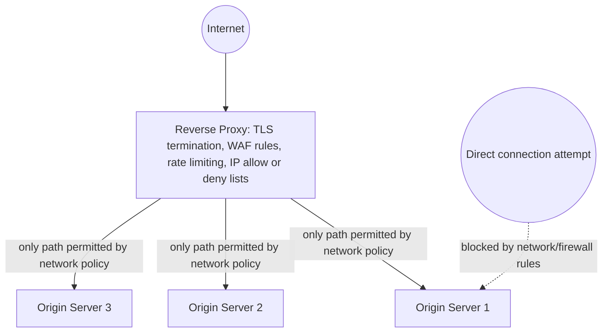

**Mechanism.** This is not purely a configuration convention; it is
typically enforced at multiple layers simultaneously so that a
misconfiguration in any single layer does not silently expose an origin:

- **Network-layer enforcement**: security groups, firewall rules, or a
  private subnet with no route from the public internet, so that even a
  correctly-addressed direct request to an origin's IP address cannot
  reach it at all.
- **Application-layer enforcement at the proxy**: centralized Web
  Application Firewall (WAF) rule evaluation (blocking SQL injection,
  cross-site scripting, and other well-known attack patterns) applied once
  for every origin, rather than requiring every backend team to implement
  and keep their own input-validation rules current.
- **Rate limiting and abuse control centralized at the edge**, so a single
  client or IP range hammering the system is throttled before it ever
  consumes an origin server's resources.
- **Topology hiding**: because clients only ever see the reverse proxy's
  public address, the number, location, internal addressing scheme, and
  even the existence of individual origin instances is invisible to anyone
  outside the trust boundary — an attacker who compromises information
  about the public-facing proxy learns nothing directly about the backend
  fleet.

**Decision implications.** "Never expose origin servers directly" is close
to an absolute architecture principle for internet-facing systems, and the
reverse proxy is the mechanism, not just the policy statement, that makes
it true. Treating this only as an operational guideline ("please don't open
that security group") rather than a hard network-level invariant is a
common and serious gap — the guideline can be violated by a single
misconfigured rule during an unrelated change, while a network-level
invariant (no route exists) fails closed even under human error.

**Common failure mode.** A debugging session or a rushed hotfix opens
direct access to an origin "just temporarily" (a security group rule, a
NodePort left exposed) and the change is never reverted — this is one of
the most common real-world causes of origin servers being directly
reachable despite an architecture diagram that shows a reverse proxy in
front of everything.

**Concrete scenario.** A payments platform enforces that origin application
servers live in a private subnet with no internet gateway route at all —
not merely a security group rule, but an actual absence of a network path
— so that even a fully misconfigured security group cannot expose an
origin; the reverse proxy tier is the only component with a route to the
public internet.

### 4.9 Path-Based and Host-Based Routing Architecture

**Definition.** Path-based routing directs a request to a different origin
service based on the URL path (for example, `/checkout/*` to the checkout
service, `/catalog/*` to the catalog service). Host-based (virtual host)
routing directs a request to a different origin service based on the
`Host` header or Server Name Indication (SNI) value in the TLS handshake
(for example, `api.example.com` to one backend, `admin.example.com` to a
different one), allowing a single reverse proxy instance, on a single
public IP address, to front many logically distinct services.

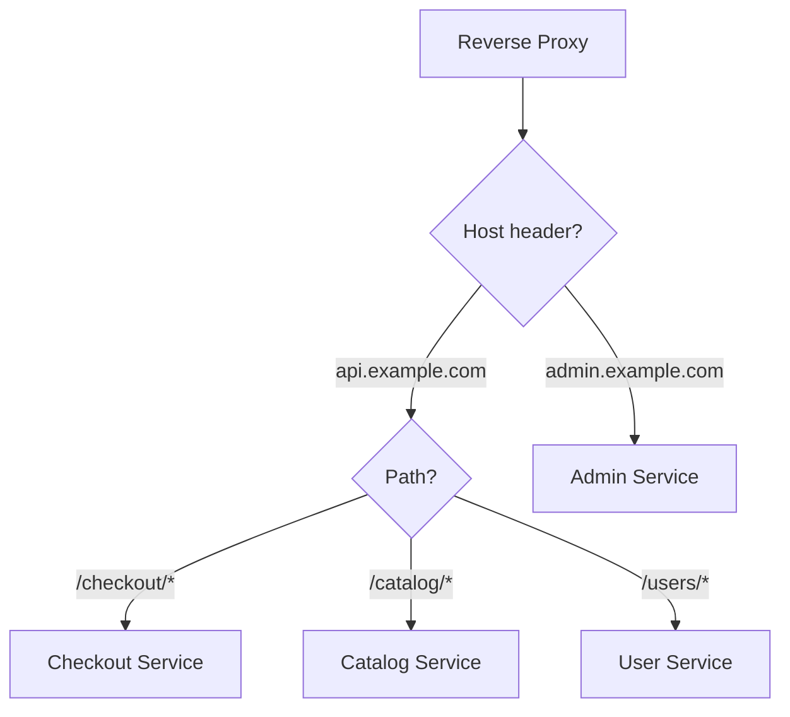

**Mechanism.** Both routing modes rely on information the reverse proxy can
inspect before it needs to decide where to forward a request: host-based
routing reads the `Host` header (plain HTTP) or the SNI extension (TLS,
before decryption even completes, which is what lets a single proxy front
multiple TLS certificates for different domains on one IP address — a
capability sometimes called SNI-based virtual hosting). Path-based routing
requires the request to already be decrypted (if TLS-encrypted), since the
path is inside the encrypted payload, so path-based rules necessarily
apply *after* TLS termination (Section 4.3) in the request-processing
order.

**Decision implications.** These two routing modes are frequently combined,
and the combination is one of the primary architectural tools for evolving
a monolith into services incrementally without breaking public contracts:
a single public domain can route different paths to different backend
services (a "strangler fig" migration pattern, letting new services take
over specific paths one at a time while the rest of the traffic still
reaches the original monolith), while host-based routing lets entirely
separate products or environments (staging vs. production, an admin
console vs. the public API) share one reverse-proxy fleet and one
certificate-management story instead of needing separate infrastructure
per domain.

**Common failure mode.** Path-matching rule ordering bugs — a broad rule
(`/api/*`) defined before a more specific rule (`/api/v2/admin/*`) can
silently swallow requests intended for the specific rule, sending
admin-path traffic to the wrong backend. Reverse proxies generally evaluate
rules in a defined priority order (often longest-prefix-match or explicit
rule ordering), and getting that order wrong is one of the most common
production routing bugs.

**Concrete scenario.** See Section 10.1 for a complete nginx configuration
implementing both host-based routing (splitting `api.example.com` and
`admin.example.com` onto different backend pools on one shared proxy
fleet) and path-based routing (splitting `/checkout`, `/catalog`, and
`/users` prefixes under the API host to three separate backend service
pools).

### 4.10 The Technology Landscape: nginx, HAProxy, Envoy, Traefik

**Definition.** These four are the reverse proxy technologies most
commonly encountered in production architectures today, and while all four
can perform routing, TLS termination, and load balancing, each was built
around a different primary assumption about its deployment environment —
which is what actually differentiates them architecturally, far more than
any single feature checklist.

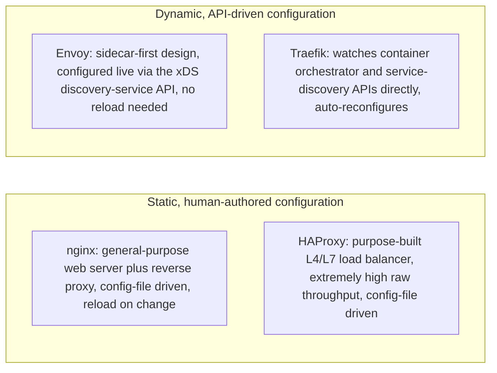

**Mechanism and decision implications, product by product:**

- **nginx.** Originally a general-purpose, event-driven web server (serving
  static files efficiently was its first job), extended over time into one
  of the most widely used reverse proxies and load balancers in existence.
  Configuration is a static file, and while nginx supports reloading
  configuration without dropping connections, it is not designed around
  configuration changing every few seconds in response to a service mesh's
  worth of scaling events. Architectural sweet spot: traditional
  web-facing deployments with a relatively small, slowly changing set of
  routing rules — a public website, a moderate number of backend service
  pools, classic host/path-based routing — where operational simplicity and
  an enormous, mature ecosystem of documentation and modules matter more
  than sub-second dynamic reconfiguration.
- **HAProxy.** Purpose-built from the start as a load balancer (not a web
  server that grew load-balancing features), and widely regarded as one of
  the highest-throughput, lowest-latency options available, particularly
  for pure Layer 4 and Layer 7 load balancing at very large connection
  counts. Like nginx, configuration is primarily file-driven. Architectural
  sweet spot: extremely high-traffic, latency-sensitive load-balancing
  tiers where raw performance and predictable behavior under load matter
  more than built-in application-layer features like caching or
  compression (which HAProxy supports far more minimally than nginx).
- **Envoy.** Designed from day one to be embedded as a sidecar (Section
  4.7) and configured dynamically via an API (the xDS protocol family)
  rather than a static file — a control plane can push routing and
  security policy to thousands of Envoy instances continuously as the
  fleet scales, with no reload step. Architectural sweet spot: service
  mesh sidecars and any environment where the set of backend destinations
  changes frequently and automatically (autoscaling microservices,
  frequent canary/traffic-shifting deployments) and where deep, uniform
  observability (Envoy's built-in metrics and tracing integration is
  extensive) across every service-to-service call is a first-order
  requirement.
- **Traefik.** Built specifically for cloud-native environments —
  watches a container orchestrator's API (Kubernetes, Docker) or a
  service-discovery backend directly, and automatically derives routing
  configuration from service labels/annotations with no separate
  configuration file to keep in sync. Architectural sweet spot: containerized
  deployments where the operational goal is "new service is deployed with
  the right labels and is immediately routable with zero manual reverse-proxy
  configuration," trading some of nginx/HAProxy's raw performance ceiling
  and long operational track record for substantially lower day-to-day
  configuration burden in a fast-changing container environment.

**Common failure mode.** Choosing a reverse proxy technology based on
name recognition or familiarity rather than matching it to the workload's
configuration-change frequency — deploying nginx with a hand-maintained
config file into an environment where backend instances autoscale every
few minutes (fighting the tool's static-config assumption with reload
scripts and templating), or adopting Envoy/a full service mesh for a small,
slowly changing set of services that would be served perfectly well, with
far less operational complexity, by a single nginx instance.

**Concrete scenario.** See Section 21's comparison table for a structured,
side-by-side comparison of all four across configuration model, dynamic
service discovery integration, raw performance characteristics, and typical
deployment scope.

### 4.11 Load Balancing: What This Chapter Recaps (and Where the Full Depth Lives)

**Recap.** Load balancing (see [Load Balancer](CH10_Load_Balancer.md)) is
the specific reverse-proxy policy of choosing which of several healthy
origin instances handles a given request.
This chapter's Section 4.2 already established the architectural
relationship — load balancing is one application of the general
reverse-proxy pattern, not separate infrastructure — and Sections 4.9-4.10
have referenced it in passing when discussing routing and technology
choice. The algorithms themselves (round-robin, weighted round-robin,
least-connections, consistent hashing and its use for session affinity,
and the health-check mechanics that determine which origins are eligible to
receive traffic at all, including active vs. passive health checks and
sticky-session implementation trade-offs) are deliberately **not**
re-taught here — that full first-principles treatment, including failure
modes specific to each algorithm, belongs to the sibling Load Balancer
chapter, and duplicating it here would violate this handbook's concept
ownership rule. Where this chapter's own examples need a load-balancing
directive (Section 10.1's nginx config, Section 10.2's Envoy config), they
use a named algorithm without re-deriving why it behaves the way it does.

## 5. Internal Working

A request's journey through a reverse proxy follows a consistent internal
pipeline regardless of which product implements it — understanding this
pipeline is what lets an architect reason about where in the chain a given
policy (Section 4.3-4.9) actually takes effect, and in what order.

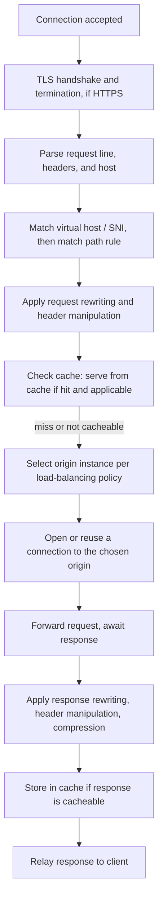

Two internal-working details matter enough to call out explicitly:

- **Connection reuse to origins.** A reverse proxy typically maintains a
  pool of persistent (keep-alive) connections to each origin rather than
  opening a brand-new TCP (Transmission Control Protocol) connection per
  incoming request — TCP connection setup (and TLS handshake, if the
  internal segment is also encrypted) has real overhead, and reusing
  connections is one of the primary reasons a well-tuned reverse proxy
  scales to far more client connections than backend connections. Under-sizing
  this internal connection pool is a common, hard-to-diagnose latency
  source (Section 11, Section 15).
- **Buffering behavior.** Most reverse proxies buffer at least part of a
  request or response body in memory (or spill to disk for very large
  bodies) rather than streaming every byte through immediately, which lets
  them apply policies that need to see a complete body (some rewriting
  rules, response compression) but introduces a latency/memory trade-off
  for very large payloads or streaming use cases (Section 11, Section 15).

## 6. Design Principles

- **Single, hardened entry point.** Route all external access through a
  minimal number of reverse proxy instances rather than allowing multiple,
  inconsistently configured entry paths to exist in parallel (Section 4.8).
- **Idempotent, declarative configuration.** Reverse proxy configuration
  should be version-controlled and reproducible from source, not
  hand-edited on a running instance — this matters even more once dynamic
  configuration (Envoy/Traefik, Section 4.10) is in play, where the
  "source of truth" is a control plane or orchestrator API rather than a
  file on disk.
- **Fail closed on policy ambiguity.** When a routing rule, host match, or
  security rule is ambiguous or missing, the safe default is to reject the
  request, not to silently fall through to an unintended backend or bypass
  a security check.
- **Push cross-cutting concerns to the proxy tier, business logic never.**
  TLS, compression, generic security headers, and routing belong at the
  proxy; anything that depends on business-specific request content
  belongs in the origin application, not encoded as increasingly elaborate
  proxy rewrite rules (Section 17, Section 19).
- **Match the configuration model to the deployment's rate of change**
  (Section 4.10) — static-file proxies for slowly changing topologies,
  dynamically configured proxies for autoscaling, frequently redeployed
  service fleets.

## 7. Architecture Patterns

```mermaid
flowchart TB
    subgraph P1["Pattern: Edge Reverse Proxy (north-south)"]
        C1[External Clients] --> E1[Single reverse-proxy tier] --> S1[Backend service pool]
    end
    subgraph P2["Pattern: Sidecar Mesh (east-west)"]
        S2A[Service A + Sidecar] <--> S2B[Service B + Sidecar]
        S2B <--> S2C[Service C + Sidecar]
    end
    subgraph P3["Pattern: Layered Reverse Proxies"]
        C3[Clients] --> CDN3[CDN edge] --> Edge3[Edge reverse proxy] --> Internal3[Internal reverse proxy / API Gateway] --> S3[Origin services]
    end
```

- **Edge reverse proxy (north-south traffic).** The classic pattern: one
  reverse-proxy tier at the perimeter, fronting a pool of origin services,
  handling TLS termination, routing, and load balancing for all traffic
  entering the system from outside.
- **Sidecar mesh (east-west traffic).** Section 4.7's pattern: a reverse
  proxy per service instance, handling service-to-service traffic
  internally, with policy pushed from a central control plane.
- **Layered reverse proxies.** Large systems frequently stack multiple
  reverse-proxy layers, each with a distinct responsibility: a CDN edge
  (see [CDN](CH09_CDN.md)) for global caching and DDoS absorption, an edge
  reverse proxy for TLS termination and coarse routing, and an internal
  API Gateway or service-mesh ingress for application-aware, per-consumer
  policy — each layer recapping, not duplicating, the layer before it.
- **Strangler fig migration via path-based routing.** Using host/path-based
  routing (Section 4.9) to incrementally redirect specific paths from a
  legacy monolith to new services, one route at a time, without a
  big-bang cutover.

## 8. Production Architecture

A production reverse-proxy tier is never a single instance — it is itself
load-balanced and made redundant at the layer below it (typically a cloud
provider's Layer 4 load balancer or an anycast address in front of several
reverse proxy instances), so that the reverse proxy tier does not become
the single point of failure it exists to prevent for the origin tier.

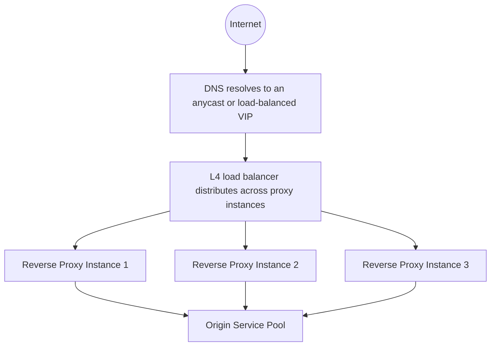

Key production concerns: each reverse proxy instance must be stateless (or
externalize any state it needs, such as rate-limit counters, to a shared
store) so that any instance can handle any request and instances can be
added, removed, or replaced without client-visible disruption; configuration
deployment must be automated and health-checked before old instances are
retired (a bad config push to every instance at once is a classic
full-outage failure mode, Section 15); and the proxy tier's own metrics
(Section 14) must be monitored independently from origin metrics, since a
proxy-tier problem (connection pool exhaustion, TLS handshake failures)
can look identical to an origin-tier problem from the outside.

## 9. Implementation

Implementing a reverse proxy in front of an existing service generally
follows the same sequence regardless of which technology is chosen:

1. Provision the reverse proxy instances (or, for sidecars, inject them
   into each service's deployment unit) on infrastructure that can reach
   the origins but is the only infrastructure directly reachable from
   clients (Section 4.8).
2. Configure TLS termination with a valid certificate for the public
   domain(s) (Section 4.3).
3. Define host/path routing rules mapping public routes to origin pools
   (Section 4.9).
4. Configure the load-balancing policy and health checks for each origin
   pool (recap only — full depth in the Load Balancer chapter).
5. Add the request/response rewrite and header rules the architecture
   requires (Section 4.4), including forwarding client IP/protocol
   correctly.
6. Enable compression and any caching policy appropriate to the routes
   involved (Section 4.5).
7. Wire up observability (access logs, metrics, tracing headers, Section
   14) before cutting real traffic over.
8. Cut DNS or load-balancer traffic over gradually (canary a small
   percentage first), verifying error rates and latency at each step.

## 10. Complete Code Examples

### 10.1 nginx Reverse Proxy: Host-Based and Path-Based Routing

```nginx
# /etc/nginx/nginx.conf (relevant server blocks)

upstream checkout_service {
    least_conn;
    server 10.0.1.10:8080 max_fails=3 fail_timeout=30s;
    server 10.0.1.11:8080 max_fails=3 fail_timeout=30s;
    keepalive 32;
}

upstream catalog_service {
    least_conn;
    server 10.0.2.10:8080 max_fails=3 fail_timeout=30s;
    server 10.0.2.11:8080 max_fails=3 fail_timeout=30s;
    keepalive 32;
}

upstream user_service {
    least_conn;
    server 10.0.3.10:8080 max_fails=3 fail_timeout=30s;
    keepalive 16;
}

upstream admin_service {
    server 10.0.9.10:8080;
    keepalive 8;
}

# --- Public API host: path-based routing to three service pools ---
server {
    listen 443 ssl http2;
    server_name api.example.com;

    ssl_certificate     /etc/nginx/certs/api.example.com.pem;
    ssl_certificate_key /etc/nginx/certs/api.example.com.key;
    ssl_protocols       TLSv1.2 TLSv1.3;

    # Reject anything that doesn't match a known path prefix (fail closed).
    location / {
        return 404;
    }

    location /checkout/ {
        proxy_pass http://checkout_service/;
        include /etc/nginx/snippets/proxy-common.conf;
    }

    location /catalog/ {
        proxy_pass http://catalog_service/;
        include /etc/nginx/snippets/proxy-common.conf;

        # Cache catalog reads: identical for all users within a short window.
        proxy_cache catalog_cache;
        proxy_cache_valid 200 60s;
        proxy_cache_key "$scheme$host$request_uri";
        add_header X-Cache-Status $upstream_cache_status;
    }

    location /users/ {
        proxy_pass http://user_service/;
        include /etc/nginx/snippets/proxy-common.conf;
    }
}

# --- Admin host: separate virtual host, same proxy fleet, IP allow-list ---
server {
    listen 443 ssl http2;
    server_name admin.example.com;

    ssl_certificate     /etc/nginx/certs/admin.example.com.pem;
    ssl_certificate_key /etc/nginx/certs/admin.example.com.key;

    allow 10.20.0.0/16;   # corporate VPN range only
    deny all;

    location / {
        proxy_pass http://admin_service;
        include /etc/nginx/snippets/proxy-common.conf;
    }
}

# Redirect all plain HTTP to HTTPS, for both hosts.
server {
    listen 80;
    server_name api.example.com admin.example.com;
    return 301 https://$host$request_uri;
}
```

### 10.2 Envoy Sidecar Configuration

```yaml
# envoy-sidecar.yaml — sidecar proxy for the "orders" service
static_resources:
  listeners:
    - name: inbound_listener
      address:
        socket_address: { address: 0.0.0.0, port_value: 15006 }
      filter_chains:
        - filters:
            - name: envoy.filters.network.http_connection_manager
              typed_config:
                "@type": type.googleapis.com/envoy.extensions.filters.network.http_connection_manager.v3.HttpConnectionManager
                stat_prefix: inbound_http
                route_config:
                  name: local_route
                  virtual_hosts:
                    - name: orders_local
                      domains: ["*"]
                      routes:
                        - match: { prefix: "/" }
                          route: { cluster: local_orders_app }
                http_filters:
                  - name: envoy.filters.http.router
                    typed_config:
                      "@type": type.googleapis.com/envoy.extensions.filters.http.router.v3.Router

    - name: outbound_listener
      address:
        socket_address: { address: 0.0.0.0, port_value: 15001 }
      filter_chains:
        - filters:
            - name: envoy.filters.network.http_connection_manager
              typed_config:
                "@type": type.googleapis.com/envoy.extensions.filters.network.http_connection_manager.v3.HttpConnectionManager
                stat_prefix: outbound_http
                route_config:
                  name: outbound_route
                  virtual_hosts:
                    - name: payments_service
                      domains: ["payments.internal:*"]
                      routes:
                        - match: { prefix: "/" }
                          route:
                            cluster: payments_service_cluster
                            timeout: 2s
                            retry_policy:
                              retry_on: "5xx,connect-failure"
                              num_retries: 2
                http_filters:
                  - name: envoy.filters.http.router
                    typed_config:
                      "@type": type.googleapis.com/envoy.extensions.filters.http.router.v3.Router

  clusters:
    - name: local_orders_app
      connect_timeout: 0.5s
      type: STATIC
      load_assignment:
        cluster_name: local_orders_app
        endpoints:
          - lb_endpoints:
              - endpoint:
                  address:
                    socket_address: { address: 127.0.0.1, port_value: 8080 }

    - name: payments_service_cluster
      connect_timeout: 0.5s
      type: EDS   # populated dynamically via the control plane, not a static list
      lb_policy: LEAST_REQUEST
      transport_socket:
        name: envoy.transport_sockets.tls
        typed_config:
          "@type": type.googleapis.com/envoy.extensions.transport_sockets.tls.v3.UpstreamTlsContext
          common_tls_context:
            tls_certificate_sds_secret_configs:
              - name: default
```

This sidecar intercepts inbound traffic to the local `orders` application
(port 8080) and outbound calls the application makes to `payments.internal`,
applying a 2-second timeout, a limited retry policy, and mTLS to the
downstream `payments` service — all without a single line of that logic
living inside either application's own code, and with the `payments_service_cluster`
endpoint list (`type: EDS`) supplied dynamically by a control plane rather
than hand-maintained, exactly the dynamic-configuration property described
in Section 4.7 and Section 4.10.

### 10.3 Header-Rewrite Rule Set (nginx snippet, reused across routes)

```nginx
# /etc/nginx/snippets/proxy-common.conf
# Included by every location block that proxies to an origin (Section 10.1).

# --- Preserve original client identity for the origin ---
proxy_set_header Host              $host;
proxy_set_header X-Real-IP         $remote_addr;
proxy_set_header X-Forwarded-For   $proxy_add_x_forwarded_for;
proxy_set_header X-Forwarded-Proto $scheme;
proxy_set_header X-Request-Id      $request_id;

# --- Connection reuse to origins (Section 5) ---
proxy_http_version 1.1;
proxy_set_header Connection "";

# --- Strip headers that leak internal implementation details ---
proxy_hide_header X-Powered-By;
proxy_hide_header Server;

# --- Add uniform security headers to every response, regardless of origin ---
add_header Strict-Transport-Security "max-age=63072000; includeSubDomains" always;
add_header X-Content-Type-Options "nosniff" always;
add_header X-Frame-Options "DENY" always;
add_header Referrer-Policy "strict-origin-when-cross-origin" always;

# --- Compression: transparent to every origin behind this proxy ---
gzip on;
gzip_types application/json text/plain text/css application/javascript;
gzip_min_length 1024;

# --- Timeouts: fail fast rather than hold connections indefinitely ---
proxy_connect_timeout 2s;
proxy_read_timeout    10s;
proxy_send_timeout    10s;
```

## 11. Performance

The reverse proxy adds one network hop, but a correctly tuned proxy tier's
overhead is typically single-digit milliseconds, dominated by connection
handling rather than the actual proxying logic. The primary performance
levers are: keep-alive connection reuse to origins (Section 5) — without
it, every request pays full TCP (and TLS, if re-encrypting) setup cost;
worker/thread concurrency model tuning (nginx's event-driven worker
processes, HAProxy's similar model, versus a naively threaded proxy that
runs out of threads under high connection counts); buffer size tuning for
request/response bodies (Section 5) to avoid excessive disk spillage for
large payloads; and enabling HTTP/2 or HTTP/3 (see
[HTTP/2](CH04_HTTP2.md) and [HTTP/3](CH05_HTTP3.md)) between client and
proxy to reduce per-request connection overhead at the edge, independent of
whatever protocol is used on the proxy-to-origin segment.

## 12. Scalability

Scaling a reverse proxy tier itself follows the same horizontal-scaling
principles the tier exists to provide to origins (Section 3, Section 8):
add more proxy instances behind a lower-layer load balancer or anycast
address, keep proxy instances stateless (externalize rate-limit counters
and any session-affinity state to a shared store, or use consistent hashing
so a given client's requests land on the same instance without needing
shared state at all), and monitor connection-count and CPU headroom on
each instance so autoscaling — or capacity planning, for statically sized
fleets — triggers before saturation, not after client-visible latency
increases.

## 13. Security

Building on Section 4.8, a reverse proxy's security responsibilities in
production include: enforcing TLS 1.2+ with modern cipher suites and
disabling legacy protocols (see [TLS](CH06_TLS.md), [SSL](CH07_SSL.md));
running WAF rule sets tuned to the actual application (generic rule sets
alone both miss application-specific attack patterns and generate false
positives); rate limiting tuned per-route (a login endpoint needs far
stricter limits than a static-asset route); never trusting a client-supplied
`X-Forwarded-For` value for anything except display without validating it
against the actual connecting IP address at the outermost proxy hop, since
a client can forge that header when talking directly to the internet-facing
proxy; and ensuring the network-level "no direct route to origin" invariant
(Section 4.8) is tested, not just configured — a scheduled scan attempting
direct connections to origin addresses is a valuable, cheap control.

## 14. Observability

A production reverse proxy tier should expose, at minimum: request rate,
error rate (broken down by status code class), and latency percentiles
(p50/p95/p99) per route and per upstream pool; upstream connection pool
utilization and any connection failures to origins, which surface origin
health problems before they show up as client-visible errors; TLS
handshake failure rate, which often points to certificate expiry or client
compatibility issues before anyone notices from the application side; and,
where a distributed tracing system is in use, correlation IDs
(`X-Request-Id`, Section 10.3) propagated consistently so a request can be
traced end-to-end across the proxy hop and every origin it touches.

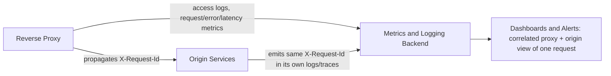

## 15. Failure Scenarios

- **Bad configuration push to every instance at once.** Rolling out a
  broken routing rule or a syntax error simultaneously to the entire proxy
  fleet is one of the most common full-outage causes; mitigated by
  canary-rolling config changes and validating configuration syntax before
  deployment.
- **Origin connection pool exhaustion.** If every origin connection is
  slow to respond (a downstream dependency degrading) and the proxy's
  connection pool to that origin is capped, new requests queue or fail even
  though the proxy itself is healthy — this looks like a proxy outage from
  outside but is actually an origin-side degradation surfacing at the
  proxy layer.
- **TLS certificate expiry.** An expired certificate at the reverse proxy
  breaks every client's connection simultaneously, regardless of how
  healthy every origin behind it is — a frequent, entirely preventable
  outage class, best mitigated with automated renewal and expiry alerting
  well before the deadline.
- **Reverse proxy tier itself becomes the bottleneck.** If the proxy tier
  is under-provisioned relative to origin capacity, origins sit idle while
  clients experience timeouts at the proxy — a reminder that the proxy
  tier needs its own capacity planning, not an assumption that it is
  infinitely scalable overhead.
- **Cascading retries across a sidecar mesh (Section 4.7).** Aggressive
  retry policy configured uniformly across many sidecars can amplify a
  single struggling downstream service's load during an incident, turning
  a partial degradation into a full outage — this is why per-route retry
  budgets and circuit-breaking are essential companions to any mesh-wide
  retry policy.

## 16. Testing

Reverse proxy configuration should be tested like any other production
artifact: syntax/lint validation in CI (most proxies support a
config-check/dry-run mode) before deployment; route-matching tests that
assert specific request shapes land on the expected upstream (host/path
combinations, Section 4.9); header-rewrite assertions verifying security
headers are present and internal headers are absent on real responses;
failover tests that kill an origin instance and confirm the load-balancing
and health-check policy routes around it within the expected window; and
TLS configuration scans (verifying supported protocol versions and cipher
suites match policy) run on a schedule against the live public endpoint,
not only at deployment time.

## 17. Common Mistakes

- Treating "reverse proxy" and "load balancer" as always-separate
  infrastructure when they are frequently the same process (Section 4.2),
  leading to redundant tooling or misleading architecture diagrams.
- Forwarding or trusting `X-Forwarded-For` incorrectly, breaking
  origin-side IP-based logic and/or creating a spoofing vector (Section
  4.4, Section 13).
- Leaving a "temporary" direct route to an origin open after debugging
  (Section 4.8), silently defeating the security-boundary invariant.
- Letting rewrite/header rules accumulate into unreviewable configuration
  sprawl that effectively encodes untested business logic at the proxy
  layer (Section 4.4).
- Choosing a static-config proxy for a highly dynamic, autoscaling
  workload (or vice versa), fighting the tool's design assumption instead
  of matching technology to deployment shape (Section 4.10).
- Under-provisioning the proxy tier's own capacity, assuming it is
  "just a pass-through" with no real resource cost (Section 12, Section 15).

## 18. Best Practices

- Enforce the "no direct route to origin" invariant at the network layer,
  not only by convention (Section 4.8, Section 13).
- Externalize or eliminate proxy-instance state so any instance can serve
  any request (Section 8, Section 12).
- Automate configuration deployment with validation and canary rollout,
  never hand-edit a running instance's configuration (Section 6, Section
  15).
- Propagate a request-correlation ID from the proxy through every origin
  it touches (Section 14).
- Choose the proxy technology based on the workload's configuration
  change-rate and traffic shape (Section 4.10), not familiarity alone.
- Keep the algorithmic depth of load balancing itself in its owning
  chapter's hands — reference, don't duplicate (Section 4.11).

## 19. Anti-Patterns

- **Snowflake configuration**: hand-tuned, undocumented rules on one proxy
  instance that are never reproduced elsewhere, breaking the moment that
  instance is replaced.
- **Shadow direct-access path**: a "just for debugging" route to an origin
  left open indefinitely (Section 4.8, Section 17).
- **Rewrite-rule business logic**: encoding meaningful application behavior
  entirely inside proxy rewrite rules rather than the origin application,
  making it invisible to code review and application-level tests (Section
  4.4, Section 17).
- **Mesh-wide retry amplification**: uniform, aggressive retry policy
  applied fleet-wide without circuit-breaking, turning a single dependency
  hiccup into a cascading outage (Section 4.7, Section 15).
- **Gateway-for-everything**: adopting a full API Gateway or service mesh
  purely for basic reverse-proxy capability an existing simpler tool
  already provides (Section 4.6, Section 17).

## 20. Trade-off Analysis

| Decision | Option A | Option B | Key trade-off |
|---|---|---|---|
| Where to terminate TLS | At the reverse proxy (Section 4.3) | At every origin | Centralized cert management and offloaded CPU vs. encryption of the internal segment |
| Configuration model | Static file (nginx/HAProxy) | Dynamic API-driven (Envoy/Traefik) | Operational simplicity and maturity vs. fit for fast-changing, autoscaling fleets |
| Proxy topology | Central edge reverse proxy only | Add per-service sidecars (Section 4.7) | Simpler operations vs. uniform east-west policy at the cost of a proxy instance per service |
| API-facing layer | Plain reverse proxy | Full API Gateway (Section 4.6) | Lower operational overhead vs. consumer-aware policy (quotas, key management) |
| Caching location | At the reverse proxy | At a CDN edge (see [CDN](CH09_CDN.md)) | Proximity to a small origin fleet vs. proximity to globally distributed clients |

## 21. Comparison Table

| Technology | Primary design assumption | Configuration model | Typical sweet spot |
|---|---|---|---|
| nginx | General-purpose web server extended to reverse proxy | Static file, reload on change | Traditional web-facing deployments, moderate rule complexity |
| HAProxy | Purpose-built L4/L7 load balancer | Static file, reload on change | Extremely high-throughput, latency-sensitive balancing tiers |
| Envoy | Sidecar-first, dynamically configured | Live API (xDS), no reload needed | Service mesh sidecars, fast-changing microservice fleets |
| Traefik | Cloud-native, orchestrator-aware | Auto-derived from orchestrator/service-discovery API | Containerized environments wanting zero manual proxy config |

## 22. Real-World Case Study

A mid-size e-commerce platform began with a monolithic application served
directly from a small pool of servers, each terminating its own TLS
certificate — already a violation of the "never expose origins directly"
principle, though the team did not initially frame it that way. Two
incidents forced the change: a certificate on one server silently expired
while the others were renewed correctly, causing intermittent client
errors that took hours to diagnose because "TLS is fine" checks against
the other servers passed; and a targeted scraping bot, hitting servers
directly by IP address (harvested from old DNS records), bypassed the
rate limiting the team believed they had because that rate limiting lived
in application code that only some server images actually ran. The fix was
exactly this chapter's Section 4.8 pattern: an nginx reverse-proxy tier was
introduced as the sole public entry point, origins were moved to a private
subnet with no direct internet route, TLS was centralized at the proxy with
automated renewal, and rate limiting moved to the proxy layer uniformly.
As the platform later split the monolith into checkout, catalog, and user
services, the same reverse-proxy tier absorbed the transition using
path-based routing (Section 4.9) to send each path to its new service
incrementally, with zero changes required on the client side — the
strangler-fig pattern (Section 7) made possible specifically because the
reverse proxy had already decoupled the public contract from backend
topology years earlier.

## 23. Interview Questions

1. Explain the architectural difference between a forward proxy and a
   reverse proxy — not just "traffic direction," but whose interest each
   represents and why that changes the trust model.
2. Why is load balancing considered a subset of what a reverse proxy does,
   rather than a separate category of infrastructure?
3. Walk through what "TLS termination" means and the trade-off involved in
   leaving the proxy-to-origin segment unencrypted versus re-encrypting it.
4. What problem does the sidecar proxy pattern solve that a single,
   centralized reverse proxy does not solve well for microservice
   architectures?
5. Why is "never expose origin servers directly" treated as a
   network-level invariant rather than just an operational guideline?
6. Compare nginx, HAProxy, Envoy, and Traefik — what deployment
   characteristic should drive the choice between them?
7. What is the difference between path-based and host-based routing, and
   why must path-based rules apply after TLS termination?
8. What is the architectural relationship between a reverse proxy and an
   API Gateway?
9. Describe a failure mode where a reverse proxy's health-and-availability
   looks fine, but requests are still failing.
10. Why does `X-Forwarded-For` need to be handled carefully at the
    outermost reverse proxy hop specifically?

## 24. Hands-on Exercises

1. Deploy an nginx reverse proxy in front of two simple backend HTTP
   servers on different ports; configure path-based routing and verify
   with `curl` that each path reaches the correct backend.
2. Extend the exercise above to terminate TLS with a self-signed
   certificate, and confirm (with a packet capture or `openssl s_client`)
   that the connection from proxy to backend is unencrypted while
   client-to-proxy is not.
3. Add the header-rewrite rule set from Section 10.3 and verify with
   browser developer tools that security headers are present and the
   backend's framework-identifying header is absent in the client-facing
   response.
4. Configure a basic Envoy static configuration (adapt Section 10.2)
   fronting a single local service, and observe Envoy's admin interface
   metrics for the requests you send it.
5. Deliberately misconfigure a path-matching rule ordering issue (Section
   4.9's common failure mode) and observe the resulting misrouted traffic,
   then fix the ordering.

## 25. Design Exercises

1. Design the reverse-proxy layer for a system migrating a monolith to
   three microservices incrementally, using path-based routing to move
   one route at a time with zero client-visible change (Section 22).
2. Design the reverse-proxy and network topology for a payments system
   that must guarantee origin servers are never directly reachable from
   the internet, including how you would verify (not just configure) that
   invariant.
3. Given an autoscaling microservices fleet on Kubernetes with frequent
   canary deployments, justify a choice between a static-config proxy and
   a dynamically configured one (Section 4.10), and sketch the resulting
   architecture.
4. Design where TLS should terminate (edge only vs. edge-plus-mTLS to each
   service) for a multi-tenant SaaS platform, and justify the trade-off
   given a stated compliance requirement for encryption-in-transit
   everywhere.

## 26. Architecture Review Questions

1. Is there any network path by which a client could reach an origin
   server without passing through the reverse proxy? How is that verified,
   not just configured?
2. Where does TLS terminate, and is the trust assumption behind that
   choice (Section 4.3) still valid given the current network topology?
3. Are cross-cutting concerns (compression, security headers, rate
   limiting) implemented once at the proxy layer, or duplicated
   inconsistently across origin services?
4. Does the chosen reverse-proxy technology's configuration model
   (Section 4.10) match how frequently this system's backend topology
   actually changes?
5. If this system uses a sidecar mesh, is retry/timeout policy configured
   with circuit-breaking to prevent cascading amplification (Section 15,
   Section 19)?
6. Is `X-Forwarded-For` (or equivalent) handled correctly and only trusted
   from the outermost, network-verified hop?

## 27. Summary

A reverse proxy is a server acting on behalf of the origin, sitting
between clients and one or more backend servers so the client only ever
sees a stable, public-facing identity while the real topology behind it
can scale, fail over, and evolve freely. That single positional
advantage — seeing every request and response before an origin does — is
the mechanical basis for everything else in this chapter: load balancing
(one policy among several, not a separate category of infrastructure), TLS
termination, request/response rewriting and header manipulation,
compression and caching, and the enforcement of "never expose origin
servers directly" as a hard security boundary rather than a convention.
Path-based and host-based routing let a single reverse-proxy fleet safely
front many services and domains, and are the mechanism behind incremental
monolith-to-microservices migrations. The API Gateway and the service-mesh
sidecar are not new inventions — they are the same reverse-proxy mechanism
with, respectively, application/consumer awareness and a per-instance,
dynamically configured deployment shape layered on top, and recognizing
that relationship is what lets an architect reason about either from first
principles. Finally, nginx, HAProxy, Envoy, and Traefik solve overlapping
problems with different core assumptions about configuration change rate
and deployment environment — choosing among them is a matter of matching
that assumption to the workload, not a matter of raw feature comparison.
The full depth of load-balancing algorithms and health-check mechanics
belongs to [CH10 — Load Balancer](CH10_Load_Balancer.md); the full depth of
API Gateway product architecture belongs to Part 08; and the full depth of
service-mesh control-plane architecture is deferred to a future dedicated
chapter — this chapter's job was to teach the reverse-proxy mechanism all
three are built on.
