# Chapter 12: NAT (Network Address Translation)

## 1. Introduction

NAT (Network Address Translation) is the mechanism that rewrites IP
(Internet Protocol) addresses and port numbers in packet headers as traffic
crosses a network boundary, most commonly between a private address range
and the public internet. Every home router, every corporate firewall, and
every cloud VPC (Virtual Private Cloud) private subnet relies on it: it is
the single most-deployed piece of network middleware in existence, and yet
most engineers interact with it only as an invisible, "it just works" layer
until something breaks — a peer-to-peer game connection fails, a VoIP
(Voice over IP) call has one-way audio, or a security review incorrectly
assumes NAT is providing a firewall's protection.

For a Solution Architect, NAT sits at the intersection of three concerns
that this chapter treats as first-class: **address-space economics** (why
NAT exists at all — IPv4 (Internet Protocol version 4) scarcity), **reachability
architecture** (what NAT breaks about the internet's original design, and how
peer-to-peer/real-time systems work around it), and **cloud infrastructure
cost/availability trade-offs** (why a managed NAT Gateway is simultaneously
the easiest way to give a private subnet outbound internet access and a
potential architectural bottleneck if you don't design around it).

This chapter assumes you already understand IPv4/IPv6 addressing, CIDR
(Classless Inter-Domain Routing) notation, and TCP (Transmission Control
Protocol)/UDP (User Datagram Protocol) sockets — all fully taught in
[TCP/IP](CH03_TCPIP.md). This chapter does not re-derive those fundamentals;
where they matter, they are recapped in one or two sentences with a link
back to that chapter's fuller treatment.

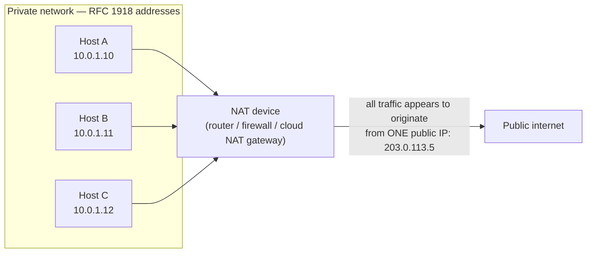

## 2. Historical Evolution

- **1981 — IPv4 is standardized** (RFC 791) with a 32-bit address space,
  assumed at the time to be functionally inexhaustible. This is the
  foundational fact NAT exists to work around; the full exhaustion timeline
  and IANA (Internet Assigned Numbers Authority) allocation history is owned
  by [TCP/IP Section 4.2](CH03_TCPIP.md#42-ipv4-exhaustion-and-why-it-forced-an-architectural-response)
  — recapped, not re-derived, here.
- **1994 — RFC 1597** (later superseded by **RFC 1918**, 1996) formally
  reserves three private address blocks (`10.0.0.0/8`, `172.16.0.0/12`,
  `192.168.0.0/16`) that are guaranteed never to be globally routed, giving
  organizations an internal addressing scheme that doesn't consume public
  IPv4 space.
- **1994 — RFC 1631** introduces NAT itself, originally pitched as a
  *short-term* solution to IPv4 exhaustion while the transition to a
  (then-unnamed) larger address space happened. The RFC's own language
  explicitly frames NAT as a stopgap, not a permanent architecture — a
  framing many production networks have since quietly abandoned in
  practice.
- **1996-2001 — PAT (Port Address Translation)**, often called "NAT
  overload," becomes the dominant deployment mode: instead of one internal
  host per public IP (the original 1:1 NAT model), thousands of internal
  hosts share a single public IP by also rewriting the source port. This is
  the mode that makes home and corporate NAT economically viable at scale.
- **1999-2003 — the peer-to-peer/VoIP traversal problem** becomes visible as
  NAT becomes ubiquitous: applications originally designed for a fully
  addressable internet (direct host-to-host connections) stop working
  through NAT's rewritten addresses. The IETF (Internet Engineering Task
  Force) responds with **STUN** (RFC 3489, 2003; revised RFC 5389, 2008) and
  later **TURN** and **ICE** (both finalized around 2010) as traversal
  techniques — covered in full in section 4.6.
- **1998 — IPv6 is standardized** (RFC 2460) as the actual architectural
  fix for address exhaustion, explicitly designed with *no NAT requirement*
  because its 128-bit space removes the scarcity that motivated NAT in the
  first place. In practice, NAT-equivalents for IPv6 (NAT66, and
  large-scale CGNAT — Carrier-Grade NAT — for IPv4) exist anyway, for
  reasons unrelated to address scarcity — covered in section 4.9.
- **2010s — cloud NAT Gateway services** (AWS NAT Gateway launched 2015,
  Azure NAT Gateway 2021, GCP Cloud NAT 2018) turn NAT from a
  self-managed router/appliance concern into a managed, billed-per-hour-
  and-per-GB cloud primitive — the form in which most architects today
  actually interact with NAT.

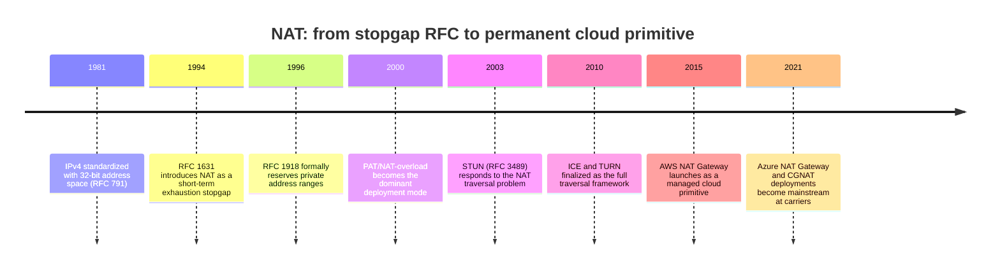

## 3. Why It Exists

NAT exists to solve one narrow, specific problem: **there are far more
devices that need internet access than there are public IPv4 addresses to
give them**. The exhaustion math itself (roughly 4.3 billion IPv4 addresses
against a world with tens of billions of connected devices) is recapped
from, and fully derived in,
[TCP/IP Section 4.2](CH03_TCPIP.md#42-ipv4-exhaustion-and-why-it-forced-an-architectural-response).
NAT's specific answer to that problem is **address sharing**: let many
devices behind one gateway share a small number of public IP addresses (often
just one), by having the gateway rewrite packet headers on the way out and
remember how to rewrite the replies on the way back.

Three forces made NAT not just useful but nearly universal, faster than
IPv6 adoption could catch up:

1. **It requires no coordination.** An organization can deploy NAT unilaterally
   inside its own network boundary — no ISP (Internet Service Provider), no
   registry, no external party needs to agree to anything. IPv6 migration,
   by contrast, requires the entire path (client OS, application, ISP,
   destination server) to support it.
2. **It is a security-adjacent side benefit, even though it isn't a
   security control.** Because NAT only creates translation-table entries
   for connections initiated from inside the private network, unsolicited
   inbound packets from the internet have no matching entry and get
   dropped by default. This *looks* like a firewall to a casual observer —
   an architectural misconception this chapter deliberately corrects in
   section 4.8.
3. **It buys time without forcing anyone to migrate.** NAT let the
   IPv4 internet keep growing for two more decades past the point address
   exhaustion "should" have stopped it, at the cost of breaking direct
   host-to-host reachability — a trade-off explored across sections 4 and 6.

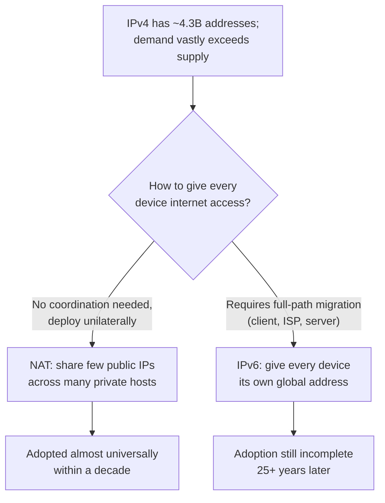

## 4. Core Concepts

### 4.1 Private address space (RFC 1918) — a one-paragraph recap

RFC 1918 reserves three IPv4 ranges that are never globally routed:
`10.0.0.0/8` (16.7M addresses), `172.16.0.0/12` (1M addresses), and
`192.168.0.0/16` (65,536 addresses). Every VPC CIDR block, every home
router's LAN (Local Area Network), and every corporate internal network is
built from one of these ranges precisely because they're guaranteed
collision-free with the public internet — meaning a private network can use
them freely without ever needing to register or coordinate with anyone.
CIDR mechanics themselves (prefix notation, subnetting, route summarization)
are fully taught in
[TCP/IP Section 4.3](CH03_TCPIP.md#43-cidr-and-subnetting-as-an-address-space-allocation-architecture)
— recapped, not re-taught, here. What matters for this chapter is the
*consequence*: because these addresses aren't globally routable, a host
using one **cannot** reach the internet directly — every packet it sends
outward needs its source address rewritten to something globally routable
before it leaves the private network. That rewriting is NAT's entire job.

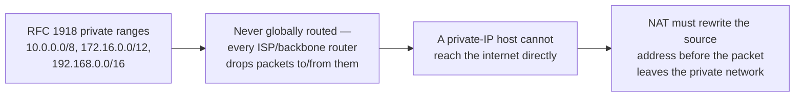

### 4.2 SNAT vs DNAT — the two directions of translation

NAT is not one operation; it is two, applied in opposite traffic directions,
and conflating them is the single most common source of confusion when
reading firewall/router configuration.

**SNAT (Source NAT)** rewrites the *source* address (and, under PAT, the
source port) of outbound packets — the case of a private host initiating a
connection to the public internet. The gateway remembers the mapping so
that when a reply arrives addressed to the public IP/port, it can rewrite
the destination back to the original private host and deliver it. This is
the "many internal hosts share one public IP for outbound traffic" case —
the overwhelmingly common one, and the one home/office internet connections
use by default.

**DNAT (Destination NAT)** rewrites the *destination* address (and often
port) of inbound packets — the case of exposing an internal service to the
outside world by publishing a public IP/port that maps to an internal
private IP/port. This is what "port forwarding" on a home router is, and
what a cloud load balancer or bastion host setup relies on when directing
external traffic to internal instances. DNAT is also how NAT can be
(mis)used as a crude load-balancing or traffic-redirection tool, since the
destination rewrite can point different inbound flows at different internal
targets based on rules.

The key distinction an architect must internalize: **SNAT is initiated
by the inside, protecting/enabling outbound reachability; DNAT is initiated
by the outside, exposing a specific internal target.** A given NAT gateway
device is very often configured to do both simultaneously — SNAT for
general outbound traffic from private hosts, DNAT for the small number of
services deliberately exposed inbound.

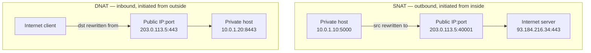

**Common failure mode**: engineers debugging "traffic isn't reaching my
internal service" often check only inbound (DNAT) rules and miss that the
*return* leg of an SNAT-translated connection also has to traverse the
gateway correctly — asymmetric routing (where the reply takes a different
path than the request) silently breaks NAT's connection tracking (section
4.3) because the gateway never sees the return packet to un-translate it.

### 4.3 The NAT translation table and connection tracking

NAT's entire trick depends on **state**: the gateway must remember, for
every active connection, the mapping between the private-side identity
(private IP, private port) and the public-side identity (public IP, public
port) it assigned, so it can correctly rewrite packets in *both*
directions. This memory structure is the **NAT translation table**
(on Linux, implemented by the kernel's **conntrack**, short for connection
tracking, subsystem).

Each table entry is keyed by a **5-tuple**: source IP, source port,
destination IP, destination port, and protocol (TCP/UDP/ICMP — Internet
Control Message Protocol). The 4-tuple/5-tuple concept itself (used to
uniquely identify a TCP connection) is fully explained in
[TCP/IP Section 4.4](CH03_TCPIP.md#44-ports-and-sockets--the-os-level-addressing-layer-above-ip);
NAT's twist is that it stores *two* versions of that tuple — the
private-side tuple and the public-side (translated) tuple — plus enough
protocol state to know when the entry is safe to expire.

Mechanically, when the first outbound packet of a new connection arrives at
the NAT gateway:

1. The gateway checks whether a translation entry already exists for this
   flow (it won't, for a new connection).
2. It allocates a public source port (for PAT — section 4.4) and creates a
   new table entry mapping `{private IP, private port} <-> {public IP,
   allocated public port}` for this destination.
3. It rewrites the packet's source IP/port to the public values and
   forwards it.
4. When a reply arrives from the destination addressed to the public
   IP/port, the gateway looks up the table entry, rewrites the destination
   back to the private IP/port, and delivers it to the original host.
5. The entry is kept alive as long as the connection is active (TCP:
   tracked via the connection state machine's SYN/ESTABLISHED/FIN/CLOSE
   transitions covered in
   [TCP/IP Section 5](CH03_TCPIP.md#5-internal-working); UDP: kept alive by
   a timeout, since UDP has no connection state to observe) and removed
   after an idle timeout or connection close, freeing the port for reuse.

```mermaid
sequenceDiagram
    participant Host as Private host (10.0.1.10:5000)
    participant Gateway as NAT gateway
    participant Server as Internet server (93.184.216.34:443)
    Host->>Gateway: SYN src=10.0.1.10:5000 dst=93.184.216.34:443
    Gateway->>Gateway: No table entry — allocate public port 40001, create entry
    Gateway->>Server: SYN src=203.0.113.5:40001 dst=93.184.216.34:443
    Server->>Gateway: SYN-ACK src=93.184.216.34:443 dst=203.0.113.5:40001
    Gateway->>Gateway: Lookup table entry for this 5-tuple — found
    Gateway->>Host: SYN-ACK src=93.184.216.34:443 dst=10.0.1.10:5000
    Host->>Gateway: ACK — connection established
    Gateway->>Server: ACK (translated)
    Note over Gateway: Table entry stays alive while connection<br/>is ESTABLISHED; removed after FIN/timeout
```

**Decision implication**: because the translation table is finite,
in-memory state on a single gateway, it is a **capacity resource**, not a
stateless pass-through — this is exactly why a cloud NAT Gateway has
documented connection and port limits (section 4.7, and the failure mode
in section 15), and why NAT gateways generally cannot be trivially
horizontally scaled behind a simple load balancer: two independent NAT
gateways with no shared state would each allocate translation entries
independently, and a connection's outbound and return legs must traverse
the *same* gateway instance to be un-translated correctly.

**Common failure mode**: assuming a NAT gateway is stateless and can
fail over instantly with zero connection loss. In reality, failing over
to a fresh gateway means the *entire translation table* is empty — every
in-flight connection loses its mapping and must be re-established. This is
central to the NAT Gateway HA (High Availability) discussion in section 4.7.

### 4.4 PAT (Port Address Translation) — how thousands of hosts share one IP

**PAT**, sometimes called NAPT (Network Address Port Translation) or "NAT
overload," is the mechanism that makes NAT economically transformative
rather than merely convenient: instead of requiring one public IP per
private host (1:1 NAT, the original, address-hungry model from RFC 1631),
PAT lets **many** private hosts share a **single** public IP by also
rewriting the source *port*, not just the address.

**Mechanism**: a TCP or UDP port number is a 16-bit field, giving roughly
65,536 possible values per IP address (in practice, a smaller usable
ephemeral range, and typically excluding well-known ports 0-1023). PAT
exploits this: the translation table's 5-tuple key already includes both
addresses and both ports, so as long as the *combination* of `{public IP,
public port}` is unique, the gateway can multiplex many internal
connections — even many connections *to the same destination* — through
one public IP, by giving each one a distinct public port. Ten thousand
internal hosts, each with several concurrent connections, can all share one
public IPv4 address, limited only by how many distinct public ports the
gateway can allocate and track simultaneously (in practice, capped well
below the theoretical 65,536 by the destination-specific port-reuse rule
below, and by the finite pool a cloud NAT Gateway allocates per public IP —
see section 4.7 and section 15's port-exhaustion failure scenario).

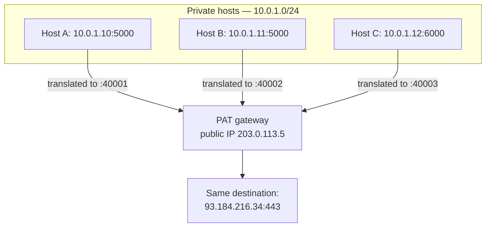

A subtlety that matters for architects reasoning about port capacity: a
single public port *can* be reused for connections to different
destinations simultaneously, because the full 5-tuple (including the
destination address/port) is what must be unique in the table, not the
public port in isolation. But the practical allocation strategy most NAT
implementations use is still to hand out one dedicated public port per
*new* connection until that port frees up — which is why the "ephemeral
port exhaustion toward a single busy destination" failure mode from
[TCP/IP Section 15](CH03_TCPIP.md#15-failure-scenarios) applies with even
sharper teeth behind PAT, where the finite port pool is shared across an
entire fleet of internal hosts rather than a single host's own ephemeral
range.

**Common failure mode**: sizing a fleet's expected outbound connection
volume against a single NAT gateway's public-port budget without accounting
for connection churn (short-lived connections that open and close rapidly
consume and release ports quickly, but under sustained high request rates
still exhaust the available pool faster than expected) — see section 15.

### 4.5 NAT types for peer-to-peer/real-time architecture

Not all NAT implementations behave identically when it comes to *which*
external hosts are allowed to reach an internal host back through an
existing translation entry — this behavioral variation is critical for any
architecture involving direct peer-to-peer connections (WebRTC — Web
Real-Time Communication, VoIP, multiplayer gaming), because it determines
whether two NAT-ed peers can establish a direct connection to each other at
all without a relay. The commonly used classification (from the original
STUN RFC 3489, later refined) defines four behaviors:

1. **Full-cone NAT**: once an internal host sends a packet out from a given
   `{private IP, private port}` and the gateway maps it to `{public IP,
   public port}`, **any** external host can send a packet back to that
   public IP/port and it will be forwarded to the internal host — the
   mapping doesn't care who the packet comes from. This is the most
   permissive type and the easiest for peer-to-peer traversal.
2. **Restricted-cone NAT**: the mapping is the same as full-cone, but the
   gateway will only forward an inbound packet if the internal host had
   previously sent a packet *to that external IP address* (any port on that
   IP is fine). This adds an "I've talked to this address before" check.
3. **Port-restricted-cone NAT**: the strictest cone variant — the gateway
   will only forward an inbound packet if the internal host had previously
   sent a packet to that **exact** external IP address *and port*.
4. **Symmetric NAT**: the most restrictive and traversal-hostile type — the
   gateway allocates a **different** public port for every distinct
   destination the internal host talks to, even from the same internal
   `{private IP, private port}`. This breaks a key assumption the other
   three types share (that the public-side mapping is stable across
   destinations) and is the type most likely to require a relay (TURN,
   section 4.6) rather than a direct connection, because a peer cannot
   predict, from the port it observed the host use to reach a STUN server,
   the port it would use to reach *that peer* directly.

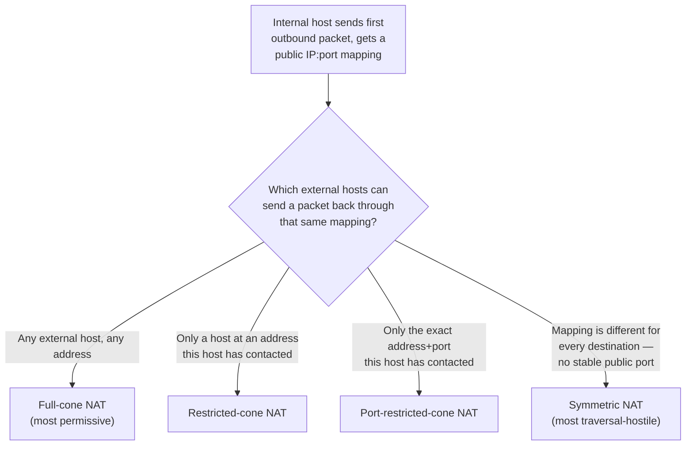

**Decision implication**: an architecture that depends on direct
peer-to-peer connectivity (a WebRTC video call, a VoIP call, a
peer-hosted multiplayer game session) cannot assume any particular NAT type
on either end of the connection — production traffic will include full-cone
home routers, port-restricted corporate firewalls, and symmetric
carrier-grade NAT (CGNAT, section 4.9) all mixed together. This is exactly
why STUN/TURN/ICE (section 4.6) exist as a *general* traversal strategy that
degrades gracefully (try direct connection first, fall back to a relay)
rather than an architecture that assumes cooperative, permissive NAT.

**Common failure mode**: a peer-to-peer feature works flawlessly in
development (both engineers on the same permissive office Wi-Fi, or one
behind full-cone home NAT) and then fails for a meaningful percentage of
real users behind symmetric NAT or CGNAT in production — a gap that only
shows up under real network diversity, not local testing.

### 4.6 STUN, TURN, and ICE — the NAT traversal solution

Given that direct peer-to-peer connectivity across NAT depends on unknown,
uncooperative middleboxes, the IETF standardized a layered solution rather
than one single protocol.

**STUN (Session Traversal Utilities for NAT)** solves the *discovery*
problem: a host behind NAT doesn't know its own public-facing IP address
and port, only its private one. A STUN server is a simple, stateless public
internet service that a client sends a "binding request" to; the server
replies with a "binding response" telling the client exactly what public
IP/port the request appeared to come from — i.e., what NAT mapping was
created for this request. This lets a client discover its own
externally-visible address for exactly as long as that NAT mapping stays
alive, and (by sending requests from multiple STUN servers, or observing
whether the mapping is consistent across multiple destinations) can even
infer which of the four NAT types from section 4.5 it's behind.

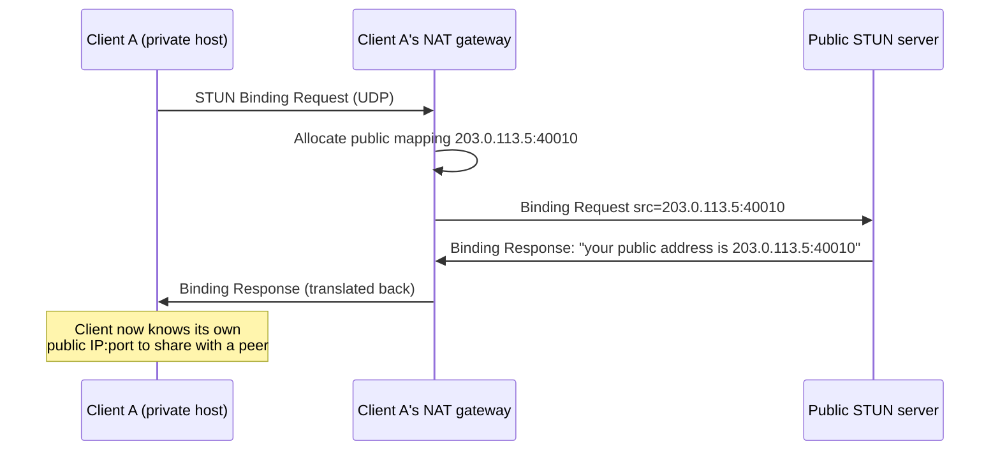

STUN alone is enough for full-cone, restricted-cone, and port-restricted-cone
NAT (sections 4.5): once both peers exchange their STUN-discovered public
addresses (typically via a signaling channel — the WebRTC/signaling
handshake itself is recapped further where it's used and owned in full by
[WebSockets](CH17_WebSockets.md) once that chapter is drafted), each can
send a packet directly to the other's public address and, because the
sending host already "knows about" that destination from the traversal
attempt, the return packet gets through the cone-type NAT's restriction
check.

STUN is **not** enough for symmetric NAT, because the public port a
symmetric NAT gateway allocates for talking to the STUN server is different
from the port it would allocate for talking to the actual peer — the
discovered address is simply the wrong one. This is where **TURN
(Traversal Using Relays around NAT)** comes in: a TURN server is a public
relay that both peers send *all* their traffic through, at the cost of
extra latency and the relay operator's bandwidth bill, when a direct
connection genuinely cannot be established.

**ICE (Interactive Connectivity Establishment)** is the orchestration layer
that ties both together: it has each peer gather every possible way it
might be reachable (its local private address, its STUN-discovered public
address, and a TURN relay address as a fallback — each called an ICE
"candidate"), exchanges the full candidate list with the other peer via the
signaling channel, and then systematically tries each candidate pair,
preferring the lowest-latency direct path and only falling back to the
TURN relay if every direct attempt fails.

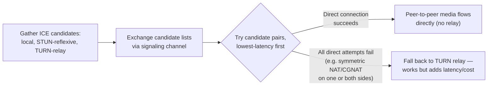

**Decision implication for architects**: budget TURN relay bandwidth costs
into any WebRTC/VoIP/peer-to-peer gaming architecture from day one, not as
an afterthought — industry data consistently shows a meaningful minority
of real-world connections (commonly cited in the 10-20% range, network-
dependent) cannot establish a direct path and require a TURN relay, and
that relay's bandwidth is proportional to session-minutes, not just
connection count.

### 4.7 NAT Gateway architecture in cloud VPCs

Cloud VPCs formalize the SNAT concept into a managed service usually called
a **NAT Gateway** (AWS, Azure) or **Cloud NAT** (GCP — Google Cloud
Platform). The architectural motivation is specific: a **private subnet**
(one with no direct route to an Internet Gateway) hosts instances that
should never be *directly* reachable from the internet — application
servers, databases, background workers — but those instances still need
**outbound-only** internet access for legitimate reasons: pulling OS
(Operating System) package updates, calling external APIs (Application
Programming Interfaces), sending telemetry to a SaaS (Software as a
Service) monitoring provider, and so on.

A NAT Gateway is deployed in a **public** subnet (one with a route to an
Internet Gateway) and is given its own public IP (typically an Elastic
IP/static public IP so it doesn't change). Private subnet route tables then
point their `0.0.0.0/0` (default route) at the NAT Gateway instead of at
the Internet Gateway directly. The result: instances in the private subnet
can *initiate* outbound connections (the NAT Gateway performs SNAT/PAT on
their behalf, exactly per the mechanism in sections 4.2-4.4), but nothing
on the internet can *initiate* a connection inbound to those instances,
because there is no DNAT rule and no route pointing inbound traffic at
them.

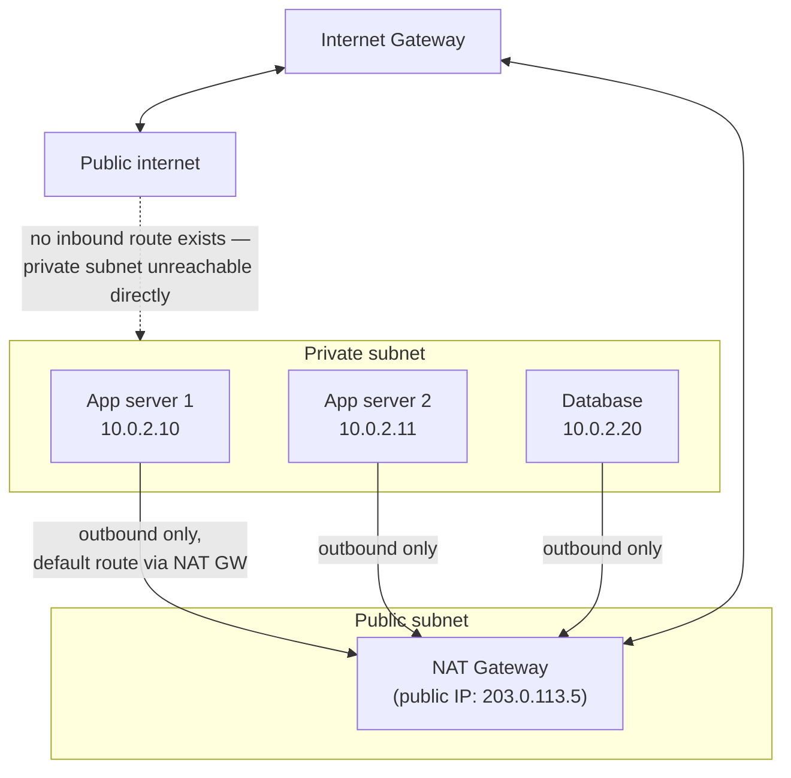

This is a deliberate, valuable **architectural cost, not just a security
side effect**: because a NAT Gateway is a managed, metered service (billed
per-hour of provisioning *and* per-GB of data processed in every major
cloud), it becomes a real line item at scale — a fleet pushing meaningful
egress bandwidth (log shipping, image/video processing pipelines pulling
external assets, ML — Machine Learning — model downloads) can find NAT
Gateway data-processing charges rivaling or exceeding compute costs, which
is why some architectures deliberately route specific high-volume,
low-risk traffic (e.g. to the cloud provider's own storage/container-
registry services) through a **VPC endpoint** (a private, non-NAT path
directly to that provider's service) instead of through the NAT Gateway,
specifically to avoid metered NAT processing charges for traffic that never
needed to leave the provider's network in the first place.

The second architectural concern is **high availability and blast radius**.
A NAT Gateway is provisioned per Availability Zone (AZ) by design in
AWS/Azure/GCP's recommended architecture — *not* because of a marketing
best-practice checkbox, but because of the exact statefulness constraint
from section 4.3: a NAT Gateway holds live translation-table state for
every in-flight connection, so if a single NAT Gateway serves multiple AZs
and that AZ (or the gateway itself) fails, every private-subnet instance
behind it in *every* AZ it served loses outbound connectivity simultaneously
and every in-flight connection is dropped — a single point of failure that
undermines the very reason the workload was spread across multiple AZs in
the first place.

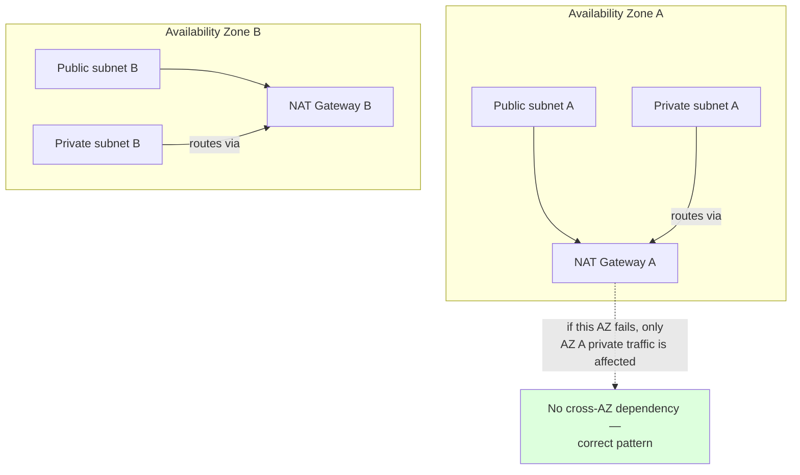

**Decision implication**: provision one NAT Gateway per AZ and route each
AZ's private subnets only through *that* AZ's NAT Gateway (never cross-AZ),
even though it costs more than sharing a single NAT Gateway across AZs —
the single-gateway "savings" architecture reintroduces exactly the
single-point-of-failure risk multi-AZ deployment exists to eliminate. For
workloads sensitive to a full connection-table reset, some architectures
run **self-managed NAT instances** (an EC2/VM acting as a router) instead
of the managed NAT Gateway specifically to get finer control over failover
behavior or cost at very high, predictable throughput — a trade-off
explored in section 20's Trade-off Analysis.

**Common failure mode**: pointing multiple AZs' private subnet route
tables at a single NAT Gateway to "save cost," not realizing this
recreates a cross-AZ single point of failure and also adds cross-AZ data
transfer charges on top of NAT Gateway processing charges — often *more*
expensive than one gateway per AZ, not less.

### 4.8 "NAT is not a security boundary" — a critical architecture misconception

This is one of the most consequential misunderstandings a Solution
Architect can carry into a security review, so it deserves being stated
precisely: **NAT's connection-tracking behavior incidentally blocks
unsolicited inbound traffic, but this is a side effect of how translation
tables work (section 4.3), not a deliberate, policy-driven security
control.**

The mechanism is real: because a NAT gateway only creates a translation
table entry for a connection *initiated from inside* the private network,
an inbound packet with no matching entry has nowhere to be translated to —
the gateway doesn't know which internal host it's "for," so it drops it.
From the outside, this looks exactly like a firewall blocking inbound
connections. But the resemblance is coincidental, and the difference
matters in three concrete ways:

1. **NAT has no concept of a security policy.** A firewall's job is to make
   a deliberate allow/deny decision based on rules — source, destination,
   port, protocol, even application-layer content in a next-generation
   firewall. NAT's "block" is simply "I have no translation entry for
   this," which means **any** technique that gets a translation entry
   created (a DNAT/port-forward rule, a misconfigured UPnP request from a
   compromised internal device, an application using a traversal
   technique like the one in section 4.6) bypasses it entirely — not
   because it defeated a policy, but because there was never a policy to
   defeat.
2. **NAT does nothing to traffic between hosts already on the same side of
   the NAT boundary.** Two compromised hosts inside the same private subnet
   can communicate freely with each other; NAT only ever operates at the
   boundary between private and public addressing, so it provides zero
   east-west (internal-to-internal) protection, which is most of what a
   real security architecture (network segmentation, security groups,
   micro-segmentation) has to address.
3. **NAT provides no visibility, logging, or inspection by design.** A
   firewall's value includes what it can observe and enforce about
   *legitimate* connections (deep packet inspection, intrusion detection,
   explicit deny rules for specific bad actors) — capabilities NAT's
   translation table was never built to provide.

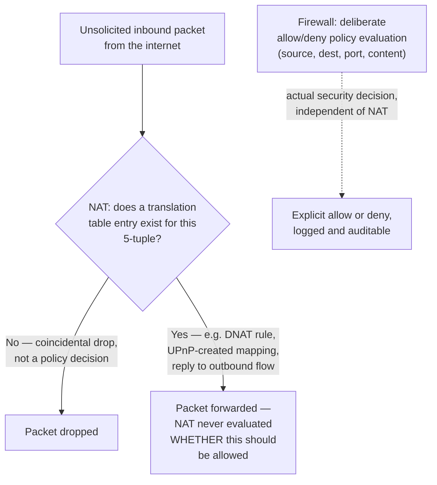

**Decision implication**: treat NAT and firewalling as two independent
layers that happen to often be deployed on the same physical/virtual
device — never substitute NAT's default-deny-by-absence-of-state behavior
for an explicit firewall policy, and never assume a private-subnet
instance behind a NAT Gateway is "safe" from a security-group or
network-ACL misconfiguration just because it also has no direct route from
the internet. The full teaching of firewall architecture — stateful vs.
stateless filtering, security groups vs. network ACLs, deliberate rule
design — is owned by the forthcoming
[Firewalls](CH13_Firewalls.md) chapter; this chapter's scope stops at
correcting the "NAT is a firewall" conflation.

**Common failure mode**: a security review approves a private-subnet
architecture as "not internet-facing" purely because instances sit behind
a NAT Gateway with no DNAT rule, without separately verifying that security
groups/NACLs (Network Access Control Lists) also deny inappropriate
traffic — leaving the design one misconfigured DNAT rule, one UPnP-enabled
device, or one lateral-movement path away from exposure that the architect
believed NAT was preventing.

### 4.9 NAT's friction with IPv6, and why NAT66/CGNAT exist anyway

IPv6 was explicitly designed to make NAT unnecessary: with roughly 340
undecillion addresses (recapped from
[TCP/IP Section 4.2](CH03_TCPIP.md#42-ipv4-exhaustion-and-why-it-forced-an-architectural-response)),
every device on Earth, many times over, can have its own globally unique,
directly routable address — the scarcity that motivated NAT simply doesn't
exist in IPv6's address space. The original IPv6 design philosophy
explicitly rejected NAT as an anti-pattern: restoring true end-to-end
connectivity was treated as a *feature*, not a gap to be patched around.

In practice, two forms of NAT persist even in an IPv6 world, for reasons
that have nothing to do with address scarcity:

1. **NAT66 (IPv6-to-IPv6 NAT)**: some organizations deploy NAT between
   IPv6 networks anyway, purely for the operational habits NAT enabled
   under IPv4 — renumbering independence (changing your ISP or internal
   addressing without changing every internal host's address, because only
   the NAT boundary's mapping changes) and topology obfuscation (not
   revealing internal network structure to the internet as a matter of
   policy, even though this is not a real security control per section
   4.8). This is explicitly discouraged by IPv6 design purists as
   reintroducing the exact end-to-end connectivity breakage IPv6 was built
   to eliminate, but it persists in enterprise networks that migrated their
   *operational NAT mindset* along with their IPv4 muscle memory, more than
   out of technical necessity.
2. **CGNAT (Carrier-Grade NAT)**: large-scale ISPs and mobile carriers,
   facing their own IPv4 exhaustion at massive subscriber scale, deploy NAT
   **twice** — once at the customer's home router (private LAN address to
   the ISP-assigned address) and again at the carrier's network edge (the
   ISP's own internally-shared address space, often the reserved
   `100.64.0.0/10` "shared address space" from RFC 6598, to a smaller pool
   of actual public IPv4 addresses shared across potentially thousands of
   subscribers). This is not a stopgap being phased out — it is a
   permanent fixture of mobile carrier networks, because IPv6-only rollout
   at the subscriber's device is necessary but not sufficient: the
   subscriber still needs IPv4 reachability for the large fraction of the
   internet that remains IPv4-only or dual-stack, and CGNAT is the
   carrier's answer to providing that reachability without allocating one
   public IPv4 address per subscriber.

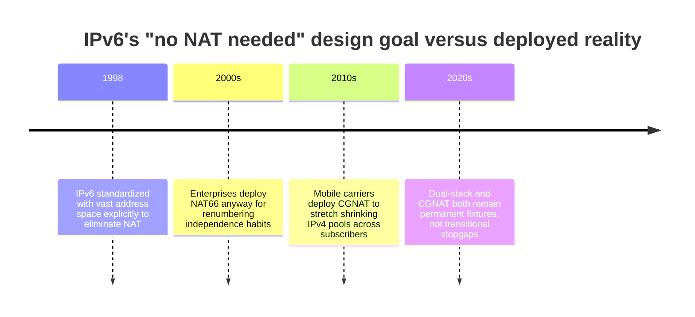

CGNAT has one specific architectural consequence that matters directly to
this chapter's peer-to-peer discussion (section 4.5-4.6): a subscriber
behind CGNAT is, from the internet's perspective, doubly NAT-ed, and
carriers frequently implement CGNAT's translation behavior as symmetric
NAT for scalability and security reasons — meaning STUN alone reliably
fails for CGNAT subscribers, and TURN relay fallback (section 4.6) is not
an edge case for this population but the expected, common path.

**Common failure mode**: assuming "the user's device supports IPv6, so
NAT traversal isn't our problem" — the majority of real-world NAT
traversal difficulty for consumer applications today comes from CGNAT on
IPv4, not from misunderstanding IPv6's original no-NAT design goal, and an
architecture must handle both.

## 5. Internal Working

At the packet level, NAT's rewrite happens in the IP and transport-layer
headers only — payload data is untouched (with narrow exceptions for
protocols that embed IP addresses in their payload, like legacy FTP's
active mode, which require an **Application Layer Gateway**, ALG, helper to
also rewrite the payload; this is a known source of NAT/protocol
incompatibility and one reason modern protocol design avoids embedding
addresses in payloads).

For an outbound TCP SYN packet, the gateway performs, in order:

1. Look up the packet's 5-tuple in the translation table.
2. If no entry exists (new connection), allocate a public source port not
   currently in use for this destination, and create a new bidirectional
   table entry.
3. Rewrite the IP header's source address field and the TCP header's
   source port field to the allocated public values.
4. Recompute the IP header checksum and the TCP header checksum (both are
   calculated over header fields that just changed, so they must be
   recalculated or the packet will be silently dropped by the receiving
   stack as corrupt) — this checksum recalculation is a real, measurable
   per-packet CPU cost at very high throughput, discussed further in
   section 11.
5. Forward the rewritten packet toward its destination via the normal IP
   routing table lookup (recapped from
   [TCP/IP Section 4.4](CH03_TCPIP.md#44-ports-and-sockets--the-os-level-addressing-layer-above-ip)).

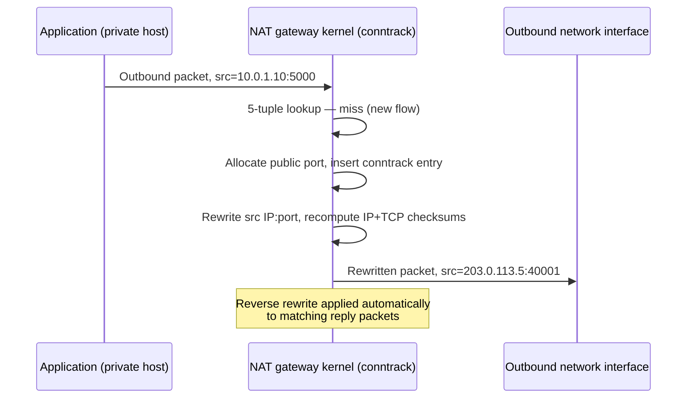

For the return path, the process runs in reverse using the same table
entry: an inbound packet's destination `{public IP, public port}` is looked
up, matched to the stored private-side mapping, the destination fields are
rewritten back to the private IP/port, checksums recomputed again, and the
packet delivered onto the private network's internal routing path. No new
allocation happens on the return path — it strictly reuses the entry the
outbound leg created, which is exactly why an asymmetric-routing
configuration (where the reply doesn't pass back through the same gateway)
breaks NAT: the gateway that would need to un-translate the reply never
sees it.

## 6. Design Principles

- **NAT is a boundary concern, not an endpoint concern.** Design NAT
  placement at network boundaries (private-to-public), never assume it
  applies within a single addressing domain.
- **State is a resource, budget for it.** Translation table capacity
  (concurrent connections, available public ports) is finite; architecture
  that generates many short-lived outbound connections at scale must be
  designed with this ceiling in mind, not discovered by hitting it in
  production (section 15).
- **Separate the "outbound-only" intent from its incidental security
  appearance.** Use NAT to achieve the outbound-only *reachability* goal;
  use an explicit firewall/security-group policy to achieve the *security*
  goal, even when both happen to be enforced by the same device (section
  4.8).
- **Design for AZ-local failure domains.** A NAT Gateway's statefulness
  means its failure domain should never span more availability zones than
  the compute it serves (section 4.7).
- **Assume traversal will be needed, don't discover it in production.** Any
  peer-to-peer, real-time architecture should assume a meaningful fraction
  of real users sit behind symmetric NAT or CGNAT and require STUN/TURN/ICE
  from the first design, not as a post-launch patch (sections 4.5-4.6, 4.9).

## 7. Architecture Patterns

Three recurring patterns for giving a private network outbound internet
access, in increasing order of operational control and decreasing order of
managed-service convenience:

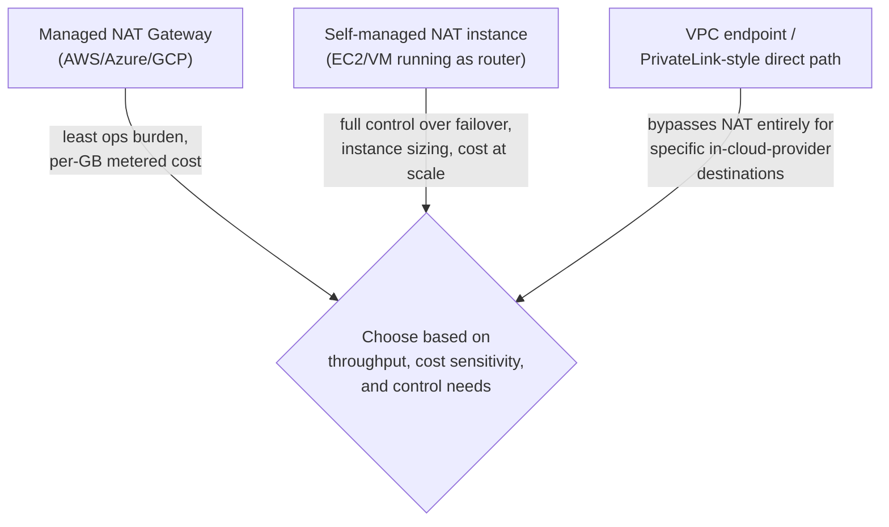

1. **Managed NAT Gateway**: the default choice for most workloads —
   provisioned per AZ, auto-scaled bandwidth up to a documented ceiling,
   billed per-hour plus per-GB processed. Best when operational simplicity
   outweighs the metered cost, which is true for the majority of
   moderate-throughput workloads.
2. **Self-managed NAT instance**: a compute instance configured to do IP
   forwarding and SNAT (the Terraform/iptables patterns in sections 9-10),
   used when an organization needs finer control — custom failover logic,
   very high sustained throughput where instance-hour pricing beats
   per-GB metered pricing, or a specific compliance requirement to run NAT
   on infrastructure the organization directly controls and can audit.
   The trade-off is the organization now owns patching, scaling, and HA for
   what used to be a managed service.
3. **VPC endpoint / private connectivity to specific cloud-provider
   services**: for destinations that are *within the same cloud provider*
   (object storage, container registries, managed databases), route
   directly via a private endpoint rather than out through the NAT Gateway
   to the public internet and back into the provider's own network — this
   avoids NAT Gateway processing charges for traffic that never
   architecturally needed to leave the provider's backbone, and often has
   better latency and no data-transfer egress fees either.

## 8. Production Architecture

A representative production layout for a three-tier web application:

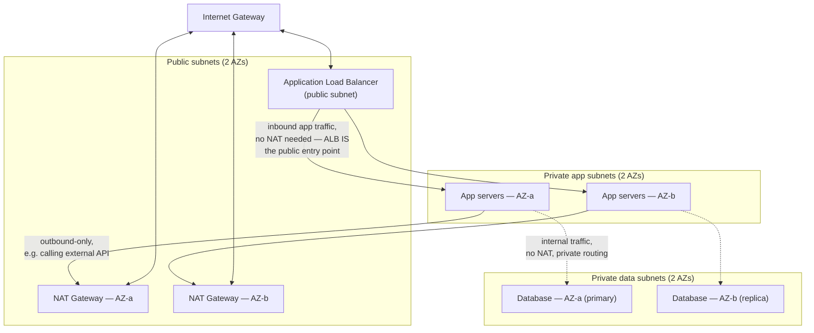

Note that the load balancer's own inbound path bypasses NAT entirely — the
ALB terminates public traffic directly in the public subnet and forwards it
to the private app tier over private routing; NAT is only in play for the
app tier's *outbound* calls to the public internet. This is a common point
of confusion: not all traffic to/from a private subnet touches the NAT
Gateway, only the traffic whose destination requires internet routing.

## 9. Implementation

Implementing NAT at the OS level (Linux, via `iptables`/`nftables` and the
kernel's netfilter framework) requires enabling IP forwarding and defining
translation rules in the `nat` table's `POSTROUTING` chain (for SNAT,
applied as the packet leaves) and `PREROUTING` chain (for DNAT, applied as
the packet arrives).

```bash
# Enable IP forwarding — required for any Linux box to act as a NAT gateway
echo 1 > /proc/sys/net/ipv4/ip_forward
# Persist across reboots
sed -i 's/^#net.ipv4.ip_forward=1/net.ipv4.ip_forward=1/' /etc/sysctl.conf
```

Implementing the cloud equivalent (a managed NAT Gateway) requires
declaring the gateway resource, an Elastic IP for it, and updating the
private subnet's route table to send default (`0.0.0.0/0`) traffic through
it — the full working example is in section 10.

## 10. Complete Code Examples

**Example 1 — SNAT (PAT/masquerade) with iptables**, the standard rule a
Linux box acting as a router applies to let an entire private subnet share
its single public-facing interface's address for outbound traffic:

```bash
#!/usr/bin/env bash
# Configure a Linux host as a NAT gateway for a private subnet.
# eth0 = public-facing interface, eth1 = private-subnet-facing interface.

# 1. Enable IP forwarding (kernel must route between interfaces)
sysctl -w net.ipv4.ip_forward=1

# 2. MASQUERADE performs SNAT dynamically using eth0's current IP —
#    preferred over a static SNAT rule when the public IP can change
#    (e.g. DHCP-assigned), since it re-resolves the address per packet.
iptables -t nat -A POSTROUTING -o eth0 -s 10.0.1.0/24 -j MASQUERADE

# 3. Allow forwarded traffic through the filter table (default policy
#    is often DROP on a hardened host — this explicitly permits it)
iptables -A FORWARD -i eth1 -o eth0 -s 10.0.1.0/24 -j ACCEPT
iptables -A FORWARD -i eth0 -o eth1 -m state --state ESTABLISHED,RELATED -j ACCEPT
```

**Example 2 — DNAT (port forwarding) with iptables**, publishing an
internal web server on the private network to the gateway's public IP:

```bash
#!/usr/bin/env bash
# Forward inbound HTTPS traffic on the gateway's public IP to an
# internal web server at 10.0.1.20:8443.

# 1. Rewrite the destination for inbound packets on eth0:443
iptables -t nat -A PREROUTING -i eth0 -p tcp --dport 443 \
    -j DNAT --to-destination 10.0.1.20:8443

# 2. Explicitly allow the now-forwarded traffic through the filter table
iptables -A FORWARD -p tcp -d 10.0.1.20 --dport 8443 \
    -m state --state NEW,ESTABLISHED,RELATED -j ACCEPT

# 3. Return traffic from the internal server must also be masqueraded so
#    it appears to come from the gateway's public IP, not the private one
iptables -t nat -A POSTROUTING -p tcp -d 10.0.1.20 --dport 8443 \
    -j SNAT --to-source 203.0.113.5
```

**Example 3 — AWS NAT Gateway in Terraform**, provisioning a per-AZ NAT
Gateway for a private subnet's outbound-only internet access:

```hcl
# One Elastic IP + NAT Gateway per Availability Zone — never share a
# single NAT Gateway across AZs (see section 4.7's HA discussion).
resource "aws_eip" "nat_az_a" {
  domain = "vpc"
  tags = { Name = "nat-gateway-eip-az-a" }
}

resource "aws_nat_gateway" "az_a" {
  allocation_id = aws_eip.nat_az_a.id
  subnet_id     = aws_subnet.public_az_a.id # NAT Gateway lives in the PUBLIC subnet
  tags          = { Name = "nat-gateway-az-a" }

  depends_on = [aws_internet_gateway.this]
}

# Private subnet's route table sends all internet-bound traffic to the
# AZ-local NAT Gateway, never to the Internet Gateway directly.
resource "aws_route_table" "private_az_a" {
  vpc_id = aws_vpc.this.id

  route {
    cidr_block     = "0.0.0.0/0"
    nat_gateway_id = aws_nat_gateway.az_a.id
  }

  tags = { Name = "private-rt-az-a" }
}

resource "aws_route_table_association" "private_az_a" {
  subnet_id      = aws_subnet.private_az_a.id
  route_table_id = aws_route_table.private_az_a.id
}
```

**Example 4 — STUN binding request/response trace**, a minimal Python
client illustrating the discovery mechanism from section 4.6 (using raw
UDP to show the actual wire-level exchange, rather than a full production
STUN library):

```python
import socket
import struct
import secrets

STUN_SERVER = ("stun.l.google.com", 19302)
BINDING_REQUEST = 0x0001
MAGIC_COOKIE = 0x2112A442

def build_binding_request() -> bytes:
    transaction_id = secrets.token_bytes(12)
    # STUN header: type(2) + length(2) + magic cookie(4) + transaction id(12)
    return struct.pack("!HHI12s", BINDING_REQUEST, 0, MAGIC_COOKIE, transaction_id)

def parse_binding_response(data: bytes) -> tuple[str, int]:
    msg_type, msg_len, _cookie, _txn_id = struct.unpack("!HHI12s", data[:20])
    body = data[20:20 + msg_len]
    offset = 0
    while offset < len(body):
        attr_type, attr_len = struct.unpack("!HH", body[offset:offset + 4])
        attr_value = body[offset + 4:offset + 4 + attr_len]
        if attr_type == 0x0020:  # XOR-MAPPED-ADDRESS
            _family, xport = struct.unpack("!BH", attr_value[1:4])
            port = xport ^ (MAGIC_COOKIE >> 16)
            xaddr = struct.unpack("!I", attr_value[4:8])[0]
            addr_int = xaddr ^ MAGIC_COOKIE
            addr = socket.inet_ntoa(struct.pack("!I", addr_int))
            return addr, port
        offset += 4 + attr_len + (attr_len % 4)
    raise ValueError("No XOR-MAPPED-ADDRESS attribute in response")

sock = socket.socket(socket.AF_INET, socket.SOCK_DGRAM)
sock.settimeout(3)
sock.sendto(build_binding_request(), STUN_SERVER)
response, _ = sock.recvfrom(2048)
public_ip, public_port = parse_binding_response(response)
print(f"This host's public-facing NAT mapping is: {public_ip}:{public_port}")
```

Representative wire-level trace of the exchange this code performs:

```text
--> Binding Request  (UDP, len 20)
    Type: 0x0001 (Binding Request)  Length: 0  Magic Cookie: 0x2112A442
    Transaction ID: 8f3a1c9e0b2d4f6a1e7c9b3d

<-- Binding Response (UDP, len 32)
    Type: 0x0101 (Binding Success Response)  Length: 12
    Transaction ID: 8f3a1c9e0b2d4f6a1e7c9b3d  (matches request)
    Attribute: XOR-MAPPED-ADDRESS
        Family: IPv4
        Port (XOR'd): 40001
        Address (XOR'd): 203.0.113.5
```

## 11. Performance

NAT's per-packet overhead is dominated by three costs: the translation
table lookup (a hash-table lookup on the 5-tuple, O(1) amortized but real
CPU cycles at line rate), the checksum recomputation forced by rewriting
header fields (section 5), and, at very high connection-churn rates, the
cost of allocating and reclaiming translation table entries. At typical
enterprise/cloud-application throughput, these costs are negligible
relative to network I/O time; they become material at very high packet
rates (hundreds of thousands of packets per second per gateway) where a
single-threaded or single-core-bound NAT implementation can become the
bottleneck before the network interface's raw bandwidth does — a reason
some high-throughput self-managed NAT instance deployments explicitly size
for CPU cores and enable receive-side scaling (distributing packet
processing across multiple CPU cores) rather than just provisioning a
larger network interface.

Cloud NAT Gateways abstract this scaling concern away up to their
documented bandwidth ceiling (commonly tens of Gbps per gateway,
provider-dependent), but that ceiling is a real, hard architectural limit —
workloads that expect to exceed it need to plan for either provisioning
additional gateways with traffic split across them (which requires
splitting the subnets/instances that route through each, since a single
subnet can only have one default route) or moving specific high-volume
destinations to VPC endpoints (section 7) that bypass the NAT Gateway
entirely.

## 12. Scalability

The scalability constraint that matters most is **public port budget**, not
raw throughput: a single public IP behind PAT has a hard ceiling on
concurrent translation-table entries (bounded by the 16-bit port space,
and further reduced in practice by cloud providers to leave headroom and
avoid port reuse collisions — commonly documented as roughly 55,000
simultaneous connections per NAT Gateway per destination-address pool in
AWS, for example). Scaling past this requires either additional public IP
addresses attached to the gateway (multiplying the available port budget)
or splitting traffic across multiple NAT Gateways, each serving a subset of
the private subnet's instances. Because this ceiling is per **destination**
(the 5-tuple includes the destination), a fleet making many connections to
a small number of hot destinations (e.g. a single downstream API or
database endpoint) exhausts its available ports for *that destination*
far faster than the aggregate connection count would suggest — the failure
mode explored in section 15.

## 13. Security

NAT's actual security-relevant properties, precisely scoped (expanding on
section 4.8's core distinction):

- **What NAT does provide**: unsolicited inbound connections have no
  matching translation entry and are dropped — a genuine, useful side
  effect that reduces the attack surface of unmanaged/default
  configurations, but only as a byproduct of connection-tracking state, not
  a policy engine.
- **What NAT does not provide**: any inspection of allowed traffic content,
  any protection against outbound-initiated attacks (a compromised internal
  host reaching out to a command-and-control server is not impeded by NAT
  at all, since that's an outbound connection NAT is specifically designed
  to allow), any east-west segmentation between internal hosts, or any
  audit trail suitable for security investigation (translation table
  entries are ephemeral operational state, not a security log).
- **A real attack surface NAT introduces**: NAT hairpinning/loopback
  (a private host reaching another private host via the gateway's public
  IP) and ALG (Application Layer Gateway) helper modules that rewrite
  payload data for legacy protocols are both additional parsing logic
  running on the gateway, and additional parsing logic is additional attack
  surface — a case for disabling ALG helpers for protocols the network
  doesn't actually need.
- **CGNAT's specific security wrinkle**: because many subscribers share a
  public IP under CGNAT (section 4.9), IP-based reputation/rate-limiting/
  blocklisting systems can incorrectly penalize an entire pool of
  unrelated subscribers for one bad actor's behavior — an architectural
  consideration for any system doing IP-based abuse detection at internet
  scale.

## 14. Observability

Operationally relevant NAT metrics to monitor (particularly for a managed
cloud NAT Gateway, where these are typically exposed via the cloud
provider's monitoring service):

- **Connection/port allocation utilization** — percentage of the available
  public-port budget currently in use per destination; the single most
  actionable leading indicator of the port-exhaustion failure mode (section
  15).
- **Packets/bytes dropped due to port allocation errors** — a direct signal
  that the gateway rejected new outbound connections because no port was
  available; this metric going non-zero is the clearest production alert
  condition for NAT capacity issues.
- **Bandwidth utilization against the gateway's throughput ceiling** —
  guards against the performance bottleneck from section 11.
- **Translation table size/connection count** (for self-managed NAT via
  `conntrack -L` or `conntrack -S` on Linux) — direct visibility into the
  in-memory state size discussed in sections 4.3 and 12.

```bash
# Inspect current Linux conntrack table size and stats
conntrack -C          # current number of tracked connections
conntrack -S          # per-CPU stats, including insert failures (drops)
```

## 15. Failure Scenarios

The canonical NAT failure scenario an architect will eventually diagnose:
a fleet of application servers behind a single NAT Gateway all calling the
same downstream API endpoint experiences a burst of new outbound
connection failures under load — not because the downstream API is down,
but because the NAT Gateway has exhausted its available public-port pool
for that specific destination 5-tuple.

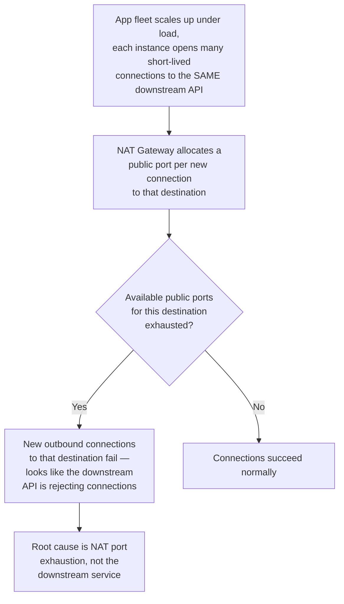

This connects directly to the ephemeral-port-exhaustion failure mode
already taught in
[TCP/IP Section 15](CH03_TCPIP.md#15-failure-scenarios) — the mechanism is
the same finite-port-per-destination constraint, but manifesting at the
shared NAT Gateway level across an entire fleet rather than on a single
host's own ephemeral port range, which is why it can surface at much lower
per-host connection rates than a single host would need to trigger its own
local port exhaustion. Mitigations mirror the ones already taught there
(connection pooling/reuse instead of opening a new connection per request,
`SO_REUSEADDR`-style socket reuse where applicable) plus NAT-specific
options: provisioning additional public IP addresses on the NAT Gateway to
multiply the available port budget, or splitting the hot-destination
traffic across multiple NAT Gateways.

A second common failure: a NAT Gateway failover or AZ incident silently
drops every in-flight connection routed through it, because (section 4.3)
the entire translation table state is lost with the gateway instance —
applications that don't implement connection retry with backoff experience
this as a sudden, fleet-wide burst of connection errors rather than a
graceful degradation.

## 16. Testing

Validating NAT behavior before it becomes a production incident:

- **Port exhaustion load testing**: drive synthetic connection load from a
  test fleet toward a single destination through a staging NAT Gateway and
  observe the port-allocation-error metric (section 14) to find the actual
  ceiling before a real traffic spike finds it for you.
- **NAT type detection for peer-to-peer features**: run a STUN-based NAT
  type probe (send binding requests from multiple local ports/servers and
  compare the reported public mappings) against representative network
  environments (home broadband, corporate Wi-Fi, mobile carrier/CGNAT) to
  validate the traversal fallback path (ICE/TURN) actually engages
  correctly rather than only ever being exercised in a permissive
  development network.
- **Failover testing**: deliberately fail a NAT Gateway (or self-managed
  NAT instance) in a staging environment and confirm the application layer
  has retry/backoff logic that tolerates the connection reset this causes,
  rather than discovering this gap during a real AZ incident.
- **Asymmetric routing checks**: verify that both directions of a
  connection's path traverse the same NAT device — a subtle
  misconfiguration (particularly in multi-path or SD-WAN, Software-Defined
  Wide Area Network, environments) that silently breaks return traffic.

## 17. Common Mistakes

- Sharing a single NAT Gateway across multiple Availability Zones to save
  cost, reintroducing the exact single-point-of-failure risk multi-AZ
  design is meant to eliminate (section 4.7).
- Treating "the private subnet has no route from the internet" as
  equivalent to "this workload has been security-reviewed," conflating
  NAT's incidental inbound-drop behavior with an actual firewall policy
  (section 4.8).
- Assuming a peer-to-peer/real-time feature that works in development will
  work in production without STUN/TURN/ICE, because development networks
  are usually more permissive (full-cone) than the symmetric NAT/CGNAT a
  meaningful fraction of real users sit behind (sections 4.5-4.6, 4.9).
- Not accounting for per-destination port exhaustion when a fleet scales
  up connections to a single hot downstream dependency (section 15).
- Assuming NAT Gateway failover is connection-preserving, when in fact the
  entire translation table state is lost on failover (section 4.3).
- Believing IPv6 adoption eliminates the need to think about NAT
  traversal, when CGNAT on the IPv4 side of a dual-stack path remains the
  dominant real-world traversal obstacle (section 4.9).

## 18. Best Practices

- Provision NAT Gateways per Availability Zone and never route a private
  subnet through a NAT Gateway outside its own AZ.
- Use VPC endpoints/PrivateLink-style private connectivity for in-cloud-
  provider destinations to reduce NAT Gateway cost and improve latency,
  reserving the NAT Gateway for genuine public-internet egress.
- Design any peer-to-peer/real-time feature around ICE's candidate-
  gathering and graceful TURN fallback from the first implementation, and
  budget TURN relay bandwidth cost as a standing operational expense, not
  an edge case.
- Monitor port-allocation-error and utilization metrics proactively (section
  14), with alerting thresholds well below the documented per-destination
  ceiling, not just aggregate bandwidth.
- Treat NAT and firewall policy as two independent architectural decisions,
  documented and reviewed separately, even when co-located on the same
  device.
- Design application-layer retry/backoff for outbound connection failures,
  since a NAT Gateway failover event will reset in-flight connections
  regardless of how it's provisioned.

## 19. Anti-Patterns

- **"NAT as a firewall" substitution** — relying on NAT's incidental
  inbound-drop behavior in place of an explicit, auditable firewall/
  security-group policy (section 4.8).
- **Single shared NAT Gateway across all AZs** — the cost-saving
  misconfiguration from section 4.7 that reintroduces a cross-AZ single
  point of failure.
- **Symmetric-NAT-blind peer-to-peer design** — building a direct-
  connection-only architecture with no TURN relay fallback, which silently
  fails for a meaningful minority of real users (sections 4.5-4.6).
- **Routing every destination through the NAT Gateway indiscriminately** —
  including traffic to the cloud provider's own services that could use a
  cheaper, lower-latency private VPC endpoint instead (section 7).
- **Assuming NAT66 provides security** — deploying IPv6-to-IPv6 NAT under
  the belief it meaningfully protects internal hosts, when it only
  reintroduces end-to-end connectivity friction without the deliberate
  policy enforcement a firewall provides (section 4.9).

## 20. Trade-off Analysis

| Decision | Favors managed NAT Gateway | Favors self-managed NAT instance |
|---|---|---|
| Operational overhead tolerance | Low — team wants a fully managed service | High — team is comfortable owning patching/HA |
| Cost profile at high sustained throughput | Per-GB metered can exceed instance-hour pricing at very high volume | Predictable instance-hour cost can be cheaper at sustained high throughput |
| Failover control | Provider-managed, opaque failover behavior | Full control over custom failover/health-check logic |
| Time to production | Minutes — a managed resource declaration | Longer — must build and validate the routing/iptables configuration |
| Compliance/audit requirements | Sufficient for most standard compliance frameworks | Preferred when an auditor requires direct infrastructure control/visibility |

| Decision | Favors direct STUN-only traversal | Favors always-available TURN relay |
|---|---|---|
| User network diversity | Low — controlled/enterprise network with mostly cone NAT | High — general consumer internet, including CGNAT |
| Cost sensitivity | Lower relay bandwidth cost if direct connections usually succeed | Must budget relay bandwidth as a standing cost regardless |
| Latency requirement | Direct connection when it works is lower latency | Relay adds latency but guarantees connectivity |
| Acceptable connection failure rate | Only acceptable if failed peer-to-peer connections aren't business-critical | Required when connectivity must succeed for (almost) all users |

## 21. Comparison Table

| NAT type | Inbound reachability rule | Peer-to-peer traversal difficulty |
|---|---|---|
| Full-cone | Any external host can reach the mapped port | Easiest — STUN alone is usually sufficient |
| Restricted-cone | Only hosts at a previously-contacted IP | Easy — STUN usually sufficient |
| Port-restricted-cone | Only hosts at a previously-contacted IP+port | Moderate — STUN usually sufficient with matching port exchange |
| Symmetric | Mapping differs per destination, unpredictable | Hardest — often requires TURN relay |

| NAT direction | Triggered by | Typical use case |
|---|---|---|
| SNAT (Source NAT) | Outbound connection from inside | Sharing one public IP for many private hosts' outbound traffic |
| DNAT (Destination NAT) | Inbound connection from outside | Exposing a specific internal service via port forwarding |

## 22. Real-World Case Study

A mid-size SaaS company's video-conferencing feature (WebRTC-based) worked
reliably in every internal QA environment but received a steady stream of
"can't connect to other participants" complaints from a specific customer
segment — corporate users on large enterprise networks. Investigation using
the NAT-type-detection technique from section 16 revealed the pattern:
those customers' corporate firewalls implemented symmetric NAT for
outbound UDP (a common enterprise security posture — unpredictable port
mapping makes many classes of UDP-based attacks and abuse harder), which
meant STUN-discovered addresses were never usable for a direct peer
connection, and the application's original implementation had no TURN
relay fallback at all — it had only ever been tested against home/office
networks with full-cone or restricted-cone behavior.

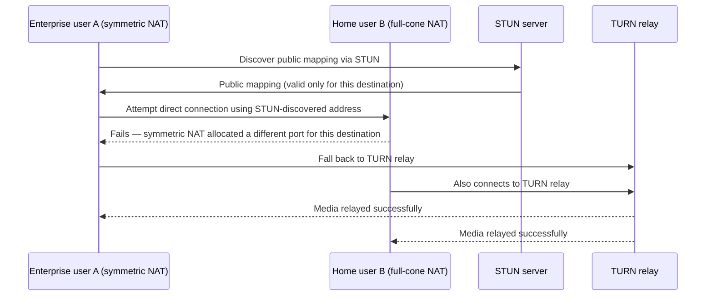

The fix was architectural, not a patch: implementing full ICE candidate
gathering with a properly provisioned TURN relay fleet, and explicitly
budgeting relay bandwidth cost into the product's unit economics rather
than treating TURN traffic as an unexpected expense — after the fix,
connection success rate for the affected segment rose to match the
general population, at the cost of a modeled, predictable increase in
relay infrastructure spend rather than an unplanned one discovered after
the complaints started.

## 23. Interview Questions

1. Explain the difference between SNAT and DNAT, and give a real
   architectural scenario for each.
2. Walk through what happens, packet by packet, when a private host opens
   a new TCP connection through a PAT-enabled NAT gateway.
3. Why is symmetric NAT harder to traverse than the three cone NAT types,
   and what does that mean architecturally for a peer-to-peer product?
4. Explain why "NAT is not a firewall" — what specifically can bypass NAT's
   incidental inbound-blocking behavior that a real firewall policy would
   catch?
5. Why does AWS/Azure/GCP recommend one NAT Gateway per Availability Zone
   instead of one shared across a region, given that this costs more?
6. What is the actual capacity ceiling on a NAT Gateway, and what specific
   traffic pattern is most likely to hit it first?
7. Why does CGNAT (Carrier-Grade NAT) still exist in a world where IPv6 was
   explicitly designed to make NAT unnecessary?
8. Describe the role each of STUN, TURN, and ICE plays, and explain why all
   three are needed rather than just one.

## 24. Hands-on Exercises

1. On a Linux VM (or two VMs in a lab network), configure one as a NAT
   gateway using the `iptables` rules from section 10, and verify that a
   private-side host can reach the internet while remaining unreachable
   from an external host attempting an unsolicited inbound connection.
2. Run the STUN client from section 10's Example 4 against a public STUN
   server from two different networks (e.g. your home network and a mobile
   hotspot) and compare the discovered public IP/port mappings to reason
   about what NAT type each network is likely using.
3. Deploy the Terraform NAT Gateway configuration from section 10 in a
   sandbox AWS account, then deliberately remove the private subnet's
   route to the NAT Gateway and confirm outbound connectivity fails,
   restoring it to confirm the fix.
4. Use `conntrack -L` on a Linux NAT gateway under synthetic load
   (generated with a simple script opening many short-lived connections)
   to observe the translation table growing and shrinking in real time.

## 25. Design Exercises

1. Design the NAT and subnet architecture for a three-tier application
   deployed across three Availability Zones, explicitly justifying your
   NAT Gateway placement and failure-domain boundaries.
2. Design the connectivity architecture for a WebRTC-based product
   expected to serve users on both symmetric NAT/CGNAT and permissive
   home networks, including where and how you'd provision and scale TURN
   relay capacity.
3. A cost review flags that NAT Gateway data-processing charges are the
   third-largest line item in the cloud bill. Design an approach to reduce
   this cost without compromising the private subnet's outbound-only
   security posture.
4. Design a monitoring and alerting strategy for NAT port exhaustion for a
   fleet expected to scale from hundreds to tens of thousands of instances
   over the next two years.

## 26. Architecture Review Questions

- Is each NAT Gateway scoped to a single Availability Zone, with no private
  subnet routed cross-AZ through another zone's gateway?
- Has the review separately verified an explicit firewall/security-group
  policy, rather than relying on NAT's incidental inbound-drop behavior as
  the security control?
- For any peer-to-peer/real-time feature, has TURN relay capacity been
  provisioned and its bandwidth cost modeled, not just STUN/ICE direct
  connectivity assumed?
- Has the design identified which destinations should route via a VPC
  endpoint instead of the NAT Gateway, to reduce cost and improve latency?
- Is there monitoring in place for per-destination port allocation
  utilization, with alert thresholds below the documented ceiling?
- Does the application layer implement retry/backoff for outbound
  connections, so a NAT Gateway failover event degrades gracefully rather
  than causing a fleet-wide error spike?

## 27. Summary

NAT (Network Address Translation) exists because IPv4's address space ran
out decades before IPv6's genuinely sufficient replacement could be fully
deployed — a stopgap, per its own founding RFC, that became permanent
production infrastructure. Its mechanics — SNAT and DNAT as two directions
of translation, PAT as the port-multiplexing trick that lets one public IP
serve thousands of private hosts, and the stateful translation table that
makes all of it possible — are the same whether implemented by a home
router's `iptables` rules or a cloud provider's managed NAT Gateway. That
statefulness has two direct architectural consequences a Solution Architect
must design around: cloud NAT Gateways need per-AZ placement to avoid
becoming a cross-zone single point of failure, and finite public-port
budgets create a real, monitorable capacity ceiling, especially against hot
downstream destinations. NAT's incidental inbound-blocking behavior is
often mistaken for a security control, but it is a side effect of
connection-tracking state, not a deliberate policy — real security
boundaries are the firewall/security-group layer covered in the forthcoming
[Firewalls](CH13_Firewalls.md) chapter. And because NAT breaks direct
host-to-host reachability, any peer-to-peer, real-time architecture
(WebRTC, VoIP, multiplayer gaming) must design for NAT traversal via
STUN/TURN/ICE from the outset, accounting for the reality that a
meaningful share of production traffic sits behind symmetric NAT or
carrier-grade NAT — the same address-scarcity-driven pattern that
motivated NAT in the first place, now recurring at the ISP/mobile-carrier
scale even in a world where IPv6 was explicitly designed to make NAT
unnecessary.
